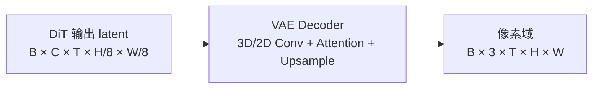

# VAE（多模态生成）

## Summary

多模态生成模型（HunyuanVideo、HunyuanImage-3.0、Wan2.2-I2V、Sana-Video）中的 VAE（Variational AutoEncoder）负责把 DiT 预测的 latent 还原为像素域图像/视频（Decoder），以及把原始像素压缩为低分辨率 latent（Encoder）。纯生成的输出阶段使用 Decoder；Wan2.2-I2V 等图像条件推理还需要 Encoder 编码输入图像。对于 720p/1080p 视频这类输入，Decoder 的 3D/2D 卷积极其吃显存与计算。

cann-recipes-infer 对 VAE 的主要优化方向有两条：
1. **空间并行（VAE patch parallel）**：把大尺寸 latent/pixel 张量在空间维度切成 patch，分配到多卡并行计算，辅以边界交换/补充保障卷积感受野与注意力的正确性，见 [vae-patch-parallel](../parallelism/vae_patch_parallel.md)。切分轴按模型而异：HunyuanImage-3.0 / Wan2.2-I2V 直接沿高度 H、宽度 W 切块，HunyuanVideo 的固定实现沿 latent 最后一维（宽度 W，`z.shape[-1]`）切分，并在两侧补 overlap。
2. **冗余计算与驻留优化**：HunyuanVideo 的 mask 缓存与取消 VAE offload；适用配置和来源性能见下文。

## Mechanism

### Decoder 角色

- **卷积感受野**：naive chunk 切分 → 边缘帧/行丢失邻居信息，生成结果出现**拼接缝**
- **注意力全局性**：VAE 内部若含 self-attention，K/V 必须全局 gather 才能正确计算
- **Upsample 边界**：上采样需要扩展边界后再裁剪，避免块间不连续

### Mask 缓存（HunyuanVideo）

VAE 内部需要重复构造的 mask（具体类型源未明示）在每帧都需重复构造，HunyuanVideo 用空间换时间将其缓存常驻内存，减少重复计算。

## Variants

- **HunyuanVideo VAE**：3D 卷积；VAE 并行沿宽度 W 切分并补充相邻块的 overlap（区别于 HunyuanImage-3.0/Wan2.2-I2V 的 H/W 二维切块）+ mask 缓存 + 虚拟内存取消 offload（见 [hunyuan-video](../models/hunyuan_video.md)）
- **HunyuanImage-3.0 VAE**：空间并行（vae_patch_parallel.py）+ CFG 并行搭配
- **Wan2.2-I2V VAE**：8 卡空间并行
- **Sana-Video 的边界**：已确认的 1×1 卷积、时序卷积和融合算子 patch 用于去噪网络；推理入口单独创建 VAE，不能将这些 patch 当作 VAE 优化。实现片段见 [Sana-Video](../models/sana_video.md)。

## Performance Characteristics

- 单独 VAE 在 HunyuanVideo baseline 1 卡场景耗时 133 s（端到端 3768 s，占 3.5%），但 VAE 并行+优化后可降至 12–40 s（speedup 3×–10×，见 [hunyuan-video](../models/hunyuan_video.md) Benchmark）
- 虚拟内存使能后可取消 VAE CPU-Offload，避免反复 Host↔Device 搬运

## Evidence

- [Sana-Video 卷积优化实现](https://gitcode.com/cann/cann-recipes-infer/blob/2f82d10467e6fe8dae81c97a2cdac78d733a6703/models/sana-video/patches/npu_patches.py)：patch 目标为 `diffusion.model.nets` 中的类，具体调用边界见 Sana-Video 卡。
- [Wan2.2-I2V 推理入口](https://gitcode.com/cann/cann-recipes-infer/blob/2f82d10467e6fe8dae81c97a2cdac78d733a6703/models/wan2.2-i2v/wan/image2video.py)：`generate` 在 DiT 前调用 `vae.encode`、在输出阶段调用 `vae.decode`，并为 Encoder/Decoder 配置并行。
- [HunyuanVideo VAE decode](https://gitcode.com/cann/cann-recipes-infer/blob/2f82d10467e6fe8dae81c97a2cdac78d733a6703/models/hunyuan-video/hyvideo/vae/vae_parallel.py)：按 `z.shape[-1]` 切宽度、补 overlap 后解码。

- [cann-recipes-infer](https://gitcode.com/cann/cann-recipes-infer/tree/2c45117d781ab9ab88dcb89a28ae30f5d2450399) — [`docs/models/hunyuan-video/hunyuan_video_optimization.md`](https://gitcode.com/cann/cann-recipes-infer/blob/2f82d10467e6fe8dae81c97a2cdac78d733a6703/docs/models/hunyuan-video/hunyuan_video_optimization.md) VAE并行 / VAE优化 / 取消VAE offload
- [cann-recipes-infer](https://gitcode.com/cann/cann-recipes-infer/tree/2c45117d781ab9ab88dcb89a28ae30f5d2450399) — [`docs/models/hunyuan-image-3.0/hunyuan_image_3_optimization.md`](https://gitcode.com/cann/cann-recipes-infer/blob/2f82d10467e6fe8dae81c97a2cdac78d733a6703/docs/models/hunyuan-image-3.0/hunyuan_image_3_optimization.md) VAE并行优化
- [cann-recipes-infer](https://gitcode.com/cann/cann-recipes-infer/tree/2c45117d781ab9ab88dcb89a28ae30f5d2450399) — [`docs/models/wan2.2-i2v/wan2.2-i2v_optimization.md`](https://gitcode.com/cann/cann-recipes-infer/blob/2f82d10467e6fe8dae81c97a2cdac78d733a6703/docs/models/wan2.2-i2v/wan2.2-i2v_optimization.md) 8卡VAE并行
- [cann-recipes-infer](https://gitcode.com/cann/cann-recipes-infer/tree/2c45117d781ab9ab88dcb89a28ae30f5d2450399) — [`docs/models/sana-video/SANA-Video_optimization.md`](https://gitcode.com/cann/cann-recipes-infer/blob/2f82d10467e6fe8dae81c97a2cdac78d733a6703/docs/models/sana-video/SANA-Video_optimization.md) 1×1 conv / 时序 conv

## Links

- [dit](dit.md)
- [vae-patch-parallel](../parallelism/vae_patch_parallel.md)
- [hunyuan-video](../models/hunyuan_video.md)
- [hunyuan-image-3](../models/hunyuan_image_3.md)
- [wan2.2-i2v](../models/wan2_2_i2v.md)
- [sana-video](../models/sana_video.md)
- [hunyuan3d](../../../spatial/concepts/models/hunyuan3d.md)（跨域·空间智能：Hunyuan3D geo_decoder VAE 几何解码与 DiT 一同入图）
- 跨域·具身：[agibot-arm-world-model](../../../embodied/concepts/world_models/agibot_arm_world_model.md)（AgiBot 世界模型 VAE）
- [mindspeed-mm](../../../training/concepts/frameworks/mindspeed_mm.md)（跨域·训练：MindSpeed-MM 扩散生成训练用 VAE 组件）
- [multimodal-dit-vae-train](../../../training/concepts/modules/multimodal_dit_vae_train.md)（训练侧 VAE：CausalConv3d 时间因果 + ContextParallelCausalVAE 长视频帧维 CP）