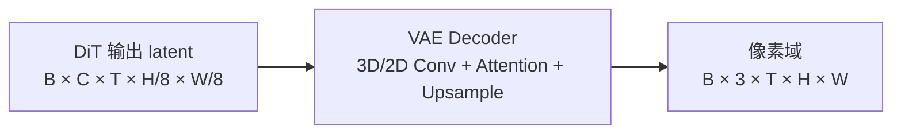

# VAE（多模态生成）

## Summary

多模态生成模型（HunyuanVideo、HunyuanImage-3.0、Wan2.2-I2V、Sana-Video）中的 VAE（Variational AutoEncoder）负责把 DiT 预测的 latent 还原为像素域图像/视频（Decoder），以及把原始像素压缩为低分辨率 latent（Encoder，训练用）。推理阶段只跑 Decoder，但对于 720p/1080p 视频这类输入，Decoder 的 3D/2D 卷积极其吃显存与计算。

cann-recipes-infer 对 VAE 的主要优化方向有两条：
1. **空间并行（VAE patch parallel）**：把大尺寸 latent/pixel 张量在空间维度切成 patch，分配到多卡并行计算，辅以边界交换/补充保障卷积感受野与注意力的正确性，见 [vae-patch-parallel](../parallelism/vae_patch_parallel.md)。切分轴按模型而异：HunyuanImage-3.0 / Wan2.2-I2V 直接沿高度 H、宽度 W 切块，HunyuanVideo 则沿展平后的序列长度 S 切分（latent 展平为序列后切，语义等价于空间切分）。
2. **算子与冗余计算优化**：mask 缓存、1×1 conv2d 转 matmul、时序 conv2d 的 HW 轴调换等（Sana-Video 为代表）。

## Mechanism

### Decoder 角色



- **卷积感受野**：naive chunk 切分 → 边缘帧/行丢失邻居信息，生成结果出现**拼接缝**
- **注意力全局性**：VAE 内部若含 self-attention，K/V 必须全局 gather 才能正确计算
- **Upsample 边界**：上采样需要扩展边界后再裁剪，避免块间不连续

### 1×1 conv2d → matmul（Sana-Video）

对于 `kernel_size == (1,1)` 的 Conv2d，可直接转为 matmul 实现（`[B, H*W, Ci] @ W^T`），避免 conv2d 的 im2col 额外开销：

```python
# 来源：models/sana-video/patches/npu_patches.py（patch_conv1x1_matmul）
if self.conv.kernel_size == (1, 1):
 B, Ci, H, W = x.shape
 Co, *_ = self.conv.weight.shape
 x_trans = x.view(B, Ci, -1).permute(0, 2, 1).contiguous
 kernel_trans = self.conv.weight.view(Co, Ci)
 x = x_trans @ kernel_trans.T
 if self.conv.bias is not None:
 x += self.conv.bias
 x = x.permute(0, 2, 1).contiguous.view(B, Co, H, W)
else:
 x = self.conv(x)
```

### 时序 conv2d 的 HW 轴调换（Sana-Video）

对于时序维度 kernel `[1, t_kernel_size]` 的卷积，在 NPU 上 HW 轴顺序会影响访存效率，将权重沿 `(2,3)` 转置、输入同步 `transpose(-1, -2)` 后再算再转回，可命中高效的 conv 布局：

```python
# 来源：models/sana-video/patches/npu_patches.py（patch_temporal_conv_swap）
x_reshaped = x.view(batch_size, time_steps, channels, height * width).permute(0, 2, 1, 3)
x_out = x_reshaped + self.t_conv_swap(x_reshaped.transpose(-1, -2)).transpose(-1, -2)
```

权重需在加载时同步做一次 `permute(0, 1, 3, 2)`。

### Mask 缓存（HunyuanVideo）

VAE 内部需要重复构造的 mask（具体类型源未明示）在每帧都需重复构造，HunyuanVideo 用空间换时间将其缓存常驻内存，减少重复计算。

## Variants

- **HunyuanVideo VAE**：3D 卷积 + 时序上下文补 seqlen；VAE 并行沿展平后的序列长度 S 切分（每卡处理各自序列段，再为每卡序列补充相邻卡部分序列以补足卷积感受野，语义等价空间切分，区别于 HunyuanImage-3.0/Wan2.2-I2V 的显式 H/W 切块）+ mask 缓存 + 虚拟内存取消 offload（见 [hunyuan-video](../models/hunyuan_video.md)）
- **HunyuanImage-3.0 VAE**：空间并行（vae_patch_parallel.py）+ CFG 并行搭配
- **Wan2.2-I2V VAE**：8 卡空间并行
- **Sana-Video VAE**：1×1 conv matmul 化 + 时序 conv 轴交换 + npu_rms_norm / npu_rotary_mul / npu_fusion_attention 融合算子

## Performance Characteristics

- 单独 VAE 在 HunyuanVideo baseline 1 卡场景耗时 133 s（端到端 3768 s，占 3.5%），但 VAE 并行+优化后可降至 12–40 s（speedup 3×–10×，见 [hunyuan-video](../models/hunyuan_video.md) Benchmark）
- 虚拟内存使能后可取消 VAE CPU-Offload，避免反复 Host↔Device 搬运

## Evidence

- [cann-recipes-infer](https://gitcode.com/cann/cann-recipes-infer/tree/2c45117d781ab9ab88dcb89a28ae30f5d2450399) — [`docs/models/hunyuan-video/hunyuan_video_optimization.md`](https://gitcode.com/cann/cann-recipes-infer/blob/2f82d10467e6fe8dae81c97a2cdac78d733a6703/docs/models/hunyuan-video/hunyuan_video_optimization.md) VAE并行 / VAE优化 / 取消VAE offload
- [cann-recipes-infer](https://gitcode.com/cann/cann-recipes-infer/tree/2c45117d781ab9ab88dcb89a28ae30f5d2450399) — [`docs/models/hunyuan-image-3.0/hunyuan_image_3_optimization.md`](https://gitcode.com/cann/cann-recipes-infer/blob/2f82d10467e6fe8dae81c97a2cdac78d733a6703/docs/models/hunyuan-image-3.0/hunyuan_image_3_optimization.md) VAE并行优化
- [cann-recipes-infer](https://gitcode.com/cann/cann-recipes-infer/tree/2c45117d781ab9ab88dcb89a28ae30f5d2450399) — [`docs/models/wan2.2-i2v/wan2.2-i2v_optimization.md`](https://gitcode.com/cann/cann-recipes-infer/blob/2f82d10467e6fe8dae81c97a2cdac78d733a6703/docs/models/wan2.2-i2v/wan2.2-i2v_optimization.md) 8卡VAE并行
- [cann-recipes-infer](https://gitcode.com/cann/cann-recipes-infer/tree/2c45117d781ab9ab88dcb89a28ae30f5d2450399) — [`docs/models/sana-video/SANA-Video_optimization.md`](https://gitcode.com/cann/cann-recipes-infer/blob/2f82d10467e6fe8dae81c97a2cdac78d733a6703/docs/models/sana-video/SANA-Video_optimization.md) 1×1 conv / 时序 conv

## Links

- [dit](dit.md)
- [vae-patch-parallel](../parallelism/vae_patch_parallel.md)
- [hunyuan-video](../models/hunyuan_video.md)
- [hunyuan-image-3](../models/hunyuan_image_3.md)
- [wan2.2-i2v](../models/wan2_2_i2v.md)
- [sana-video](../models/sana_video.md)
- [hunyuan3d](../../../spatial/concepts/models/hunyuan3d.md)（跨域·空间智能：Hunyuan3D geo_decoder VAE 几何解码与 DiT 一同入图）
- 跨域·具身：[agibot-arm-world-model](../../../embodied/concepts/world_models/agibot_arm_world_model.md)（AgiBot 世界模型 VAE）
- [mindspeed-mm](../../../training/concepts/frameworks/mindspeed_mm.md)（跨域·训练：MindSpeed-MM 扩散生成训练用 VAE 组件）
- [multimodal-dit-vae-train](../../../training/concepts/modules/multimodal_dit_vae_train.md)（训练侧 VAE：CausalConv3d 时间因果 + ContextParallelCausalVAE 长视频帧维 CP）
