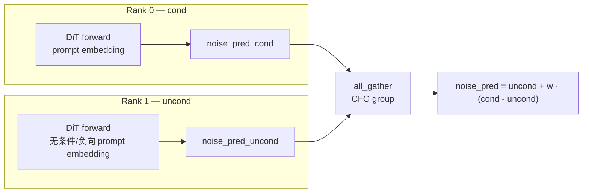

# CFG Parallel

## Summary

Classifier-Free Guidance (CFG) 在 DiT 每个采样 step 内需要做两次前向：一次条件（cond，带 prompt）、一次无条件或负向提示分支（uncond，具体输入由模型实现决定），再按 `noise_pred = noise_pred_uncond + w·(noise_pred_cond - noise_pred_uncond)` 融合。CFG Parallel 把这两个样本分别放到两张卡上同时跑，每卡只做一次模型推理，最后通过 all_gather 互相拿对方的结果，理想条件下两路前向可并行，实际加速仍需计入 all_gather、负载平衡及其他阶段后实测。HunyuanImage-3.0、Wan2.2-I2V 均采用该并行。

## Mechanism


*来源：[`docs/models/hunyuan-image-3.0/figures/cfg_parallel.png`](../../../../../cann-recipes-raw/cann-recipes-infer/944d2d3ece86f7df33dbb0cb155c72ca619a9c66/docs/models/hunyuan-image-3.0/figures/cfg_parallel.png)（cann-recipes-infer @ 944d2d3）*

> 源（HunyuanImage-3.0 优化文档）：对于一张图的生成，CFG(Classifier Free Guidance) 需要跑一个无条件的生成和一个有条件的生成，相当于网络跑了两个样本，可以把这两个样本拆分到两张卡上去跑，然后通过 all_gather 通信操作互相获取对方的计算结果，得到最终的预测结果。

Wan2.2-I2V 的 uncond 实际使用 context_null；当 n_prompt 为空时先替换为 sample_neg_prompt，再编码，因此不是固定空 prompt。其实现（`wan/image2video.py:L454`；源优化文档原文误作 `iamge2video.py`）：

```python
# 来源：docs/models/wan2.2-i2v/wan2.2-i2v_optimization.md / wan/image2video.py
if get_classifier_free_guidance_world_size() == 2:
 noise_pred = model(
 latent_model_input, t=timestep, **arg_all, **extra_kwargs)[0].to(
 torch.device('cpu') if offload_model else self.device)
 noise_pred_cond, noise_pred_uncond = get_cfg_group().all_gather(
 noise_pred, separate_tensors=True
 )
else:
 noise_pred_cond = model(latent_model_input, t=timestep, **arg_c, **extra_kwargs)[0]
 noise_pred_uncond = model(latent_model_input, t=timestep, **arg_null, **extra_kwargs)[0]

noise_pred = noise_pred_uncond + sample_guide_scale * (noise_pred_cond - noise_pred_uncond)
```



## Applicable Scenarios

- 已接入独立CFG分支通信的生成模型，如HunyuanImage-3.0和Wan2.2-I2V；模型使用guidance不自动证明此并行已接入
- 与 TP / SP 正交，可叠加形成 `TP × CFGP` 二维拓扑（HunyuanImage-3.0 文档以 TP2+CFGP 为例）
- DiT Cache 配置需区分串行交替 CFG 与并行进程隔离；Wan 的 enable_separate_cfg 为串行交替设计，不能由并行机制直接推导其取值

## Configuration

- CFG world_size = 2（固定为两路样本）
- 触发：`get_classifier_free_guidance_world_size() == 2`；否则退化为传统模式顺序跑两次
- TeaCache 与 CFG 串行配合：Wan2.2-I2V 采用 [ali-vilab/TeaCache 官方实现的 cond/uncond 分别管理版本](https://github.com/ali-vilab/TeaCache/tree/7c10efc4702c6b619f47805f7abe4a7a08085aa0/TeaCache4Wan2.1)

## Constraints

- 仅适用于需要 CFG 的推理，训练与蒸馏后无 CFG 的模型不适用
- 理论极限加速 ≈ 2×（每步减半），受通信（all_gather）与负载平衡影响
- Wan 串行 CFG 每进程交替执行 cond/uncond 时，enable_separate_cfg 通过 cfg_step 交替维护两份状态。CFG 并行则每个进程始终处理固定一路，不能沿用交替判定或统一要求开启该开关；须按每进程实际缓存调用序列核对配置，避免把同一路误当成两路交替

## Known Deployments

- **HunyuanImage-3.0**：CFG 并行 + TP + EP（MoE Double-Routing）
- **Wan2.2-I2V**：当前多卡默认CFG2×Ulysses4并启用VAE并行；多卡入口强制NoCache，不能视为可叠加TeaCache

## Evidence

- [README.md](../../../../../cann-recipes-raw/cann-recipes-infer/944d2d3ece86f7df33dbb0cb155c72ca619a9c66/README.md)（primary）
- [hunyuan_image_3_optimization.md](../../../../../cann-recipes-raw/cann-recipes-infer/944d2d3ece86f7df33dbb0cb155c72ca619a9c66/docs/models/hunyuan-image-3.0/hunyuan_image_3_optimization.md)（supporting）
- [image2video.py](../../../../../cann-recipes-raw/cann-recipes-infer/944d2d3ece86f7df33dbb0cb155c72ca619a9c66/models/wan2.2-i2v/wan/image2video.py)（implementation）
- [cache_block.py](../../../../../cann-recipes-raw/cann-recipes-infer/944d2d3ece86f7df33dbb0cb155c72ca619a9c66/models/wan2.2-i2v/wan/cache/cache_block.py)（implementation）

## Links

- [ulysses](ulysses.md)
- [vae-patch-parallel](vae_patch_parallel.md)
- [dit-cache](../techniques/dit_cache.md)
- [dit](../modules/dit.md)
- [mm-inference-launch](../frameworks/mm_inference_launch.md)
- [hunyuan-image-3](../models/hunyuan_image_3.md)
- [wan2.2-i2v](../models/wan2_2_i2v.md)
- 跨域·具身：[cosmos-transfer2.5](../../../embodied/concepts/world_models/cosmos_transfer2_5.md)、[cosmos-predict2.5](../../../embodied/concepts/world_models/cosmos_predict2_5.md)（Cosmos 世界模型 CFG 并行）
