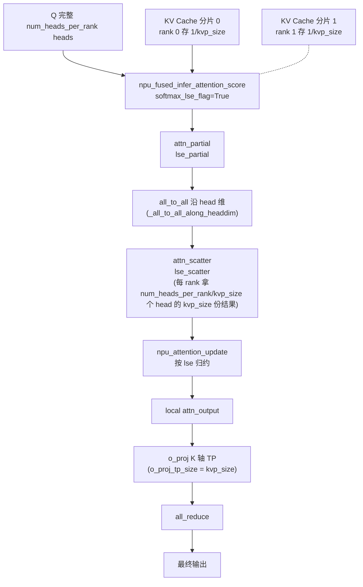

# KV Parallel (KVP)

> ⚠️ **KVP 部署已于 2026-05 回退。** 回退范围：删除 longcat kvp8 部署 YAML（`config/longcat_flash_densetp8_ep32_kvp8_gegraph_w8a8.yaml` 及 `config/ci/..._ep16_kvp8_...yaml`）、新 `ParallelConfig` 的 `kvp_size` 字段+校验（`executor/core/config/inference_config.py`）、优化文档「MLA KVP 切分优化」整节（含 `figures/kvp.png`）、README 长序列 OOM 的 KVP 小节、`config/README.md` 与 `docs/common/inference_config_guide.md` 的 `kvp_size` 条目；`model_setting.py:check_and_update_vars` 新增守卫 `raise ValueError("kvp_size is removed; longcat KVP is temporarily disabled")`。HEAD@2c45117 **不再有 KVP 部署/文档/新配置开关**（commit/MR 溯源见 Evidence）。
>
> **legacy 代码残留（grep@2c45117 实测）**：`models/longcat-flash/models/modeling_longcat_flash.py` 仍读 `runner_settings.get("parallel_config").get("kvp_size", 1)`（legacy `ModelRunner` 路径，默认 1），并保留 `kvp_rank` / `kvp_group`（`kvp_size==1` 时 init_comm_group 收束为 `None`）/ slot_mapping 轮转（`slot_mapping % kvp_size != kvp_rank`）/ `softmax_lse_flag` / `_all_to_all_along_headdim` / `o_proj all_reduce` 等 `kvp_size > 1` 分支——**机制代码未全删，但无对应 shipped 配置/文档暴露**。本页以下机制描述与配置示例对应回退前状态，保留作历史/机制参考。

## Summary

KVP (KV Parallel) 是面向**长序列推理场景**的 KV Cache 切分并行策略：通过将 KV Cache **沿 S (sequence) 维度切分**到多个 rank 上，缓解单 rank 的 KV Cache 访存压力，从而降低时延并扩大单请求可处理的序列长度上限。

LongCat-Flash 在长序列 Decode / Prefill 场景通过 YAML `kvp_size` 开关使用 KVP（仅 LongCat-Flash 实现，且**部署已于 2026-05 回退**——见页首 ⚠️）。该策略与 DP MLA（每卡存完整 KV）和 CP（沿 seq 切 token，每 rank 计算部分 query）都不同——**KVP 切的是 KV Cache 本身**。

## Mechanism

### Prefill 阶段

Prefill 阶段使能 KVP 切分优化：

- 根据 `kvp_size` 和 `kvp_rank` 对 `slot_mapping` 进行切分
- 将 `slot_mapping` 作为 `npu_kv_rmsnorm_rope_cache` 算子的 index 参数，将**完整的 KV Cache 分片轮转写入**到各个 `kvp_rank` 上，每个 `kvp_rank` 上存储 `1/kvp_size` 长度的 KV Cache
- 此外，Prefill 阶段在计算 Attention 时**复用了 `kvp_size`**，同时**约束 `attn_tp_size = 1`**，对 `npu_fused_infer_attention_score` 算子的输入 Q、K、V **按头维度进行 TP 切分**

### Decode 阶段

Decode 阶段使能 KVP 切分优化：

1. 启用 `npu_fused_infer_attention_score` 算子的 **`softmax_lse_flag` 功能**，输入 Q、K、V 头维度保持完整，与各个 `kvp_rank` 上存储的**部分 KV Cache** 进行 Attention 计算，并输出相应的 softmax lse
2. 每个 `kvp_rank` 拿到**完整 `num_heads_per_rank` 个 Q head 对部分 KV Cache** 的计算结果 `attn_partial` 和 `lse_partial`
3. 通过 `_all_to_all_along_headdim` 从各个 `kvp_rank` 拿到 `kvp_size` 份 `num_heads_per_rank // kvp_size` 个 Q head 对各个部分 KV Cache 的计算结果 `attn_scatter` 和 `lse_scatter`
4. 通过 `npu_attention_update` 算子对 `attn_scatter` 和 `lse_scatter` 执行**归约操作**
   > 注：归约算子 `npu_attention_update` 系回退前 optimization 文档描述；HEAD 代码实际以内联 `(attn_scatter * lse_scatter.softmax(dim=0)).sum(dim=0)` 实现 lse-softmax 归约（`modeling_longcat_flash.py`，无算子调用）。
5. Decode 阶段 `actual_seq_lengths_kv` 表示当前 `kvp_rank` 实际存储的 KV Cache 长度，因此需要根据 `kvp_size` 和 `kvp_rank` 进行调整

### o_proj 配合

使能 KVP 特性的场景下（`kvp_size > 1`）新增了 **`o_proj_tp_size = kvp_size` 约束**，在 `o_proj_forward` 中配合执行 o_proj TP 切分并后续执行 `all_reduce` 通信（与不使能 KVP 时的 `all_to_all + reduce_scatter` 不同）。


*来源：[`docs/models/longcat-flash/figures/kvp.png`](https://gitcode.com/cann/cann-recipes-infer/blob/2f82d10467e6fe8dae81c97a2cdac78d733a6703/docs/models/longcat-flash/figures/kvp.png)（cann-recipes-infer @ 2f82d10）*

### 核心数据流



## Applicable Scenarios

Applicable Scenarios

- **长序列 Decode**：单请求 KV Cache 过大导致单 rank 访存瓶颈或 OOM 时（如 LongCat-Flash 131072 input_max_len 配置 `longcat_flash_densetp8_ep32_kvp8_gegraph_w8a8.yaml`）
- 需要 `npu_fused_infer_attention_score` 支持 `softmax_lse_flag` + `npu_attention_update` 两个算子

## Configuration

> ⚠️ 以下 YAML 对应**回退前状态**：该配置文件 `longcat_flash_densetp8_ep32_kvp8_gegraph_w8a8.yaml` 与新 `ParallelConfig` 的 `kvp_size` 字段均已于 2026-05 删除，HEAD@2c45117 不再 ship；保留作回退前 KVP 部署形态参考。

回退前 LongCat-Flash YAML 片段（`longcat_flash_densetp8_ep32_kvp8_gegraph_w8a8.yaml`，已删除）：

```yaml
parallel_config:
 attn_tp_size: 1 # when kvp_size > 1 attn_tp_size should be equal to 1
 o_proj_tp_size: 8 # when kvp_size > 1, o_proj_tp_size should be equal to kvp_size
 moe_tp_size: 1
 dense_tp_size: 8
 embed_tp_size: 1
 lmhead_tp_size: 1
 kvp_size: 8
```

## Constraints

- **`kvp_size > 1` 时 `attn_tp_size == 1`**
- **`o_proj_tp_size == kvp_size`**（配合 o_proj K 轴 TP + `all_reduce`）
- **KVP 特性暂未支持 Multi-Token Prediction 投机推理**（与 MTP 不可同开；属回退前描述）
- 仅 LongCat-Flash 模型实现，且**部署已于 2026-05 回退**（kvp8 YAML / 新 `ParallelConfig.kvp_size` 字段 / 文档移除）；legacy `modeling_longcat_flash.py` 代码残留但无 shipped 配置触发，新 `InferenceConfig` 体系不再有 `kvp_size`（见 [inference-config](../techniques/inference_config.md)）
- 需要 Attention 融合算子支持 `softmax_lse_flag`（`npu_fused_infer_attention_score`）与 `npu_attention_update` 归约

## Evidence

- [cann-recipes-infer](https://gitcode.com/cann/cann-recipes-infer/tree/2c45117d781ab9ab88dcb89a28ae30f5d2450399) — [`docs/models/longcat-flash/longcat_flash_optimization.md`](https://gitcode.com/cann/cann-recipes-infer/blob/2f82d10467e6fe8dae81c97a2cdac78d733a6703/docs/models/longcat-flash/longcat_flash_optimization.md) "MLA (Multi-Head Latent Attention) KVP 切分优化" 章节（Prefill / Decode 两段机制、o_proj 约束、KVP 图）
- [cann-recipes-infer](https://gitcode.com/cann/cann-recipes-infer/tree/2c45117d781ab9ab88dcb89a28ae30f5d2450399) — [`models/longcat-flash/config/longcat_flash_densetp8_ep32_kvp8_gegraph_w8a8.yaml`](https://gitcode.com/cann/cann-recipes-infer/blob/2f82d10467e6fe8dae81c97a2cdac78d733a6703/models/longcat-flash/config/longcat_flash_densetp8_ep32_kvp8_gegraph_w8a8.yaml)、`models/longcat-flash/config/ci/longcat_flash_densetp8_ep16_kvp8_gegraph_w8a8.yaml`（KVP 部署配置，回退前 @2f82d10；HEAD@2c45117 已删）；`models/longcat-flash/README.md` "长序列请求 out of memory 问题处理" 小节（KVP 项回退前）
- **KVP 部署回退**（!501 / b085e02，2026-05）：删除上述 kvp8 YAML、`executor/core/config/inference_config.py` 的 `ParallelConfig.kvp_size` 字段+校验、optimization.md 的「MLA KVP 切分优化」整节+`figures/kvp.png`、README KVP OOM 小节、`config/README.md` / `docs/common/inference_config_guide.md` 的 `kvp_size` 条目；`model_setting.py:check_and_update_vars` 新增 `kvp_size is removed` 守卫。legacy 残留（grep@2c45117）：[`modeling_longcat_flash.py`](https://gitcode.com/cann/cann-recipes-infer/blob/2c45117d781ab9ab88dcb89a28ae30f5d2450399/models/longcat-flash/models/modeling_longcat_flash.py) 仍含 `kvp_size`（L178/560/1562）、`kvp_rank`/`kvp_group`（L589-590/1619-1624）、slot_mapping 轮转（L1372-1374）、`softmax_lse_flag`（L1022）、`o_proj all_reduce`（L709-710）等 `kvp_size > 1` 分支

## Links

- [longcat-flash](../models/longcat_flash.md)
- [mla](../modules/mla.md)
- [fused-infer-attention-score](../kernels/fused_infer_attention_score.md)
- [data-parallel](data_parallel.md)
- [context-parallel](context_parallel.md)
- [kvcache-offload](../techniques/kvcache_offload.md)
- [inference-config](../techniques/inference_config.md)
- [qwen3-rl](../../../training/guides/recipes/qwen3_rl.md)（跨域·训练：长序列 RL 中，KVP 切分被列为 Rollout Rebalance 之外的显存缓解候选——continuous-batching 极端长序列场景下沿 KV/序列维切分摊薄单卡 KV Cache）

## 已知冲突

- [longcat-flash](../models/longcat_flash.md)
- [inference-config](../techniques/inference_config.md)