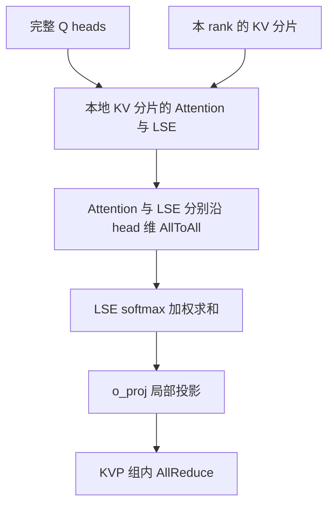

# KVP（KV Parallelism）：长序列 Decode 的 KV Cache 序列分片与历史状态

## 机制与可用状态

KVP 将 KV Cache 沿序列维分到多个 rank；Decode 时，每个 rank 对本地 KV 分片计算局部 Attention，再结合各分片的 log-sum-exp（LSE）合并输出。这个机制概念与某个仓库版本是否提供部署入口是两件事。本卡的平台无关范围只指机制定义；下面的具体实现证据限定 LongCat-Flash / Atlas A3。

LongCat 的回退前实现见提交 `de084d3cc7fbf0117f38c6b0a63936fd9991e415`，配套校验见 `d6ba03b342efe7eecb814cb4657242e28894093a`。[PR501](https://gitcode.com/cann/cann-recipes-infer/merge_requests/501) 于 2026-05-29 合入撤回；其固定源码 `152ad5ef50d3dee75b9c18e6c4766814e19eb1f5` 及知识库引用版本 `2c45117d781ab9ab88dcb89a28ae30f5d2450399` 的 `check_and_update_vars` 都在配置含有 `kvp_size` 键时直接抛出：

```text
kvp_size is removed; longcat KVP is temporarily disabled
```

守卫检查键是否存在，因此 **`kvp_size: 1` 也会被拒绝**。在这些版本中不能按旧说明打开 KVP，也不能把设为 1 当作回退方式。残留的模型分支或机制代码不构成可部署证据；其他版本需要重新核验。本卡不声明后续版本的可用性。

## 回退前的数据流

在 `de084d3cc7fbf0117f38c6b0a63936fd9991e415` 的实现中，连续的 KVP rank 共同保存一份完整 KV Cache。`slot_mapping` 按位置对 `kvp_size` 取模分配归属，不属于本 rank 的槽位写为 `-1`；属于本 rank 的槽位改为本地分片偏移。

Prefill 负责把 KV 写入这些分片，并在相应 Attention 路径按 head 维切分计算。KVP 的优化目标侧重长序列 Decode 的 KV 显存与访存压力，不能由此推导“Prefill 完全不参与 KVP”。长序列 Prefill 的 CP 决策另见[上下文并行规则](../../optimizations/rules/long_seq_prefill_context_parallel.md)。

Decode 的 `forward_page_attention_absorb` 先通过 `softmax_lse_flag` 取得局部 Attention 和 LSE，再对两者分别沿 head 维做 `all_to_all`，最后内联完成加权合并：

```python
attn_output = (attn_scatter * lse_scatter.softmax(dim=0)).sum(dim=0)
```

历史优化文档将合并描述为 `npu_attention_update`，但上述固定源码没有调用该算子。本卡的数据流以代码为准，不将该算子列为这条实现的必需依赖。Decode 的本地 `actual_seq_lengths_kv` 也按分片调整；`o_proj_tp_size == kvp_size` 时，输出投影通过 KVP 组内 `all_reduce` 合并。



## 历史约束与验证边界

回退前的配置约束、失败信号和历史样例集中保留在[已停用的 KVP Guide](../../guides/deployment/kvp_longseq_decode.md)，本卡不提供当前启用步骤。

历史样例含 `decode_only`，源码注释说明它只用于 TPOT 测试并影响精度。样例存在不能证明完整推理精度，也没有可归因于单一 KVP 开关的独立收益数字。本次只做固定源码与文档核验，没有运行模型、验证硬件收益或增加 `verified`。

## Evidence

- [回退前模型源码](https://gitcode.com/cann/cann-recipes-infer/blob/de084d3cc7fbf0117f38c6b0a63936fd9991e415/models/longcat-flash/models/modeling_longcat_flash.py)：`get_slot_mapping`、Prefill KV 写入、Decode 的两次 AllToAll 与内联 LSE 合并、`o_proj_forward`。
- [回退前优化文档](https://gitcode.com/cann/cann-recipes-infer/blob/de084d3cc7fbf0117f38c6b0a63936fd9991e415/docs/models/longcat-flash/longcat_flash_optimization.md)：核对 Atlas A3 范围与 KVP 设计目标；归约算子名称与代码有差异。
- [历史校验](https://gitcode.com/cann/cann-recipes-infer/blob/d6ba03b342efe7eecb814cb4657242e28894093a/models/longcat-flash/models/model_setting.py)：核对 KVP 与 batch、Attention TP、o_proj TP、CP、MTP 的耦合条件。
- [撤回提交的校验入口](https://gitcode.com/cann/cann-recipes-infer/blob/152ad5ef50d3dee75b9c18e6c4766814e19eb1f5/models/longcat-flash/models/model_setting.py)及[知识库引用版本的同一入口](https://gitcode.com/cann/cann-recipes-infer/blob/2c45117d781ab9ab88dcb89a28ae30f5d2450399/models/longcat-flash/models/model_setting.py)：均按键存在性拒绝 `kvp_size`。

## 相关机制

- [LongCat-Flash](../models/longcat_flash.md)
- [MLA](../modules/mla.md)
- [融合 Attention](../kernels/fused_infer_attention_score.md)
- [数据并行](data_parallel.md)
- [上下文并行](context_parallel.md)
- [KV Cache 卸载](../techniques/kvcache_offload.md)
- [推理配置](../techniques/inference_config.md)
