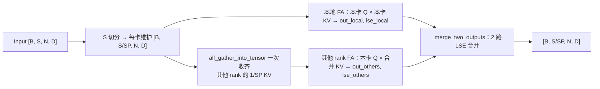

# Ring Attention Sequence Parallelism

## Summary

Ring Attention 是另一种长序列 SP 方案：与 Ulysses 不同，**attention 内部也保持序列切分**，每张卡仅维护自己那 1/SP 的 Q。概念上（见下方 HunyuanVideo 文档引用）以 P2P 环形逐跳传递 KV；但本仓 `module/unified_sp/core.py` 的实际实现是用一次 `all_gather_into_tensor` 把其他所有 rank 的 1/SP KV 一次性收齐，默认 overlap 路径再对「本地 FA」与「其他 rank 合并 FA」共 2 路输出做 LSE（Log-Sum-Exp）合并（非逐跳 P2P、非 SP-1 串行轮）。适合 Ulysses 规模受限（`num_heads` 不够切）或与 Ulysses 组成 2D hybrid SP 的场景。

Wan2.2-I2V 在此基础上实现了 [ring-attention-overlap](../techniques/ring_attention_overlap.md)：异步 AllGather + 本地 FA 并行，用计算掩盖通信。

## Mechanism

*来源：[`docs/models/hunyuan-video/figures/ring.png`](../../../../../cann-recipes-raw/cann-recipes-infer/944d2d3ece86f7df33dbb0cb155c72ca619a9c66/docs/models/hunyuan-video/figures/ring.png)（cann-recipes-infer @ 944d2d3；原图来源 [feifeibear/long-context-attention](https://github.com/feifeibear/long-context-attention)）*

> 源（HunyuanVideo 优化文档）：首先将 input 沿着 S 维度切分为 S/SP，其中 SP 为序列并行数量，输入模型。当 attn 计算时，保持本卡的 1/SP 的 Q 不动，通过 P2P(Peer-To-Peer)，将当前维护的 1/SP 的 KV 对传递给下一张卡。每张卡循环接收其他卡的 KV 对，与本卡的 Q 计算注意力。

下图仅展示 use_ring_overlap=True 的路径；同步基线收齐全部 KV 后直接单次 attention，不调用 _merge_two_outputs。

### 两条执行路径

`core.py` 的 `UnifiedSPAttention` 由 `SPConfig.use_ring_overlap`（默认 `True`）切换两条 Ring 路径，均在 `_forward_core` 中按 `if self.use_ring_overlap` 选择：

- `_ring_attention_overlap`（默认）：以 `async_op=True` 异步发起 KV 的 `all_gather_into_tensor`，在通信进行时先算本地 FA（`out_local, lse_local`），`handle.wait()` 后再算其他 rank 的合并 FA（`out_others, lse_others`），用计算掩盖通信，详见 [ring-attention-overlap](../techniques/ring_attention_overlap.md)。
- `_ring_attention_allgather`：串行先 `all_gather_into_tensor` 收齐全部 KV，拼成整段 KV 后做单次 `_compute_attention`，无重叠。

### overlap 路径的 LSE 两路合并

仅 _ring_attention_overlap 的两路输出由 `_merge_two_outputs(out1, lse1, out2, lse2)` 做数值稳定的 2 路合并：先取 `max_lse = max(lse1, lse2)` 重标定，`lse_new = max_lse + log(exp(lse1-max_lse) + exp(lse2-max_lse))`，再以 `weight_i = exp(lse_i - lse_new)` 加权求和 `out_merged = weight1*out1 + weight2*out2`。注意该函数仅合并两路（本地 vs 其他 rank 合并），并非逐轮累积。

## Applicable Scenarios

- `num_heads` 太小、无法满足 Ulysses `num_heads % SP == 0` 的限制（即使启用 UAA 也会超填充预算）
- 与 Ulysses 组合 hybrid SP（外层 Ulysses × 内层 Ring，扩大可用总并行度）
- 显存带宽充裕、P2P 延迟可接受的拓扑

## Configuration

- `ring_group` / `ulysses_group` 由各模型的分布式管理层构造后传入：Wan2.2-I2V 在 `wan/distributed/parallel_mgr.py`（`ulysses_group=PROCESS_GROUP.ULYSSES_PG, ring_group=PROCESS_GROUP.RING_PG`），HunyuanVideo 在 `hyvideo/inference.py`（`get_sp_group().ulysses_group / .ring_group`）。`module/unified_sp/core.py` 的 `UnifiedSPAttention.__init__` 只消费这两个进程组（`self.ulysses_pg = ulysses_group; self.ring_pg = ring_group`），不构造它们
- 标准Ulysses可与Ring组成Hybrid；UAA及MXFP8 attention当前均不支持Ring

## Constraints

- 本仓实现以一次 `all_gather_into_tensor` 收齐 ring 组内其他 rank 的 KV（而非逐跳 P2P 的 SP-1 串行轮），通信量随 ring 组大小增长
- 默认 overlap 路径的 Attention 输出需要 2 路（本地 / 其他 rank）LSE 合并，对实现精度更敏感
- 不兼容 FP8 量化 attention（HunyuanVideo 文档明示）
- 当前HunyuanVideo块稀疏已实现Ring TopK及SVG；TopK overlap另依赖稀疏算子LSE，SVG overlap回退普通路径，详见[块稀疏](../modules/blockwise_sparse_attention.md)。
- Ring 将计算与通信串行化时掩盖率低，需要借助 overlap 技巧（见 [ring-attention-overlap](../techniques/ring_attention_overlap.md)）

## Known Deployments

- **Wan2.2-I2V**：多卡 Ring Attention + AllGather overlap，详见 `module/unified_sp/core.py`
- **HunyuanVideo**：作为与 Ulysses 并列的 SP 选项纳入 `unified_sp` 框架

## Evidence

- [hunyuan_video_optimization.md](../../../../../cann-recipes-raw/cann-recipes-infer/944d2d3ece86f7df33dbb0cb155c72ca619a9c66/docs/models/hunyuan-video/hunyuan_video_optimization.md)（primary）
- [core.py](../../../../../cann-recipes-raw/cann-recipes-infer/944d2d3ece86f7df33dbb0cb155c72ca619a9c66/module/unified_sp/core.py)（implementation）
- [sparse_method.py](../../../../../cann-recipes-raw/cann-recipes-infer/944d2d3ece86f7df33dbb0cb155c72ca619a9c66/module/blockwise_sparse/sparse_method.py)（supporting）

## Links

- [ulysses](ulysses.md)
- [ring-attention-overlap](../techniques/ring_attention_overlap.md)
- [dit](../modules/dit.md)
- [blockwise-sparse-attention](../modules/blockwise_sparse_attention.md)
- [hunyuan-video](../models/hunyuan_video.md)
- [wan2.2-i2v](../models/wan2_2_i2v.md)
- [vggt](../../../spatial/concepts/models/vggt.md)（跨域·空间智能：VGGT SP overlap 用 Ring Attention）
- 跨域·具身：[cosmos-transfer2.5](../../../embodied/concepts/world_models/cosmos_transfer2_5.md)、[cosmos-predict2.5](../../../embodied/concepts/world_models/cosmos_predict2_5.md)（Cosmos 长序列 Ring Attention）
- [context-parallel-train](../../../training/concepts/parallelism/context_parallel_train.md)（跨域·训练：MindSpeed Ring CP，KV 序列维 P2P 环形传递，含 Double Ring / LoongTrain 二级环与反向 KV 缓存）
