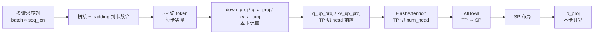

# SP-TP-SP Hybrid Split (Prefill MLA)

## Summary

DeepSeek-R1 Prefill 阶段 MLA 部分针对 DP 切分在短序列混合/请求数少场景下 **计算负载不均 + TTFT 被拉长** 问题提出的混合切分策略：把 batch 与 seq_len 合轴变为 token 数，按卡数 **SP** 切 token 均匀分发；FlashAttention 计算走 **TP** 切 head；FA 结束后 AllToAll 再转回 **SP** 给 o_proj。"SP → TP（FA）→ SP" 三段式得名。

## Mechanism

源图原貌（Attention SP-TP-SP 阶段流），结构示意见上方 mermaid：

*来源：[`docs/models/deepseek-r1/figures/image_attention_sp.png`](https://gitcode.com/cann/cann-recipes-infer/blob/2f82d10467e6fe8dae81c97a2cdac78d733a6703/docs/models/deepseek-r1/figures/image_attention_sp.png)（cann-recipes-infer @ 2f82d10）*

### 关键步骤（源文档原文）

1. 将多个请求序列拼接后 padding 到卡数的最小整数倍，进行 SP 切分，此时每张卡获取的 token 数相同。
2. FlashAttention 计算部分采用 TP 策略，通过将 Attention head 均匀分布到每张计算卡上来实现，确保计算负载在多卡间均衡分布。
3. FlashAttention 计算完成之后，通过 AllToAll 通信，将 TP 转换为 SP 切分，通信算子的通信量更小，性能更优；此时 o_proj 由于需要全载权重，占用内存会变高。

### 数据切分示意

假设有 3 个输入 input0、input1、input2，把 batch 和 seq_len 合轴后，将 token 均匀分布到 Rank0~Rank3 上。`down_proj` 包含 `q_a_proj` 和 `kv_a_proj` 计算；`q_up_proj` 与 `kv_up_proj` 分别表示 `q_b_proj` 和 `kv_b_proj`。此时每张卡计算数据量一致，计算负载均匀。

源图原貌：

*来源：[`docs/models/deepseek-r1/figures/image_data_split_sp.png`](https://gitcode.com/cann/cann-recipes-infer/blob/2f82d10467e6fe8dae81c97a2cdac78d733a6703/docs/models/deepseek-r1/figures/image_data_split_sp.png)（cann-recipes-infer @ 2f82d10）*

## Applicable Scenarios

**与纯 DP 策略的对比**（源文档结论）：

> 当前在 prefill 场景中，当请求量较大或 KV-Cache 内存占用较高时，可以考虑采用 DP 切分策略，以提升吞吐量；当请求数量较少、分布不均匀或单次请求序列长度较长时，可以考虑采用 SP-TP-SP 混合切分策略，以降低时延。

适合：

- 单请求长序列（128K+）场景 — 可以把计算均匀分布到所有卡上；
- 请求数 < 卡数 — 避免 DP 下部分卡空闲或凑批等待；
- TTFT 敏感场景。

## Constraints

相较 DP，SP-TP-SP 引入两个副作用：

1. **每卡存完整 KVCache**：各卡之间 KVCache 冗余，峰值显存升高。文档建议将 KVCache 数据分卡存储以规避。
2. **引入 AllGather 与 AllToAll 通信**：相对 DP 的"无通信"路径有额外耗时；可以通过 [prefill-micro-batch](../techniques/prefill_micro_batch.md) 双流来进一步掩盖。

另外：

- `o_proj` 全载权重，单卡 proj 权重内存上升。
- 与 `MicroBatchMode.PREFILL_MICRO_BATCH_SP_TP_EP = 2` 配合可进一步重叠通信。

## Known Results

源文档未单列 SP-TP-SP 相对 DP 的数值对比。实际 benchmark 数据（见 [deepseek-r1](../models/deepseek_r1.md)）为 DP+EP + micro-batch 路径。SP-TP-SP 的典型收益描述为"长序列 TTFT 更短"和"MLA 负载均匀"。

## Evidence

- [cann-recipes-infer](https://gitcode.com/cann/cann-recipes-infer/tree/2c45117d781ab9ab88dcb89a28ae30f5d2450399) — [`docs/models/deepseek-r1/deepseek_r1_prefill_optimization.md`](https://gitcode.com/cann/cann-recipes-infer/blob/2f82d10467e6fe8dae81c97a2cdac78d733a6703/docs/models/deepseek-r1/deepseek_r1_prefill_optimization.md) "SP-TP-SP 混合切分策略"章节；`models/deepseek_r1/models/modeling_deepseek.py`（`MicroBatchMode.PREFILL_MICRO_BATCH_SP_TP_EP` 枚举与 `forward_microbatch_v2` 入口）。

## Links

- [deepseek-r1](../models/deepseek_r1.md)
- [mla](../modules/mla.md)
- [tensor-parallel](tensor_parallel.md)
- [data-parallel](data_parallel.md)
- [prefill-micro-batch](../techniques/prefill_micro_batch.md)
