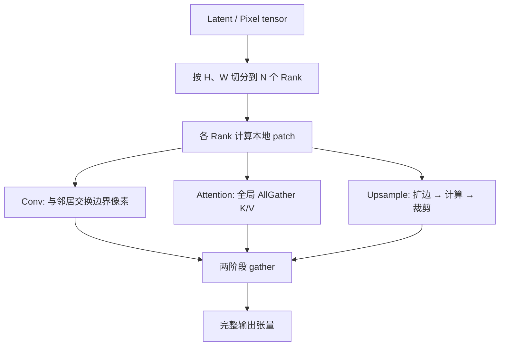

# VAE Patch Parallel

## Summary

多模态生成模型的 VAE Decoder 处理大尺寸（720p/1080p，视频还叠加时间维度）pixel 输出时显存与算力消耗巨大。共享实现 `module/vae_patch_parallel.py` 把 latent/pixel 张量沿 H、W 空间维度切分到多卡并行处理，搭配**卷积的边界交换**、**注意力的全局 K/V 聚合**、**上采样的边界扩展+裁剪** 三种针对性通信策略，使各卡局部结果最终拼接成完整输出。**HunyuanImage-3.0、Wan2.2-I2V** 均复用这份共享脚本（Wan2.2-I2V `from module.vae_patch_parallel import set_vae_patch_parallel, VAE_patch_parallel`，见 `image2video.py` L35/L145；钉定版仓库中并无独立的 `wan/vae_patch_parallel.py`，wan 文档正文笔误如此，代码不是）。**HunyuanVideo 是另一份实现**：用 `models/hunyuan-video/hyvideo/vae/vae_parallel.py` 的沿单一序列维 1D overlap-chunk decode（非 H/W 二维网格、非下述三策略，详见 Mechanism）。

## Mechanism

*来源：[`docs/models/hunyuan-image-3.0/figures/vae_parallel.png`](https://gitcode.com/cann/cann-recipes-infer/blob/2f82d10467e6fe8dae81c97a2cdac78d733a6703/docs/models/hunyuan-image-3.0/figures/vae_parallel.png)（cann-recipes-infer @ 2f82d10）*

> 源（HunyuanImage-3.0 优化文档）：通过空间并行的方式实现，将大尺寸图像在高度和宽度维度上切分成多个块，分配给不同的 NPU 进程并行处理，可以加速原模型 VAE 推理。
>
> 1. 首先将输入张量按空间维度切分到多个进程，每个进程处理自己的局部块；
> 2. 然后在计算过程中根据不同操作的特点采用相应的通信策略——卷积操作通过与邻居交换边界数据来获取上下文，注意力操作通过全局收集所有 K,V 张量来保证计算完整性，插值操作通过扩展边界、计算后再裁剪来处理上采样；
> 3. 最后通过两阶段的收集过程将各个进程的局部结果按照原始的空间位置重新拼接成完整的输出张量。

### 关键通信策略

| 操作 | 为什么需要特殊处理 | 采取策略 |
| ---- | ------------------ | -------- |
| 3D/2D Conv | 卷积感受野跨越 patch 边界 | 与左右/上下邻居**交换边界行列** |
| Self-Attention | K/V 全局相关 | **全量 AllGather K/V** 到每张卡 |
| 上采样（Interpolate） | 边界插值需邻居像素 | **扩展边界 → 计算 → 裁剪** |

> **适用范围**：上述 H、W 二维空间网格切分 + 三策略（conv 边界交换 / attn 全 gather / interpolate 扩裁）属于共享实现 `module/vae_patch_parallel.py`，仅 **HunyuanImage-3.0、Wan2.2-I2V** 使用。

#### stride≠1 下采样卷积的特殊路径

普通三策略只覆盖 `stride=1` 卷积；遇到 `stride≠1` 的下采样卷积，`wraps_f_conv2d`（`module/vae_patch_parallel.py`）走另一条路径：先 `self.dispatch(...)` 把切片重组回完整空间，再按 `channels_per_rank` 用 `weight.narrow(0, start, end-start)` 在 out_channel 维切分权重做局部卷积，最后 `dist.all_to_all(gathered_outputs, patches, ...)` 重分块、`torch.cat(gathered_outputs, dim=1)` 拼回 channel 维。

### HunyuanVideo：另一份实现（1D overlap-chunk decode）

HunyuanVideo 不走上面的 H/W 网格三策略，而是用 `models/hunyuan-video/hyvideo/vae/vae_parallel.py`（`inference.py` L48 `from hyvideo.vae.vae_parallel import decode`）：沿单一序列维（`wid_size = z.shape[-1]`）做 1D 切分，`act_chunk_len = wid_size // world_size`，每个 chunk 两侧各加 `overlap_size` 补充相邻序列，本地 decode 后 `dist.all_gather(...)` 再 `torch.cat(..., dim=-1)` 拼接。

> 源（HunyuanVideo 优化文档）：VAE 阶段涉及卷积操作，简单的 chunk 会导致边缘感受野不足（部分序列被切分到了相邻卡上），生成出来的视频有明显的拼接现象。为此，本样例为每张卡的序列做了补充，使其能够获得相邻设备卡上的部分序列信息。

## Applicable Scenarios

- 大尺寸图像/视频生成（720p+，视频 5s+）
- VAE Decoder（推理阶段不跑 Encoder）
- 多卡场景（一般与 DiT SP 使用相同的卡数，如 HunyuanVideo 的 `ulysses8` + VAE 8 卡）
- Wan2.2-I2V：文档中明确为 **8 卡 VAE 并行**

## Configuration

- 共享实现 `module/vae_patch_parallel.py`：HunyuanImage-3.0、Wan2.2-I2V 复用（Wan 经 `from module.vae_patch_parallel import ...` 引入，并无独立 `wan/vae_patch_parallel.py`）
- HunyuanVideo 用另一份 `models/hunyuan-video/hyvideo/vae/vae_parallel.py`（沿序列 1D overlap-chunk decode）
- 切分维度（H、W、T）由模型 VAE 具体结构决定
- 零侵入接入：`VAE_patch_parallel` 上下文管理器在 `__enter__` 把 `F.conv2d/conv3d/interpolate/pad`（`_sub_F_func`）与 `F.scaled_dot_product_attention`（`_sub_FA`）临时 monkeypatch 成分布式版本，`__exit__` 还原各 `ori_*`，从而对原 VAE 代码无改动接入

## Constraints

- 卷积邻居交换、Attention AllGather 都引入额外通信；patch 切太小收益递减
- 若 VAE 内部含 cross-attention 或全局 pooling，需要额外 gather
- 与 CFG 并行、DiT SP 正交但需要独立 process group

## Known Deployments

- **HunyuanVideo**（沿序列 1D overlap-chunk decode，非 H/W 网格三策略）：VAE 并行 + mask 缓存 + 虚拟内存取消 offload，VAE 阶段从 133 s → 12.4 s（`ulysses8` 场景，speedup 10.74×）
- **HunyuanImage-3.0**：VAE 并行 + CFG 并行组合
- **Wan2.2-I2V**：8 卡 VAE 并行

## Evidence

- [cann-recipes-infer](https://gitcode.com/cann/cann-recipes-infer/tree/2c45117d781ab9ab88dcb89a28ae30f5d2450399) — [`docs/models/hunyuan-video/hunyuan_video_optimization.md`](https://gitcode.com/cann/cann-recipes-infer/blob/2f82d10467e6fe8dae81c97a2cdac78d733a6703/docs/models/hunyuan-video/hunyuan_video_optimization.md) VAE 并行 / VAE 优化
- [cann-recipes-infer](https://gitcode.com/cann/cann-recipes-infer/tree/2c45117d781ab9ab88dcb89a28ae30f5d2450399) — [`docs/models/hunyuan-image-3.0/hunyuan_image_3_optimization.md`](https://gitcode.com/cann/cann-recipes-infer/blob/2f82d10467e6fe8dae81c97a2cdac78d733a6703/docs/models/hunyuan-image-3.0/hunyuan_image_3_optimization.md) VAE 并行优化
- [cann-recipes-infer](https://gitcode.com/cann/cann-recipes-infer/tree/2c45117d781ab9ab88dcb89a28ae30f5d2450399) — [`docs/models/wan2.2-i2v/wan2.2-i2v_optimization.md`](https://gitcode.com/cann/cann-recipes-infer/blob/2f82d10467e6fe8dae81c97a2cdac78d733a6703/docs/models/wan2.2-i2v/wan2.2-i2v_optimization.md) 8卡 VAE 并行
- [cann-recipes-infer](https://gitcode.com/cann/cann-recipes-infer/tree/2c45117d781ab9ab88dcb89a28ae30f5d2450399) — [`module/vae_patch_parallel.py`](https://gitcode.com/cann/cann-recipes-infer/blob/2f82d10467e6fe8dae81c97a2cdac78d733a6703/module/vae_patch_parallel.py)（共享实现：H/W 网格三策略 + stride≠1 channel-split/all_to_all + `VAE_patch_parallel` monkeypatch 上下文管理器；HunyuanImage-3.0、Wan2.2-I2V 复用）
- [cann-recipes-infer](https://gitcode.com/cann/cann-recipes-infer/tree/2c45117d781ab9ab88dcb89a28ae30f5d2450399) — [`models/wan2.2-i2v/wan/image2video.py`](https://gitcode.com/cann/cann-recipes-infer/blob/2f82d10467e6fe8dae81c97a2cdac78d733a6703/models/wan2.2-i2v/wan/image2video.py) L35/L145 `from module.vae_patch_parallel import ...`（Wan 复用共享脚本，无独立 `wan/vae_patch_parallel.py`）
- [cann-recipes-infer](https://gitcode.com/cann/cann-recipes-infer/tree/2c45117d781ab9ab88dcb89a28ae30f5d2450399) — [`models/hunyuan-video/hyvideo/vae/vae_parallel.py`](https://gitcode.com/cann/cann-recipes-infer/blob/2f82d10467e6fe8dae81c97a2cdac78d733a6703/models/hunyuan-video/hyvideo/vae/vae_parallel.py)（HunyuanVideo 专用：沿序列 1D overlap-chunk decode，`inference.py` L48 import decode）

## Links

- [vae](../modules/vae.md)
- [cfg-parallel](cfg_parallel.md)
- [dit](../modules/dit.md)
- [hunyuan-video](../models/hunyuan_video.md)
- [hunyuan-image-3](../models/hunyuan_image_3.md)
- [wan2.2-i2v](../models/wan2_2_i2v.md)