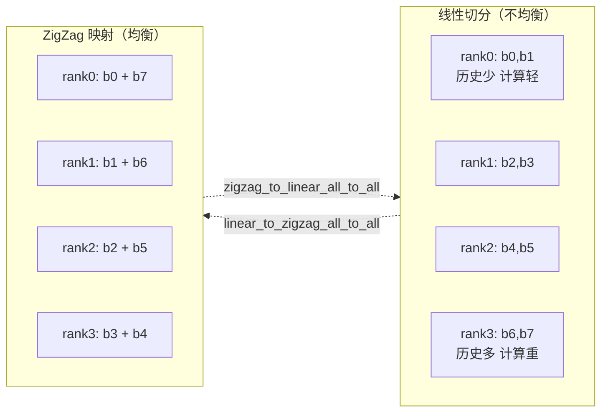

# ZigZag Context Parallel (Load-Balanced Causal Attention)

## Summary

ZigZag 是 [context-parallel](context_parallel.md) 下针对**因果 Attention 负载不均**的切分变体：将输入 Sequence 切成 `2·cp_size` 个 block，每个 CP rank 负责头尾对称的两个 block（如 rank 0 负责 block 0 与 block 2·cp_size-1），从而让所有 rank 的历史 KV 计算量近似相等。通过两次 AllToAll 在"因果序"和"ZigZag 序"之间切换。

定位：ZigZag 是 CP 的**并行切分策略**（不是正交的通用技术），放在 parallelism 目录下；与 Ulysses/Ring Attention SP 并列作为长序列并行的一个方案族。

## Mechanism

以 `cp_size=4` 为例，Sequence 切成 8 个 block，rank 负责的 block 如下：

源图原貌如下，结构示意见上方 mermaid：

*来源：[`docs/models/qwen3-next/figures/zigzag_load_balance.jpg`](https://gitcode.com/cann/cann-recipes-infer/blob/2f82d10467e6fe8dae81c97a2cdac78d733a6703/docs/models/qwen3-next/figures/zigzag_load_balance.jpg)（cann-recipes-infer @ 2f82d10）*

- **问题**：如果 Sequence 按 rank 顺序线性切分，因果 mask 下 rank 0 只看到很少历史 token，rank `cp_size-1` 看到全部历史，计算量失衡到 ~2 倍。
- **切块**：将 S 切成 `2·cp_size` 个等大 block（`block_size = S / (2·cp_size)`）。
- **ZigZag 映射**：rank `r` 负责 block `r` 和 block `2·cp_size - 1 - r`，每个 rank 的两个 block 都成为因果注意力下的一个"前段 + 后段对"，合计计算量均等。
- **通信**：
 - `prepare_attn` 前：`linear_to_zigzag_all_to_all` 将因果线性排布的 `local_tokens` 重排为 ZigZag 排布（per-rank 拿到自己的两个 block）。
 - Attention 计算前：`cp_all_gather_reorganized_into_tensor` 在 CP 域对 KV AllGather，并就地重排回因果顺序（由 `get_prev_block_slices`/`get_next_block_slices`/`get_block_qkv_slices` 标注切片），保证 Attention 内部仍按因果顺序计算。
 - `prepare_mlp` 前：`zigzag_to_linear_all_to_all` 将 ZigZag 排布还原为线性因果排布，供 MoE 的 Reduce-Scatter 使用。
- **代码入口**：[`python/sglang/srt/layers/zigzag_cp_utils.py`](https://gitcode.com/cann/cann-recipes-infer/blob/2f82d10467e6fe8dae81c97a2cdac78d733a6703/models/qwen3-next/patches/stage4/0001-feat-support-context-parallel.patch)（由 CP patch 新增），`prepare_zigzag_context_parallel_metadata`、`cp_split_and_rebuild_data`、`cp_split_and_rebuild_position` 负责 metadata 和 position embedding 的一致重排。

## Applicable Scenarios

- Qwen3-Next PD 分离场景下 Prefill 节点 [gated-attention](../modules/gated_attention.md) + [context-parallel](context_parallel.md) 组合。
- 长序列单 batch 场景（README 注明"面向长序列单 batch 场景"）。
- 任意因果 Softmax Attention + CP 组合（ZigZag 仅作用于 Gated Attention 层；GDN 层默认因 Conv1d 走纯 TP、不参与 ZigZag）。

> 注：env-gated GDN-CP 为 2f82d10 之后新增特性（@2c45117 的 stage6 patch `models/qwen3-next/patches/stage6/0001-support-gdn-cp.patch`，本页其余 Evidence 钉于 @2f82d10 处尚不存在此特性）。经 `ENABLE_CONTEXT_PARALLEL_GDN=1` 开启后，GDN-CP 不走 ZigZag 重排，而是在 `single_batch_overlapped_causal_conv1d_update` 内用相邻 rank P2P（`dist.isend(dst=cp_group.next_rank)` / `dist.recv(src=cp_group.prev_rank)`）交换 conv overlap 窗口，再对缓存的 conv_states 做一次 `torch.distributed.broadcast`——是两步式 P2P + broadcast 交接，非单纯"末 rank 广播"。详见 [qwen3-next](../models/qwen3_next.md)。

## Configuration

- `--cp-size` + `CP_USE_ZIGZAG=1` 共同使能。
- PD 分离场景下 Prefill 节点 `cp_size < tp_size`。

## Constraints

- 仅在启用 CP 时生效（`--cp-size`），开关为 `CP_USE_ZIGZAG=1`。
- 要求 `cp_size < tp_size` 且 PD 卡数一致；CP 与 DP 互斥（CP 复用 DP 通信域）。
- `S % (2·cp_size) == 0` 隐含要求（block 等分）；chunk prefill 下 `chunked-prefill-size ≤ 71680`。
- 只在 Gated Attention 层生效；MoE/GDN 层的通信（AllGather/ReduceScatter）仍按线性因果布局进行。

## Known Results

- CP+ZigZag 将 64K/256K 长序列 Prefill 的单卡激活内存从 O(S²/TP) 降至 O(S²/(CP·TP))，避免 TP-only 下的 OOM。
- 负载均衡化后最慢 rank 与最快 rank 的 Attention 计算量近似相等，理想情况下消除 CP 下因果 mask 引入的 ~2x bubble。具体加速比在本 source 未给出数字。

## Evidence

- [cann-recipes-infer](https://gitcode.com/cann/cann-recipes-infer/tree/2c45117d781ab9ab88dcb89a28ae30f5d2450399) — [`docs/models/qwen3-next/qwen3_next_optimization.md`](https://gitcode.com/cann/cann-recipes-infer/blob/2f82d10467e6fe8dae81c97a2cdac78d733a6703/docs/models/qwen3-next/qwen3_next_optimization.md) ZigZag 负载均衡章节
- [cann-recipes-infer](https://gitcode.com/cann/cann-recipes-infer/tree/2c45117d781ab9ab88dcb89a28ae30f5d2450399) — [`models/qwen3-next/patches/stage4/0001-feat-support-context-parallel.patch`](https://gitcode.com/cann/cann-recipes-infer/blob/2f82d10467e6fe8dae81c97a2cdac78d733a6703/models/qwen3-next/patches/stage4/0001-feat-support-context-parallel.patch)（`zigzag_cp_utils.py` 全文，`prepare_zigzag_context_parallel_metadata` 等）
- [cann-recipes-infer](https://gitcode.com/cann/cann-recipes-infer/tree/2c45117d781ab9ab88dcb89a28ae30f5d2450399) — [`models/qwen3-next/README.md`](https://gitcode.com/cann/cann-recipes-infer/blob/2f82d10467e6fe8dae81c97a2cdac78d733a6703/models/qwen3-next/README.md) 规格约束 5 + 新增特性使能表中 `CP_USE_ZIGZAG=1`

## Links

- [context-parallel](context_parallel.md)
- [tensor-parallel](tensor_parallel.md)
- [qwen3-next](../models/qwen3_next.md)
- [deepseek-v4](../models/deepseek_v4.md)（Prefill 长序列 CP + zigzag 切分，128 对齐 all_gather）
- [gated-attention](../modules/gated_attention.md)
- [sglang](../frameworks/sglang.md)
- [context-parallel-train](../../../training/concepts/parallelism/context_parallel_train.md)（跨域·训练：MindSpeed CP 家族的因果负载均衡切分，2·cp 分块对称切分与 ZigZag 同源）