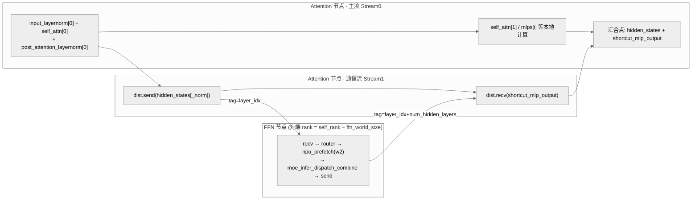

# Attention-FFN Disaggregation (AFD)

## Summary

Attention-FFN Disaggregation (AFD) 是 LongCat-Flash 模型在 Decode 阶段的**部署级解耦**优化：将 Attention 模块与 MoE (FFN) 模块**部署在不同的节点**上，中间通过 Send/Recv 算子进行节点间的数据交互。相比把 Attention 与 MoE 部署在同一张卡 + 多流 + 控核方案，AFD 解除了双流共享 Cube/Vector 核数的约束，Attention 侧算子不再控核后耗时大幅下降。

实测在 W8A8 + GBS=256 + Seq=4608 + 64 Chips + MTP2 + perfect eplb 场景下，AFD TPOT **9.5 ms**（相对同配置不分离 9.95 ms），且吞吐由 402.01 → 421.05 tokens/p/s，是 LongCat-Flash **TPOT 进入 10 ms 内**的关键优化。

## Mechanism

### 出发点：控核的副作用

在 LongCat-Flash 非分离场景中，Attention 模块和 MoE 模块部署在同一个卡上，由于 ScMoE 结构的固有特性，为了获取最佳的性能，在 [moe-multi-stream](moe_multi_stream.md) 中对 Stage2 设计了多流并行策略，通过分配不同的核数将 Attention 计算流和 MoE 计算流进行了并行流水，达到最佳性能。

**然而，对 Stage2 通过控核后，由于两条计算流在计算时只能使用部分 Cube 和 Vector 核，算子执行时会受到算力的约束。** 在 Atlas A3 环境上实测对比发现，在不控核情况下，MLAProlog / FA / MM / TBMM / QBMM 算子耗时相比控核时均有所下降：

| Cube_Vector 核数 | MLAProlog (us) | FA (us) | MM (us) | TBMM (us) | QBMM1 (us) | QBMM2 (us) |
| ---- | ---- | ---- | ---- | ---- | ---- | ---- |
| 12C_24V | 68.1 | 118 | 18 | 19.6 | 18.7 | 20.1 |
| 24C_48V | **45.2** | **91.8** | **14.2** | **12.5** | **14.6** | **16.3** |

> 以上数据除了核数不同，其他都在相同的配置情况下从整网中采集拆解得到的。

根据以上分析，为了在 Decode 阶段进一步降低 TPOT 耗时，可采用 AFD 技术方案。

### AFD 部署结构

使能 AFD 技术前后的网络结构示意图：


*来源：[`docs/models/longcat-flash/figures/w_afd.png`](https://gitcode.com/cann/cann-recipes-infer/blob/2f82d10467e6fe8dae81c97a2cdac78d733a6703/docs/models/longcat-flash/figures/w_afd.png)（cann-recipes-infer @ 2f82d10）*

Attention 和 MoE 独立部署后：


*来源：[`docs/models/longcat-flash/figures/afd_deploy.png`](https://gitcode.com/cann/cann-recipes-infer/blob/2f82d10467e6fe8dae81c97a2cdac78d733a6703/docs/models/longcat-flash/figures/afd_deploy.png)（cann-recipes-infer @ 2f82d10）*

### 计算流图

使能 AFD 之后，**Send/Recv 算子跨节点通信走 SDMA 不占用 Vector 核**，Attention 模块中计算算子和 Send/Recv 并行时不再受控核的约束。

计算流上，在 Attention 节点上：第一个 LayerNorm(LN) 算子的结果，一方面通过 Send 算子发送到 FFN 节点上；另外一方面，同时送给下一个算子完成后续的计算操作。在 Send 算子完成发送动作后，会同时通过 Recv 算子等待并接收从 FFN 节点发送回来的数据。Attention 节点上的 Send/Recv 算子在 Stream1 上和主流 Stream0 上的计算算子进行 overlap，达到通信计算隐藏的目的。


*来源：[`docs/models/longcat-flash/figures/attn_ffn_stream.png`](https://gitcode.com/cann/cann-recipes-infer/blob/2f82d10467e6fe8dae81c97a2cdac78d733a6703/docs/models/longcat-flash/figures/attn_ffn_stream.png)（cann-recipes-infer @ 2f82d10）*

同理，FFN 节点作为服务端，任务执行时图上第一个是 Recv 算子，它一直等待直到 Attention 节点通过 Send 算子发数据过来。当前 FFN 节点接收到数据后，会进行 Router/Dispatch/MoE-GMM/Combine 等操作，最后再通过 Send 算子将数据发回 Attention 节点。

### FFN 权重预取（AFD 配套）

非分离场景中，对 QuantBatchMatmul (QBMM)、MLAProlog、Matmul 进行权重预取后，一方面由于 Stage2 里 Stream0 上算子的计算耗时与 Stream1 上 Router/Dispatch/MoE-GMM/Combine 算子耗时相当，另一方面也没有较好的时间窗口对 MoE GMM 进行权重预取，故对 MoE GMM 算子没有采取权重预取。

**但使能 AFD 之后，Attention 侧再不控核后，MLAProlog/FA/MM/TBMM/QBMM 算子耗时降低，可能出现 FFN 侧计算瓶颈**，导致 Attention 侧的 Recv 算子长时间没能收到 FFN 侧发来的数据，在计算流上出现 EVENT_WAIT 间隙的拖尾现象：


*来源：[`docs/models/longcat-flash/figures/attn_event_wait.png`](https://gitcode.com/cann/cann-recipes-infer/blob/2f82d10467e6fe8dae81c97a2cdac78d733a6703/docs/models/longcat-flash/figures/attn_event_wait.png)（cann-recipes-infer @ 2f82d10）*

针对 FFN 侧计算瓶颈问题，可**对 GMM/Matmul 访存 Bound 类算子在通信间隙时提前预取对应的权重**，从而降低 FFN 侧的整体耗时：


*来源：[`docs/models/longcat-flash/figures/afd_ffn_cmo.png`](https://gitcode.com/cann/cann-recipes-infer/blob/2f82d10467e6fe8dae81c97a2cdac78d733a6703/docs/models/longcat-flash/figures/afd_ffn_cmo.png)（cann-recipes-infer @ 2f82d10）*

> AFD 场景下，Attention 侧的权重预取保持和非分离场景时一样，见 [weight-prefetch](weight_prefetch.md)。

## Applicable Scenarios

- LongCat-Flash ScMoE 结构的 Decode 阶段，对 TPOT 有极致要求时
- 可接受 Attention / MoE 两种 Instance 类型同机柜跨节点部署的运维复杂度
- 目标：把 Attention 算子耗时恢复到不控核水平，同时通过 Send/Recv overlap 掩盖跨节点通信

## Constraints

- **Send/Recv 单次通信只支持 1:1 模式**，不支持 M:N，所以 AFD 场景部署时 Attention Instance 的 Node 个数和 FFN Instance 的 Node 个数是一样（**M == N**）；后续会计划支持 M:N 的部署模式（README）。
- **AFD 与 `enable_multi_stream` 互斥**：AFD 场景下多流并行在卡内已无意义（Attention 不控核），YAML 注释：`AFD scenario will not take effect.`（`enable_multi_stream: 1` 下字段仍在但不生效）
- 需要 FFN 侧做额外的 GMM/Matmul 权重预取，否则 Attention 侧会出现 EVENT_WAIT 拖尾
- 当前仅 LongCat-Flash 模型实现（配置：`longcat_flash_densetp8_ep64_gegraph_mtp2_eplb_afd_w8a8.yaml`、`longcat_flash_densetp8_ep16_gegraph_mtp2_afd_w8a8.yaml`）

## Known Results

LongCat-Flash Benchmark（W8A8，MTP2 + perfect eplb）：

| Enable AFD | GBS | Seq Length | Chips | TPOT (ms) | Throughput (tokens/p/s) |
| ---- | ---- | ---- | ---- | ---- | ---- |
| N | 256 | 4608 | 64 | 9.95 | 402.01 |
| Y | 256 | 4608 | 64 | **9.5** | **421.05** |

AFD 相对同配置非分离方案：TPOT −4.5%，吞吐 +4.7%。

## 多流优化（case pattern）

> AFD 在 LongCat-Flash 上的「通信／计算 overlap」是多流编排的一个具体模式；多流编排的通用方法论（流划分、SDMA vs 计算核、汇合点、控核取舍）见 [multi-stream](multi_stream.md)。

### 动机

[moe-multi-stream](moe_multi_stream.md) 解决的是「同卡内 Attention 流 vs MoE 流」的并行（靠 `limit_core_num` 控核切核流水，详见该页）。AFD 把 MoE（FFN）剥离到对端 [expert-parallel](../parallelism/expert_parallel.md) 节点后，卡内已无第二条计算流可拼，**新瓶颈变成跨节点的 `dist.send`/`dist.recv`**。若通信串行暴露在关键路径上，Attention 侧会在等待对端 FFN 返回时出现空洞。

因此 AFD 场景的多流目标从「本地双计算路径并行」转为「**通信单独成流，与 Attention 节点本地计算 overlap，主流只在汇合点等对端 FFN 结果**」。Send/Recv 跨节点走 SDMA、不占 Cube/Vector 核，正好与本地计算并发（详见上文「计算流图」小节）。

### 编排



汇合点：Attention 节点把 `shortcut_mlp_output`（对端 MoE 结果）与本地 `hidden_states` 相加（`forward` 路径 `i==1` 时；`multi_stream_forward` 在返回前相加）。send/recv 用一对错开的 tag（`send_tag=layer_idx`、`recv_tag=layer_idx+num_hidden_layers`），且 Attn 侧的 send_tag 必须等于 FFN 侧的 recv_tag。

### 关键代码

`enable_afd` 时本地 shortcut MoE 被替换为「先 send 本层归一化结果、再 recv 对端 FFN 结果」。串行（`forward`，发送 `hidden_states`）路径：

```python
# modeling_longcat_flash.py:1190-1197
if i == 0:
    if self.enable_afd:
        dist.send(hidden_states, dst=(self.global_rank - self.ffn_world_size), tag=self.send_tag)
        shortcut_mlp_output = torch.empty_like(hidden_states)
        dist.recv(shortcut_mlp_output, src=(self.global_rank - self.ffn_world_size), tag=self.recv_tag)
    else:
        # shortcut output (MoE output)
        shortcut_mlp_output = self.mlp(hidden_states, is_prefill, cur_topk_list=cur_topk_list)
```

多流（`multi_stream_forward`）路径发送的是 `hidden_states_norm`，且发完即让主流的本地计算在**不控核**下与在途 Send/Recv 并发——AFD 把 `limit_core_num` 的开关直接关掉（`not self.enable_afd`）：

```python
# modeling_longcat_flash.py:1245-1258
if not self.enable_afd:
    npu_prefetch(self.enable_prefetch, self.mlp.router.classifier.weight.data, o_proj, 18 * 1024 * 1024, 0)
    with npu_stream_switch(True, "1"):
        with limit_core_num(True, self.aic_num1, self.aiv_num1):
            with superkernel_scope(self.enable_superkernel, f"scope_{self.layer_idx}_part2_moe", ""):
                shortcut_mlp_output = self.mlp(hidden_states_norm, is_prefill, cur_topk_list=cur_topk_list)
else:
    dist.send(hidden_states_norm, dst=(self.global_rank - self.ffn_world_size), tag=self.send_tag)
    shortcut_mlp_output = torch.empty_like(hidden_states)
    dist.recv(shortcut_mlp_output, src=(self.global_rank - self.ffn_world_size), tag=self.recv_tag)

with limit_core_num(not self.enable_afd, self.aic_num2, self.aiv_num2):  # AFD: 主流不控核
    ...  # self.mlps[0]、self_attn[1]、下一层权重预取——与在途 Send/Recv overlap
```

对端 FFN 节点是 Recv 起手的服务循环：`recv → router → npu_prefetch(w2) → moe_infer_dispatch_combine → send 回 Attn`：

```python
# ffn.py:70-89 (LongcatFlashFFN.forward, decode 分支)
recv_tensor = torch.empty_like(hidden_states)
dist.recv(recv_tensor, src=self.global_rank + self.ffn_world_size, tag=self.recv_tag)
topk_indices, topk_weights, router_logits = self.router(recv_tensor)
if not is_prefill:
    npu_prefetch(self.enable_prefetch, self.experts.w2_weight.data, router_logits, self.gmm2_prefetch_size, 0)
...
result, gmm2_out = self.moe_infer_dispatch_combine(recv_tensor, topk_indices, topk_weights)
dist.send(result, dst=self.global_rank + self.ffn_world_size, tag=self.send_tag)
```

> 本质：把「本地 shortcut MoE」替换为「远端 FFN 服务 + 通信 overlap」。`dst/src = self_rank ∓ ffn_world_size` 也印证了上文 Send/Recv **1:1 rank 配对**（M==N）的部署约束。

### 适用与风险

- **适用**：AFD 这类分离式/PD 分离部署，主流本地计算耗时 ≳ 单次跨节点 Send/Recv 时，「通信单独成流」可把通信基本掩盖；其它分离部署可借鉴该思路。
- **风险**：若 FFN 侧本身成为瓶颈（Attn 不控核后算子提速，FFN 反而更慢），Recv 长时间收不到数据，主流出现 EVENT_WAIT 拖尾——需配合 FFN 侧 GMM/Matmul 权重预取（见上文「FFN 权重预取」小节，对应 `ffn.py:76` 的 `npu_prefetch(w2)`）。
- **风险**：收益强依赖集群网络、Send/Recv 实现与 SDMA 行为；且 AFD 与 `enable_multi_streams` 在卡内并存时多流不再生效（YAML 注释 `AFD scenario will not take effect.`，见上文 Constraints）。

## Evidence

- [cann-recipes-infer](https://gitcode.com/cann/cann-recipes-infer/tree/2c45117d781ab9ab88dcb89a28ae30f5d2450399) — [`docs/models/longcat-flash/longcat_flash_optimization.md`](https://gitcode.com/cann/cann-recipes-infer/blob/2f82d10467e6fe8dae81c97a2cdac78d733a6703/docs/models/longcat-flash/longcat_flash_optimization.md) "Attention-FFN Disaggregation(AFD)优化" 章节（优化出发点 / 计算流图 / FFN 权重预取 三小节 + 核数耗时对比表格）
- [cann-recipes-infer](https://gitcode.com/cann/cann-recipes-infer/tree/2c45117d781ab9ab88dcb89a28ae30f5d2450399) — [`models/longcat-flash/config/longcat_flash_densetp8_ep64_gegraph_mtp2_eplb_afd_w8a8.yaml`](https://gitcode.com/cann/cann-recipes-infer/blob/2f82d10467e6fe8dae81c97a2cdac78d733a6703/models/longcat-flash/config/longcat_flash_densetp8_ep64_gegraph_mtp2_eplb_afd_w8a8.yaml)（`enable_afd: True` + `next_n: 2` + `perfect_eplb: True`）；`models/longcat-flash/README.md` benchmark 表 + Send/Recv 1:1 约束说明
- [cann-recipes-infer](https://gitcode.com/cann/cann-recipes-infer/tree/2c45117d781ab9ab88dcb89a28ae30f5d2450399) —「多流优化」节 @2c45117：[`models/longcat-flash/models/modeling_longcat_flash.py`](https://gitcode.com/cann/cann-recipes-infer/blob/2c45117d781ab9ab88dcb89a28ae30f5d2450399/models/longcat-flash/models/modeling_longcat_flash.py) `LongcatFlashDecoderLayer`（:1094 `enable_afd`；:1190-1197 `forward` AFD send/recv vs 本地 `self.mlp`；:1206 `multi_stream_forward`，:1245/:1251 AFD 分支、:1256 `limit_core_num(not self.enable_afd, ...)` 主流不控核）+ [`models/longcat-flash/models/ffn.py`](https://gitcode.com/cann/cann-recipes-infer/blob/2c45117d781ab9ab88dcb89a28ae30f5d2450399/models/longcat-flash/models/ffn.py) `LongcatFlashFFN.forward`（:70-89 recv → router → npu_prefetch(w2) → moe_infer_dispatch_combine → send 回 Attn；:58-59 send/recv tag 错开）

## Links

- [longcat-flash](../models/longcat_flash.md)
- [moe-multi-stream](moe_multi_stream.md)
- [weight-prefetch](weight_prefetch.md)
- [superkernel](superkernel.md)
- [atlas-a3](../platforms/atlas_a3.md)

<!-- cannbot:related:start -->
## 相关

- [AFD 后 FFN 侧成新瓶颈：Attention 侧 Recv EVENT_WAIT 拖尾 → 对 FFN 侧 MoE-GMM 权重做通信间隙预取](../../runbooks/performance/afd_ffn_side_bottleneck_prefetch.md)（`related`）：相比把 Attention 与 MoE 部署在同一张卡 + 多流 + 控核方案，AFD 解除了双流共享 Cube/Vector 核数的约束，Attention 侧算子不再控核后耗时大幅下降。；解耦本身会**重排瓶颈**。AFD 让 Attention 侧解除多流控核后，MLA_Prolog/FA/MM/TBMM/QBMM 等算子耗时下降，于是 FFN 侧（Router/Dispatch/MoE-GMM/Combine）反而成为新瓶颈——一侧被优化后另一侧暴露为拖尾源，是解耦部署的通用陷阱。。前者给出 AFD 解除 Attention 控核的收益，后者承接该收益导致的 FFN 新瓶颈并提供 profiling 诊断与预取修法。
- [Attention-FFN 解耦（AFD）部署：把 MoE/FFN 剥到独立 rank，Send/Recv over SDMA 解除同卡多流控核约束降 decode TPOT](../../optimizations/experience/cases/afd_attn_ffn_disaggregation.md)（`related`）：Attention-FFN Disaggregation (AFD) 是 LongCat-Flash 模型在 Decode 阶段的**部署级解耦**优化：将 Attention 模块与 MoE (FFN) 模块**部署在不同的节点**上，中间通过 Send/Recv 算子进行节点间的数据交互。；把 MoE/FFN 模块从整网剥离、与 Attention 分处不同 rank，两侧用点对点 Send/Recv 交互：。两卡描述同一个 LongCat-Flash AFD 部署决策：概念卡定义机制，案例卡给出 rank 拆分与 Send/Recv 落地。
<!-- cannbot:related:end -->
