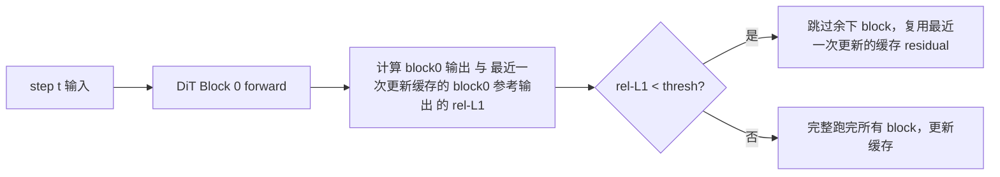

# DiT Cache (FBCache / TeaCache / TaylorSeer)

## Summary

DiT-Cache 是扩散生成模型推理加速的 Step-level 缓存框架：**利用相邻采样 step 间输出变化平滑的性质，复用或预测上一步的残差**，以跳过当前 step 的完整前向计算。cann-recipes-infer 的实现位于 `module/dit_cache/cache_method.py`（HunyuanVideo 使用）与 `module/dit_cache_step/cache_step.py`（Wan2.2-I2V 使用），支持三种范式：**FBCache**（First-Block L1 误差判据）、**TeaCache**（Timestep Embedding Modulated Noisy Input L1 距离 + 多项式 rescale 判据）、**TaylorSeer**（泰勒级数预测）。HunyuanVideo 的固定来源数据由独立观测维护。

## Mechanism

DiT-Cache 加速逻辑分两种粒度：

- **Step-level**：判断不同采样步数 step 间的特定特征差异，通过阈值比较决定是否跳过完整 step、直接复用或预测缓存结果
- **Block-level**：以 block（attention、mlp）为粒度判断复用

cann-recipes-infer 集成的是 Step-level。

### FBCache（First-Block Cache）



### TeaCache

TeaCache 使用 Timestep Embedding Modulated Noisy Input 的 L1 距离（经多项式 rescale 后累加）作为判据：

缓存判据使用经模型相关多项式重标定后累积的相对 L1 距离；配置与误差验收由[FBCache/TeaCache 规则](../../optimizations/rules/dit_step_cache_fbcache_teacache.md)维护，不复制简化的张量调用代码。

多项式系数来自 [TeaCache 官方仓库](https://github.com/ali-vilab/TeaCache/blob/7c10efc4702c6b619f47805f7abe4a7a08085aa0/TeaCache4HunyuanVideo/teacache_sample_video.py#L102)。

### TaylorSeer（HunyuanVideo 独有）

Benchmark 表中 "TaylorSeer 算 1 跳 3，使用三阶泰勒"，该组结果只在其来源配置下成立，性能数字见独立观测。承重参数（`cache_config.json` TaylorSeer）：算 1 跳 3 = `skip_interval_steps: 4`、三阶 = `n_derivatives: 3`、`warmup: 3`（强制前 3 步 full）、`cutoff_steps: 1`（末 1 步 full）、`offload: true`。step 类型判据（`_get_step_type`）：`step < warmup` 或 `(step - warmup) % skip_interval_steps == 0` 或 `(total_steps - step) <= cutoff_steps` → full 完整计算，否则 taylor 预测。预测时 `taylor_formula` 按泰勒级数 `output += (1/i!) · 导数因子 · x^i`（`derivative_approximation` 用相邻 `activated_steps` 差分逐阶求导数因子）外推。

### Cache + SP

多卡 SP 下，各 rank 的 l1 loss 差异会导致跳步判断不同步；需要一次 all_reduce 取均值：

```python
# 来源：固定 module/dit_cache/cache_method.py；省略外围类定义与导入。
def _sync_scalar_for_sp(self, value: float) -> float:
    value = value.item() if torch.is_tensor(value) else value
    if self.sp_group is None or self.sp_world_size <= 1:
        return value
    tensor = torch.tensor([value], dtype=torch.float32, device='npu')
    dist.all_reduce(tensor, op=dist.ReduceOp.SUM, group=self.sp_group)
    return tensor.item() / self.sp_world_size
```

### CFG 分离（Wan2.2-I2V）

由于 WAN2.2 具有 CFG 串行的特点，Wan2.2-I2V 使用 [TeaCache4Wan2.1 官方实现的 cond/uncond 分别管理版](https://github.com/ali-vilab/TeaCache/tree/7c10efc4702c6b619f47805f7abe4a7a08085aa0/TeaCache4Wan2.1)；配置开关 `"enable_separate_cfg": true`。

## Applicable Scenarios

在已接入缓存且质量允许的多步采样实现中，分析跨步复用或预测的候选机制。阈值、系数和 warmup 由具体模型配置与输出质量验收决定，不能从单次表格规定通用最优值。

## Constraints

- **阈值权衡**：阈值越大跳步越多，精度损失越大
- **TeaCache 多项式系数模型相关**：不同 DiT 模型需要重新拟合
- **CFG 必须分离**：cond/uncond 共享 cache 会导致跳步判断错位
- **Warmup 步数**：DiT 在 step 开始/结束阶段变化剧烈，需要 warmup 强制前后 N 步完整计算。TeaCache 的 warmup 通用——HunyuanVideo 与 Wan2.2-I2V 的 `cache_config.json` 中 TeaCache 默认均为 `warmup: 2`；TaylorSeer 默认 `warmup: 3`

## Known Results

[HunyuanVideo A3 累计来源观测](../../optimizations/benchmark_observations/hunyuan_video_a3_source_benchmark.md)维护缓存组合数据，不是单项受控收益。模型配置、版本差异与回退分别见[HunyuanVideo Guide](../../guides/models/hunyuan_video_deployment.md)和[Wan Guide](../../guides/models/wan2_2_i2v_deployment.md)。

## Evidence

- [cann-recipes-infer](https://gitcode.com/cann/cann-recipes-infer/tree/2c45117d781ab9ab88dcb89a28ae30f5d2450399) — [`docs/models/hunyuan-video/hunyuan_video_optimization.md`](https://gitcode.com/cann/cann-recipes-infer/blob/2f82d10467e6fe8dae81c97a2cdac78d733a6703/docs/models/hunyuan-video/hunyuan_video_optimization.md) Dit Cache / cache config / cache for sp
- [cann-recipes-infer](https://gitcode.com/cann/cann-recipes-infer/tree/2c45117d781ab9ab88dcb89a28ae30f5d2450399) — [`docs/models/wan2.2-i2v/wan2.2-i2v_optimization.md`](https://gitcode.com/cann/cann-recipes-infer/blob/2f82d10467e6fe8dae81c97a2cdac78d733a6703/docs/models/wan2.2-i2v/wan2.2-i2v_optimization.md) Dit-Cache 段
- [cann-recipes-infer](https://gitcode.com/cann/cann-recipes-infer/tree/2c45117d781ab9ab88dcb89a28ae30f5d2450399) — [`module/dit_cache/cache_method.py`](https://gitcode.com/cann/cann-recipes-infer/blob/2f82d10467e6fe8dae81c97a2cdac78d733a6703/module/dit_cache/cache_method.py) `module/dit_cache_step/cache_step.py`

## Links

- [dit](../modules/dit.md)
- [cfg-parallel](../parallelism/cfg_parallel.md)
- [mm-inference-launch](../frameworks/mm_inference_launch.md)
- [hunyuan-video](../models/hunyuan_video.md)
- [wan2.2-i2v](../models/wan2_2_i2v.md)
- [hunyuan3d](../../../spatial/concepts/models/hunyuan3d.md)（跨域·空间智能：Hunyuan3D step-level DiT-Cache(FBCache/TeaCache/TaylorSeer) 适配）
- [mindspeed-mm](../../../training/concepts/frameworks/mindspeed_mm.md)（跨域·训练：MindSpeed-MM 扩散生成训练相关(推理侧 DiT-Cache 对照)）
