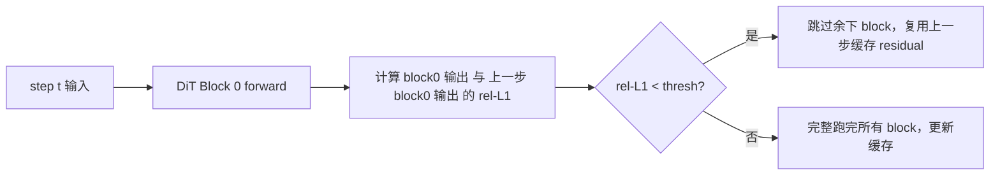

# DiT Cache (FBCache / TeaCache / TaylorSeer)

## Summary

DiT-Cache 是扩散生成模型推理加速的 Step-level 缓存框架：**利用相邻采样 step 间输出变化平滑的性质，复用或预测上一步的残差**，以跳过当前 step 的完整前向计算。cann-recipes-infer 的实现位于 `module/dit_cache/cache_method.py`（HunyuanVideo 使用）与 `module/dit_cache_step/cache_step.py`（Wan2.2-I2V 使用），支持三种范式：**FBCache**（First-Block L1 误差判据）、**TeaCache**（Timestep Embedding Modulated Noisy Input L1 距离 + 多项式 rescale 判据）、**TaylorSeer**（泰勒级数预测）。HunyuanVideo 上实测 FBCache 2.12×、TeaCache 2.06×、TaylorSeer 2.51× 端到端。

## Mechanism

DiT-Cache 加速逻辑分两种粒度：

- **Step-level**：判断不同采样步数 step 间的特定特征差异，通过阈值比较决定是否跳过完整 step、直接复用或预测缓存结果
- **Block-level**：以 block（attention、mlp）为粒度判断复用

cann-recipes-infer 集成的是 Step-level。

### FBCache（First-Block Cache）



### TeaCache

TeaCache 使用 Timestep Embedding Modulated Noisy Input 的 L1 距离（经多项式 rescale 后累加）作为判据：

```python
# 来源：docs/models/hunyuan-video/hunyuan_video_optimization.md
coefficients = [7.33226126e+02, -4.01131952e+02, 6.75869174e+01, -3.14987800e+00, 9.61237896e-02]
rescale_func = np.poly1d(coefficients)
self.accumulated_rel_l1_distance += rescale_func(
 ((modulated_inp - self.previous_modulated_input).abs.mean /
 self.previous_modulated_input.abs.mean).cpu.item
)
if self.accumulated_rel_l1_distance < self.rel_l1_thresh:
 should_calc = False
else:
 should_calc = True
 self.accumulated_rel_l1_distance = 0
```

多项式系数来自 [TeaCache 官方仓库](https://github.com/ali-vilab/TeaCache/blob/7c10efc4702c6b619f47805f7abe4a7a08085aa0/TeaCache4HunyuanVideo/teacache_sample_video.py#L102)。

### TaylorSeer（HunyuanVideo 独有）

Benchmark 表中 "TaylorSeer 算 1 跳 3，使用三阶泰勒"，端到端 2.51×，效果好于 FBCache/TeaCache。承重参数（`cache_config.json` TaylorSeer）：算 1 跳 3 = `skip_interval_steps: 4`、三阶 = `n_derivatives: 3`、`warmup: 3`（强制前 3 步 full）、`cutoff_steps: 1`（末 1 步 full）、`offload: true`。step 类型判据（`_get_step_type`）：`step < warmup` 或 `(step - warmup) % skip_interval_steps == 0` 或 `(total_steps - step) <= cutoff_steps` → full 完整计算，否则 taylor 预测。预测时 `taylor_formula` 按泰勒级数 `output += (1/i!) · 导数因子 · x^i`（`derivative_approximation` 用相邻 `activated_steps` 差分逐阶求导数因子）外推。

### Cache + SP

多卡 SP 下，各 rank 的 l1 loss 差异会导致跳步判断不同步；需要一次 all_reduce 取均值：

```python
# 来源：docs/models/hunyuan-video/hunyuan_video_optimization.md cache for sp
def _sync_scalar_for_sp(self, value: float) -> float:
 if self.sp_group is None or self.sp_world_size <= 1:
 return value
 tensor = torch.tensor([value], dtype=torch.float32, device='npu')
 dist.all_reduce(tensor, op=dist.ReduceOp.SUM, group=self.sp_group)
 return (tensor.item / self.sp_world_size)
```

### CFG 分离（Wan2.2-I2V）

由于 WAN2.2 具有 CFG 串行的特点，Wan2.2-I2V 使用 [TeaCache4Wan2.1 官方实现的 cond/uncond 分别管理版](https://github.com/ali-vilab/TeaCache/tree/7c10efc4702c6b619f47805f7abe4a7a08085aa0/TeaCache4Wan2.1)；配置开关 `"enable_separate_cfg": true`。

## Applicable Scenarios

- 所有多步采样 DiT 模型（HunyuanVideo、Wan2.2-I2V，HunyuanImage-3.0 源文档未提及但原理通用）
- 精度敏感时选择阈值较小的 FBCache（0.05）；追求加速可选 TaylorSeer 或放大 TeaCache 阈值（0.10–0.15）

## Constraints

- **阈值权衡**：阈值越大跳步越多，精度损失越大
- **TeaCache 多项式系数模型相关**：不同 DiT 模型需要重新拟合
- **CFG 必须分离**：cond/uncond 共享 cache 会导致跳步判断错位
- **Warmup 步数**：DiT 在 step 开始/结束阶段变化剧烈，需要 warmup 强制前后 N 步完整计算。TeaCache 的 warmup 通用——HunyuanVideo 与 Wan2.2-I2V 的 `cache_config.json` 中 TeaCache 默认均为 `warmup: 2`；TaylorSeer 默认 `warmup: 3`

## Known Results

HunyuanVideo（Atlas A3，单卡 baseline 3768.91 s）：

| 方案 | dit (s) | e2e (s) | e2e speedup |
| ---- | ------- | ------- | ----------- |
| baseline（仅 FIA） | 3634.48 | 3768.91 | 1.00 |
| 融合算子 | 3568.36 | 3612.30 | 1.04 |
| + FBCache (thresh=0.05) | 1693.89 | 1778.28 | 2.12 |
| + TeaCache (thresh=0.15) | 1737.92 | 1830.75 | 2.06 |
| + TaylorSeer (1 跳 3, 三阶) | 1405.68 | 1500.17 | **2.51** |

Wan2.2-I2V 通过 `cache_config.json` 热切换方案，默认 NoCache：

```json
{
 "cache_forward": "NoCache",
 "enable_separate_cfg": true,
 "FBCache": {"cache_name": "FBCache", "rel_l1_thresh": 0.05, "latent": "latent", "judge_input": "cache_latent"},
 "TeaCache": {"cache_name": "TeaCache", "rel_l1_thresh": 0.1,
 "coefficients": [733.226126, -401.131952, 67.5869174, -3.149879, 0.0961237896],
 "latent": "latent", "warmup": 2, "judge_input": "modulated_inp"}
}
```

## Evidence

- [cann-recipes-infer](https://gitcode.com/cann/cann-recipes-infer/tree/2c45117d781ab9ab88dcb89a28ae30f5d2450399) — [`docs/models/hunyuan-video/hunyuan_video_optimization.md`](https://gitcode.com/cann/cann-recipes-infer/blob/2f82d10467e6fe8dae81c97a2cdac78d733a6703/docs/models/hunyuan-video/hunyuan_video_optimization.md) Dit Cache / cache config / cache for sp
- [cann-recipes-infer](https://gitcode.com/cann/cann-recipes-infer/tree/2c45117d781ab9ab88dcb89a28ae30f5d2450399) — [`docs/models/wan2.2-i2v/wan2.2-i2v_optimization.md`](https://gitcode.com/cann/cann-recipes-infer/blob/2f82d10467e6fe8dae81c97a2cdac78d733a6703/docs/models/wan2.2-i2v/wan2.2-i2v_optimization.md) Dit-Cache 段
- [cann-recipes-infer](https://gitcode.com/cann/cann-recipes-infer/tree/2c45117d781ab9ab88dcb89a28ae30f5d2450399) — [`module/dit_cache/cache_method.py`](https://gitcode.com/cann/cann-recipes-infer/blob/2f82d10467e6fe8dae81c97a2cdac78d733a6703/module/dit_cache/cache_method.py) `module/dit_cache_step/cache_step.py`

## Links

- [dit](../modules/dit.md)
- [cfg-parallel](../parallelism/cfg_parallel.md)
- [mm-inference-launch](../frameworks/mm_inference_launch.md)
- [hunyuan-video](../models/hunyuan_video.md)
- [wan2.2-i2v](../models/wan2_2_i2v.md)
- [hunyuan3d](../../../spatial/concepts/models/hunyuan3d.md)（跨域·空间智能：Hunyuan3D step-level DiT-Cache(FBCache/TeaCache/TaylorSeer) 适配）
- [mindspeed-mm](../../../training/concepts/frameworks/mindspeed_mm.md)（跨域·训练：MindSpeed-MM 扩散生成训练相关(推理侧 DiT-Cache 对照)）

<!-- cannbot:related:start -->
## 相关

- [DiT 步间缓存与多卡序列并行共存（数据相关判据须跨卡取一致决策，样例默认互斥）](../../optimizations/experience/rules/dit_cache_with_sequence_parallel.md)（`related`）：使用数据相关判据的缓存与 SP 共存时，需在 SP 通信组内归约各 rank 的判据标量，使跳步决策和 cache-miss 路径保持一致。
- [DiT 跳步缓存想更激进跳步且精度损失更小 — TaylorSeer 预测式缓存（记特征导数泰勒外推，代价：全阶导数显存需 offload + 仅单卡）](../../optimizations/experience/rules/taylorseer_predictive_dit_cache.md)（`related`）：TaylorSeer 以特征导数作泰勒外推，可支持更激进的跳步；需评估导数缓存显存、offload 和单卡限制。
- [DiT 采样步残差缓存（FBCache / TeaCache）键控、阈值权衡与 TeaCache 属性名 bug](../../optimizations/experience/rules/dit_step_cache_fbcache_teacache.md)（`related`）：FBCache/TeaCache 阈值越大，跳步越激进、精度损失越大；还需核对 TeaCache 属性名及状态键。
- [HunyuanVideo](../models/hunyuan_video.md)（`related`）：HunyuanVideo 使用 FBCache、TeaCache 或 TaylorSeer 在采样步之间复用或预测残差。
- [Wan2.2-I2V](../models/wan2_2_i2v.md)（`related`）：Wan2.2-I2V 通过 cache 配置选择 FBCache/TeaCache，复用 step-level 残差以跳过完整前向。
- [step-level DiT 跳步缓存遇 CFG 串行双分支 — 缓存状态必须按 guidance 分支分槽，否则 cond/uncond 互相覆盖残差](../../optimizations/experience/rules/dit_step_cache_cfg_branch_slotting.md)（`related`）：CFG 的 cond/uncond 串行进入同一缓存逻辑时，必须分别保存判据与残差，并按分支复位状态。
- [视频 DiT TaylorSeer 特征缓存 NPU OOM：offload 到 Host + 预取搬算并行；Host 内存成新瓶颈](../../guides/experience/interventions/video_dit_taylorseer_cache_offload.md)（`related`）：TaylorSeer 的导数缓存可通过 Host offload 与预取降低 NPU 显存占用，同时需评估 Host 内存容量。
<!-- cannbot:related:end -->
