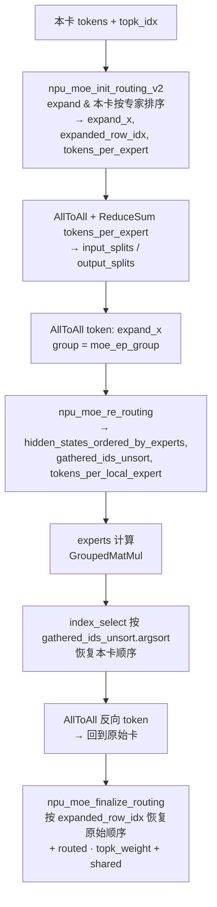

# MoE Double-Routing

## Summary

DeepSeek-R1 / Kimi-K2 等大 EP MoE 模型在 Prefill 阶段使用的专家路由方案。每张卡完成 **两轮路由与两轮顺序恢复（末轮调用一次 npu_moe_finalize_routing）**：第一次做本卡内按专家排序 + 通过 AllToAll+ReduceSum 推导 `input_splits` / `output_splits`；token AllToAll 之后再做一次 re-routing 让本卡 token 按本地专家再次排序。相较 AllGather 全量方案，Double-Routing 在负载较均衡时**峰值显存更低**（无数据冗余）且**通信量更小**。

## Mechanism



源图原貌如下，结构示意见上方 mermaid：


*来源：[`docs/models/deepseek-r1/figures/image_double_routing.png`](../../../../../cann-recipes-raw/cann-recipes-infer/944d2d3ece86f7df33dbb0cb155c72ca619a9c66/docs/models/deepseek_r1/figures/image_double_routing.png)（cann-recipes-infer @ 944d2d3）*

### 8 步详述

源文档 `docs/models/deepseek-r1/deepseek_r1_prefill_optimization.md`：

1. 调用 `npu_moe_init_routing_v2` 对本卡 token 按专家 expand + 排序，得到 `expand_x`、`tokens_per_expert`、`expanded_row_idx`（**第一次 routing**）：
 ```python
 expanded_x, expanded_row_idx, tokens_per_expert, _ = torch_npu.npu_moe_init_routing_v2(...)
 ```
2. 对 `tokens_per_expert` 做 AllToAll + ReduceSum，得到 `input_splits`（本卡要发给其他卡的 token 数）和 `output_splits`（从其他卡收到的 token 数）。
3. AllToAll token 分发：
 ```python
 dist.all_to_all_single(gathered_tokens, expanded_x, output_splits, input_splits, group=moe_ep_group)
 ```
4. 收到的 token 处于乱序，再做一次 re-routing（**第二次 routing**）：
 ```python
 hidden_states_ordered_by_experts, _, gathered_ids_unsort, tokens_per_local_expert \
 = torch_npu.npu_moe_re_routing(...)
 ```
5. 本卡路由专家 + shared expert 计算（GroupedMatMul）：
 ```python
 hidden_states_ordered_by_experts = experts(**args)
 ```
6. 用 `torch.index_select` + `argsort` 恢复本卡 token 顺序（**第一轮顺序恢复，不调用 finalize_routing 接口**，与第二次 routing 对应）：
 ```python
 new_x = torch.index_select(hidden_states_ordered_by_experts, 0,
 gathered_ids_unsort.float().argsort().int())
 ```
7. AllToAll 反向，把本卡 token 送回原始卡：
 ```python
 dist.all_to_all_single(gathered_tokens, new_x, input_splits, output_splits, group=moe_ep_group)
 ```
8. 调用 `npu_moe_finalize_routing`（**第二轮顺序恢复，调用一次 finalize_routing 接口**，与第一次 routing 对应），恢复原始 token 排布，同时直接完成 routed + shared 的加权求和：
 ```python
 hidden_states = torch_npu.npu_moe_finalize_routing(
 gathered_tokens, skip1=hidden_states_share, skip2=None, bias=None,
 scales=topk_weight.to(gathered_tokens.dtype),
 expanded_src_to_dst_row=expanded_row_idx,
 export_for_source_row=None, drop_pad_mode=2
 )
 ```

### A8W8 路径

A8W8 场景下 `npu_moe_init_routing_v2` 直接与后续 dynamic-quant 融合，输出 INT8 + `pertoken_scale`。当前double-routing路径（moe_infer_double_routing）的第一次 init-routing 直接内联传参，A8W8 时仅打开 `scale=smooth_scale_1` 与 `quant_mode=1`（dynamic quant），`expert_tokens_num_type` 恒为 `1`（count mode），**不设** `row_idx_type` / `drop_pad_mode` / `expert_tokens_num_type=2`：

```python
expanded_x, expanded_row_idx, tokens_per_expert, pertoken_scale \
 = torch_npu.npu_moe_init_routing_v2(
 hidden_states, expert_idx=topk_ids,
 active_num=topk_ids.shape[0] * topk_ids.shape[1],
 scale=self.experts.smooth_scale_1 if "a8" in self.gmm_quant_mode else None,
 expert_num=self.num_experts,
 expert_tokens_num_type=1, # count mode
 expert_tokens_num_flag=True, active_expert_range=[0, self.num_experts],
 quant_mode=1 if "a8" in self.gmm_quant_mode else -1, # 1: dynamic quant
 )
```

来自 `models/deepseek_r1/models/modeling_deepseek.py` 中 `moe_infer_double_routing`。

> 注：另一处 `routing_args.update({scale, quant_mode:1, expert_tokens_num_type:2, row_idx_type:0, drop_pad_mode:0})` 的 A8W8 量化片段出自 `moe_infer_tp`（TP路径，moe_tp_size>1），**不属于本页 double-routing 流程**——两条分支的 init-routing 量化参数不可互套。

## Applicable Scenarios

- 大 EP（16+、128+）MoE 部署的 Prefill 阶段。
- 每卡均持有 shared expert + 本卡分得的 routed experts。
- [longcat-flash-lite](../models/longcat_flash_lite.md) Prefill 走 `_dispatch_double_routing`（两轮 AllToAll）：因 MC2 `dispatch_v2` 单层 token 数受 BS 上限（约 512）约束无法用于 Prefill 大序列；其 当前A2部署在每rank专家数>24时自动回退DR，开关显式关闭也可回退。
- 与 Decode 阶段更常用的 `npu_moe_distribute_dispatch_v2` / `combine_v2` 一体化算子（[moe-dispatch-combine-v2](moe_dispatch_combine_v2.md)）形成对比：后者在 decode 单 token 场景下更高效，double-routing 在 Prefill 大序列场景收益显著。
- [qwen3-5-moe](../models/qwen3_5_moe.md) 的普通 EP 路径与本方案**同源**（`init_routing_v2` → AllToAll splits → 分发 → `re_routing` → GroupedMatmul → `torch.index_select` 恢复 → 反向 AllToAll → `finalize_routing`），Qwen3.5 与本页 R1 均以 `torch.index_select` 完成第一轮恢复，末轮调用一次 `finalize_routing`；逻辑路由/恢复次数不等于同名接口调用次数。其纯 EP Decode（`moe_ep_size>1` 且 `moe_tp_size==1`）可替换为 dispatch_v2/combine_v2 融合路径。

当前R1该函数仍注明只支持eager，Prefill并不会因YAML指定Decode图模式而入图。新实现进入层循环前先按moe_chunk_max_len求EP MAX chunk数，tensor_split在各rank返回相同份数（含空片），保持token/scale/topk/shared顺序及集合通信轮次一致；mode2微批分别计算，避免每层同步。不能只按本地token数独立循环。

## Constraints

- 相比一体化 dispatch/combine，**多了一次 re-routing 计算** + 额外一轮 AllToAll，host 下发压力更大，在 host bound 场景下反而变慢。
- 负载极度不均时效益下降（individual 卡显存仍可能飙升，可用 Chunk MoE 分块缓解显存峰值；perfect eplb 是性能观测的理想负载条件，force_eplb 会用轮转生成的 expert ID 覆盖真实门控选择、改变路由，不能作为保持模型语义的通用补救）。
- `npu_moe_finalize_routing` 的 `drop_pad_mode=2` 约束需要上游 `expanded_src_to_dst_row` 正确传递。

## Known Results

源文档定性比较负载均衡下的峰值内存与通信，不提供Double-Routing单项受控收益。R1完整Prefill数据见[R1 Prefill 来源观测](../../optimizations/benchmark_observations/deepseek_r1_a3_prefill_source_benchmark.md)，不能归因给路由算法。

## Evidence

- [README.md](../../../../../cann-recipes-raw/cann-recipes-infer/944d2d3ece86f7df33dbb0cb155c72ca619a9c66/README.md)（primary）
- [deepseek_r1_prefill_optimization.md](../../../../../cann-recipes-raw/cann-recipes-infer/944d2d3ece86f7df33dbb0cb155c72ca619a9c66/docs/models/deepseek_r1/deepseek_r1_prefill_optimization.md)（supporting）
- [modeling_deepseek.py](../../../../../cann-recipes-raw/cann-recipes-infer/944d2d3ece86f7df33dbb0cb155c72ca619a9c66/models/deepseek_r1/models/modeling_deepseek.py)（implementation）

## Links

- [deepseek-r1](../models/deepseek_r1.md)
- [qwen3-5-moe](../models/qwen3_5_moe.md)
- [longcat-flash-lite](../models/longcat_flash_lite.md)（Prefill 走 double-routing；当前A2超出每rank专家上限时自动回退至此）
- [expert-parallel](../parallelism/expert_parallel.md)
- [prefill-micro-batch](prefill_micro_batch.md)
- [w8a8c8](../quantization/w8a8c8.md)
- [moe-dispatch-combine-v2](moe_dispatch_combine_v2.md)（Decode 一体化融合算子路径，与本页 Prefill 多算子集合通信路由互为场景对照）
- [shmem-dispatch-combine](shmem_dispatch_combine.md)（同解 EP All-to-All 的另一路：基于 SHMEM 对称内存 win 区单边通信重写 dispatch&combine，区别于本页 HCCL AllToAll 集合通信路由）
- [tilelang-moe-token-permute](../../../training/concepts/kernels/tilelang_moe_token_permute.md)（跨域·训练：MoE token permute/unpermute 的 TileLang 训练实现）
