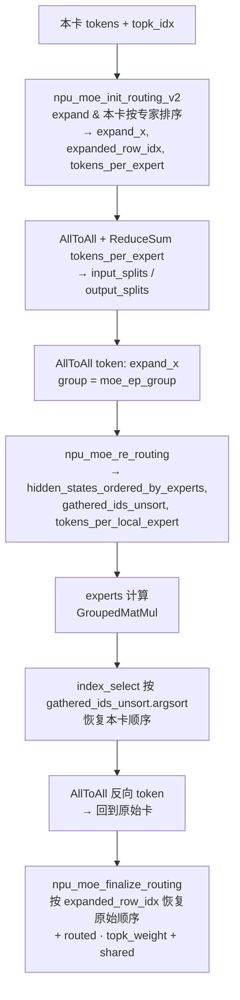

# MoE Double-Routing

## Summary

DeepSeek-R1 / Kimi-K2 等大 EP MoE 模型在 Prefill 阶段使用的专家路由方案。每张卡完成 **2 次 init-routing + 2 次 finalize-routing**：第一次做本卡内按专家排序 + 通过 AllToAll+ReduceSum 推导 `input_splits` / `output_splits`；token AllToAll 之后再做一次 re-routing 让本卡 token 按本地专家再次排序。相较 AllGather 全量方案，Double-Routing 在负载较均衡时**峰值显存更低**（无数据冗余）且**通信量更小**。

## Mechanism



源图原貌如下，结构示意见上方 mermaid：


*来源：[`docs/models/deepseek-r1/figures/image_double_routing.png`](https://gitcode.com/cann/cann-recipes-infer/blob/2f82d10467e6fe8dae81c97a2cdac78d733a6703/docs/models/deepseek-r1/figures/image_double_routing.png)（cann-recipes-infer @ 2f82d10）*

### 8 步详述

源文档 `docs/models/deepseek-r1/deepseek_r1_prefill_optimization.md`：

1. 调用 `npu_moe_init_routing_v2` 对本卡 token 按专家 expand + 排序，得到 `expand_x`、`tokens_per_expert`、`expanded_row_idx`（**第一次 routing**）：
 ```python
 expanded_x, expanded_row_idx, tokens_per_expert, _ = torch_npu.npu_moe_init_routing_v2(...)
 ```
2. 对 `tokens_per_expert` 做 AllToAll + ReduceSum，得到 `input_splits`（本卡要发给其他卡的 token 数）和 `output_splits`（从其他卡收到的 token 数）。
3. AllToAll token 分发：
 ```python
 dist.all_to_all_single(gathered_tokens, expanded_x, output_splits, input_splits, group=moe_ep_group)
 ```
4. 收到的 token 处于乱序，再做一次 re-routing（**第二次 routing**）：
 ```python
 hidden_states_ordered_by_experts, _, gathered_ids_unsort, tokens_per_local_expert \
 = torch_npu.npu_moe_re_routing(...)
 ```
5. 本卡路由专家 + shared expert 计算（GroupedMatMul）：
 ```python
 hidden_states_ordered_by_experts = experts(**args)
 ```
6. 用 `torch.index_select` + `argsort` 恢复本卡 token 顺序（**第一次 finalize-routing**，与第二次 routing 对应）：
 ```python
 new_x = torch.index_select(hidden_states_ordered_by_experts, 0,
 gathered_ids_unsort.float.argsort.int)
 ```
7. AllToAll 反向，把本卡 token 送回原始卡：
 ```python
 dist.all_to_all_single(gathered_tokens, new_x, input_splits, output_splits, group=moe_ep_group)
 ```
8. 调用 `npu_moe_finalize_routing`（**第二次 finalize-routing**，与第一次 routing 对应），恢复原始 token 排布，同时直接完成 routed + shared 的加权求和：
 ```python
 hidden_states = torch_npu.npu_moe_finalize_routing(
 gathered_tokens, skip1=hidden_states_share, skip2=None, bias=None,
 scales=topk_weight.to(gathered_tokens.dtype),
 expanded_src_to_dst_row=expanded_row_idx,
 export_for_source_row=None, drop_pad_mode=2
 )
 ```

### A8W8 路径

A8W8 场景下 `npu_moe_init_routing_v2` 直接与后续 dynamic-quant 融合，输出 INT8 + `pertoken_scale`。本页 double-routing 路径（`moe_infer_double_routing`，L644-668）的第一次 init-routing 直接内联传参，A8W8 时仅打开 `scale=smooth_scale_1` 与 `quant_mode=1`（dynamic quant），`expert_tokens_num_type` 恒为 `1`（count mode），**不设** `row_idx_type` / `drop_pad_mode` / `expert_tokens_num_type=2`：

```python
expanded_x, expanded_row_idx, tokens_per_expert, pertoken_scale \
 = torch_npu.npu_moe_init_routing_v2(
 hidden_states, expert_idx=topk_ids,
 active_num=topk_ids.shape[0] * topk_ids.shape[1],
 scale=self.experts.smooth_scale_1 if "a8" in self.gmm_quant_mode else None,
 expert_num=self.num_experts,
 expert_tokens_num_type=1, # count mode
 expert_tokens_num_flag=True, active_expert_range=[0, self.num_experts],
 quant_mode=1 if "a8" in self.gmm_quant_mode else -1, # 1: dynamic quant
 )
```

来自 `models/deepseek_r1/models/modeling_deepseek.py` 中 `moe_infer_double_routing`（L656-666）。

> 注：另一处 `routing_args.update({scale, quant_mode:1, expert_tokens_num_type:2, row_idx_type:0, drop_pad_mode:0})` 的 A8W8 量化片段出自 `moe_infer_tp`（TP 混切路径，`moe_tp_size>1`，L563-567），**不属于本页 double-routing 流程**——两条分支的 init-routing 量化参数不可互套。

## Applicable Scenarios

- 大 EP（16+、128+）MoE 部署的 Prefill 阶段。
- 每卡均持有 shared expert + 本卡分得的 routed experts。
- [longcat-flash-lite](../models/longcat_flash_lite.md) Prefill 走 `_dispatch_double_routing`（两轮 AllToAll）：因 MC2 `dispatch_v2` 单层 token 数受 BS 上限（约 512）约束无法用于 Prefill 大序列；其 A2 部署亦因 `experts_per_rank ≤ 24`（EP=8 下 32/rank 不满足）回退 double-routing。
- 与 Decode 阶段更常用的 `npu_moe_distribute_dispatch_v2` / `combine_v2` 一体化算子（[moe-dispatch-combine-v2](moe_dispatch_combine_v2.md)）形成对比：后者在 decode 单 token 场景下更高效，double-routing 在 Prefill 大序列场景收益显著。
- [qwen3-5-moe](../models/qwen3_5_moe.md) 的普通 EP 路径与本方案**同源**（`init_routing_v2` → AllToAll splits → 分发 → `re_routing` → GroupedMatmul → `torch.index_select` 恢复 → 反向 AllToAll → `finalize_routing`），但 Qwen3.5 链路用 `torch.index_select` 恢复本卡顺序、**仅 1 次 `finalize_routing`**，与本页 DeepSeek-R1 版的"2 次 init-routing + 2 次 finalize-routing"略有差异——读 Qwen3.5 时不必逐字套用上述 R1 的 8 步细分。其纯 EP Decode（`moe_ep_size>1` 且 `moe_tp_size==1`）可替换为 dispatch_v2/combine_v2 融合路径。

## Constraints

- 相比一体化 dispatch/combine，**多了一次 re-routing 计算** + 额外一轮 AllToAll，host 下发压力更大，在 host bound 场景下反而变慢。
- 负载极度不均时效益下降（individual 卡显存仍可能飙升，需要配合 Chunk MoE 与 perfect eplb）。
- `npu_moe_finalize_routing` 的 `drop_pad_mode=2` 约束需要上游 `expanded_src_to_dst_row` 正确传递。

## Known Results

源文档未单独给出 double-routing 相对 AllGather 的量化对比，但强调：

1. 负载均衡下峰值显存更低，无数据冗余；
2. 通信量更低，通信耗时更优。

Prefill 整体 **MLA-DP32 + MoE-EP32** 在 A3 2 机环境下 64×4K 输入达到 5237 tokens/卡/s；叠加 micro-batch 提升到 6522 tokens/卡/s（详见 [prefill-micro-batch](prefill_micro_batch.md)）。

## Evidence

- [cann-recipes-infer](https://gitcode.com/cann/cann-recipes-infer/tree/2c45117d781ab9ab88dcb89a28ae30f5d2450399) — [`docs/models/deepseek-r1/deepseek_r1_prefill_optimization.md`](https://gitcode.com/cann/cann-recipes-infer/blob/2f82d10467e6fe8dae81c97a2cdac78d733a6703/docs/models/deepseek-r1/deepseek_r1_prefill_optimization.md) "MoE 部署策略优化"章节；`models/deepseek_r1/models/modeling_deepseek.py:L468-L535`（`forward_gate_init_routing` / `forward_expert` / `forward_combine_double_routing` / `forward_finalize_routing`）、`L548-L680`（`moe_infer_tp` / `moe_infer_double_routing`）。

## Links

- [deepseek-r1](../models/deepseek_r1.md)
- [qwen3-5-moe](../models/qwen3_5_moe.md)
- [longcat-flash-lite](../models/longcat_flash_lite.md)（Prefill 走 double-routing；A2 因 experts_per_rank≤24 亦回退至此）
- [expert-parallel](../parallelism/expert_parallel.md)
- [prefill-micro-batch](prefill_micro_batch.md)
- [w8a8c8](../quantization/w8a8c8.md)
- [moe-dispatch-combine-v2](moe_dispatch_combine_v2.md)（Decode 一体化融合算子路径，与本页 Prefill 多算子集合通信路由互为场景对照）
- [shmem-dispatch-combine](shmem_dispatch_combine.md)（同解 EP All-to-All 的另一路：基于 SHMEM 对称内存 win 区单边通信重写 dispatch&combine，区别于本页 HCCL AllToAll 集合通信路由）
- [tilelang-moe-token-permute](../../../training/concepts/kernels/tilelang_moe_token_permute.md)（跨域·训练：MoE token permute/unpermute 的 TileLang 训练实现）

<!-- cannbot:related:start -->
## 相关

- [GLM-5](../models/glm_5.md)（`related`）：“Prefill 走 `moe_infer_double_routing`（`:574`，用 `npu_moe_init_routing_v2` / `npu_moe_re_routing` / `npu_moe_finalize_routing`），Decode 走 `moe_infer_dispatch_combine`（`:610`，一体化融合算子）。”与“每张卡完成 **2 次 init-routing + 2 次 finalize-routing**：第一次做本卡内按专家排序 + 通过 AllToAll+ReduceSum 推导 `input_splits` / `output_splits`；token AllToAll 之后再做一次 re-routing 让本卡 token 按本地专家再次排序。”提供双方正文证据。GLM-5 卡锁定 prefill 的 moe_infer_double_routing 调用链，技术卡展开两次 routing 与中间 AllToAll 的数据流，补齐该阶段的路由机制。
- [MoE Dispatch/Combine V2（一体化融合算子）](moe_dispatch_combine_v2.md)（`related`）：`torch_npu.npu_moe_distribute_dispatch_v2` / `npu_moe_distribute_combine_v2`（仓内文档亦称 **MC2** 路由）是把 MoE 专家并行（［expert-parallel］(../parallelism/expert_parallel.md)）的整条 All-to-All 路由链路收敛为**两个一体化融合算子**：；DeepSeek-R1 / Kimi-K2 等大 EP MoE 模型在 Prefill 阶段使用的专家路由方案。每张卡完成 **2 次 init-routing + 2 次 finalize-routing**：第一次做本卡内按专家排序 + 通过 AllToAll+ReduceSum 推导 `input_splits` / `output_splits`；token AllToAll 之后再做一次 re-routing 让本卡 token 按本地专家再次排序。相较 AllGather 全量方案，Double-Routing 在负载较均衡时**峰值显存更低**（无数据冗余）且**通信量更小**。。一体化 V2 卡明确把 Double-Routing 作为多算子替代路径，后者补齐 Prefill 大序列的两次重排与 AllToAll 任务图。
- [MoE 专家并行跨卡分发按 prefill/decode 阶段选型：多 token 走 double-routing、少 token 走融合 dispatch/combine](../../optimizations/experience/rules/moe_ep_dispatch_path_by_stage.md)（`related`）：DeepSeek-R1 / Kimi-K2 等大 EP MoE 模型在 Prefill 阶段使用的专家路由方案。；- **prefill（长序列、多 token）→ ［double-routing］(../../../concepts/techniques/double_routing.md)**：`npu_moe_init_routing_v2` 本地排序后，用两次 `dist.all_to_all_single`（先换每专家 token 计数、再换 token）路由；专家算完 `npu_moe_re_routing` 反重排、反向 all_to_all 收回、`npu_moe_finalize_routing` 加权求和。prefill 分发的是大批 token、更吃聚合带宽，变长 AllToAll 此时只发有效 token、无冗余。。概念卡给出 Double-Routing 机制，选型规则把它限定为 Prefill 多 token 分发并列出完整调用链。
- [MoE 长序列 prefill 峰值显存 / OOM：专家负载不均 + dispatch 中间量放大；分块 / 均衡 / double-routing 处置](../../runbooks/performance/moe_prefill_oom_peak_memory.md)（`related`）：纯 EP（`moe_tp_size==1`）的 prefill 走 `moe_infer_double_routing`（手写 AllToAll 路由），**不用** decode 的 dispatch/combine——因为 double-routing 每张卡只拿到本卡专家要算的 token，峰值内存更低、无内存冗余占用，通信量也更低。；DeepSeek-R1 / Kimi-K2 等大 EP MoE 模型在 Prefill 阶段使用的专家路由方案。每张卡完成 **2 次 init-routing + 2 次 finalize-routing**：第一次做本卡内按专家排序 + 通过 AllToAll+ReduceSum 推导 `input_splits` / `output_splits`；token AllToAll 之后再做一次 re-routing 让本卡 token 按本地专家再次排序。相较 AllGather 全量方案，Double-Routing 在负载较均衡时**峰值显存更低**（无数据冗余）且**通信量更小**。；焦点把 double-routing 作为低峰值处置，目标补齐其步骤与较低冗余成立条件。
- [MoeInitRoutingV3 950 ACLNN 算子知识](../../../../ops/ascendc/operators/aclnn/transformer/moe/moe_init_routing_950.md)（`related`）：950 算子定义“`keyValueSort(expertIdx, arange(L))` 得到 `(sortedExpert,sortedRow)`”；Double-Routing 的第一步是“调用 `npu_moe_init_routing_v2` 对本卡 token 按专家 expand + 排序”，概念页把该排序输出接入 AllToAll/re-routing/finalize，形成算子实现到完整 Prefill 路由链的直接衔接。
- [Prefill 用 micro-batch 双流把 MoE dispatch/combine 通信藏进计算](../../guides/experience/interventions/prefill_micro_batch_dual_stream_moe_overlap.md)（`related`）：核心是让一路的计算与另一 micro-batch 的 dispatch/combine 通信重叠；每张卡完成 **2 次 init-routing + 2 次 finalize-routing**；后者给出被前者重叠隐藏的完整路由通信骨架。
- [double-routing：MoE 从 TP 切 EP 把 routing/finalizing 开销降到 1/ep_size 的 8 步 AllToAll 骨架（相对 AllGather 更省峰值内存/通信）](../../optimizations/experience/rules/moe_ep_double_routing_skeleton.md)（`related`）：DeepSeek-R1 / Kimi-K2 等大 EP MoE 模型在 Prefill 阶段使用的专家路由方案。；MoE 在 ［TP］(../../../concepts/parallelism/tensor_parallel.md) 切分下，routing 与 finalizing 的计算量**与切分份数无关**（固定开销）：不论 RANK 数多少其开销一致，随 RANK 数增加占比越来越大且无法优化。改用 ［EP］(../../../concepts/parallelism/expert_parallel.md)（对 gating 切 S 轴 → per-rank gating 被切成 `ceil(S/ep_size)`）后，routing 与 finalizing 计算量降为约 **`1/ep_size`**。代价是引入 2~3 次 all_to_all 通信 + Local/Global rerouting，实现方式即 ［double-routing］(../../../concepts/techniques/double_routing.md)。。概念卡定义 Prefill Double-Routing，规则卡把它落实为 TP 转 EP 后的 routing/finalizing 降本和通信骨架。
- [基于 SHMEM 重写的 MoE Dispatch&Combine](shmem_dispatch_combine.md)（`related`）：［double-routing］(double_routing.md) 是 Prefill 阶段基于 `npu_moe_init_routing_v2` + `dist.all_to_all_single` 的 **8 步集合通信路由**（init-routing×2 + finalize-routing×2），走 HCCL AllToAll；SHMEM 重写则基于对称内存 win 区 + put/signal/wait 做**单边通信**，两者解决同一 EP All-to-All 问题但通信原语不同。；DeepSeek-R1 / Kimi-K2 等大 EP MoE 模型在 Prefill 阶段使用的专家路由方案。每张卡完成 **2 次 init-routing + 2 次 finalize-routing**：第一次做本卡内按专家排序 + 通过 AllToAll+ReduceSum 推导 `input_splits` / `output_splits`；token AllToAll 之后再做一次 re-routing 让本卡 token 按本地专家再次排序。相较 AllGather 全量方案，Double-Routing 在负载较均衡时**峰值显存更低**（无数据冗余）且**通信量更小**。；双方把同一 EP All-to-All 任务的单边 SHMEM 路线与 HCCL double-routing 路线做成可执行的机制对照。
- [昇腾融合 MoE 路由的整数契约：npu_moe_init_routing(_v2) 的 active_expert_range 只吃 int、topk_ids 须 int32](../../runbooks/runtime/npu_moe_init_routing_integer_contract.md)（`related`）：`npu_moe_init_routing(_v2)` 对若干标量入参有整数 dtype 契约：`active_expert_range` 只吃 Python int、`topk_ids` 须 int32。；调用 `npu_moe_init_routing_v2` 对本卡 token 按专家 expand + 排序，得到 `expand_x`、`tokens_per_expert`、`expanded_row_idx`（**第一次 routing**）；运行手册的整数归一必须在 Double-Routing 第一次 init-routing 入口前完成，概念卡展示该入口在 Prefill 八步链中的位置和后续 AllToAll 消费。
<!-- cannbot:related:end -->
