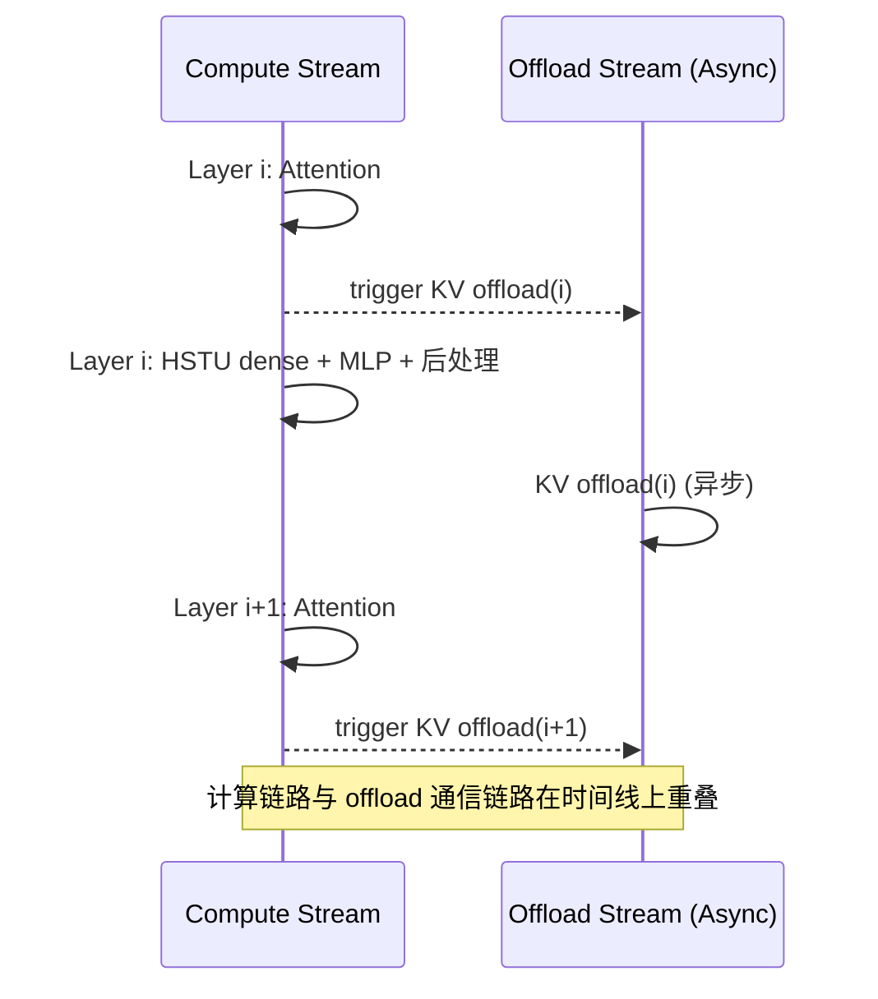

# KVCache Offload

## Summary

**KVCache Offload** 泛指把部分或全部 KV Cache 从设备 HBM 卸载到 Host 内存（或延后到异步 stream 上执行），以换取显存容量或计算/通信重叠。cann-recipes-infer 里实现了两个差异明显的 Offload 变体：

- **容量型 Offload（固定 Atlas A3 DeepSeek-V3.2-Exp）**：把 MLA Full KVCache 卸载到 Host 内存，Prefill 仅复用一层临时 Full KV 缓冲，设备另保留逐层 Decode selection KVCache，释放 HBM 以容纳更大的 batch 或更长的序列。Decode 阶段借助 Lightning Indexer TopK + `GatherSelectionKvCache` 算子，利用前后 Token 命中率复用设备端 cache，缓解 H2D 带宽压力。
- **时间型 Offload（固定 Atlas A2 HSTU）**：不改变 KV 存放位置（目标仍是 Host/外存），而是把每层 KV offload 的触发时机从"HSTU dense 完成后统一执行"前移到"每层 Attention 结束立即触发"，并切到一条独立 NPU stream 异步执行，从而让 offload 通信与 HSTU dense/MLP 计算在时间轴上重叠，降低流水线空泡。

两个变体的共同点是"释放设备内存 / 重叠通信"，差异在于**目标与约束**——容量型关心能否把更大的 workload 装下，时间型关心能否把现有 offload 的耗时掩盖掉。

> 区别于 [online-pd-inference](../frameworks/online_pd_inference.md) 的 PD KV 传输：本页 Offload 在**单实例内**把 KV 在 HBM↔Host（或异步 stream）间搬运；PD 分离是把 KV 跨**独立服务实例**经 RDMA/HCCL 直发，两者的 KV 流向重设计动机不同、不可混淆。

## 当前分配接口与预算

Full MLA KV使用统一CacheEntry的SWAPPED_MEMORY分配器。OffloadCache.build_workspace_spec先申报设备内存，再由init_offload_workspace/init_workspace分配；旧init_cache不再存在。主模型按num_hidden_layers，MTP按num_nextn_predict_layers声明层数。设备预算除临时Full KV和逐层selected KV，还包含selection块表、状态和default_topk_indices；INT8布局的cache_last_dim为kv_lora_rank+2×rope_dim+16字节，非量化单独保存rope。

batchseq=batch_size_per_dp_rank×(next_n+1)；selected块数为ceil(topk/block_size)×batchseq；临时块数根据pa_max_length或配置总长度取整并额外保留null block0。CP Prefill只向persistent_slot_mapping写持久槽，计算视图和持久视图不能混用。每次Prefill重置selection状态。

当前V3.2-Exp配置入口是model_config.custom_params.enable_offload；模型拒绝在线PD启用。下列容量数字仍是当前指南保留的W8A8C8/MTP3/perfect-eplb来源观测，不是当前默认YAML或独立复测的容量承诺。

## Variants

### 容量型 Offload — MLA Full KVCache → Host Memory（DeepSeek-V3.2-Exp）

把占比较高的 **MLA Full KVCache** 从设备 HBM 内存卸载到 **Host 内存**上。在 DeepSeek-V3.2-Exp 的 W8A8C8 + 长序列场景下，使能 Offload 可使**最大 batch 翻倍**（固定 64K：1024→2048）、或**最长序列 +50%**（固定 batch 128：256K→384K）。方案涉及 Prefill 和 Decode 两个阶段的 KV 流向重设计，以及一个**利用前后 Token TopK 相似度复用设备端 cache** 的 AscendC 新算子 [gather-selection-kv-cache](../kernels/gather_selection_kv_cache.md)。

**Prefill Stage**

Prefill 在设备上复用**一层临时 Full MLA KVCache**，同时每卡在 Host 内存上申请 **61 层**（源文档数字）KVCache 内存。MLA 计算完后**通过多流**把当前层设备上的 KVCache 卸载到 Host 侧。


*来源：[`docs/models/deepseek-v3.2-exp/figures/OffloadPrefill.png`](../../../../../cann-recipes-raw/cann-recipes-infer/944d2d3ece86f7df33dbb0cb155c72ca619a9c66/docs/models/deepseek_v3_2_exp/figures/OffloadPrefill.png)（cann-recipes-infer @ 944d2d3）*

**Decode Stage**

Decode 阶段的数据流：

1. 每层计算得到当前 Token 的 KVCache 更新到 Host 内存；
2. [lightning-indexer](../kernels/lightning_indexer.md) 产出 TopK index；
3. 新增的 **`npu_gather_selection_kv_cache`** 算子根据 index 从 Host 侧 Full KVCache 选出 TopK KV，搬回设备；
4. 聚合后的 `selection_kv_cache` 喂给 [sparse-flash-attention](../kernels/sparse_flash_attention.md)。


*来源：[`docs/models/deepseek-v3.2-exp/figures/OffloadDecode.png`](../../../../../cann-recipes-raw/cann-recipes-infer/944d2d3ece86f7df33dbb0cb155c72ca619a9c66/docs/models/deepseek_v3_2_exp/figures/OffloadDecode.png)（cann-recipes-infer @ 944d2d3）*

**复用设备端 Cache（关键优化）**

`GatherSelectionKvCache` 充分利用**前后 Token 在同一层上 TopK 命中率（相似度）特性**：若当前步 TopK 与前一步 TopK 有 **60% 一样**，仅需从 Host 读取 40% 未复用的 KV，60% 直接从设备上读，显著减少 H2D 耗时。

设备端复用所需元信息由 `OffloadCache`（[`models/deepseek-v3.2-exp/models/offload_cache.py`](../../../../../cann-recipes-raw/cann-recipes-infer/944d2d3ece86f7df33dbb0cb155c72ca619a9c66/models/deepseek_v3_2_exp/models/offload_cache.py)）维护：

```python
self.selection_kv_block_table # 每层的 [batchseq, s_maxblocknum] block 映射
self.selection_kv_block_status # 初始 -1，记录当前 block 是否已在设备
self.d2h_stream / self.d2h_event # Prefill D2H 生产和复用边界的流/事件
```

**Applicable Scenarios**

- **W8A8C8 + 长序列 Decode**：设备内存仍不足以装下大 batch 的完整 MLA KVCache 时。
- **DSA 架构**：Offload 的收益依赖 Lightning Indexer TopK 的前后命中率，稠密 Attention 下没有这种稀疏选择的语义，复用收益不存在。
- **A3 集群**：与大 EP / MTP / ge_graph 组合使用（见 config [`deepseek_v3.2_exp_rank_128_128ep_w8a8c8_offload_benchmark.yaml`](../../../../../cann-recipes-raw/cann-recipes-infer/944d2d3ece86f7df33dbb0cb155c72ca619a9c66/models/deepseek_v3_2_exp/config/deepseek_v3.2_exp_rank_128_128ep_w8a8c8_offload_benchmark.yaml)，`enable_offload: True`）。

**Constraints**

- **Host 内存容量**：需要每卡预留 `num_layers × batch × kv_length × feature_dim × bytes` 的 Host 内存用于 MLA Full KVCache（Prefill 设备临时缓冲不抵扣 Host 层数）。量化时按实际分量计算，例如 INT8 nope、不同 dtype 的 rope、scale 及对齐分别求和，不能把一个统一 bytes 无条件套到整个拼接布局。
- **PCIe / UB 带宽**：H2D 带宽成为 decode tail；前后 Token 命中率低时 H2D 开销会放大。
- **仅适配 DSA 模型**：当前 V3.2-Exp 与 GLM-5 都有该类实现，V3.2-Exp 明确仅offline；不能由同名接口推导所有模型/在线PD支持。DeepSeek-R1等稠密Attention模型不能直接套用这条TopK选择路径。

**Known Results**

基于 Atlas A3、DeepSeek-V3.2-Exp、W8A8C8、MTP3、perfect eplb 配置（源文档 Benchmark / KVCache Offload）：


*来源：[`docs/models/deepseek-v3.2-exp/figures/offload_mem_bs.png`](../../../../../cann-recipes-raw/cann-recipes-infer/944d2d3ece86f7df33dbb0cb155c72ca619a9c66/docs/models/deepseek_v3_2_exp/figures/offload_mem_bs.png)（cann-recipes-infer @ 944d2d3）*


*来源：[`docs/models/deepseek-v3.2-exp/figures/offload_mem_seq.png`](../../../../../cann-recipes-raw/cann-recipes-infer/944d2d3ece86f7df33dbb0cb155c72ca619a9c66/docs/models/deepseek_v3_2_exp/figures/offload_mem_seq.png)（cann-recipes-infer @ 944d2d3）*

| 固定参数 | 非 Offload | 使能 Offload |
| ---- | ---- | ---- |
| 序列长度 64K | global batch 1024 | **2048** |
| global batch 128 | 序列长度 256K | **384K** |

**Future Plan**

当前指南保留的后续方向（不表示已实现）："利用前后 Token 命中率关系或**跨 layer 预取**等手段，进一步降低 GatherSelectionKvCache 耗时。"

### 时间型 Offload — KV Offload 与 Dense 计算并行（Atlas A2 HSTU）

针对 [hstu](../models/hstu.md) 推理流水中 KV Offload 与 HSTU dense 计算的**串行瓶颈**，在 NPU 上将**每层 KV offload 触发时机前移**到该层 Attention 结束后立即执行，并放到**另一条 NPU stream** 异步执行，从而实现**计算链路（HSTU dense + MLP + 后处理）与通信链路（KV offload）的重叠**。

**原始（串行）：等待 HSTU dense 完成后逐层执行 KV offload**

原仓实现需要等待 HSTU dense 完成后，再逐层执行 KV offload，这样的**计算与 KV Offload 串行**的方式并行度不高，导致性能较差。


*来源：[`docs/models/hstu/figures/offload_ori.png`](../../../../../cann-recipes-raw/cann-recipes-infer/944d2d3ece86f7df33dbb0cb155c72ca619a9c66/docs/models/hstu/figures/offload_ori.png)（cann-recipes-infer @ 944d2d3）*

**优化（并行）：每层 Attention 结束立即触发 KV offload，异步 stream 执行**

在 NPU 上，我们将 offload 时机**前移**到每层 Attention 结束后立即触发该层 KV offload，并**放到另一条 NPU stream 异步执行**，从而实现计算链路（HSTU dense + MLP + 后处理）与通信链路（KV offload）的重叠。


*来源：[`docs/models/hstu/figures/offload.png`](../../../../../cann-recipes-raw/cann-recipes-infer/944d2d3ece86f7df33dbb0cb155c72ca619a9c66/docs/models/hstu/figures/offload.png)（cann-recipes-infer @ 944d2d3）*



**Applicable Scenarios**

- HSTU 推理流水中 dense 计算耗时 ≥ 单层 KV offload 耗时 → 可以被完全/部分掩盖
- NPU 支持多 stream 异步调度（与 compute stream 独立的 offload stream）
- 支持**单算子模式**与**图模式**下的使能（见源 README 优化点列表第 6 项）

**Constraints**

- **每层独立触发**：offload 粒度为单层 KV，需要保证该层 Attention 计算完成后 K/V 已就绪
- **依赖两条 stream + event 同步**：与 compute stream 之间通过 NPU event 保证 KV 写入先于跨层 offload
- **收益上限受限于 offload 与 dense 耗时比**：若 KV offload 远长于 dense 计算，不能完全掩盖

**Known Results**

源文档定性描述："显著降低流水线空泡并大幅提升整体性能"——具体 TPOT / 吞吐 / 重叠比数据源未提供，unverified。

## 两变体对比

| 维度 | 容量型（DeepSeek-V3.2-Exp） | 时间型（HSTU） |
|------|-----------------------------|----------------|
| 优化目标 | 显存容量（固定条件下 batch 翻倍，或序列长度增加 50%） | 流水时间（计算通信重叠） |
| KV 最终位置 | Host 全层持久缓存；设备 Prefill 临时 Full KV 与逐层 Decode selection KV 并存 | 原 offload 目标不变 |
| 关键硬件 | H2D 带宽 + 设备少量 cache | 独立 offload stream |
| 关键算子 | `GatherSelectionKvCache` | — |
| 依赖前提 | DSA 稀疏选择 + TopK 命中率 | Dense 计算耗时 ≥ 单层 offload 耗时 |
| 组合开关 | `enable_offload: True` | 模型 README "优化点 6" |
| 组合能力 | W8A8C8 + MTP3 + ge_graph | 单算子模式 + 图模式均可 |

## Evidence

- [README.md](../../../../../cann-recipes-raw/cann-recipes-infer/944d2d3ece86f7df33dbb0cb155c72ca619a9c66/README.md)（primary）
- [deepseek_v3.2_exp_inference_guide.md](../../../../../cann-recipes-raw/cann-recipes-infer/944d2d3ece86f7df33dbb0cb155c72ca619a9c66/docs/models/deepseek_v3_2_exp/deepseek_v3.2_exp_inference_guide.md)（supporting）
- [README.md](../../../../../cann-recipes-raw/cann-recipes-infer/944d2d3ece86f7df33dbb0cb155c72ca619a9c66/models/hstu/README.md)（supporting）
- [offload_cache.py](../../../../../cann-recipes-raw/cann-recipes-infer/944d2d3ece86f7df33dbb0cb155c72ca619a9c66/models/deepseek_v3_2_exp/models/offload_cache.py)（implementation）
- [modeling_deepseek.py](../../../../../cann-recipes-raw/cann-recipes-infer/944d2d3ece86f7df33dbb0cb155c72ca619a9c66/models/deepseek_v3_2_exp/models/modeling_deepseek.py)（implementation）

## 多流优化（case pattern）

该固定实现的事件和分支代码统一维护在[独立实现案例](../../optimizations/cases/deepseek_v32_offload_stream_events.md)。本卡保留机制、变体与接口；案例不能继承更宽的平台或收益范围。

## Links

- [multi-stream](multi_stream.md)（多流优化方法论总纲）
- [deepseek-v3.2-exp](../models/deepseek_v3_2_exp.md)
- [hstu](../models/hstu.md)
- [gather-selection-kv-cache](../kernels/gather_selection_kv_cache.md)
- [sparse-flash-attention](../kernels/sparse_flash_attention.md)
- [lightning-indexer](../kernels/lightning_indexer.md)
- [w8a8c8](../quantization/w8a8c8.md)
- [sparse-flash-attention](../modules/sparse_flash_attention.md)
- [moe-multi-stream](moe_multi_stream.md)
- [online-pd-inference](../frameworks/online_pd_inference.md)
- [cann-shmem](cann_shmem.md)
- [hixl](hixl.md)
- [glm-5](../models/glm_5.md)（GLM-5 长序列 65536 KVCache Offload，沿用 V3.2-Exp 方案）
- [swap-optimizer](../../../training/concepts/techniques/swap_optimizer.md)（跨域·训练：训练侧优化器状态 Host 卸载（同源 Host-offload 思路））
- [virtual-optimizer](../../../training/concepts/techniques/virtual_optimizer.md)（跨域·训练：优化器态 Host 虚拟内存卸载，同属 Host-offload 思路）
