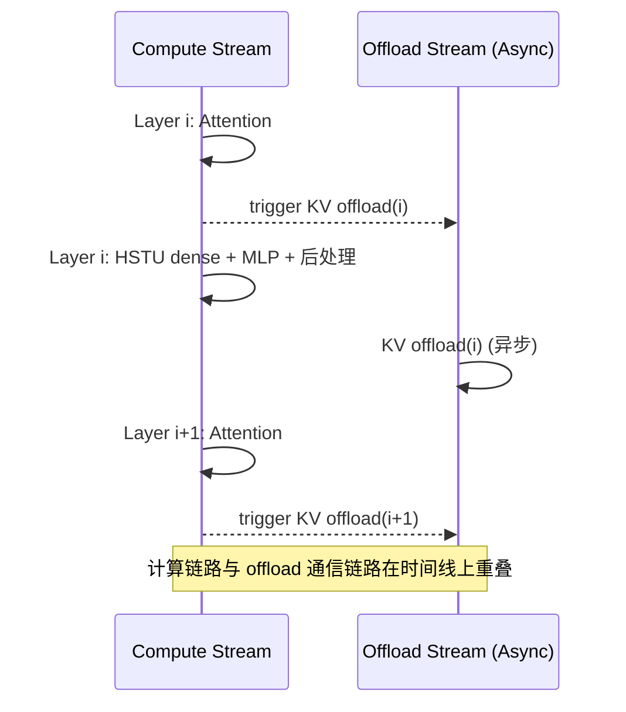
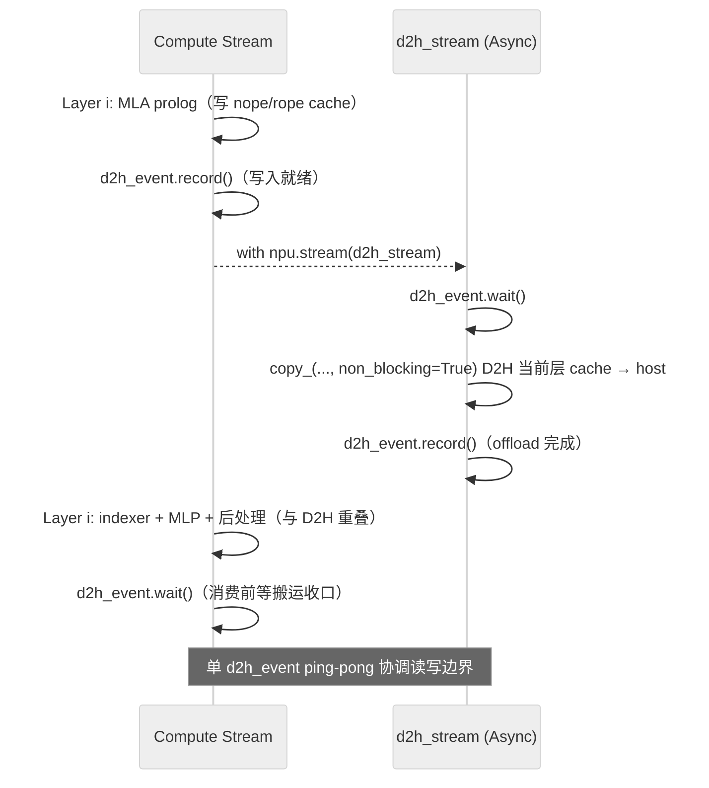

# KVCache Offload

## Summary

**KVCache Offload** 泛指把部分或全部 KV Cache 从设备 HBM 卸载到 Host 内存（或延后到异步 stream 上执行），以换取显存容量或计算/通信重叠。cann-recipes-infer 里实现了两个差异明显的 Offload 变体：

- **容量型 Offload（DeepSeek-V3.2-Exp）**：把 MLA Full KVCache 卸载到 Host 内存，设备仅留一层 cache，释放 HBM 以容纳更大的 batch 或更长的序列。Decode 阶段借助 Lightning Indexer TopK + `GatherSelectionKvCache` 算子，利用前后 Token 命中率复用设备端 cache，缓解 H2D 带宽压力。
- **时间型 Offload（HSTU）**：不改变 KV 存放位置（目标仍是 Host/外存），而是把每层 KV offload 的触发时机从"HSTU dense 完成后统一执行"前移到"每层 Attention 结束立即触发"，并切到一条独立 NPU stream 异步执行，从而让 offload 通信与 HSTU dense/MLP 计算在时间轴上重叠，降低流水线空泡。

两个变体的共同点是"释放设备内存 / 重叠通信"，差异在于**目标与约束**——容量型关心能否把更大的 workload 装下，时间型关心能否把现有 offload 的耗时掩盖掉。

> 区别于 [online-pd-inference](../frameworks/online_pd_inference.md) 的 PD KV 传输：本页 Offload 在**单实例内**把 KV 在 HBM↔Host（或异步 stream）间搬运；PD 分离是把 KV 跨**独立服务实例**经 RDMA/HCCL 直发，两者的 KV 流向重设计动机不同、不可混淆。

## Variants

### 容量型 Offload — MLA Full KVCache → Host Memory（DeepSeek-V3.2-Exp）

把占比较高的 **MLA Full KVCache** 从设备 HBM 内存卸载到 **Host 内存**上。在 DeepSeek-V3.2-Exp 的 W8A8C8 + 长序列场景下，使能 Offload 可使**最大 batch 翻倍**（固定 64K：1024→2048）、或**最长序列 +50%**（固定 batch 128：256K→384K）。方案涉及 Prefill 和 Decode 两个阶段的 KV 流向重设计，以及一个**利用前后 Token TopK 相似度复用设备端 cache** 的 AscendC 新算子 [gather-selection-kv-cache](../kernels/gather_selection_kv_cache.md)。

**Prefill Stage**

设备上只**申请一层 MLA KVCache**，同时每卡在 Host 内存上申请 **61 层**（源文档数字）KVCache 内存。MLA 计算完后**通过多流**把当前层设备上的 KVCache 卸载到 Host 侧。


*来源：[`docs/models/deepseek-v3.2-exp/figures/OffloadPrefill.png`](https://gitcode.com/cann/cann-recipes-infer/blob/2f82d10467e6fe8dae81c97a2cdac78d733a6703/docs/models/deepseek-v3.2-exp/figures/OffloadPrefill.png)（cann-recipes-infer @ 2f82d10）*

**Decode Stage**

Decode 阶段的数据流：

1. 每层计算得到当前 Token 的 KVCache 更新到 Host 内存；
2. [lightning-indexer](../kernels/lightning_indexer.md) 产出 TopK index；
3. 新增的 **`npu_gather_selection_kv_cache`** 算子根据 index 从 Host 侧 Full KVCache 选出 TopK KV，搬回设备；
4. 聚合后的 `selection_kv_cache` 喂给 [sparse-flash-attention](../kernels/sparse_flash_attention.md)。


*来源：[`docs/models/deepseek-v3.2-exp/figures/OffloadDecode.png`](https://gitcode.com/cann/cann-recipes-infer/blob/2f82d10467e6fe8dae81c97a2cdac78d733a6703/docs/models/deepseek-v3.2-exp/figures/OffloadDecode.png)（cann-recipes-infer @ 2f82d10）*

**复用设备端 Cache（关键优化）**

`GatherSelectionKvCache` 充分利用**前后 Token 在同一层上 TopK 命中率（相似度）特性**：若当前步 TopK 与前一步 TopK 有 **60% 一样**，仅需从 Host 读取 40% 未复用的 KV，60% 直接从设备上读，显著减少 H2D 耗时。

设备端复用所需元信息由 `OffloadCache`（[`models/deepseek-v3.2-exp/models/offload_cache.py`](https://gitcode.com/cann/cann-recipes-infer/blob/2f82d10467e6fe8dae81c97a2cdac78d733a6703/models/deepseek-v3.2-exp/models/offload_cache.py)）维护：

```python
self.selection_kv_block_table # 每层的 [batchseq, s_maxblocknum] block 映射
self.selection_kv_block_status # 初始 -1，记录当前 block 是否已在设备
self.d2h_stream / self.d2h_event # 与 H2D 配对的 D2H 异步流/事件
```

**Applicable Scenarios**

- **W8A8C8 + 长序列 Decode**：设备内存仍不足以装下大 batch 的完整 MLA KVCache 时。
- **DSA 架构**：Offload 的收益依赖 Lightning Indexer TopK 的前后命中率，稠密 Attention 下没有这种稀疏选择的语义，复用收益不存在。
- **A3 集群**：与大 EP / MTP / ge_graph 组合使用（见 config [`deepseek_v3.2_exp_rank_128_128ep_w8a8c8_offload_benchmark.yaml`](https://gitcode.com/cann/cann-recipes-infer/blob/2f82d10467e6fe8dae81c97a2cdac78d733a6703/models/deepseek-v3.2-exp/config/deepseek_v3.2_exp_rank_128_128ep_w8a8c8_offload_benchmark.yaml)，`enable_offload: True`）。

**Constraints**

- **Host 内存容量**：需要每卡预留 `(num_layers - 1) × batch × kv_length × feature_dim × bytes` 的 Host 内存用于 MLA Full KVCache（Prefill 侧只在设备留一层）。
- **PCIe / UB 带宽**：H2D 带宽成为 decode tail；前后 Token 命中率低时 H2D 开销会放大。
- **仅适配 DSA 模型**：当前 cann-recipes-infer 只在 DeepSeek-V3.2-Exp 上实现；DeepSeek-R1 等稠密 Attention 模型未启用。

**Known Results**

基于 Atlas A3、DeepSeek-V3.2-Exp、W8A8C8、MTP3、perfect eplb 配置（源文档 Benchmark / KVCache Offload）：


*来源：[`docs/models/deepseek-v3.2-exp/figures/offload_mem_bs.png`](https://gitcode.com/cann/cann-recipes-infer/blob/2f82d10467e6fe8dae81c97a2cdac78d733a6703/docs/models/deepseek-v3.2-exp/figures/offload_mem_bs.png)（cann-recipes-infer @ 2f82d10）*


*来源：[`docs/models/deepseek-v3.2-exp/figures/offload_mem_seq.png`](https://gitcode.com/cann/cann-recipes-infer/blob/2f82d10467e6fe8dae81c97a2cdac78d733a6703/docs/models/deepseek-v3.2-exp/figures/offload_mem_seq.png)（cann-recipes-infer @ 2f82d10）*

| 固定参数 | 非 Offload | 使能 Offload |
| ---- | ---- | ---- |
| 序列长度 64K | global batch 1024 | **2048** |
| global batch 128 | 序列长度 256K | **384K** |

**Future Plan**

源文档 Future Plan："利用前后 Token 命中率关系或**跨 layer 预取**等手段，进一步降低 GatherSelectionKvCache 耗时。"

### 时间型 Offload — KV Offload 与 Dense 计算并行（HSTU）

针对 [hstu](../models/hstu.md) 推理流水中 KV Offload 与 HSTU dense 计算的**串行瓶颈**，在 NPU 上将**每层 KV offload 触发时机前移**到该层 Attention 结束后立即执行，并放到**另一条 NPU stream** 异步执行，从而实现**计算链路（HSTU dense + MLP + 后处理）与通信链路（KV offload）的重叠**。

**原始（串行）：等待 HSTU dense 完成后逐层执行 KV offload**

原仓实现需要等待 HSTU dense 完成后，再逐层执行 KV offload，这样的**计算与 KV Offload 串行**的方式并行度不高，导致性能较差。


*来源：[`docs/models/hstu/figures/offload_ori.png`](https://gitcode.com/cann/cann-recipes-infer/blob/2f82d10467e6fe8dae81c97a2cdac78d733a6703/docs/models/hstu/figures/offload_ori.png)（cann-recipes-infer @ 2f82d10）*

**优化（并行）：每层 Attention 结束立即触发 KV offload，异步 stream 执行**

在 NPU 上，我们将 offload 时机**前移**到每层 Attention 结束后立即触发该层 KV offload，并**放到另一条 NPU stream 异步执行**，从而实现计算链路（HSTU dense + MLP + 后处理）与通信链路（KV offload）的重叠。


*来源：[`docs/models/hstu/figures/offload.png`](https://gitcode.com/cann/cann-recipes-infer/blob/2f82d10467e6fe8dae81c97a2cdac78d733a6703/docs/models/hstu/figures/offload.png)（cann-recipes-infer @ 2f82d10）*



**Applicable Scenarios**

- HSTU 推理流水中 dense 计算耗时 ≥ 单层 KV offload 耗时 → 可以被完全/部分掩盖
- NPU 支持多 stream 异步调度（与 compute stream 独立的 offload stream）
- 支持**单算子模式**与**图模式**下的使能（见源 README 优化点列表第 6 项）

**Constraints**

- **每层独立触发**：offload 粒度为单层 KV，需要保证该层 Attention 计算完成后 K/V 已就绪
- **依赖两条 stream + event 同步**：与 compute stream 之间通过 NPU event 保证 KV 写入先于跨层 offload
- **收益上限受限于 offload 与 dense 耗时比**：若 KV offload 远长于 dense 计算，不能完全掩盖

**Known Results**

源文档定性描述："显著降低流水线空泡并大幅提升整体性能"——具体 TPOT / 吞吐 / 重叠比数据源未提供，unverified。

## 两变体对比

| 维度 | 容量型（DeepSeek-V3.2-Exp） | 时间型（HSTU） |
|------|-----------------------------|----------------| | 优化目标 | 显存容量（batch/seq 翻倍） | 流水时间（计算通信重叠） |
| KV 最终位置 | Host 内存（设备仅留一层） | 原 offload 目标不变 |
| 关键硬件 | H2D 带宽 + 设备少量 cache | 独立 offload stream |
| 关键算子 | `GatherSelectionKvCache` | — |
| 依赖前提 | DSA 稀疏选择 + TopK 命中率 | Dense 计算耗时 ≥ 单层 offload 耗时 |
| 组合开关 | `enable_offload: True` | 模型 README "优化点 6" |
| 组合能力 | W8A8C8 + MTP3 + ge_graph | 单算子模式 + 图模式均可 |

## Evidence

- [cann-recipes-infer](https://gitcode.com/cann/cann-recipes-infer/tree/2c45117d781ab9ab88dcb89a28ae30f5d2450399) — [`docs/models/deepseek-v3.2-exp/deepseek_v3.2_exp_inference_guide.md`](https://gitcode.com/cann/cann-recipes-infer/blob/2f82d10467e6fe8dae81c97a2cdac78d733a6703/docs/models/deepseek-v3.2-exp/deepseek_v3.2_exp_inference_guide.md) KVCache Offload + Benchmark 章节
- [cann-recipes-infer](https://gitcode.com/cann/cann-recipes-infer/tree/2c45117d781ab9ab88dcb89a28ae30f5d2450399) — [`models/deepseek-v3.2-exp/config/deepseek_v3.2_exp_rank_128_128ep_w8a8c8_offload_benchmark.yaml`](https://gitcode.com/cann/cann-recipes-infer/blob/2f82d10467e6fe8dae81c97a2cdac78d733a6703/models/deepseek-v3.2-exp/config/deepseek_v3.2_exp_rank_128_128ep_w8a8c8_offload_benchmark.yaml)（`enable_offload: True`）
- [cann-recipes-infer](https://gitcode.com/cann/cann-recipes-infer/tree/2c45117d781ab9ab88dcb89a28ae30f5d2450399) — [`models/deepseek-v3.2-exp/models/offload_cache.py`](https://gitcode.com/cann/cann-recipes-infer/blob/2f82d10467e6fe8dae81c97a2cdac78d733a6703/models/deepseek-v3.2-exp/models/offload_cache.py)（`OffloadCache` 数据结构）
- [cann-recipes-infer](https://gitcode.com/cann/cann-recipes-infer/tree/2c45117d781ab9ab88dcb89a28ae30f5d2450399) — [`models/deepseek-v3.2-exp/models/modeling_deepseek.py`](https://gitcode.com/cann/cann-recipes-infer/blob/2f82d10467e6fe8dae81c97a2cdac78d733a6703/models/deepseek-v3.2-exp/models/modeling_deepseek.py)（Offload 分支 + gather + SFA 调用，约 L1330–L1412）
- [cann-recipes-infer](https://gitcode.com/cann/cann-recipes-infer/tree/2c45117d781ab9ab88dcb89a28ae30f5d2450399) — [`docs/models/hstu/hstu_optimization.md`](https://gitcode.com/cann/cann-recipes-infer/blob/2f82d10467e6fe8dae81c97a2cdac78d733a6703/docs/models/hstu/hstu_optimization.md)（"KV Offload 并行"章节，`figures/offload.png` / `figures/offload_ori.png` 对比图）
- [cann-recipes-infer](https://gitcode.com/cann/cann-recipes-infer/tree/2c45117d781ab9ab88dcb89a28ae30f5d2450399) — [`models/hstu/README.md`](https://gitcode.com/cann/cann-recipes-infer/blob/2f82d10467e6fe8dae81c97a2cdac78d733a6703/models/hstu/README.md)（优化点 6："使能单算子模式和图模式下的 KV Offload 与 dense 层计算并行"）

## 多流优化（case pattern）

> 方法论总纲见 [multi-stream](multi_stream.md)（多流编排的通用范式、event 协同原语、收益与陷阱）；本节只记 **KVCache Offload 异步搬运流** 这一具体模式在 cann-recipes-infer 中的落地细节。

**模式名**：KVCache Offload 异步搬运流（D2H/H2D 当 memory pipeline 与主计算流重叠）。

**动机**：长序列 / 大 batch 下 MLA Full KVCache 占用高，必须 Offload 到 Host 才能装下（容量型变体见上文）。但若 D2H/H2D 直接挂在主计算流里，搬运就会阻塞前向，使 Offload 反而把时延拉高。因此关键不在"有没有 Offload"，而在"Offload 能否异步、能否与计算重叠"——把 Offload 视为一条独立的 **memory pipeline**，而非普通计算流。

**编排**：`OffloadCache` 初始化时单独创建一条搬运流 + 一个配对事件（cann-recipes-infer @2c45117，[`models/deepseek-v3.2-exp/models/offload_cache.py`](https://gitcode.com/cann/cann-recipes-infer/blob/2c45117d781ab9ab88dcb89a28ae30f5d2450399/models/deepseek-v3.2-exp/models/offload_cache.py):46-47；[glm-5](../models/glm_5.md) 同款写法在 [`models/glm-5/models/offload_cache.py`](https://gitcode.com/cann/cann-recipes-infer/blob/2c45117d781ab9ab88dcb89a28ae30f5d2450399/models/glm-5/models/offload_cache.py):52-53）：

```python
# offload_cache.py:46-47（DeepSeek-V3.2-Exp；GLM-5 见 :52-53，逐行一致）
self.d2h_stream = torch.npu.Stream(device="npu")
self.d2h_event  = torch.npu.Event(blocking=True, enable_timing=False)
```

实际的读写边界由 **单事件 ping-pong** 协调，而非案例叙述里抽象的"主流等搬运"。以 Prefill 为例（[`models/deepseek-v3.2-exp/models/modeling_deepseek.py`](https://gitcode.com/cann/cann-recipes-infer/blob/2c45117d781ab9ab88dcb89a28ae30f5d2450399/models/deepseek-v3.2-exp/models/modeling_deepseek.py):1279-1292、:1492-1493）：

```python
# modeling_deepseek.py:1279-1292（Prefill：MLA prolog 算完后，把当前层 cache D2H 到 host swapped memory）
if self.enable_offload:
    offload_cache.d2h_event.record()                 # 主流：标记 prolog 写入已就绪
    with torch.npu.stream(offload_cache.d2h_stream):  # 切到搬运流
        offload_cache.d2h_event.wait()               # 搬运流：等写入边界
        # Prefill 阶段数据连续，用 copy_ 把当前层 cache 整层搬到 host
        nope_cache_dst.copy_(nope_cache_src, non_blocking=True)
        ...  # rope_cache 同理（非 int8 量化路径）
        offload_cache.d2h_event.record()             # 搬运流：标记本层 offload 完成
...
# modeling_deepseek.py:1492-1493（本层 MLP 算完后，主流等 offload 收口）
if is_prefill and self.enable_offload:
    offload_cache.d2h_event.wait()                   # 主流：消费/复用前等搬运边界
```

主流 `record` → 搬运流 `wait`/`copy_(non_blocking=True)`/`record` → 主流 `wait`，构成 D2H 与"本层后续计算（indexer / MLP / 后处理）"在时间线上的重叠；搬运缓冲由 `torch_npu.empty_with_swapped_memory(...)` 申请可换出内存（`offload_cache.py`:116），设备侧仅留临时 cache。



**适用与风险**：

- **适用**：长序列 / 大 batch 必须 Offload 的高吞吐场景；代表实现 [deepseek-v3.2-exp](../models/deepseek_v3_2_exp.md)，相似实现 [glm-5](../models/glm_5.md)（长序列 65536，沿用同款 `d2h_stream`/`d2h_event` 写法）。不同模型差异主要在 cache 结构与 selection 策略，不在流模型本身。
- **风险（带宽掩盖）**：Host/PCIe/UB 带宽不够时，异步流也掩盖不住搬运耗时——这是该模式的硬约束，与上文"H2D 带宽成为 decode tail"一致。
- **风险（状态一致性）**：cache 一致性与设备端复用状态（`selection_kv_block_status` 初始 -1，记录 block 是否已在设备）比普通双流更易出错，读写边界完全依赖 `d2h_event` 的 record/wait 配对，少一处即数据竞争。
- **风险（收益强相关）**：Offload 收益与 batch / topk / block_size 强相关，不能机械复制参数。

## Links

- [multi-stream](multi_stream.md)（多流优化方法论总纲）
- [deepseek-v3.2-exp](../models/deepseek_v3_2_exp.md)
- [hstu](../models/hstu.md)
- [gather-selection-kv-cache](../kernels/gather_selection_kv_cache.md)
- [sparse-flash-attention](../kernels/sparse_flash_attention.md)
- [lightning-indexer](../kernels/lightning_indexer.md)
- [w8a8c8](../quantization/w8a8c8.md)
- [sparse-flash-attention](../modules/sparse_flash_attention.md)
- [moe-multi-stream](moe_multi_stream.md)
- [online-pd-inference](../frameworks/online_pd_inference.md)
- [cann-shmem](cann_shmem.md)
- [hixl](hixl.md)
- [glm-5](../models/glm_5.md)（GLM-5 长序列 65536 KVCache Offload，沿用 V3.2-Exp 方案）
- [swap-optimizer](../../../training/concepts/techniques/swap_optimizer.md)（跨域·训练：训练侧优化器状态 Host 卸载（同源 Host-offload 思路））
- [virtual-optimizer](../../../training/concepts/techniques/virtual_optimizer.md)（跨域·训练：优化器态 Host 虚拟内存卸载，同属 Host-offload 思路）

<!-- cannbot:related:start -->
## 相关

- [CANN SHMEM 通信编程模型](cann_shmem.md)（`related`）：焦点卡说明“支持 NPU HBM 与 CPU DDR 混合编址，把 Host 内存映射成可直接当 Device tensor 使用的内存”，候选卡给出“把占比较高的 **MLA Full KVCache** 从设备 HBM 内存卸载到 **Host 内存**上”的容量方案；前者是后者 Host 映射访问的通信内存机制。
- [GatherSelectionKvCache](../kernels/gather_selection_kv_cache.md)（`related`）：**容量型 Offload（DeepSeek-V3.2-Exp）**：把 MLA Full KVCache 卸载到 Host 内存，设备仅留一层 cache，释放 HBM 以容纳更大的 batch 或更长的序列。Decode 阶段借助 Lightning Indexer TopK + `GatherSelectionKvCache` 算子，利用前后 Token 命中率复用设备端 cache，缓解 H2D 带宽压力。；`npu_gather_selection_kv_cache` 是 cann-recipes-infer 为 DeepSeek-V3.2-Exp **KVCache Offload** 场景新开发的 AscendC 自定义算子。算子文档定义其功能为：**通过 topk 的稀疏索引从原始 `full_kv_cache` 中 gather，拼接成一块新的连续 `selection_kv_cache`**，支撑 DeepSeek 超大 token 场景下的 kv_cache offload。其中 `full_kv_cache` 支持 **host 侧或 device 侧内存**（offload 场景常驻 Host，但接口并不限定）。在 Decode 阶段，根据 ［lightning-indexer］(lightning_indexer.md) 返回的 TopK（2048）个相关 token index 选出参与计算的 KV 并搬回设备，再喂给 ［sparse-flash-attention］(sparse_flash_attention.md)。算子约束 `TOPK ≤ 2048`、`H 当前只支持 1`。。概念卡指出 Offload decode 依赖 GatherSelectionKvCache，算子卡闭合 TopK 索引、Host/Device Full KVCache 与连续 Selection KVCache 的接口合同。
- [KV cache 卸载到 Host 内存：设备单层 temp + 专用流 D2H 重叠 + 逐层异步搬算掩盖](../../guides/experience/interventions/kvcache_offload_host_swap.md)（`related`）：**容量型 Offload（DeepSeek-V3.2-Exp）**：把 MLA Full KVCache 卸载到 Host 内存，设备仅留一层 cache，释放 HBM 以容纳更大的 batch 或更长的序列。Decode 阶段借助 Lightning Indexer TopK + `GatherSelectionKvCache` 算子，利用前后 Token 命中率复用设备端 cache，缓解 H2D 带宽压力。；**Host 全量、设备单层**：每层 KV cache 用 host-swapped 内存常驻 Host；设备上只申请**单层** temp 缓冲，计算读写都落在这块单层缓冲上——把「设备驻留 N 层」压成「设备 1 层 + Host N 层」（例：61 层模型每卡 Host 存 61 层、设备只 1 层）。C8 布局时 nope/rope/scale 拼成 int8 供融合算子，见 ［mla-c8-int8-kv-cache-op-wiring］(../../../optimizations/experience/rules/mla_c8_int8_kv_cache_op_wiring.md)。。概念卡定义容量型 Host Offload，实践卡给出 Host 全量、设备单层 temp 的具体内存布局。
- [KV offload block swap 把逐块逐子张量小拷贝聚成一次 aclrtMemcpyBatchAsync（版本门 + srcLoc/dstLoc 契约 + D2D 回退）](../../optimizations/experience/rules/kvcache_offload_batch_memcpy_async.md)（`related`）：“服务化 decode 下做 KV cache offload / prefix 复用：KV cache 要在 NPU HBM 与 CPU host 之间来回 block swap（HBM→host 的 D2H、host→HBM 的 H2D）。”与“**KVCache Offload** 泛指把部分或全部 KV Cache 从设备 HBM 卸载到 Host 内存（或延后到异步 stream 上执行），以换取显存容量或计算/通信重叠。”分别给出双端正文事实；概念卡界定 HBM 与 Host 间的 KV offload，规则卡针对该搬运中的碎片化 block swap 用批量异步 memcpy 降低提交开销，连接总体技术与具体传输优化。
- [KVCache 卸载到 Host + 稀疏 TopK-selection decode：跨 step 复用设备常驻选中块摊薄 H2D](../../optimizations/experience/rules/kvcache_offload_sparse_selection_cross_step_reuse.md)（`related`）：**容量型 Offload（DeepSeek-V3.2-Exp）**：把 MLA Full KVCache 卸载到 Host 内存，设备仅留一层 cache，释放 HBM 以容纳更大的 batch 或更长的序列。Decode 阶段借助 Lightning Indexer TopK + `GatherSelectionKvCache` 算子，利用前后 Token 命中率复用设备端 cache，缓解 H2D 带宽压力。；**利用相邻 step 在同一层的 TopK 命中集高度重叠**：稀疏注意力下相邻 token 在**同一层**的 TopK 选中集相似度高——重复 H2D 拉取重叠部分是浪费。。概念卡提出命中率复用以缓解 H2D，规则卡把它落实为同层相邻 step 的设备常驻块复用。
- [启用 KV-Pool Remote H2D 直传前的 Ascend 前置校验（2MiB HugeTLB + worker H2D 参数 + NPU/RoCE 环境）](../../guides/experience/interventions/yuanrong_kv_pool_remote_h2d_ascend_prereqs.md)（`related`）：把 KV cache offload 到一个分布式内存后端（此处为 Yuanrong Datasystem KV-Pool），并希望**跨节点把 KV 直接搬到远端 NPU device**。；**KVCache Offload** 泛指把部分或全部 KV Cache 从设备 HBM 卸载到 Host 内存（或延后到异步 stream 上执行），以换取显存容量或计算/通信重叠。。前者把 KVCache Offload 的卸载目标扩展为分布式内存后端并补充远端 NPU 搬运前置条件，直接细化后者的卸载机制。
<!-- cannbot:related:end -->
