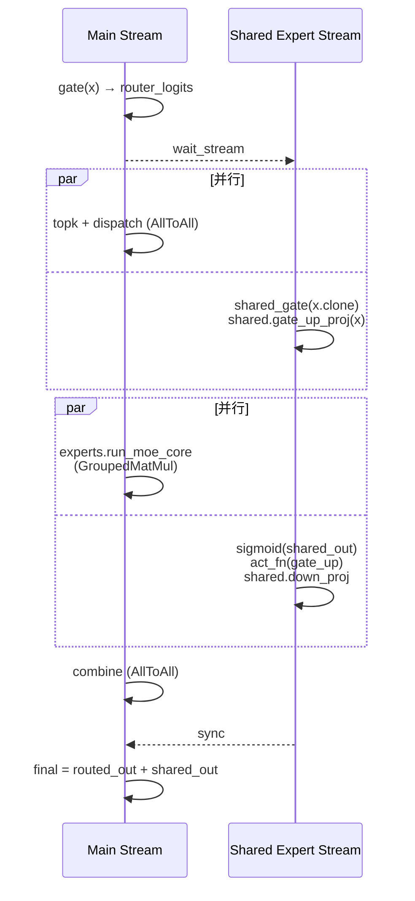

# MoE 多流（MoE Multi-Stream）：共享专家旁路与 ScMoE 分支

## Summary

MoE 层上的多 NPU stream 并行是 cann-recipes-infer 在多个模型里反复使用的优化手段，共同思想是 **把 MoE 层内部可并行的子计算/通信段分配到多条 stream，让它们在时间轴上重叠**，隐藏 AllToAll、GroupedMatMul 或专家计算的时延。不同模型对应不同的多流拓扑：

- **Shared + Routed Overlap 变体**（Qwen3-Next / Qwen2-MoE / DeepSeek-R1 Decode / DeepSeek-V3.2-Exp / Kimi-K2-Thinking / HunyuanImage-3.0）：shared-expert 的 `gate_up_proj`/`act_fn`/`down_proj` 放在独立 stream，与主 stream 路由分支的部分计算/通信重叠。combine 能否参与重叠取决于是否消费共享输出：当前V3.2-Exp已将combine与shared_expert_x解耦并在末尾相加；原生流路径仍在combine前wait共享输出，因此解耦本身不证明该段已重叠。
- **ScMoE Stream Switch + Core Limit 变体**（LongCat-Flash）：ScMoE 双段 "Attention → FFN → Attention → MoE" 结构里，**把第二段 Attention 与 FFN 提前到与 MoE 并行**，通过 `npu_stream_switch("1")` 与 `limit_core_num` 联合限定每条 stream 占用的 Cube/Vector Core（核数取值随平台与配置核对），使双流计算时间接近，无明显拖尾。

两个变体都依赖 NPU 多 stream 调度与 stream 间 event 同步，但作用的 MoE 结构和约束不同，故独立列出。

## 机制：两类并行结构

### 共享专家与路由专家

两条分支汇合前可以重叠，必须保留路由、共享输出与最终相加之间的依赖。下面仅示意 combine 与共享输出解耦、末尾相加的形式；当前V3.2-Exp原生流路径仍在combine前等待共享分支，不能直接套用此时序图。具体算子和事件顺序按实现核对。

### ScMoE 的两段结构

LongCat 的 shortcut MoE 与第二段 Attention/FFN 可形成并行分支；与共享专家旁路的结构不同。核数、AFD 条件和固定实现集中见下列规则。

## 决策与实现入口

- [共享专家双流规则](../../optimizations/rules/moe_shared_expert_decode_dual_stream.md)：门控、combine 解耦、模型实现差异和回退。
- [Decode 多流控核规则](../../optimizations/rules/decode_multi_stream_overlap_core_balance.md)：LongCat 已核验条件与核数配置。
- [跨流同步规则](../../optimizations/rules/graph_mode_multi_stream_cross_stream_sync_api.md)：按后端表达依赖和生命周期。
- [Prefill Micro-Batch](prefill_micro_batch.md)：跨 batch 的计算/通信重叠，区别于同 token 的共享/路由专家分支。

## Evidence

- [README.md](../../../../../cann-recipes-raw/cann-recipes-infer/944d2d3ece86f7df33dbb0cb155c72ca619a9c66/README.md)（primary）
- [longcat_flash_optimization.md](../../../../../cann-recipes-raw/cann-recipes-infer/944d2d3ece86f7df33dbb0cb155c72ca619a9c66/docs/models/longcat_flash/longcat_flash_optimization.md)（supporting）
- [modeling_deepseek.py](../../../../../cann-recipes-raw/cann-recipes-infer/944d2d3ece86f7df33dbb0cb155c72ca619a9c66/models/deepseek_v3_2_exp/models/modeling_deepseek.py)（implementation）

## Links

- [qwen3-next](../models/qwen3_next.md)
- [deepseek-r1](../models/deepseek_r1.md)
- [longcat-flash](../models/longcat_flash.md)
- [deepseek-v3.2-exp](../models/deepseek_v3_2_exp.md)
- [kimi-k2-thinking](../models/kimi_k2_thinking.md)
- [hunyuan-image-3](../models/hunyuan_image_3.md)
- [expert-parallel](../parallelism/expert_parallel.md)
- [moe-dispatch-combine-v2](moe_dispatch_combine_v2.md)（shared expert 可与路由分支部分重叠；combine 是否等待共享输出按实现核对）
- [sglang](../frameworks/sglang.md)
- [torchair](../frameworks/torchair.md)
- [atlas-a3](../platforms/atlas_a3.md)
- [afd](afd.md)
- [superkernel](superkernel.md)
- [prefill-micro-batch](prefill_micro_batch.md)
- [multi-stream](multi_stream.md)（多流编排/控核方法论总纲；MoE 多流为其子场景）
- [vllm-ascend](../../../training/concepts/frameworks/vllm_ascend.md)（跨域·训练：vLLM-Ascend rollout 的 MLA/MoE 多流）
- [deepseek-v4](../models/deepseek_v4.md)（DeepSeek-V4 MoE 共享/路由专家多流，Int8/MXFP8 量化场景掩盖共享专家）
