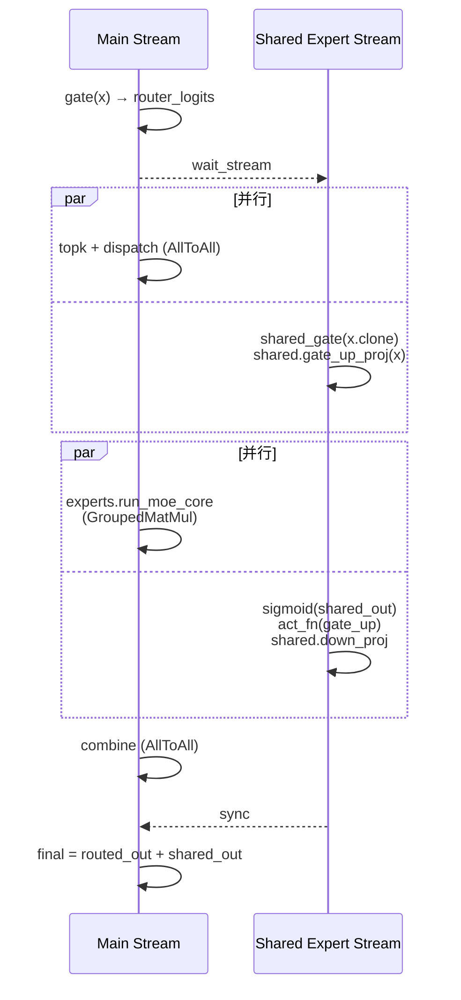

# MoE Multi-Stream

## Summary

MoE 层上的多 NPU stream 并行是 cann-recipes-infer 在多个模型里反复使用的优化手段，共同思想是 **把 MoE 层内部可并行的子计算/通信段分配到多条 stream，让它们在时间轴上重叠**，隐藏 AllToAll、GroupedMatMul 或专家计算的时延。不同模型对应不同的多流拓扑：

- **Shared + Routed Overlap 变体**（Qwen3-Next / Qwen2-MoE / DeepSeek-R1 Decode / DeepSeek-V3.2-Exp / Kimi-K2-Thinking / HunyuanImage-3.0）：shared-expert 的 `gate_up_proj`/`act_fn`/`down_proj` 放在独立 stream，与主 stream 上的 `topk → dispatch → GroupedMatMul → combine` 重叠。
- **ScMoE Stream Switch + Core Limit 变体**（LongCat-Flash）：ScMoE 双段 "Attention → FFN → Attention → MoE" 结构里，**把第二段 Attention 与 FFN 提前到与 MoE 并行**，通过 `npu_stream_switch("1")` 与 `limit_core_num` 联合限定每条 stream 占用的 Cube/Vector Core（stream0 `c16v32`、stream1 `c8v16`），使双流计算时间接近，无明显拖尾。

两个变体都依赖 NPU 多 stream 调度与 stream 间 event 同步，但作用的 MoE 结构和约束不同，故独立列出。

## Variants

### Shared + Routed Overlap（Qwen3-Next / DeepSeek-R1 等）

将共享专家（shared expert）与路由专家（routed expert）的 `dispatch`、`gate_up_proj`、`act_fn`、`down_proj` 分别绑定到主 NPU stream 与独立 shared_expert stream，重叠 shared-expert 的计算与路由专家的 AllToAll dispatch/combine 通信，隐藏 EP 通信时延。



**Qwen3-Next / SGLang 路径**

- 全局单例 `shared_expert_stream = torch.npu.Stream`（`get_npu_shared_expert_stream`）。
- `npu_forward_normal_dual_stream` 流程：
 1. 主 stream 做 `gate(hidden_states) → router_logits`。
 2. `shared_expert_stream.wait_stream(current_stream)` 后，在 shared stream 上并行执行 `shared_expert_gate(x.clone)` 和 `shared_expert.gate_up_proj(x)`。
 3. 主 stream 做 `topk` 选路由 + `dispatcher.dispatch(hidden_states, topk_output)`（AllToAll）。
 4. shared stream 做 `sigmoid(shared_output)` + `act_fn(gate_up)`。
 5. 主 stream 做 `experts.run_moe_core(dispatch_output)`（GroupedMatMul）。
 6. shared stream 做 `shared_expert.down_proj(gate_up)` + 与 sigmoid 门相乘。
 7. 主 stream 做 `dispatcher.combine`（AllToAll），再与 shared_output 相加。
- 入侵点：[`python/sglang/srt/models/qwen2_moe.py`](https://gitcode.com/cann/cann-recipes-infer/blob/2f82d10467e6fe8dae81c97a2cdac78d733a6703/models/qwen3-next/patches/stage1/0003-feat-moe-multi-stream.patch)，由 `ENABLE_NPU_DEEPEP_MOE_MULTI_STREAM=1` 触发。
- 与 DeepEP 配合：`--moe-a2a-backend deepep --deepep-mode auto`，需满足 `self.shared_expert is not None`。

**DeepSeek-R1 Decode 路径（不走 SGLang）**

DeepSeek-R1 decode 阶段也使用 "shared expert 与 routed dispatch/combine 重叠" 思想，但入侵点不在 SGLang：

- 由 YAML `enable_multi_streams: True` 使能（`decode_r1_rank_*.yaml`）；
- 在 `DeepseekV3MoE.forward`（[`models/deepseek_r1/models/modeling_deepseek.py`](https://gitcode.com/cann/cann-recipes-infer/blob/2f82d10467e6fe8dae81c97a2cdac78d733a6703/models/deepseek_r1/models/modeling_deepseek.py) 约 L414）中，使用 `npu_stream_switch("22", ...)` / `npu_wait_tensor` 将 shared expert 的 `gate_up_proj` 放到 "22" stream，与主 stream 的 topk + dispatch AllToAll 重叠；
- `ge_graph` 图模式下进一步形成 `enable_geraph_and_multistream` 合并态（代码 L416）。
- 需要 `n_shared_experts > 0`（DeepEP 路径与 Qwen3-Next 一致），且仅 Decode（`is_prefill=False`）启用。

关键代码片段（`modeling_deepseek.py` 约 L432）：

```python
if self.enable_geraph_and_multistream:
 hidden_states_share = None
 with npu_stream_switch(self.enable_geraph_and_multistream, "22"):
 hidden_states = npu_wait_tensor(True, hidden_states, topk_idx)
 if "a8" in self.mm_quant_mode:
 merged_x, pertoken_scale = self.shared_experts.gate_up_proj(...)
 else:
 merged_x = self.shared_experts.gate_up_proj(...)
```

Prefill 阶段则由 [prefill-micro-batch](prefill_micro_batch.md) 提供计算/通信重叠，语义不同：micro-batch 重叠的是 2 个 micro-batch 之间的计算与 AllToAll，而非同一 token 下 shared/routed 之间的异步。

**Applicable Scenarios**

- MoE 模型 Decode 阶段，尤其 `num_shared_experts > 0` 的架构（Qwen3-Next、Qwen2-MoE、DeepSeek-R1/V3、Kimi-K2 系列、HunyuanImage-3.0）。
- EP 并行 + DeepEP 后端部署。
- 主 stream 中 dispatch/combine 的 AllToAll 与 GroupedMatMul 时延可观时收益最大。

**Constraints**

- 仅 NPU 路径（`_is_npu` 且 shared_expert 存在时触发）。
- 需额外一个 NPU Stream 资源和 hidden_states 的一次 clone。
- 与 BF16/INT8 权重兼容（stage1 patch 将 `w2_weight_scale` 转成 BF16 以避免类型冲突）。
- 对 batch size / topk 分布敏感，极小 batch 下 shared 分支计算量不足以掩盖 AllToAll 时可能收益有限。

### ScMoE Stream Switch + Core Limit（LongCat-Flash）

大模型推理场景下，多流并行常因"所有 Core 都被一条流占用"退化为串行；本变体通过 `npu_stream_switch` + `limit_core_num` 两个 API 组合，把核分给不同流，让算子真正并行执行。LongCat-Flash 的 ScMoE 双段结构（第一段 Attention → FFN → 第二段 Attention → MoE）天然存在可并行路径，cann-recipes-infer 的实现将第二段 Attention 与 FFN 专家提前执行，并通过控核使双流计算时间接近。

- 多流并行技术的详细介绍：[官方文档](https://www.hiascend.com/document/detail/zh/Pytorch/720/modthirdparty/torchairuseguide/torchair_00026.html)
- 控核技术的详细介绍：[官方文档](https://www.hiascend.com/document/detail/zh/Pytorch/720/modthirdparty/torchairuseguide/torchair_00044.html)

原始的 LongCat-Flash 模型在 [论文](https://arxiv.org/pdf/2509.01322) 中提供了四阶段的并行策略，其方案图如下：


*来源：[`docs/models/longcat-flash/figures/overlap_strategy.png`](https://gitcode.com/cann/cann-recipes-infer/blob/2f82d10467e6fe8dae81c97a2cdac78d733a6703/docs/models/longcat-flash/figures/overlap_strategy.png)（cann-recipes-infer @ 2f82d10）*

cann-recipes-infer 的多流并行和控核方案如下：**将第二段 attention 和 FFN 专家提前执行，并通过控制多流上的 ai core 和 vector core 核数，使得双流的计算时间接近，无明显拖尾，提升性能。**

- **stage1 不做控核**，默认占用全部的 ai core 和 vector core 核数；
- **stage2 里的 stream0 采用 `c16v32` 控核方案**，stream1 采用 `c8v16`。


*来源：[`docs/models/longcat-flash/figures/multi_stream_limit_core_num.png`](https://gitcode.com/cann/cann-recipes-infer/blob/2f82d10467e6fe8dae81c97a2cdac78d733a6703/docs/models/longcat-flash/figures/multi_stream_limit_core_num.png)（cann-recipes-infer @ 2f82d10）*

实现伪代码（[`models/longcat-flash/models/modeling_longcat_flash.py`](https://gitcode.com/cann/cann-recipes-infer/blob/2f82d10467e6fe8dae81c97a2cdac78d733a6703/models/longcat-flash/models/modeling_longcat_flash.py) 中 `LongcatFlashDecoderLayer.forward` 路径）：

```python
# stage1: 不控核，主 stream 独占全部核
attn
layernorm

# stage2: 双流并行 + 控核
with npu_stream_switch(True, "1"):
 with limit_core_num(True, "8", "16"):
 router
 dispatch
 gmm
 combine
with limit_core_num(True, "16", "32"):
 dense
 attn
 layernorm
 dense
```

- `npu_stream_switch(True, "1")` —— 切换到副流 "1"
- `limit_core_num(True, "8", "16")` —— stream1：8 个 Cube Core、16 个 Vector Core
- `limit_core_num(True, "16", "32")` —— stream0：16 个 Cube Core、32 个 Vector Core

**Applicable Scenarios**

- 具有天然双路径的结构：LongCat-Flash ScMoE（Attention 与 MoE 可并行）
- Decode 阶段，时延敏感场景
- `exe_mode: "ge_graph"` 图模式（与 SuperKernel scope 协同标定）

**Constraints**

- **控核的副作用：stage2 双流上的算子只能使用部分 Cube/Vector 核，MLAProlog / FA / MM / TBMM / QBMM 耗时相比不控核时上升**（见 [afd](afd.md) 对比表：`12C_24V` vs `24C_48V`）
- 为解除上述约束，LongCat-Flash 进一步引入 **AFD** 将 MoE 分节点部署，使 Attention 侧不再需要控核
- 与 AFD 互斥：AFD YAML 注释 "AFD scenario will not take effect."

## Known Results

- Qwen3-Next README Benchmark（A8W8C8，Atlas A3 16die，dp_size=8，tp_size=2，ep_size=16，256K 输入）中叠加 MoE 多流，纯模型 decode 时延 20.6 ms。本 source 未拆分多流单独收益。
- LongCat-Flash 多流 + 控核的单项增益未在源文档给出具体对比数据；在完整 W8A8 + GBS=256 + Seq=4608 + 64 Chips + MTP2 配置下不分离 TPOT 9.95 ms（见 [longcat-flash](../models/longcat_flash.md) benchmark 表）。

## 多流优化（case pattern）

多流编排/控核的方法见 [multi-stream](multi_stream.md)。以下实现细节对应 cann-recipes-infer **@2c45117**；上文标注 `2f82d10` 的实现适用于该旧版本。

cann-recipes-infer 里 MoE 多流落地分三种实现形态，思想一致（把 shared/MLP 分支从主路径剥离与路由专家的通信/计算重叠），但**切流 API、同步原语、注入时机**各不相同：

### (a) 共享专家双流 `npu_stream_switch "11"`（V3.2-Exp / GLM-5 / Kimi-K2）

**动机**：MoE decode 路径里，shared expert 与 routed expert 最终相加（`final = routed + shared`），但二者无严格串行依赖；单流执行会把 shared expert 整段耗时压在关键路径上。把 shared expert 切到副流 `"11"`，与主流的 `topk → dispatch → GroupedMatMul → combine` 重叠，隐藏 shared 分支耗时。**仅 decode**（`is_prefill=False`）。

**编排**（DeepSeek-V3.2-Exp `DeepseekV3MoE.forward`，[`models/deepseek-v3.2-exp/models/modeling_deepseek.py`](https://gitcode.com/cann/cann-recipes-infer/blob/2c45117d781ab9ab88dcb89a28ae30f5d2450399/models/deepseek-v3.2-exp/models/modeling_deepseek.py) L418–L430；GLM-5 [`models/glm-5/models/modeling_glm.py`](https://gitcode.com/cann/cann-recipes-infer/blob/2c45117d781ab9ab88dcb89a28ae30f5d2450399/models/glm-5/models/modeling_glm.py) L406–L418 为逐行同构实现）：

```python
# modeling_deepseek.py L418–L430（@2c45117，与 glm-5 L406–L418 同构）
if self.n_shared_experts > 0:
    enable_multi_streams = self.enable_multi_streams and not is_prefill
    use_aclgraph_event = enable_multi_streams and self.enable_aclgraph
    if use_aclgraph_event:
        tng.ops.npu_record_tagged_stream(hidden_states, "11")
        tng.ops.npu_tagged_event_record(moe_npu_events[0])
    with npu_stream_switch(enable_multi_streams, "11"):
        if use_aclgraph_event:
            tng.ops.npu_tagged_event_wait(moe_npu_events[0])
        # shared_expert use multi streams
        hidden_states_share = self.shared_experts(hidden_states.view(-1, hidden_states.shape[-1]))
        if use_aclgraph_event:
            tng.ops.npu_tagged_event_record(moe_npu_events[1])
```

关键事实（@2c45117）：

- 副流标号是 `"11"`（regular `npu_stream_switch`）。**R1 不属本组**——R1 @2c45117 用 `npu_stream_switch_gegraph(True, "22")`（ge_graph 路径、无 tagged_event，见上文旧叙述段），与本组 acl_graph `"11"` + tagged_event 链是不同实现。
- `enable_aclgraph = (exe_mode == "acl_graph")`（L218），故 `tagged_event`/`tagged_stream` 这条同步链只在 **acl_graph 模式**下叠加；`moe_npu_events = [tng.ops.npu_create_tagged_event(tag=f"moe_evt_{i}") for i in range(2)]` 在模块级创建（v3.2 L69 / glm-5 L57）。下游 `npu_tagged_event_wait(moe_npu_events[1])` 在 dispatch/combine 汇合处等待 shared 分支完成（v3.2 L549/L654、glm-5 L537/L642）。
- superkernel 协同：图模式下整段 decoder 包在 `superkernel_scope(self.enable_superkernel and not is_prefill, label, option)` 内，多流开时 `option = "stream-fusion=1"`，否则 `"option_xxx2"`（v3.2 L1659–L1664、glm-5 L1663–L1668）。详见 [superkernel](superkernel.md)。
- Kimi-K2-Thinking 复用同一 `npu_stream_switch(enable_multi_streams, "11")` 写法（`models/kimi-k2-thinking/models/modeling_deepseek.py` L414）。代表实现 [deepseek-v3.2-exp](../models/deepseek_v3_2_exp.md)；相似实现 GLM-5 / Kimi-K2-Thinking（R1 走 ge_graph `"22"` 另一路，见旧叙述段）。

### (b) Qwen3-Next SGLang patch 形态（全局 stream + 环境变量）

**动机**：优化不落在模型仓本体，而是通过 patch 嵌入 SGLang runtime + DeepEP dispatch/combine 流程。

**编排**（[`models/qwen3-next/patches/stage1/0003-feat-moe-multi-stream.patch`](https://gitcode.com/cann/cann-recipes-infer/blob/2c45117d781ab9ab88dcb89a28ae30f5d2450399/models/qwen3-next/patches/stage1/0003-feat-moe-multi-stream.patch)，改 `moe/utils.py` + `models/qwen2_moe.py` + `quantization/w8a8_int8.py`）：

- `moe/utils.py` 新增全局单例 `shared_expert_stream = None` + `get_npu_shared_expert_stream()`（懒创建 `torch.npu.Stream()`）。
- `Qwen2MoeSparseMoeBlock` 构造期读 `self.enable_npu_deepep_moe_multi_stream = get_bool_env_var("ENABLE_NPU_DEEPEP_MOE_MULTI_STREAM", "false")`；`_forward_deepep` 中当 `_is_npu and self.shared_expert is not None and self.enable_npu_deepep_moe_multi_stream` 时走 `npu_forward_normal_dual_stream`。
- `npu_forward_normal_dual_stream` 用 **`shared_expert_stream.wait_stream(current_stream)` + `with torch.npu.stream(shared_expert_stream)`** 三段切流（与 DeepEP dispatch/combine overlap），末尾 `current_stream.wait_stream(shared_expert_stream)` 汇合：

```python
# qwen2_moe.py（patch 注入，@2c45117）
current_stream = torch.npu.current_stream()
router_logits, _ = self.gate(hidden_states)
shared_expert_stream.wait_stream(current_stream)
with torch.npu.stream(shared_expert_stream):           # 段1：shared gate + gate_up
    hidden_states_copy = hidden_states.clone()
    shared_output = self.shared_expert_gate(hidden_states_copy)
    gate_up, _ = self.shared_expert.gate_up_proj(hidden_states_copy)
topk_output = self.topk(hidden_states, router_logits, ...)
dispatch_output = self.experts.dispatcher.dispatch(hidden_states=hidden_states, topk_output=topk_output)
shared_expert_stream.wait_stream(current_stream)
with torch.npu.stream(shared_expert_stream):           # 段2：sigmoid + act_fn
    shared_output = F.sigmoid(shared_output)
    gate_up = self.shared_expert.act_fn(gate_up)
combine_input = self.experts.run_moe_core(dispatch_output)
shared_expert_stream.wait_stream(current_stream)
with torch.npu.stream(shared_expert_stream):           # 段3：down_proj + 门控相乘
    shared_expert_output, _ = self.shared_expert.down_proj(gate_up)
    shared_output = shared_output * shared_expert_output
router_output = self.experts.dispatcher.combine(combine_input=combine_input)
current_stream.wait_stream(shared_expert_stream)
```

> **版本差异**：`2f82d10` 的 shared stream 实现分为两段；`2c45117` 则是**三段** `with torch.npu.stream(...)`，每段前都 `wait_stream(current_stream)`，`down_proj` 单独成段（不与 sigmoid/act_fn 合并）。

配套：`w8a8_int8.py` 把 NPU 上 `layer.w2_weight_scale` 转 `torch.bfloat16`（避免 GroupedMatMul scale 类型冲突）。详见 [qwen3-next](../models/qwen3_next.md)。

### (c) HunyuanImage-3.0 多模态变体（init 注入 `share_mlp_stream` + Event 同步）

**动机**：多模态网络里 shared MLP 与路由路径串行会暴露在整网关键路径上；且实现风格偏「初始化阶段就把共享流作为模块能力注入」，而非前向里临时切 scope。

**编排**（[`models/hunyuan-image-3.0/adaptor_patches/hunyuan.py`](https://gitcode.com/cann/cann-recipes-infer/blob/2c45117d781ab9ab88dcb89a28ae30f5d2450399/models/hunyuan-image-3.0/adaptor_patches/hunyuan.py)）：

- 模型 init 期 `kwargs["share_mlp_stream"] = torch.npu.Stream(device=torch.device(f"npu:{local_rank}"))`，再把整个 `kwargs` 传给每一层（L729）；MoE 模块构造期 `self.share_mlp_stream = kwargs.get("share_mlp_stream", torch.npu.Stream(...))`（L205）。
- 前向里 shared MLP 跑在 `with torch.npu.stream(self.share_mlp_stream):`（EP 路径 L295、非 EP 路径 L332），**同步用 `torch.npu.Event()` 而非 `npu_stream_switch`**：`input_ready_event.record(current_stream)` → 副流内 `input_ready_event.wait()`；汇合处 `mlp_done_event.record(self.share_mlp_stream)` → `mlp_done_event.wait(torch.npu.current_stream())`（L375），最后 `output = hidden_states_mlp + combined_output`。
- 整条多流路径由 `self.config.use_mixed_mlp_moe` 开关门控。

```python
# hunyuan.py L292–L297（@2c45117）
input_ready_event = torch.npu.Event()
input_ready_event.record(torch.npu.current_stream())
with torch.npu.stream(self.share_mlp_stream):
    input_ready_event.wait()
    hidden_states_mlp = self.shared_mlp(shared_mlp_input)
```

详见 [hunyuan-image-3](../models/hunyuan_image_3.md)。

### 三种形态对比 / 适用与风险

| 形态 | 切流原语 | 同步原语 | 注入时机 | 门控 |
|---|---|---|---|---|
| (a) V3.2-Exp/GLM-5/Kimi-K2 | `npu_stream_switch("11")` | tagged_event（acl_graph）+ superkernel `stream-fusion=1` | 前向临时切 scope | `enable_multi_streams` + decode |
| (b) Qwen3-Next patch | `torch.npu.stream(shared_expert_stream)` | `wait_stream`（×4） | 框架 patch + 全局单例 | `ENABLE_NPU_DEEPEP_MOE_MULTI_STREAM` env |
| (c) HunyuanImage-3.0 | `torch.npu.stream(share_mlp_stream)` | `torch.npu.Event` record/wait | init 期注入各层 | `config.use_mixed_mlp_moe` |

- **适用**：MoE / shared-expert（或 shared-MLP）结构，shared 分支计算量足以掩盖主流通信（dispatch/combine AllToAll）或专家计算；(a) 主走 decode + 图模式，(b) 走 SGLang+DeepEP，(c) 走多模态整网。
- **风险**：流间同步缺失 → `shared + routed` 精度/顺序错误；shape 太小或 host-bound 重时收益不明显；(b) 的 `hidden_states.clone()` 带额外显存开销且对上游 SGLang 版本敏感；(c) init 期注入 stream，不能简单拷一段前向，且多模态里若同时有 CFG/VAE 并行需防资源竞争。控核（`limit_core_num`）等更一般的双流并行约束与方法论见 [multi-stream](multi_stream.md)。

## Evidence

- [cann-recipes-infer](https://gitcode.com/cann/cann-recipes-infer/tree/2c45117d781ab9ab88dcb89a28ae30f5d2450399) — 共享专家双流 @2c45117：[`models/deepseek-v3.2-exp/models/modeling_deepseek.py`](https://gitcode.com/cann/cann-recipes-infer/blob/2c45117d781ab9ab88dcb89a28ae30f5d2450399/models/deepseek-v3.2-exp/models/modeling_deepseek.py) L418–L430（`npu_stream_switch("11")` + `npu_record_tagged_stream` + `moe_npu_events`，L69 事件创建，L218 `enable_aclgraph`，L1659–L1664 superkernel `stream-fusion=1`）；[`models/glm-5/models/modeling_glm.py`](https://gitcode.com/cann/cann-recipes-infer/blob/2c45117d781ab9ab88dcb89a28ae30f5d2450399/models/glm-5/models/modeling_glm.py) L406–L418（同构，L1663–L1668 superkernel）；`models/kimi-k2-thinking/models/modeling_deepseek.py` L414。
- [cann-recipes-infer](https://gitcode.com/cann/cann-recipes-infer/tree/2c45117d781ab9ab88dcb89a28ae30f5d2450399) — Qwen3-Next patch @2c45117：[`models/qwen3-next/patches/stage1/0003-feat-moe-multi-stream.patch`](https://gitcode.com/cann/cann-recipes-infer/blob/2c45117d781ab9ab88dcb89a28ae30f5d2450399/models/qwen3-next/patches/stage1/0003-feat-moe-multi-stream.patch)（`get_npu_shared_expert_stream`、`npu_forward_normal_dual_stream` 三段 `wait_stream`、`ENABLE_NPU_DEEPEP_MOE_MULTI_STREAM`、`w8a8_int8.py` w2_weight_scale→bf16）。
- [cann-recipes-infer](https://gitcode.com/cann/cann-recipes-infer/tree/2c45117d781ab9ab88dcb89a28ae30f5d2450399) — HunyuanImage-3.0 @2c45117：[`models/hunyuan-image-3.0/adaptor_patches/hunyuan.py`](https://gitcode.com/cann/cann-recipes-infer/blob/2c45117d781ab9ab88dcb89a28ae30f5d2450399/models/hunyuan-image-3.0/adaptor_patches/hunyuan.py) L205（`share_mlp_stream` 字段）、L729（init 注入各层）、L295/L332（`with torch.npu.stream`）、L292–L297/L375（`torch.npu.Event` record/wait）。
- [cann-recipes-infer](https://gitcode.com/cann/cann-recipes-infer/tree/2c45117d781ab9ab88dcb89a28ae30f5d2450399) — Qwen3-Next: [`models/qwen3-next/patches/stage1/0003-feat-moe-multi-stream.patch`](https://gitcode.com/cann/cann-recipes-infer/blob/2f82d10467e6fe8dae81c97a2cdac78d733a6703/models/qwen3-next/patches/stage1/0003-feat-moe-multi-stream.patch)（`get_npu_shared_expert_stream`、`npu_forward_normal_dual_stream`、`ENABLE_NPU_DEEPEP_MOE_MULTI_STREAM`）；README "新增特性使能" 表。
- [cann-recipes-infer](https://gitcode.com/cann/cann-recipes-infer/tree/2c45117d781ab9ab88dcb89a28ae30f5d2450399) — DeepSeek-R1: [`models/deepseek_r1/models/modeling_deepseek.py`](https://gitcode.com/cann/cann-recipes-infer/blob/2f82d10467e6fe8dae81c97a2cdac78d733a6703/models/deepseek_r1/models/modeling_deepseek.py) L414–L466（`DeepseekV3MoE.forward` 中 `enable_multi_streams` + `npu_stream_switch("22")` + `npu_wait_tensor`），L537（`shared_experts_down_proj` 上的 stream switch）；[`models/deepseek_r1/config/decode_r1_rank_*.yaml`](https://gitcode.com/cann/cann-recipes-infer/tree/2f82d10467e6fe8dae81c97a2cdac78d733a6703/models/deepseek_r1/config) 中 `enable_multi_streams: True`。
- [cann-recipes-infer](https://gitcode.com/cann/cann-recipes-infer/tree/2c45117d781ab9ab88dcb89a28ae30f5d2450399) — LongCat-Flash: [`docs/models/longcat-flash/longcat_flash_optimization.md`](https://gitcode.com/cann/cann-recipes-infer/blob/2f82d10467e6fe8dae81c97a2cdac78d733a6703/docs/models/longcat-flash/longcat_flash_optimization.md) "多流并行与控核" 章节（含原策略图、调整后方案图、伪代码、stage1/stage2 控核策略）；[`models/longcat-flash/models/modeling_longcat_flash.py`](https://gitcode.com/cann/cann-recipes-infer/blob/2f82d10467e6fe8dae81c97a2cdac78d733a6703/models/longcat-flash/models/modeling_longcat_flash.py)（`npu_stream_switch` + `limit_core_num` 使用处）。

## Links

- [qwen3-next](../models/qwen3_next.md)
- [deepseek-r1](../models/deepseek_r1.md)
- [longcat-flash](../models/longcat_flash.md)
- [deepseek-v3.2-exp](../models/deepseek_v3_2_exp.md)
- [kimi-k2-thinking](../models/kimi_k2_thinking.md)
- [hunyuan-image-3](../models/hunyuan_image_3.md)
- [expert-parallel](../parallelism/expert_parallel.md)
- [moe-dispatch-combine-v2](moe_dispatch_combine_v2.md)（shared expert 计算与 dispatch/combine AllToAll 重叠的对端融合算子）
- [sglang](../frameworks/sglang.md)
- [torchair](../frameworks/torchair.md)
- [atlas-a3](../platforms/atlas_a3.md)
- [afd](afd.md)
- [superkernel](superkernel.md)
- [prefill-micro-batch](prefill_micro_batch.md)
- [multi-stream](multi_stream.md)（多流编排/控核方法论总纲；MoE 多流为其子场景）
- [vllm-ascend](../../../training/concepts/frameworks/vllm_ascend.md)（跨域·训练：vLLM-Ascend rollout 的 MLA/MoE 多流）
- [deepseek-v4](../models/deepseek_v4.md)（DeepSeek-V4 MoE 共享/路由专家多流，Int8/MXFP8 量化场景掩盖共享专家）

<!-- cannbot:related:start -->
## 相关

- [NPU 多流优化(Multi-Stream)](multi_stream.md)（`related`）：MoE 的共享专家双流和 ScMoE 控核依赖通用 Stream/Event 机制；需按执行模式选择同步接口并用 profiling 调整并行度。
- [torchair 图模式 multistream MoE 的两处静默错配：mc2_mask 漏切致 shape mismatch + isinstance 打在非-torchair 基类致 overlap 恒失效](../../runbooks/runtime/torchair_multistream_moe_tp_mask_and_isinstance_gating.md)（`related`）：开了 `multistream_moe` + W8A8Dynamic + `FusedMoEState.MC2`，却**观测不到**预期的量化/路由 overlap 收益；无异常、无精度问题，就是优化像没开。；MoE 层上的多 NPU stream 并行是 cann-recipes-infer 在多个模型里反复使用的优化手段，共同思想是 **把 MoE 层内部可并行的子计算/通信段分配到多条 stream，让它们在时间轴上重叠**，隐藏 AllToAll、GroupedMatMul 或专家计算的时延。；概念页说明 MoE 多流用于重叠通信与专家计算，运行手册处理该优化已配置却因门控未生效的诊断链。
- [图模式多流并行的跨流同步：ge_graph 控制边 vs aclgraph tagged-event 及 API 选型](../../guides/experience/interventions/graph_mode_multi_stream_cross_stream_sync_api.md)（`related`）：MoE 多流同步必须匹配图后端：GE 使用图内控制边，aclgraph 使用显式 event，不能混用两套 API。
- [多流并行后还要分核：limit_core_num 给两条重路径流配不同 Cube/Vector 核数、让时长趋近](../../optimizations/experience/cases/moe_multi_stream_limit_core_num.md)（`related`）：LongCat-Flash 双流需按 profiling 分配 Cube/Vector 核数，使两条重路径时长接近，减少拖尾。
- [带共享专家的 MoE decode 双流重叠：共享专家副流掩盖路由专家 dispatch/GMM/combine](../../optimizations/experience/rules/moe_shared_expert_decode_dual_stream.md)（`related`）：Decode 主流执行路由专家 gate/topk、dispatch、GMM 和 combine，副流执行共享专家；在汇合点同步后相加。
<!-- cannbot:related:end -->
