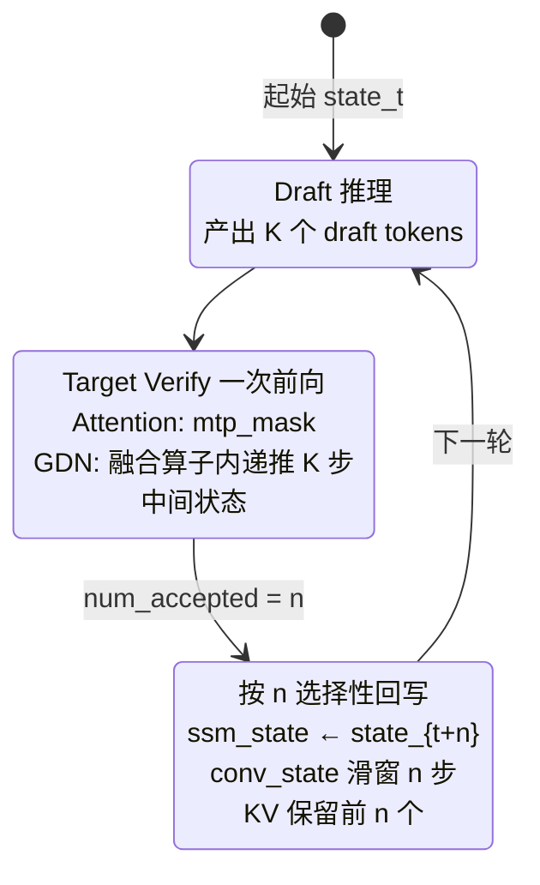
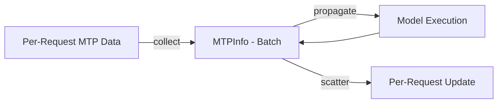
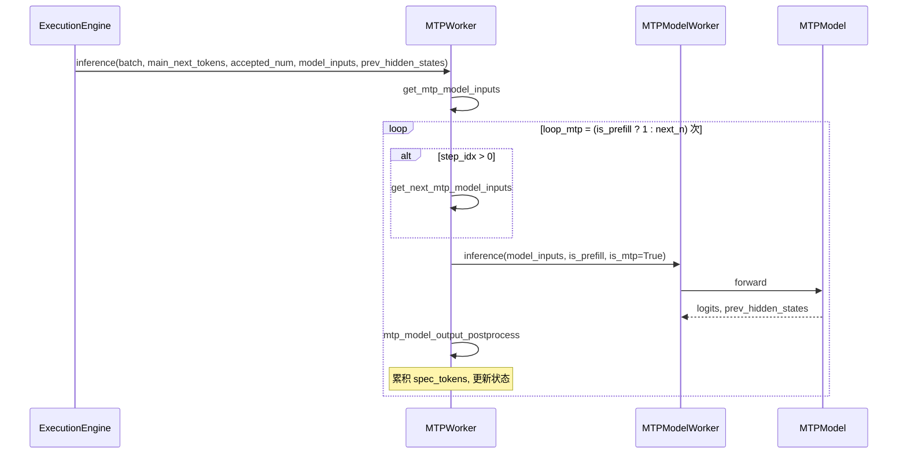
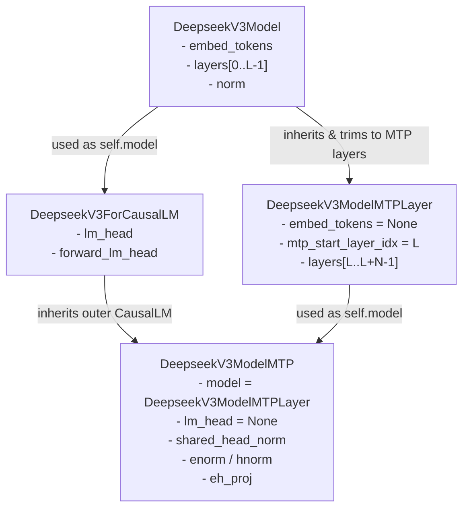

# MTP Speculative Decoding

## Summary

Multi-Token Prediction (MTP) 投机推理：主模型一次前向同时验证 1 个主 token + `next_n` 个 draft token（MTP1 即 `next_n`=1，即每步 1 个 draft、共验证 1+1=2 个 token），在相近的 HBM 搬运量下做更多算术运算，充分利用 Decode 阶段剩余的算力水位，降低等效 per-token 时延并提升吞吐。

cann-recipes-infer 中有两条落地路径：

- **Qwen3-Next**：SGLang 的 `NEXTN` 投机算法 + AscendC `recurrent_gated_delta_rule` 融合算子的 `num_accepted_tokens` 接口（针对 GDN 线性注意力的 ssm_state 选择性回写）。
- **DeepSeek-R1**：自研 executor 的 MTP 实现，通过 `next_n` 参数使能；MLA 端通过 `npu_fused_infer_attention_score_v2` 的 `sparse_mode=3` 切换 MTP 因果 mask；KV 按 `speculative_num_draft_tokens` 连续布局；无 ssm_state 语义因而不需 num_accepted_tokens 回写。`DeepseekV3ModelMTP` / `DeepseekV3ModelMTPLayer` 承担 MTP layer。

## Mechanism



- **算法**：SGLang 内置 `--speculative-algorithm NEXTN`；`speculative-num-steps 1`、`speculative-eagle-topk 1`、`speculative-num-draft-tokens 2`。一次前向包含 2 个候选 token 的 target-verify。
- **环境**：`SGLANG_ENABLE_OVERLAP_PLAN_STREAM=1`、`SGLANG_ENABLE_SPEC_V2=1`、`ENABLE_ASCENDC_FUSION_GDN=true`。走 `eagle_worker_v2.py` 路径。
- **Attention 端**：ascend_backend 使用 `mtp_mask`（draft token 之间的因果 + 历史 full attn）；KV 写入按 `speculative_num_draft_tokens` 连续布局。
- **Linear Attention 端（GDN）**：
 - `prepare_gdn_inputs` 根据 `mamba_cache_indices` 构造 `ssm_state_indices`，并把每个 batch 的 `num_accepted_tokens` 传给 [recurrent-gated-delta-rule](../kernels/recurrent_gated_delta_rule.md)。
 - 融合算子内部先按 MAX_MTP=8 的上限执行 draft step 的递推，然后只把 `num_accepted_tokens[i]` 指向的中间 state 写回 `ssm_state`，保证下一轮起始状态与实际被接受的 token 对齐。
 - `conv_state` 由 `torch_causal_conv1d_update_npu` 根据被接受的 token 数相应滑窗更新。

## DeepSeek-R1 MTP 路径

源文档：`docs/models/deepseek-r1/deepseek_r1_decode_optimization.md` "支持 Multi-Token Prediction (MTP)"。YAML `next_n: 1` 使能；`decode_r1_rank_128_128ep_a8w8c8_mtp*.yaml` 三份配置都启用。

- **MLA 端 mask 切换**：`if q_len > 1: sparse_mode = 3`（`modeling_deepseek.py:L1191`、`L1303` 两处 attention 分支），让下游 FIA（[fused-infer-attention-score](../kernels/fused_infer_attention_score.md)）走 MTP 因果 mask；否则 `sparse_mode = 0`。
- **MTP Layer**：`DeepseekV3ModelMTPLayer`（`modeling_deepseek.py:L2202`）/ `DeepseekV3ModelMTP`（`L2774`）独立于主模型，承担 draft token 的轻量前向。
- **与 W8A8C8 共存**：R1 路径下 C8 与 MTP 同开，benchmark 配置 `decode_r1_rank_128_128ep_a8w8c8_mtp_benchmark.yaml` 为主要性能指标来源（TPOT 44.9 ms）。
- **accept 率**：benchmark 报告"1 个 draft token 中平均 accept token 为 0.7 个"。
- **与图模式共存**：R1 的 `ge_graph` + MTP 可同开（`decode_r1_rank_128_128ep_a8w8c8_mtp_benchmark.yaml`），**与 Qwen3-Next "MTP 与图模式互斥" 的约束不同**。

## 框架执行机制（CANN Executor）

> 来源：`docs/design/mtp_design.md`、`docs/common/mtp_model_guide.md`、`executor/core/model_worker/mtp_worker.py`

cann-recipes-infer 自研 executor 把 MTP 作为一个独立的 `MTPWorker` 组件与主模型 `ModelWorker` 并列，由 `ExecutionEngine` 在 decode 循环中调度。

### MTPInfo 结构体

`MTPInfo` 封装 MTP 推测解码的状态信息，管理 draft / 主模型之间的工作流：

| 字段 | 类型 | 说明 |
|------|------|------| | `is_prefill` | `Optional[bool]` | 当前阶段是否为 prefill |
| `spec_tokens` | `Optional[torch.Tensor]` | 累积的推测 token 序列，供主模型验证 |
| `accepted_num` | `Optional[torch.Tensor]` | 当前迭代每个样本接受的 token 数量 |

在 [online-pd-inference](../frameworks/online_pd_inference.md) 的 PD 分离路径下，prefill 端算得的首批推测 token 经传输 metadata 的 `mtp_spec_tokens` 携带到 decode 端，由 `DecodeTransferQueue._commit_metadata`（提交 metadata 时，`queues.py:345-349`）物化为该请求的 `MTPInfo(spec_tokens=torch.tensor(...))`；而 `DecodePreallocQueue`（`queues.py:41-304`）只负责按 `next_n` 为首步预分配 `1+next_n` 个 token 的 KV 块（不物化 MTPInfo），衔接此处的验证流程。



### MTPWorker 类

**关键成员变量**：

| 分类 | 变量 | 说明 |
|------|------|------| | 配置 | `infer_config` / `next_n` / `exe_mode` / `prefill_mini_batch` / `batch_size_per_dp_rank` | 运行时配置 |
| 模型 | `device` / `mtp_model_worker` | 计算 NPU 与封装 MTP 的 ModelWorker |

**关键方法**：

| 方法 | 说明 |
|------|------| | `share_weights_from_main_model(main_model)` | 从主模型共享 `lm_head` / `embed_tokens`（MTP 模型缺这些层时复用） |
| `_pad_seq_len_to_size(tensor, size)` | 沿 dim=1 对 tensor padding / truncate 到指定长度 |
| `get_main_model_inputs(input_ids, batch)` | 构建主模型验证窗口：拼接 `input_ids` 与 `spec_tokens`，回退 `kv_len` 到接受的前缀位置 |
| `get_mtp_model_inputs(batch, main_next_tokens, model_inputs_main, prev_hidden_states)` | Prefill 分支拼接 `input_ids` + 接受 token + 存 `prev_hidden_states` + `cycle_idx`；Decode 分支用主模型位置信息 |
| `mtp_model_output_postprocess(model_inputs, logits, mtp_infos)` | 处理 MTP 输出，累积 `spec_tokens` + 更新状态；Prefill 分支直接推进 `kv_len` + 翻转 `is_prefill` |
| `get_next_mtp_model_inputs(...)` | 构建下一次 MTP 迭代输入，按 `accepted_num` scatter 最后一个推测 token，重塑 `prev_hidden_states` |
| `inference(batch, main_next_tokens, accepted_num, model_inputs_main, prev_hidden_states)` | MTP 主入口，循环 `prefill=1` 或 `decode=next_n` 次推理 |

### 调度时序



### DeepSeek-R1 MTP 类结构示例

> 来源：`docs/common/mtp_model_guide.md`，以 `models/deepseek_r1/models/modeling_deepseek.py` 为例。



- `DeepseekV3ModelMTPLayer` 仅作 MTP 额外层容器，`embed_tokens = None`、`mtp_start_layer_idx = config.num_hidden_layers`、`layers` 是 `ModuleDict`（key 为字符串 `"num_hidden_layers + i"`）。
- `DeepseekV3ModelMTP` 复用 `ForCausalLM` 外层接口，内部 model 换成 `DeepseekV3ModelMTPLayer`；`lm_head = None` 复用主模型。
- MTP 前向 7 步：`calc_input_embeddings` → `enorm(hidden) / hnorm(prev)` → `concat + eh_proj` 特征融合 → 位置编码 → 循环 MTP 层 → `shared_head_norm` → `forward_lm_head`。

### MTP 独有权重映射

checkpoint 权重名与模型参数名不一致时，在 MTP 模型的 `load_weights` 做映射：

| checkpoint 名 | 模型参数名 |
|--------------|-----------| | `shared_head.norm` | `shared_head_norm` |
| `enorm` | `enorm` |
| `hnorm` | `hnorm` |
| `eh_proj` | `eh_proj` |

**注意**：`embed_tokens.weight` 与 `lm_head.weight` 无需加载（复用主模型），框架通过 `share_weights_from_main_model` 自动共享。

### 三步接入流程

1. **定义 MTP 类**（`DeepseekV3ModelMTPLayer` + `DeepseekV3ModelMTP`）
2. **注册惰性注册表**（`executor/core/support_models.py` 的 `_specs: dict[str, list[tuple[str, str]]]`）：值是 `(module_path, class_name)` 字符串元组的 list（运行时 `importlib` 惰性导入，注册表里存的是字符串而非 class 对象）。为 `"deepseek_r1"` 登记 `DeepseekV3ForCausalLM` / `DeepseekV3ModelMTP` / `DeepseekV3Config` 三项即自动使能 MTP（含 ModelMTP 项的模型才有 MTP 能力；如 `deepseek_v2_lite` 只登记 ForCausalLM + Config 则无 MTP）：

 ```python
 _specs: dict[str, list[tuple[str, str]]] = {
     "deepseek_r1": [
         ("models.deepseek_r1.models.modeling_deepseek", "DeepseekV3ForCausalLM"),
         ("models.deepseek_r1.models.modeling_deepseek", "DeepseekV3ModelMTP"),
         ("models.deepseek_r1.models.configuration_deepseek", "DeepseekV3Config"),
     ],
 }
 ```

3. **YAML 开关** `model_config.next_n > 0` → 框架自动启用 MTP + 共享权重。

## MTP 性能指标

> 来源：`docs/design/mtp_design.md` "3. MTP 指标介绍"；`executor/offline/offline_inference.py:149-184`、`executor/offline/infer.py:64-102`（`log_results`）。

MTP 启用时框架统计三个核心指标，用于量化 decode 阶段的收益（`next_n` = MTP draft 数）：

| 指标 | 公式 | 含义 |
|------|------|------|
| 平均接受率 `avg_accept_rate` | `total_accept_tokens / total_spec_tokens` | MTP 预测准确程度，越高表示 MTP 模型与主模型越一致 |
| 平均接受长度 `avg_accept_length` | `total_accept_tokens / spec_num_forward_ct + 1` | 平均每次 decode 迭代实际产出的 token 数 |
| 平均等效时延 `avg_equivalent_time` | `avg_decode_time / avg_accept_length` | 等效于每生成一个有效 token 的平均耗时 |

其中：

- `total_spec_tokens = sum(spec_num_forward_ct) × next_n`：MTP 模型推测的总 token 数。
- `total_accept_tokens = sum(spec_num_accepted_tokens)`：主模型验证后接受的总 token 数。
- `spec_num_forward_ct`（求和后）：前向传播次数；接受长度公式的 `+1` 表示主模型每次验证至少产出 1 个有效 token（含主模型本身那个 token）。
- `avg_decode_time`：decode 阶段平均前向耗时，包括一次主模型推理 + `next_n` 次 MTP 模型推理（`infer.py` 中取 `infer_time[1:]` 的均值，跳过首步 prefill）。

**指标来源（offline 推理）**：`offline_inference.py` 在请求完成后逐请求收集 `mtp_stats`（`spec_num_accepted_tokens` / `spec_num_forward_ct` / `valid_output_len`，仅 `request.mtp_info` 存在时收集）；`infer.py` 的 `log_results` 在 `next_n > 0` 时据此算出三指标并打印（accept length / accept rate / equivalent latency）。

**指标来源于 executor 侧逐轮累计**：每请求的 `spec_num_accepted_tokens` 由 `update_mtp_info(accepted_num, ...)` 以 `+= accepted_num` 累计（`forward_data_info.py:164-165`），其中 `accepted_num` 是 [cann-executor](../frameworks/cann_executor.md) / MTPInfo 侧记录的「当轮被接受 token 数」（与上文 `MTPInfo.accepted_num` 同口径）。各模型路径里同名/同概念的「被接受 draft token 数」（如 Qwen3-Next GDN 融合算子的 `num_accepted_tokens`）以各自代码为准、未必是同一变量。指标的直观意义：接受长度越大 → 一次前向多产出有效 token → 等效时延越低，这是 MTP decode 加速的量化口径。

## Applicable Scenarios

- Decode 阶段单请求或小 batch、算力空闲但带宽紧张的场景。
- Qwen3-Next 场景：与 [recurrent-gated-delta-rule](../kernels/recurrent_gated_delta_rule.md) 配套，使 GDN state 能正确吞吐多 draft token 的递推；PD 混部（非分离）、BF16 或 W8A8 场景。
- DeepSeek-R1 场景：与 W8A8C8 + [torchair](../frameworks/torchair.md) `ge_graph` + [superkernel](superkernel.md) + perfect eplb 组合，是 decode 高吞吐主路径。

## Constraints

按路径区分：

### Qwen3-Next 路径

- **与图模式互斥**（ACLGraph `--cuda-graph-bs` 不可同开）。
- **与 C8 KVCache 互斥**：当前 ascend_backend 的 C8 路径未打通 MTP 验证流。
- **PD 分离下不支持**（SGLang KV 传输逻辑限制）。
- 必须启用 GDN 融合算子（`ENABLE_ASCENDC_FUSION_GDN=true`），否则 state 回写不正确。
- `max-mamba-cache-size` 需设置较大值（建议 512），否则 `mamba_cache_indices=0` 频繁触发已知精度 bug。

### DeepSeek-R1 路径

- MLA 与 FIA 的 `sparse_mode=3` 专为 MTP 因果 mask 设计，不可在非 MTP 场景误开。
- accept 率约束性能收益（平均 0.7/1，即 ~70% 命中）。

## Known Results

- **Qwen3-Next**：README Benchmark 表在 A8W8C8、graph_bs=16 场景下未叠加 MTP；MTP 主要在非 C8 BF16/W8A8 长序列场景收益。具体时延收益在本 source 未给出数字。
- **DeepSeek-R1**：`decode_r1_rank_128_128ep_a8w8c8_mtp_benchmark.yaml`、128 卡、seq 4096、global batch 6144、MTP1（平均 accept 0.7 token/draft）、perfect eplb 下 TPOT **44.9 ms**、吞吐 **2138 tokens/p/s**。未单独对比开/关 MTP 的增益数据。

## Evidence

- [cann-recipes-infer](https://gitcode.com/cann/cann-recipes-infer/tree/2c45117d781ab9ab88dcb89a28ae30f5d2450399) — Qwen3-Next: `docs/models/qwen3-next/qwen3_next_optimization.md` MTP 章节；`models/qwen3-next/README.md` "新增特性使能" 与 "规格约束说明"；`models/qwen3-next/patches/stage3/0001-feat-GDN-adaption-and-support-MTP.patch`（`prepare_gdn_inputs`、`fused_recurrent_gated_delta_rule_update_npu`、`torch_causal_conv1d_update_npu`、`mtp_mask`）。
- [cann-recipes-infer](https://gitcode.com/cann/cann-recipes-infer/tree/2c45117d781ab9ab88dcb89a28ae30f5d2450399) — DeepSeek-R1: `docs/models/deepseek-r1/deepseek_r1_decode_optimization.md` "支持 Multi-Token Prediction (MTP)" 章节与 Benchmark 表；`models/deepseek_r1/models/modeling_deepseek.py:L1191`、`L1303`（sparse_mode=3 切换）、`L2202`（`class DeepseekV3ModelMTPLayer`）、`L2774`（`class DeepseekV3ModelMTP`）；`models/deepseek_r1/config/decode_r1_rank_128_128ep_a8w8c8_mtp*.yaml`（`next_n: 1`）。
- [cann-recipes-infer](https://gitcode.com/cann/cann-recipes-infer/tree/2c45117d781ab9ab88dcb89a28ae30f5d2450399) — 框架执行机制：`docs/design/mtp_design.md`、`docs/common/mtp_model_guide.md`、`executor/core/model_worker/mtp_worker.py`（MTPWorker / MTPInfo / `share_weights_from_main_model`）、`executor/core/support_models.py`（`_specs` 惰性注册表）。
- [cann-recipes-infer](https://gitcode.com/cann/cann-recipes-infer/tree/2c45117d781ab9ab88dcb89a28ae30f5d2450399) — MTP 性能指标：`docs/design/mtp_design.md` "3. MTP 指标介绍"（avg_accept_rate / avg_accept_length / avg_equivalent_time 公式）；`executor/offline/offline_inference.py:149-184`（`mtp_stats` 逐请求收集 `spec_num_accepted_tokens` / `spec_num_forward_ct` / `valid_output_len`）；`executor/offline/infer.py:64-102` `log_results`（`next_n>0` 时算三指标）；`executor/core/forward_data_info/forward_data_info.py:159-165` `update_mtp_info`（`spec_num_accepted_tokens += accepted_num`）。

## Kimi-K2-Thinking 与 LongCat-Flash 路径差异

- **Kimi-K2-Thinking**：与 DeepSeek-R1 共享 `modeling_deepseek.py` MTP 实现路径（`sparse_mode=3` + KV 按 `speculative_num_draft_tokens` 布局）。由于 Attention Head 从 128 精简至 64，**Attention 计算量显著降低，更利好 MTP 场景**——Decode 通常为访存瓶颈，MTP 通过少量计算代价缓解访存压力，Kimi-K2-Thinking 计算负载更轻，MTP 模式下更难触及计算瓶颈。Benchmark YAML 当前 `next_n: 0` 未开启，代码已支持多头 MTP 权重直接启用。见 [kimi-k2-thinking](../models/kimi_k2_thinking.md)。
- **LongCat-Flash**：`next_n` 参数使能 MTP，**当前支持 MTP1 与 MTP2**（R1 只使用 MTP1）。MTP 场景下 `graph_compile` 的 cache 路径增加 `_spec` 后缀（主模型 `CASE_NAME` / MTP 模型 `CASE_NAME_spec`）。**KVP 与 MTP 不可同开**（KVP 约束），见 [kvp](../parallelism/kvp.md)。benchmark 默认 `next_n: 2`。见 [longcat-flash](../models/longcat_flash.md)。

## Links

- [qwen3-next](../models/qwen3_next.md)
- [deepseek-r1](../models/deepseek_r1.md)
- [kimi-k2-thinking](../models/kimi_k2_thinking.md)
- [longcat-flash](../models/longcat_flash.md)
- [deepseek-v4](../models/deepseek_v4.md)（Main+Spec 双模型；Spec 仅 SWA，Ring-Buffer cache + 梯形掩码适配 Hybrid Attention）
- [hy3-preview](../models/hy3_preview.md)（含 MTP layer（layer 80）但推理跳过、不做投机推理；权重加载层忽略 `model.layers.80.`）
- [gated-deltanet](../modules/gated_deltanet.md)
- [mla](../modules/mla.md)
- [recurrent-gated-delta-rule](../kernels/recurrent_gated_delta_rule.md)
- [fused-infer-attention-score](../kernels/fused_infer_attention_score.md)
- [sglang](../frameworks/sglang.md)
- [torchair](../frameworks/torchair.md)
- [cann-executor](../frameworks/cann_executor.md)
- [inference-config](inference_config.md)
- [npu-graph-mode](npu_graph_mode.md)
- [w8a8c8](../quantization/w8a8c8.md)
- [superkernel](superkernel.md)
- [kv-cache-manager](../frameworks/kv_cache_manager.md)
- [online-pd-inference](../frameworks/online_pd_inference.md)
- [glm-5](../models/glm_5.md)（GLM-5 Atlas A3 部署用 MTP3，next_n=3，benchmark 平均 accept 1.44/3）
- [sam-speculative](../../../training/concepts/techniques/sam_speculative.md)（跨域·训练：SAM 无损投机(RL rollout 加速),与 MTP 投机对照）
- [deepseek-v32-mtp-train](../../../training/concepts/modules/deepseek_v32_mtp_train.md)（对照：训练侧 MTP 辅助 loss vs 本页推理侧 MTP 投机解码）