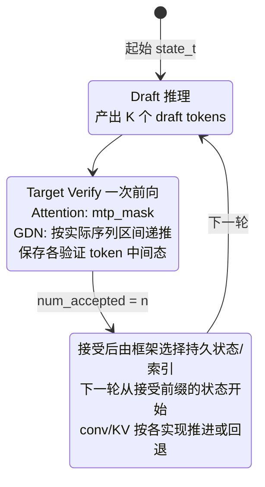

# MTP Speculative Decoding

## Summary

Multi-Token Prediction (MTP) 投机推理：主模型一次前向同时验证 1 个主 token + `next_n` 个 draft token（MTP1 即 `next_n`=1，即每步 1 个 draft、共验证 1+1=2 个 token），在相近的 HBM 搬运量下做更多算术运算，充分利用 Decode 阶段剩余的算力水位，降低等效 per-token 时延并提升吞吐。

当前 Executor 以 `BaseSpeculativeWorker` 统一 draft 生命周期；引擎实际支持 native MTP 和 DSpark 两种后端。MTP 顺序生成候选，主模型用固定宽度验证；DSpark 的提案和验证策略独立，配置字段存在不代表任意后端已实现。以下区分 Executor 与 SGLang 两条集成路径：

- **Qwen3-Next**：SGLang 的 `NEXTN` 投机算法 + AscendC `recurrent_gated_delta_rule` 融合算子的 `num_accepted_tokens` 接口（针对 GDN 的上一轮起始状态选择与候选中间态保存）。
- **DeepSeek-R1**：自研 executor 的 MTP 实现，通过 `speculative_config.method: mtp` 与 `num_speculative_tokens>0` 使能（兼容旧 next_n）；MLA 端通过 `npu_fused_infer_attention_score_v2` 的 `sparse_mode=3` 切换 MTP 因果 mask；KV 验证窗口由 next_n+1 构造，按接受前缀回退 kv_len 并生成对应 position_ids（speculative_num_draft_tokens 是 Qwen/SGLang 参数，不属于此 R1 路径）；无 ssm_state 语义因而不需 num_accepted_tokens 回写。`DeepseekV3ModelMTP` / `DeepseekV3ModelMTPLayer` 承担 MTP layer。

## Mechanism

- **算法**：SGLang 内置 `--speculative-algorithm NEXTN`；`speculative-num-steps 1`、`speculative-eagle-topk 1`、`speculative-num-draft-tokens 2`。一次前向包含 2 个候选 token 的 target-verify。
- **环境**：`SGLANG_ENABLE_OVERLAP_PLAN_STREAM=1`、`SGLANG_ENABLE_SPEC_V2=1`、`ENABLE_ASCENDC_FUSION_GDN=true`。走 `eagle_worker_v2.py` 路径。
- **Attention 端**：ascend_backend 使用 `mtp_mask`（draft token 之间的因果 + 历史 full attn）；KV 写入按 `speculative_num_draft_tokens` 连续布局。
- **Linear Attention 端（GDN）**：
 - `prepare_gdn_inputs` 根据 `mamba_cache_indices` 构造 `ssm_state_indices`，并把每个 batch 的 `num_accepted_tokens` 传给 [recurrent-gated-delta-rule](../kernels/recurrent_gated_delta_rule.md)。
 - 自研 kernel 用 num_accepted_tokens 选择上一轮起始状态槽位；本轮依 actual_seq_lengths 递推，每个验证 token 的中间态均按 ssm_state_indices 保存，MAX_MTP=8 为容量上限。接受结果确定后，由框架选择持久状态/索引供下一轮读取；不能把只提交接受前缀归给 kernel 内部写回。stage3 prepare_gdn_inputs 还将该输入初始化为全 1，须按具体补丁链核对。
 - `conv_state` 由 `torch_causal_conv1d_update_npu` 根据被接受的 token 数相应滑窗更新。

## DeepSeek-R1 MTP 路径

源文档：`docs/models/deepseek-r1/deepseek_r1_decode_optimization.md` "支持 Multi-Token Prediction (MTP)"。YAML `next_n: 1` 使能；`decode_r1_rank_128_128ep_a8w8c8_mtp*.yaml` 三份配置都启用。

- **MLA 端 mask 切换**：`if q_len > 1: sparse_mode = 3`（当前模型 attention 分支），让下游 FIA（[fused-infer-attention-score](../kernels/fused_infer_attention_score.md)）走 MTP 因果 mask；否则 `sparse_mode = 0`。
- **MTP Layer**：`DeepseekV3ModelMTPLayer`/ `DeepseekV3ModelMTP`独立于主模型，承担 draft token 的轻量前向。
- **与 W8A8C8 共存**：R1 路径下 C8 与 MTP 同开，benchmark 配置 `decode_r1_rank_128_128ep_a8w8c8_mtp_benchmark.yaml` 的完整组合数据见[R1 Decode 来源观测](../../optimizations/benchmark_observations/deepseek_r1_a3_decode_source_benchmark.md)。
- **accept 率**：来源接受数由对应观测维护，不作为新负载的预测值。
- **与图模式共存**：R1 的 `ge_graph` + MTP 可同开（`decode_r1_rank_128_128ep_a8w8c8_mtp_benchmark.yaml`），**与 Qwen3-Next "MTP 与图模式互斥" 的约束不同**。

## 接入、缓存与测量入口

- [MTP 接入指南](../../guides/integration/mtp_speculative_decode_model_onboarding.md)：模型接口、权重共享、Worker 状态和版本化注册步骤。
- [缓存状态规则](../../optimizations/rules/mtp_draft_cache_state_correctness.md)：按实现区分 KV 槽与递归状态写回。
- [MTP 计时规则](../../optimizations/rules/mtp_decode_timing_two_metric_split.md)：计时范围、接受率、接受长度与等效时延。

## Applicable Scenarios

- Decode 阶段单请求或小 batch、算力空闲但带宽紧张的场景。
- Qwen3-Next 场景：与 [recurrent-gated-delta-rule](../kernels/recurrent_gated_delta_rule.md) 配套，使 GDN state 能正确吞吐多 draft token 的递推；PD 混部（非分离）、BF16 或 W8A8 场景。
- DeepSeek-R1 场景：与 W8A8C8 + [torchair](../frameworks/torchair.md) `ge_graph` + [superkernel](superkernel.md) 组合；来源 benchmark 还启用 perfect eplb，这属于 profiling 条件，不能作为生产路由建议。

## Constraints

按路径区分：

### Qwen3-Next 路径

- **与图模式互斥**（ACLGraph `--cuda-graph-bs` 不可同开）。
- **与 C8 KVCache 互斥**：当前 ascend_backend 的 C8 路径未打通 MTP 验证流。
- **PD 分离下不支持**（SGLang KV 传输逻辑限制）。
- 必须启用 GDN 融合算子（`ENABLE_ASCENDC_FUSION_GDN=true`），否则 state 回写不正确。
- `mamba_cache_indices=0` 有已知精度问题；调大 `max-mamba-cache-size`（来源建议 512）只降低触发概率，不构成修复。

### DeepSeek-R1 路径

- 本实现 Decode 验证分支按 q_len 选择 sparse_mode（多 token 时为 3）；这不是接口的 MTP 专用限制。固定 R1 的普通 Prefill 分支也使用 sparse_mode=3，须按阶段、布局和实际算子接口核对。
- 实际接受数、cache与每步成本共同影响收益，历史接受数不能当作本任务约束值。

## Known Results

- **Qwen3-Next**：README Benchmark 表在 A8W8C8、graph_bs=16 场景下未叠加 MTP；MTP 主要在非 C8 BF16/W8A8 长序列场景收益。具体时延收益在本 source 未给出数字。
- **DeepSeek-R1**：完整配置、接受数与Chips分歧见[R1 Decode 来源观测](../../optimizations/benchmark_observations/deepseek_r1_a3_decode_source_benchmark.md)；未给只切换MTP的独立增益。

## Evidence

- [README.md](../../../../../cann-recipes-raw/cann-recipes-infer/944d2d3ece86f7df33dbb0cb155c72ca619a9c66/README.md)（primary）
- [mtp_design.md](../../../../../cann-recipes-raw/cann-recipes-infer/944d2d3ece86f7df33dbb0cb155c72ca619a9c66/docs/design/mtp_design.md)（supporting）
- [mtp_model_guide.md](../../../../../cann-recipes-raw/cann-recipes-infer/944d2d3ece86f7df33dbb0cb155c72ca619a9c66/docs/common/mtp_model_guide.md)（supporting）
- [mtp_worker.py](../../../../../cann-recipes-raw/cann-recipes-infer/944d2d3ece86f7df33dbb0cb155c72ca619a9c66/executor/core/model_worker/mtp_worker.py)（implementation）
- [recurrent_gated_delta_rule.h](../../../../../cann-recipes-raw/cann-recipes-infer/944d2d3ece86f7df33dbb0cb155c72ca619a9c66/integration/sglang/qwen3-next/ops/gated_delta_net/recurrent_gated_delta_rule/op_kernel/recurrent_gated_delta_rule.h)（implementation）
- [0001-feat-GDN-adaption-and-support-MTP.patch](../../../../../cann-recipes-raw/cann-recipes-infer/944d2d3ece86f7df33dbb0cb155c72ca619a9c66/integration/sglang/qwen3-next/patches/stage3/0001-feat-GDN-adaption-and-support-MTP.patch)（implementation）

## Kimi-K2-Thinking 与 LongCat-Flash 路径差异

- **Kimi-K2-Thinking**：使用同架构思路的独立 `modeling_deepseek.py` MTP 实现副本（`sparse_mode=3` + 缓存布局按该固定实现核对）。由于 Attention Head 从 128 精简至 64，Attention head 数较少可能降低部分计算负载；是否更利于 MTP 仍取决于接受率、缓存、算子和负载，不能仅由 head 数判断——Decode 通常为访存瓶颈，MTP 通过少量计算代价缓解访存压力，Kimi-K2-Thinking 计算负载更轻，MTP 模式下可能有不同的计算余量，需实际测量。Benchmark YAML 当前 `next_n: 0` 未开启，代码已支持多头 MTP 权重直接启用。见 [kimi-k2-thinking](../models/kimi_k2_thinking.md)。
- **LongCat-Flash**：`next_n` 参数使能 MTP，**当前支持 MTP1 与 MTP2**（R1 只使用 MTP1）。当前图缓存按 `decode_q_len_N` 命名空间及 `main_decode/mtp_decode` 区分，见[图模式](npu_graph_mode.md)。当前实现没有 KVP 配置路径。benchmark 默认 `next_n: 2`。见 [longcat-flash](../models/longcat_flash.md)。

## Links

- [qwen3-next](../models/qwen3_next.md)
- [deepseek-r1](../models/deepseek_r1.md)
- [kimi-k2-thinking](../models/kimi_k2_thinking.md)
- [longcat-flash](../models/longcat_flash.md)
- [deepseek-v4](../models/deepseek_v4.md)（Main+Spec 双模型；Spec 仅 SWA，Ring-Buffer cache + 梯形掩码适配 Hybrid Attention）
- [hy3-preview](../models/hy3_preview.md)（当前独立 MTP 类加载 layer 80，主模型跳过该层；已提供 MTP1 配置）
- [gated-deltanet](../modules/gated_deltanet.md)
- [mla](../modules/mla.md)
- [recurrent-gated-delta-rule](../kernels/recurrent_gated_delta_rule.md)
- [fused-infer-attention-score](../kernels/fused_infer_attention_score.md)
- [sglang](../frameworks/sglang.md)
- [torchair](../frameworks/torchair.md)
- [cann-executor](../frameworks/cann_executor.md)
- [inference-config](inference_config.md)
- [npu-graph-mode](npu_graph_mode.md)
- [w8a8c8](../quantization/w8a8c8.md)
- [superkernel](superkernel.md)
- [kv-cache-manager](../frameworks/kv_cache_manager.md)
- [online-pd-inference](../frameworks/online_pd_inference.md)
- [glm-5](../models/glm_5.md)（GLM-5 Atlas A3 部署用 MTP3，next_n=3，benchmark 平均 accept 1.44/3）
- [sam-speculative](../../../training/concepts/techniques/sam_speculative.md)（跨域·训练：SAM 无损投机(RL rollout 加速),与 MTP 投机对照）
- [deepseek-v32-mtp-train](../../../training/concepts/modules/deepseek_v32_mtp_train.md)（对照：训练侧 MTP 辅助 loss vs 本页推理侧 MTP 投机解码）
