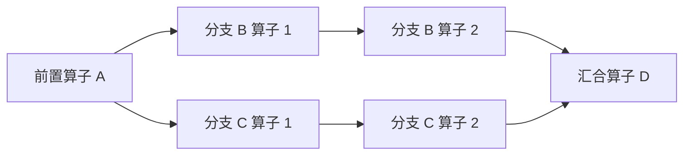
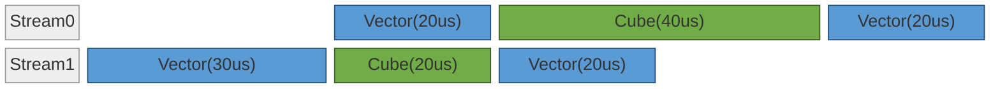
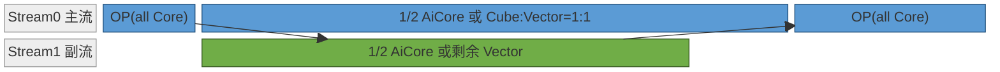
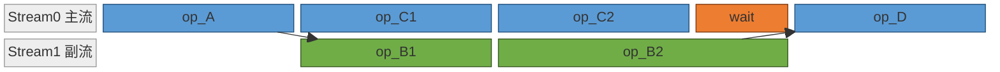
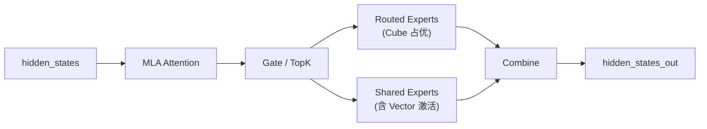
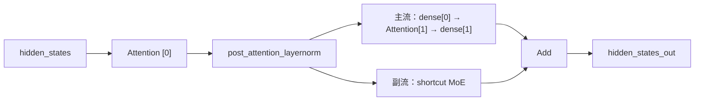

# NPU 多流优化(Multi-Stream)

## 概述

多流优化是把一个模块/算子序列里**彼此无 data 依赖、可并行的子计算或通信段**分配到多条 NPU stream 上重叠执行，用一条流的耗时去掩盖另一条流的耗时，从而在不增加算力的前提下缩短关键路径。它是 cann-recipes-infer 在 MoE / Attention 前处理 / KVCache 搬运 / Prefill micro-batch / 分离式通信等多个场景里反复使用的一类优化骨架。

从 NPU 硬件资源与 Stream/Event 机制出发，多流优化覆盖三种并行典型形态、三种执行模式的多流实现、贯穿全程的核心原则、分析→实现→控核→调试流程，以及全仓多流案例。它支持两类工作：给已 profiling 的模型**形成多流候选 plan**，以及把某个方案**落到代码并 review** 其是否物理并行。MoE 子场景（共享专家双流、ScMoE 控核变体）的拓扑细节见 [moe-multi-stream](moe_multi_stream.md)。

## 多流为何有效:硬件基础与并行条件

模型执行的关键路径上常存在硬件资源未被充分使用的情形：Cube 与 Vector 利用率不均衡使一类单元闲置；算子小无法高效利用所有 AICore；HCCL 集合通信与本地计算串行进行，使通信期间计算资源空转。多流优化通过将算子合理分配到多条 Stream，让算子在不同 Stream 上并行计算，从而提高硬件使用效率。

要使能多 Stream 并行，需要计算图中存在满足并行条件的结构：当多个算子的输入都依赖于同一前驱算子的输出、彼此之间没有数据依赖时，这些算子在拓扑上即可并发执行。如下图，前置算子 A 的输出同时被 B 与 C 两条分支消费；B、C 之间无数据依赖，可分别承载于两条 Stream 并行，最终在汇合算子 D 合并。



除了模型原生结构支持多流并行，也可以通过调整计算过程造出并行分支，例如把输入数据切成两 batch 多出两个并行计算分支（Dual Batch Overlap，DBO，见下文「计算↔通信互补」）。`npu_prefetch`（见 [weight-prefetch](weight_prefetch.md)）也是利用数据搬运资源并行的一种形式，框架自动分配一条 Stream，属于独立的预取编排而非此处的多流编排。

### 物理资源单元

NPU Device 侧拥有多类可独立调度的物理执行资源，多 Stream / Event 提供异步机制把这些硬件调度成并发计算：

| 单元 | 主要职责 | 跨 Stream 行为 |
| --- | --- | --- |
| **Cube** | 大矩阵乘类计算 | 多 Stream 竞争，可分核并行，不同 Stream 各获取一部分核（见「同类计算池分核」） |
| **Vector** | 向量、激活、规约类计算 | 同上 |
| **HCCL** | 集合通信 | 与计算独立的资源，部分优化场景需占用一些 Vector |

算子按算力使用情况分三类，是判定能否互补并行的基础：

1. **纯 Cube 算子**：如非量化的 Matmul；
2. **纯 Vector 算子**：如 RMSNorm；
3. **混合算子**：Cube 和 Vector 都需要，如量化 Matmul、flash attention 系列。

一般算子不能把全部算力用满，这给多流加速提供了优化空间。集合通信算子一般与计算单元独立、可并行，但**两种情况下通信会占用 Vector**：① 环境变量 `HCCL_OP_EXPANSION_MODE="AIV"` 时占用部分 AIV；② 通算融合算子同时利用计算与通信单元（算子内计算/通信分片并行，适合数据量大时）。这两种情况下需按「分核」给通信 Stream 分配部分 Vector。

### Stream 与 Event 机制

**Stream** 是 Host 向 Device 下发任务的队列：同一 Stream 上的任务按入队顺序串行执行，Stream 之间的执行顺序由同步语句（Event）和调度器决定。Stream 本身承载调度上下文，算力来自下层物理资源单元。两种典型划分方式：① 把上图 B/C 分支分别放到两条 Stream；② 按资源类型划分（一条计算 Stream、一条通信 Stream），算子按类别分流并在 Stream 间加 Event。

**Event** 是跨 Stream 的同步原语：Stream A 上的 `record_event` 在执行流上标记一个时间点，Stream B 上的 `wait_event` 在该时间点完成后才继续（不同执行模式接口不同）。Stream 间相互等待最终落到 Event——或显式由脚本调用，或由框架按数据依赖隐式插入。Event 同步主要两类：

1. **数据依赖同步**：一个 Stream 的输入来自另一个 Stream，需用 Event 确保数据被使用前已算完；
2. **执行顺序控制**：错开资源利用以提高利用率，需显式加 Event。如下例，方案二通过 Event 控制顺序使关键路径更短：

方案一（不用 Event 控制，Stream1 可能先被调度，耗时 110us）：



方案二（用 Event 控制顺序，关键路径更短，耗时 100us）：


## 三种并行典型形态

### Cube↔Vector 互补

在 Cube/Vector 可独立调度的[分离模式](https://www.hiascend.com/document/detail/zh/CANNCommunityEdition/900/programug/Ascendcopdevg/atlas_ascendc_10_0008.html)平台上，把 Cube 算子与 Vector 算子交替编排在两条 Stream 上形成互补：两条流通常有相同前置依赖，一条沿用原 Stream（**主流**）、另一条用新 Stream（**副流**），副流数据随后回到主流。Cube 与 Vector 总耗时一般不对等（多数 Cube 居多），Cube 类算子是关键路径——理想情况下 Cube 单元利用率接近 100%，把另一并行单元的时间掩盖。


### 同类计算池分核

很多场景算子对计算资源利用率不高：某算子用全部核耗时 $T$，用 1/2 核耗时 $\frac{3}{2}T$，那么两个相近的 Matmul 从串行 $2T$ 优化到各占一半核并行的 $\frac{3}{2}T$，省 **25%**。原理是数据量小时计算/带宽利用率不高、算子启动开销占比高，多用核加速不明显（但不是不能加速——没有可并行分支时，最优策略仍可能是用更多核），引入并行 Stream 可提高资源利用率。

量化场景的混合 Matmul 当 Vector 利用率低时，可划出一部分给并行 Stream 的 Vector 类算子（需[分离模式](https://www.hiascend.com/document/detail/zh/CANNCommunityEdition/900/programug/Ascendcopdevg/atlas_ascendc_10_0008.html)）。如 Atlas A2/A3，AiCore 中 Cube:Vector=1:2，可划出 Cube:Vector=1:1 的混合计算 Stream 与另一条 Vector Stream。



实际收益需按模型实测调整：

- 分核能一定程度提升算力利用率，但会有部分性能损失——分核后两条并行 Stream 耗时不相同，而后续计算依赖两条流结果，先完成的流对应核处于闲置，抵消部分收益，严重时甚至劣化；
- 可调整两条 Stream 的分配比例让其执行时间接近。分核一般用在 **Decode**（数据量少、算子小，满足分核收益条件），多采用图模式，因此分核在首次图执行时确定、后续不变；但两条流耗时仍会变化（attention 随 kv cache 长度、moe 随路由专家负载），调分核未必能完全消除耗时不一致导致的闲置，需实测判断是否采用。

> 控核的工程接口（`limit_core_num`）与生产案例见下文「实现要点与控核」。

### 计算↔通信互补

通信单元与计算单元独立，把通信算子切到独立 Stream 与主流计算并发：


默认通信不占计算资源，但前述两种情况（`HCCL_OP_EXPANSION_MODE=AIV`、通算融合算子）通信会占 Vector，此时按「大部分算子默认占用所有 AiCore」会导致两条流无法并行，需按分核给通信 Stream 分配部分 Vector、计算 Stream 减去对应数量。

模型里的计算与通信算子通常有数据依赖只能串行，但可按 **DBO（Dual Batch Overlap）** 拆出两个并行分支——两分支的通信与计算无数据依赖可并行。如下把 MoE 拆成两个 micro-batch，一个 batch 的前后通信与另一 batch 的计算并行：


DBO 收益来自通信/计算并行，但拆分也引入开销：单个算子处理数据量越大硬件使用效率越高，一份数据拆成多份计算时间一般是负面的，若把并行收益抵消则整体无收益甚至劣化。例如 **Decode 一般是访存瓶颈（weight 加载）**，DBO 切的两 batch 都加载全量 weight，导致计算时间近乎翻倍，因此 **DBO 主要用在 Prefill 优化**（Prefill micro-batch 双流见 [prefill-micro-batch](prefill_micro_batch.md)）。

> **跨节点通信 overlap** 是计算↔通信互补的跨节点变体：把副流的本地计算换成跨节点 Send/Recv，与主流计算重叠（LongCat-Flash 的 AFD 部署即此形态，见 [afd](afd.md) 与下文样例）。

## 执行路径定界

动手前必须先确认当前代码走哪种执行模式（`exe_mode` 取值 `eager` / `ge_graph` / `npugraph_ex`），三者多流与 Event 同步的接口**不能混用**（如 ge_graph 下调 `record_event` / `wait_event` 会因外部对象语义无法接入图内而导致同步失效或编译失败）。仓内两条图模式路径：

- **Ascend IR / GE 图模式（`ge_graph`）**：通过 `torchair.CompilerConfig()`（设 `experimental_config.*`，仓内 runner 如 longcat-flash 即此形态；字符串 `"max-autotune"` 仅见于 qwen3-moe-sglang patch 的 `compiler_config.mode` 赋值，非构造入参）+ `torchair.get_npu_backend()` 把 FX 图转 Ascend IR 再由 GE 编译执行。切流用 `torchair.scope.npu_stream_switch(stream_tag, stream_priority)`（图内 string-tag），时序用 `torchair.scope.npu_wait_tensor`，tagged event 沿用 `torchair.scope.npu_tagged_event_*`。仓内 `executor/utils/common_utils.py` 把这套包成 `npu_stream_switch` / `npu_wait_tensor`（[L126 / L120](https://gitcode.com/cann/cann-recipes-infer/blob/2c45117d781ab9ab88dcb89a28ae30f5d2450399/executor/utils/common_utils.py)，转发 `tng.scope.*`）。
- **npugraph_ex / aclgraph（`npugraph_ex`）**：通过 `torch.compile(backend="npugraph_ex")` 编译。切流用显式 `torch.npu.Stream()` + `with torch.npu.stream(stream)`，时序用 `torch.npu.Event()` 的 `record()` / `wait()`，或 Stream 侧 `record_stream` / `wait_stream`。`fullgraph=True` 下 dynamo 拦截 Stream/Event 对象时，改用 `torch.npu.npugraph_ex.scope.npu_stream_switch(tag)` 的 string-tag / tagged-event 接口（见 torchair use guide；@2c45117 模型代码实际多用显式 `Stream`+`Event`）。仓内 `models/deepseek-v4` 的 decode config 走这条（`exe_mode: npugraph_ex`）；`models/deepseek_r1` 虽含 npugraphex 回退分支，其生产 decode config 走 **ge_graph**（副流 `npu_stream_switch_gegraph(True, "22")`）。

> **术语辨析**：torchair 文档里「Ascend IR」与「GE 图模式」指同一条路径（分别从 IR 侧与执行侧描述），不矛盾。GE 图模式用 `CompilerConfig` + `get_npu_backend()` 定界，不要把 `torch.compile(mode=...)` 当主入口。npugraph_ex 本质是显式 stream/event/生命周期管理，已是这套风格就顺着写，不要强改成图内表达。图模式背景见 [npu-graph-mode](npu_graph_mode.md)。

## 三种执行模式的多流实现

下文以前面 A → (B 分支, C 分支) → D 的 DAG 为统一例子：主流执行 A → C1 → C2，副流并行 B1 → B2；`op_D` 启动前需等两条流汇合。三种模式代码不同，但执行时序语义一致：



`wait` 块在 eager / npugraph_ex 下表现为代码中的 `wait_event` 调用（主流等副流结束），在 ge_graph 下由编译器从 `out_B2` 的数据依赖自动插入。

### eager

eager 模式下 Stream 由模型脚本主动创建和切换。

```python
import torch

# 副流创建（主流为默认 current_stream）
side_stream = torch.npu.Stream()
main_stream = torch.npu.current_stream()

# 主流：前置算子 A
out_A = op_A(x)

# 副流：等主流的 A 完成后执行 B 分支
side_stream.wait_stream(main_stream)
with torch.npu.stream(side_stream):
    out_B1 = op_B1(out_A)
    out_B2 = op_B2(out_B1)
out_B2.record_stream(main_stream)  # out_B2 将被主流消费，告知 allocator 延长其生命周期
event_B = side_stream.record_event()

# 主流并行执行 C 分支
out_C1 = op_C1(out_A)
out_C2 = op_C2(out_C1)

# 主流等副流的 B 完成后汇合
main_stream.wait_event(event_B)
out_D = op_D(out_B2, out_C2)
```

- `torch.npu.Stream()` 创建副流；`torch.npu.current_stream()` 获取主流。
- `with torch.npu.stream(side_stream):` 上下文内 launch 的 kernel 绑定该 Stream。
- `side_stream.wait_stream(main_stream)`：副流入口等待主流当前已下发的全部任务完成（粗粒度汇合，适合"等到这一点之前全部完成"）。
- `record_event` / `wait_event`：跨流时间点同步——副流在 B 完成处标记 `event_B`，主流在 D 启动前等待。
- `tensor.record_stream(stream)`：caching allocator 默认按 tensor 创建 Stream 追踪释放；跨流消费的短生命周期 tensor 需 `record_stream` 把内存生命周期延长到目标 Stream，allocator 才会等目标 Stream 消费完再复用。

### ge_graph

ge_graph 模式下多流表达进入图内，由 GE 编译器在编译期分配到逻辑 Stream、运行期按图调度。

```python
import torch
import torchair as tng
from torchair import CompilerConfig, get_npu_backend

class Model(torch.nn.Module):
    def forward(self, x):
        out_A = op_A(x)

        # B 分支放到 tag "1" 副流，并限制其使用的核数
        with tng.scope.npu_stream_switch("1"):
            with tng.scope.limit_core_num(12, 24):
                out_B1 = op_B1(out_A)
                out_B2 = op_B2(out_B1)

        # C 分支留在主流，同样限制核数（与副流形成分核配对）
        with tng.scope.limit_core_num(12, 24):
            out_C1 = op_C1(out_A)
            tng.scope.npu_wait_tensor(out_C1, out_B2)
            out_C2 = op_C2(out_C1)

        # out_B2 来自副流，op_D 的跨流数据依赖由编译器自动插入同步
        out_D = op_D(out_B2, out_C2)
        return out_D

# 编译入图
config = CompilerConfig()
model = Model()
model = torch.compile(model, backend=get_npu_backend(compiler_config=config))
```

- `tng.scope.npu_stream_switch("tag")`：图内 scope，scope 内算子在编译期分配到 tag 对应逻辑 Stream；tag 全局唯一，跨模块复用同 tag 用相同 Stream。
- `tng.scope.npu_wait_tensor(anchor, wait_tensor)`：插入跨流等待，用于两条流需精确控制排序的场景。
- `tng.scope.limit_core_num(aic, aiv)`：限制 scope 内算子使用的 AIC / AIV 核数，控核精确到单个并行段。两条并行 Stream 通常都要限核（如上例各 12+24），**一般并行分支核数加起来等于总核数，超过会导致无法并行甚至资源互锁卡死**。
- 生命周期：图编译期依据数据依赖已分析完整，跨流依赖以图边显式表达。

### npugraph_ex

npugraph_ex 模式下用创建 Stream 和 Event 的方式切流，跨流有数据依赖时需显式用 Event 同步等待。

```python
import torch

class Model(torch.nn.Module):
    def __init__(self):
        super().__init__()
        # Stream 与 Event 在 __init__ 创建，capture / replay 阶段保持对象引用稳定
        self.side_stream = torch.npu.Stream()
        self.events = [torch.npu.Event(), torch.npu.Event()]

    def forward(self, x):
        out_A = op_A(x)

        # 主流标记 out_A 将被副流消费，告知 allocator 延长其生命周期
        out_A.record_stream(self.side_stream)
        self.events[0].record()  # 主流标记事件 0

        # B 分支放到副流
        with torch.npu.stream(self.side_stream):
            self.events[0].wait()  # 副流等主流的事件 0
            out_B1 = op_B1(out_A)
            out_B2 = op_B2(out_B1)
            self.events[1].record()  # 副流标记事件 1

        # C 分支并行执行
        out_C1 = op_C1(out_A)
        out_C2 = op_C2(out_C1)

        # 主流标记 out_B2 将被自身消费，并等副流的事件 1
        out_B2.record_stream(torch.npu.current_stream())
        self.events[1].wait()
        out_D = op_D(out_B2, out_C2)
        return out_D

# 包装入图
model = Model()
model = torch.compile(model, backend="npugraph_ex")
```

- 流切换沿用 eager 的 `with torch.npu.stream(s):` 上下文。
- Event 同步通过 `event.record()` / `event.wait()` 显式调用。
- `tensor.record_stream(stream)`：跨流消费的 tensor 进入消费流前调用，告知 allocator 延长其生命周期至 `stream` 也用完。本例 `out_A`（主流产出、副流消费）与 `out_B2`（副流产出、主流消费）都需调用。

## 核心原则

- **Stream ID 切对 ≠ 物理并行成立（最重要）**：`npu_stream_switch` 贴的是逻辑标签，**源码层级 ≠ 物理层级**。GE 编译期会重排算子——尤其把「消费副流输出的轻量 precompute」（Cast / Swish / Sigmoid）拉回主流形成 barrier。任何「副流已落 side stream」的结论都必须用 profiling 验证，不能凭 Stream ID 切对就判方案成立。
- **先整网后局部**：先回答整网主路径和模块间并行性，再下钻到模块内算子；decoder layer 不能当单个模块，必须再拆。
- **开关必须可关闭**：多流路径要保留 enable 开关和原始回退路径（仓内统一用 `switch_flag` + `FakeContextManager` 兜底），方便调试、review 和淘汰时干净隔离。
- **先证明正确，再追性能**：先验证依赖、功能、精度，再看 overlap 与时延收益。
- **overlap 不等于收益**：出现拖尾、资源争抢、host bound、shape 劣化时，overlap 真实成立也可能不降 wall，要继续评估控核与图模式限制。

## 形成多流方案:拆解与并行性判断

主线固定三步：

1. **拆整网模块、画模块级 DAG、判模块间并行**：沿子网络 / 通信 / 状态 / 同步 / 资源边界把每层拆成语义完整的模块，标注依赖类型（`data` / `state` / `event` / `collective_order`），把模块对判成 `serial` / `parallel_candidate` / `parallel_pending_validation`。
2. **对每个候选模块拆算子、画算子 DAG、判模块内并行**：识别模块内部哪些算子可并行、哪些依赖边不能打破。
3. **为每个并行点派生 ≥2 种编排候选**：并行对象、流分组、汇合点、tag 粒度或跨阶段 overlap 不同，就是不同候选。

**实现强度是一个复杂度阶梯**，不是不同方案：同一编排可从 **C1 最小切流** → **C2 切流 + 控核** → **C3 切流 + 控核 + 手动同步点控制** 逐级加码。先用 C1 验证编排是否真并行，再决定要不要上更高强度；改变并行对象 / 流分组 / 汇合点则属于另一个候选。

## 实现要点与控核

实现：

1. **按执行模式选 API**（见上文「三种执行模式的多流实现」）：ge_graph 用 `tng.scope.npu_stream_switch` + `npu_wait_tensor`；npugraph_ex / eager 用 `torch.npu.Stream()` + `Event`。不要把两套混写进同一实现。
2. **显式 stream 路径查内存生命周期**：短生命周期 tensor 若被其他 stream 继续消费，补 `record_stream()`；模型权重、常驻 cache 这类长生命周期对象一般不需要。
3. **先做最小可验证 overlap**：只改一个明确并行点，先补同步再扩大窗口，始终保留原路径和 enable 开关。
4. **overlap 成立后再评估控核**。

**控核（`limit_core_num`）**：多流之后，一条流可能吃满全部 Core 把另一条流挤成拖尾，逻辑并行退化成物理串行。控核就是给每条流分配上限核数让双流计算时间接近——**两条并行分支核数之和一般等于总核数，超过会无法并行甚至资源互锁卡死**。Ascend IR 用算子级 `torchair.scope.limit_core_num`（优先级高于全局 `config.ge_config.aicore_num`），npugraph_ex 用 Stream 级 `torch.npu.npugraph_ex.scope.limit_core_num`（见 torchair use guide；@2c45117 仓内模型代码暂无实际调用，生产控核均走 GE 路径）。仓内封装 `limit_core_num(switch_flag, aic_num, aiv_num)` 转发 `tng.scope.limit_core_num`（[`executor/utils/common_utils.py` L133](https://gitcode.com/cann/cann-recipes-infer/blob/2c45117d781ab9ab88dcb89a28ae30f5d2450399/executor/utils/common_utils.py)）。

**LongCat-Flash 是代表案例**（ge_graph，对应「同类计算池分核」）：ScMoE 双段结构里，shortcut **MoE 路径**切到副流 `npu_stream_switch(True, "1")`，与主流的**第二段 Attention + FFN 路径**并行；两条路径各用 `limit_core_num` 分到不同 AI/Vector Core，并叠加 `npu_prefetch` 预取下一层权重、`superkernel_scope` 标定（[`models/longcat-flash/models/modeling_longcat_flash.py`](https://gitcode.com/cann/cann-recipes-infer/blob/2c45117d781ab9ab88dcb89a28ae30f5d2450399/models/longcat-flash/models/modeling_longcat_flash.py) `multi_stream_forward`，L1206）。

```python
# L45  from executor.utils import npu_stream_switch, limit_core_num, npu_wait_tensor, superkernel_scope, npu_prefetch
# L1246 npu_prefetch(self.enable_prefetch, self.mlp.router.classifier.weight.data, o_proj, 18*1024*1024, 0)
with npu_stream_switch(True, "1"):                       # MoE shortcut → 副流 "1"
    with limit_core_num(True, self.aic_num1, self.aiv_num1):     # L1248
        shortcut_mlp_output = self.mlp(hidden_states_norm, ...)
with limit_core_num(not self.enable_afd, self.aic_num2, self.aiv_num2):  # L1256 主流:二段 attn+FFN
    hidden_states, _, dsq = self.mlps[0](hidden_states_norm, self.enable_prefetch, o_proj)
    ...  # self_attn[1].prepare_qkv / fused_infer_attention_score / mlps[1] + 逐级 npu_prefetch
```

核数取值随 `enable_multi_streams` 分支：`==2` 时双流均 `c12v24`（L1107-1110）；否则副流 `c8v16`、主流 `c16v32`（L1112-1115）。控核的副作用是受限流上的 MLAProlog / FA / MM 耗时相比不控核时上升，LongCat 进一步用 AFD 把 MoE 分节点部署以解除主路径控核（与 AFD 互斥，见 [afd](afd.md)）。完整 ScMoE 拓扑见 [longcat-flash](../models/longcat_flash.md)。

## 调试与验证(真假并行)

按五类问题分开排查，不要混在一起：**(1) 依赖/同步错误**（读到未完成结果、死等）、**(2) 精度/功能异常**（按 prefill/decode→模块→算子 缩范围）、**(3) 性能无收益**、**(4) 图模式/runtime 限制**（graph break、stream 语义差异）、**(5) aclgraph 生命周期错误**（短生命周期 tensor 跨流复用、遗漏 `record_stream()`）。

**性能无收益必须按 3a → 3b → 3c 顺序排查，不允许跳过前两步直接走资源/host 假设**：

- **3a 副流根本没真跑**：副流 ops 的 `stream_id` 仍落主流或退到 `sid=1`。查切流 with-block 是否在 `is_prefill / enable_multi_stream` 条件下真走到、兜底有没有被命中。
- **3b 假并行 / GE auto-reorder barrier**：Stream ID 已分裂但 wall 与 baseline 持平。最常见根因是 **GE 把消费副流输出的轻量 precompute（Cast/Swish/Sigmoid/Reshape）拉回主流提前下发**，卡住主流 dominator。解法是把 barrier op 显式钉进 with-block（自己写出 precompute，不依赖 GE 自动放置），或重设 op 集合让副流有真正 dominator——两者都是新候选。
- **3c 真重叠但 wall 不变**：仅在 3a/3b 排除后才走，看 shape 变化、task 数增加、host bound、带宽争抢、拖尾。

**用 profiling 量化真假并行**：取每个算子的 `Start Time(us)` + `Duration(us)` 重建甘特图算 `overlap_pct`——`≤ 0.05` 判假并行、`≥ 0.5` 判真并行、中间为部分并行；判方案成立要 `≥ 0.5`（阈值为 torchair use guide 多流调试小节的方法论推荐值，非 @2c45117 代码常量）。判主/副流是否争 Cube 用 `kernel_details.csv` 的 `Block Dim` 加和 vs 设备 `ai_core_cnt`，**不要**用「算子类型是 MatMul / Vector」二元判断（MatMul 也能 blk=1 占很少核）。

## 网络样例

### DeepSeek-R1:Micro-batch 流水 + Cube↔Vector 互补

DeepSeek-R1 的两种多流：prefill 阶段采用 Micro-batch 流水，decode 阶段把共享专家切至副流与路由专家并行。MoE 层内部存在两条数据无依赖分支（路由专家与共享专家）：



**Decode 阶段：共享专家、路由专家并行**（对应 Cube↔Vector 互补）。共享专家分 `gate_up_proj` → `swiglu` → `down_proj` 三段，与主流的 `dispatch` → `routed GMM` → `combine` 三段在副流上**逐段错开**排进，每段并行对资源类型互补：

```mermaid
block-beta
  columns 13
  s0["Stream0 主流"]:1 gate["gate"]:1 disp["dispatch"]:2 gmm["routed GMM"]:6 comb["combine"]:2 add["add"]:1
  s1["Stream1 副流"]:1 space:1 gup["gate_up_proj"]:2 swi["swiglu"]:2 space:4 dp["down_proj"]:2 space:1

  gate --> gup
  disp --> swi
  gmm --> dp
  comb --> add
  dp --> add

  classDef hdr fill:#eee,stroke:#999,color:#000
  classDef vector fill:#5B9BD5,color:#fff,stroke:#1F4E79
  classDef cube fill:#70AD47,color:#fff,stroke:#385723
  classDef comm fill:#ED7D31,color:#fff,stroke:#7C390F

  class s0,s1 hdr
  class gate,swi,add vector
  class gmm,gup,dp cube
  class disp,comb comm
```



颜色按资源类型：蓝 = Vector、绿 = Cube、橙 = HCCL 通信。三段并行对的资源互补关系：

| 时间段 | 主流（资源） | 副流（资源） | 互补关系 |
| --- | --- | --- | --- |
| dispatch ‖ gate_up_proj | HCCL 通信 + Vector | Cube | 通信 ↔ 计算 |
| routed GMM 头部 ‖ swiglu | Cube | Vector | Cube ↔ Vector |
| combine ‖ down_proj | HCCL 通信 + Vector | Cube | 通信 ↔ 计算 |

**Prefill 阶段：Micro-batch 流水**。输入拆为两个 micro-batch（mb0、mb1），主流为计算流（attn / ln+gate / shared expert / expert / finalize_routing），副流为 HCCL 通信（dispatch / combine），通过多组 Event 实现 mb0 与 mb1 的计算-通信跨流等待。每层 MoE 一个 mb0/mb1 周期的执行时序：


颜色按 micro-batch 分：蓝 = mb0、绿 = mb1。`L0`/`L1` 是 post_attention_layernorm + gate_init_routing，`S0`/`S1` 是 shared expert，`fin` 是 finalize_routing。**跨层覆盖**：上一层的 mb1 combine 在下一层入口触发 mb1 finalize_routing，与下一层 mb0 attn 并行，使 mb1 combine 也被掩盖。MoE 共享专家双流的拓扑深挖见 [moe-multi-stream](moe_multi_stream.md)；Prefill 双流见 [prefill-micro-batch](prefill_micro_batch.md)。

### LongCat-Flash:同类计算池分核 + 跨节点通信 overlap

LongCat-Flash 每层两段：第一段单条 attention，第二段把 **dense → 第二个 attention → dense** 与 **shortcut MoE** 拆成两条并行路径。两条路径均 Cube 占优，需 `limit_core_num` 切分核数（同类计算池分核）。AFD 部署下副流的 shortcut MoE 换为跨节点 Send/Recv（计算↔通信的跨节点变体）。每层并行结构：



两条 Cube 占优路径并行执行，各自通过 `limit_core_num` 锁定独立 AIC / AIV 配额。主流由 `attn[1]` 嵌在两个 dense 之间，整体时长接近副流的 shortcut MoE，两条流大致同步后在 `Add` 汇合：


具体控核取值与仓内代码见上文「实现要点与控核」；完整 ScMoE 拓扑与 AFD 互斥见 [longcat-flash](../models/longcat_flash.md) 与 [afd](afd.md)。

## 多流模式目录

| 模式 | 代表模型 | 详见 |
| --- | --- | --- |
| MoE 共享专家双流 / Patch 形态 / 多模态变体 | DeepSeek-V3.2-Exp / Qwen3-Next / HunyuanImage-3.0 | [moe-multi-stream](moe_multi_stream.md) |
| MoE 共享专家 Cube↔Vector 互补（decode） | DeepSeek-R1 | 本页「网络样例」 |
| Micro-batch / DBO 计算-通信流水（prefill） | DeepSeek-R1 | [prefill-micro-batch](prefill_micro_batch.md) |
| Indexer-Prolog 多流（Attention 前处理拆流） | DeepSeek-V3.2-Exp / GLM-5 | [indexer-prolog](../kernels/indexer_prolog.md) |
| KVCache Offload 异步搬运流 | DeepSeek-V3.2-Exp / GLM-5 | [kvcache-offload](kvcache_offload.md) |
| 同类计算池分核 + 跨节点通信 overlap（AFD） | LongCat-Flash | 本页「网络样例」/「控核」+ [afd](afd.md) |

## Source basis

- **多流原理与三种形态、三种执行模式实现、R1/LongCat 样例**：官方设计文档 [blob @ a12e98a8](https://gitcode.com/cann/cann-recipes-infer/blob/a12e98a866f5f9ef51053e47f5e8151ac703caf3/docs/design/multi_stream_principles.md)（2026-06-01 加入 cann-recipes-infer）。
- **仓内多流写法代码**均在 **cann-recipes-infer @ 2c45117**：LongCat 控核/预取 [`models/longcat-flash/models/modeling_longcat_flash.py`](https://gitcode.com/cann/cann-recipes-infer/blob/2c45117d781ab9ab88dcb89a28ae30f5d2450399/models/longcat-flash/models/modeling_longcat_flash.py)（L45 / L1107-1115 / L1206 / L1246-1258）；API 封装 [`executor/utils/common_utils.py`](https://gitcode.com/cann/cann-recipes-infer/blob/2c45117d781ab9ab88dcb89a28ae30f5d2450399/executor/utils/common_utils.py)（L120 / L126 / L133 / L151）与 [`executor/utils/stream_utils.py`](https://gitcode.com/cann/cann-recipes-infer/blob/2c45117d781ab9ab88dcb89a28ae30f5d2450399/executor/utils/stream_utils.py)；显式 stream 路径 [`models/deepseek-v3.2-exp/models/offload_cache.py`](https://gitcode.com/cann/cann-recipes-infer/blob/2c45117d781ab9ab88dcb89a28ae30f5d2450399/models/deepseek-v3.2-exp/models/offload_cache.py)（L46 `torch.npu.Stream`）。整体 source 索引 [cann-recipes-infer](https://gitcode.com/cann/cann-recipes-infer/tree/2c45117d781ab9ab88dcb89a28ae30f5d2450399)。
- 两类图模式 API、控核约束、`overlap_pct` 复盘与 Event 语义的方法论基线另见 torchair 官方 `multi_stream` / `limit_cores` 文档（外部 hiascend.com torchair use guide）。

## Links

- [moe-multi-stream](moe_multi_stream.md)
- [prefill-micro-batch](prefill_micro_batch.md)
- [afd](afd.md)
- [kvcache-offload](kvcache_offload.md)
- [indexer-prolog](../kernels/indexer_prolog.md)
- [superkernel](superkernel.md)
- [npu-graph-mode](npu_graph_mode.md)
- [weight-prefetch](weight_prefetch.md)
- [torchair](../frameworks/torchair.md)
- [longcat-flash](../models/longcat_flash.md)
- [deepseek-r1](../models/deepseek_r1.md)
- [deepseek-v3.2-exp](../models/deepseek_v3_2_exp.md)
- [hunyuan3d](../../../spatial/concepts/models/hunyuan3d.md)（跨域·空间智能：Hunyuan3D TaylorSeer offload 用 copy/cal 双流重叠）
- 跨域·具身：[cosmos-transfer2.5](../../../embodied/concepts/world_models/cosmos_transfer2_5.md)（Cosmos 多流重叠）
- [deepseek-v4](../models/deepseek_v4.md)（DeepSeek-V4 Attention 多流：MLAProlog‖q_rms_norm、LI‖CSA-Compressor 经 CV 控核掩盖）

<!-- cannbot:related:start -->
## 相关

- [KV cache 卸载到 Host 内存：设备单层 temp + 专用流 D2H 重叠 + 逐层异步搬算掩盖](../../guides/experience/interventions/kvcache_offload_host_swap.md)（`related`）：异步 KV offload 需用专用流与 Event 明确读写依赖，防止共享的单层缓冲在搬运结束前被覆盖。
- [MoE Multi-Stream](moe_multi_stream.md)（`related`）：MoE 的共享专家双流和 ScMoE 控核依赖通用 Stream/Event 机制；需按执行模式选择同步接口并用 profiling 调整并行度。
- [Prefill 用 micro-batch 双流把 MoE dispatch/combine 通信藏进计算](../../guides/experience/interventions/prefill_micro_batch_dual_stream_moe_overlap.md)（`related`）：要使能多 Stream 并行，需要计算图中存在满足并行条件的结构：当多个算子的输入都依赖于同一前驱算子的输出、彼此之间没有数据依赖时，这些算子在拓扑上即可并发执行。如下图，前置算子 A 的输出同时被 B 与 C 两条分支消费；B、C 之间无数据依赖，可分别承载于两条 Stream 并行，最终在汇合算子 D 合并。；把每层 prefill 计算划成 6 段：`atten`（MLA + o_proj）、`init_routing`、`dispatch`（token 分发 AllToAll）、`mlp`（路由专家 + 共享专家）、`combine`（token 回收 AllToAll）、`finalize_routing`。核心是让一路的计算与另一 micro-batch 的 dispatch/combine 通信重叠。。通用卡的无依赖分支并发条件在该方案中具体化为不同 micro-batch 的计算与 dispatch/combine 通信重叠。
- [decode 多流并行 overlap：模块级双流控核平衡 + 前处理子链切流](../../optimizations/experience/rules/decode_multi_stream_overlap_core_balance.md)（`related`）：要使能多 Stream 并行，需要计算图中存在满足并行条件的结构：当多个算子的输入都依赖于同一前驱算子的输出、彼此之间没有数据依赖时，这些算子在拓扑上即可并发执行。如下图，前置算子 A 的输出同时被 B 与 C 两条分支消费；B、C 之间无数据依赖，可分别承载于两条 Stream 并行，最终在汇合算子 D 合并。；**控核平衡是关键**：多流下单流独占全部 AI core 会压低另一流的算子并行度 → 用 `limit_core_num` 给主流/副流各分一段 core，使两流计算时间对齐、消除拖尾。判断依据是「让并发两流的计算时间对齐」，不是照搬固定常量。。通用卡确定分支具备并发拓扑，优化卡补上实际并发时避免单流独占核心并校准拖尾的资源约束。
- [图模式多流并行的跨流同步：ge_graph 控制边 vs aclgraph tagged-event 及 API 选型](../../guides/experience/interventions/graph_mode_multi_stream_cross_stream_sync_api.md)（`related`）：要使能多 Stream 并行，需要计算图中存在满足并行条件的结构：当多个算子的输入都依赖于同一前驱算子的输出、彼此之间没有数据依赖时，这些算子在拓扑上即可并发执行。如下图，前置算子 A 的输出同时被 B 与 C 两条分支消费；B、C 之间无数据依赖，可分别承载于两条 Stream 并行，最终在汇合算子 D 合并。；在图模式 decode 下用多流（［multi-stream］(../../../concepts/techniques/multi_stream.md) / ［moe-multi-stream］(../../../concepts/techniques/moe_multi_stream.md)）让互不依赖的计算 overlap 掉时延（典型：MoE 共享专家计算掩盖路由专家 TP 通信、indexer prolog 的 q/kv 侧流）。。通用卡先判定可并行的无依赖分支，图模式卡继续规定这些分支进入图后端后的跨流依赖表达。
- [图模式多流跨流同步的失败签名：漏配同步/守卫不一致/重复创建 event/流未转发](../../runbooks/runtime/graph_mode_multi_stream_sync_failures.md)（`related`）：要使能多 Stream 并行，需要计算图中存在满足并行条件的结构：当多个算子的输入都依赖于同一前驱算子的输出、彼此之间没有数据依赖时，这些算子在拓扑上即可并发执行。如下图，前置算子 A 的输出同时被 B 与 C 两条分支消费；B、C 之间无数据依赖，可分别承载于两条 Stream 并行，最终在汇合算子 D 合并。；在图模式多流路径上改动后，出现"多流开关一开结果就不稳 / 图模式 + MTP 执行失败 / 重复创建 event"这类症状时对号入座。正确的跨流同步 API 与写法在 ［graph-mode-multi-stream-cross-stream-sync-api］(../../guides/experience/interventions/graph_mode_multi_stream_cross_stream_sync_api.md)；本页是那套写法**写错时的四种失败签名**。。通用卡建立可并发分支和最终汇合关系，runbook 把图模式下该关系同步不完整时的错误、失败与重复 event 信号收敛成排障入口。
- [多流 + TP 下 MoE 无报错卡死：排查并发分支复用同名 Python 变量（路由 vs 共享专家）](../../runbooks/runtime/multistream_branch_variable_name_collision_hang.md)（`related`）：要使能多 Stream 并行，需要计算图中存在满足并行条件的结构：当多个算子的输入都依赖于同一前驱算子的输出、彼此之间没有数据依赖时，这些算子在拓扑上即可并发执行。如下图，前置算子 A 的输出同时被 B 与 C 两条分支消费；B、C 之间无数据依赖，可分别承载于两条 Stream 并行，最终在汇合算子 D 合并。；把两条并发分支复用的同名变量**解耦改名**——本例把路由专家一路的输出从 `pertoken_scale` 改为 `dynamic_scale`，与共享专家的 `pertoken_scale` 分开（`moe_args` 里的赋值源同步改名），卡死即消除：。通用卡给出两条无依赖分支的并发结构，runbook 则定位这种结构中同名变量被编译器错误串联造成卡死并给出改名验证。
- [多流注意力主流张量被通信流消费致 NPU 内存不释放：跨流消费前 clone 副本解耦生命周期](../../runbooks/runtime/multistream_cross_stream_tensor_lifetime_clone.md)（`related`）：要使能多 Stream 并行，需要计算图中存在满足并行条件的结构：当多个算子的输入都依赖于同一前驱算子的输出、彼此之间没有数据依赖时，这些算子在拓扑上即可并发执行。如下图，前置算子 A 的输出同时被 B 与 C 两条分支消费；B、C 之间无数据依赖，可分别承载于两条 Stream 并行，最终在汇合算子 D 合并。；进入通信流消费前，先把主流张量 `.clone()` 一份到临时变量，**通信流只消费这个副本**。clone 出的副本归属消费流的生命周期，与原张量解耦；原张量在主流上不再被外部流引用，其 NPU 内存即可正常释放。。通用卡描述生产者输出被多流分支消费的拓扑，runbook 给出跨流消费者延长张量生命周期时的 clone 修复。
- [带共享专家的 MoE decode 双流重叠：共享专家副流掩盖路由专家 dispatch/GMM/combine](../../optimizations/experience/rules/moe_shared_expert_decode_dual_stream.md)（`related`）：要使能多 Stream 并行，需要计算图中存在满足并行条件的结构：当多个算子的输入都依赖于同一前驱算子的输出、彼此之间没有数据依赖时，这些算子在拓扑上即可并发执行。如下图，前置算子 A 的输出同时被 B 与 C 两条分支消费；B、C 之间无数据依赖，可分别承载于两条 Stream 并行，最终在汇合算子 D 合并。；主流跑路由专家主路径（gate/topk → dispatch → GMM → combine），副流跑共享专家前向，汇合点再同步、相加。仅在 decode（`not is_prefill`）启用。。通用卡给出分叉并发后在汇合点合并的骨架，优化卡把它落实为路由专家主流与共享专家副流并在相加前同步。
<!-- cannbot:related:end -->
