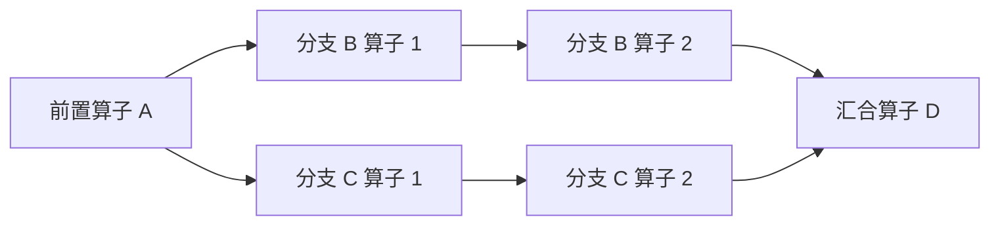
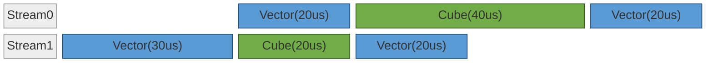

# NPU 多流机制：资源互补、Stream 与 Event

## 概述

多流优化是把一个模块/算子序列里**彼此无 data 依赖、可并行的子计算或通信段**分配到多条 NPU stream 上重叠执行，用一条流的耗时去掩盖另一条流的耗时，从而在不增加算力的前提下缩短关键路径。它是 cann-recipes-infer 在 MoE / Attention 前处理 / KVCache 搬运 / Prefill micro-batch / 分离式通信等多个场景里反复使用的一类优化骨架。

从 NPU 硬件资源与 Stream/Event 机制出发，多流优化覆盖三种并行典型形态、三种执行模式的多流实现、贯穿全程的核心原则、分析→实现→控核→调试流程，以及全仓多流案例。它支持两类工作：给已 profiling 的模型**形成多流候选 plan**，以及把某个方案**落到代码并 review** 其是否物理并行。MoE 子场景（共享专家双流、ScMoE 控核变体）的拓扑细节见 [moe-multi-stream](moe_multi_stream.md)。

## 多流为何有效:硬件基础与并行条件

模型执行的关键路径上常存在硬件资源未被充分使用的情形：Cube 与 Vector 利用率不均衡使一类单元闲置；算子小无法高效利用所有 AICore；HCCL 集合通信与本地计算串行进行，使通信期间计算资源空转。多流优化通过将算子合理分配到多条 Stream，让算子在不同 Stream 上并行计算，从而提高硬件使用效率。

要使能多 Stream 并行，需要计算图中存在满足并行条件的结构：当多个算子的输入都依赖于同一前驱算子的输出、彼此之间没有数据依赖时，这些算子在拓扑上即可并发执行。如下图，前置算子 A 的输出同时被 B 与 C 两条分支消费；B、C 之间无数据依赖，可分别承载于两条 Stream 并行，最终在汇合算子 D 合并。

除了模型原生结构支持多流并行，也可以通过调整计算过程造出并行分支，例如把输入数据切成两 batch 多出两个并行计算分支（Dual Batch Overlap，DBO，见下文「计算↔通信互补」）。`npu_prefetch`（见 [weight-prefetch](weight_prefetch.md)）也是利用数据搬运资源并行的一种形式，框架自动分配一条 Stream，属于独立的预取编排而非此处的多流编排。

### 物理资源单元

NPU Device 侧拥有多类可独立调度的物理执行资源，多 Stream / Event 提供异步机制把这些硬件调度成并发计算：

| 单元 | 主要职责 | 跨 Stream 行为 |
| --- | --- | --- |
| **Cube** | 大矩阵乘类计算 | 多 Stream 竞争，可分核并行，不同 Stream 各获取一部分核（见「同类计算池分核」） |
| **Vector** | 向量、激活、规约类计算 | 同上 |
| **HCCL** | 集合通信 | 与计算独立的资源，部分优化场景需占用一些 Vector |

算子按算力使用情况分三类，是判定能否互补并行的基础：

1. **纯 Cube 算子**：如非量化的 Matmul；
2. **纯 Vector 算子**：如 RMSNorm；
3. **混合算子**：Cube 和 Vector 都需要，如量化 Matmul、flash attention 系列。

一般算子不能把全部算力用满，这给多流加速提供了优化空间。集合通信算子一般与计算单元独立、可并行，但**两种情况下通信会占用 Vector**：① 环境变量 `HCCL_OP_EXPANSION_MODE="AIV"` 时占用部分 AIV；② 通算融合算子同时利用计算与通信单元（算子内计算/通信分片并行，适合数据量大时）。这两种情况下需按「分核」给通信 Stream 分配部分 Vector。

### Stream 与 Event 机制

**Stream** 是 Host 向 Device 下发任务的队列：同一 Stream 上的任务按入队顺序串行执行，Stream 之间的执行顺序由同步语句（Event）和调度器决定。Stream 本身承载调度上下文，算力来自下层物理资源单元。两种典型划分方式：① 把上图 B/C 分支分别放到两条 Stream；② 按资源类型划分（一条计算 Stream、一条通信 Stream），算子按类别分流并在 Stream 间加 Event。

**Event** 是跨 Stream 的同步原语：Stream A 上的 `record_event` 在执行流上标记一个时间点，Stream B 上的 `wait_event` 在该时间点完成后才继续（不同执行模式接口不同）。Stream 间相互等待最终落到 Event——或显式由脚本调用，或由框架按数据依赖隐式插入。Event 同步主要两类：

1. **数据依赖同步**：一个 Stream 的输入来自另一个 Stream，需用 Event 确保数据被使用前已算完；
2. **执行顺序控制**：错开资源利用以提高利用率，需显式加 Event。如下例，方案二通过 Event 控制顺序使关键路径更短：

方案一（不用 Event 控制，Stream1 可能先被调度，耗时 110us）：

方案二（用 Event 控制顺序，关键路径更短，耗时 100us）：

## 三种并行典型形态

### Cube↔Vector 互补

在 Cube/Vector 可独立调度的[分离模式](https://www.hiascend.com/document/detail/zh/CANNCommunityEdition/900/programug/Ascendcopdevg/atlas_ascendc_10_0008.html)平台上，把 Cube 算子与 Vector 算子交替编排在两条 Stream 上形成互补：两条流通常有相同前置依赖，一条沿用原 Stream（**主流**）、另一条用新 Stream（**副流**），副流数据随后回到主流。Cube 与 Vector 总耗时一般不对等（多数 Cube 居多），Cube 类算子是关键路径——理想情况下 Cube 单元利用率接近 100%，把另一并行单元的时间掩盖。

### 同类计算池分核

很多场景算子对计算资源利用率不高：某算子用全部核耗时 $T$，用 1/2 核耗时 $\frac{3}{2}T$，那么两个相近的 Matmul 从串行 $2T$ 优化到各占一半核并行的 $\frac{3}{2}T$，省 **25%**。原理是数据量小时计算/带宽利用率不高、算子启动开销占比高，多用核加速不明显（但不是不能加速——没有可并行分支时，最优策略仍可能是用更多核），引入并行 Stream 可提高资源利用率。

量化场景的混合 Matmul 当 Vector 利用率低时，可划出一部分给并行 Stream 的 Vector 类算子（需[分离模式](https://www.hiascend.com/document/detail/zh/CANNCommunityEdition/900/programug/Ascendcopdevg/atlas_ascendc_10_0008.html)）。如 Atlas A2/A3，AiCore 中 Cube:Vector=1:2，可划出 Cube:Vector=1:1 的混合计算 Stream 与另一条 Vector Stream。

实际收益需按模型实测调整：

- 分核能一定程度提升算力利用率，但会有部分性能损失——分核后两条并行 Stream 耗时不相同，而后续计算依赖两条流结果，先完成的流对应核处于闲置，抵消部分收益，严重时甚至劣化；
- 可调整两条 Stream 的分配比例让其执行时间接近。分核一般用在 **Decode**（数据量少、算子小，满足分核收益条件），多采用图模式，因此分核在首次图执行时确定、后续不变；但两条流耗时仍会变化（attention 随 kv cache 长度、moe 随路由专家负载），调分核未必能完全消除耗时不一致导致的闲置，需实测判断是否采用。

> 控核的工程接口（`limit_core_num`）与生产案例见下文「实现要点与控核」。

### 计算↔通信互补

通信单元与计算单元独立，把通信算子切到独立 Stream 与主流计算并发：

默认通信不占计算资源，但前述两种情况（`HCCL_OP_EXPANSION_MODE=AIV`、通算融合算子）通信会占 Vector，此时按「大部分算子默认占用所有 AiCore」会导致两条流无法并行，需按分核给通信 Stream 分配部分 Vector、计算 Stream 减去对应数量。

模型里的计算与通信算子通常有数据依赖只能串行，但可按 **DBO（Dual Batch Overlap）** 拆出两个并行分支——两分支的通信与计算无数据依赖可并行。如下把 MoE 拆成两个 micro-batch，一个 batch 的前后通信与另一 batch 的计算并行：

DBO 收益来自通信/计算并行，但拆分也引入开销：单个算子处理数据量越大硬件使用效率越高，一份数据拆成多份计算时间一般是负面的，若把并行收益抵消则整体无收益甚至劣化。例如 **Decode 一般是访存瓶颈（weight 加载）**，DBO 切的两 batch 都加载全量 weight，导致计算时间近乎翻倍，因此 **DBO 主要用在 Prefill 优化**（Prefill micro-batch 双流见 [prefill-micro-batch](prefill_micro_batch.md)）。

> **跨节点通信 overlap** 是计算↔通信互补的跨节点变体：把副流的本地计算换成跨节点 Send/Recv，与主流计算重叠（LongCat-Flash 的 AFD 部署即此形态，见 [afd](afd.md) 与下文样例）。

## 从机制到实现

- [多流优化流程](../../guides/optimization/multi_stream_optimization_workflow.md)：依赖拆解、最小改动、精度与性能验收。
- [跨流同步规则](../../optimizations/rules/graph_mode_multi_stream_cross_stream_sync_api.md)：eager、GE、显式 Event 与历史 tagged API 的边界。
- [Decode 控核规则](../../optimizations/rules/decode_multi_stream_overlap_core_balance.md)：资源争抢、分核与平台证据。

Stream 标签只说明逻辑归属，实际重叠和端到端收益应分别验证。

## 多流模式目录

| 模式 | 代表模型 | 详见 |
| --- | --- | --- |
| MoE 共享专家双流 / Patch 形态 / 多模态变体 | DeepSeek-V3.2-Exp / Qwen3-Next / HunyuanImage-3.0 | [moe-multi-stream](moe_multi_stream.md) |
| MoE 共享专家 Cube↔Vector 互补（decode） | DeepSeek-R1 | 本页「网络样例」 |
| Micro-batch / DBO 计算-通信流水（prefill） | DeepSeek-R1 | [prefill-micro-batch](prefill_micro_batch.md) |
| Indexer-Prolog 多流（Attention 前处理拆流） | DeepSeek-V3.2-Exp / GLM-5 | [indexer-prolog](../kernels/indexer_prolog.md) |
| KVCache Offload 异步搬运流 | DeepSeek-V3.2-Exp / GLM-5 | [kvcache-offload](kvcache_offload.md) |
| 同类计算池分核 + 跨节点通信 overlap（AFD） | LongCat-Flash | 本页「网络样例」/「控核」+ [afd](afd.md) |

## Source basis

- **多流原理与三种形态、三种执行模式实现、R1/LongCat 样例**：官方设计文档 [blob @ a12e98a8](https://gitcode.com/cann/cann-recipes-infer/blob/a12e98a866f5f9ef51053e47f5e8151ac703caf3/docs/design/multi_stream_principles.md)（2026-06-01 加入 cann-recipes-infer）。
- **仓内多流写法代码**均在 **cann-recipes-infer @ 2c45117**：LongCat 控核/预取 [`models/longcat-flash/models/modeling_longcat_flash.py`](https://gitcode.com/cann/cann-recipes-infer/blob/2c45117d781ab9ab88dcb89a28ae30f5d2450399/models/longcat-flash/models/modeling_longcat_flash.py)（L45 / L1107-1115 / L1206 / L1246-1258）；API 封装 [`executor/utils/common_utils.py`](https://gitcode.com/cann/cann-recipes-infer/blob/2c45117d781ab9ab88dcb89a28ae30f5d2450399/executor/utils/common_utils.py)（L120 / L126 / L133 / L151）与 [`executor/utils/stream_utils.py`](https://gitcode.com/cann/cann-recipes-infer/blob/2c45117d781ab9ab88dcb89a28ae30f5d2450399/executor/utils/stream_utils.py)；显式 stream 路径 [`models/deepseek-v3.2-exp/models/offload_cache.py`](https://gitcode.com/cann/cann-recipes-infer/blob/2c45117d781ab9ab88dcb89a28ae30f5d2450399/models/deepseek-v3.2-exp/models/offload_cache.py)（L46 `torch.npu.Stream`）。整体 source 索引 [cann-recipes-infer](https://gitcode.com/cann/cann-recipes-infer/tree/2c45117d781ab9ab88dcb89a28ae30f5d2450399)。
- 两类图模式 API、控核约束、`overlap_pct` 复盘与 Event 语义的方法论基线另见 torchair 官方 `multi_stream` / `limit_cores` 文档（外部 hiascend.com torchair use guide）。

## Links

- [moe-multi-stream](moe_multi_stream.md)
- [prefill-micro-batch](prefill_micro_batch.md)
- [afd](afd.md)
- [kvcache-offload](kvcache_offload.md)
- [indexer-prolog](../kernels/indexer_prolog.md)
- [superkernel](superkernel.md)
- [npu-graph-mode](npu_graph_mode.md)
- [weight-prefetch](weight_prefetch.md)
- [torchair](../frameworks/torchair.md)
- [longcat-flash](../models/longcat_flash.md)
- [deepseek-r1](../models/deepseek_r1.md)
- [deepseek-v3.2-exp](../models/deepseek_v3_2_exp.md)
- [hunyuan3d](../../../spatial/concepts/models/hunyuan3d.md)（跨域·空间智能：Hunyuan3D TaylorSeer offload 用 copy/cal 双流重叠）
- 跨域·具身：[cosmos-transfer2.5](../../../embodied/concepts/world_models/cosmos_transfer2_5.md)（Cosmos 多流重叠）
- [deepseek-v4](../models/deepseek_v4.md)（DeepSeek-V4 Attention 多流：MLAProlog‖q_rms_norm、LI‖CSA-Compressor 经 CV 控核掩盖）