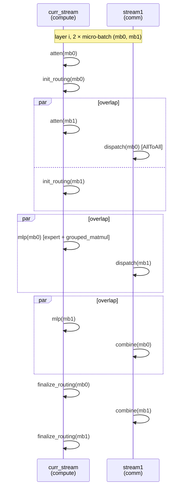

# Prefill Micro-Batch (Dual-Stream Overlap)

## Summary

Prefill 微批次把输入拆成两份并通过事件交错执行；下面的主计算流/副通信流六段形式专指 mode=1 的 DP+EP MoE 层。目标是掩盖MoE通信空洞，是否获益取决于输入切分后的效率与真实并行，不能从双流本身推导完全掩盖。

## Mechanism

### 设计前提

固定 R1 Prefill 实践以计算密集场景为例，称通信占比“可达 30%”，并非所有大 EP 场景通常约 30%；计算由 Cube/Vector 完成，通信走 HCCL/SDMA，硬件路径互不冲突。把 batch 切成 2 份，可以构造两条流水，使得一路的通信与另一路的计算严格并行。

理想情况下，通信耗时被完全掩盖 → 芯片侧无空闲 → 端到端性能大幅提升。但要满足两个前置条件：

1. **计算与通信性能线性度良好**：输入切分前的计算/通信耗时近似等于切分后两份加和。如果因 shape 变化出现性能劣化（如某 shape 下 matmul 效率骤降），收益会被吃掉。
2. **非 host-bound**：如果原本就 host 下发紧张，双流会让 task 数翻倍进一步加剧 host 压力，整体反而变慢。

### 6 阶段划分

此六段图仅适用于 micro_batch_mode=1 / forward_microbatch_v1 的 DP+EP MoE 层；前置 dense 层走独立分支。SP-TP-EP 的 mode=2 / forward_microbatch_v2 在两流分别放 mb0/mb1 的 forward_attn 和 forward_mlp，不是专用计算流/通信流，不能套用本图：

源图原貌（Prefill DP + Micro-Batch 双流水时序），结构示意见上方 mermaid：

*来源：[`docs/models/deepseek-r1/figures/image_prefill_dp_mb.png`](../../../../../cann-recipes-raw/cann-recipes-infer/944d2d3ece86f7df33dbb0cb155c72ca619a9c66/docs/models/deepseek_r1/figures/image_prefill_dp_mb.png)（cann-recipes-infer @ 944d2d3）*

- **atten**：MLA + o_proj；
- **init_routing**：`npu_moe_init_routing_v2`（本卡 expand + 排序）；
- **dispatch**：token AllToAll（专家侧接收）；
- **mlp**：shared expert + routed experts（GroupedMatMul）；
- **combine**：token AllToAll（原始卡侧接收）；
- **finalize_routing**：`npu_moe_finalize_routing`（恢复排序、加权合并）。

### 流切换与同步

具体Stream创建、mode→函数映射和逐事件代码由[微批次实施Guide](../../guides/optimization/prefill_micro_batch_dual_stream_moe_overlap.md)维护；本卡的时序图只解释依赖机制。

### 通信模式约束

主路径必须使用 **默认 SDMA** 模式：

> 此时不能使能 HCCL_OP_EXPANSION_MODE=AIV，否则通信会抢占 Vector Core 与计算争资源，反而变慢。

因此 micro-batch 与 Decode 阶段常用的 `HCCL_OP_EXPANSION_MODE=AIV`（Decode 小通信量 + 低时延场景）**互斥**。

## 当前实现与限制

当前mode1/2仍分别选择forward_microbatch_v1/v2，配置位于model_config.custom_params.micro_batch_mode。统一Executor传packed input_ids、position_ids、slot_mapping与每请求seq_lens；按累计token接近一半的请求边界拆两份，不会把单个请求切半。少于两个请求显式RuntimeError，缺position_ids也拒绝。

mode1要求attnTP1、moeTP1。mode2可有SP补齐，并在各微批进入层循环前单独计算EP一致chunk数；使用MAX与tensor_split保持空片和非空rank的集合通信轮次一致。实施细节见[当前Guide](../../guides/optimization/prefill_micro_batch_dual_stream_moe_overlap.md)。

输入太小、切分后算子效率下降或Host下发瓶颈都可能无收益；默认SDMA建议来自该Prefill实践，不能当作所有模型/阶段的后端规则。请求数、padding和输出边界需共同验收。

## Known Results

该固定R1实践的数字与卡/rank口径集中到[R1 Prefill 来源观测](../../optimizations/benchmark_observations/deepseek_r1_a3_prefill_source_benchmark.md)；不依据world_size把“2机16卡”改写为32物理卡。没有独立复测或跨负载收益保证。

## 多流优化（case pattern）

实施代码、显式Stream与indexed-Event的区别归同一[微批次Guide](../../guides/optimization/prefill_micro_batch_dual_stream_moe_overlap.md)，不在机制卡重复流水配方。

## Evidence

- [README.md](../../../../../cann-recipes-raw/cann-recipes-infer/944d2d3ece86f7df33dbb0cb155c72ca619a9c66/README.md)（primary）
- [deepseek_r1_prefill_optimization.md](../../../../../cann-recipes-raw/cann-recipes-infer/944d2d3ece86f7df33dbb0cb155c72ca619a9c66/docs/models/deepseek_r1/deepseek_r1_prefill_optimization.md)（supporting）
- [modeling_deepseek.py](../../../../../cann-recipes-raw/cann-recipes-infer/944d2d3ece86f7df33dbb0cb155c72ca619a9c66/models/deepseek_r1/models/modeling_deepseek.py)（implementation）

## Links

- [multi-stream](multi_stream.md)
- [deepseek-r1](../models/deepseek_r1.md)
- [expert-parallel](../parallelism/expert_parallel.md)
- [data-parallel](../parallelism/data_parallel.md)
- [double-routing](double_routing.md)
- [moe-dispatch-combine-v2](moe_dispatch_combine_v2.md)
- [sp-tp-sp](../parallelism/sp_tp_sp.md)
