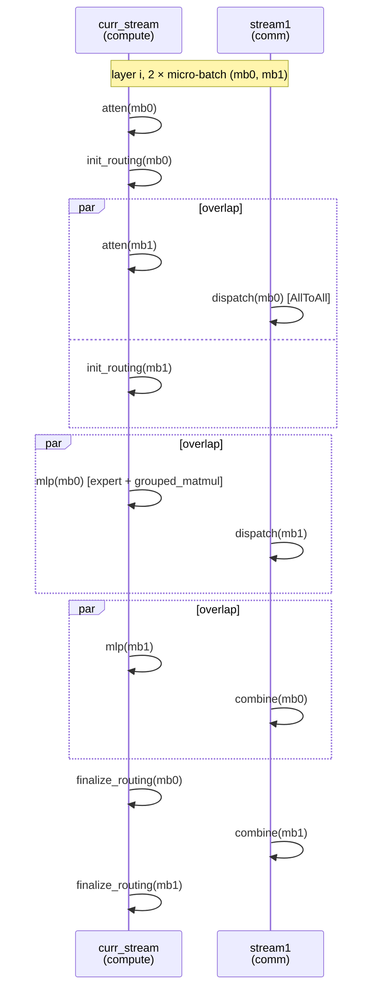

# Prefill Micro-Batch (Dual-Stream Overlap)

## Summary

Prefill微批次把输入拆成两份，以主计算流与副通信流的事件依赖交错执行。目标是掩盖MoE通信空洞，是否获益取决于输入切分后的效率与真实并行，不能从双流本身推导完全掩盖。

## Mechanism

### 设计前提

Prefill 在大 EP MoE 下通常是 compute-bound + ~30% 通信占比；计算由 Cube/Vector 完成，通信走 HCCL/SDMA，硬件路径互不冲突。把 batch 切成 2 份，可以构造两条流水，使得一路的通信与另一路的计算严格并行。

理想情况下，通信耗时被完全掩盖 → 芯片侧无空闲 → 端到端性能大幅提升。但要满足两个前置条件：

1. **计算与通信性能线性度良好**：输入切分前的计算/通信耗时近似等于切分后两份加和。如果因 shape 变化出现性能劣化（如某 shape 下 matmul 效率骤降），收益会被吃掉。
2. **非 host-bound**：如果原本就 host 下发紧张，双流会让 task 数翻倍进一步加剧 host 压力，整体反而变慢。

### 6 阶段划分

prefill 每层划分为 6 个阶段：



源图原貌（Prefill DP + Micro-Batch 双流水时序），结构示意见上方 mermaid：


*来源：[`docs/models/deepseek-r1/figures/image_prefill_dp_mb.png`](https://gitcode.com/cann/cann-recipes-infer/blob/2f82d10467e6fe8dae81c97a2cdac78d733a6703/docs/models/deepseek-r1/figures/image_prefill_dp_mb.png)（cann-recipes-infer @ 2f82d10）*

- **atten**：MLA + o_proj；
- **init_routing**：`npu_moe_init_routing_v2`（本卡 expand + 排序）；
- **dispatch**：token AllToAll（专家侧接收）；
- **mlp**：shared expert + routed experts（GroupedMatMul）；
- **combine**：token AllToAll（原始卡侧接收）；
- **finalize_routing**：`npu_moe_finalize_routing`（恢复排序、加权合并）。

### 流切换与同步

具体Stream创建、mode→函数映射和逐事件代码由[微批次实施Guide](../../guides/optimization/prefill_micro_batch_dual_stream_moe_overlap.md)维护；本卡的时序图只解释依赖机制。

### 通信模式约束

主路径必须使用 **默认 SDMA** 模式：

> 此时不能使能 HCCL_OP_EXPANSION_MODE=AIV，否则通信会抢占 Vector Core 与计算争资源，反而变慢。

因此 micro-batch 与 Decode 阶段常用的 `HCCL_OP_EXPANSION_MODE=AIV`（Decode 小通信量 + 低时延场景）**互斥**。

## Applicable Scenarios

- DeepSeek-R1 / Kimi-K2 Prefill 阶段 MLA-DP + MoE-EP（或 SP-TP-EP）部署。
- 单 micro-batch 已经 compute-bound 但仍留有 ~30% 通信 gap 的大 EP 场景。
- 每卡至少有 2 个请求（`gen_microbatch_input` 在 `request_count < 2` 时抛 RuntimeError，调用方须关闭该模式或调整请求数，`:1691/:1699`）。

## Constraints

- 每卡请求数 ≥2（`request_count >= 2`），否则 `gen_microbatch_input` 抛 RuntimeError，不自动回退（`:1699`）。
- 与 `HCCL_OP_EXPANSION_MODE=AIV` 互斥。
- Host bound 场景下会劣化。
- 输入长度过小（每 micro-batch 计算量 < 通信时延）时无收益甚至负收益。
- `micro_batch_mode=1` 要求 `attn_tp_size=1` + `moe_tp_size=1`（纯 DP+EP），源码校验：
 ```python
 # modeling_deepseek.py:2767-2769（@2c45117）
 if micro_batch_mode == MicroBatchMode.PREFILL_MICRO_BATCH_DP_EP:
 if self.moe_tp_size != 1 or self.attn_tp_size != 1:
 raise ValueError("micro_batch_mode 1 can only be enabled when atten only DP and moe only EP!")
 ```

## Known Results

该固定R1实践的数字与卡/rank口径集中到[R1 Prefill 来源观测](../../optimizations/benchmark_observations/deepseek_r1_a3_prefill_source_benchmark.md)；不依据world_size把“2机16卡”改写为32物理卡。没有独立复测或跨负载收益保证。

## 多流优化（case pattern）

实施代码、显式Stream与indexed-Event的区别归同一[微批次Guide](../../guides/optimization/prefill_micro_batch_dual_stream_moe_overlap.md)，不在机制卡重复流水配方。

## Evidence

- [cann-recipes-infer](https://gitcode.com/cann/cann-recipes-infer/tree/2c45117d781ab9ab88dcb89a28ae30f5d2450399) — [`docs/models/deepseek-r1/deepseek_r1_prefill_optimization.md`](https://gitcode.com/cann/cann-recipes-infer/blob/2f82d10467e6fe8dae81c97a2cdac78d733a6703/docs/models/deepseek-r1/deepseek_r1_prefill_optimization.md) "micro-batch 优化"章节；`models/deepseek_r1/models/modeling_deepseek.py`（`MicroBatchMode` 枚举、`forward_microbatch_v1` / `forward_microbatch_v2`、`gen_microbatch_input`、`micro_batch_mode` 校验）；`models/deepseek_r1/config/prefill_r1_rank_32_32dp_32ep_a8w8.yaml`（`micro_batch_mode: 1`）。
- 多流编排代码（已核实 @2c45117）：[`models/deepseek_r1/models/modeling_deepseek.py`](https://gitcode.com/cann/cann-recipes-infer/blob/2c45117d781ab9ab88dcb89a28ae30f5d2450399/models/deepseek_r1/models/modeling_deepseek.py)（`:49` import `MicroBatchMode`、`:56-62` import `record_event`/`wait_event` 等、`:1597-1598` `self.stream1 = torch.npu.Stream()`、`:1638-1641` mode↔fn 映射、`forward_microbatch_v1` `:2018-2195` / `forward_microbatch_v2` `:1914-2015` 的逐事件 `record_event`/`wait_event` 流水；`:286-298` 的 `record_event(enable_npugraphex_and_multistream, self.npu_events, idx)` indexed-Event helper 属 decode 路径（索引普通 NPU Event，不是 tagged event））；[`executor/utils/stream_utils.py`](https://gitcode.com/cann/cann-recipes-infer/blob/2c45117d781ab9ab88dcb89a28ae30f5d2450399/executor/utils/stream_utils.py)（`record_event` / `wait_event` helper 定义）；[`executor/utils/common_utils.py`](https://gitcode.com/cann/cann-recipes-infer/blob/2c45117d781ab9ab88dcb89a28ae30f5d2450399/executor/utils/common_utils.py)（`MicroBatchMode` 枚举 `:187-190`）。

## Links

- [multi-stream](multi_stream.md)
- [deepseek-r1](../models/deepseek_r1.md)
- [expert-parallel](../parallelism/expert_parallel.md)
- [data-parallel](../parallelism/data_parallel.md)
- [double-routing](double_routing.md)
- [moe-dispatch-combine-v2](moe_dispatch_combine_v2.md)
- [sp-tp-sp](../parallelism/sp_tp_sp.md)
