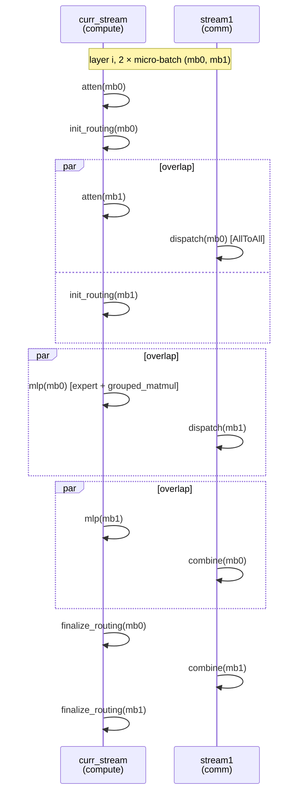
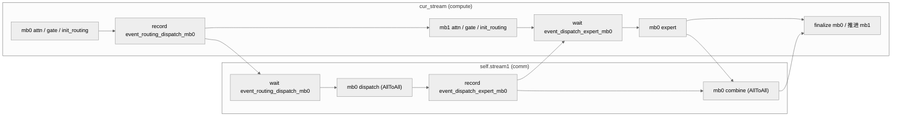

# Prefill Micro-Batch (Dual-Stream Overlap)

## Summary

DeepSeek-R1 Prefill 阶段的计算/通信重叠技术。将输入拆成 2 个 micro-batch，在主计算流与副通信流之间构造双流水线，让 MoE 的 dispatch / combine AllToAll 被下一/上一 micro-batch 的计算完全掩盖。源文档 `docs/models/deepseek-r1/deepseek_r1_prefill_optimization.md` 在 Atlas A3 2 机环境下实测相对非 micro-batch 提升 **25%**（5237 → 6522 tokens/卡/s）。

## Mechanism

### 设计前提

Prefill 在大 EP MoE 下通常是 compute-bound + ~30% 通信占比；计算由 Cube/Vector 完成，通信走 HCCL/SDMA，硬件路径互不冲突。把 batch 切成 2 份，可以构造两条流水，使得一路的通信与另一路的计算严格并行。

理想情况下，通信耗时被完全掩盖 → 芯片侧无空闲 → 端到端性能大幅提升。但要满足两个前置条件：

1. **计算与通信性能线性度良好**：输入切分前的计算/通信耗时近似等于切分后两份加和。如果因 shape 变化出现性能劣化（如某 shape 下 matmul 效率骤降），收益会被吃掉。
2. **非 host-bound**：如果原本就 host 下发紧张，双流会让 task 数翻倍进一步加剧 host 压力，整体反而变慢。

### 6 阶段划分

prefill 每层划分为 6 个阶段：



源图原貌（Prefill DP + Micro-Batch 双流水时序），结构示意见上方 mermaid：


*来源：[`docs/models/deepseek-r1/figures/image_prefill_dp_mb.png`](https://gitcode.com/cann/cann-recipes-infer/blob/2f82d10467e6fe8dae81c97a2cdac78d733a6703/docs/models/deepseek-r1/figures/image_prefill_dp_mb.png)（cann-recipes-infer @ 2f82d10）*

- **atten**：MLA + o_proj；
- **init_routing**：`npu_moe_init_routing_v2`（本卡 expand + 排序）；
- **dispatch**：token AllToAll（专家侧接收）；
- **mlp**：shared expert + routed experts（GroupedMatMul）；
- **combine**：token AllToAll（原始卡侧接收）；
- **finalize_routing**：`npu_moe_finalize_routing`（恢复排序、加权合并）。

### 流切换与同步

关键代码（改写自源文档示例）：

```python
curr_stream = torch.npu.current_stream
stream1 = torch.npu.Stream

with torch.npu.stream(curr_stream):
 atten

with torch.npu.stream(stream1):
 dispatch

event0 = curr_stream.record_event
# ...
stream1.wait_event(event0)
```

DeepSeek-R1 在 `modeling_deepseek.py`（@2c45117）的 `forward_microbatch_v1`（`:2018`）与 `forward_microbatch_v2`（`:1914`）实现两种模式，模式→函数映射见 `:1638-1641`：

- `MicroBatchMode.DISABLE = 0`
- `MicroBatchMode.PREFILL_MICRO_BATCH_DP_EP = 1` → `forward_microbatch_v1`：MLA-DP + MoE-EP（主路径）；
- `MicroBatchMode.PREFILL_MICRO_BATCH_SP_TP_EP = 2` → `forward_microbatch_v2`：配合 SP-TP-SP + EP。

### 通信模式约束

主路径必须使用 **默认 SDMA** 模式：

> 此时不能使能 HCCL_OP_EXPANSION_MODE=AIV，否则通信会抢占 Vector Core 与计算争资源，反而变慢。

因此 micro-batch 与 Decode 阶段常用的 `HCCL_OP_EXPANSION_MODE=AIV`（Decode 小通信量 + 低时延场景）**互斥**。

## Applicable Scenarios

- DeepSeek-R1 / Kimi-K2 Prefill 阶段 MLA-DP + MoE-EP（或 SP-TP-EP）部署。
- 单 micro-batch 已经 compute-bound 但仍留有 ~30% 通信 gap 的大 EP 场景。
- 每卡至少有 2 个请求（`gen_microbatch_input` 在 `request_count < 2` 时不切 micro-batch，`:1691/:1699`）。

## Constraints

- 每卡请求数 ≥2（`request_count >= 2`），否则 `gen_microbatch_input` 不切 2 个 micro-batch（`:1699`）。
- 与 `HCCL_OP_EXPANSION_MODE=AIV` 互斥。
- Host bound 场景下会劣化。
- 输入长度过小（每 micro-batch 计算量 < 通信时延）时无收益甚至负收益。
- `micro_batch_mode=1` 要求 `attn_tp_size=1` + `moe_tp_size=1`（纯 DP+EP），源码校验：
 ```python
 # modeling_deepseek.py:2767-2769（@2c45117）
 if micro_batch_mode == MicroBatchMode.PREFILL_MICRO_BATCH_DP_EP:
 if self.moe_tp_size != 1 or self.attn_tp_size != 1:
 raise ValueError("micro_batch_mode 1 can only be enabled when atten only DP and moe only EP!")
 ```

## Known Results

Atlas A3 2 机环境，输入 64 × 4K，perfect eplb：

| 切分策略 | 时延 (ms) | 总吞吐 (tokens/s) | 平均吞吐 (tokens/卡/s) | 增益 |
| ---- | ---- | ---- | ---- | ---- |
| MLA-DP32 + MoE-EP32 | 3128 | 83805 | 5237 | — |
| + micro-batch | 2512 | 104356 | **6522** | +25% |

> 注：源文档描述为"2 机共 16 卡"，但切分写作 DP32/EP32，数字不自洽。YAML `prefill_r1_rank_32_32dp_32ep_a8w8.yaml` 定义 `world_size: 32`，因此应理解为 **2 机 × 16 卡 = 32 卡**，源文档的"2 机共计 16 卡"为表述笔误。

## 多流优化（case pattern）

方法论总纲见 [multi-stream](multi_stream.md)；本节只记 Prefill Micro-Batch 这一具体模式在 clone @2c45117 里的编排与代码形态。

### 动机

Prefill 在大 EP MoE 下是 compute-bound + 显著通信占比，MoE 的 dispatch / combine 走 AllToAll。若 attention/gate/dispatch/expert/combine/finalize 串行执行，芯片在等通信或等计算时都会出现空洞。把输入拆成 2 个 micro-batch（mb0/mb1），用主流跑当前 mb 的计算、用副流穿插另一 mb 的通信，借 event 把 6 阶段流水化，从而把通信掩盖在计算之后。

### 编排（双流 6 阶段流水）



### 关键代码（clone @2c45117 实测形态）

Prefill micro-batch 入口在 `forward`（`models/deepseek_r1/models/modeling_deepseek.py:1632-1641`）按 `micro_batch_mode` 选分支；构造函数在 `:1597-1598` 创建副流：

```python
# modeling_deepseek.py:1597-1598
self.micro_batch_mode = MicroBatchMode(...)   # :1596
if self.micro_batch_mode != MicroBatchMode.DISABLE:
    self.stream1 = torch.npu.Stream()
```

流水主体用 **显式 Stream + 逐事件 record/wait**（`forward_microbatch_v1` `:2018-2195`，下为 `:2127-2161` 节选）：

```python
cur_stream = torch.npu.current_stream()                 # :2026
...
event_routing_dispatch_mb0 = cur_stream.record_event()  # :2127
...
with torch.npu.stream(self.stream1):                    # :2151
    self.stream1.wait_event(event_routing_dispatch_mb0)
    ... = decode_layer.forward_dispatch_double_routing(...)  # mb0 dispatch
    event_dispatch_expert_mb0 = self.stream1.record_event()  # :2156
cur_stream.wait_event(event_dispatch_expert_mb0)        # :2158
new_x_mb0 = decode_layer.forward_expert(...)            # mb0 expert :2159
event_expert_combine_mb0 = cur_stream.record_event()    # :2161
```

收尾用 `cur_stream.wait_stream(self.stream1)` + `self.stream1.wait_stream(cur_stream)` 双向对齐两条流（`:2194-2195`）。

> ⚠️ 矛盾标记（案例 md vs clone @2c45117）：案例叙述用 `cur_stream.record_event()` 显式 Stream 写法，与 clone 的 prefill 路径**一致**——prefill micro-batch 用的就是显式 `torch.npu.Stream()` + 逐事件 `record_event()` / `wait_event()`，**不是** tagged-event helper。clone 里另有一套 `record_event(enable_npugraphex_and_multistream, self.npu_events, idx)` 的 **indexed-Event helper**（`executor/utils/stream_utils.py:46-60` 定义，封装普通 `torch.npu.Event` 的 `events[idx].record()/.wait()`，**非 tagged-event**——R1 全文无 `tng.ops.npu_tagged_event`，真正的 tagged-event API 只出现在 glm-5 / v3.2-exp 的 indexer；`modeling_deepseek.py:486-490 / :637 / :762` 调用，`npu_events = [Event(), Event()]` 见 `:296-298`），它走 `and not is_prefill` 门控（`:462 / :586`），属于 **decode shared-expert overlap（npugraphex + multistream）** 的兄弟路径，与本页的 prefill micro-batch 不是同一段代码。本节如实记 prefill 显式 Stream 形态，该 helper 仅作背景提及。

> 注（mode↔fn 映射）：`:1638-1641` 映射为 `PREFILL_MICRO_BATCH_DP_EP`(1) → `forward_microbatch_v1`、`PREFILL_MICRO_BATCH_SP_TP_EP`(2) → `forward_microbatch_v2`，@2f82d10 与 @2c45117 **一致、无跨版本翻转**（早期叙述曾因函数物理定义顺序 v2 在 v1 之前而易误读，已在上文按 mode→fn 显式标注订正）。`prefill_r1_rank_32_32dp_32ep_a8w8.yaml` 实配 `micro_batch_mode: 1` + `attn_tp_size: 1` + `moe_tp_size: 1`，对应 v1。

### 适用与风险

- 适用：DeepSeek-R1 / Kimi-K2 Prefill 的 MLA-DP + MoE-EP（mode 1 / v1）或 SP-TP-EP（mode 2 / v2），单 mb 已 compute-bound 但仍留通信 gap，且每卡 ≥2 请求可切 2 份。
- 风险：shape 切半后算子若劣化则收益缩水；event 顺序错误会死等 / 早读 / 精度异常；host-bound 场景 task 翻倍会进一步劣化；与 `HCCL_OP_EXPANSION_MODE=AIV` 互斥（见上文「通信模式约束」）。dispatch/combine 的 double-routing 见 [moe-dispatch-combine-v2](moe_dispatch_combine_v2.md)。

## Evidence

- [cann-recipes-infer](https://gitcode.com/cann/cann-recipes-infer/tree/2c45117d781ab9ab88dcb89a28ae30f5d2450399) — [`docs/models/deepseek-r1/deepseek_r1_prefill_optimization.md`](https://gitcode.com/cann/cann-recipes-infer/blob/2f82d10467e6fe8dae81c97a2cdac78d733a6703/docs/models/deepseek-r1/deepseek_r1_prefill_optimization.md) "micro-batch 优化"章节；`models/deepseek_r1/models/modeling_deepseek.py`（`MicroBatchMode` 枚举、`forward_microbatch_v1` / `forward_microbatch_v2`、`gen_microbatch_input`、`micro_batch_mode` 校验）；`models/deepseek_r1/config/prefill_r1_rank_32_32dp_32ep_a8w8.yaml`（`micro_batch_mode: 1`）。
- 多流编排代码（已核实 @2c45117）：[`models/deepseek_r1/models/modeling_deepseek.py`](https://gitcode.com/cann/cann-recipes-infer/blob/2c45117d781ab9ab88dcb89a28ae30f5d2450399/models/deepseek_r1/models/modeling_deepseek.py)（`:49` import `MicroBatchMode`、`:56-62` import `record_event`/`wait_event` 等、`:1597-1598` `self.stream1 = torch.npu.Stream()`、`:1638-1641` mode↔fn 映射、`forward_microbatch_v1` `:2018-2195` / `forward_microbatch_v2` `:1914-2015` 的逐事件 `record_event`/`wait_event` 流水；`:286-298` 的 `record_event(enable_npugraphex_and_multistream, self.npu_events, idx)` tagged-event helper 属 decode 路径）；[`executor/utils/stream_utils.py`](https://gitcode.com/cann/cann-recipes-infer/blob/2c45117d781ab9ab88dcb89a28ae30f5d2450399/executor/utils/stream_utils.py)（`record_event` / `wait_event` helper 定义）；[`executor/utils/common_utils.py`](https://gitcode.com/cann/cann-recipes-infer/blob/2c45117d781ab9ab88dcb89a28ae30f5d2450399/executor/utils/common_utils.py)（`MicroBatchMode` 枚举 `:187-190`）。

## Links

- [multi-stream](multi_stream.md)
- [deepseek-r1](../models/deepseek_r1.md)
- [expert-parallel](../parallelism/expert_parallel.md)
- [data-parallel](../parallelism/data_parallel.md)
- [double-routing](double_routing.md)
- [moe-dispatch-combine-v2](moe_dispatch_combine_v2.md)
- [sp-tp-sp](../parallelism/sp_tp_sp.md)