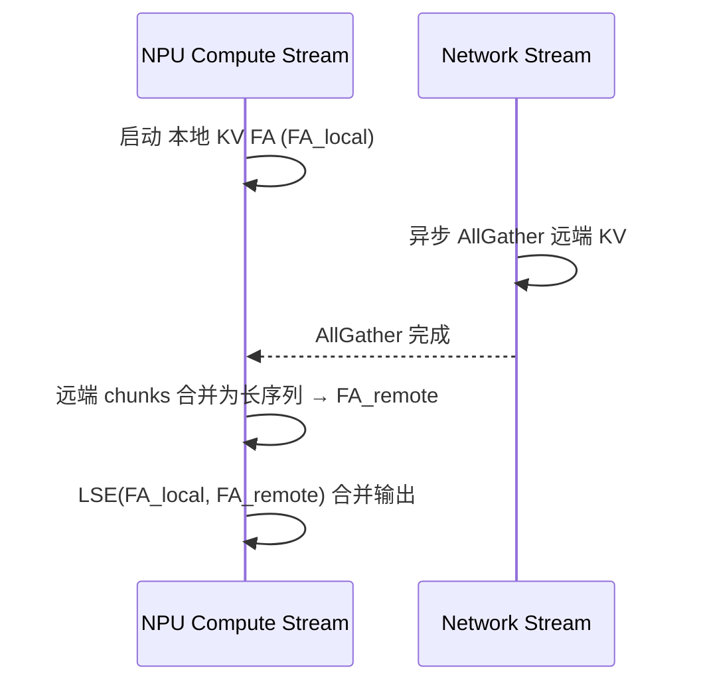

# Ring Attention Overlap

## Summary

多卡 Ring Attention 的 P2P / AllGather 通信通常与 FA 计算串行，利用率低。Wan2.2-I2V 在此基础上做了**计算-通信掩盖**：异步启动 AllGather 收集远端 KV 的同时，立即用本地 KV 算第一次 FA；AllGather 完成后把远端多个 chunks 合并为一段长序列一次性算第二次 FA；最后用 LSE（Log-Sum-Exp）合并两次输出。实现代码见 `module/unified_sp/core.py`。

## Mechanism

*来源：[`docs/models/wan2.2-i2v/figures/overlap.png`](../../../../../cann-recipes-raw/cann-recipes-infer/944d2d3ece86f7df33dbb0cb155c72ca619a9c66/docs/models/wan2.2-i2v/figures/overlap.png)（cann-recipes-infer @ 944d2d3）*

> 源（Wan2.2-I2V 优化文档）：在多卡 Ring Attention 中，通过异步启动 AllGather 收集其他卡的 KV 数据，同时立即使用本地 KV 计算第一个 FA，让 NPU 计算与网络通信并行执行以掩盖通信延迟；待 AllGather 完成后，将其他多个远程 chunks 合并为一个长序列一次性计算第二个 FA，最后用 LSE（Log-Sum-Exp）算法正确合并两次 attention 输出，达成将通信时间隐藏在本地计算中。

该 overlap 路径由 `SPConfig.use_ring_overlap`（默认 `True`）开关控制，`_forward_core` 在 `ring_world_size > 1` 时据此在 `_ring_attention_overlap` 与对照基线 `_ring_attention_allgather` 之间分派；后者为同步 `dist.all_gather_into_tensor` 收齐全部 KV 后单次整段 `_compute_attention`（计算-通信串行）。overlap 即把 AllGather 与本地 FA 重叠。

LSE 合并（`_merge_two_outputs`）采用在线 softmax 数值稳定式：`lse_new = max(lse_l, lse_r) + log(Σ exp(lse_i - max))`，权重 `w_i = exp(lse_i - lse_new)`，`out = w_l·O_l + w_r·O_r`；两次 FA 均通过 `_npu_attention_with_lse` 调 `torch_npu.npu_fused_infer_attention_score` 并置 `softmax_lse_flag=True` 取回 lse。

## Applicable Scenarios

- 基于 Ring Attention 的长序列 DiT 推理
- AllGather 耗时若可被本地 FA 时长覆盖，通信暴露可能减少；实际收益须连同远端 FA、LSE 合并和同步成本测量，不能比较带宽与时间或保证“最佳”
- 主要实例：Wan2.2-I2V 多卡 I2V 推理

## Constraints

- 需要 NPU 支持 compute stream / comm stream 并行（Atlas A2/A3 均支持）
- MXFP8量化 attention 仅支持 Ulysses 序列并行；当 `ring_world_size > 1`（即走 Ring 路径，含 Ring Overlap）时 `module/unified_sp/core.py` 的 `UnifiedSPAttention.__init__` 在 `if fa_mxfp8:` 分支直接 `raise ValueError("The quantization method supports only Ulysses Attention sequence parallel now!")`。故 Ring Overlap 不能与 FP8 attention 同开——此为源代码硬约束，非推断
- 依赖 LSE 合并的数值稳定性（合并采用在线 softmax max-LSE 减法重加权，见 Mechanism）

## Known Results

Wan文档定性描述通信掩盖。HunyuanVideo的Ring TopK稀疏overlap是另一条实现：来源四卡209帧/CAC0.66为1385→1327s，129帧为554→584s；后者更慢，不保证开overlap有收益。具体硬件缺口见[稀疏观测](../../optimizations/benchmark_observations/hunyuan_video_sparse_source_observations.md)，本次未复测。

## Evidence

- [wan2.2-i2v_optimization.md](../../../../../cann-recipes-raw/cann-recipes-infer/944d2d3ece86f7df33dbb0cb155c72ca619a9c66/docs/models/wan2.2-i2v/wan2.2-i2v_optimization.md)（primary）
- [core.py](../../../../../cann-recipes-raw/cann-recipes-infer/944d2d3ece86f7df33dbb0cb155c72ca619a9c66/module/unified_sp/core.py)（implementation）
- [sparse_method.py](../../../../../cann-recipes-raw/cann-recipes-infer/944d2d3ece86f7df33dbb0cb155c72ca619a9c66/module/blockwise_sparse/sparse_method.py)（supporting）
- [hunyuan_video_optimization.md](../../../../../cann-recipes-raw/cann-recipes-infer/944d2d3ece86f7df33dbb0cb155c72ca619a9c66/docs/models/hunyuan-video/hunyuan_video_optimization.md)（supporting）

## Links

- [ring-attention](../parallelism/ring_attention.md)
- [ulysses](../parallelism/ulysses.md)
- [wan2.2-i2v](../models/wan2_2_i2v.md)
