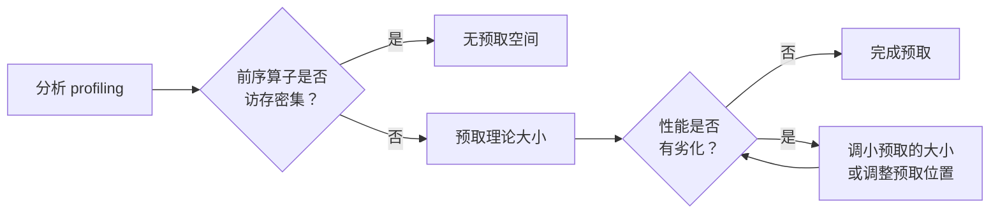

# Weight Prefetch (npu_prefetch)

## Summary

该优化提供网络 weight 预取功能，在算子计算的同时，**利用空闲的带宽，提前将一些访存 bound 算子的权重从 HBM 搬运到 L2 Cache 中**，提升算子性能。`npu_prefetch` 技术的详细介绍，请参考 [官方文档](https://www.hiascend.com/document/detail/zh/Pytorch/730/apiref/torchnpuCustomsapi/docs/context/torch_npu-npu_prefetch.md)。LongCat-Flash 通过 `enable_prefetch` 开关使能该优化。

## Mechanism

以下图为例，`Matmul` 的权重有 20 MB，前序的算子 `RmsNorm` 对内存带宽的需求较小，执行时间为 10us，此时可以通过预取技术，将 `Matmul` 的权重提前写入到 L2 Cache 中，**理想情况下，最大可预取的大小为 `HBM_bandwidth / time_available`**，实际可预取大小因网络与前序算子对带宽的占用程度而异。假设此时可预取的大小为 10 MB，与 `RmsNorm` 并行执行，则在 `Matmul` 算子执行时，只需要再额外读 10 MB 权重，访存的耗时开销减少明显。

*来源：[`docs/models/longcat-flash/figures/prefetch_demo.jpg`](https://gitcode.com/cann/cann-recipes-infer/blob/2f82d10467e6fe8dae81c97a2cdac78d733a6703/docs/models/longcat-flash/figures/prefetch_demo.jpg)（cann-recipes-infer @ 2f82d10）*

## 预取分析与调试流程

判断预取的大小和位置是否合理，可以通过 profiling 分析，如果与预取并行的算子性能有明显劣化，则需要进一步调整预取的位置（可以将预取的位置提前开始，或与劣化算子错开），如没有可调整的位置，则需要减少预取的大小使得并行算子尽量不劣化。如果想要获取最大化的预取收益，可以通过实验对比调整。**如果前序算子是访存密集型，如 Matmul 等，则不适合并行，避免带宽抢占导致劣化。**

预取分析和调试的通用流程：

> 注：各模型的预取情况可能有所不同，可按需调整上述流程。

## LongCat-Flash 的预取位置

LongCat-Flash 模型对访存 bound 的算子如 **QuantBatchMatmul (QBMM)、MLAProlog、Matmul** 等算子提前预取了对应的权重。其中 **MLAProlog 算子包含了多个矩阵乘计算，搬运 bound 较大，因此提前预取了前置的 QBMM 的权重**，为 MLAProlog 提供了更大的预取空间，获取较大的性能收益。具体的预取大小及预取位置，可在 `models/modeling_longcat_flash.py` 中搜索 `npu_prefetch` 接口查看。

`modeling_longcat_flash.py` 中这些预取大小为硬编码的承重参数：router `classifier.weight`~18 MB、下一段 attention 的 `q_a_proj`~18 MB、`q_b_proj`~36 MB、`kv_a_proj_with_mqa`~7 MB。设计上以**前一算子的输出作为预取触发依赖**（`npu_prefetch` 的 dependency tensor）——router 预取依赖 `o_proj`、本段 attention 权重预取依赖 `dsq`、跨层预取**下一层** attention（`next_layer.self_attn[0]`）权重时则以 `down_proj` 为依赖锚点，从而构成跨层流水的预取链。

*来源：[`docs/models/longcat-flash/figures/prefetch.png`](https://gitcode.com/cann/cann-recipes-infer/blob/2f82d10467e6fe8dae81c97a2cdac78d733a6703/docs/models/longcat-flash/figures/prefetch.png)（cann-recipes-infer @ 2f82d10）*

## AFD 下的 FFN 侧预取

使能 [afd](afd.md) 之后，Attention 侧解除控核后算子耗时下降，FFN 侧可能成为新的瓶颈。此时对 **MoE GMM / Matmul 等访存 bound 算子在通信间隙时提前预取权重**，可进一步降低 FFN 侧整体耗时。AFD 场景下 Attention 侧的权重预取保持与非分离场景一致。

## Applicable Scenarios

- Decode 阶段访存 bound 算子（MLAProlog、FA、MM、QBMM、TBMM、GMM 等）
- 前序算子为**计算密集**、带宽空闲的场景（如 LN、softmax、element-wise）
- `exe_mode: "ge_graph"` 或 eager 均适用

## Constraints

- **前序算子为访存密集型（如 Matmul）时不适合预取**，避免带宽抢占导致前序算子劣化
- 预取大小过大会挤占前序算子带宽，需要 profiling 迭代调整
- AFD 场景下 FFN 侧（MoE GMM / Matmul）的预取位置与非分离场景不同，需针对性标定

## Known Results

源文档未给出 `enable_prefetch` 单项 A/B 增益数据。LongCat-Flash 配置 `longcat_flash_densetp8_ep64_gegraph_mtp2_eplb_afd_w8a8.yaml` 中 `enable_prefetch: True` 为 Benchmark 默认值。**单项收益待验证**。

## Evidence

- [cann-recipes-infer](https://gitcode.com/cann/cann-recipes-infer/tree/2c45117d781ab9ab88dcb89a28ae30f5d2450399) — [`docs/models/longcat-flash/longcat_flash_optimization.md`](https://gitcode.com/cann/cann-recipes-infer/blob/2f82d10467e6fe8dae81c97a2cdac78d733a6703/docs/models/longcat-flash/longcat_flash_optimization.md) "权重预取" 章节 + AFD 的 "FFN 权重预取" 子章节
- [cann-recipes-infer](https://gitcode.com/cann/cann-recipes-infer/tree/2c45117d781ab9ab88dcb89a28ae30f5d2450399) — [`models/longcat-flash/models/modeling_longcat_flash.py`](https://gitcode.com/cann/cann-recipes-infer/blob/2f82d10467e6fe8dae81c97a2cdac78d733a6703/models/longcat-flash/models/modeling_longcat_flash.py)（`npu_prefetch` 调用点）；`models/longcat-flash/config/longcat_flash_densetp8_ep64_gegraph_mtp2_eplb_afd_w8a8.yaml`（`enable_prefetch: True`）

## Links

- [longcat-flash](../models/longcat_flash.md)
- [afd](afd.md)
- [atlas-a3](../platforms/atlas_a3.md)
- [torchair](../frameworks/torchair.md)
- [multi-stream](multi_stream.md)（npu_prefetch 与多流是两类硬件资源重叠；多流控核常叠加权重预取，如 LongCat 副流 MoE + 逐级 npu_prefetch）

<!-- cannbot:related:start -->
## 相关

- [AFD 后 FFN 侧成新瓶颈：Attention 侧 Recv EVENT_WAIT 拖尾 → 对 FFN 侧 MoE-GMM 权重做通信间隙预取](../../runbooks/performance/afd_ffn_side_bottleneck_prefetch.md)（`related`）：该优化提供网络 weight 预取功能，在算子计算的同时，**利用空闲的带宽，提前将一些访存 bound 算子的权重从 HBM 搬运到 L2 Cache 中**，提升算子性能。；对 FFN 侧访存 Bound 的算子（MoE-GMM、MatMul）做**通信间隙权重预取**（［`npu_prefetch`］(../../concepts/techniques/weight_prefetch.md)），用 Send/Recv 通信间隙填掉访存等待、降低 FFN 侧整体耗时、消除拖尾：后者给出了 AFD 后 FFN 侧出现新瓶颈时复用该预取机制的具体通信空窗。
- [decode 访存 bound 阶段的权重预取调度：按搬运 bound 大小排布相邻算子的预取顺序](../../optimizations/experience/rules/decode_weight_prefetch_ordering.md)（`related`）：该优化提供网络 weight 预取功能，在算子计算的同时，**利用空闲的带宽，提前将一些访存 bound 算子的权重从 HBM 搬运到 L2 Cache 中**，提升算子性能。；**预取顺序按搬运 bound 大小排布，不是无差别每个都预取**：相邻算子共享有限的预取空间，当一个算子（如 MLA_Prolog，内含多个 matmul、搬运 bound 特别大）预取空间紧张时，**把预取空间让给它本身，而提前预取它的前置算子（QBMM）权重**——即「谁搬运 bound 更大谁优先占预取空间」。这是收益的关键判断，不是简单地给每个权重都加一句 prefetch。前者定义 HBM 到 L2 的预取机制，后者把该机制落实为相邻算子间的空间分配与顺序决策。
<!-- cannbot:related:end -->
