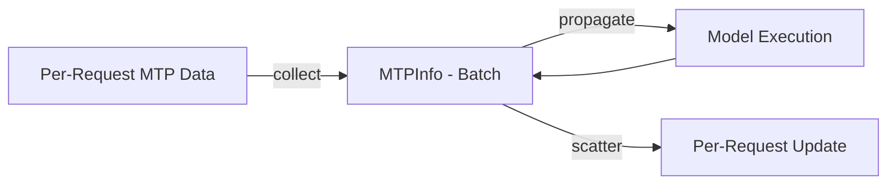
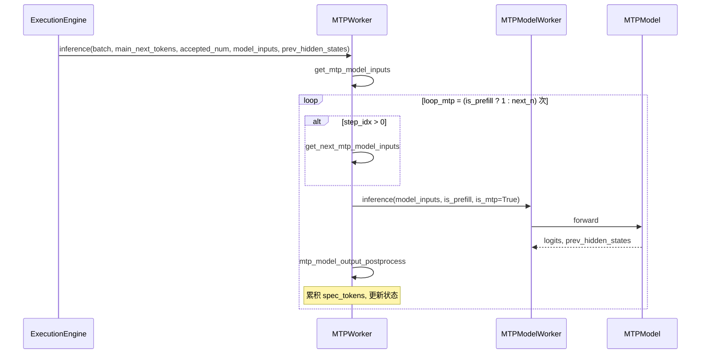
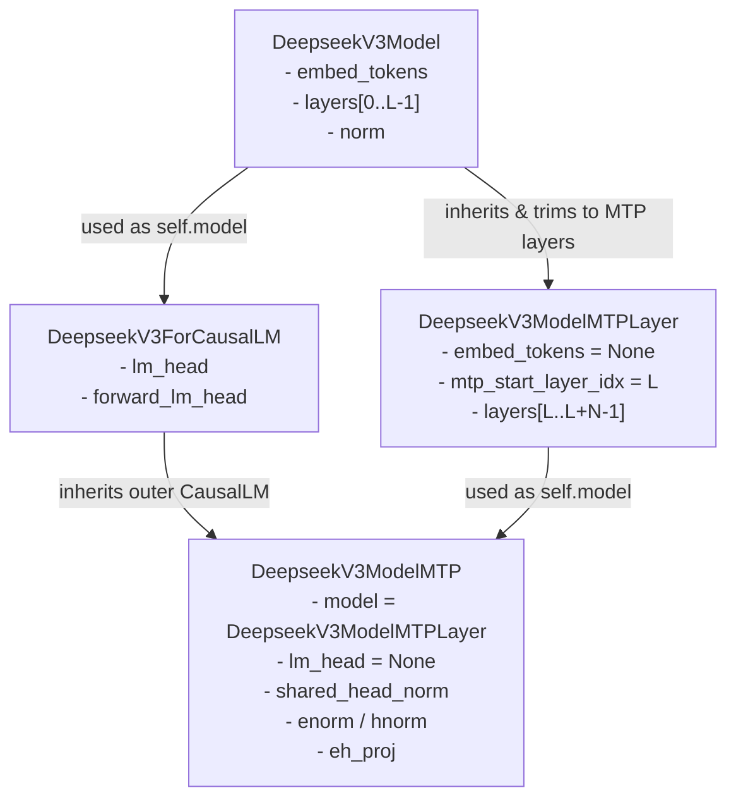

# MTP 接入指南：权重共享、隐状态接口、注册与贪心校验

## 适用场景
- decode 尚未达计算 bound、想用推测解码（一次主模型前向多产出 token）压等效时延 / 提吞吐：把一个复用主模型输出头的 draft（MTP）模型接入通用 executor 的推测路径，每步预测 `next_n` 个推测 token（[mtp-speculative-decoding](../../concepts/techniques/mtp_speculative_decoding.md)）。
- 参考实现：[cann-executor](../../concepts/frameworks/cann_executor.md) 的通用 MTP 路径，参考接入模型 [deepseek-r1](../../concepts/models/deepseek_r1.md)（MoE），prefill+decode 全程。

## 何时不适用
- decode 已计算 bound：推测解码是用相近数据搬运换更多计算，计算已满时收益有限。
- 主模型无法在其上构造复用输出头/词嵌入的 draft（见前置条件）。

## 问题信号
- 给新模型接框架级 MTP 时最易漏三处硬约束——权重共享、`prev_hidden_states` 接口、注册形态——漏了会在加载期报错或让推测静默失效（接受率为 0 / 校验永远不匹配）。

## 前置条件
- 新模型能在主模型基础上构造 draft：draft 复用主模型的 `lm_head` / `embed_tokens`；
- draft 模型 `forward` 必须接受 `prev_hidden_states` 入参（推测算法要从主模型把上一步隐状态喂进 draft）。

## PR326 固定实现的接入步骤
- **门控 / rollback**：以 `model_config.next_n>0` 使能、`=0` 关闭回退非推测解码。`next_n>0` 却未提供 MTP 模型类时框架直接 `raise ValueError(... set next_n to 0)`。
- **权重共享**：draft 类把 `lm_head` / `model.embed_tokens` 置 `None`，框架在 `load_model` 阶段用主模型对应层填入（`share_weights_from_main_model`）；MTP checkpoint 无需单独带 `embed_tokens.weight` / `lm_head.weight`，其余层按名映射（`shared_head.norm→shared_head_norm`、`enorm` / `hnorm` / `eh_proj`）。→ 推荐在主模型上搭 MTP、直接复用输出头与词嵌入，别为 draft 单独加载一份。
- **特征融合接口**：MTP 层特征融合 = `eh_proj(concat(enorm(hidden), hnorm(prev_hidden_states)))`，返回 `(logits, prev_hidden_states)`；`prev_hidden_states` 由主模型传入，故 draft `forward` 必须显式支持该参数。
- **注册形态**：在 executor 的 `model_dict` 里，支持 MTP 的模型登记为三元组 `(主模型类, MTP 类, config 类)`；非 MTP 模型仍是二元组 `(模型类, config 类)`。

## correctness 验证（本实现的贪心路径）
- decode 每步主模型产出 `next_tokens` 后，框架逐 batch 比较推测 `spec_tokens` 与主模型 argmax 输出，遇首个不匹配即截断接受（全匹配则接受 `next_n` 个），`kv_len` 回退到接受前缀。→ 语义等价于主模型逐 token 贪心解码，此结论限确定性贪心路径和正确状态更新，不证明任意随机采样分布不变，可据此判断接入是否正确（若接受率异常低，先查 `prev_hidden_states` 与权重共享是否接对）。

## benchmark
- 源未给加速比 / 接受率数字；收益方向为 decode 未达计算 bound 时降等效时延。等效时延的正确度量口径见 [mtp-benefit-sparse-attention-and-latency-metric](../../optimizations/cases/mtp_benefit_sparse_attention_and_latency_metric.md)。

## 风险 / rollback
- 风险：漏权重共享 / `prev_hidden_states` 接口 / 三元组注册 → 加载报错或推测失效。draft 的 KV / 递归状态缓存分配另有结构相关的正确性坑（历史 R1 按草稿步取 KV 槽，其他实现可能按预测层复用；SSM 递归状态需按接受数推进），见 [mtp-draft-cache-state-correctness](../../optimizations/rules/mtp_draft_cache_state_correctness.md)。
- rollback：`next_n=0` 关闭 MTP、回退非推测解码。

## 相关经验
- [MoE + 投机解码：draft dummy_run 误带 profile-run 语义触发](../../runbooks/precision/mtp_draft_dummy_run_in_profile_run_random_experts.md)

## Evidence
- `diff 事实`（@b7a110bd6812）：`load_model` 的 `next_n>0` 门控与 `ValueError`、`share_weights_from_main_model` 自动填层、`verify_spec_tokens` 的 argmax 前缀校验、`model_dict` 三元组均在合入 diff；三步接入约定取自仓内 `mtp_model_guide.md`（`doc 披露`），与代码自洽。
- 溯源下探：[cann-recipes-infer-pr-326-refactor-mtp-refactor-and-r1-adaptation-framework](https://gitcode.com/cann/cann-recipes-infer/merge_requests/326)

## 版本、验收与停止条件

三元组 `model_dict` 是 PR326 固定提交的注册接口；其他版本须核对实际 registry，不照抄路径。先以 `next_n=0` 保存确定性输出，再开启 MTP，覆盖零接受、部分接受、全接受、长输出与多请求的状态推进；分别记录接受数和稳态计时。输出不对齐或净收益不足时关闭 MTP，先排查权重共享、隐状态和缓存记账。

性能统计统一见 [MTP 计时规则](../../optimizations/rules/mtp_decode_timing_two_metric_split.md)，不在本指南另定义指标。

## 框架接口与状态结构（固定版本参考）

> 来源：`docs/design/mtp_design.md`、`docs/common/mtp_model_guide.md`、`executor/core/model_worker/mtp_worker.py`

cann-recipes-infer 自研 executor 把 MTP 作为一个独立的 `MTPWorker` 组件与主模型 `ModelWorker` 并列，由 `ExecutionEngine` 在 decode 循环中调度。

### MTPInfo 结构体

`MTPInfo` 封装 MTP 推测解码的状态信息，管理 draft / 主模型之间的工作流：

| 字段 | 类型 | 说明 |
|------|------|------|
| `is_prefill` | `Optional[bool]` | 当前阶段是否为 prefill |
| `spec_tokens` | `Optional[torch.Tensor]` | 累积的推测 token 序列，供主模型验证 |
| `accepted_num` | `Optional[torch.Tensor]` | 当前迭代每个样本接受的 token 数量 |

在 [online-pd-inference](../../concepts/frameworks/online_pd_inference.md) 的 PD 分离路径下，prefill 端算得的首批推测 token 经传输 metadata 的 `mtp_spec_tokens` 携带到 decode 端，由 `DecodeTransferQueue._commit_metadata`（提交 metadata 时，`queues.py:345-349`）物化为该请求的 `MTPInfo(spec_tokens=torch.tensor(...))`；而 `DecodePreallocQueue`（`queues.py:41-304`）只负责按 `next_n` 为首步预分配 `1+next_n` 个 token 的 KV 块（不物化 MTPInfo），衔接此处的验证流程。

### MTPWorker 类

**关键成员变量**：

| 分类 | 变量 | 说明 |
|------|------|------|
| 配置 | `infer_config` / `next_n` / `exe_mode` / `prefill_mini_batch` / `batch_size_per_dp_rank` | 运行时配置 |
| 模型 | `device` / `mtp_model_worker` | 计算 NPU 与封装 MTP 的 ModelWorker |

**关键方法**：

| 方法 | 说明 |
|------|------|
| `share_weights_from_main_model(main_model)` | 从主模型共享 `lm_head` / `embed_tokens`（MTP 模型缺这些层时复用） |
| `_pad_seq_len_to_size(tensor, size)` | 意图沿 dim=1 填充/截断；该固定实现却以 shape[0] 判断分支，不能保证目标长度，接入前须修复并验证 |
| `get_main_model_inputs(input_ids, batch)` | 构建主模型验证窗口：拼接 `input_ids` 与 `spec_tokens`，回退 `kv_len` 到接受的前缀位置 |
| `get_mtp_model_inputs(batch, main_next_tokens, model_inputs_main, prev_hidden_states)` | Prefill 分支拼接 `input_ids` + 接受 token + 存 `prev_hidden_states` + `cycle_idx`；Decode 分支用主模型位置信息 |
| `mtp_model_output_postprocess(model_inputs, logits, mtp_infos)` | 处理 MTP 输出，累积 `spec_tokens` + 更新状态；Prefill 分支直接推进 `kv_len` + 翻转 `is_prefill` |
| `get_next_mtp_model_inputs(...)` | 构建下一次 MTP 迭代输入，按 `accepted_num` scatter 最后一个推测 token，重塑 `prev_hidden_states` |
| `inference(batch, main_next_tokens, accepted_num, model_inputs_main, prev_hidden_states)` | MTP 主入口，循环 `prefill=1` 或 `decode=next_n` 次推理 |

固定 PR326 的 `_pad_seq_len_to_size` 存在轴判断缺陷：例如 (4, 1)、size=3 会直接返回 (4, 1)，而非 (4, 3)；batch 小于 size、序列较长时还可能申请负维度。不能把函数设计意图当作该版本已保证的契约；按序列轴修复后分别验证填充、截断、无需变化的输入。

### 调度时序

### DeepSeek-R1 MTP 类结构示例

> 来源：`docs/common/mtp_model_guide.md`，以 `models/deepseek_r1/models/modeling_deepseek.py` 为例。

- `DeepseekV3ModelMTPLayer` 仅作 MTP 额外层容器，`embed_tokens = None`、`mtp_start_layer_idx = config.num_hidden_layers`、`layers` 是 `ModuleDict`（key 为字符串 `"num_hidden_layers + i"`）。
- `DeepseekV3ModelMTP` 复用 `ForCausalLM` 外层接口，内部 model 换成 `DeepseekV3ModelMTPLayer`；`lm_head = None` 复用主模型。
- MTP 前向 7 步：`calc_input_embeddings` → `enorm(hidden) / hnorm(prev)` → `concat + eh_proj` 特征融合 → 位置编码 → 循环 MTP 层 → `shared_head_norm` → `forward_lm_head`。

### MTP 独有权重映射

checkpoint 权重名与模型参数名不一致时，在 MTP 模型的 `load_weights` 做映射：

| checkpoint 名 | 模型参数名 |
|--------------|-----------|
| `shared_head.norm` | `shared_head_norm` |
| `enorm` | `enorm` |
| `hnorm` | `hnorm` |
| `eh_proj` | `eh_proj` |

**注意**：`embed_tokens.weight` 与 `lm_head.weight` 无需加载（复用主模型），框架通过 `share_weights_from_main_model` 自动共享。

## PR326 与后续注册表的区别

本指南步骤中的 `executor/core/entrypoints/support_models.py` / 直接类三元组属于 PR326。固定提交 `2c45117d781ab9ab88dcb89a28ae30f5d2450399` 改为 `executor/core/support_models.py` 的 `_specs` 惰性导入：登记 `(模块路径, 类名)` 对，由 `load_model_classes` 解析，不能将旧版本的直接类对象写法照抄进去。应先确认模型项实际包含哪些类和 MTP 支持，再修改注册。

来源：[固定注册表](https://gitcode.com/cann/cann-recipes-infer/blob/2c45117d781ab9ab88dcb89a28ae30f5d2450399/executor/core/support_models.py)。
