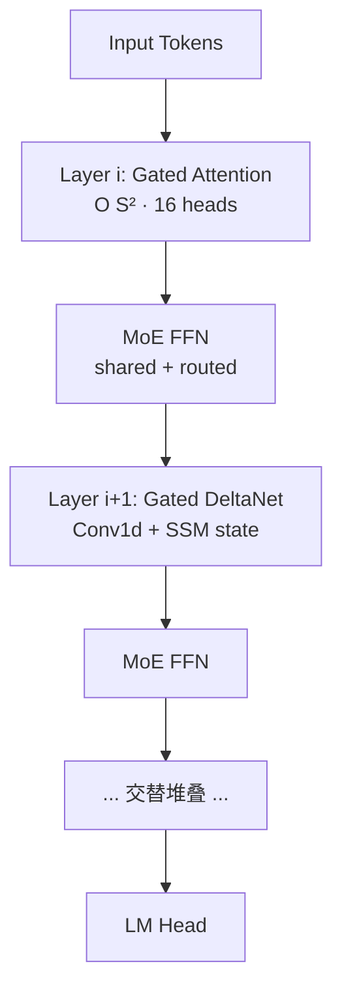
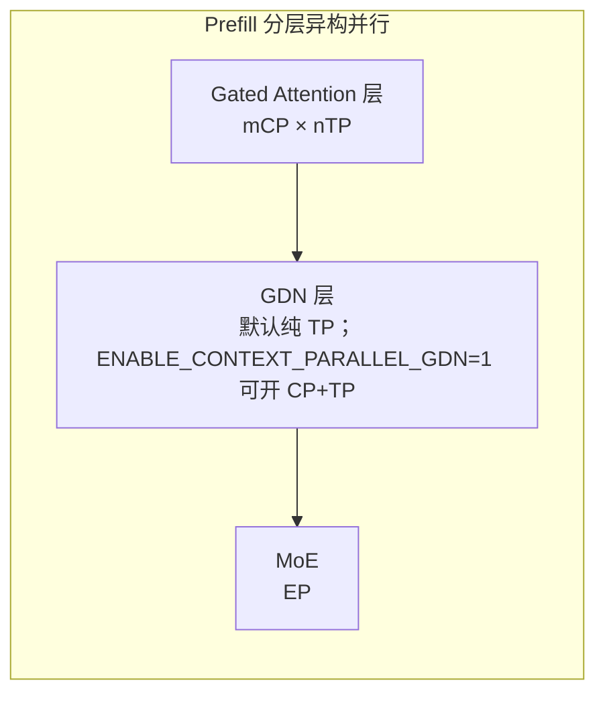

# Qwen3-Next Atlas A3 推理部署与优化指南

## 适用范围

本指南只覆盖 Atlas A3 上基于 SGLang 的 Qwen3-Next 推理实践。模型架构的跨平台定义见 [Qwen3-Next](../../concepts/models/qwen3_next.md)；其它平台不能直接复用下文命令、并行度、融合算子和性能数据。

cann-recipes-infer 在 Atlas A3 上基于 SGLang 框架完成 Qwen3-Next 的推理优化实践，重点介绍针对混合注意力架构设计的并行策略、高性能融合算子、MTP 投机推理及 W8A8C8 量化方案，以实现长序列场景下的高性能表现。

### Highlights

- 整体部署策略大 EP 并行方案，针对 Gated Attention 采用 TP 部署策略，叠加实现长序列亲和的 CP 并行策略，兼顾时延和吞吐。
- 使用 AscendC 实现的 NPU RecurrentGDN 融合 Kernel，提升 decode linear attention 性能（见 [recurrent-gated-delta-rule](../../concepts/kernels/recurrent_gated_delta_rule.md)）。
- 基于自研 PyPTO 框架实现 NPU ChunkGDN 融合 Kernel，提高融合算子编程易用性（见 [pypto](../../concepts/frameworks/pypto.md)）。
- 支持 Int8 W8A8C8 量化（见 [w8a8c8](../../concepts/quantization/w8a8c8.md)），MTP1 的投机推理（见 [mtp-speculative-decoding](../../concepts/techniques/mtp_speculative_decoding.md)）。

## Architecture And Serving Traits

Qwen3-Next 的 Transformer Block 中按层交替使用 [gated-attention](../../concepts/modules/gated_attention.md) 与 [gated-deltanet](../../concepts/modules/gated_deltanet.md)，配合 MoE FFN（shared + routed experts）构成混合注意力 + MoE 架构。

- **Gated Attention**：Softmax Attention + Gate，承担长程精确检索，计算复杂度 O(S²)，Head 数 = 16 限制纯 TP 上限 TP16。
- **Gated DeltaNet（GDN）**：线性注意力 + Conv1d + 状态递推，沿 Sequence 做卷积，默认**不适合 Sequence 切分**，故默认走纯 TP；但设 `ENABLE_CONTEXT_PARALLEL_GDN=1` 后可走 CP + TP 混合并行（GDN-CP 路径见下文 Prefill 并行策略）。
- **Linear Attention State**：GDN 维护 `conv_state` 与 `ssm_state` 形式的 `mamba_cache`，由 `mamba_cache_indices` 索引，每请求独占一槽。MTP 场景下需根据 `num_accepted_tokens` 选择性回写 state，保证下一轮推理状态正确。

### 关键规格约束（来自 README）

- PD 分离需 P/D 策略相同（框架限制），MHA 下 PD 策略不可不同。
- MTP 不能与图模式或 C8 同时开启；PD 分离暂不支持 MTP。
- CP 仅 PD 分离可用，`cp_size < tp_size`，P/D 卡数需相同，CP 复用 DP 通信域不可与 DP 同开。
- `chunked-prefill-size ≤ 71680`（Triton 算子规格限制）。
- GDN TP 切头上限 `tp_size ≤ 32`。
- `max-mamba-cache-size` 默认 2 时 `mamba_cache_indices=0` 会触发精度 bug，建议设为 512。

## Known Optimizations

### 并行策略

Atlas A3 推荐部署策略：Prefill 使用 M 个节点部署，Decode 使用 N 个节点部署，每个节点包含 8 卡。其中 BF16 场景下，推荐根据资源数量、SLA 等约束，启用 CP 并行时，推荐 M=1 N=1 部署。

PD 部署总览如下图（源图原貌）：

*来源：[`docs/models/qwen3-next/figures/pd_overview.jpg`](https://gitcode.com/cann/cann-recipes-infer/blob/2f82d10467e6fe8dae81c97a2cdac78d733a6703/docs/models/qwen3-next/figures/pd_overview.jpg)（cann-recipes-infer @ 2f82d10）*

#### Prefill 并行策略

Qwen3-Next 引入的 Gated Attention 结构显著增强了长序列上下文的捕捉能力，但在 Prefill 阶段，随序列长度平方级增长的激活值内存占用使得 OOM 风险急剧上升，同时如何在超长 Context 下维持低 TTFT 是部署的关键挑战。

若使用纯 TP 策略，在处理超长序列时，TP 通信组内将产生巨大的 All-Reduce 开销。同时 Qwen3-Next 的 Attention Head 数为 16，这限制了纯 TP 并行下最大 16TP 的部署规模。此外，单纯依赖 TP 切分 Head 维度，无法从根本上解决 Sequence 维度带来的 OOM 风险。

针对 Gated Attention 与 GDN 模块计算特性的差异，Qwen3-Next 在 prefill 阶段采取分层异构的并行策略：

1. **Gated Attention 层采用 CP + TP 混合并行**：Gated Attention 模块计算复杂度接近 O(S²)。在此处引入 Context Parallel (CP) 配合 Tensor Parallel (TP)。CP 将 Sequence 维度切分到不同 Rank，显著降低了单卡的激活值内存占用。
2. **GDN 层默认采用 TP 并行**：GDN 模块涉及沿 Sequence 的卷积操作，不适合对 Sequence 轴的切分，且 num_head 足够 TP 切分，因此默认使用纯 TP 并行。设 `ENABLE_CONTEXT_PARALLEL_GDN=1` 后，GDN 可走 CP + TP 混合并行（GDN 不再强制 full TP）：CP 域内按 `cp_size` 把每条序列切成若干段，相邻 CP rank 间通过 P2P（isend/recv）交换 Conv1d 的 overlap 窗口以维持卷积因果性，并在 CP 域末 rank 广播 `conv_state`，从而在长序列下叠加 CP 减小 GDN 的激活值/TTFT 压力。CP+TP 的具体切分细节详见 stage6 patch（`patches/stage6/0001-support-gdn-cp.patch`）。

源图原貌如下，结构示意见上方 mermaid：

*来源：[`docs/models/qwen3-next/figures/prefill_parallel.jpg`](https://gitcode.com/cann/cann-recipes-infer/blob/2f82d10467e6fe8dae81c97a2cdac78d733a6703/docs/models/qwen3-next/figures/prefill_parallel.jpg)（cann-recipes-infer @ 2f82d10）*

**Gated Attention 并行策略**：Gated Attention 使用 mCP × nTP 并行，CP 复用 SGLang 框架的 DP 通信域。以 m=4，n=2，64K 输入推理为例，每个 CP rank 处理 64K/cp_size=16K 个 token，每个 CP rank 内的 qkv_proj 基于 TP2 计算，在计算完 kv 之后，对所有 CP 域的 kv token 进行 AllGather，得到完整的 kv 结果。每个 rank 拿到 64K/cp_size 的 q token 和完整的 kv token，进行后续的 Attention 计算。完成 Attention 计算之后，将输出在 TP 组内进行 Reduce-Scatter，得到 MoE 输入需要的 Scattered 排布的数据。

**ZigZag 负载均衡**：Attention 计算需要遵循因果注意力，如果 CP 简单按照 rank 顺序进行切片可能会面临计算负载均衡问题——第一个 rank 关注到的历史 kv token 很少，计算量较小；最后一个 rank 关注到的历史 kv token 较多，计算量较大。为了降低负载不均带来的影响，需要将 Sequence 切分成 `2·cp_size` 个 block，在 `prepare_attn` 阶段通过 All-to-All 通信将因果顺序排布的 blocks 转换为 ZigZag 排布，每个 rank 负责计算头尾对称的两个切片；每层 Gated Attention 计算前通过 Token 重排将 kv 还原回因果顺序；Gated Attention 计算结束后，在 `prepare_mlp` 阶段再次通过 All-to-All 通信将 ZigZag 排布的 blocks 转换为因果顺序排布。详见 [zigzag-cp](../../concepts/parallelism/zigzag_cp.md)。ZigZag 负载均衡由 `set_env.sh` 中 `export CP_USE_ZIGZAG=1` 使能，面向长序列单 batch 场景。

**CP 激活方式（Prefill）**：在 `infer_prefill.sh` 中把 DP 配置 `--enable-dp-attention --dp-size 8` 替换为 `--cp-size 8` 即开启 Gated Attention 的 CP + TP 混合并行（CP/DP 互斥等约束见上文）。GDN 的 CP 需另设 `ENABLE_CONTEXT_PARALLEL_GDN=1`（默认 `false`，置位后 GDN 不再强制 full TP，改走 CP + TP 混合）；GDN-CP 还需 CP 实际激活（`cp_size > 1`，即已设 `--cp-size`）作前置——仅设 `ENABLE_CONTEXT_PARALLEL_GDN` 而未开 CP 无效（`use_full_tp` 由 `get_context_model_parallel_world_size() > 1` 与该 env 共同决定）。

#### Decode 并行策略

Decode 阶段使用 SGLang 框架原生提供的并行能力，在 Gated Attention 和 GDN 使用 TP 并行，MoE 使用 EP 并行。

- **Gated Attention / GDN**：在 `prepare_attn` 阶段，通过 All-Gather 通信将上一层 MoE 输出的 Scattered 形式排布的数据拼接为完整 hidden state。
- **MoE**：在 `prepare_mlp` 阶段，对 Gated Attention/GDN 输出的 hidden state 进行 Reduce-Scatter 通信，得到 MoE 输入需要的 Scattered 排布的数据。

### Multi-Token Prediction (MTP)

MTP 机制允许在一次主模型推理过程中同时推理多个 Token，在相似的数据搬运下，进行更多的计算，来充分利用芯片的算力，提升模型等效时延和吞吐。需注意，在主模型进行 target_verify 推理后，需要根据接收情况来更新 linear attention 结构中的 `mamba_cache`，为下一轮计算提供正确的状态矩阵 `conv_state` 和 `ssm_state`。

SGLang 启用 `--speculative-algorithm NEXTN`，`speculative-num-steps 1`、`speculative-eagle-topk 1`、`speculative-num-draft-tokens 2`。完整机制和状态回写细节见 [mtp-speculative-decoding](../../concepts/techniques/mtp_speculative_decoding.md)。

### 融合 Kernel

- **recurrent_gated_delta_rule 融合算子**：替换 decode 阶段的 GDN 模块等计算，其中包含 Sigmoid、L2Norm 以及计算注意力分数和计算并更新 `ssm_state` 操作。见 [recurrent-gated-delta-rule](../../concepts/kernels/recurrent_gated_delta_rule.md)。
- **mambav2_rmsnormgated 融合算子**：将 RMSNorm + Silu + Mul 融合计算。见 [mambav2-rmsnormgated](../../concepts/kernels/mambav2_rmsnormgated.md)。
- **PyPTO ChunkGDN**：Prefill 路径的 Gated DeltaNet 分块递推融合算子。见 [pypto](../../concepts/frameworks/pypto.md)。

### MoE 多流

共享专家与路由专家 dispatch/combine 并行，主/副 NPU stream 解耦 gate / shared-expert / dispatch 计算。由 `ENABLE_NPU_DEEPEP_MOE_MULTI_STREAM=1` 使能。详见 [moe-multi-stream](../../concepts/techniques/moe_multi_stream.md)。

### 量化策略

相对于 BF16 推理，Int8 量化可以有效降低端到端时延，提升系统吞吐。目前本实践已经支持 W8A8C8 量化：

- **Gated DeltaNet**：除 conv 外采用 W8A8 量化
- **Gated Attention**：采用 W8A8 量化，KVCache 使用 C8 量化
- **MoE**：路由专家使用 W8A8 量化
- **LM_Head**：暂不量化

> W8A8：W8 指权重使用静态 Per-Channel Int8 量化，A8 指数据使用动态 Per-Token Int8 量化
> KVCache C8：KVCache 使用动态 Per-Tensor Int8 量化

**量化模型精度表现**：

| 模型 | MMLU | GPQA | DROP | MGSM |
| ---- | ---- | ---- | ---- | ---- |
| BF16 | 89.9 | 73.6 | 88.9 | 92.4 |
| W8A8C8 | 89.8 | 74 | 88.4 | 92 |

详细机制见 [w8a8c8](../../concepts/quantization/w8a8c8.md)。

### 部署典型命令（Atlas A3）

- **BF16 PD 混部**：`--tp 16 --enable-dp-attention --dp-size 8 --moe-a2a-backend deepep --deepep-mode auto --cuda-graph-bs 16`，`context-length 262144`，`chunked-prefill-size 71680`
- **BF16 PD 分离 + CP**：Prefill 启用 `--cp-size 8` + `CP_USE_ZIGZAG=1`，面向长序列单 batch；Decode 走 TP+EP
- **A8W8C8**：`DEEP_NORMAL_MODE_USE_INT8_QUANT=1`、`ASCEND_USE_C8=1`、`--quantization w8a8_int8`

### ACLGraph

`--cuda-graph-bs` 开启图模式（与 MTP 互斥）。

## Future Plan

- `conv1d_update` 融合算子 AscendC 支持
- **MegaKernel**：Decode 阶段仍然存在较多融合算子并行空间，可通过 PyPTO 实现更大范围的 MegaKernel，完成多核 MPMD 并行调度，提升计算效率
- **线性 Attention 的序列并行**：Prefill 阶段在 256K-1M 长序列场景下 TTFT 耗时较长，而 linear attention 的 TP 并行存在上限（num_kv_head）。stage6 已落地 env-gated GDN-CP（`ENABLE_CONTEXT_PARALLEL_GDN=1`，默认 false，见上文 Prefill 并行策略），让 GDN 层可在 TP 之外叠加 CP 序列切分以缓解 TTFT；后续可继续完善/验证 GDN 的 CP+TP 切分（如 head 切分与 CP 序列切分的叠加关系）

## Evidence

- [cann-recipes-infer](https://gitcode.com/cann/cann-recipes-infer/tree/2c45117d781ab9ab88dcb89a28ae30f5d2450399) — [`docs/models/qwen3-next/qwen3_next_optimization.md`](https://gitcode.com/cann/cann-recipes-infer/blob/2f82d10467e6fe8dae81c97a2cdac78d733a6703/docs/models/qwen3-next/qwen3_next_optimization.md)（主优化文档，"概述" / "Highlights" / "并行策略" / "MTP" / "融合 Kernel" / "量化策略" / "Future Plan" 各章节）、`models/qwen3-next/README.md`（规格约束和使能开关）、`models/qwen3-next/patches/stage{1..5}/*.patch`（SGLang 适配）、`models/qwen3-next/ops/gated_delta_net/*`（AscendC 融合算子源码）、`models/qwen3-next/{set_env,infer,infer_prefill,infer_decode}.sh`
- GDN-CP 支持（@2c45117）：[`models/qwen3-next/patches/stage6/0001-support-gdn-cp.patch`](https://gitcode.com/cann/cann-recipes-infer/blob/2c45117d781ab9ab88dcb89a28ae30f5d2450399/models/qwen3-next/patches/stage6/0001-support-gdn-cp.patch)（`use_full_tp = get_context_model_parallel_world_size() > 1 and not get_bool_env_var("ENABLE_CONTEXT_PARALLEL_GDN", "false")`；`enable_context_parallel_gdn` 路径：`get_split_sizes` 按 cp_rank 切序列 + overlap 窗口 P2P isend/recv + `conv_state` 末 rank 广播）、[`models/qwen3-next/patches/sgl_kernel_npu_support_gdn_cp.patch`](https://gitcode.com/cann/cann-recipes-infer/blob/2c45117d781ab9ab88dcb89a28ae30f5d2450399/models/qwen3-next/patches/sgl_kernel_npu_support_gdn_cp.patch)（sgl_kernel_npu 侧 GDN-CP kernel 适配）、[`models/qwen3-next/README.md`](https://gitcode.com/cann/cann-recipes-infer/blob/2c45117d781ab9ab88dcb89a28ae30f5d2450399/models/qwen3-next/README.md)「序列并行」条（`--cp-size` 替 `--dp-size` 激活、`CP_USE_ZIGZAG=1` CP 负载均衡、`ENABLE_CONTEXT_PARALLEL_GDN=1` 开 GDN CP+TP 混合）。窗口 commit 2c45117 "Support Context Parallel execution of GatedDeltaNet attention in Qwen3-Next"（stage6 patch）。
- Benchmark（Atlas A3 16die，A8W8C8，dp_size=8，tp_size=2，ep_size=16，256K 输入，16 prompts）：**纯模型 decode 时延 20.6 ms**。

## Links

- [qwen3-5-moe](../../concepts/models/qwen3_5_moe.md)
- [qwen3-moe](../../concepts/models/qwen3_moe.md)
- [atlas-a3](../../concepts/platforms/atlas_a3.md)
- [sglang](../../concepts/frameworks/sglang.md)
- [ascendc](../../concepts/frameworks/ascendc.md)
- [pypto](../../concepts/frameworks/pypto.md)
- [gated-attention](../../concepts/modules/gated_attention.md)
- [gated-deltanet](../../concepts/modules/gated_deltanet.md)
- [recurrent-gated-delta-rule](../../concepts/kernels/recurrent_gated_delta_rule.md)
- [mambav2-rmsnormgated](../../concepts/kernels/mambav2_rmsnormgated.md)
- [context-parallel](../../concepts/parallelism/context_parallel.md)
- [tensor-parallel](../../concepts/parallelism/tensor_parallel.md)
- [expert-parallel](../../concepts/parallelism/expert_parallel.md)
- [data-parallel](../../concepts/parallelism/data_parallel.md)
- [zigzag-cp](../../concepts/parallelism/zigzag_cp.md)
- [mtp-speculative-decoding](../../concepts/techniques/mtp_speculative_decoding.md)
- [moe-multi-stream](../../concepts/techniques/moe_multi_stream.md)
- [w8a8c8](../../concepts/quantization/w8a8c8.md)
- [deltanet-pretrain](../../../training/guides/recipes/deltanet_pretrain.md)（跨域·训练：DeltaNet 线性注意力预训练样例(与 GDN 同谱系)）

<!-- cannbot:related:start -->
## 相关

- [Qwen3-Next](../../concepts/models/qwen3_next.md)（`related`）：Qwen3-Next 的 Transformer Block 中按层交替使用 ［gated-attention］(../../concepts/modules/gated_attention.md) 与 ［gated-deltanet］(../../concepts/modules/gated_deltanet.md)，配合 MoE FFN（shared + routed experts）构成混合注意力 + MoE 架构。；Qwen3-Next 以 `Qwen3-Next-80B-A3B-Instruct` 为代表规格，总参数约 80B、每个 token 激活参数约 3B。Transformer Block 交替使用 Gated Attention 与 Gated DeltaNet（GDN），并配合 shared 与 routed experts 组成的 MoE FFN。。指南以概念卡定义的交替 Attention/GDN 与 MoE 结构为基础，继续给出 Atlas A3 的 TP、CP、EP、融合 Kernel 和量化部署选择。
- [ZECO — 让线性注意力 / GDN 吃到序列并行（Context Parallel），打破 chunk 递推的跨 rank 顺序依赖](../experience/interventions/qwen3_next_gdn_context_parallel_zeco.md)（`related`）：ZECO 卡给出“**使能**：`export ENABLE_CONTEXT_PARALLEL_GDN=1` + `--cp-size N`（替换 `--enable-dp-attention --dp-size N`）；env 打开后 `use_full_tp=False` → GDN 走 CP。”；部署指南补充“GDN-CP 还需 CP 实际激活（`cp_size > 1`，即已设 `--cp-size`）作前置——仅设 `ENABLE_CONTEXT_PARALLEL_GDN` 而未开 CP 无效”，两端合成可执行的双开关使能合同。
<!-- cannbot:related:end -->
