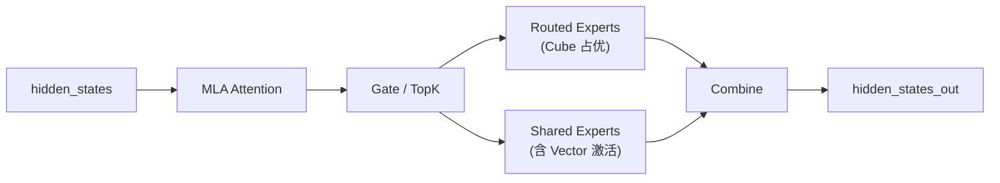
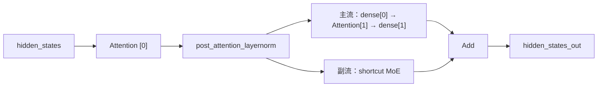

# 多流优化流程：拆解依赖、选择后端并验收真实收益

## 输入与产物

输入为模型、平台与软件版本、执行后端、目标阶段和同输入基线。产物为带状态/通信依赖的候选编排、可关闭的实现，以及精度、时间线和稳态性能对照。来源示例不代表已在目标环境复测。

## 核心原则

- **Stream ID 切对 ≠ 物理并行成立（最重要）**：`npu_stream_switch` 贴的是逻辑标签，**源码层级 ≠ 物理层级**。GE 编译期会重排算子——尤其把「消费副流输出的轻量 precompute」（Cast / Swish / Sigmoid）拉回主流形成 barrier。任何「副流已落 side stream」的结论都必须用 profiling 验证，不能凭 Stream ID 切对就判方案成立。
- **先整网后局部**：先回答整网主路径和模块间并行性，再下钻到模块内算子；decoder layer 不能当单个模块，必须再拆。
- **开关必须可关闭**：多流路径要保留 enable 开关和原始回退路径（仓内统一用 `switch_flag` + `FakeContextManager` 兜底），方便调试、review 和淘汰时干净隔离。
- **先证明正确，再追性能**：先验证依赖、功能、精度，再看 overlap 与时延收益。
- **overlap 不等于收益**：出现拖尾、资源争抢、host bound、shape 劣化时，overlap 真实成立也可能不降 wall，要继续评估控核与图模式限制。

## 形成多流方案:拆解与并行性判断

可按以下步骤梳理：

1. **拆整网模块、画模块级 DAG、判模块间并行**：沿子网络 / 通信 / 状态 / 同步 / 资源边界把每层拆成语义完整的模块，标注依赖类型（`data` / `state` / `event` / `collective_order`），把模块对判成 `serial` / `parallel_candidate` / `parallel_pending_validation`。
2. **对每个候选模块拆算子、画算子 DAG、判模块内并行**：识别模块内部哪些算子可并行、哪些依赖边不能打破。
3. **为每个并行点比较可行的编排候选**：并行对象、流分组、汇合点、tag 粒度或跨阶段 overlap 不同，就是不同候选。

**实现强度是一个复杂度阶梯**，不是不同方案：同一编排可从 **C1 最小切流** → **C2 切流 + 控核** → **C3 切流 + 控核 + 手动同步点控制** 逐级加码。先用 C1 验证编排是否真并行，再决定要不要上更高强度；改变并行对象 / 流分组 / 汇合点则属于另一个候选。

## 实现要点与控核

实现：

1. **按执行模式选 API**（见[跨流同步规则](../../optimizations/rules/graph_mode_multi_stream_cross_stream_sync_api.md)）：ge_graph 用 `tng.scope.npu_stream_switch` + `npu_wait_tensor`；npugraph_ex / eager 用 `torch.npu.Stream()` + `Event`。不要把两套混写进同一实现。
2. **显式 stream 路径查内存生命周期**：短生命周期 tensor 若被其他 stream 继续消费，补 `record_stream()`；模型权重、常驻 cache 这类长生命周期对象一般不需要。
3. **先做最小可验证 overlap**：只改一个明确并行点，先补同步再扩大窗口，始终保留原路径和 enable 开关。
4. **overlap 成立后再评估控核**。

**控核（`limit_core_num`）**：多流之后，一条流可能吃满全部 Core 把另一条流挤成拖尾，逻辑并行退化成物理串行。控核就是给每条流分配上限核数让双流计算时间接近——**来源示例按可用资源划分两条流的配额；超额或竞争可能破坏重叠，须按具体平台和调度验证**。Ascend IR 用算子级 `torchair.scope.limit_core_num`（优先级高于全局 `config.ge_config.aicore_num`），npugraph_ex 用 Stream 级 `torch.npu.npugraph_ex.scope.limit_core_num`（见 torchair use guide；@2c45117 仓内模型代码暂无实际调用，生产控核均走 GE 路径）。仓内封装 `limit_core_num(switch_flag, aic_num, aiv_num)` 转发 `tng.scope.limit_core_num`（[`executor/utils/common_utils.py` L133](https://gitcode.com/cann/cann-recipes-infer/blob/2c45117d781ab9ab88dcb89a28ae30f5d2450399/executor/utils/common_utils.py)）。

**LongCat-Flash 是 Atlas A3 Decode 代表案例**（仅 enable_multi_streams > 0 且 not is_prefill 时进入 multi_stream_forward；ge_graph，对应「同类计算池分核」）：ScMoE 双段结构里，shortcut **MoE 路径**切到副流 `npu_stream_switch(True, "1")`，与主流的**第二段 Attention + FFN 路径**并行；两条路径各用 `limit_core_num` 分到不同 AI/Vector Core，并叠加 `npu_prefetch` 预取下一层权重、`superkernel_scope` 标定（[`models/longcat-flash/models/modeling_longcat_flash.py`](https://gitcode.com/cann/cann-recipes-infer/blob/2c45117d781ab9ab88dcb89a28ae30f5d2450399/models/longcat-flash/models/modeling_longcat_flash.py) `multi_stream_forward`，L1206）。

```python
# L45  from executor.utils import npu_stream_switch, limit_core_num, npu_wait_tensor, superkernel_scope, npu_prefetch
# L1246 npu_prefetch(self.enable_prefetch, self.mlp.router.classifier.weight.data, o_proj, 18*1024*1024, 0)
with npu_stream_switch(True, "1"):                       # MoE shortcut → 副流 "1"
    with limit_core_num(True, self.aic_num1, self.aiv_num1):     # L1248
        shortcut_mlp_output = self.mlp(hidden_states_norm, ...)
with limit_core_num(not self.enable_afd, self.aic_num2, self.aiv_num2):  # L1256 主流:二段 attn+FFN
    hidden_states, _, dsq = self.mlps[0](hidden_states_norm, self.enable_prefetch, o_proj)
    ...  # self_attn[1].prepare_qkv / fused_infer_attention_score / mlps[1] + 逐级 npu_prefetch
```

核数取值随 `enable_multi_streams` 分支：`==2` 时双流均 `c12v24`（L1107-1110）；否则副流 `c8v16`、主流 `c16v32`（L1112-1115）。控核的副作用是受限流上的 MLAProlog / FA / MM 耗时相比不控核时上升，LongCat 进一步用 AFD 把 MoE 分节点部署以解除主路径控核（与 AFD 互斥，见 [afd](../../concepts/techniques/afd.md)）。完整 ScMoE 拓扑见 [longcat-flash](../../concepts/models/longcat_flash.md)。

## 调试与验证(真假并行)

按五类问题分开排查，不要混在一起：**(1) 依赖/同步错误**（读到未完成结果、死等）、**(2) 精度/功能异常**（按 prefill/decode→模块→算子 缩范围）、**(3) 性能无收益**、**(4) 图模式/runtime 限制**（graph break、stream 语义差异）、**(5) aclgraph 生命周期错误**（短生命周期 tensor 跨流复用、遗漏 `record_stream()`）。

**性能无收益时先检查是否命中多流路径和是否真正重叠，再分析资源与 Host 开销**：

- **3a 副流根本没真跑**：副流 ops 的 `stream_id` 仍落主流或退到 `sid=1`。查切流 with-block 是否在 `is_prefill / enable_multi_stream` 条件下真走到、兜底有没有被命中。
- **3b 假并行 / GE auto-reorder barrier**：Stream ID 已分裂但 wall 与 baseline 持平。最常见根因是 **GE 把消费副流输出的轻量 precompute（Cast/Swish/Sigmoid/Reshape）拉回主流提前下发**，卡住主流 dominator。解法是把 barrier op 显式钉进 with-block（自己写出 precompute，不依赖 GE 自动放置），或重设 op 集合让副流有真正 dominator——两者都是新候选。
- **3c 真重叠但 wall 不变**：仅在 3a/3b 排除后才走，看 shape 变化、task 数增加、host bound、带宽争抢、拖尾。

**用 profiling 检查重叠和净收益**：结合算子起止时间、流 ID、等待边与资源配置检查实际时间线，再对比相同输入下的端到端稳态时延。旧文的 overlap_pct=0.05/0.5 阈值未在所引固定设计文档中找到依据，撤下统一通过阈值；重叠比例也不能代替正确性和端到端收益验收。

## 网络样例

### DeepSeek-R1:Micro-batch 流水 + Cube↔Vector 互补

DeepSeek-R1 的两种多流：prefill 阶段采用 Micro-batch 流水，decode 阶段把共享专家切至副流与路由专家并行。MoE 层内部存在两条数据无依赖分支（路由专家与共享专家）：



**Decode 阶段：共享专家、路由专家并行**（对应 Cube↔Vector 互补）。共享专家分 `gate_up_proj` → `swiglu` → `down_proj` 三段，与主流的 `dispatch` → `routed GMM` → `combine` 三段在副流上**逐段错开**排进，每段并行对资源类型互补：

```mermaid
block-beta
  columns 13
  s0["Stream0 主流"]:1 gate["gate"]:1 disp["dispatch"]:2 gmm["routed GMM"]:6 comb["combine"]:2 add["add"]:1
  s1["Stream1 副流"]:1 space:1 gup["gate_up_proj"]:2 swi["swiglu"]:2 space:4 dp["down_proj"]:2 space:1

  gate --> gup
  disp --> swi
  gmm --> dp
  comb --> add
  dp --> add

  classDef hdr fill:#eee,stroke:#999,color:#000
  classDef vector fill:#5B9BD5,color:#fff,stroke:#1F4E79
  classDef cube fill:#70AD47,color:#fff,stroke:#385723
  classDef comm fill:#ED7D31,color:#fff,stroke:#7C390F

  class s0,s1 hdr
  class gate,swi,add vector
  class gmm,gup,dp cube
  class disp,comb comm
```



颜色按资源类型：蓝 = Vector、绿 = Cube、橙 = HCCL 通信。三段并行对的资源互补关系：

| 时间段 | 主流（资源） | 副流（资源） | 互补关系 |
| --- | --- | --- | --- |
| dispatch ‖ gate_up_proj | HCCL 通信 + Vector | Cube | 通信 ↔ 计算 |
| routed GMM 头部 ‖ swiglu | Cube | Vector | Cube ↔ Vector |
| combine ‖ down_proj | HCCL 通信 + Vector | Cube | 通信 ↔ 计算 |

**Prefill 阶段：Micro-batch 流水**。输入拆为两个 micro-batch（mb0、mb1），主流为计算流（attn / ln+gate / shared expert / expert / finalize_routing），副流为 HCCL 通信（dispatch / combine），通过多组 Event 实现 mb0 与 mb1 的计算-通信跨流等待。每层 MoE 一个 mb0/mb1 周期的执行时序：


颜色按 micro-batch 分：蓝 = mb0、绿 = mb1。`L0`/`L1` 是 post_attention_layernorm + gate_init_routing，`S0`/`S1` 是 shared expert，`fin` 是 finalize_routing。**跨层覆盖**：上一层的 mb1 combine 在下一层入口触发 mb1 finalize_routing，与下一层 mb0 attn 并行，使 mb1 combine 也被掩盖。MoE 共享专家双流的拓扑深挖见 [moe-multi-stream](../../concepts/techniques/moe_multi_stream.md)；Prefill 双流见 [prefill-micro-batch](../../concepts/techniques/prefill_micro_batch.md)。

### LongCat-Flash：Atlas A3 Decode 同类计算池分核与跨节点通信 overlap

以下 LongCat 双流和控核按固定实现的 Decode 门控解释；Prefill 不进入 multi_stream_forward，AFD 分支另按对应配置核对。

LongCat-Flash 每层两段：第一段单条 attention，第二段把 **dense → 第二个 attention → dense** 与 **shortcut MoE** 拆成两条并行路径。两条路径均 Cube 占优，需 `limit_core_num` 切分核数（同类计算池分核）。AFD 部署下副流的 shortcut MoE 换为跨节点 Send/Recv（计算↔通信的跨节点变体）。每层并行结构：



两条 Cube 占优路径并行执行，各自通过 `limit_core_num` 锁定独立 AIC / AIV 配额。主流由 `attn[1]` 嵌在两个 dense 之间，整体时长接近副流的 shortcut MoE，两条流大致同步后在 `Add` 汇合：


具体控核取值与仓内代码见上文「实现要点与控核」；完整 ScMoE 拓扑与 AFD 互斥见 [longcat-flash](../../concepts/models/longcat_flash.md) 与 [afd](../../concepts/techniques/afd.md)。


## 验收、回退与停止

先检查实际开关和路径命中，再逐点验收输出、状态更新和同步，最后测量重叠与稳态时延。遇到精度失败、死等、生命周期错误或无净收益时回到单流，并保留输入和探针结果；不继续叠加无法归因的优化。

## 来源

固定设计文档与实现来源沿 Frontmatter 及图内链接核对；具体 API 统一见 [跨流同步规则](../../optimizations/rules/graph_mode_multi_stream_cross_stream_sync_api.md)。