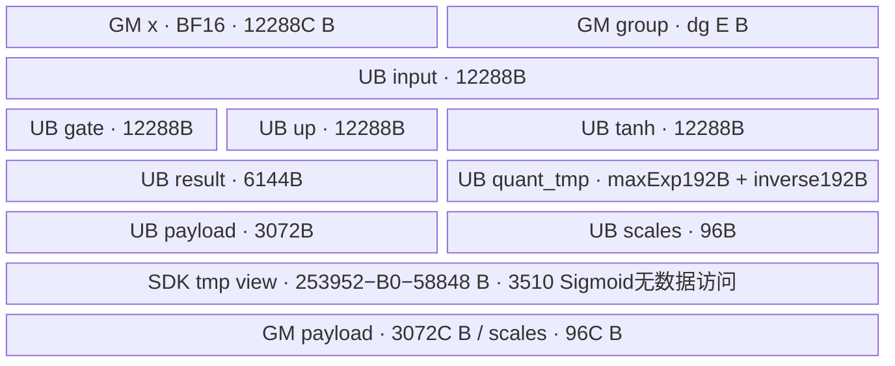

# SiTU MXFP8 量化 950 ACLNN 算子知识

## 算子速览

| 项目 | 内容 |
|---|---|
| 实际入口 | `aclnnSglSituMxfp8QuantGetWorkspaceSize / aclnnSglSituMxfp8Quant`；固定 kernel 提交 dda6d36b0cdb4081e102d14c0a2fb276fc416e69，CANN 9.2.0，Ascend 950 |
| 计算语义 | 固定宽度 BF16 SiTU：gate 的 soft-saturation×sigmoid×up 的 soft-saturation，FP32 计算后先 RNE 到 BF16，再每 32 元素量化为 E4M3FN+E8M0 |
| 输入输出 | x=[C,6144] BF16；group_list=[E] int32/int64；payload=[C,3072] E4M3FN；scales=[C,48,2] E8M0；仅有效前缀写回 |
| 执行类型 | 单节点 K1=AIV_VECTOR；MicroAPI/Reg SIMD，不含 Cube/AIC、MIX_CV、SIMT、NDDMA 或通信节点 |
| Kernel 路线 | R-001 累计末项，R-002 逐 expert 计数；每条显式包含 groupDtype=0/int32 和 1/int64 两实例 |
| 核心资源 | 每 AIV 8 个 VECCALC TBuf 共 58,848 B；无 TQue/双缓冲；SDK PopStackBuffer 另建立剩余 UB 视图，3510 Sigmoid 不实际读写此视图；自有 workspace=0 |
| 来源闭包 | source_closed：公开 Python→自有 Torch ACLNN adapter→生成式 ACLNN 框架边界→自有 OpDef/Tiling/POD→K1 entry/body→固定 SDK 9.2 Sigmoid/TPipe/MicroAPI 实例与构建均可追溯。闭包不保证实现正确 |
| 验证状态 | draft：保留计数窄化、uint32 分核算式及 CTRL60 初始化顺序的静态风险。已完成源码闭包检查；本次知识提取未执行编译、真机、数值或性能测试。 |

## 接口与语义

### 计算语义

设 C=capacity、E=numExperts、D=3072、G=32、S=D/G=96，x 每行前 D 元素为 gate g，后 D 元素为 up u。数学意图为：

```text
soft(z,a) = a * tanh(z/a)
y_fp32 = soft(g,beta) * sigmoid(g) * soft(u,linear_beta)
y_bf16 = RNE_BF16(y_fp32)
```

实际 StableTanh 用 `a*(2*sigmoid(2*z/a)-1)` 的分步 FP32 Muls/Sigmoid/Muls/Adds；乘法次序为先 gate sigmoid×gate soft，再乘 up soft。它不等于硬裁剪 SiLU/SwiGLU；每步受 primitive、CTRL 模式和 FP32 舍入影响，不能用实数恒等式承诺逐位相同。

对 y_bf16 每连续 32 元素 h：把 BF16 位模式与 0x7f80，取最大指数域 e。正常非零指数域时：

```text
qexp = max(e,0x0400) - 0x0400
scale_byte = qexp >> 7
inverse_bf16_bits = 0x7f00 - qexp
scaled_bf16 = BF16_Mul(y_bf16, bitcast_bf16(inverse_bf16_bits))
clipped_bf16 = min(max(scaled_bf16,-448),448)
payload = RINT/SAT_E4M3FN(FP32(clipped_bf16))
```

scale_byte 是 E8M0 编码（正常编码对应 2^(scale_byte−127)），不是 int8 数值缩放因子。e=0x7f80 时 byte=255、inverse bits=0x7f81；e=0 时 byte=0、inverse bits=0。后者包含整组 BF16 零及整组指数域为零的 subnormal，不能仅解释为数值全零。含 NaN/Inf 组会标 byte255；后续 Min/Max、乘法和 cast 对非有限值的 payload 位模式不在本卡中补造保证。BF16 分支量化乘法自身仍是 BF16，并非全部在 FP32 中缩放。

先按编码读取总数 T：累计型只读 group_list[E−1]；计数型顺序 int64 求和。实际有效行 R 为 `min(C, T>0 ? uint32(T) : 0)`，计数型求和必须先有定义。仅在 T 可由 uint32 表示且分核算式未溢出的域，等同数学前缀 `min(C,max(T,0))`；不是按 expert 分段重排或各 expert 单独分核。payload/scales 的 [R,C) 未写且由 at::empty 分配，不能读取为零。

### 输入、输出与属性

| 参数 | shape/layout | dtype | 约束、默认值与语义 |
|---|---|---|---|
| x / hidden_states | 连续 ND [C,6144] | BF16 | C>0；公开实现还要求 NPU；前后各3072元素，不能交错拆 gate/up |
| group_list | 连续 ND [E] | int32/int64 | E>0，与x同设备；Host只验证元信息，不扫描值、单调性或非负性 |
| group_list_type | 标量 | ACLNN int64；POD uint32 | 默认1；仅0累计、1计数 |
| beta | 标量 | Python/Torch double→ACLNN/POD float32 | 默认4；Host要求>0，不要求finite；double正数可能窄化成0或Inf |
| linear_beta | 标量 | double→float32 | 默认25；与beta相同的校验/窄化边界 |
| payload | 新连续 ND [C,3072] | E4M3FN，1B/元素 | 3072C B，只有有效前缀有定义，不与输入别名 |
| scales | 新连续 ND [C,48,2] | E8M0，1B/元素 | 96C B，flat96个scale；第三维2是布局，不是两套独立统计 |
| workspace/executor/stream | ACLNN两阶段执行参数 | uint64字节数/框架executor/aclrtStream | 查询返回的W由调用者分配并保活；自有Tiling workspace[0]=0不等于生成框架总W必为0 |

### 入口与版本

主入口是公开 ACLNN pair。公开 Python `operators.activation.situ_mxfp8_quant(impl="auto"/"ascendc")` 在 ARCH35 注册，调用 `torch.ops.npu.situ_mxfp8_quant`；refactor wheel 的同名 Torch schema 绑定自有 adapter，adapter 从自身扩展相对路径加载 vendor libcust_opapi.so，再 dlsym 此 ACLNN pair。显式 `torch_native` 是不同的纯 Torch 数学对照，不是本卡 Device Route，也不存在 auto 失败后自动回退。

CANN 版本固定9.2.0：公开 nested README 给出9.2/3510构建示例；活动 release workflow 定义9.1/9.2×950构建矩阵；原生算子注册仅按3510过滤，没有9.1专属门禁；当前 SDK a63d5261c7c8077a0081e867f43a0e884fec066b 的 version.cmake 明确9.2.0。本卡不将 CI 定义写成本次编译结果，也不声称其它 SDK 的 CTRL、UB 或 Sigmoid 内部相同。

旧 `activation/situ_mxfp8_quant.py` 只有 rank/6144/type 检查，默认属性同为1/4/25，直接进入同名 Torch schema。legacy 构建绑定 `sglang::npu_kernel::situ_mxfp8_quant`→`EXEC_KERNEL_CMD(situ_mxfp8_quant,...)`，Device 为四个GM加六个标量，**不是 ACLNN 24B POD ABI**。旧 class `SituMxFp8Quant<GroupType>` 与新 `KernelSituMxfp8Quant<GroupType>` 的实际数学、8TBuf、计数、行循环、同步相同；选中的三个动态量化函数与新公共helper逐字相同，Ceil/include/命名空间不同。两种包是替代构建，不能同时注册同一 Torch schema 或混用 launcher/tiling；不为相同数学另建第二张 Operator。旧 Direct 的额外 Host/异步边界见后文。

接口概览可复用[既有 SiTU MXFP8 API](../../../../apis/sgl_kernel_npu/sgl_situ_mxfp8_quant.md)；[旧 Triton SwiGLU MXFP8](../../../../apis/sgl_kernel_npu/sgl_legacy_swiglu_mxfp8.md) 的硬裁剪/scale构造及舍入顺序不同，不能按 MXFP8 名称判等价。

## Host/Launcher 执行流程

### 参数校验与前处理

公开 Python 顺序检查 x 二维且宽6144、BF16、连续、C>0；group一维非空、int32/64、连续、同设备；type属于{0,1}；beta/L>0，再按已注册impl派发。generation 模块在进程导入时缓存 ACL device0 的架构601（失败时按SoC映射）；3510为ARCH35。注册框架只安装当前代实现；未知impl或其它generation抛错，没有跨代fallback。此缓存不是逐输入device重新探测。

adapter 首先验证 x.device=PrivateUse1，再重复元信息/属性检查；建立 x.device 的 DeviceGuard，按上述固定输出形状分配两个 empty Tensor，不做 contiguity修复、转型或输入别名输出。beta/L 从double窄化float。用 ACL descriptors 记录 sizes/strides/ND，data_ptr已含view偏移，因此 descriptor offset=0；连续view可有storage_offset，不能再重复偏移。

TilingSglSituMxfp8Quant 检查输入shape/desc/attrs/platform存在，storage shape维度2/1，C>0/6144/E>0，BF16与int32/64，三个属性pointer存在/type0或1/float beta,L>0，最后 C,E<=UINT32_MAX；失败返回 GRAPH_FAILED。它不检查group值、不查询UB容量、不要求finite。InferShape只验证x二维后生成固定宽输出；InferDataType固定FP8/E8M0；不能把infer函数较弱的检查当成Tiling全校验。

旧 Direct Host 重复多数元信息校验，但没有新adapter的 PrivateUse1检查、DeviceGuard、C/E<=UINT32_MAX保护，也不在double→float后再做Tiling正数检查。其rows/E直接cast uint32，core从平台manager取值cast后0改1，再与cast rows取min；大shape可使block_dim/容量发生不同窄化，不能把新公开支持域外推到旧raw入口。

### 参数、Workspace 与生命周期

adapter 用 static function pointer 保存query/execute。op_api_symbol 通过dladdr定位自身extension，加载 `_cann/vendors/sgl_kernel_npu/op_api/lib/libcust_opapi.so`，RTLD_NOW|RTLD_LOCAL，handle常驻以供排队调用；缺库/符号即 TORCH_CHECK 失败。

query调用次序为 xDesc、groupDesc、group_type、float beta、float L、payloadDesc、scalesDesc、&workspaceSize、&executor。workspaceSize初始化0、executor初始化nullptr；status非ACL_SUCCESS抛错，不启动execute；W>INT64_MAX也抛错。成功后分配 W 字节Tensor。自有Tiling设置 workspace[0]=0，K1完全不读workspace，生成式ACLNN inner bridge/executor内部工作区属于明确框架边界，不能由自有0推断总W。

取得当前NPU stream，x/group/payload/scales/workspace均record_stream；launch lambda按值capture这5个Tensor、4个shared descriptor、W/executor/aclStream。OpCommand::RunOpApi排队期间capture保活Host描述符，record_stream保护Device storage；descriptor deleter为aclDestroyTensor。execute传 W?data_ptr:nullptr、W、executor、stream，失败抛错；返回两个Tensor不等于同步完成。executor释放、OpCommand调度与allocator完成事件属于框架所有权，算子不自行提前free或插入全stream同步。

旧 EXEC_KERNEL_CMD 将Tensor转为void*，按值capture转换后的指针/标量、stream与blockDim，再由RunOpApi调用ACLRT_LAUNCH_KERNEL；未capture Tensor对象、未调用record_stream、未检查launcher返回值（lambda直接return0）。因此不能把新adapter的保活/错误检查事实套到legacy；其框架异步生命周期未在旧helper中加强，不由本次静态阅读推定必然发生UAF。

### 启动图与失败传播

```text
公开Python auto/ascendc → refactor Torch adapter
  → query ACLNN(输入/属性/输出描述符) → OpDef infer/Tiling → key0、POD24B、B
  → 分配查询W、record_stream、capture → RunOpApi
  → execute(W,executor,currentStream)
    → K1 sgl_situ_mxfp8_quant(x,group,payload,scales,workspace,tiling)
       → groupDtype0/1 → KernelSituMxfp8Quant<int32_t/int64_t>
       → Init → GetValidRows → ProcessRow循环 → TPipe析构
```

| 节点/边 | producer→consumer | offset/extent/dtype/layout | ordering与owner/lifetime | 失败传播 |
|---|---|---|---|---|
| K1 | ACLNN execute→sgl_situ_mxfp8_quant | blockDim B=min(A>0?uint32(A):1,C)；POD24B；workspace不读；执行族AIV_VECTOR | 输入/输出/W由调用方或adapter持有，当前stream异步 | 自有Tiling GRAPH_FAILED阻断正常launch；execute立即返回的错误由adapter抛出；异步Device故障不能仅靠此返回码排除 |
| 输入边x | 调用方→K1 | [0,12288C) B，BF16 ND；第r行offset=12288r B | 调用方先在兼容stream生产；adapter record_stream；本核MTE2→V事件 | 未满足调用方stream依赖不能凭Host书写顺序保证可见 |
| 元数据边 | 调用方→每个AIV K1 | int32 4E B/int64 8E B；累计读末项，计数读全E | 所有核重复scalar GetValue，无跨核归约；运行中不得修改 | 值/溢出不经Host检测 |
| 输出边 | K1→下游 | payload [0,3072R) B、scale [0,96R) B；余padding不写 | 行内V→MTE3→S；下游同stream或显式依赖；capture/record_stream保活 | 无自有第二Kernel，失败后不得把padding或部分结果当完整有效输出 |
| tiling边 | Tiling→K1 | [0,24) B，共享结构；四u32两float | 生成式框架序列化/分发，K1 REGISTER/GET_TILING_DATA | raw容量/指针不足 GRAPH_FAILED |
| workspace边 | query框架→execute | 查询W B，byte Tensor；自有slice=0 | adapter持有并record_stream；K1不消费 | 不存在自有中间GM或跨Kernel边 |

## Route 与参数设计

### 分核与资源计算

C、E在Host以int64读取，确认1..UINT32_MAX后写u32。A=GetCoreNumAiv()；B=A>0?uint32(A):1，然后min(B,C)。Device用实际 GetBlockNum=P（正常launch等于B）。在uint32计算有定义且无环绕的域，`n=ceil(R/P)=(R+P−1)/P`，第b核负责 `[b*n,min((b+1)*n,R))`，可能有空核；C用于定B而非R。行地址乘法先提升uint64，6144 BF16读和3072/96字节写都为32B整数倍；无列tail，尾核只少行。

隐藏算术边界：R+P−1、b*n、begin+n均为uint32；Host只限C<=UINT32_MAX，未保证这些表达式不环绕。保证R<=UINT32_MAX−(P−1)可同时覆盖正常分配的向上取整与最后candidate_end上界；超界时仅能按源表达式分析，不能承诺完整覆盖。GetValidRows对正int64先窄化u32再minC，0有效行仅在Init之后早退，因此空前缀也先构造TPipe/分配8buffer/计算beta逆数。

每核8个TBuf共58848B，精确图/子区见各Route。SDK3510 TPipe的UB pool起点 B0=GetDynamicMemStartPos<UB>()，其实现取外部 `dynamicStartUB` 链接符号地址；未编译不可填成0。InitBuffer按32B对齐，各buffer本身已对齐，queueEnd=B0+58848。无显式tmp的Sigmoid经PopStackBuffer建立 `[queueEnd,248*1024)` UB视图，要求queueEnd<253952且32B对齐；实际3510 Sigmoid body只使用Reg和源/目的UB，不消耗该view数据，不能将view容量另加一遍到InitBuffer账。Host未做这些UB guard，不存在失败后缩小tile路线。

### Route 选择

共同前提 P0：公开950/ARCH35，C/E合法、x连续BF16[C,6144]、group同设备连续int32/64[E]、type0/1、float beta,L>0、Tiling raw/POD/workspace指针有效；否则在相应公开层/adapter/Tiling失败。dtype router先执行，GetValidRows随后判type，表按其真实嵌套顺序列出。

| 顺序 | Route | Key/模板 | 精确选择条件与优先级 | 不适用去向 |
|---:|---|---|---|---|
| 1 | R-001 累计/int32 | key0，groupDtype0；KernelSituMxfp8Quant<int32_t> | P0 && group dtype int32 && type=0 | dtype0/type1→R-002；dtype1→下两行 |
| 2 | R-002 计数/int32 | key0，groupDtype0；KernelSituMxfp8Quant<int32_t> | P0 && int32 && type=1 | dtype1→下两行；无其它合法type |
| 3 | R-001 累计/int64 | key0，groupDtype1；KernelSituMxfp8Quant<int64_t> | P0 && int64 && type=0 | type1→R-002 |
| 4 | R-002 计数/int64 | key0，groupDtype1；KernelSituMxfp8Quant<int64_t> | P0 && int64 && type=1 | 其它dtype/type公开失败，无fallback |

```text
public/adapter/Tiling校验（不读取group值） → key=0，groupDtype=(int64?1:0)
entry: if groupDtype==0 → GroupType=int32_t；else → GroupType=int64_t
  GetValidRows: if groupListType==0 → R-001 read group[E-1]
                else → R-002 int64 serial sum group[0:E]
  positive? cast uint32 :0 → min(C) → 0早退或分行处理
```

raw伪造POD时entry的else接受任意非0 groupDtype，GetValidRows的else接受任意非0 type；这些不是公开支持路线。entry没有TilingKey switch，Host只写0，不能补造未知key错误检查。每Route合并两个dtype仅因其元数据宽度不同，POD布局、量化body、UB、同步、精度和tail完全相同；差异指针类型、扫描字节数和int64计数风险逐项保留。

### 模板/实现执行矩阵

| Route | key/selector | dtype/shape/platform 完整命中条件 | 执行拓扑与 Kernel 节点 | 实际模板/body | 内存与同步特征 | tail/fallback |
|---|---|---|---|---|---|---|
| R-001 | 0/(groupDtype0,type0)；0/(1,0) | P0；int32/int64；950；6144固定宽 | 单K1 AIV_VECTOR | KernelSituMxfp8Quant<int32_t>或<int64_t>::Init/Process/GetValidRows/ProcessRow | 每核读末项dg B，UB58848，MTE2_V/V_MTE3/MTE3_S id0 | T<=0无输出；先u32窄化再cap；按行tail，无其它实现 |
| R-002 | 0/(0,1)；0/(1,1) | P0；int32/int64；950；6144固定宽 | 同K1 | 同两class；GetValidRows计数else完整循环 | 每核E*dg B，int64标量累加；其余相同 | 同上；int64溢出是未定义行为边界，不是fallback |

公共量化实例均为 `ComputeMaxExp<bfloat16_t>`、`ComputeScale<fp8_e4m3fn_t>`、`ComputeFp8Data<bfloat16_t,fp8_e4m3fn_t,CAST_TRUNC,CAST_RINT,true>`。FP16输入、E5M2、FP4、Clamp=false等通用header分支未被实例化，不是本算子Route。

### 隐藏性能 Guard

| Guard | Host/Tiling 条件 | Device/资源原因 | 影响 Route | 不满足时去向 | 源码符号 |
|---|---|---|---|---|---|
| 固定整行 | C>0 && width=6144 && BF16 | 每次固定6144/3072/96，地址/quant循环不接受任意宽 | 全部 | GRAPH_FAILED/公开异常，无列tail | TilingSglSituMxfp8Quant/ProcessRow |
| 索引容量 | 1<=C,E<=UINT32_MAX | POD和循环u32 | 全部 | 新Tiling失败；旧Direct无此guard | Host Tiling/旧Host casts |
| 总数范围 | Host未检查T | positive→u32在minC之前；count可能int64溢出 | 全部；sum风险R-002 | 保留源表达式，无安全fallback | GetValidRows |
| 分核加法 | Host未检查 R<=UINT32_MAX−(P−1) | u32 ceil与candidate_end | 全部 | 没有重分核分支，存在静态环绕风险 | Process |
| UB剩余 | Host未查询；必要B0+58848<253952且32B对齐 | Sigmoid no-tmp重载要创建PopStack视图；8TBuf自身也须可分配 | 全部 | SDK assert/资源边界，无小tile路径 | TPipe/PopStackBuffer |
| beta/L | float>0，不检查finite或倒数finite | 1/a可能溢出，Inf×0等不遵循有限实数公式 | 全部 | 正无穷可通过；NaN/0失败，不能补finite guard | Tiling/Init/StableTanh |
| CTRL60顺序 | 无Host guard | entry清0后TPipe初始化置1，再Process | 全部 | 无替代Route；source级语义冲突 | entry/TPipe/InitSocStateImpl |

### POD/ABI

结构 `optiling::SglSituMxfp8QuantTilingData`：目标u32/float均4B，自然alignof=4，sizeof=24，static_assert核对总尺寸；无pack或可变长尾。六字段在两Route均active，默认值不是省略Host producer的理由。

| 结构 | 字段 | 类型/位宽 | ABI 布局 | 单位 | Host/launcher producer | Device consumer | 边界 |
|---|---|---|---|---|---|---|---|
| SglSituMxfp8QuantTilingData | capacityRows | uint32/32 | offsetof0，4B | 行 | uint32(rows) | Init→capacity_rows_→min有效行 | 默认0；Host保证>0且可表示 |
| 同上 | numExperts | uint32/32 | off4，4B | expert数 | uint32(numExperts) | Init→GetValidRows末项索引/循环上限 | 默认0；Host保证>0 |
| 同上 | groupListType | uint32/32 | off8，4B | 编码 | uint32(*groupTypeAttr) | GetValidRows if==0/else | 默认1；仅0/1公开合法 |
| 同上 | groupDtype | uint32/32 | off12，4B | dtype selector | desc DT_INT64?1:0 | entry选择GroupType模板 | 默认0；非0 raw都会选int64 |
| 同上 | beta | float32 | off16，4B | gate界 | *betaAttr | Init beta_/inv_beta_→StableTanh | 默认4；>0不等于有限 |
| 同上 | linearBeta | float32 | off20，4B | up界 | *linearBetaAttr | Init linear_beta_/inv_linear_beta_ | 默认25；同上 |

ACLNN entry六个GM参数依次为x/group/payload/scales/workspace/tiling；POD从tiling解析。旧Direct同一计算的ABI是四GM后 `uint32 capacity_rows,num_experts,group_list_type,group_dtype,float beta,linear_beta`，逐一对应上表六字段但没有serialized struct、workspace或tiling GM；不能reinterpret互换。

### Route 源码闭包

| Route | Key/selector | Host/Tiling producer | POD/参数 | Kernel entry/router 节点 | Kernel body/直接依赖 | 构建接线 |
|---|---|---|---|---|---|---|
| R-001 | 0/(0,0)、0/(1,0) | op_host/situ_mxfp8_quant.cpp::TilingSglSituMxfp8Quant | 六字段24B；type0；dtype0/1 | op_kernel/situ_mxfp8_quant.cpp::sgl_situ_mxfp8_quant→int32_t/int64_t实例 | GetValidRows末项、Process/ProcessRow/StableTanh、mx_quant_kernel.h三函数、SDK3510 Sigmoid/Reg/TPipe | 本算子CMake3510→operators/cann_ops→generated ACLNN、tiling和kernel |
| R-002 | 0/(0,1)、0/(1,1) | 同上完整Tiling | 同POD；type1；dtype0/1 | 同entry两实例 | GetValidRows计数loop；其它完整body相同 | 同一接线，没有独立fallback target |

## Kernel 实现

### 公共执行流程

entry先REGISTER_TILING_DEFAULT/GET_TILING_DATA，再保存CTRL60、清0；随后按groupDtype在局部作用域构造含TPipe成员的class。SDK3510 `TPipe::TPipe→InitSocState→InitSocStateImpl` 会写 `CTRL=0x1000000000000008 | (旧CTRL&0x1000000000000)`，即保留bit48并使bit60=1。因而清0操作不能保证Process在bit60=0下运行。class退出后TPipe析构完成资源清理/fence，entry只恢复原bit60，不能称完整CTRL原值恢复。此结论是选中源码的顺序推导，不推定真机浮点结果或所有编译模式行为。

Init绑定四GM、保存u32属性和float界/倒数、分配8TBuf。各核独立GetValidRows，随后分行；ProcessRow完成一次整行MTE2读、Vector SiTU、BF16中间舍入、MicroAPI量化、两次MTE3写；逐行串行复用。没有TQue/AllocTensor/FreeTensor协议、没有跨核barrier或Atomic、没有L1/L0使用、没有自有GM中间结果。

以下Route中 `dg=4或8` 对应两精确dtype实例；TBuf字节账和计算代码不随dg变化。相同资源表仍在每Route列出，以明确元数据访问差异不改变量化内存。
### Route R-001：累计末项

#### 适用条件

##### 选择证据

| 层级 | 文件 | 符号 | 源码谓词/参数 | 结果/下一跳 |
|---|---|---|---|---|
| API | operators/activation/situ_mxfp8_quant.py | _ascendc_impl | ARCH35 && impl auto/ascendc；公共校验；type=0 | Torch同名schema→adapter |
| Host/Tiling | csrc/activation/situ_mxfp8_quant/op_host/situ_mxfp8_quant.cpp | TilingSglSituMxfp8Quant | P0；group int32→groupDtype0/int64→1；groupListType=0 | key0、B、六字段24B |
| Router/int32 | csrc/activation/situ_mxfp8_quant/op_kernel/situ_mxfp8_quant.cpp | sgl_situ_mxfp8_quant | data.groupDtype==0 | KernelSituMxfp8Quant<int32_t>；dg=4 |
| Router/int64 | 同一文件 | 同entry | data.groupDtype!=0；公开Host仅1 | KernelSituMxfp8Quant<int64_t>；dg=8 |
| Body selector | 同一文件 | GetValidRows | group_list_type_==0 | int64末项，再正数窄化u32 |

只读末项；前E−1项既不验证也不消费，不能宣称内核检查单调prefix或按expert分组。 公开支持仍受全部P0和前述资源/算术边界约束，元数据值不是新Route selector。

#### Device 数据流

##### 函数级调用链

```text
ACLNN execute → K1 sgl_situ_mxfp8_quant(x,group,payload,scales,workspace,tiling)
  → GET_TILING_DATA → 保存/清CTRL60
  → KernelSituMxfp8Quant<int32_t> [groupDtype0]
    或 KernelSituMxfp8Quant<int64_t> [groupDtype1]
      → TPipe构造/SDK3510 InitSocState → Init(8 TBuf)
      → Process → GetValidRows(type=0)
      → [R>0] 分核行loop
        → ProcessRow
          → MTE2整行 → event MTE2_V
          → BF16→FP32 Cast → StableTanh(g副本) / Sigmoid(g) / StableTanh(up) / Mul
          → FP32→BF16 RINT
          → ComputeMaxExp<BF16>
          → ComputeScale<E4M3>
          → ComputeFp8Data<BF16,E4M3,CAST_TRUNC,CAST_RINT,true>
          → event V_MTE3 → 两输出MTE3 → event MTE3_S
      → TPipe析构 → 恢复saved CTRL60
```

##### 源码等价伪码

```text
# 伪码；算术位宽和顺序保留，非替换实现
save_bit60(); set_bit60(0)
op = KernelSituMxfp8Quant<GroupType>()  # TPipe在这里InitSocState，3510重写CTRL
op.Init(x,group,payload,scales,C,E,0,beta,L)  # inv=1/beta,1/L；8TBuf先分配
int64 total = int64(group[E-1]);
R32 = total>0 ? uint32(total) : 0
R = min(R32,C)
if R != 0:
    P = GetBlockNum(); b = GetBlockIdx()
    n = uint32(R+P-1)/P
    begin = uint32(b*n); end = min(uint32(begin+n),R)
    for uint32 row in [begin,end):
        copy6144_BF16(input, x + uint64(row)*6144)
        set/wait MTE2_V(0)
        gate = FP32(input[0:3072]); up=FP32(input[3072:6144]); barrierV
        tanh = gate*1; barrierV
        StableTanh(tanh,beta,1/beta); barrierV
        Sigmoid<float,false>(gate,gate,3072); barrierV
        gate *= tanh
        StableTanh(up,L,1/L); barrierV
        gate *= up; barrierV
        result = RNE_BF16(gate); barrierV
        maxExp = ComputeMaxExp(result,3072)  # 前192B
        scales,halfScale = ComputeScale<E4M3>(maxExp,96)  # inverse后192B
        payload = ComputeFp8Data<BF16,E4M3,TRUNC,RINT,true>(result,halfScale,3072)
        set/wait V_MTE3(0)
        copy3072_FP8(payloadGM+uint64(row)*3072,payload)
        copy96_bytes(scaleGM+uint64(row)*96,scales)
        set/wait MTE3_S(0)
destroy op; restore_saved_bit60()
```

#### 内存与数据搬运

##### 资源与搬运表

| 层级/缓冲区 | offset/地址公式 | extent/容量公式 | dtype/layout | producer | consumer | owner/lifetime | 对齐/复用 |
|---|---|---|---|---|---|---|---|
| GM x | base+12288r B | 总12288C B；读12288R B | 连续BF16 [C,6144] | 调用方 | MTE2 | 输入Tensor/调用者；adapter记录stream | 每行32B倍数；无输入写 |
| GM group | base+dg*(E−1) | 容量dg*E，每核只读dg B | int32/dg4 或 int64/dg8 | 调用方 | GetValidRows标量 | 同设备group Tensor；不能并发改 | scalar读；无搬入TBuf，无跨核汇总 |
| GM payload/scales | 3072r / 96r B | 分配3072C/96C；写3072R/96R | E4M3FN/E8M0 ND | MTE3 | 下游 | 输出Tensor，record_stream保活 | 不别名，padding未写 |
| UB input_buf_ | B0+[0,12288) | 6144×2=12288B | BF16[6144] | MTE2从x | 两次Cast gate/up | 本AIV的TPipe，整launch | 32B，逐行复用，无depth队列 |
| UB result_buf_ | B0+[12288,18432) | 3072×2=6144B | BF16[3072] | FP32→BF16 Cast_RINT | 三量化helper | 同上 | result不与gate/up重叠 |
| UB payload_buf_ | B0+[18432,21504) | 3072×1=3072B | E4M3FN | ComputeFp8Data四PACK4 store/轮 | MTE3 | 同上 | 下一行quant前须等上行MTE3 |
| UB scales_buf_ | B0+[21504,21600) | 96B | uint8/E8M0；helper指针reinterpret u16 | ComputeScale PACK_B16 | MTE3写96B | 同上 | mask96约束打包存储，不是192B scale数组 |
| UB quant_tmp_buf_ | B0+[21600,21984) | 2×96×2=384B | uint16[192] | maxExp后halfScale | scale/payload helper | 同上 | 两个192B子区；maxExp在前、inverse在后 |
| UB gate_buf_ | B0+[21984,34272) | 3072×4=12288B | FP32 | Cast、sigmoid、两次Mul | BF16 Cast | 同上 | in-place sigmoid/Mul |
| UB up_buf_ | B0+[34272,46560) | 12288B | FP32 | Cast、StableTanh | 最后Mul | 同上 | in-place StableTanh |
| UB tanh_buf_ | B0+[46560,58848) | 12288B | FP32 | gate Muls(1)、StableTanh | gate的第一Mul | 同上 | 保留未sigmoid的gate副本 |
| SDK tmp view | [B0+58848,253952) | 253952−B0−58848 B，非新增allocation | uint8 LocalTensor view | PopStackBuffer | 3510 Sigmoid仅检查position，不读写其数据 | TPipe剩余区，单次调用视图 | 必须长度>0且32B对齐；不可与独立allocation重复计数 |
| workspace/L1/L0/TQue | N/A | 自有0B | 无这些自有资源 | 无 | K1忽略workspace GM | query总W由adapter/framework保活 | 用VECCALC TBuf与Reg代替，没有双缓冲 |
| Reg/Sigmoid | 256B/Reg、float64 lanes | 源码srcReg/castReg/tmpReg/dstReg，float实例srcReg分支未使用 | RegTensor<float>、MaskReg | LoadAlign→Muls/Exp/Add/Div | StoreAlign到同UB | 单VF调用，48次repeat | 不从源码命名数推定物理寄存器峰值 |
| Reg/量化 | 256B/Reg、u16/BF16=128 lanes，FP32=64 | 两BF16源Reg、exp提取/最大值/u16常量、scale/halfScale、4个FP32扩宽和4个FP8结果等具名Reg | BF16/u16/FP32/E4M3+MaskReg/UnalignReg | dual-load、reduce、cast | pack-store到三个UB区域 | 各helper的__VEC_SCOPE__ | 无显式spill容量；compiler/native intrinsic是框架边界 |

##### 分层内存布局



##### 字节账与复用顺序

```text
UB_allocated = 12288+6144+3072+96+384+12288+12288+12288 = 58848 B
quant_tmp[0:192) = maxExp[96] u16
quant_tmp[192:384) = inverseScale[96] u16
B0 = address(dynamicStartUB)  # SDK3510设备路径，不能假定0
queueEnd = B0+58848
必要条件：queueEnd < TMP_UB_OFFSET=248*1024=253952，且32B对齐
SDK_tmp_view = [queueEnd,253952)；3510 Sigmoid没有对该view的数据读写
Host没有读取实际UB容量或建立小tile fallback
dynamic_ub = N/A（无SIMT launch）；L1/L0/自有workspace=0
查询总workspace=W，由框架query返回，不能仅由上述0推定W=0
GM显式整行流量 = R*(12288+3072+96) = 15456R B
metadata读取 = P*dg B；包括无输出的空核仍会GetValidRows
```

| 复用子区 | 写入者 | 读取者/消费点 | 下一次覆盖 | 同步或释放依据 | 安全条件 |
|---|---|---|---|---|---|
| input整区 | 第r行MTE2 | gate/up Cast | 第r+1行CopyIn | MTE2_V与本行计算/提交顺序 | 逐行串行，无预取重叠 |
| gate/tanh/up | Cast/Muls/StableTanh/Sigmoid/Mul | 后续Vector及result Cast | 下行Cast/复制 | 源码各步骤PIPE_V，最终V_MTE3 | 不可删gate的tanh副本；Mul仍需要两种gate变换 |
| result | FP32→BF16 RINT | MaxExp及payload helper | 下行result Cast | PIPE_V，量化完成后V_MTE3 | 不能将result与input/gate无证明别名 |
| quant_tmp前192B | ComputeMaxExp | ComputeScale | 下行指数归约 | 同步Vector/helper顺序；UnAlignPost flush | Scale读取128u16含masked后32lane，384B总buffer保证物理读取在界内 |
| quant_tmp后192B | ComputeScale | ComputeFp8Data | 下行ComputeScale | helper顺序，V_MTE3在末端 | 与maxExp不重叠有效96lane；不能缩成192B总buffer |
| payload/scales | quant helpers | 本行MTE3 | 下行quant helpers | V_MTE3→两copy→MTE3_S id0等待 | 未等MTE3不能覆盖输出UB |
| SDK tmp view | 无数据写入 | Sigmoid仅position检查 | 下一次PopStack视图 | TPipe queueEnd不变 | 这不许可其它阶段把相同剩余UB同时用为活跃独立buffer |

#### 同步、精度与尾块

##### 同步与数值边界表

| 阶段 | primitive/机制 | producer | consumer/等待点 | 保护对象 | 精度/尾块 |
|---|---|---|---|---|---|
| 元数据读取 | 单次GetValue(E−1)转int64 | group Tensor | GetValidRows→Process | R标量 | 末项<=0返回0；正数先窄化u32；再minC |
| Init/CTRL | entry SetCtrlSpr(60,0)→TPipe InitSocState | entry保存旧bit60 | class构造再Process | CTRL状态 | SDK3510重新设bit60=1，退出仅恢复saved bit60；不保证完整CTRL恢复 |
| CopyIn | DataCopy(input,x[row*6144],6144)；MTE2_V Set/Wait id0 | MTE2 | 两Cast前V | input12288B | 固定整行，6144 BF16；无列tail/padding |
| SiTU转换 | Cast gate/up，CAST_NONE，各3072；PIPE_V | input | FP32 gate/up和tanh副本 | gate/up/tanh三12288B区 | BF16→FP32扩宽；Muls(1)保留gate |
| StableTanh/Sigmoid | 每步PIPE_V；SDK Sigmoid<float,false>为48轮64float，mask按剩余元素更新 | Muls→Sigmoid→Muls→Adds | gate/up Mul | 同一UB in-place；tmp view不消费 | beta/L/inverse均FP32；isReuseSource=false不禁止此3510实际in-place实现；不能外推别的SDK |
| BF16中间 | Cast(result,gate,CAST_RINT,3072)后PIPE_V | 两次Mul后FP32 gate | ComputeMaxExp/ComputeFp8Data | result6144B | RNE到BF16是数学边界，不能省略 |
| 指数归约 | 12轮，每轮dual-load256 BF16、DINTLV_B16，按32原元素reduce；UnAlignPost flush | result | maxExp96u16 | quant_tmp前192B | 先AND0x7f80、pair Max，再u16 ReduceMaxWithDataBlock默认ZEROING→vcgmax；不是absmax尾数归约 |
| scale生成 | 一轮load128u16，preMask96；PACK_B16写96byte、inverse写96u16 | maxExp | scales/halfScale | scales96B、quant_tmp后192B | raw读取前256B落在384B buffer内；第96..127 lanes不参与，不能把它们当有效maxExp |
| payload生成 | 12轮：256BF16+8inverse；E2B_B16广播→BF16 Mul→Interleave→±448 Min/Max→FP32扩宽→E4M3 RINT/SAT→4×64B PACK4_B32 | result/inverse | payload | result只读，payload3072B | template里CAST_TRUNC对应通用半精度路径参数；当前BF16实际castTrait固定RINT，不能据模板名说FP8截断 |
| CopyOut提交 | V_MTE3 Set/Wait id0；DataCopy3072payload+96scale；MTE3_S Set/Wait id0 | Vector/MicroAPI | MTE3再scalar行loop | 两个输出UB与GM | 先等V完成再读UB，最后等MTE3才复用同UB；没有跨核barrier |
| launch结束 | TPipe析构Destroy，选中默认分支PIPE_ALL | 本核已排队工作 | 退出entry并恢复bit60 | 本核全部TBuf | 不等于Host stream已同步；SUPER_KERNEL等编译宏边界不得替代本卡普通launch |

#### 关键实现

##### 符号证据表

| 阶段 | 文件 | 符号/模板实例 | 实现事实 |
|---|---|---|---|
| Host/Tiling producer | csrc/activation/situ_mxfp8_quant/op_host/situ_mxfp8_quant.cpp | TilingSglSituMxfp8Quant | key0、B、type=0、groupDtype0/1、POD24B、workspace0 |
| Kernel entry/router | csrc/activation/situ_mxfp8_quant/op_kernel/situ_mxfp8_quant.cpp | sgl_situ_mxfp8_quant | 两GroupType实例，CTRL保存/清0/构造/析构/恢复 |
| Device body/helper | 同一文件 | KernelSituMxfp8Quant<int32_t/int64_t>::GetValidRows/Process/ProcessRow/StableTanh | 每核仅读group[E−1]共dg B；固定整行，8buffer，事件id0和PIPE_V |
| 量化helper | csrc/activation/common/kernel/mx_quant_kernel.h | BF16/E4M3三个实际实例 | 12轮指数/12轮payload，96scale mask；BF16乘法、显式±448、固定RINT/SAT |
| SDK helper | impl/adv_api/detail/activation/sigmoid/sigmoid_3510_impl.h | SigmoidImpl<float,false>/SigmoidImplVF<float> | 每3072元素48轮，Load/Muls/Exp/Add/Div/Store，临时view无数据读写 |
| SDK资源 | impl/basic_api/dav_3510/kernel_tpipe_impl_c310.h | TPipe/InitBuffer/ResetPool/Destroy | B0动态起点、8对齐TBuf、析构fence，不能用其它arch实现替代 |

### Route R-002：逐 expert 计数

#### 适用条件

##### 选择证据

| 层级 | 文件 | 符号 | 源码谓词/参数 | 结果/下一跳 |
|---|---|---|---|---|
| API | operators/activation/situ_mxfp8_quant.py | _ascendc_impl | ARCH35 && impl auto/ascendc；公共校验；type=1 | Torch同名schema→adapter |
| Host/Tiling | csrc/activation/situ_mxfp8_quant/op_host/situ_mxfp8_quant.cpp | TilingSglSituMxfp8Quant | P0；group int32→groupDtype0/int64→1；groupListType=1 | key0、B、六字段24B |
| Router/int32 | csrc/activation/situ_mxfp8_quant/op_kernel/situ_mxfp8_quant.cpp | sgl_situ_mxfp8_quant | data.groupDtype==0 | KernelSituMxfp8Quant<int32_t>；dg=4 |
| Router/int64 | 同一文件 | 同entry | data.groupDtype!=0；公开Host仅1 | KernelSituMxfp8Quant<int64_t>；dg=8 |
| Body selector | 同一文件 | GetValidRows | group_list_type_!=0；公开Host仅1 | 顺序int64计数和，再正数窄化u32 |

两dtype先转int64再加；int64计数的累加可能超出int64，属于C++有符号溢出边界，不能推定total的环绕值。负数条目不会被单独裁零，也未校验各expert计数。 公开支持仍受全部P0和前述资源/算术边界约束，元数据值不是新Route selector。

#### Device 数据流

##### 函数级调用链

```text
ACLNN execute → K1 sgl_situ_mxfp8_quant(x,group,payload,scales,workspace,tiling)
  → GET_TILING_DATA → 保存/清CTRL60
  → KernelSituMxfp8Quant<int32_t> [groupDtype0]
    或 KernelSituMxfp8Quant<int64_t> [groupDtype1]
      → TPipe构造/SDK3510 InitSocState → Init(8 TBuf)
      → Process → GetValidRows(type=1)
      → [R>0] 分核行loop
        → ProcessRow
          → MTE2整行 → event MTE2_V
          → BF16→FP32 Cast → StableTanh(g副本) / Sigmoid(g) / StableTanh(up) / Mul
          → FP32→BF16 RINT
          → ComputeMaxExp<BF16>
          → ComputeScale<E4M3>
          → ComputeFp8Data<BF16,E4M3,CAST_TRUNC,CAST_RINT,true>
          → event V_MTE3 → 两输出MTE3 → event MTE3_S
      → TPipe析构 → 恢复saved CTRL60
```

##### 源码等价伪码

```text
# 伪码；算术位宽和顺序保留，非替换实现
save_bit60(); set_bit60(0)
op = KernelSituMxfp8Quant<GroupType>()  # TPipe在这里InitSocState，3510重写CTRL
op.Init(x,group,payload,scales,C,E,1,beta,L)  # inv=1/beta,1/L；8TBuf先分配
int64 total=0; for (uint32 i=0; i<E; ++i) total += int64(group[i]);
R32 = total>0 ? uint32(total) : 0
R = min(R32,C)
if R != 0:
    P = GetBlockNum(); b = GetBlockIdx()
    n = uint32(R+P-1)/P
    begin = uint32(b*n); end = min(uint32(begin+n),R)
    for uint32 row in [begin,end):
        copy6144_BF16(input, x + uint64(row)*6144)
        set/wait MTE2_V(0)
        gate = FP32(input[0:3072]); up=FP32(input[3072:6144]); barrierV
        tanh = gate*1; barrierV
        StableTanh(tanh,beta,1/beta); barrierV
        Sigmoid<float,false>(gate,gate,3072); barrierV
        gate *= tanh
        StableTanh(up,L,1/L); barrierV
        gate *= up; barrierV
        result = RNE_BF16(gate); barrierV
        maxExp = ComputeMaxExp(result,3072)  # 前192B
        scales,halfScale = ComputeScale<E4M3>(maxExp,96)  # inverse后192B
        payload = ComputeFp8Data<BF16,E4M3,TRUNC,RINT,true>(result,halfScale,3072)
        set/wait V_MTE3(0)
        copy3072_FP8(payloadGM+uint64(row)*3072,payload)
        copy96_bytes(scaleGM+uint64(row)*96,scales)
        set/wait MTE3_S(0)
destroy op; restore_saved_bit60()
```

#### 内存与数据搬运

##### 资源与搬运表

| 层级/缓冲区 | offset/地址公式 | extent/容量公式 | dtype/layout | producer | consumer | owner/lifetime | 对齐/复用 |
|---|---|---|---|---|---|---|---|
| GM x | base+12288r B | 总12288C B；读12288R B | 连续BF16 [C,6144] | 调用方 | MTE2 | 输入Tensor/调用者；adapter记录stream | 每行32B倍数；无输入写 |
| GM group | base+dg*i，i∈[0,E) | 容量dg*E，每核读取dg*E B | int32/dg4 或 int64/dg8 | 调用方 | GetValidRows标量 | 同设备group Tensor；不能并发改 | scalar读；无搬入TBuf，无跨核汇总 |
| GM payload/scales | 3072r / 96r B | 分配3072C/96C；写3072R/96R | E4M3FN/E8M0 ND | MTE3 | 下游 | 输出Tensor，record_stream保活 | 不别名，padding未写 |
| UB input_buf_ | B0+[0,12288) | 6144×2=12288B | BF16[6144] | MTE2从x | 两次Cast gate/up | 本AIV的TPipe，整launch | 32B，逐行复用，无depth队列 |
| UB result_buf_ | B0+[12288,18432) | 3072×2=6144B | BF16[3072] | FP32→BF16 Cast_RINT | 三量化helper | 同上 | result不与gate/up重叠 |
| UB payload_buf_ | B0+[18432,21504) | 3072×1=3072B | E4M3FN | ComputeFp8Data四PACK4 store/轮 | MTE3 | 同上 | 下一行quant前须等上行MTE3 |
| UB scales_buf_ | B0+[21504,21600) | 96B | uint8/E8M0；helper指针reinterpret u16 | ComputeScale PACK_B16 | MTE3写96B | 同上 | mask96约束打包存储，不是192B scale数组 |
| UB quant_tmp_buf_ | B0+[21600,21984) | 2×96×2=384B | uint16[192] | maxExp后halfScale | scale/payload helper | 同上 | 两个192B子区；maxExp在前、inverse在后 |
| UB gate_buf_ | B0+[21984,34272) | 3072×4=12288B | FP32 | Cast、sigmoid、两次Mul | BF16 Cast | 同上 | in-place sigmoid/Mul |
| UB up_buf_ | B0+[34272,46560) | 12288B | FP32 | Cast、StableTanh | 最后Mul | 同上 | in-place StableTanh |
| UB tanh_buf_ | B0+[46560,58848) | 12288B | FP32 | gate Muls(1)、StableTanh | gate的第一Mul | 同上 | 保留未sigmoid的gate副本 |
| SDK tmp view | [B0+58848,253952) | 253952−B0−58848 B，非新增allocation | uint8 LocalTensor view | PopStackBuffer | 3510 Sigmoid仅检查position，不读写其数据 | TPipe剩余区，单次调用视图 | 必须长度>0且32B对齐；不可与独立allocation重复计数 |
| workspace/L1/L0/TQue | N/A | 自有0B | 无这些自有资源 | 无 | K1忽略workspace GM | query总W由adapter/framework保活 | 用VECCALC TBuf与Reg代替，没有双缓冲 |
| Reg/Sigmoid | 256B/Reg、float64 lanes | 源码srcReg/castReg/tmpReg/dstReg，float实例srcReg分支未使用 | RegTensor<float>、MaskReg | LoadAlign→Muls/Exp/Add/Div | StoreAlign到同UB | 单VF调用，48次repeat | 不从源码命名数推定物理寄存器峰值 |
| Reg/量化 | 256B/Reg、u16/BF16=128 lanes，FP32=64 | 两BF16源Reg、exp提取/最大值/u16常量、scale/halfScale、4个FP32扩宽和4个FP8结果等具名Reg | BF16/u16/FP32/E4M3+MaskReg/UnalignReg | dual-load、reduce、cast | pack-store到三个UB区域 | 各helper的__VEC_SCOPE__ | 无显式spill容量；compiler/native intrinsic是框架边界 |

##### 分层内存布局


##### 字节账与复用顺序

```text
UB_allocated = 12288+6144+3072+96+384+12288+12288+12288 = 58848 B
quant_tmp[0:192) = maxExp[96] u16
quant_tmp[192:384) = inverseScale[96] u16
B0 = address(dynamicStartUB)  # SDK3510设备路径，不能假定0
queueEnd = B0+58848
必要条件：queueEnd < TMP_UB_OFFSET=248*1024=253952，且32B对齐
SDK_tmp_view = [queueEnd,253952)；3510 Sigmoid没有对该view的数据读写
Host没有读取实际UB容量或建立小tile fallback
dynamic_ub = N/A（无SIMT launch）；L1/L0/自有workspace=0
查询总workspace=W，由框架query返回，不能仅由上述0推定W=0
GM显式整行流量 = R*(12288+3072+96) = 15456R B
metadata读取 = P*E*dg B；包括无输出的空核仍会GetValidRows
```

| 复用子区 | 写入者 | 读取者/消费点 | 下一次覆盖 | 同步或释放依据 | 安全条件 |
|---|---|---|---|---|---|
| input整区 | 第r行MTE2 | gate/up Cast | 第r+1行CopyIn | MTE2_V与本行计算/提交顺序 | 逐行串行，无预取重叠 |
| gate/tanh/up | Cast/Muls/StableTanh/Sigmoid/Mul | 后续Vector及result Cast | 下行Cast/复制 | 源码各步骤PIPE_V，最终V_MTE3 | 不可删gate的tanh副本；Mul仍需要两种gate变换 |
| result | FP32→BF16 RINT | MaxExp及payload helper | 下行result Cast | PIPE_V，量化完成后V_MTE3 | 不能将result与input/gate无证明别名 |
| quant_tmp前192B | ComputeMaxExp | ComputeScale | 下行指数归约 | 同步Vector/helper顺序；UnAlignPost flush | Scale读取128u16含masked后32lane，384B总buffer保证物理读取在界内 |
| quant_tmp后192B | ComputeScale | ComputeFp8Data | 下行ComputeScale | helper顺序，V_MTE3在末端 | 与maxExp不重叠有效96lane；不能缩成192B总buffer |
| payload/scales | quant helpers | 本行MTE3 | 下行quant helpers | V_MTE3→两copy→MTE3_S id0等待 | 未等MTE3不能覆盖输出UB |
| SDK tmp view | 无数据写入 | Sigmoid仅position检查 | 下一次PopStack视图 | TPipe queueEnd不变 | 这不许可其它阶段把相同剩余UB同时用为活跃独立buffer |

#### 同步、精度与尾块

##### 同步与数值边界表

| 阶段 | primitive/机制 | producer | consumer/等待点 | 保护对象 | 精度/尾块 |
|---|---|---|---|---|---|
| 元数据读取 | E次GetValue、int64 total+=cast(group[i]) | group Tensor | GetValidRows→Process | R标量 | 不归约到UB；int64溢出无定义；正数先窄化u32；再minC |
| Init/CTRL | entry SetCtrlSpr(60,0)→TPipe InitSocState | entry保存旧bit60 | class构造再Process | CTRL状态 | SDK3510重新设bit60=1，退出仅恢复saved bit60；不保证完整CTRL恢复 |
| CopyIn | DataCopy(input,x[row*6144],6144)；MTE2_V Set/Wait id0 | MTE2 | 两Cast前V | input12288B | 固定整行，6144 BF16；无列tail/padding |
| SiTU转换 | Cast gate/up，CAST_NONE，各3072；PIPE_V | input | FP32 gate/up和tanh副本 | gate/up/tanh三12288B区 | BF16→FP32扩宽；Muls(1)保留gate |
| StableTanh/Sigmoid | 每步PIPE_V；SDK Sigmoid<float,false>为48轮64float，mask按剩余元素更新 | Muls→Sigmoid→Muls→Adds | gate/up Mul | 同一UB in-place；tmp view不消费 | beta/L/inverse均FP32；isReuseSource=false不禁止此3510实际in-place实现；不能外推别的SDK |
| BF16中间 | Cast(result,gate,CAST_RINT,3072)后PIPE_V | 两次Mul后FP32 gate | ComputeMaxExp/ComputeFp8Data | result6144B | RNE到BF16是数学边界，不能省略 |
| 指数归约 | 12轮，每轮dual-load256 BF16、DINTLV_B16，按32原元素reduce；UnAlignPost flush | result | maxExp96u16 | quant_tmp前192B | 先AND0x7f80、pair Max，再u16 ReduceMaxWithDataBlock默认ZEROING→vcgmax；不是absmax尾数归约 |
| scale生成 | 一轮load128u16，preMask96；PACK_B16写96byte、inverse写96u16 | maxExp | scales/halfScale | scales96B、quant_tmp后192B | raw读取前256B落在384B buffer内；第96..127 lanes不参与，不能把它们当有效maxExp |
| payload生成 | 12轮：256BF16+8inverse；E2B_B16广播→BF16 Mul→Interleave→±448 Min/Max→FP32扩宽→E4M3 RINT/SAT→4×64B PACK4_B32 | result/inverse | payload | result只读，payload3072B | template里CAST_TRUNC对应通用半精度路径参数；当前BF16实际castTrait固定RINT，不能据模板名说FP8截断 |
| CopyOut提交 | V_MTE3 Set/Wait id0；DataCopy3072payload+96scale；MTE3_S Set/Wait id0 | Vector/MicroAPI | MTE3再scalar行loop | 两个输出UB与GM | 先等V完成再读UB，最后等MTE3才复用同UB；没有跨核barrier |
| launch结束 | TPipe析构Destroy，选中默认分支PIPE_ALL | 本核已排队工作 | 退出entry并恢复bit60 | 本核全部TBuf | 不等于Host stream已同步；SUPER_KERNEL等编译宏边界不得替代本卡普通launch |

#### 关键实现

##### 符号证据表

| 阶段 | 文件 | 符号/模板实例 | 实现事实 |
|---|---|---|---|
| Host/Tiling producer | csrc/activation/situ_mxfp8_quant/op_host/situ_mxfp8_quant.cpp | TilingSglSituMxfp8Quant | key0、B、type=1、groupDtype0/1、POD24B、workspace0 |
| Kernel entry/router | csrc/activation/situ_mxfp8_quant/op_kernel/situ_mxfp8_quant.cpp | sgl_situ_mxfp8_quant | 两GroupType实例，CTRL保存/清0/构造/析构/恢复 |
| Device body/helper | 同一文件 | KernelSituMxfp8Quant<int32_t/int64_t>::GetValidRows/Process/ProcessRow/StableTanh | 每核读取group[0:E]共dg*E B，E次scalar GetValue；固定整行，8buffer，事件id0和PIPE_V |
| 量化helper | csrc/activation/common/kernel/mx_quant_kernel.h | BF16/E4M3三个实际实例 | 12轮指数/12轮payload，96scale mask；BF16乘法、显式±448、固定RINT/SAT |
| SDK helper | impl/adv_api/detail/activation/sigmoid/sigmoid_3510_impl.h | SigmoidImpl<float,false>/SigmoidImplVF<float> | 每3072元素48轮，Load/Muls/Exp/Add/Div/Store，临时view无数据读写 |
| SDK资源 | impl/basic_api/dav_3510/kernel_tpipe_impl_c310.h | TPipe/InitBuffer/ResetPool/Destroy | B0动态起点、8对齐TBuf、析构fence，不能用其它arch实现替代 |

## 算子特定优化

### Trick T-001：整行 UB 融合与 BF16 中间舍入

#### 触发与源码依据

- 适用 Route：R-001、R-002全部dtype selector。
- 触发条件：950，BF16输入6144列、输出3072列，P0成立且所需UB可用；ComputeFp8Data实例的ClampE4m3Finite=true。
- Golden 来源：[csrc/activation/situ_mxfp8_quant/op_kernel/situ_mxfp8_quant.cpp:L130–L143](https://github.com/sgl-project/sgl-kernel-npu/blob/dda6d36b0cdb4081e102d14c0a2fb276fc416e69/csrc/activation/situ_mxfp8_quant/op_kernel/situ_mxfp8_quant.cpp#L130-L143)

**官方源码（固定 Commit 连续逐字摘录）**：

```cpp
        // Match the unfused path's BF16 SiTU output before MXFP8 quantization.
        Cast(result, gate, RoundMode::CAST_RINT, OUTPUT_COLS);
        PipeBarrier<PIPE_V>();

        __ubuf__ bfloat16_t *src = reinterpret_cast<__ubuf__ bfloat16_t *>(result.GetPhyAddr());
        __ubuf__ uint16_t *max_exp = reinterpret_cast<__ubuf__ uint16_t *>(quant_tmp.GetPhyAddr());
        __ubuf__ uint16_t *half_scale = reinterpret_cast<__ubuf__ uint16_t *>(quant_tmp[SCALE_COLS].GetPhyAddr());
        __ubuf__ uint16_t *mx_scale = reinterpret_cast<__ubuf__ uint16_t *>(scales.GetPhyAddr());
        __ubuf__ int8_t *out = reinterpret_cast<__ubuf__ int8_t *>(payload.GetPhyAddr());

        quant::ComputeMaxExp(src, max_exp, OUTPUT_COLS);
        quant::ComputeScale<fp8_e4m3fn_t>(max_exp, mx_scale, half_scale, SCALE_COLS);
        quant::ComputeFp8Data<bfloat16_t, fp8_e4m3fn_t, RoundMode::CAST_TRUNC, RoundMode::CAST_RINT, true>(
            src, half_scale, out, OUTPUT_COLS);
```

#### 机制与设计原因

SiTU 的FP32结果先在UB中RINT到BF16 result，再在同一行内完成指数统计、96个scale与payload；这保留未融合路径的BF16中间舍入，同时不把3072个BF16中间结果写GM再读。result、maxExp、inverse、payload、scales各自有确定TBuf区间，quant_tmp后半从第96个u16开始即192B。reinterpret scales指针为u16仅配合PACK_B16写低字节，不把scales容量扩大为192B。

3072由固定D决定，96=D/32，半精度临时区实际保存BF16 reciprocal位模式。先ComputeMaxExp，再ComputeScale，再ComputeFp8Data不可重排；跨行复用须保留V_MTE3和MTE3_S事件。源码没有异步双缓冲，节省的是自有GM中间流量，未测量速度提升。

#### 迁移边界

- 适用：固定BF16 SiTU→MXFP8的32元素分组融合。
- 前提：8TBuf共58848B、B0/SDK PopStack必要条件、3072/32整除、所有DMA32B对齐、固定BF16/E4M3实例。
- 失效：变宽、FP16、量化不同舍入顺序或其它scale布局需另设计；本固定源无通用width fallback。
- 未验证：本次知识提取未执行编译、真机、数值或性能测试。

#### 错误做法

删掉result的BF16舍入、直接用FP32 gate求scale/量化会改变输入量化位模式；源码明确先Cast_RINT。把96B scales按uint16指针分配/搬运192B也违背PACK_B16和最终96B DataCopy；固定源并没有此替代实现或可报告的真机故障结果。

### Trick T-002：按 BF16 指数与成对寄存器布局构造 MXFP8

#### 触发与源码依据

- 适用 Route：R-001、R-002全部dtype selector。
- 触发条件：ComputeMaxExp输入T=BF16、ComputeScale目标E4M3、ComputeFp8Data的BF16 else分支，ClampE4m3Finite=true。
- Golden 来源：[csrc/activation/common/kernel/mx_quant_kernel.h:L285–L303](https://github.com/sgl-project/sgl-kernel-npu/blob/dda6d36b0cdb4081e102d14c0a2fb276fc416e69/csrc/activation/common/kernel/mx_quant_kernel.h#L285-L303)

**官方源码（固定 Commit 连续逐字摘录）**：

```cpp
                MicroAPI::Mul(vdExp0, vdExp0, (MicroAPI::RegTensor<T> &)halfScaleForMul, dataMask1);
                MicroAPI::Mul(vdExp1, vdExp1, (MicroAPI::RegTensor<T> &)halfScaleForMul, dataMask1);
                MicroAPI::Interleave(vdExp0, vdExp1, vdExp0, vdExp1);
                if constexpr (ClampE4m3Finite && Std::IsSame<U, fp8_e4m3fn_t>::value) {
                    MicroAPI::Min(vdExp0, vdExp0, e4m3FiniteMax, dataMask1);
                    MicroAPI::Max(vdExp0, vdExp0, e4m3FiniteMin, dataMask1);
                    MicroAPI::Min(vdExp1, vdExp1, e4m3FiniteMax, dataMask2);
                    MicroAPI::Max(vdExp1, vdExp1, e4m3FiniteMin, dataMask2);
                }
                MicroAPI::Cast<float, T, castTraitZero>(vdExp0FP32Zero, vdExp0, dataMask1);
                MicroAPI::Cast<float, T, castTraitOne>(vdExp0FP32One, vdExp0, dataMask1);
                MicroAPI::Interleave(vdExp0FP32Zero, vdExp0FP32One, vdExp0FP32Zero, vdExp0FP32One);
                MicroAPI::Cast<U, float, castTrait32to8>(vdExp0FP8Zero, vdExp0FP32Zero, dataMask3);
                MicroAPI::Cast<U, float, castTrait32to8>(vdExp0FP8One, vdExp0FP32One, dataMask3);
                MicroAPI::Cast<float, T, castTraitZero>(vdExp1FP32Zero, vdExp1, dataMask2);
                MicroAPI::Cast<float, T, castTraitOne>(vdExp1FP32One, vdExp1, dataMask2);
                MicroAPI::Interleave(vdExp1FP32Zero, vdExp1FP32One, vdExp1FP32Zero, vdExp1FP32One);
                MicroAPI::Cast<U, float, castTrait32to8>(vdExp1FP8Zero, vdExp1FP32Zero, dataMask4);
                MicroAPI::Cast<U, float, castTrait32to8>(vdExp1FP8One, vdExp1FP32One, dataMask4);
```

#### 机制与设计原因

ComputeMaxExp每轮用DINTLV_B16双搬256元素为两个128lane Reg，配对Max指数，再以16个u16/32B数据块归约，得到8组、每组对应32个原元素；12轮产生96个maxExp。SDK实际派发为vlds dual-post和u16 vcgmax ZEROING，UnAlignPost完成末尾flush。这样保留的是指数，不需要按绝对值尾数做完整max。

ComputeScale的一轮128lane load只激活96scale；packed字节和BF16 inverse各存一次。ComputeFp8Data再每轮加载256个BF16、8个inverse，以E2B_B16广播到每个32B数据块，覆盖两组deinterleave对应的32原元素。实际先BF16 Mul，再Interleave重建顺序、显式±448 Min/Max、BF16→float分ZERO/ONE布局扩宽、E4M3固定RINT/SAT、4×64B PACK4_B32写出256个payload；12轮完成3072B。

SDK Cast实例落实到原生vcvt的round/sat/layout/mask，compiler分配具体Reg/spill不在固定源码中展开，不能凭具名Reg数声称占用峰值。这里也不能把函数签名中的CAST_TRUNC解释为当前FP8 payload的舍入；BF16分支采用固定castTrait32to8 RINT。

#### 迁移边界

- 适用：需要与本BF16指数构造及E4M3有限值夹取顺序一致的MX量化。
- 前提：每组32、每轮256、VReg256B、dtype/traits/布局和inverse编码相同；固定SDK3510的MicroAPI实例。
- 失效：FP16 helper分支、E5M2/FP4、取消Clamp、按ceil(absmax)计算scale均非此路线；整组指数0和非有限值不可套普通正常值公式。
- 未验证：本次知识提取未执行编译、真机、数值或性能测试。

#### 错误做法

把BF16缩放替换为FP32乘法、只依赖FP8 cast的饱和而删显式±448夹取，或用旧Triton SwiGLU的scale公式替换指数位算法，都丢失实际实现的精度顺序。固定源无这些替代的运行比较结果，不补造误差幅度。

### Trick T-003：用 Sigmoid 复用 soft-saturation 计算

#### 触发与源码依据

- 适用 Route：R-001、R-002。
- 触发条件：StableTanh对3072个FP32元素原地运行，gate传(beta,1/beta)，up传(L,1/L)；属性通过>0校验。
- Golden 来源：[csrc/activation/situ_mxfp8_quant/op_kernel/situ_mxfp8_quant.cpp:L82–L93](https://github.com/sgl-project/sgl-kernel-npu/blob/dda6d36b0cdb4081e102d14c0a2fb276fc416e69/csrc/activation/situ_mxfp8_quant/op_kernel/situ_mxfp8_quant.cpp#L82-L93)

**官方源码（固定 Commit 连续逐字摘录）**：

```cpp
    __aicore__ inline void StableTanh(LocalTensor<float> &dst, float multiplier, float inverse_multiplier)
    {
        // tanh(x) = 2 * sigmoid(2x) - 1. AscendC's sigmoid primitive avoids
        // non-finite intermediates from a hand-written exp/div sequence.
        Muls(dst, dst, 2.0f * inverse_multiplier, OUTPUT_COLS);
        PipeBarrier<PIPE_V>();
        Sigmoid<float, false>(dst, dst, OUTPUT_COLS);
        PipeBarrier<PIPE_V>();
        Muls(dst, dst, 2.0f * multiplier, OUTPUT_COLS);
        PipeBarrier<PIPE_V>();
        Adds(dst, dst, -multiplier, OUTPUT_COLS);
    }
```

#### 机制与设计原因

源实现把a*tanh(z/a)写成三次标量向量运算包围一个Sigmoid，复用同一dst，不额外分配指数UB；与gate原始Sigmoid分开，以tanh_buf_保存gate副本，避免覆盖仍需的原gate。源码每步PIPE_V保证in-place producer/consumer顺序。

注释声称Sigmoid primitive避免手写exp/div的非有限中间值；在本固定SDK9.2/3510内，实际SigmoidImplVF仍展开为FP32 Muls(-1)、Exp、Adds(1)、Duplicate(1)、Div和Store，3072/64=48轮，而非一个具有额外稳定性保证的硬件原子sigmoid。尤其entry清CTRL60后构造TPipe会重新置该位；因此只能保存实际实现策略，不能把注释升级成任意beta/非有限输入的安全保证。

#### 迁移边界

- 适用：同一soft-saturation公式、FP32中间和本SDK原地Sigmoid路径。
- 前提：需要的三个FP32行buffer、PIPE_V依赖、beta/L及其倒数的数值域可接受；实际CTRL配置必须重新核对。
- 失效：将软件注释当作所有SDK的稳定性保证，或假定entry SetCtrlSpr(0)在TPipe构造后仍保持0，均没有本源支持；固定实现无另一稳定路线fallback。
- 未验证：本次知识提取未执行编译、真机、数值或性能测试。

#### 错误做法

在TPipe构造之后未重新设置CTRL却声称“全计算在bit60=0下运行”与选中SDK顺序矛盾；只恢复saved bit60也不等于还原整个CTRL。该静态事实不证明具体数值或硬件故障，本次未执行修复/验证。

## 模板与实现对比

| 对比维度 | R-001 累计末项 | R-002 逐expert计数 | 设计选择依据 |
|---|---|---|---|
| 命中条件/优先级 | P0/type0，groupDtype0或1 | P0/type1，groupDtype0或1 | entry先dtype，GetValidRows再type；其它公开失败 |
| 模板与 dtype | GroupType=int32_t/int64_t，取末项转int64 | 两dtype，逐项转int64后求和 | dtype差异只改变metadata读宽/表示范围 |
| 循环与分核 | 1次scalar读取→R | E次scalar读取→R | 得到R后同一u32行分核，不按expert边界处理 |
| Queue/TBuf/寄存器/dynamic UB/通信 window | 8TBuf、无TQue/dynamic launch/通信 | 相同 | 量化body/UB/同步完全相同，dtype分支合法合并 |
| 内存总占用与复用 | 每核58848B，自有workspace0；metadata P*dg | 相同UB；metadata P*E*dg | 不把剩余SDK临时view当额外allocation |
| 搬运/Vector/SIMT/NDDMA/通信 API | DataCopy整行、Sigmoid/Vector/MicroAPI | 相同 | 单K1 AIV，无其它执行节点 |
| 同步、精度与 tail | MTE2_V/PIPE_V/V_MTE3/MTE3_S；FP32→BF16→BF16缩放→FP8；行tail | 相同 | 固定3072/96，列无tail |
| fallback/失败边界 | 正末项窄化；<=0零前缀 | 正总数窄化；int64求和溢出/负值未检 | 无通用fallback，不能用对照Torch修正native结果 |

新旧接线对比：new为公开ACLNN/24B POD/有C,E范围校验/DeviceGuard/query状态检查/Tensor capture+record_stream；legacy为Direct四GM+六标量/无上述C,E范围检查/仅指针capture/launcher返回值未传播。新旧数学body复用不消除Host ABI、资源生命周期和错误传播差异。

## 平台差异

| 项目 | A2 | A3 | Ascend 950 |
|---|---|---|---|
| 支持状态 | 公开arch22表不支持 | 公开arch22表不支持 | 公开arch35表支持；本卡仅950 |
| Host/Launcher | Python拒绝；无此算子arch22 target | 同A2 | ARCH35注册、SUPPORTED_ARCHS3510、OpDef config ascend950 |
| Kernel/资源 | 不外推 | 不外推 | 固定3072输出、8TBuf58848B；SDK9.2 3510实例；不因AICORE构建类别推导Cube节点 |

release workflow的a3/950共用矩阵不扩张单算子公开平台范围；legacy注册在A5宏/950配置，refactor算子声明仅3510。SDK9.1同名源码不能代替本卡9.2实例资源或CTRL事实。

## 限制与失败边界

- 固定BF16、6144输入/3072输出/32分组；rawACLNN遵守OpDef与框架ND输入合同，新Torch/Python进一步检查连续性和同设备，不做隐式修复。A2/A3或其它shape/dtype不是fallback。
- “前min(T,C)行有效”须限定总数有定义且可由u32表示、分核u32计算无环绕。例C=1、int64 group=[4294967296]，type0或1均在cap前窄化为0；有符号累加溢出不能推定环绕结果。Host不验证单调prefix、负计数或总数容量。
- C/E<=UINT32_MAX不自动保证Process的u32 ceil/add安全；B从平台AIV数产生，不随有效R减少；R=0仍先Init分配与计算倒数。无界外shape性能/完整覆盖承诺。
- 0<beta/L不保证有限或倒数可表示；正Inf可过校验，double小正数窄化0在新Tiling失败而旧Direct无同一检查。非有限payload、signed zero和subnormal行为不能用有限实数恒等式补齐。
- 精度严格保留FP32 SiTU→RINT BF16→指数统计→BF16 reciprocal乘法→±448→RINT/SAT E4M3；scale255表示非有限组，scale0还包括全BF16指数0组。无基于primitive注释的普遍稳定性保证。
- SDK3510 TPipe构造重写CTRL60，发生在entry清0之后；entry恢复的仅saved bit60。卡片为可追溯draft，不推荐未经编译/数值验证直接迁移此CTRL顺序，也不将静态矛盾写成已观测真机故障。
- 所有输出padding未初始化；未完成stream依赖时不得读输出。query总workspaceW、生成ACLNN桥/executor和OpCommand/allocator内部是框架边界；自有Host/POD/body/helpers不存在缺源。没有把外部Torch核心数学作为本native节点。
- 58848B是自有InitBuffer总和；UB基点B0来自链接器dynamicStartUB，不能填0推导固定剩余195104B；应使用253952−B0−58848。Host未检查该容量/PopStack必要条件，无缩tile路线。
- legacy Direct仅作为相同数学的可见入口/Host差异映射，不将其无record_stream、无launcher返回检查解释为必然UAF或必然launch成功。两构建不能混装同一schema。
- 本次仅源码提取，未编译、未执行上游/测试/数值/真机/性能验证；来源闭包标签不等于运行正确性认证。

## 源码索引

### 链路索引

| 链路阶段 | 文件 | 关键符号 | 支撑内容 |
|---|---|---|---|
| 公开约束 | [docs/api/en/operators/activation/situ_mxfp8_quant.md](https://github.com/sgl-project/sgl-kernel-npu/blob/dda6d36b0cdb4081e102d14c0a2fb276fc416e69/docs/api/en/operators/activation/situ_mxfp8_quant.md) | situ_mxfp8_quant | 950公开支持、固定宽度和量化合同 |
| 公开入口 | [python/sgl_kernel_npu/sgl_kernel_npu/operators/activation/situ_mxfp8_quant.py](https://github.com/sgl-project/sgl-kernel-npu/blob/dda6d36b0cdb4081e102d14c0a2fb276fc416e69/python/sgl_kernel_npu/sgl_kernel_npu/operators/activation/situ_mxfp8_quant.py) | situ_mxfp8_quant/_ascendc_impl | 校验、ARCH35注册和Torch派发 |
| 平台注册 | [python/sgl_kernel_npu/sgl_kernel_npu/operators/utils/generation.py](https://github.com/sgl-project/sgl-kernel-npu/blob/dda6d36b0cdb4081e102d14c0a2fb276fc416e69/python/sgl_kernel_npu/sgl_kernel_npu/operators/utils/generation.py) | get_hardware/generation_from_arch | ACL设备0架构缓存；3510映射 |
| 注册框架 | [python/sgl_kernel_npu/sgl_kernel_npu/operators/utils/registry.py](https://github.com/sgl-project/sgl-kernel-npu/blob/dda6d36b0cdb4081e102d14c0a2fb276fc416e69/python/sgl_kernel_npu/sgl_kernel_npu/operators/utils/registry.py) | register_operator/register_impl | impl选择与未注册失败 |
| 包加载 | [python/sgl_kernel_npu/sgl_kernel_npu/__init__.py](https://github.com/sgl-project/sgl-kernel-npu/blob/dda6d36b0cdb4081e102d14c0a2fb276fc416e69/python/sgl_kernel_npu/sgl_kernel_npu/__init__.py) | _cann/libsgl_kernel_npu.so | vendor OPP和Torch扩展加载 |
| 入口实现 | [csrc/activation/situ_mxfp8_quant/torch_adapter.cpp](https://github.com/sgl-project/sgl-kernel-npu/blob/dda6d36b0cdb4081e102d14c0a2fb276fc416e69/csrc/activation/situ_mxfp8_quant/torch_adapter.cpp) | situ_mxfp8_quant | ACLNN query/execute、capture/record_stream |
| 入口桥接 | [csrc/aclnn_torch_adapter/aclnn_runtime.h](https://github.com/sgl-project/sgl-kernel-npu/blob/dda6d36b0cdb4081e102d14c0a2fb276fc416e69/csrc/aclnn_torch_adapter/aclnn_runtime.h) | op_api_symbol/tensor_descriptor | 限定本wheel符号库和描述符生命周期 |
| Host/Tiling | [csrc/activation/situ_mxfp8_quant/op_host/situ_mxfp8_quant.cpp](https://github.com/sgl-project/sgl-kernel-npu/blob/dda6d36b0cdb4081e102d14c0a2fb276fc416e69/csrc/activation/situ_mxfp8_quant/op_host/situ_mxfp8_quant.cpp) | TilingSglSituMxfp8Quant/SglSituMxfp8Quant | 校验、24B POD、dtype配置、key0/workspace0 |
| POD | [csrc/activation/situ_mxfp8_quant/op_kernel/situ_mxfp8_quant_tiling.h](https://github.com/sgl-project/sgl-kernel-npu/blob/dda6d36b0cdb4081e102d14c0a2fb276fc416e69/csrc/activation/situ_mxfp8_quant/op_kernel/situ_mxfp8_quant_tiling.h) | SglSituMxfp8QuantTilingData | 六字段和6144/3072/96常量 |
| Kernel entry/body | [csrc/activation/situ_mxfp8_quant/op_kernel/situ_mxfp8_quant.cpp](https://github.com/sgl-project/sgl-kernel-npu/blob/dda6d36b0cdb4081e102d14c0a2fb276fc416e69/csrc/activation/situ_mxfp8_quant/op_kernel/situ_mxfp8_quant.cpp) | sgl_situ_mxfp8_quant/KernelSituMxfp8Quant | 全部Route、8TBuf、分行、CTRL和同步 |
| 量化helper | [csrc/activation/common/kernel/mx_quant_kernel.h](https://github.com/sgl-project/sgl-kernel-npu/blob/dda6d36b0cdb4081e102d14c0a2fb276fc416e69/csrc/activation/common/kernel/mx_quant_kernel.h) | ComputeMaxExp/ComputeScale/ComputeFp8Data | 实际BF16/E4M3实例、Reg循环和舍入 |
| 算子构建 | [csrc/activation/situ_mxfp8_quant/CMakeLists.txt](https://github.com/sgl-project/sgl-kernel-npu/blob/dda6d36b0cdb4081e102d14c0a2fb276fc416e69/csrc/activation/situ_mxfp8_quant/CMakeLists.txt) | sgl_register_operator | 仅3510、Host/adapter/Kernel/include接线 |
| 域构建 | [csrc/activation/CMakeLists.txt](https://github.com/sgl-project/sgl-kernel-npu/blob/dda6d36b0cdb4081e102d14c0a2fb276fc416e69/csrc/activation/CMakeLists.txt) | sgl_discover_operators | 发现算子子目录 |
| 构建入口 | [csrc/CMakeLists.txt](https://github.com/sgl-project/sgl-kernel-npu/blob/dda6d36b0cdb4081e102d14c0a2fb276fc416e69/csrc/CMakeLists.txt) | CODEGEN/TILING/KERNEL | SDK导入、stage和架构选择 |
| 构建域 | [csrc/cmake/domains.cmake](https://github.com/sgl-project/sgl-kernel-npu/blob/dda6d36b0cdb4081e102d14c0a2fb276fc416e69/csrc/cmake/domains.cmake) | sgl_add_cann_operator_domains/sgl_discover_operators | activation域 |
| 构建注册 | [csrc/cmake/operators.cmake](https://github.com/sgl-project/sgl-kernel-npu/blob/dda6d36b0cdb4081e102d14c0a2fb276fc416e69/csrc/cmake/operators.cmake) | sgl_register_operator | 架构过滤和选中源文件 |
| ACLNN构建 | [csrc/cmake/cann_ops.cmake](https://github.com/sgl-project/sgl-kernel-npu/blob/dda6d36b0cdb4081e102d14c0a2fb276fc416e69/csrc/cmake/cann_ops.cmake) | sgl_generate_cann_interfaces/sgl_add_cann_tiling/sgl_add_cann_host_libraries/sgl_add_cann_kernels | SGL_CANN_CONFIGS、aclnn生成、host/kernel目标 |
| 平台映射 | [csrc/cmake/architectures.json](https://github.com/sgl-project/sgl-kernel-npu/blob/dda6d36b0cdb4081e102d14c0a2fb276fc416e69/csrc/cmake/architectures.json) | 3510/ascend950 | Ascend950计算单元 |
| adapter构建 | [csrc/aclnn_torch_adapter/CMakeLists.txt](https://github.com/sgl-project/sgl-kernel-npu/blob/dda6d36b0cdb4081e102d14c0a2fb276fc416e69/csrc/aclnn_torch_adapter/CMakeLists.txt) | libsgl_kernel_npu | 选中Torch adapter及依赖 |
| 版本/构建 | [python/sgl_kernel_npu/README.md](https://github.com/sgl-project/sgl-kernel-npu/blob/dda6d36b0cdb4081e102d14c0a2fb276fc416e69/python/sgl_kernel_npu/README.md) | CANN9.2.0/refactor | 9.2构建示例与legacy/refactor边界 |
| 活动CI定义 | [.github/workflows/build_and_release.yml](https://github.com/sgl-project/sgl-kernel-npu/blob/dda6d36b0cdb4081e102d14c0a2fb276fc416e69/.github/workflows/build_and_release.yml) | cann-version/kernel-release | 9.1/9.2×950 legacy构建矩阵，非本次运行 |
| 旧Python入口 | [activation/situ_mxfp8_quant.py](https://github.com/sgl-project/sgl-kernel-npu/blob/dda6d36b0cdb4081e102d14c0a2fb276fc416e69/python/sgl_kernel_npu/sgl_kernel_npu/activation/situ_mxfp8_quant.py) | situ_mxfp8_quant | 旧薄包装校验和默认属性 |
| 旧Direct Host | [csrc/situ_mxfp8_quant/op_host/situ_mxfp8_quant.cpp](https://github.com/sgl-project/sgl-kernel-npu/blob/dda6d36b0cdb4081e102d14c0a2fb276fc416e69/csrc/situ_mxfp8_quant/op_host/situ_mxfp8_quant.cpp) | sglang::npu_kernel::situ_mxfp8_quant | 直接launcher和窄化，无ACLNN POD |
| 旧Direct Device | [csrc/situ_mxfp8_quant/op_kernel/situ_mxfp8_quant.cpp](https://github.com/sgl-project/sgl-kernel-npu/blob/dda6d36b0cdb4081e102d14c0a2fb276fc416e69/csrc/situ_mxfp8_quant/op_kernel/situ_mxfp8_quant.cpp) | situ_mxfp8_quant | 相同数学body、标量ABI和CTRL顺序 |
| 旧量化helper | [csrc/deepep/ops/op_kernel/fused_deep_moe_a5/fused_deep_moe/gemm/kernel/dynamic_mx_quant.h](https://github.com/sgl-project/sgl-kernel-npu/blob/dda6d36b0cdb4081e102d14c0a2fb276fc416e69/csrc/deepep/ops/op_kernel/fused_deep_moe_a5/fused_deep_moe/gemm/kernel/dynamic_mx_quant.h) | ComputeMaxExp/ComputeScale/ComputeFp8Data | 选中三个量化函数与新helper逐字相同 |
| 旧公共helper | [csrc/deepep/ops/op_kernel/common.h](https://github.com/sgl-project/sgl-kernel-npu/blob/dda6d36b0cdb4081e102d14c0a2fb276fc416e69/csrc/deepep/ops/op_kernel/common.h) | Ceil | 旧动态量化include解析；其余逻辑未实例化 |
| 旧Torch注册 | [csrc/pytorch_extensions.cpp](https://github.com/sgl-project/sgl-kernel-npu/blob/dda6d36b0cdb4081e102d14c0a2fb276fc416e69/csrc/pytorch_extensions.cpp) | situ_mxfp8_quant | A5宏内schema/PrivateUse1绑定 |
| 旧Direct构建 | [cmake/legacy_kernels.cmake](https://github.com/sgl-project/sgl-kernel-npu/blob/dda6d36b0cdb4081e102d14c0a2fb276fc416e69/cmake/legacy_kernels.cmake) | SUPPORT_A5_KERNEL/no_workspace | 950选择、旧Host/Device及公共include |
| SDK接口 | [include/adv_api/activation/sigmoid.h](https://gitcode.com/cann/asc-devkit/blob/a63d5261c7c8077a0081e867f43a0e884fec066b/include/adv_api/activation/sigmoid.h) | Sigmoid<float,false> | 选中无显式tmp的LocalTensor重载 |
| SDK派发 | [impl/adv_api/detail/activation/sigmoid/sigmoid_common_impl.h](https://gitcode.com/cann/asc-devkit/blob/a63d5261c7c8077a0081e867f43a0e884fec066b/impl/adv_api/detail/activation/sigmoid/sigmoid_common_impl.h) | SigmoidImpl | 3510实现及PopStackBuffer |
| SDK向量body | [impl/adv_api/detail/activation/sigmoid/sigmoid_3510_impl.h](https://gitcode.com/cann/asc-devkit/blob/a63d5261c7c8077a0081e867f43a0e884fec066b/impl/adv_api/detail/activation/sigmoid/sigmoid_3510_impl.h) | SigmoidImplVF<float> | Muls/Exp/Add/Div，3072/64=48轮 |
| SDK临时视图 | [impl/basic_api/kernel_pop_stack_buffer.h](https://gitcode.com/cann/asc-devkit/blob/a63d5261c7c8077a0081e867f43a0e884fec066b/impl/basic_api/kernel_pop_stack_buffer.h) | PopStackBuffer | queueEnd到248KiB的视图，无新增InitBuffer |
| SDK派发 | [impl/basic_api/kernel_tpipe_impl.h](https://gitcode.com/cann/asc-devkit/blob/a63d5261c7c8077a0081e867f43a0e884fec066b/impl/basic_api/kernel_tpipe_impl.h) | 3510 include | 选择dav_3510/c310与vec实现 |
| SDK资源/生命周期 | [impl/basic_api/dav_3510/kernel_tpipe_impl_c310.h](https://gitcode.com/cann/asc-devkit/blob/a63d5261c7c8077a0081e867f43a0e884fec066b/impl/basic_api/dav_3510/kernel_tpipe_impl_c310.h) | TPipe/InitBuffer/ResetPool/Destroy | 动态UB基点、对齐分配和结束fence |
| SDK UB基点 | [impl/basic_api/kernel_tensor_impl.h](https://gitcode.com/cann/asc-devkit/blob/a63d5261c7c8077a0081e867f43a0e884fec066b/impl/basic_api/kernel_tensor_impl.h) | GetDynamicMemStartPos<Hardware::UB> | dynamicStartUB外部链接器符号 |
| SDK控制寄存器 | [impl/basic_api/kernel_utils_base.h](https://gitcode.com/cann/asc-devkit/blob/a63d5261c7c8077a0081e867f43a0e884fec066b/impl/basic_api/kernel_utils_base.h) | InitSocStateImpl | 3510 TPipe初始化重写CTRL60 |
| SDK资源常量 | [impl/basic_api/utils/kernel_utils_constants.h](https://gitcode.com/cann/asc-devkit/blob/a63d5261c7c8077a0081e867f43a0e884fec066b/impl/basic_api/utils/kernel_utils_constants.h) | TMP_UB_OFFSET/VECTOR_REG_WIDTH | 3510 248KiB临时端点、256B向量宽度 |
| SDK MicroAPI派发 | [impl/basic_api/reg_compute/kernel_reg_compute_datacopy_intf_impl.h](https://gitcode.com/cann/asc-devkit/blob/a63d5261c7c8077a0081e867f43a0e884fec066b/impl/basic_api/reg_compute/kernel_reg_compute_datacopy_intf_impl.h) | DataCopy/DataCopyUnAlign | 双搬、postupdate和打包搬运 |
| SDK加载 | [impl/basic_api/reg_compute/dav_3510/kernel_reg_compute_datacopy_load_impl.h](https://gitcode.com/cann/asc-devkit/blob/a63d5261c7c8077a0081e867f43a0e884fec066b/impl/basic_api/reg_compute/dav_3510/kernel_reg_compute_datacopy_load_impl.h) | DataCopyImpl | DINTLV_B16/E2B_B16→vlds/vld和post stride |
| SDK存储 | [impl/basic_api/reg_compute/dav_3510/kernel_reg_compute_datacopy_store_impl.h](https://gitcode.com/cann/asc-devkit/blob/a63d5261c7c8077a0081e867f43a0e884fec066b/impl/basic_api/reg_compute/dav_3510/kernel_reg_compute_datacopy_store_impl.h) | DataCopyImpl/DataCopyUnAlignPostImpl | PACK_B16/PACK4_B32和未对齐flush |
| SDK归约派发 | [impl/basic_api/reg_compute/kernel_reg_compute_vec_reduce_intf_impl.h](https://gitcode.com/cann/asc-devkit/blob/a63d5261c7c8077a0081e867f43a0e884fec066b/impl/basic_api/reg_compute/kernel_reg_compute_vec_reduce_intf_impl.h) | ReduceMaxWithDataBlock | 默认ZEROING参数 |
| SDK归约 | [impl/basic_api/reg_compute/dav_3510/kernel_reg_compute_vec_reduce_impl.h](https://gitcode.com/cann/asc-devkit/blob/a63d5261c7c8077a0081e867f43a0e884fec066b/impl/basic_api/reg_compute/dav_3510/kernel_reg_compute_vec_reduce_impl.h) | ReduceMaxWithDataBlockImpl | u16 vcgmax数据块归约 |
| SDK类型转换 | [impl/basic_api/reg_compute/dav_3510/kernel_reg_compute_vec_vconv_impl.h](https://gitcode.com/cann/asc-devkit/blob/a63d5261c7c8077a0081e867f43a0e884fec066b/impl/basic_api/reg_compute/dav_3510/kernel_reg_compute_vec_vconv_impl.h) | CastImpl | BF16扩宽与E4M3 RINT/SAT/layout实例 |
| 旧helper依赖 | [impl/basic_api/utils/kernel_utils_ceil_oom_que.h](https://gitcode.com/cann/asc-devkit/blob/a63d5261c7c8077a0081e867f43a0e884fec066b/impl/basic_api/utils/kernel_utils_ceil_oom_que.h) | Ceil(uint32_t,uint32_t) | 旧body可见SDK非模板Ceil重载 |
| SDK版本 | [version.cmake](https://gitcode.com/cann/asc-devkit/blob/a63d5261c7c8077a0081e867f43a0e884fec066b/version.cmake) | set_cann_package | asc-devkit9.2.0包版本 |
| 旧launcher helper | [csrc/utils/torch_helper.h](https://github.com/sgl-project/sgl-kernel-npu/blob/dda6d36b0cdb4081e102d14c0a2fb276fc416e69/csrc/utils/torch_helper.h) | EXEC_KERNEL_CMD | Tensor变data_ptr、当前stream、按值capture指针与标量 |
| 旧Host导出 | [csrc/utils/defines.h](https://github.com/sgl-project/sgl-kernel-npu/blob/dda6d36b0cdb4081e102d14c0a2fb276fc416e69/csrc/utils/defines.h) | HOST_API | 可见性宏 |

每行对应一个固定源码文件，均列于Frontmatter sources。SDK其余原生intrinsic/编译器实现和生成式ACLNN是声明的框架边界；通用FP16/FP4/E5M2分支、未选中的其它算子/测试和其它代架构不作为本Route实现。

### 实现复用检查

| 检查项 | 可复用事实 | 不得改变的约束 | 源码符号 |
|---|---|---|---|
| ABI/POD | 六字段24B与两GroupType分派 | u32×4/f32×2顺序/offset；legacy标量ABI不能混用；scale为packed96B | SglSituMxfp8QuantTilingData/entry |
| 调用顺序 | BF16扩宽→三Sigmoid构成SiTU→BF16舍入→三quanthelper | SetCtrl清0位于TPipe构造前的已知冲突必须保留/重新核实，不假称安全；总数窄化先于cap | ProcessRow/TPipe/InitSocStateImpl |
| workspace/内存 | 8TBuf58848B，相同body无中间GM | B0动态、PopStackview上界、192+192量化临时区、W由query，不可添加隐形队列 | Init/PopStackBuffer/adapter |
| 同步 | id0三条HardEvent和逐步PIPE_V、TPipe析构 | 输入copy就绪、量化输出copy就绪、输出完成后才复用；Host仍异步 | ProcessRow/TPipe::Destroy/record_stream |
| 精度与尾块 | BF16指数位scale、BF16缩放、E4M3显式夹取/RINT | 不替换成ceil(absmax)、FP32全程量化或硬裁剪；仅完整列和行tail，padding不写 | mx_quant_kernel.h/Process |
| 失败边界 | 公共元信息和Tiling失败、空前缀早退均可追踪 | 未检查计数/UB/u32算术/finite不能补造guard；legacy未传播launch返回不等于成功保证 | TilingSglSituMxfp8Quant/GetValidRows/EXEC_KERNEL_CMD |
