# SwigluGroupQuantBlockFP8 950 ACLNN 算子知识

## 算子速览

| 项目 | 内容 |
|---|---|
| 实际入口 | `aclnnSglSwigluGroupQuantGetWorkspaceSize/aclnnSglSwigluGroupQuant`，本卡严格`quant_mode==3` |
| 计算语义 | FP32 SwiGLU后每128值max(abs,1e-4)/448，round_scale可将scale上取2幂；可存E8M0与输出输入dtype origin |
| 输入输出 | FP16/BF16 x[...,2C]→FP8 y[...,C]、FP32/E8M0 scale[...,C/128]、可选有效origin[...,C] |
| 执行类型 | 单AIV_VECTOR/VF；无Cube/MIX/外部核心数学节点 |
| Kernel 路线 | 16个typed entry Route各含8个maskBit子路线，共128个精确VF实例；origin对应key31/32 |
| 核心资源 | Umain=8R A16F+2R A32F+scale双slot+w·8A8R+origin·4R A16F；group前stage16A4GF+32，经Reset复用 |
| 来源闭包 | `source_closed`：完整Host/POD212、31/32 router、两dispatcher全部maskBit、真实VF/搬运/3510资源/build闭合 |
| 验证状态 | draft，未编译/运行。E8M0配非round仍以float*写scale的类型/范围缺陷、group+origin+weight下固定SDK bufID不足条件清楚保留 |

## 接口与语义

### 计算语义

N为展平行数，C=d/2，S=C/128。公开与Host mode3均要求d%256=0；有限、非空合法域每列片F与尾fa均为128倍数。L=N或group存在时min(N,sum非负counts)，只定义前L行。

```text
a = float32(gate)/(1+exp(-float32(gate))) * float32(up)
# 有clamp先gate=min(gate,c), up=min(max(up,-c),c)
# 有weight在SwiGLU之后逐行乘FP32weight
if output_origin: origin = input_dtype_CAST_RINT_NO_SAT(a)
amax = max(max(abs(a[each128])), 1e-4)
s = amax / 448                       # E4M3FN/E5M2目标都固定448
if round_scale:
  k = exponent_float32(s)-127 + (mantissa_bits(s)!=0)
  inverse = float32_from_bits((127-k)<<23)
  scale = float32_from_bits((127+k)<<23) OR E8M0 byte(k+127)
else:
  inverse=448/amax
  scale store is unconditionally float32(s), even if actual scale dtype is E8M0
q = a * inverse
# q*0 自比较异常时Select原a，否则q
y = target_FP8_CAST_RINT_NO_SAT(q)
```

对正常有限positive s，round位操作等价于2^ceil(log2(s))；源码不是实际调用log2/exp，非有限/极端位模式不按该理想公式保证。VF对a先Add0，然后以a*0自比较、masked Abs、两64-lane ReduceMax/Max处理NaNInf，输出q异常通过Select保留原a；精确序列见公共Kernel，不推定参考后端完全一致。origin不参与scale计算，量化用原FP32a；与先回输入dtype再量化的MX不同。

ue8m0_scale=True且round_scale=False是真实Host可达组合，公开说明应配合round，但源未拒绝。其T2为1B E8M0，VF却硬转float*连续写4B标量，随后按1B Compact搬出。不能把此组合当正确E8编码；写span超过单slot时还会与邻接UB资源重叠。此卡同时记录意图公式和原代码缺陷，不自行修复源码。

### 输入、输出与属性

| 参数 | shape/layout | dtype | 约束、默认值与语义 |
|---|---|---|---|
| x | [...,2C]连续ND | FP16/BF16 | rank≥1、d%256=0；同NPU |
| topk_weight | None/空或[N]连续 | FP32 | 逐行乘，adapter未完整检查可选Tensor合同 |
| group_index | None/空或[E]连续 | int64 | 非负counts、listType0，限制有效前缀 |
| dst_type/y_e5m2 | dtype/bool | E4M3FN/E5M2 | 默认E4M3FN；本模式两目标scale基准都448 |
| quant_mode | int64 | — | 固定3 |
| round_scale | bool | — | 控制8路dispatcher bit2，有限正scale上取2幂 |
| ue8m0_scale | bool | — | 选择FP32/E8M0输出storage；与roundFalse组合有源码缺陷 |
| output_origin | bool | — | false key31不写origin；true key32写未量化输入dtype结果 |
| clamp_value/has_clamp_value | float/bool | — | 0关闭；adapter !=0启用，公开正值；gate上限/up双限 |
| group_list_type/group_size | int64 | — | listType仅0；group_size兼容不转发，分组固定128 |
| y | [...,C]新连续 | FP8 | 前L行写 |
| scale | [...,S]新连续 | FP32或E8M0 | ue8=False/True选择，坏组合不能视正确E8scale |
| y_origin | [...,C]新连续 | x dtype | 仅output_origin=True时前L行有效 |

### 入口与版本

固定SGL提交dda6d36b0cdb4081e102d14c0a2fb276fc416e69与官方SDKv9.1.0=e5451c7feba11f9e259f4fbc19c4bf82f8c0496c；CANN9.1.0为README/CI配置，非本次运行。SDK tag不是任意同版本二进制等价保证。[三模式API](../../../../apis/sgl_kernel_npu/sgl_swiglu_group_quant.md)已完整阅读并链接复用。公开原生950/arch35支持、arch22不支持，与当前activation域3510 CMake/OpDef configs一致。mode1/2分别独立卡，不套用它们的scale公式或额外节点。

## Host/Launcher 执行流程

### 参数校验与前处理

adapter检查x rank/dtype/连续、模式和目标dtype、d%256/%2；optional输入按present&&defined&&numel>0处理为真实指针或nullptr。DeviceGuard(x.device)→分配y/scale/origin→计算N，N0直接返回→检查group_list_type0→构造6 ND descriptors及record_stream→query→workspace≤INT64_MAX后Byte分配/record_stream→RunOpApi。optional shape/dtype/同device/layout不完整检查，仍为调用方公开合同。group_size未进入query。

Host读shape N/d、optional形状/E、attrs及平台；检查d偶数、mode合法、mode3 d%256、listType0，算C/S→group GF→row/column tiling→POD。ue8/round组合没有拒绝。InferShape输出y/origin维为[...,C]，scale[...,ceil(C/128)]；dtype由ue8选E8或FP32、目标bool选两FP8。无Contiguous修复/框架数学fallback，裸空域检查弱于adapter。

### 参数、Workspace 与生命周期

W=platform.GetLibApiWorkSpaceSize()+32B；body不读workspace，但entry空指针直接返回，无输出。实际queryW为adapter分配依据，record_stream保护异步。正式outputstorage总`3NC+N*S*sizeof(Tscale)`，origin无论是否写都分配2NC，输出有效范围只前L行。Tensor/descriptors/ws/executor/currentstream被lambda捕获，libvendor句柄静态持有；generated ACLNN executor内部生命周期为框架边界。

POD212B由CANN管理，entry从GM逐字段读25int64与clampValue，dtype/key局部读后分发。TPipe/TBufPool<VECCALC,12>位于当前kernel；有group阶段先完成V_S读取L后Reset，把旧count UB交给主队列。group/主stage字节取max，但MutexID可用mask不随Reset自动恢复，见限制；不能仅按字节预算宣称资源安全。

### 启动图与失败传播

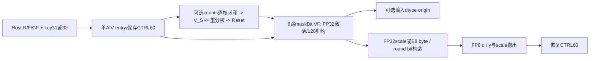

无group launch=Host usedCoreNums；有group launch=平台coreNum，所有核先求counts再Process跳过超有效核，L0时无有效写。无核间sum/SyncAll/atomic、无GM中间结果。entry key31/32各有x2*y2*scale2=8 typed类，origin两key共16；class按maskBit=(round<<2)|(clamp<<1)|weight调用对应8VF，共128。unknown key无body，maskBit由3bool产生只能0…7；malformed其它mask无dispatcher匹配、输出无初始化。同步错误停止后续语句，异步错误由框架报告，无fallback。

## Route 与参数设计

### 分核与资源计算

Ae(x)为上取整到e元素，U平台UB、P平台AIV核(<=0改1)。GF由Ug=16A4(GF)+32选择，E整段不fit时逐base取ceil(E/base)，GF>16向下16对齐；gLoop/tailGF对应末块。N正时former=ceil(N/P)、used=min(ceil(N/former),P)、tail=N-(used-1)former；R从1开始。

```text
SF=ceil(F/128), w=weight有无, o=origin有无, e=E8scale有无
T=w*8A8(R)
O=o*4R A16(F)                     # origin2slot
X0=X1=4R A16(F)                   # 各2slot
Y=2R A32(F)                       # 2slot FP8
Sbuf=e ? 2A32(R*SF) : 8A8(R*SF)   # 2slot scale
Umain=T+O+X0+X1+Y+Sbuf
UBpeak=max(group?Ug:0,Umain)
```

先按实际scale dtype测一行整C；fit则F=C，否则128递增选最后fit列候选、R=1，无fit失败。仅F=C时增R直到下一个不fit再退1。**该增R循环的scaleSize始终按FP32 8A8(R*S)计，不随ue8改变**，对正确E8/round路线是保守估计，不能误写始终等于实际分配。outputOrigin加O，weight加T。dLoop=ceil(C/F)、tailF=C-(dLoop-1)F；rowLoop/tailRowFactor分别前尾核。group存在时按L重新分rows但保留Host R/F。

Host int64/POD int64不会取消Device RoundUp/CeilDiv(int32)、VF行/计数uint16、DMA行uint16/字节uint32等窄化；本节公式只在对应计算无溢出/窄化域成立。

### Route 选择

| 顺序 | Route | Key/模板 | 精确选择条件与优先级 | 不适用去向 |
|---:|---|---|---|---|
| 1 | R-001 | key31,dtype0 | x=half,y=fp8_e4m3fn_t,scale=float,origin=0；内部M0…M7全部可达 | 其它组合对应Route，非法Host失败 |
| 2 | R-002 | key32,dtype0 | x=half,y=fp8_e4m3fn_t,scale=float,origin=1；内部M0…M7全部可达 | 其它组合对应Route，非法Host失败 |
| 3 | R-003 | key31,dtype4 | x=half,y=fp8_e4m3fn_t,scale=fp8_e8m0_t,origin=0；内部M0…M7全部可达 | 其它组合对应Route，非法Host失败 |
| 4 | R-004 | key32,dtype4 | x=half,y=fp8_e4m3fn_t,scale=fp8_e8m0_t,origin=1；内部M0…M7全部可达 | 其它组合对应Route，非法Host失败 |
| 5 | R-005 | key31,dtype2 | x=half,y=fp8_e5m2_t,scale=float,origin=0；内部M0…M7全部可达 | 其它组合对应Route，非法Host失败 |
| 6 | R-006 | key32,dtype2 | x=half,y=fp8_e5m2_t,scale=float,origin=1；内部M0…M7全部可达 | 其它组合对应Route，非法Host失败 |
| 7 | R-007 | key31,dtype6 | x=half,y=fp8_e5m2_t,scale=fp8_e8m0_t,origin=0；内部M0…M7全部可达 | 其它组合对应Route，非法Host失败 |
| 8 | R-008 | key32,dtype6 | x=half,y=fp8_e5m2_t,scale=fp8_e8m0_t,origin=1；内部M0…M7全部可达 | 其它组合对应Route，非法Host失败 |
| 9 | R-009 | key31,dtype1 | x=bfloat16_t,y=fp8_e4m3fn_t,scale=float,origin=0；内部M0…M7全部可达 | 其它组合对应Route，非法Host失败 |
| 10 | R-010 | key32,dtype1 | x=bfloat16_t,y=fp8_e4m3fn_t,scale=float,origin=1；内部M0…M7全部可达 | 其它组合对应Route，非法Host失败 |
| 11 | R-011 | key31,dtype5 | x=bfloat16_t,y=fp8_e4m3fn_t,scale=fp8_e8m0_t,origin=0；内部M0…M7全部可达 | 其它组合对应Route，非法Host失败 |
| 12 | R-012 | key32,dtype5 | x=bfloat16_t,y=fp8_e4m3fn_t,scale=fp8_e8m0_t,origin=1；内部M0…M7全部可达 | 其它组合对应Route，非法Host失败 |
| 13 | R-013 | key31,dtype3 | x=bfloat16_t,y=fp8_e5m2_t,scale=float,origin=0；内部M0…M7全部可达 | 其它组合对应Route，非法Host失败 |
| 14 | R-014 | key32,dtype3 | x=bfloat16_t,y=fp8_e5m2_t,scale=float,origin=1；内部M0…M7全部可达 | 其它组合对应Route，非法Host失败 |
| 15 | R-015 | key31,dtype7 | x=bfloat16_t,y=fp8_e5m2_t,scale=fp8_e8m0_t,origin=0；内部M0…M7全部可达 | 其它组合对应Route，非法Host失败 |
| 16 | R-016 | key32,dtype7 | x=bfloat16_t,y=fp8_e5m2_t,scale=fp8_e8m0_t,origin=1；内部M0…M7全部可达 | 其它组合对应Route，非法Host失败 |

每个typed entry Route保持自己的GM/UB布局及origin/scale类型，下列子路线分别实例化完整VF参数，未把128个实例合并成同一数学路径。记`V<Ty,Tx,Ts,r,c,o,w>`为`VFProcessSwigluFp8QuantPerToken`。

| 子路线 | maskBit | round r | clamp c | weight w | 实际VF末四参数 | 资源/数学差异 |
|---|---:|---:|---:|---:|---|---|
| M0 | 0 | 0 | 0 | 0 | <false,false,本Route.o,false> | FP32scale固定store，Ts为E8时缺陷；无T；无clamp |
| M1 | 1 | 0 | 0 | 1 | <false,false,本Route.o,true> | FP32scale固定store，Ts为E8时缺陷；T分配+weight乘；无clamp |
| M2 | 2 | 0 | 1 | 0 | <false,true,本Route.o,false> | FP32scale固定store，Ts为E8时缺陷；无T；clamp |
| M3 | 3 | 0 | 1 | 1 | <false,true,本Route.o,true> | FP32scale固定store，Ts为E8时缺陷；T分配+weight乘；clamp |
| M4 | 4 | 1 | 0 | 0 | <true,false,本Route.o,false> | 2幂round/类型正确的E8分支；无T；无clamp |
| M5 | 5 | 1 | 0 | 1 | <true,false,本Route.o,true> | 2幂round/类型正确的E8分支；T分配+weight乘；无clamp |
| M6 | 6 | 1 | 1 | 0 | <true,true,本Route.o,false> | 2幂round/类型正确的E8分支；无T；clamp |
| M7 | 7 | 1 | 1 | 1 | <true,true,本Route.o,true> | 2幂round/类型正确的E8分支；T分配+weight乘；clamp |

```text
mode3 -> x/y/scale dtype bits -> key31(originFalse) or32(originTrue)
 typed entry R001..R016 -> optional countstage/Reset or Host rows
 maskBit0..7 -> Rxxx.M0..M7 exact VF
 R/F whole/split, former/tail core, full/tail row/D -> CopyOut y/scale/(origin)
```

### 模板/实现执行矩阵

| Route | key/selector | dtype/shape/platform 完整命中条件 | 执行族与 kernel 节点 | 实际模板/body | 内存与同步特征 | tail/fallback |
|---|---|---|---|---|---|---|
| R-001.M0 | key31/code0/mask0 | 950/mode3公共域,Tx=half,Ty=fp8_e4m3fn_t,Ts=float,o0/r0/c0/w0 | 单AIV_VECTOR | SwigluFp8QuantPerToken<half,fp8_e4m3fn_t,float,false>→V<fp8_e4m3fn_t,half,float,false,false,false,false> | Umain取w0/o0/e0，group Reset可选 | 128分组完整，行/D尾；精确scale路线；无fallback |
| R-001.M1 | key31/code0/mask1 | 950/mode3公共域,Tx=half,Ty=fp8_e4m3fn_t,Ts=float,o0/r0/c0/w1 | 单AIV_VECTOR | SwigluFp8QuantPerToken<half,fp8_e4m3fn_t,float,false>→V<fp8_e4m3fn_t,half,float,false,false,false,true> | Umain取w1/o0/e0，group Reset可选 | 128分组完整，行/D尾；精确scale路线；无fallback |
| R-001.M2 | key31/code0/mask2 | 950/mode3公共域,Tx=half,Ty=fp8_e4m3fn_t,Ts=float,o0/r0/c1/w0 | 单AIV_VECTOR | SwigluFp8QuantPerToken<half,fp8_e4m3fn_t,float,false>→V<fp8_e4m3fn_t,half,float,false,true,false,false> | Umain取w0/o0/e0，group Reset可选 | 128分组完整，行/D尾；精确scale路线；无fallback |
| R-001.M3 | key31/code0/mask3 | 950/mode3公共域,Tx=half,Ty=fp8_e4m3fn_t,Ts=float,o0/r0/c1/w1 | 单AIV_VECTOR | SwigluFp8QuantPerToken<half,fp8_e4m3fn_t,float,false>→V<fp8_e4m3fn_t,half,float,false,true,false,true> | Umain取w1/o0/e0，group Reset可选 | 128分组完整，行/D尾；精确scale路线；无fallback |
| R-001.M4 | key31/code0/mask4 | 950/mode3公共域,Tx=half,Ty=fp8_e4m3fn_t,Ts=float,o0/r1/c0/w0 | 单AIV_VECTOR | SwigluFp8QuantPerToken<half,fp8_e4m3fn_t,float,false>→V<fp8_e4m3fn_t,half,float,true,false,false,false> | Umain取w0/o0/e0，group Reset可选 | 128分组完整，行/D尾；精确scale路线；无fallback |
| R-001.M5 | key31/code0/mask5 | 950/mode3公共域,Tx=half,Ty=fp8_e4m3fn_t,Ts=float,o0/r1/c0/w1 | 单AIV_VECTOR | SwigluFp8QuantPerToken<half,fp8_e4m3fn_t,float,false>→V<fp8_e4m3fn_t,half,float,true,false,false,true> | Umain取w1/o0/e0，group Reset可选 | 128分组完整，行/D尾；精确scale路线；无fallback |
| R-001.M6 | key31/code0/mask6 | 950/mode3公共域,Tx=half,Ty=fp8_e4m3fn_t,Ts=float,o0/r1/c1/w0 | 单AIV_VECTOR | SwigluFp8QuantPerToken<half,fp8_e4m3fn_t,float,false>→V<fp8_e4m3fn_t,half,float,true,true,false,false> | Umain取w0/o0/e0，group Reset可选 | 128分组完整，行/D尾；精确scale路线；无fallback |
| R-001.M7 | key31/code0/mask7 | 950/mode3公共域,Tx=half,Ty=fp8_e4m3fn_t,Ts=float,o0/r1/c1/w1 | 单AIV_VECTOR | SwigluFp8QuantPerToken<half,fp8_e4m3fn_t,float,false>→V<fp8_e4m3fn_t,half,float,true,true,false,true> | Umain取w1/o0/e0，group Reset可选 | 128分组完整，行/D尾；精确scale路线；无fallback |
| R-002.M0 | key32/code0/mask0 | 950/mode3公共域,Tx=half,Ty=fp8_e4m3fn_t,Ts=float,o1/r0/c0/w0 | 单AIV_VECTOR | SwigluFp8QuantPerToken<half,fp8_e4m3fn_t,float,true>→V<fp8_e4m3fn_t,half,float,false,false,true,false> | Umain取w0/o1/e0，group Reset可选 | 128分组完整，行/D尾；精确scale路线；无fallback |
| R-002.M1 | key32/code0/mask1 | 950/mode3公共域,Tx=half,Ty=fp8_e4m3fn_t,Ts=float,o1/r0/c0/w1 | 单AIV_VECTOR | SwigluFp8QuantPerToken<half,fp8_e4m3fn_t,float,true>→V<fp8_e4m3fn_t,half,float,false,false,true,true> | Umain取w1/o1/e0，group Reset可选 | 128分组完整，行/D尾；精确scale路线；无fallback |
| R-002.M2 | key32/code0/mask2 | 950/mode3公共域,Tx=half,Ty=fp8_e4m3fn_t,Ts=float,o1/r0/c1/w0 | 单AIV_VECTOR | SwigluFp8QuantPerToken<half,fp8_e4m3fn_t,float,true>→V<fp8_e4m3fn_t,half,float,false,true,true,false> | Umain取w0/o1/e0，group Reset可选 | 128分组完整，行/D尾；精确scale路线；无fallback |
| R-002.M3 | key32/code0/mask3 | 950/mode3公共域,Tx=half,Ty=fp8_e4m3fn_t,Ts=float,o1/r0/c1/w1 | 单AIV_VECTOR | SwigluFp8QuantPerToken<half,fp8_e4m3fn_t,float,true>→V<fp8_e4m3fn_t,half,float,false,true,true,true> | Umain取w1/o1/e0，group Reset可选 | 128分组完整，行/D尾；精确scale路线；无fallback |
| R-002.M4 | key32/code0/mask4 | 950/mode3公共域,Tx=half,Ty=fp8_e4m3fn_t,Ts=float,o1/r1/c0/w0 | 单AIV_VECTOR | SwigluFp8QuantPerToken<half,fp8_e4m3fn_t,float,true>→V<fp8_e4m3fn_t,half,float,true,false,true,false> | Umain取w0/o1/e0，group Reset可选 | 128分组完整，行/D尾；精确scale路线；无fallback |
| R-002.M5 | key32/code0/mask5 | 950/mode3公共域,Tx=half,Ty=fp8_e4m3fn_t,Ts=float,o1/r1/c0/w1 | 单AIV_VECTOR | SwigluFp8QuantPerToken<half,fp8_e4m3fn_t,float,true>→V<fp8_e4m3fn_t,half,float,true,false,true,true> | Umain取w1/o1/e0，group Reset可选 | 128分组完整，行/D尾；精确scale路线；无fallback |
| R-002.M6 | key32/code0/mask6 | 950/mode3公共域,Tx=half,Ty=fp8_e4m3fn_t,Ts=float,o1/r1/c1/w0 | 单AIV_VECTOR | SwigluFp8QuantPerToken<half,fp8_e4m3fn_t,float,true>→V<fp8_e4m3fn_t,half,float,true,true,true,false> | Umain取w0/o1/e0，group Reset可选 | 128分组完整，行/D尾；精确scale路线；无fallback |
| R-002.M7 | key32/code0/mask7 | 950/mode3公共域,Tx=half,Ty=fp8_e4m3fn_t,Ts=float,o1/r1/c1/w1 | 单AIV_VECTOR | SwigluFp8QuantPerToken<half,fp8_e4m3fn_t,float,true>→V<fp8_e4m3fn_t,half,float,true,true,true,true> | Umain取w1/o1/e0，group Reset可选 | 128分组完整，行/D尾；精确scale路线；无fallback |
| R-003.M0 | key31/code4/mask0 | 950/mode3公共域,Tx=half,Ty=fp8_e4m3fn_t,Ts=fp8_e8m0_t,o0/r0/c0/w0 | 单AIV_VECTOR | SwigluFp8QuantPerToken<half,fp8_e4m3fn_t,fp8_e8m0_t,false>→V<fp8_e4m3fn_t,half,fp8_e8m0_t,false,false,false,false> | Umain取w0/o0/e1，group Reset可选 | 128分组完整，行/D尾；错误FP32 store到E8缓冲；无fallback |
| R-003.M1 | key31/code4/mask1 | 950/mode3公共域,Tx=half,Ty=fp8_e4m3fn_t,Ts=fp8_e8m0_t,o0/r0/c0/w1 | 单AIV_VECTOR | SwigluFp8QuantPerToken<half,fp8_e4m3fn_t,fp8_e8m0_t,false>→V<fp8_e4m3fn_t,half,fp8_e8m0_t,false,false,false,true> | Umain取w1/o0/e1，group Reset可选 | 128分组完整，行/D尾；错误FP32 store到E8缓冲；无fallback |
| R-003.M2 | key31/code4/mask2 | 950/mode3公共域,Tx=half,Ty=fp8_e4m3fn_t,Ts=fp8_e8m0_t,o0/r0/c1/w0 | 单AIV_VECTOR | SwigluFp8QuantPerToken<half,fp8_e4m3fn_t,fp8_e8m0_t,false>→V<fp8_e4m3fn_t,half,fp8_e8m0_t,false,true,false,false> | Umain取w0/o0/e1，group Reset可选 | 128分组完整，行/D尾；错误FP32 store到E8缓冲；无fallback |
| R-003.M3 | key31/code4/mask3 | 950/mode3公共域,Tx=half,Ty=fp8_e4m3fn_t,Ts=fp8_e8m0_t,o0/r0/c1/w1 | 单AIV_VECTOR | SwigluFp8QuantPerToken<half,fp8_e4m3fn_t,fp8_e8m0_t,false>→V<fp8_e4m3fn_t,half,fp8_e8m0_t,false,true,false,true> | Umain取w1/o0/e1，group Reset可选 | 128分组完整，行/D尾；错误FP32 store到E8缓冲；无fallback |
| R-003.M4 | key31/code4/mask4 | 950/mode3公共域,Tx=half,Ty=fp8_e4m3fn_t,Ts=fp8_e8m0_t,o0/r1/c0/w0 | 单AIV_VECTOR | SwigluFp8QuantPerToken<half,fp8_e4m3fn_t,fp8_e8m0_t,false>→V<fp8_e4m3fn_t,half,fp8_e8m0_t,true,false,false,false> | Umain取w0/o0/e1，group Reset可选 | 128分组完整，行/D尾；精确scale路线；无fallback |
| R-003.M5 | key31/code4/mask5 | 950/mode3公共域,Tx=half,Ty=fp8_e4m3fn_t,Ts=fp8_e8m0_t,o0/r1/c0/w1 | 单AIV_VECTOR | SwigluFp8QuantPerToken<half,fp8_e4m3fn_t,fp8_e8m0_t,false>→V<fp8_e4m3fn_t,half,fp8_e8m0_t,true,false,false,true> | Umain取w1/o0/e1，group Reset可选 | 128分组完整，行/D尾；精确scale路线；无fallback |
| R-003.M6 | key31/code4/mask6 | 950/mode3公共域,Tx=half,Ty=fp8_e4m3fn_t,Ts=fp8_e8m0_t,o0/r1/c1/w0 | 单AIV_VECTOR | SwigluFp8QuantPerToken<half,fp8_e4m3fn_t,fp8_e8m0_t,false>→V<fp8_e4m3fn_t,half,fp8_e8m0_t,true,true,false,false> | Umain取w0/o0/e1，group Reset可选 | 128分组完整，行/D尾；精确scale路线；无fallback |
| R-003.M7 | key31/code4/mask7 | 950/mode3公共域,Tx=half,Ty=fp8_e4m3fn_t,Ts=fp8_e8m0_t,o0/r1/c1/w1 | 单AIV_VECTOR | SwigluFp8QuantPerToken<half,fp8_e4m3fn_t,fp8_e8m0_t,false>→V<fp8_e4m3fn_t,half,fp8_e8m0_t,true,true,false,true> | Umain取w1/o0/e1，group Reset可选 | 128分组完整，行/D尾；精确scale路线；无fallback |
| R-004.M0 | key32/code4/mask0 | 950/mode3公共域,Tx=half,Ty=fp8_e4m3fn_t,Ts=fp8_e8m0_t,o1/r0/c0/w0 | 单AIV_VECTOR | SwigluFp8QuantPerToken<half,fp8_e4m3fn_t,fp8_e8m0_t,true>→V<fp8_e4m3fn_t,half,fp8_e8m0_t,false,false,true,false> | Umain取w0/o1/e1，group Reset可选 | 128分组完整，行/D尾；错误FP32 store到E8缓冲；无fallback |
| R-004.M1 | key32/code4/mask1 | 950/mode3公共域,Tx=half,Ty=fp8_e4m3fn_t,Ts=fp8_e8m0_t,o1/r0/c0/w1 | 单AIV_VECTOR | SwigluFp8QuantPerToken<half,fp8_e4m3fn_t,fp8_e8m0_t,true>→V<fp8_e4m3fn_t,half,fp8_e8m0_t,false,false,true,true> | Umain取w1/o1/e1，group Reset可选 | 128分组完整，行/D尾；错误FP32 store到E8缓冲；无fallback |
| R-004.M2 | key32/code4/mask2 | 950/mode3公共域,Tx=half,Ty=fp8_e4m3fn_t,Ts=fp8_e8m0_t,o1/r0/c1/w0 | 单AIV_VECTOR | SwigluFp8QuantPerToken<half,fp8_e4m3fn_t,fp8_e8m0_t,true>→V<fp8_e4m3fn_t,half,fp8_e8m0_t,false,true,true,false> | Umain取w0/o1/e1，group Reset可选 | 128分组完整，行/D尾；错误FP32 store到E8缓冲；无fallback |
| R-004.M3 | key32/code4/mask3 | 950/mode3公共域,Tx=half,Ty=fp8_e4m3fn_t,Ts=fp8_e8m0_t,o1/r0/c1/w1 | 单AIV_VECTOR | SwigluFp8QuantPerToken<half,fp8_e4m3fn_t,fp8_e8m0_t,true>→V<fp8_e4m3fn_t,half,fp8_e8m0_t,false,true,true,true> | Umain取w1/o1/e1，group Reset可选 | 128分组完整，行/D尾；错误FP32 store到E8缓冲；无fallback |
| R-004.M4 | key32/code4/mask4 | 950/mode3公共域,Tx=half,Ty=fp8_e4m3fn_t,Ts=fp8_e8m0_t,o1/r1/c0/w0 | 单AIV_VECTOR | SwigluFp8QuantPerToken<half,fp8_e4m3fn_t,fp8_e8m0_t,true>→V<fp8_e4m3fn_t,half,fp8_e8m0_t,true,false,true,false> | Umain取w0/o1/e1，group Reset可选 | 128分组完整，行/D尾；精确scale路线；无fallback |
| R-004.M5 | key32/code4/mask5 | 950/mode3公共域,Tx=half,Ty=fp8_e4m3fn_t,Ts=fp8_e8m0_t,o1/r1/c0/w1 | 单AIV_VECTOR | SwigluFp8QuantPerToken<half,fp8_e4m3fn_t,fp8_e8m0_t,true>→V<fp8_e4m3fn_t,half,fp8_e8m0_t,true,false,true,true> | Umain取w1/o1/e1，group Reset可选 | 128分组完整，行/D尾；精确scale路线；无fallback |
| R-004.M6 | key32/code4/mask6 | 950/mode3公共域,Tx=half,Ty=fp8_e4m3fn_t,Ts=fp8_e8m0_t,o1/r1/c1/w0 | 单AIV_VECTOR | SwigluFp8QuantPerToken<half,fp8_e4m3fn_t,fp8_e8m0_t,true>→V<fp8_e4m3fn_t,half,fp8_e8m0_t,true,true,true,false> | Umain取w0/o1/e1，group Reset可选 | 128分组完整，行/D尾；精确scale路线；无fallback |
| R-004.M7 | key32/code4/mask7 | 950/mode3公共域,Tx=half,Ty=fp8_e4m3fn_t,Ts=fp8_e8m0_t,o1/r1/c1/w1 | 单AIV_VECTOR | SwigluFp8QuantPerToken<half,fp8_e4m3fn_t,fp8_e8m0_t,true>→V<fp8_e4m3fn_t,half,fp8_e8m0_t,true,true,true,true> | Umain取w1/o1/e1，group Reset可选 | 128分组完整，行/D尾；精确scale路线；无fallback |
| R-005.M0 | key31/code2/mask0 | 950/mode3公共域,Tx=half,Ty=fp8_e5m2_t,Ts=float,o0/r0/c0/w0 | 单AIV_VECTOR | SwigluFp8QuantPerToken<half,fp8_e5m2_t,float,false>→V<fp8_e5m2_t,half,float,false,false,false,false> | Umain取w0/o0/e0，group Reset可选 | 128分组完整，行/D尾；精确scale路线；无fallback |
| R-005.M1 | key31/code2/mask1 | 950/mode3公共域,Tx=half,Ty=fp8_e5m2_t,Ts=float,o0/r0/c0/w1 | 单AIV_VECTOR | SwigluFp8QuantPerToken<half,fp8_e5m2_t,float,false>→V<fp8_e5m2_t,half,float,false,false,false,true> | Umain取w1/o0/e0，group Reset可选 | 128分组完整，行/D尾；精确scale路线；无fallback |
| R-005.M2 | key31/code2/mask2 | 950/mode3公共域,Tx=half,Ty=fp8_e5m2_t,Ts=float,o0/r0/c1/w0 | 单AIV_VECTOR | SwigluFp8QuantPerToken<half,fp8_e5m2_t,float,false>→V<fp8_e5m2_t,half,float,false,true,false,false> | Umain取w0/o0/e0，group Reset可选 | 128分组完整，行/D尾；精确scale路线；无fallback |
| R-005.M3 | key31/code2/mask3 | 950/mode3公共域,Tx=half,Ty=fp8_e5m2_t,Ts=float,o0/r0/c1/w1 | 单AIV_VECTOR | SwigluFp8QuantPerToken<half,fp8_e5m2_t,float,false>→V<fp8_e5m2_t,half,float,false,true,false,true> | Umain取w1/o0/e0，group Reset可选 | 128分组完整，行/D尾；精确scale路线；无fallback |
| R-005.M4 | key31/code2/mask4 | 950/mode3公共域,Tx=half,Ty=fp8_e5m2_t,Ts=float,o0/r1/c0/w0 | 单AIV_VECTOR | SwigluFp8QuantPerToken<half,fp8_e5m2_t,float,false>→V<fp8_e5m2_t,half,float,true,false,false,false> | Umain取w0/o0/e0，group Reset可选 | 128分组完整，行/D尾；精确scale路线；无fallback |
| R-005.M5 | key31/code2/mask5 | 950/mode3公共域,Tx=half,Ty=fp8_e5m2_t,Ts=float,o0/r1/c0/w1 | 单AIV_VECTOR | SwigluFp8QuantPerToken<half,fp8_e5m2_t,float,false>→V<fp8_e5m2_t,half,float,true,false,false,true> | Umain取w1/o0/e0，group Reset可选 | 128分组完整，行/D尾；精确scale路线；无fallback |
| R-005.M6 | key31/code2/mask6 | 950/mode3公共域,Tx=half,Ty=fp8_e5m2_t,Ts=float,o0/r1/c1/w0 | 单AIV_VECTOR | SwigluFp8QuantPerToken<half,fp8_e5m2_t,float,false>→V<fp8_e5m2_t,half,float,true,true,false,false> | Umain取w0/o0/e0，group Reset可选 | 128分组完整，行/D尾；精确scale路线；无fallback |
| R-005.M7 | key31/code2/mask7 | 950/mode3公共域,Tx=half,Ty=fp8_e5m2_t,Ts=float,o0/r1/c1/w1 | 单AIV_VECTOR | SwigluFp8QuantPerToken<half,fp8_e5m2_t,float,false>→V<fp8_e5m2_t,half,float,true,true,false,true> | Umain取w1/o0/e0，group Reset可选 | 128分组完整，行/D尾；精确scale路线；无fallback |
| R-006.M0 | key32/code2/mask0 | 950/mode3公共域,Tx=half,Ty=fp8_e5m2_t,Ts=float,o1/r0/c0/w0 | 单AIV_VECTOR | SwigluFp8QuantPerToken<half,fp8_e5m2_t,float,true>→V<fp8_e5m2_t,half,float,false,false,true,false> | Umain取w0/o1/e0，group Reset可选 | 128分组完整，行/D尾；精确scale路线；无fallback |
| R-006.M1 | key32/code2/mask1 | 950/mode3公共域,Tx=half,Ty=fp8_e5m2_t,Ts=float,o1/r0/c0/w1 | 单AIV_VECTOR | SwigluFp8QuantPerToken<half,fp8_e5m2_t,float,true>→V<fp8_e5m2_t,half,float,false,false,true,true> | Umain取w1/o1/e0，group Reset可选 | 128分组完整，行/D尾；精确scale路线；无fallback |
| R-006.M2 | key32/code2/mask2 | 950/mode3公共域,Tx=half,Ty=fp8_e5m2_t,Ts=float,o1/r0/c1/w0 | 单AIV_VECTOR | SwigluFp8QuantPerToken<half,fp8_e5m2_t,float,true>→V<fp8_e5m2_t,half,float,false,true,true,false> | Umain取w0/o1/e0，group Reset可选 | 128分组完整，行/D尾；精确scale路线；无fallback |
| R-006.M3 | key32/code2/mask3 | 950/mode3公共域,Tx=half,Ty=fp8_e5m2_t,Ts=float,o1/r0/c1/w1 | 单AIV_VECTOR | SwigluFp8QuantPerToken<half,fp8_e5m2_t,float,true>→V<fp8_e5m2_t,half,float,false,true,true,true> | Umain取w1/o1/e0，group Reset可选 | 128分组完整，行/D尾；精确scale路线；无fallback |
| R-006.M4 | key32/code2/mask4 | 950/mode3公共域,Tx=half,Ty=fp8_e5m2_t,Ts=float,o1/r1/c0/w0 | 单AIV_VECTOR | SwigluFp8QuantPerToken<half,fp8_e5m2_t,float,true>→V<fp8_e5m2_t,half,float,true,false,true,false> | Umain取w0/o1/e0，group Reset可选 | 128分组完整，行/D尾；精确scale路线；无fallback |
| R-006.M5 | key32/code2/mask5 | 950/mode3公共域,Tx=half,Ty=fp8_e5m2_t,Ts=float,o1/r1/c0/w1 | 单AIV_VECTOR | SwigluFp8QuantPerToken<half,fp8_e5m2_t,float,true>→V<fp8_e5m2_t,half,float,true,false,true,true> | Umain取w1/o1/e0，group Reset可选 | 128分组完整，行/D尾；精确scale路线；无fallback |
| R-006.M6 | key32/code2/mask6 | 950/mode3公共域,Tx=half,Ty=fp8_e5m2_t,Ts=float,o1/r1/c1/w0 | 单AIV_VECTOR | SwigluFp8QuantPerToken<half,fp8_e5m2_t,float,true>→V<fp8_e5m2_t,half,float,true,true,true,false> | Umain取w0/o1/e0，group Reset可选 | 128分组完整，行/D尾；精确scale路线；无fallback |
| R-006.M7 | key32/code2/mask7 | 950/mode3公共域,Tx=half,Ty=fp8_e5m2_t,Ts=float,o1/r1/c1/w1 | 单AIV_VECTOR | SwigluFp8QuantPerToken<half,fp8_e5m2_t,float,true>→V<fp8_e5m2_t,half,float,true,true,true,true> | Umain取w1/o1/e0，group Reset可选 | 128分组完整，行/D尾；精确scale路线；无fallback |
| R-007.M0 | key31/code6/mask0 | 950/mode3公共域,Tx=half,Ty=fp8_e5m2_t,Ts=fp8_e8m0_t,o0/r0/c0/w0 | 单AIV_VECTOR | SwigluFp8QuantPerToken<half,fp8_e5m2_t,fp8_e8m0_t,false>→V<fp8_e5m2_t,half,fp8_e8m0_t,false,false,false,false> | Umain取w0/o0/e1，group Reset可选 | 128分组完整，行/D尾；错误FP32 store到E8缓冲；无fallback |
| R-007.M1 | key31/code6/mask1 | 950/mode3公共域,Tx=half,Ty=fp8_e5m2_t,Ts=fp8_e8m0_t,o0/r0/c0/w1 | 单AIV_VECTOR | SwigluFp8QuantPerToken<half,fp8_e5m2_t,fp8_e8m0_t,false>→V<fp8_e5m2_t,half,fp8_e8m0_t,false,false,false,true> | Umain取w1/o0/e1，group Reset可选 | 128分组完整，行/D尾；错误FP32 store到E8缓冲；无fallback |
| R-007.M2 | key31/code6/mask2 | 950/mode3公共域,Tx=half,Ty=fp8_e5m2_t,Ts=fp8_e8m0_t,o0/r0/c1/w0 | 单AIV_VECTOR | SwigluFp8QuantPerToken<half,fp8_e5m2_t,fp8_e8m0_t,false>→V<fp8_e5m2_t,half,fp8_e8m0_t,false,true,false,false> | Umain取w0/o0/e1，group Reset可选 | 128分组完整，行/D尾；错误FP32 store到E8缓冲；无fallback |
| R-007.M3 | key31/code6/mask3 | 950/mode3公共域,Tx=half,Ty=fp8_e5m2_t,Ts=fp8_e8m0_t,o0/r0/c1/w1 | 单AIV_VECTOR | SwigluFp8QuantPerToken<half,fp8_e5m2_t,fp8_e8m0_t,false>→V<fp8_e5m2_t,half,fp8_e8m0_t,false,true,false,true> | Umain取w1/o0/e1，group Reset可选 | 128分组完整，行/D尾；错误FP32 store到E8缓冲；无fallback |
| R-007.M4 | key31/code6/mask4 | 950/mode3公共域,Tx=half,Ty=fp8_e5m2_t,Ts=fp8_e8m0_t,o0/r1/c0/w0 | 单AIV_VECTOR | SwigluFp8QuantPerToken<half,fp8_e5m2_t,fp8_e8m0_t,false>→V<fp8_e5m2_t,half,fp8_e8m0_t,true,false,false,false> | Umain取w0/o0/e1，group Reset可选 | 128分组完整，行/D尾；精确scale路线；无fallback |
| R-007.M5 | key31/code6/mask5 | 950/mode3公共域,Tx=half,Ty=fp8_e5m2_t,Ts=fp8_e8m0_t,o0/r1/c0/w1 | 单AIV_VECTOR | SwigluFp8QuantPerToken<half,fp8_e5m2_t,fp8_e8m0_t,false>→V<fp8_e5m2_t,half,fp8_e8m0_t,true,false,false,true> | Umain取w1/o0/e1，group Reset可选 | 128分组完整，行/D尾；精确scale路线；无fallback |
| R-007.M6 | key31/code6/mask6 | 950/mode3公共域,Tx=half,Ty=fp8_e5m2_t,Ts=fp8_e8m0_t,o0/r1/c1/w0 | 单AIV_VECTOR | SwigluFp8QuantPerToken<half,fp8_e5m2_t,fp8_e8m0_t,false>→V<fp8_e5m2_t,half,fp8_e8m0_t,true,true,false,false> | Umain取w0/o0/e1，group Reset可选 | 128分组完整，行/D尾；精确scale路线；无fallback |
| R-007.M7 | key31/code6/mask7 | 950/mode3公共域,Tx=half,Ty=fp8_e5m2_t,Ts=fp8_e8m0_t,o0/r1/c1/w1 | 单AIV_VECTOR | SwigluFp8QuantPerToken<half,fp8_e5m2_t,fp8_e8m0_t,false>→V<fp8_e5m2_t,half,fp8_e8m0_t,true,true,false,true> | Umain取w1/o0/e1，group Reset可选 | 128分组完整，行/D尾；精确scale路线；无fallback |
| R-008.M0 | key32/code6/mask0 | 950/mode3公共域,Tx=half,Ty=fp8_e5m2_t,Ts=fp8_e8m0_t,o1/r0/c0/w0 | 单AIV_VECTOR | SwigluFp8QuantPerToken<half,fp8_e5m2_t,fp8_e8m0_t,true>→V<fp8_e5m2_t,half,fp8_e8m0_t,false,false,true,false> | Umain取w0/o1/e1，group Reset可选 | 128分组完整，行/D尾；错误FP32 store到E8缓冲；无fallback |
| R-008.M1 | key32/code6/mask1 | 950/mode3公共域,Tx=half,Ty=fp8_e5m2_t,Ts=fp8_e8m0_t,o1/r0/c0/w1 | 单AIV_VECTOR | SwigluFp8QuantPerToken<half,fp8_e5m2_t,fp8_e8m0_t,true>→V<fp8_e5m2_t,half,fp8_e8m0_t,false,false,true,true> | Umain取w1/o1/e1，group Reset可选 | 128分组完整，行/D尾；错误FP32 store到E8缓冲；无fallback |
| R-008.M2 | key32/code6/mask2 | 950/mode3公共域,Tx=half,Ty=fp8_e5m2_t,Ts=fp8_e8m0_t,o1/r0/c1/w0 | 单AIV_VECTOR | SwigluFp8QuantPerToken<half,fp8_e5m2_t,fp8_e8m0_t,true>→V<fp8_e5m2_t,half,fp8_e8m0_t,false,true,true,false> | Umain取w0/o1/e1，group Reset可选 | 128分组完整，行/D尾；错误FP32 store到E8缓冲；无fallback |
| R-008.M3 | key32/code6/mask3 | 950/mode3公共域,Tx=half,Ty=fp8_e5m2_t,Ts=fp8_e8m0_t,o1/r0/c1/w1 | 单AIV_VECTOR | SwigluFp8QuantPerToken<half,fp8_e5m2_t,fp8_e8m0_t,true>→V<fp8_e5m2_t,half,fp8_e8m0_t,false,true,true,true> | Umain取w1/o1/e1，group Reset可选 | 128分组完整，行/D尾；错误FP32 store到E8缓冲；无fallback |
| R-008.M4 | key32/code6/mask4 | 950/mode3公共域,Tx=half,Ty=fp8_e5m2_t,Ts=fp8_e8m0_t,o1/r1/c0/w0 | 单AIV_VECTOR | SwigluFp8QuantPerToken<half,fp8_e5m2_t,fp8_e8m0_t,true>→V<fp8_e5m2_t,half,fp8_e8m0_t,true,false,true,false> | Umain取w0/o1/e1，group Reset可选 | 128分组完整，行/D尾；精确scale路线；无fallback |
| R-008.M5 | key32/code6/mask5 | 950/mode3公共域,Tx=half,Ty=fp8_e5m2_t,Ts=fp8_e8m0_t,o1/r1/c0/w1 | 单AIV_VECTOR | SwigluFp8QuantPerToken<half,fp8_e5m2_t,fp8_e8m0_t,true>→V<fp8_e5m2_t,half,fp8_e8m0_t,true,false,true,true> | Umain取w1/o1/e1，group Reset可选 | 128分组完整，行/D尾；精确scale路线；无fallback |
| R-008.M6 | key32/code6/mask6 | 950/mode3公共域,Tx=half,Ty=fp8_e5m2_t,Ts=fp8_e8m0_t,o1/r1/c1/w0 | 单AIV_VECTOR | SwigluFp8QuantPerToken<half,fp8_e5m2_t,fp8_e8m0_t,true>→V<fp8_e5m2_t,half,fp8_e8m0_t,true,true,true,false> | Umain取w0/o1/e1，group Reset可选 | 128分组完整，行/D尾；精确scale路线；无fallback |
| R-008.M7 | key32/code6/mask7 | 950/mode3公共域,Tx=half,Ty=fp8_e5m2_t,Ts=fp8_e8m0_t,o1/r1/c1/w1 | 单AIV_VECTOR | SwigluFp8QuantPerToken<half,fp8_e5m2_t,fp8_e8m0_t,true>→V<fp8_e5m2_t,half,fp8_e8m0_t,true,true,true,true> | Umain取w1/o1/e1，group Reset可选 | 128分组完整，行/D尾；精确scale路线；无fallback |
| R-009.M0 | key31/code1/mask0 | 950/mode3公共域,Tx=bfloat16_t,Ty=fp8_e4m3fn_t,Ts=float,o0/r0/c0/w0 | 单AIV_VECTOR | SwigluFp8QuantPerToken<bfloat16_t,fp8_e4m3fn_t,float,false>→V<fp8_e4m3fn_t,bfloat16_t,float,false,false,false,false> | Umain取w0/o0/e0，group Reset可选 | 128分组完整，行/D尾；精确scale路线；无fallback |
| R-009.M1 | key31/code1/mask1 | 950/mode3公共域,Tx=bfloat16_t,Ty=fp8_e4m3fn_t,Ts=float,o0/r0/c0/w1 | 单AIV_VECTOR | SwigluFp8QuantPerToken<bfloat16_t,fp8_e4m3fn_t,float,false>→V<fp8_e4m3fn_t,bfloat16_t,float,false,false,false,true> | Umain取w1/o0/e0，group Reset可选 | 128分组完整，行/D尾；精确scale路线；无fallback |
| R-009.M2 | key31/code1/mask2 | 950/mode3公共域,Tx=bfloat16_t,Ty=fp8_e4m3fn_t,Ts=float,o0/r0/c1/w0 | 单AIV_VECTOR | SwigluFp8QuantPerToken<bfloat16_t,fp8_e4m3fn_t,float,false>→V<fp8_e4m3fn_t,bfloat16_t,float,false,true,false,false> | Umain取w0/o0/e0，group Reset可选 | 128分组完整，行/D尾；精确scale路线；无fallback |
| R-009.M3 | key31/code1/mask3 | 950/mode3公共域,Tx=bfloat16_t,Ty=fp8_e4m3fn_t,Ts=float,o0/r0/c1/w1 | 单AIV_VECTOR | SwigluFp8QuantPerToken<bfloat16_t,fp8_e4m3fn_t,float,false>→V<fp8_e4m3fn_t,bfloat16_t,float,false,true,false,true> | Umain取w1/o0/e0，group Reset可选 | 128分组完整，行/D尾；精确scale路线；无fallback |
| R-009.M4 | key31/code1/mask4 | 950/mode3公共域,Tx=bfloat16_t,Ty=fp8_e4m3fn_t,Ts=float,o0/r1/c0/w0 | 单AIV_VECTOR | SwigluFp8QuantPerToken<bfloat16_t,fp8_e4m3fn_t,float,false>→V<fp8_e4m3fn_t,bfloat16_t,float,true,false,false,false> | Umain取w0/o0/e0，group Reset可选 | 128分组完整，行/D尾；精确scale路线；无fallback |
| R-009.M5 | key31/code1/mask5 | 950/mode3公共域,Tx=bfloat16_t,Ty=fp8_e4m3fn_t,Ts=float,o0/r1/c0/w1 | 单AIV_VECTOR | SwigluFp8QuantPerToken<bfloat16_t,fp8_e4m3fn_t,float,false>→V<fp8_e4m3fn_t,bfloat16_t,float,true,false,false,true> | Umain取w1/o0/e0，group Reset可选 | 128分组完整，行/D尾；精确scale路线；无fallback |
| R-009.M6 | key31/code1/mask6 | 950/mode3公共域,Tx=bfloat16_t,Ty=fp8_e4m3fn_t,Ts=float,o0/r1/c1/w0 | 单AIV_VECTOR | SwigluFp8QuantPerToken<bfloat16_t,fp8_e4m3fn_t,float,false>→V<fp8_e4m3fn_t,bfloat16_t,float,true,true,false,false> | Umain取w0/o0/e0，group Reset可选 | 128分组完整，行/D尾；精确scale路线；无fallback |
| R-009.M7 | key31/code1/mask7 | 950/mode3公共域,Tx=bfloat16_t,Ty=fp8_e4m3fn_t,Ts=float,o0/r1/c1/w1 | 单AIV_VECTOR | SwigluFp8QuantPerToken<bfloat16_t,fp8_e4m3fn_t,float,false>→V<fp8_e4m3fn_t,bfloat16_t,float,true,true,false,true> | Umain取w1/o0/e0，group Reset可选 | 128分组完整，行/D尾；精确scale路线；无fallback |
| R-010.M0 | key32/code1/mask0 | 950/mode3公共域,Tx=bfloat16_t,Ty=fp8_e4m3fn_t,Ts=float,o1/r0/c0/w0 | 单AIV_VECTOR | SwigluFp8QuantPerToken<bfloat16_t,fp8_e4m3fn_t,float,true>→V<fp8_e4m3fn_t,bfloat16_t,float,false,false,true,false> | Umain取w0/o1/e0，group Reset可选 | 128分组完整，行/D尾；精确scale路线；无fallback |
| R-010.M1 | key32/code1/mask1 | 950/mode3公共域,Tx=bfloat16_t,Ty=fp8_e4m3fn_t,Ts=float,o1/r0/c0/w1 | 单AIV_VECTOR | SwigluFp8QuantPerToken<bfloat16_t,fp8_e4m3fn_t,float,true>→V<fp8_e4m3fn_t,bfloat16_t,float,false,false,true,true> | Umain取w1/o1/e0，group Reset可选 | 128分组完整，行/D尾；精确scale路线；无fallback |
| R-010.M2 | key32/code1/mask2 | 950/mode3公共域,Tx=bfloat16_t,Ty=fp8_e4m3fn_t,Ts=float,o1/r0/c1/w0 | 单AIV_VECTOR | SwigluFp8QuantPerToken<bfloat16_t,fp8_e4m3fn_t,float,true>→V<fp8_e4m3fn_t,bfloat16_t,float,false,true,true,false> | Umain取w0/o1/e0，group Reset可选 | 128分组完整，行/D尾；精确scale路线；无fallback |
| R-010.M3 | key32/code1/mask3 | 950/mode3公共域,Tx=bfloat16_t,Ty=fp8_e4m3fn_t,Ts=float,o1/r0/c1/w1 | 单AIV_VECTOR | SwigluFp8QuantPerToken<bfloat16_t,fp8_e4m3fn_t,float,true>→V<fp8_e4m3fn_t,bfloat16_t,float,false,true,true,true> | Umain取w1/o1/e0，group Reset可选 | 128分组完整，行/D尾；精确scale路线；无fallback |
| R-010.M4 | key32/code1/mask4 | 950/mode3公共域,Tx=bfloat16_t,Ty=fp8_e4m3fn_t,Ts=float,o1/r1/c0/w0 | 单AIV_VECTOR | SwigluFp8QuantPerToken<bfloat16_t,fp8_e4m3fn_t,float,true>→V<fp8_e4m3fn_t,bfloat16_t,float,true,false,true,false> | Umain取w0/o1/e0，group Reset可选 | 128分组完整，行/D尾；精确scale路线；无fallback |
| R-010.M5 | key32/code1/mask5 | 950/mode3公共域,Tx=bfloat16_t,Ty=fp8_e4m3fn_t,Ts=float,o1/r1/c0/w1 | 单AIV_VECTOR | SwigluFp8QuantPerToken<bfloat16_t,fp8_e4m3fn_t,float,true>→V<fp8_e4m3fn_t,bfloat16_t,float,true,false,true,true> | Umain取w1/o1/e0，group Reset可选 | 128分组完整，行/D尾；精确scale路线；无fallback |
| R-010.M6 | key32/code1/mask6 | 950/mode3公共域,Tx=bfloat16_t,Ty=fp8_e4m3fn_t,Ts=float,o1/r1/c1/w0 | 单AIV_VECTOR | SwigluFp8QuantPerToken<bfloat16_t,fp8_e4m3fn_t,float,true>→V<fp8_e4m3fn_t,bfloat16_t,float,true,true,true,false> | Umain取w0/o1/e0，group Reset可选 | 128分组完整，行/D尾；精确scale路线；无fallback |
| R-010.M7 | key32/code1/mask7 | 950/mode3公共域,Tx=bfloat16_t,Ty=fp8_e4m3fn_t,Ts=float,o1/r1/c1/w1 | 单AIV_VECTOR | SwigluFp8QuantPerToken<bfloat16_t,fp8_e4m3fn_t,float,true>→V<fp8_e4m3fn_t,bfloat16_t,float,true,true,true,true> | Umain取w1/o1/e0，group Reset可选 | 128分组完整，行/D尾；精确scale路线；无fallback |
| R-011.M0 | key31/code5/mask0 | 950/mode3公共域,Tx=bfloat16_t,Ty=fp8_e4m3fn_t,Ts=fp8_e8m0_t,o0/r0/c0/w0 | 单AIV_VECTOR | SwigluFp8QuantPerToken<bfloat16_t,fp8_e4m3fn_t,fp8_e8m0_t,false>→V<fp8_e4m3fn_t,bfloat16_t,fp8_e8m0_t,false,false,false,false> | Umain取w0/o0/e1，group Reset可选 | 128分组完整，行/D尾；错误FP32 store到E8缓冲；无fallback |
| R-011.M1 | key31/code5/mask1 | 950/mode3公共域,Tx=bfloat16_t,Ty=fp8_e4m3fn_t,Ts=fp8_e8m0_t,o0/r0/c0/w1 | 单AIV_VECTOR | SwigluFp8QuantPerToken<bfloat16_t,fp8_e4m3fn_t,fp8_e8m0_t,false>→V<fp8_e4m3fn_t,bfloat16_t,fp8_e8m0_t,false,false,false,true> | Umain取w1/o0/e1，group Reset可选 | 128分组完整，行/D尾；错误FP32 store到E8缓冲；无fallback |
| R-011.M2 | key31/code5/mask2 | 950/mode3公共域,Tx=bfloat16_t,Ty=fp8_e4m3fn_t,Ts=fp8_e8m0_t,o0/r0/c1/w0 | 单AIV_VECTOR | SwigluFp8QuantPerToken<bfloat16_t,fp8_e4m3fn_t,fp8_e8m0_t,false>→V<fp8_e4m3fn_t,bfloat16_t,fp8_e8m0_t,false,true,false,false> | Umain取w0/o0/e1，group Reset可选 | 128分组完整，行/D尾；错误FP32 store到E8缓冲；无fallback |
| R-011.M3 | key31/code5/mask3 | 950/mode3公共域,Tx=bfloat16_t,Ty=fp8_e4m3fn_t,Ts=fp8_e8m0_t,o0/r0/c1/w1 | 单AIV_VECTOR | SwigluFp8QuantPerToken<bfloat16_t,fp8_e4m3fn_t,fp8_e8m0_t,false>→V<fp8_e4m3fn_t,bfloat16_t,fp8_e8m0_t,false,true,false,true> | Umain取w1/o0/e1，group Reset可选 | 128分组完整，行/D尾；错误FP32 store到E8缓冲；无fallback |
| R-011.M4 | key31/code5/mask4 | 950/mode3公共域,Tx=bfloat16_t,Ty=fp8_e4m3fn_t,Ts=fp8_e8m0_t,o0/r1/c0/w0 | 单AIV_VECTOR | SwigluFp8QuantPerToken<bfloat16_t,fp8_e4m3fn_t,fp8_e8m0_t,false>→V<fp8_e4m3fn_t,bfloat16_t,fp8_e8m0_t,true,false,false,false> | Umain取w0/o0/e1，group Reset可选 | 128分组完整，行/D尾；精确scale路线；无fallback |
| R-011.M5 | key31/code5/mask5 | 950/mode3公共域,Tx=bfloat16_t,Ty=fp8_e4m3fn_t,Ts=fp8_e8m0_t,o0/r1/c0/w1 | 单AIV_VECTOR | SwigluFp8QuantPerToken<bfloat16_t,fp8_e4m3fn_t,fp8_e8m0_t,false>→V<fp8_e4m3fn_t,bfloat16_t,fp8_e8m0_t,true,false,false,true> | Umain取w1/o0/e1，group Reset可选 | 128分组完整，行/D尾；精确scale路线；无fallback |
| R-011.M6 | key31/code5/mask6 | 950/mode3公共域,Tx=bfloat16_t,Ty=fp8_e4m3fn_t,Ts=fp8_e8m0_t,o0/r1/c1/w0 | 单AIV_VECTOR | SwigluFp8QuantPerToken<bfloat16_t,fp8_e4m3fn_t,fp8_e8m0_t,false>→V<fp8_e4m3fn_t,bfloat16_t,fp8_e8m0_t,true,true,false,false> | Umain取w0/o0/e1，group Reset可选 | 128分组完整，行/D尾；精确scale路线；无fallback |
| R-011.M7 | key31/code5/mask7 | 950/mode3公共域,Tx=bfloat16_t,Ty=fp8_e4m3fn_t,Ts=fp8_e8m0_t,o0/r1/c1/w1 | 单AIV_VECTOR | SwigluFp8QuantPerToken<bfloat16_t,fp8_e4m3fn_t,fp8_e8m0_t,false>→V<fp8_e4m3fn_t,bfloat16_t,fp8_e8m0_t,true,true,false,true> | Umain取w1/o0/e1，group Reset可选 | 128分组完整，行/D尾；精确scale路线；无fallback |
| R-012.M0 | key32/code5/mask0 | 950/mode3公共域,Tx=bfloat16_t,Ty=fp8_e4m3fn_t,Ts=fp8_e8m0_t,o1/r0/c0/w0 | 单AIV_VECTOR | SwigluFp8QuantPerToken<bfloat16_t,fp8_e4m3fn_t,fp8_e8m0_t,true>→V<fp8_e4m3fn_t,bfloat16_t,fp8_e8m0_t,false,false,true,false> | Umain取w0/o1/e1，group Reset可选 | 128分组完整，行/D尾；错误FP32 store到E8缓冲；无fallback |
| R-012.M1 | key32/code5/mask1 | 950/mode3公共域,Tx=bfloat16_t,Ty=fp8_e4m3fn_t,Ts=fp8_e8m0_t,o1/r0/c0/w1 | 单AIV_VECTOR | SwigluFp8QuantPerToken<bfloat16_t,fp8_e4m3fn_t,fp8_e8m0_t,true>→V<fp8_e4m3fn_t,bfloat16_t,fp8_e8m0_t,false,false,true,true> | Umain取w1/o1/e1，group Reset可选 | 128分组完整，行/D尾；错误FP32 store到E8缓冲；无fallback |
| R-012.M2 | key32/code5/mask2 | 950/mode3公共域,Tx=bfloat16_t,Ty=fp8_e4m3fn_t,Ts=fp8_e8m0_t,o1/r0/c1/w0 | 单AIV_VECTOR | SwigluFp8QuantPerToken<bfloat16_t,fp8_e4m3fn_t,fp8_e8m0_t,true>→V<fp8_e4m3fn_t,bfloat16_t,fp8_e8m0_t,false,true,true,false> | Umain取w0/o1/e1，group Reset可选 | 128分组完整，行/D尾；错误FP32 store到E8缓冲；无fallback |
| R-012.M3 | key32/code5/mask3 | 950/mode3公共域,Tx=bfloat16_t,Ty=fp8_e4m3fn_t,Ts=fp8_e8m0_t,o1/r0/c1/w1 | 单AIV_VECTOR | SwigluFp8QuantPerToken<bfloat16_t,fp8_e4m3fn_t,fp8_e8m0_t,true>→V<fp8_e4m3fn_t,bfloat16_t,fp8_e8m0_t,false,true,true,true> | Umain取w1/o1/e1，group Reset可选 | 128分组完整，行/D尾；错误FP32 store到E8缓冲；无fallback |
| R-012.M4 | key32/code5/mask4 | 950/mode3公共域,Tx=bfloat16_t,Ty=fp8_e4m3fn_t,Ts=fp8_e8m0_t,o1/r1/c0/w0 | 单AIV_VECTOR | SwigluFp8QuantPerToken<bfloat16_t,fp8_e4m3fn_t,fp8_e8m0_t,true>→V<fp8_e4m3fn_t,bfloat16_t,fp8_e8m0_t,true,false,true,false> | Umain取w0/o1/e1，group Reset可选 | 128分组完整，行/D尾；精确scale路线；无fallback |
| R-012.M5 | key32/code5/mask5 | 950/mode3公共域,Tx=bfloat16_t,Ty=fp8_e4m3fn_t,Ts=fp8_e8m0_t,o1/r1/c0/w1 | 单AIV_VECTOR | SwigluFp8QuantPerToken<bfloat16_t,fp8_e4m3fn_t,fp8_e8m0_t,true>→V<fp8_e4m3fn_t,bfloat16_t,fp8_e8m0_t,true,false,true,true> | Umain取w1/o1/e1，group Reset可选 | 128分组完整，行/D尾；精确scale路线；无fallback |
| R-012.M6 | key32/code5/mask6 | 950/mode3公共域,Tx=bfloat16_t,Ty=fp8_e4m3fn_t,Ts=fp8_e8m0_t,o1/r1/c1/w0 | 单AIV_VECTOR | SwigluFp8QuantPerToken<bfloat16_t,fp8_e4m3fn_t,fp8_e8m0_t,true>→V<fp8_e4m3fn_t,bfloat16_t,fp8_e8m0_t,true,true,true,false> | Umain取w0/o1/e1，group Reset可选 | 128分组完整，行/D尾；精确scale路线；无fallback |
| R-012.M7 | key32/code5/mask7 | 950/mode3公共域,Tx=bfloat16_t,Ty=fp8_e4m3fn_t,Ts=fp8_e8m0_t,o1/r1/c1/w1 | 单AIV_VECTOR | SwigluFp8QuantPerToken<bfloat16_t,fp8_e4m3fn_t,fp8_e8m0_t,true>→V<fp8_e4m3fn_t,bfloat16_t,fp8_e8m0_t,true,true,true,true> | Umain取w1/o1/e1，group Reset可选 | 128分组完整，行/D尾；精确scale路线；无fallback |
| R-013.M0 | key31/code3/mask0 | 950/mode3公共域,Tx=bfloat16_t,Ty=fp8_e5m2_t,Ts=float,o0/r0/c0/w0 | 单AIV_VECTOR | SwigluFp8QuantPerToken<bfloat16_t,fp8_e5m2_t,float,false>→V<fp8_e5m2_t,bfloat16_t,float,false,false,false,false> | Umain取w0/o0/e0，group Reset可选 | 128分组完整，行/D尾；精确scale路线；无fallback |
| R-013.M1 | key31/code3/mask1 | 950/mode3公共域,Tx=bfloat16_t,Ty=fp8_e5m2_t,Ts=float,o0/r0/c0/w1 | 单AIV_VECTOR | SwigluFp8QuantPerToken<bfloat16_t,fp8_e5m2_t,float,false>→V<fp8_e5m2_t,bfloat16_t,float,false,false,false,true> | Umain取w1/o0/e0，group Reset可选 | 128分组完整，行/D尾；精确scale路线；无fallback |
| R-013.M2 | key31/code3/mask2 | 950/mode3公共域,Tx=bfloat16_t,Ty=fp8_e5m2_t,Ts=float,o0/r0/c1/w0 | 单AIV_VECTOR | SwigluFp8QuantPerToken<bfloat16_t,fp8_e5m2_t,float,false>→V<fp8_e5m2_t,bfloat16_t,float,false,true,false,false> | Umain取w0/o0/e0，group Reset可选 | 128分组完整，行/D尾；精确scale路线；无fallback |
| R-013.M3 | key31/code3/mask3 | 950/mode3公共域,Tx=bfloat16_t,Ty=fp8_e5m2_t,Ts=float,o0/r0/c1/w1 | 单AIV_VECTOR | SwigluFp8QuantPerToken<bfloat16_t,fp8_e5m2_t,float,false>→V<fp8_e5m2_t,bfloat16_t,float,false,true,false,true> | Umain取w1/o0/e0，group Reset可选 | 128分组完整，行/D尾；精确scale路线；无fallback |
| R-013.M4 | key31/code3/mask4 | 950/mode3公共域,Tx=bfloat16_t,Ty=fp8_e5m2_t,Ts=float,o0/r1/c0/w0 | 单AIV_VECTOR | SwigluFp8QuantPerToken<bfloat16_t,fp8_e5m2_t,float,false>→V<fp8_e5m2_t,bfloat16_t,float,true,false,false,false> | Umain取w0/o0/e0，group Reset可选 | 128分组完整，行/D尾；精确scale路线；无fallback |
| R-013.M5 | key31/code3/mask5 | 950/mode3公共域,Tx=bfloat16_t,Ty=fp8_e5m2_t,Ts=float,o0/r1/c0/w1 | 单AIV_VECTOR | SwigluFp8QuantPerToken<bfloat16_t,fp8_e5m2_t,float,false>→V<fp8_e5m2_t,bfloat16_t,float,true,false,false,true> | Umain取w1/o0/e0，group Reset可选 | 128分组完整，行/D尾；精确scale路线；无fallback |
| R-013.M6 | key31/code3/mask6 | 950/mode3公共域,Tx=bfloat16_t,Ty=fp8_e5m2_t,Ts=float,o0/r1/c1/w0 | 单AIV_VECTOR | SwigluFp8QuantPerToken<bfloat16_t,fp8_e5m2_t,float,false>→V<fp8_e5m2_t,bfloat16_t,float,true,true,false,false> | Umain取w0/o0/e0，group Reset可选 | 128分组完整，行/D尾；精确scale路线；无fallback |
| R-013.M7 | key31/code3/mask7 | 950/mode3公共域,Tx=bfloat16_t,Ty=fp8_e5m2_t,Ts=float,o0/r1/c1/w1 | 单AIV_VECTOR | SwigluFp8QuantPerToken<bfloat16_t,fp8_e5m2_t,float,false>→V<fp8_e5m2_t,bfloat16_t,float,true,true,false,true> | Umain取w1/o0/e0，group Reset可选 | 128分组完整，行/D尾；精确scale路线；无fallback |
| R-014.M0 | key32/code3/mask0 | 950/mode3公共域,Tx=bfloat16_t,Ty=fp8_e5m2_t,Ts=float,o1/r0/c0/w0 | 单AIV_VECTOR | SwigluFp8QuantPerToken<bfloat16_t,fp8_e5m2_t,float,true>→V<fp8_e5m2_t,bfloat16_t,float,false,false,true,false> | Umain取w0/o1/e0，group Reset可选 | 128分组完整，行/D尾；精确scale路线；无fallback |
| R-014.M1 | key32/code3/mask1 | 950/mode3公共域,Tx=bfloat16_t,Ty=fp8_e5m2_t,Ts=float,o1/r0/c0/w1 | 单AIV_VECTOR | SwigluFp8QuantPerToken<bfloat16_t,fp8_e5m2_t,float,true>→V<fp8_e5m2_t,bfloat16_t,float,false,false,true,true> | Umain取w1/o1/e0，group Reset可选 | 128分组完整，行/D尾；精确scale路线；无fallback |
| R-014.M2 | key32/code3/mask2 | 950/mode3公共域,Tx=bfloat16_t,Ty=fp8_e5m2_t,Ts=float,o1/r0/c1/w0 | 单AIV_VECTOR | SwigluFp8QuantPerToken<bfloat16_t,fp8_e5m2_t,float,true>→V<fp8_e5m2_t,bfloat16_t,float,false,true,true,false> | Umain取w0/o1/e0，group Reset可选 | 128分组完整，行/D尾；精确scale路线；无fallback |
| R-014.M3 | key32/code3/mask3 | 950/mode3公共域,Tx=bfloat16_t,Ty=fp8_e5m2_t,Ts=float,o1/r0/c1/w1 | 单AIV_VECTOR | SwigluFp8QuantPerToken<bfloat16_t,fp8_e5m2_t,float,true>→V<fp8_e5m2_t,bfloat16_t,float,false,true,true,true> | Umain取w1/o1/e0，group Reset可选 | 128分组完整，行/D尾；精确scale路线；无fallback |
| R-014.M4 | key32/code3/mask4 | 950/mode3公共域,Tx=bfloat16_t,Ty=fp8_e5m2_t,Ts=float,o1/r1/c0/w0 | 单AIV_VECTOR | SwigluFp8QuantPerToken<bfloat16_t,fp8_e5m2_t,float,true>→V<fp8_e5m2_t,bfloat16_t,float,true,false,true,false> | Umain取w0/o1/e0，group Reset可选 | 128分组完整，行/D尾；精确scale路线；无fallback |
| R-014.M5 | key32/code3/mask5 | 950/mode3公共域,Tx=bfloat16_t,Ty=fp8_e5m2_t,Ts=float,o1/r1/c0/w1 | 单AIV_VECTOR | SwigluFp8QuantPerToken<bfloat16_t,fp8_e5m2_t,float,true>→V<fp8_e5m2_t,bfloat16_t,float,true,false,true,true> | Umain取w1/o1/e0，group Reset可选 | 128分组完整，行/D尾；精确scale路线；无fallback |
| R-014.M6 | key32/code3/mask6 | 950/mode3公共域,Tx=bfloat16_t,Ty=fp8_e5m2_t,Ts=float,o1/r1/c1/w0 | 单AIV_VECTOR | SwigluFp8QuantPerToken<bfloat16_t,fp8_e5m2_t,float,true>→V<fp8_e5m2_t,bfloat16_t,float,true,true,true,false> | Umain取w0/o1/e0，group Reset可选 | 128分组完整，行/D尾；精确scale路线；无fallback |
| R-014.M7 | key32/code3/mask7 | 950/mode3公共域,Tx=bfloat16_t,Ty=fp8_e5m2_t,Ts=float,o1/r1/c1/w1 | 单AIV_VECTOR | SwigluFp8QuantPerToken<bfloat16_t,fp8_e5m2_t,float,true>→V<fp8_e5m2_t,bfloat16_t,float,true,true,true,true> | Umain取w1/o1/e0，group Reset可选 | 128分组完整，行/D尾；精确scale路线；无fallback |
| R-015.M0 | key31/code7/mask0 | 950/mode3公共域,Tx=bfloat16_t,Ty=fp8_e5m2_t,Ts=fp8_e8m0_t,o0/r0/c0/w0 | 单AIV_VECTOR | SwigluFp8QuantPerToken<bfloat16_t,fp8_e5m2_t,fp8_e8m0_t,false>→V<fp8_e5m2_t,bfloat16_t,fp8_e8m0_t,false,false,false,false> | Umain取w0/o0/e1，group Reset可选 | 128分组完整，行/D尾；错误FP32 store到E8缓冲；无fallback |
| R-015.M1 | key31/code7/mask1 | 950/mode3公共域,Tx=bfloat16_t,Ty=fp8_e5m2_t,Ts=fp8_e8m0_t,o0/r0/c0/w1 | 单AIV_VECTOR | SwigluFp8QuantPerToken<bfloat16_t,fp8_e5m2_t,fp8_e8m0_t,false>→V<fp8_e5m2_t,bfloat16_t,fp8_e8m0_t,false,false,false,true> | Umain取w1/o0/e1，group Reset可选 | 128分组完整，行/D尾；错误FP32 store到E8缓冲；无fallback |
| R-015.M2 | key31/code7/mask2 | 950/mode3公共域,Tx=bfloat16_t,Ty=fp8_e5m2_t,Ts=fp8_e8m0_t,o0/r0/c1/w0 | 单AIV_VECTOR | SwigluFp8QuantPerToken<bfloat16_t,fp8_e5m2_t,fp8_e8m0_t,false>→V<fp8_e5m2_t,bfloat16_t,fp8_e8m0_t,false,true,false,false> | Umain取w0/o0/e1，group Reset可选 | 128分组完整，行/D尾；错误FP32 store到E8缓冲；无fallback |
| R-015.M3 | key31/code7/mask3 | 950/mode3公共域,Tx=bfloat16_t,Ty=fp8_e5m2_t,Ts=fp8_e8m0_t,o0/r0/c1/w1 | 单AIV_VECTOR | SwigluFp8QuantPerToken<bfloat16_t,fp8_e5m2_t,fp8_e8m0_t,false>→V<fp8_e5m2_t,bfloat16_t,fp8_e8m0_t,false,true,false,true> | Umain取w1/o0/e1，group Reset可选 | 128分组完整，行/D尾；错误FP32 store到E8缓冲；无fallback |
| R-015.M4 | key31/code7/mask4 | 950/mode3公共域,Tx=bfloat16_t,Ty=fp8_e5m2_t,Ts=fp8_e8m0_t,o0/r1/c0/w0 | 单AIV_VECTOR | SwigluFp8QuantPerToken<bfloat16_t,fp8_e5m2_t,fp8_e8m0_t,false>→V<fp8_e5m2_t,bfloat16_t,fp8_e8m0_t,true,false,false,false> | Umain取w0/o0/e1，group Reset可选 | 128分组完整，行/D尾；精确scale路线；无fallback |
| R-015.M5 | key31/code7/mask5 | 950/mode3公共域,Tx=bfloat16_t,Ty=fp8_e5m2_t,Ts=fp8_e8m0_t,o0/r1/c0/w1 | 单AIV_VECTOR | SwigluFp8QuantPerToken<bfloat16_t,fp8_e5m2_t,fp8_e8m0_t,false>→V<fp8_e5m2_t,bfloat16_t,fp8_e8m0_t,true,false,false,true> | Umain取w1/o0/e1，group Reset可选 | 128分组完整，行/D尾；精确scale路线；无fallback |
| R-015.M6 | key31/code7/mask6 | 950/mode3公共域,Tx=bfloat16_t,Ty=fp8_e5m2_t,Ts=fp8_e8m0_t,o0/r1/c1/w0 | 单AIV_VECTOR | SwigluFp8QuantPerToken<bfloat16_t,fp8_e5m2_t,fp8_e8m0_t,false>→V<fp8_e5m2_t,bfloat16_t,fp8_e8m0_t,true,true,false,false> | Umain取w0/o0/e1，group Reset可选 | 128分组完整，行/D尾；精确scale路线；无fallback |
| R-015.M7 | key31/code7/mask7 | 950/mode3公共域,Tx=bfloat16_t,Ty=fp8_e5m2_t,Ts=fp8_e8m0_t,o0/r1/c1/w1 | 单AIV_VECTOR | SwigluFp8QuantPerToken<bfloat16_t,fp8_e5m2_t,fp8_e8m0_t,false>→V<fp8_e5m2_t,bfloat16_t,fp8_e8m0_t,true,true,false,true> | Umain取w1/o0/e1，group Reset可选 | 128分组完整，行/D尾；精确scale路线；无fallback |
| R-016.M0 | key32/code7/mask0 | 950/mode3公共域,Tx=bfloat16_t,Ty=fp8_e5m2_t,Ts=fp8_e8m0_t,o1/r0/c0/w0 | 单AIV_VECTOR | SwigluFp8QuantPerToken<bfloat16_t,fp8_e5m2_t,fp8_e8m0_t,true>→V<fp8_e5m2_t,bfloat16_t,fp8_e8m0_t,false,false,true,false> | Umain取w0/o1/e1，group Reset可选 | 128分组完整，行/D尾；错误FP32 store到E8缓冲；无fallback |
| R-016.M1 | key32/code7/mask1 | 950/mode3公共域,Tx=bfloat16_t,Ty=fp8_e5m2_t,Ts=fp8_e8m0_t,o1/r0/c0/w1 | 单AIV_VECTOR | SwigluFp8QuantPerToken<bfloat16_t,fp8_e5m2_t,fp8_e8m0_t,true>→V<fp8_e5m2_t,bfloat16_t,fp8_e8m0_t,false,false,true,true> | Umain取w1/o1/e1，group Reset可选 | 128分组完整，行/D尾；错误FP32 store到E8缓冲；无fallback |
| R-016.M2 | key32/code7/mask2 | 950/mode3公共域,Tx=bfloat16_t,Ty=fp8_e5m2_t,Ts=fp8_e8m0_t,o1/r0/c1/w0 | 单AIV_VECTOR | SwigluFp8QuantPerToken<bfloat16_t,fp8_e5m2_t,fp8_e8m0_t,true>→V<fp8_e5m2_t,bfloat16_t,fp8_e8m0_t,false,true,true,false> | Umain取w0/o1/e1，group Reset可选 | 128分组完整，行/D尾；错误FP32 store到E8缓冲；无fallback |
| R-016.M3 | key32/code7/mask3 | 950/mode3公共域,Tx=bfloat16_t,Ty=fp8_e5m2_t,Ts=fp8_e8m0_t,o1/r0/c1/w1 | 单AIV_VECTOR | SwigluFp8QuantPerToken<bfloat16_t,fp8_e5m2_t,fp8_e8m0_t,true>→V<fp8_e5m2_t,bfloat16_t,fp8_e8m0_t,false,true,true,true> | Umain取w1/o1/e1，group Reset可选 | 128分组完整，行/D尾；错误FP32 store到E8缓冲；无fallback |
| R-016.M4 | key32/code7/mask4 | 950/mode3公共域,Tx=bfloat16_t,Ty=fp8_e5m2_t,Ts=fp8_e8m0_t,o1/r1/c0/w0 | 单AIV_VECTOR | SwigluFp8QuantPerToken<bfloat16_t,fp8_e5m2_t,fp8_e8m0_t,true>→V<fp8_e5m2_t,bfloat16_t,fp8_e8m0_t,true,false,true,false> | Umain取w0/o1/e1，group Reset可选 | 128分组完整，行/D尾；精确scale路线；无fallback |
| R-016.M5 | key32/code7/mask5 | 950/mode3公共域,Tx=bfloat16_t,Ty=fp8_e5m2_t,Ts=fp8_e8m0_t,o1/r1/c0/w1 | 单AIV_VECTOR | SwigluFp8QuantPerToken<bfloat16_t,fp8_e5m2_t,fp8_e8m0_t,true>→V<fp8_e5m2_t,bfloat16_t,fp8_e8m0_t,true,false,true,true> | Umain取w1/o1/e1，group Reset可选 | 128分组完整，行/D尾；精确scale路线；无fallback |
| R-016.M6 | key32/code7/mask6 | 950/mode3公共域,Tx=bfloat16_t,Ty=fp8_e5m2_t,Ts=fp8_e8m0_t,o1/r1/c1/w0 | 单AIV_VECTOR | SwigluFp8QuantPerToken<bfloat16_t,fp8_e5m2_t,fp8_e8m0_t,true>→V<fp8_e5m2_t,bfloat16_t,fp8_e8m0_t,true,true,true,false> | Umain取w0/o1/e1，group Reset可选 | 128分组完整，行/D尾；精确scale路线；无fallback |
| R-016.M7 | key32/code7/mask7 | 950/mode3公共域,Tx=bfloat16_t,Ty=fp8_e5m2_t,Ts=fp8_e8m0_t,o1/r1/c1/w1 | 单AIV_VECTOR | SwigluFp8QuantPerToken<bfloat16_t,fp8_e5m2_t,fp8_e8m0_t,true>→V<fp8_e5m2_t,bfloat16_t,fp8_e8m0_t,true,true,true,true> | Umain取w1/o1/e1，group Reset可选 | 128分组完整，行/D尾；精确scale路线；无fallback |

### 隐藏性能 Guard

| Guard | Host/Tiling 条件 | Device/资源原因 | 影响 Route | 不满足时去向 | 源码符号 |
|---|---|---|---|---|---|
| 128完整分组 | mode3 d%256 | VF只处理loopCountFoldTwo个128组，没有reminder执行体 | 全部 | Host失败，d0仍未完整排除 | GetShapeAttrs/VF |
| Umain预算 | 初始/切列按真实Ts，增R按FP32scale | 双槽queue字节 | 全部 | 切F/减R/失败；不修复UE8非round类型错 | CalcFp8QuantOpTiling |
| E8必须round | 没有Host guard | !round分支硬写float* | Ts=E8且M0…M3 | 无fallback，错误编码/可能越槽 | VF !hasRoundScale |
| bufID12 | group消耗2 IDs，Reset未恢复mask；main要8+2w+2o | 软件可用MutexID bitset不足 | group&&w&&o | 无独立guard，不能保证合法独立bufID | SDKReset/InitBuffer |
| counts/optional | 非负合法Tensor合同 | 前缀与原始storage解释 | 对应子路线 | 不完整检查，调用方须满足 | adapter/Init |
| workspace | 必须非空，W库查询+32 | entry提前返回 | 全部 | 无输出终点 | entry |
| 位构造/转换 | finite正规scale/整数无溢出窄化 | fast ceilpow2不处理任意NaN/Inf；多helper窄类型 | 全部 | 无统一safe fallback | VF/helper |

### POD/ABI


SwigluGroupQuantTilingData packed sizeof212/align1：前25int64占0…199，float clampValue offset200，int32 dtype204，uint32 tilingKey208。按固定声明静态推导，未编译测量；所有int64字段从GM逐一复制，天然偏移8对齐但struct base仍需CANN保证。CANN outer tilingKey=0，不等内部31/32。下表每字段独立列出。

| 结构 | 字段 | 类型/位宽 | ABI 布局 | 单位 | Host/launcher producer | Device consumer | 边界 |
|---|---|---|---|---|---|---|---|
| SwigluGroupQuantTilingData | bs | int64 | offset0,size8,结构align1 | 元素/次数/标志，依字段 | 展平行数N | 所有row偏移 | group字段无group时0；转换范围需调用方满足 |
| SwigluGroupQuantTilingData | d | int64 | offset8,size8,结构align1 | 元素/次数/标志，依字段 | 输入宽2C | gate/up行stride | group字段无group时0；转换范围需调用方满足 |
| SwigluGroupQuantTilingData | splitD | int64 | offset16,size8,结构align1 | 元素/次数/标志，依字段 | d/2=C | 输出stride/up起点 | group字段无group时0；转换范围需调用方满足 |
| SwigluGroupQuantTilingData | scaleCol | int64 | offset24,size8,结构align1 | 元素/次数/标志，依字段 | ceil(C/128) | scaleGM行stride | group字段无group时0；转换范围需调用方满足 |
| SwigluGroupQuantTilingData | rowOfFormerBlock | int64 | offset32,size8,结构align1 | 元素/次数/标志，依字段 | ceil(N/coreNum) | 无group时Device分核 | group字段无group时0；转换范围需调用方满足 |
| SwigluGroupQuantTilingData | rowOfTailBlock | int64 | offset40,size8,结构align1 | 元素/次数/标志，依字段 | N-(used-1)*former | 尾核行数 | group字段无group时0；转换范围需调用方满足 |
| SwigluGroupQuantTilingData | rowLoopOfFormerBlock | int64 | offset48,size8,结构align1 | 元素/次数/标志，依字段 | ceil(former/R) | 无group前核循环 | group字段无group时0；转换范围需调用方满足 |
| SwigluGroupQuantTilingData | rowLoopOfTailBlock | int64 | offset56,size8,结构align1 | 元素/次数/标志，依字段 | ceil(tail/R) | 无group尾核循环 | group字段无group时0；转换范围需调用方满足 |
| SwigluGroupQuantTilingData | rowFactor | int64 | offset64,size8,结构align1 | 元素/次数/标志，依字段 | Host UB预算选择R | 每次处理行数/队列容量 | group字段无group时0；转换范围需调用方满足 |
| SwigluGroupQuantTilingData | tailRowFactorOfFormerBlock | int64 | offset72,size8,结构align1 | 元素/次数/标志，依字段 | former%R或R | 无group前核尾loop | group字段无group时0；转换范围需调用方满足 |
| SwigluGroupQuantTilingData | tailRowFactorOfTailBlock | int64 | offset80,size8,结构align1 | 元素/次数/标志，依字段 | tail%R或R | 无group尾核尾loop | group字段无group时0；转换范围需调用方满足 |
| SwigluGroupQuantTilingData | dLoop | int64 | offset88,size8,结构align1 | 元素/次数/标志，依字段 | ceil(C/F) | 列循环 | group字段无group时0；转换范围需调用方满足 |
| SwigluGroupQuantTilingData | dFactor | int64 | offset96,size8,结构align1 | 元素/次数/标志，依字段 | Host whole/split选F | 队列容量/列步长 | group字段无group时0；转换范围需调用方满足 |
| SwigluGroupQuantTilingData | tailDFactor | int64 | offset104,size8,结构align1 | 元素/次数/标志，依字段 | C-(dLoop-1)F | 列尾大小 | group字段无group时0；转换范围需调用方满足 |
| SwigluGroupQuantTilingData | roundScale | int64 | offset112,size8,结构align1 | 元素/次数/标志，依字段 | 属性bool | maskBit bit2选择round VF | 此模式active，逐属性或模板消费 |
| SwigluGroupQuantTilingData | ue8m0Scale | int64 | offset120,size8,结构align1 | 元素/次数/标志，依字段 | 属性bool | scale类型由entry dtype bit2选择 | 此模式active，逐属性或模板消费 |
| SwigluGroupQuantTilingData | outputOrigin | int64 | offset128,size8,结构align1 | 元素/次数/标志，依字段 | 属性bool | entry template origin控制队列与写回 | 此模式active，逐属性或模板消费 |
| SwigluGroupQuantTilingData | hasClampValue | int64 | offset136,size8,结构align1 | 元素/次数/标志，依字段 | adapter clamp_value!=0.0 或裸属性 | VF hasClampValue实例 | group字段无group时0；转换范围需调用方满足 |
| SwigluGroupQuantTilingData | g | int64 | offset144,size8,结构align1 | 元素/次数/标志，依字段 | group_index元素数E或0 | count阶段 | group字段无group时0；转换范围需调用方满足 |
| SwigluGroupQuantTilingData | ubSize | int64 | offset152,size8,结构align1 | 字节 | 平台UB字节查询 | InitBufPool完整池 | group字段无group时0；转换范围需调用方满足 |
| SwigluGroupQuantTilingData | gLoop | int64 | offset160,size8,结构align1 | 元素/次数/标志，依字段 | ceil(E/GF)或0 | count块循环 | group字段无group时0；转换范围需调用方满足 |
| SwigluGroupQuantTilingData | gFactor | int64 | offset168,size8,结构align1 | 元素/次数/标志，依字段 | GF=Host count tiling | groupqueue容量/步长 | group字段无group时0；转换范围需调用方满足 |
| SwigluGroupQuantTilingData | tailGFactor | int64 | offset176,size8,结构align1 | 元素/次数/标志，依字段 | E%GF或GF | count尾块 | group字段无group时0；转换范围需调用方满足 |
| SwigluGroupQuantTilingData | groupListType | int64 | offset184,size8,结构align1 | 元素/次数/标志，依字段 | 固定合法0 | count阶段谓词 | group字段无group时0；转换范围需调用方满足 |
| SwigluGroupQuantTilingData | coreNum | int64 | offset192,size8,结构align1 | 元素/次数/标志，依字段 | AIV查询，<=0修成1 | group存在时重新分核 | group字段无group时0；转换范围需调用方满足 |
| SwigluGroupQuantTilingData | clampValue | float32 | offset200,size4 | 夹值 | attrs double/float转换 | 4个VF布尔实例 | 仅hasClamp生效 |
| SwigluGroupQuantTilingData | dtype | int32 | offset204,size4 | bit flags | bit0 xBF16、bit1 yE5M2、bit2=ue8m0_scale | entry局部xBf16/yE5m2 | 不拷入class POD副本对应未用字段 |
| SwigluGroupQuantTilingData | tilingKey | uint32 | offset208,size4 | key | mode3 outputOrigin映射31/32 | entry局部dispatch | 非0外层CANN key |

Host输入结构SwigluGroupQuantInputs逐字段：bs/d int64由shape；hasTopkWeight bool由optional shape；g int64和hasGroupIndex bool由group shape；quantMode/roundScale/ue8m0Scale/outputOrigin/groupListType int64由attrs；clampValue float及hasClampValue int64由attrs。它不跨GM、offset为Host ABI，未据源编译测量，不将该Host对象当packed POD。entry ABI顺序为x/topkWeight/groupIndex/y/scale/yOrigin/workspace/tiling共8个GM_ADDR，CANN生成bridge布局是外部边界。


### Route 源码闭包

| Route | Key/selector | Host/Tiling producer | POD/参数 | Kernel entry/router | Kernel body/直接依赖 | 构建接线 |
|---|---|---|---|---|---|---|
| R-001.M0…M7 | key31/dtype0、逐mask表 | CalcFp8QuantOpTiling/SetTilingData | 同212B逐字段，r/c/w各bit/o/e身份 | RUN_FP8(half,fp8_e4m3fn_t,float,false) | PerToken Init/Process→Dispatcher→8个精确V实例；GroupIndex/Copy helpers | 当前activation域3510，codegen/infer/tiling/kernel |
| R-002.M0…M7 | key32/dtype0、逐mask表 | CalcFp8QuantOpTiling/SetTilingData | 同212B逐字段，r/c/w各bit/o/e身份 | RUN_FP8(half,fp8_e4m3fn_t,float,true) | PerToken Init/Process→DispatcherYOrigin→8个精确V实例；GroupIndex/Copy helpers | 当前activation域3510，codegen/infer/tiling/kernel |
| R-003.M0…M7 | key31/dtype4、逐mask表 | CalcFp8QuantOpTiling/SetTilingData | 同212B逐字段，r/c/w各bit/o/e身份 | RUN_FP8(half,fp8_e4m3fn_t,fp8_e8m0_t,false) | PerToken Init/Process→Dispatcher→8个精确V实例；GroupIndex/Copy helpers | 当前activation域3510，codegen/infer/tiling/kernel |
| R-004.M0…M7 | key32/dtype4、逐mask表 | CalcFp8QuantOpTiling/SetTilingData | 同212B逐字段，r/c/w各bit/o/e身份 | RUN_FP8(half,fp8_e4m3fn_t,fp8_e8m0_t,true) | PerToken Init/Process→DispatcherYOrigin→8个精确V实例；GroupIndex/Copy helpers | 当前activation域3510，codegen/infer/tiling/kernel |
| R-005.M0…M7 | key31/dtype2、逐mask表 | CalcFp8QuantOpTiling/SetTilingData | 同212B逐字段，r/c/w各bit/o/e身份 | RUN_FP8(half,fp8_e5m2_t,float,false) | PerToken Init/Process→Dispatcher→8个精确V实例；GroupIndex/Copy helpers | 当前activation域3510，codegen/infer/tiling/kernel |
| R-006.M0…M7 | key32/dtype2、逐mask表 | CalcFp8QuantOpTiling/SetTilingData | 同212B逐字段，r/c/w各bit/o/e身份 | RUN_FP8(half,fp8_e5m2_t,float,true) | PerToken Init/Process→DispatcherYOrigin→8个精确V实例；GroupIndex/Copy helpers | 当前activation域3510，codegen/infer/tiling/kernel |
| R-007.M0…M7 | key31/dtype6、逐mask表 | CalcFp8QuantOpTiling/SetTilingData | 同212B逐字段，r/c/w各bit/o/e身份 | RUN_FP8(half,fp8_e5m2_t,fp8_e8m0_t,false) | PerToken Init/Process→Dispatcher→8个精确V实例；GroupIndex/Copy helpers | 当前activation域3510，codegen/infer/tiling/kernel |
| R-008.M0…M7 | key32/dtype6、逐mask表 | CalcFp8QuantOpTiling/SetTilingData | 同212B逐字段，r/c/w各bit/o/e身份 | RUN_FP8(half,fp8_e5m2_t,fp8_e8m0_t,true) | PerToken Init/Process→DispatcherYOrigin→8个精确V实例；GroupIndex/Copy helpers | 当前activation域3510，codegen/infer/tiling/kernel |
| R-009.M0…M7 | key31/dtype1、逐mask表 | CalcFp8QuantOpTiling/SetTilingData | 同212B逐字段，r/c/w各bit/o/e身份 | RUN_FP8(bfloat16_t,fp8_e4m3fn_t,float,false) | PerToken Init/Process→Dispatcher→8个精确V实例；GroupIndex/Copy helpers | 当前activation域3510，codegen/infer/tiling/kernel |
| R-010.M0…M7 | key32/dtype1、逐mask表 | CalcFp8QuantOpTiling/SetTilingData | 同212B逐字段，r/c/w各bit/o/e身份 | RUN_FP8(bfloat16_t,fp8_e4m3fn_t,float,true) | PerToken Init/Process→DispatcherYOrigin→8个精确V实例；GroupIndex/Copy helpers | 当前activation域3510，codegen/infer/tiling/kernel |
| R-011.M0…M7 | key31/dtype5、逐mask表 | CalcFp8QuantOpTiling/SetTilingData | 同212B逐字段，r/c/w各bit/o/e身份 | RUN_FP8(bfloat16_t,fp8_e4m3fn_t,fp8_e8m0_t,false) | PerToken Init/Process→Dispatcher→8个精确V实例；GroupIndex/Copy helpers | 当前activation域3510，codegen/infer/tiling/kernel |
| R-012.M0…M7 | key32/dtype5、逐mask表 | CalcFp8QuantOpTiling/SetTilingData | 同212B逐字段，r/c/w各bit/o/e身份 | RUN_FP8(bfloat16_t,fp8_e4m3fn_t,fp8_e8m0_t,true) | PerToken Init/Process→DispatcherYOrigin→8个精确V实例；GroupIndex/Copy helpers | 当前activation域3510，codegen/infer/tiling/kernel |
| R-013.M0…M7 | key31/dtype3、逐mask表 | CalcFp8QuantOpTiling/SetTilingData | 同212B逐字段，r/c/w各bit/o/e身份 | RUN_FP8(bfloat16_t,fp8_e5m2_t,float,false) | PerToken Init/Process→Dispatcher→8个精确V实例；GroupIndex/Copy helpers | 当前activation域3510，codegen/infer/tiling/kernel |
| R-014.M0…M7 | key32/dtype3、逐mask表 | CalcFp8QuantOpTiling/SetTilingData | 同212B逐字段，r/c/w各bit/o/e身份 | RUN_FP8(bfloat16_t,fp8_e5m2_t,float,true) | PerToken Init/Process→DispatcherYOrigin→8个精确V实例；GroupIndex/Copy helpers | 当前activation域3510，codegen/infer/tiling/kernel |
| R-015.M0…M7 | key31/dtype7、逐mask表 | CalcFp8QuantOpTiling/SetTilingData | 同212B逐字段，r/c/w各bit/o/e身份 | RUN_FP8(bfloat16_t,fp8_e5m2_t,fp8_e8m0_t,false) | PerToken Init/Process→Dispatcher→8个精确V实例；GroupIndex/Copy helpers | 当前activation域3510，codegen/infer/tiling/kernel |
| R-016.M0…M7 | key32/dtype7、逐mask表 | CalcFp8QuantOpTiling/SetTilingData | 同212B逐字段，r/c/w各bit/o/e身份 | RUN_FP8(bfloat16_t,fp8_e5m2_t,fp8_e8m0_t,true) | PerToken Init/Process→DispatcherYOrigin→8个精确V实例；GroupIndex/Copy helpers | 当前activation域3510，codegen/infer/tiling/kernel |

## Kernel 实现

### 公共执行流程

Init创建U字节pool12；可选group双countqueue与sum32，逐GF CopyIn→queue→int64 VF reduce(首块清零、后块累加，短循环/四路展开、ZEROING尾)→Free，V_S Set/Wait→GetValue L→rows重算→3510 Reset。Reset对MTE2/MTE3/V三个pipe barrier，curBufSize归0、maxAddr回start，maxLen保留，availableIdMask不恢复。无group用Hostrows/GetBlockNum。然后按topk(可选)→origin(可选)→x0→x1→y→scale分配双slotqueue，记录clamp/round标志、CTRL60=0。

Process跳过多余核，每row块先读weight一次并跨D片持有。每D片按实际ma/fa CopyIn gate/up到x0/x1，alloc可选origin/y/scale，计算maskBit，origin template选择两个dispatcher之一；八maskBit逐一映射r/c/w，没有default计算fallback。VF逐行、逐128组：4个64lane输入load→FP32→可选clamp→SwiGLU→weight→Add0；origin若开先RINT/NO_SAT回输入dtypeStore。随后a*0自比较→masked Abs→左右ReduceMax→Max→Maxs1e-4→乘1/448。!round时inverse448/amax并**不看Ts硬转float*写scale**；round时floatbits提exponent/mantissa，k=exp-127+(mantissa!=0)，FP32scale存(127+k)<<23，或E8存uint8(k+127)，inverse存(127-k)<<23解释float。q=a*inv，自比较异常时Select原a，否则q，最终StoreOutputData<Ty> RINT/NO_SAT、PACK4_B32。

VF声明loopCountReminder但无相应计算体；合法fa128倍数保证不需要该分支。量化始终使用FP32a，origin舍入不会反馈量化。x0/x1Free后y EnQue/DeQue→NormalCopyOut→Free；scale EnQue/DeQue→CompactCopyOut按Ts字节→Free；origin开启时再EnQue/DeQue→NormalCopyOut→Free；所有D完后freeweight。entry最后恢复旧CTRL60，0是单指令模式，不能照注释称全局饱和。

```text
for core / rowBlock / DBlock:
  read gate/up; retain optional weight per rowBlock
  mask=(round<<2)|(clamp<<1)|weight
  dispatch V<Ty,Tx,Ts,round,clamp,origin,weight>
    for row / group128:
      a_left,a_right = FP32_SwiGLU(clamped_input)*optional_weight + 0
      if origin: store Tx_RINT(a_left,a_right)
      amax=max(reduceAbs(left),reduceAbs(right),1e-4)
      s=amax/448
      if !round: inv=448/amax; ((float*)scale)[row*SF+group]=s
      else: k=exp(s)-127+(mantissa(s)!=0)
            Ts scale=FP32_pow2(k) or E8(k+127); inv=FP32_pow2(-k)
      q=a*inv; select original a for nonfinite quotient marker; store FP8_RINT_NO_SAT
  CopyOut y / Compact scale[Tscale] / optional origin
```

CopyIn用字节blockLen=fa*2、srcStride=(2C-fa)*2、dstStride0、blockCount=ma uint16，DataCopyPad isPad=false。y/origin Normal CopyOut actualfa、GM rowstrideC；scale Compact实际SF=fa/128、GM rowstrideS、字节dtype由Ts决定。queue同步与3510bufID由固定SDK控制，没有核间sum或额外GM handoff。!round&&E8时buffer实际写span4maSF而合法分配单slotA32(RSF)，不把额外写量当有效分配扩大。

### Route R-001：half→fp8_e4m3fn_t，scalefloat，origin0

#### 适用条件

950/mode3，key31/dtype0，精确Tx=half,Ty=fp8_e4m3fn_t,Ts=float,outputOrigin=false。8个子路线M0…M7均按上表逐key展开，group有无、whole/split与前尾核/行列尾均保留。FP32scale所有round布尔组合使用对应公式；origin返回缓冲未写。

##### 选择证据

| 层级 | 文件 | 符号 | 源码谓词/参数 | 结果/下一跳 |
|---|---|---|---|---|
| entry | csrc/activation/swiglu_group_quant/op_kernel/swiglu_group_quant.cpp | RUN_FP8 | key31/code0 | PerToken<half,fp8_e4m3fn_t,float,false> |
| VF分发 | csrc/activation/swiglu_group_quant/op_kernel/swiglu_group_quant_base.h | Fp8QuantPerTokenDispatcher | maskBit0…7完整子表 | V<fp8_e4m3fn_t,half,float,r,c,false,w> |

#### Device 数据流

##### 函数级调用链

```text
entry -> SwigluFp8QuantPerToken<half,fp8_e4m3fn_t,float,false>::Init/Process
 -> optionalCountVF/Reset -> CopyIn -> Dispatcher[M0..M7]
 -> V<fp8_e4m3fn_t,half,float,r,c,false,w> -> VFSwiGlu/scale bits/Cast -> CopyOut
```

##### 源码等价伪码

执行公共完整伪码，固定输入half/输出fp8_e4m3fn_t/scalefloat/originfalse；M0…M7的r/c/w逐项取精确子表。两FP8目标scale分母都448。origin LocalTensor参数不消费，返回storage未写。r=False写s FP32；r=True写2^k FP32。

#### 内存与数据搬运

##### 资源与搬运表

| 层级/缓冲区 | offset/地址公式 | extent/容量公式 | dtype/layout | producer | consumer | owner/lifetime | 对齐/复用 |
|---|---|---|---|---|---|---|---|
| GM x/y/scale/origin | x=2(row*2C+dF)，up加2C；y/origin=(row*C+dF)*dtypeBytes；scale=(row*S+dSF)*4 | 4NC /NC /4NS /2NC B | half/fp8_e4m3fn_t/float/half | caller / VF+MTE3 | Device/caller | record_stream | 前L有效，origin未写 |
| groupstage | countslots0/8A4GF，sum16A4GF | Ug=16A4GF+32 B | int64 | MTE2/VF | scalar rows | 到V_S/Reset | 字节复用，IDs未重置 |
| weight/origin | topk offset0、origin从T | T=w8A8R；O=0 | FP32/half双slot | MTE2/VF | VF/MTE3 | row块/D片 | w由子路线0/1决定 |
| x0/x1/y | x0=T+O；x1=T+O+X0；y=T+O+X0+X1 | X0=X1=4RA16F，Y=2RA32F | half/fp8_e4m3fn_t双slot | MTE2/VF | VF/MTE3 | 当前D片 | 块容量与depth2都计入 |
| scale | T+O+X0+X1+Y | 8A8(RSF) B，双slot | float Compact | VF | MTE3 | 当前D片 | FP32标量连续写 |
| 寄存器 | VF Reg/Mask | 逻辑256B/Reg；物理compiler边界 | FP32/uint32/int32 | VF | VF | group128 | 不新增GM/UB FP32中间矩阵 |
| L1/L0/workspace | L1/L0 N/A；W非空check | W=库查询+32B | Byte | Host | entry | stream周期 | body不读，无Cube |

##### 分层内存布局

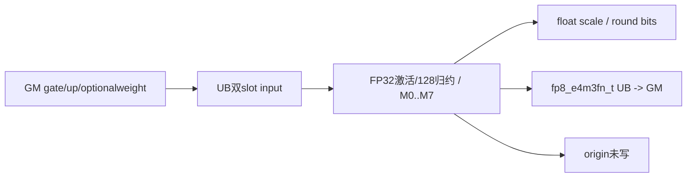

```block-beta
 columns 1
 G["可选counts双槽+sum32 -> V_S -> Reset"]
 M["main: weight(w2) + origin(0) + x0(2) + x1(2) + y(2) + scale(2)"]
```

##### 字节账与复用顺序

```text
Umain=8R A16F+2R A32F+8A8(RSF)+w8A8R
UBpeak=max(group?16A4GF+32:0,Umain)
GM有效名义读=4LC+w4L+group*8E*launch_cores
GM有效名义写=LC+4LS
正式输出allocation=3NC+4NS B
main资源IDs=8+2w+0；group已消费2，Reset不恢复mask
```

按无算术溢出/窄化域推导，名义传输不等运行成功保证。增R Host估计与实际FP32scale双槽相同。

| 边/复用子区 | producer | offset/extent | dtype/layout | consumer | ordering/sync | owner/lifetime | 安全条件 |
|---|---|---|---|---|---|---|---|
| group→main | count VF/scalar | 同poolbase，Ug→Umain | int64→多queue | main | V_S读sum+Reset三barrier | 旧view失效 | 字节max成立，bufID条件独立 |
| weight跨D | MTE2 | T | FP32 | VF M1/3/5/7 | DeQue→最后D后Free | 当前row块 | 无weight子路线不分配 |
| scale/y→GM | VF | 双slot | float/fp8_e4m3fn_t | MTE3 | EnQue/DeQue/Free | 当前D片 | Compact FP32 stride匹配 |
| origin→GM | VF | O | half | MTE3 | 无消费者 | 当前D片 | 不可读返回origin |

#### 同步、精度与尾块

##### 同步与数值边界表

| 阶段 | primitive/机制 | producer | consumer/等待点 | 保护对象 | 精度/尾块 |
|---|---|---|---|---|---|
| counts | queue/ZEROING尾/V_S/Reset | MTE2/VF | scalar/main | group UB | 非负sum/无窄化前提 |
| 激活 | FP32 Exp/Div/Mul/Add0 | half | VF归约/origin | 128值组 | M0…M7 clamp/weight精确开关 |
| scale | maxAbs≥1e-4、/448、可选bit round | FP32 a | q/scaleGM | float | 两种round都FP32存 |
| y/origin | CAST_RINT/NO_SAT，CTRL60=0 | FP32 a/q | outputqueues | 当前D片 | origin无写；fa128倍数无reminder执行体 |
| 结束 | 队列/stream/恢复CTRL60 | 当前Kernel | 外部caller | GM/tensor | 无自有Host同步等待、无核间sum |

#### 关键实现

##### 符号证据表

| 阶段 | 文件 | 符号/模板实例 | 实现事实 |
|---|---|---|---|
| Host/Tiling producer | csrc/activation/swiglu_group_quant/op_host/swiglu_group_quant.cpp | CalcFp8QuantOpTiling | O=0、Ts=float、R/F/U |
| Kernel entry/router | csrc/activation/swiglu_group_quant/op_kernel/swiglu_group_quant.cpp | RUN_FP8(half,fp8_e4m3fn_t,float,false) | key31/code0 |
| Device body/helper | csrc/activation/swiglu_group_quant/op_kernel/swiglu_group_quant_base.h | V<fp8_e4m3fn_t,half,float,r,c,false,w> | M0…M7八个实例全列于执行矩阵 |

### Route R-002：half→fp8_e4m3fn_t，scalefloat，origin1

#### 适用条件

950/mode3，key32/dtype0，精确Tx=half,Ty=fp8_e4m3fn_t,Ts=float,outputOrigin=true。8个子路线M0…M7均按上表逐key展开，group有无、whole/split与前尾核/行列尾均保留。FP32scale所有round布尔组合使用对应公式；group+weight的bufID条件必须另审。

##### 选择证据

| 层级 | 文件 | 符号 | 源码谓词/参数 | 结果/下一跳 |
|---|---|---|---|---|
| entry | csrc/activation/swiglu_group_quant/op_kernel/swiglu_group_quant.cpp | RUN_FP8 | key32/code0 | PerToken<half,fp8_e4m3fn_t,float,true> |
| VF分发 | csrc/activation/swiglu_group_quant/op_kernel/swiglu_group_quant_base.h | Fp8QuantPerTokenDispatcherYOrigin | maskBit0…7完整子表 | V<fp8_e4m3fn_t,half,float,r,c,true,w> |

#### Device 数据流

##### 函数级调用链

```text
entry -> SwigluFp8QuantPerToken<half,fp8_e4m3fn_t,float,true>::Init/Process
 -> optionalCountVF/Reset -> CopyIn -> DispatcherYOrigin[M0..M7]
 -> V<fp8_e4m3fn_t,half,float,r,c,true,w> -> VFSwiGlu/scale bits/Cast -> CopyOut
```

##### 源码等价伪码

执行公共完整伪码，固定输入half/输出fp8_e4m3fn_t/scalefloat/origintrue；M0…M7的r/c/w逐项取精确子表。两FP8目标scale分母都448。origin先把FP32激活RINT到half写回，仍用原FP32激活量化。r=False写s FP32；r=True写2^k FP32。

#### 内存与数据搬运

##### 资源与搬运表

| 层级/缓冲区 | offset/地址公式 | extent/容量公式 | dtype/layout | producer | consumer | owner/lifetime | 对齐/复用 |
|---|---|---|---|---|---|---|---|
| GM x/y/scale/origin | x=2(row*2C+dF)，up加2C；y/origin=(row*C+dF)*dtypeBytes；scale=(row*S+dSF)*4 | 4NC /NC /4NS /2NC B | half/fp8_e4m3fn_t/float/half | caller / VF+MTE3 | Device/caller | record_stream | 前L有效，origin有效 |
| groupstage | countslots0/8A4GF，sum16A4GF | Ug=16A4GF+32 B | int64 | MTE2/VF | scalar rows | 到V_S/Reset | 字节复用，IDs未重置 |
| weight/origin | topk offset0、origin从T | T=w8A8R；O=4R A16F | FP32/half双slot | MTE2/VF | VF/MTE3 | row块/D片 | w由子路线0/1决定 |
| x0/x1/y | x0=T+O；x1=T+O+X0；y=T+O+X0+X1 | X0=X1=4RA16F，Y=2RA32F | half/fp8_e4m3fn_t双slot | MTE2/VF | VF/MTE3 | 当前D片 | 块容量与depth2都计入 |
| scale | T+O+X0+X1+Y | 8A8(RSF) B，双slot | float Compact | VF | MTE3 | 当前D片 | FP32标量连续写 |
| 寄存器 | VF Reg/Mask | 逻辑256B/Reg；物理compiler边界 | FP32/uint32/int32 | VF | VF | group128 | 不新增GM/UB FP32中间矩阵 |
| L1/L0/workspace | L1/L0 N/A；W非空check | W=库查询+32B | Byte | Host | entry | stream周期 | body不读，无Cube |

##### 分层内存布局

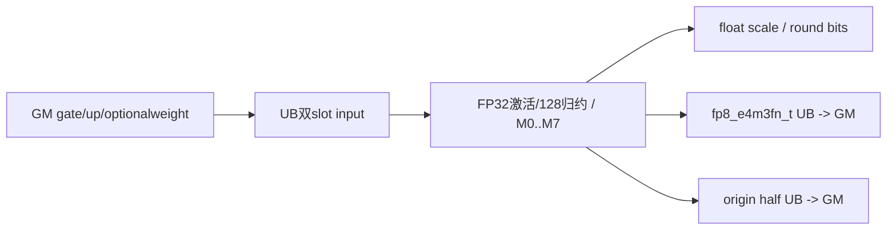

```block-beta
 columns 1
 G["可选counts双槽+sum32 -> V_S -> Reset"]
 M["main: weight(w2) + origin(2) + x0(2) + x1(2) + y(2) + scale(2)"]
```

##### 字节账与复用顺序

```text
Umain=8R A16F+2R A32F+8A8(RSF)+w8A8R+4R A16F
UBpeak=max(group?16A4GF+32:0,Umain)
GM有效名义读=4LC+w4L+group*8E*launch_cores
GM有效名义写=LC+4LS+2LC
正式输出allocation=3NC+4NS B
main资源IDs=8+2w+2；group已消费2，Reset不恢复mask
```

按无算术溢出/窄化域推导，名义传输不等运行成功保证。增R Host估计与实际FP32scale双槽相同。

| 边/复用子区 | producer | offset/extent | dtype/layout | consumer | ordering/sync | owner/lifetime | 安全条件 |
|---|---|---|---|---|---|---|---|
| group→main | count VF/scalar | 同poolbase，Ug→Umain | int64→多queue | main | V_S读sum+Reset三barrier | 旧view失效 | 字节max成立，bufID条件独立 |
| weight跨D | MTE2 | T | FP32 | VF M1/3/5/7 | DeQue→最后D后Free | 当前row块 | 无weight子路线不分配 |
| scale/y→GM | VF | 双slot | float/fp8_e4m3fn_t | MTE3 | EnQue/DeQue/Free | 当前D片 | Compact FP32 stride匹配 |
| origin→GM | VF | O | half | MTE3 | y/scale之后独立queue搬出 | 当前D片 | 前L行有效，不能反馈到量化 |

#### 同步、精度与尾块

##### 同步与数值边界表

| 阶段 | primitive/机制 | producer | consumer/等待点 | 保护对象 | 精度/尾块 |
|---|---|---|---|---|---|
| counts | queue/ZEROING尾/V_S/Reset | MTE2/VF | scalar/main | group UB | 非负sum/无窄化前提 |
| 激活 | FP32 Exp/Div/Mul/Add0 | half | VF归约/origin | 128值组 | M0…M7 clamp/weight精确开关 |
| scale | maxAbs≥1e-4、/448、可选bit round | FP32 a | q/scaleGM | float | 两种round都FP32存 |
| y/origin | CAST_RINT/NO_SAT，CTRL60=0 | FP32 a/q | outputqueues | 当前D片 | origin按输入dtypeRINT；fa128倍数无reminder执行体 |
| 结束 | 队列/stream/恢复CTRL60 | 当前Kernel | 外部caller | GM/tensor | 无自有Host同步等待、无核间sum |

#### 关键实现

##### 符号证据表

| 阶段 | 文件 | 符号/模板实例 | 实现事实 |
|---|---|---|---|
| Host/Tiling producer | csrc/activation/swiglu_group_quant/op_host/swiglu_group_quant.cpp | CalcFp8QuantOpTiling | O=1、Ts=float、R/F/U |
| Kernel entry/router | csrc/activation/swiglu_group_quant/op_kernel/swiglu_group_quant.cpp | RUN_FP8(half,fp8_e4m3fn_t,float,true) | key32/code0 |
| Device body/helper | csrc/activation/swiglu_group_quant/op_kernel/swiglu_group_quant_base.h | V<fp8_e4m3fn_t,half,float,r,c,true,w> | M0…M7八个实例全列于执行矩阵 |

### Route R-003：half→fp8_e4m3fn_t，scalefp8_e8m0_t，origin0

#### 适用条件

950/mode3，key31/dtype4，精确Tx=half,Ty=fp8_e4m3fn_t,Ts=fp8_e8m0_t,outputOrigin=false。8个子路线M0…M7均按上表逐key展开，group有无、whole/split与前尾核/行列尾均保留。M0…M3不round时有float写E8缓冲缺陷；origin返回缓冲未写。

##### 选择证据

| 层级 | 文件 | 符号 | 源码谓词/参数 | 结果/下一跳 |
|---|---|---|---|---|
| entry | csrc/activation/swiglu_group_quant/op_kernel/swiglu_group_quant.cpp | RUN_FP8 | key31/code4 | PerToken<half,fp8_e4m3fn_t,fp8_e8m0_t,false> |
| VF分发 | csrc/activation/swiglu_group_quant/op_kernel/swiglu_group_quant_base.h | Fp8QuantPerTokenDispatcher | maskBit0…7完整子表 | V<fp8_e4m3fn_t,half,fp8_e8m0_t,r,c,false,w> |

#### Device 数据流

##### 函数级调用链

```text
entry -> SwigluFp8QuantPerToken<half,fp8_e4m3fn_t,fp8_e8m0_t,false>::Init/Process
 -> optionalCountVF/Reset -> CopyIn -> Dispatcher[M0..M7]
 -> V<fp8_e4m3fn_t,half,fp8_e8m0_t,r,c,false,w> -> VFSwiGlu/scale bits/Cast -> CopyOut
```

##### 源码等价伪码

执行公共完整伪码，固定输入half/输出fp8_e4m3fn_t/scalefp8_e8m0_t/originfalse；M0…M7的r/c/w逐项取精确子表。两FP8目标scale分母都448。origin LocalTensor参数不消费，返回storage未写。r=False保持硬转float*的原始错误写；r=True按E8编码存单字节。

#### 内存与数据搬运

##### 资源与搬运表

| 层级/缓冲区 | offset/地址公式 | extent/容量公式 | dtype/layout | producer | consumer | owner/lifetime | 对齐/复用 |
|---|---|---|---|---|---|---|---|
| GM x/y/scale/origin | x=2(row*2C+dF)，up加2C；y/origin=(row*C+dF)*dtypeBytes；scale=(row*S+dSF)*1 | 4NC /NC /NS /2NC B | half/fp8_e4m3fn_t/fp8_e8m0_t/half | caller / VF+MTE3 | Device/caller | record_stream | 前L有效，origin未写 |
| groupstage | countslots0/8A4GF，sum16A4GF | Ug=16A4GF+32 B | int64 | MTE2/VF | scalar rows | 到V_S/Reset | 字节复用，IDs未重置 |
| weight/origin | topk offset0、origin从T | T=w8A8R；O=0 | FP32/half双slot | MTE2/VF | VF/MTE3 | row块/D片 | w由子路线0/1决定 |
| x0/x1/y | x0=T+O；x1=T+O+X0；y=T+O+X0+X1 | X0=X1=4RA16F，Y=2RA32F | half/fp8_e4m3fn_t双slot | MTE2/VF | VF/MTE3 | 当前D片 | 块容量与depth2都计入 |
| scale | T+O+X0+X1+Y | 2A32(RSF) B，双slot | fp8_e8m0_t Compact | VF | MTE3 | 当前D片 | 非round写4maSF B，不符合此slot容量/编码 |
| 寄存器 | VF Reg/Mask | 逻辑256B/Reg；物理compiler边界 | FP32/uint32/int32 | VF | VF | group128 | 不新增GM/UB FP32中间矩阵 |
| L1/L0/workspace | L1/L0 N/A；W非空check | W=库查询+32B | Byte | Host | entry | stream周期 | body不读，无Cube |

##### 分层内存布局

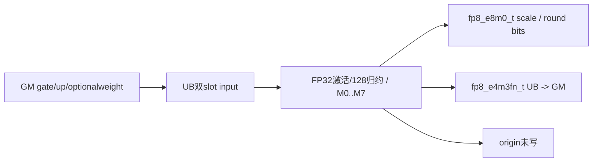

```block-beta
 columns 1
 G["可选counts双槽+sum32 -> V_S -> Reset"]
 M["main: weight(w2) + origin(0) + x0(2) + x1(2) + y(2) + scale(2)"]
```

##### 字节账与复用顺序

```text
Umain=8R A16F+2R A32F+2A32(RSF)+w8A8R
UBpeak=max(group?16A4GF+32:0,Umain)
GM有效名义读=4LC+w4L+group*8E*launch_cores
GM有效名义写=LC+LS
正式输出allocation=3NC+NS B
main资源IDs=8+2w+0；group已消费2，Reset不恢复mask
```

按无算术溢出/窄化域推导，名义传输不等运行成功保证。不round时额外float写4maSF为错误请求，不代表实际已分配足够空间。

| 边/复用子区 | producer | offset/extent | dtype/layout | consumer | ordering/sync | owner/lifetime | 安全条件 |
|---|---|---|---|---|---|---|---|
| group→main | count VF/scalar | 同poolbase，Ug→Umain | int64→多queue | main | V_S读sum+Reset三barrier | 旧view失效 | 字节max成立，bufID条件独立 |
| weight跨D | MTE2 | T | FP32 | VF M1/3/5/7 | DeQue→最后D后Free | 当前row块 | 无weight子路线不分配 |
| scale/y→GM | VF | 双slot | fp8_e8m0_t/fp8_e4m3fn_t | MTE3 | EnQue/DeQue/Free | 当前D片 | r=False的错误store不得忽略 |
| origin→GM | VF | O | half | MTE3 | 无消费者 | 当前D片 | 不可读返回origin |

#### 同步、精度与尾块

##### 同步与数值边界表

| 阶段 | primitive/机制 | producer | consumer/等待点 | 保护对象 | 精度/尾块 |
|---|---|---|---|---|---|
| counts | queue/ZEROING尾/V_S/Reset | MTE2/VF | scalar/main | group UB | 非负sum/无窄化前提 |
| 激活 | FP32 Exp/Div/Mul/Add0 | half | VF归约/origin | 128值组 | M0…M7 clamp/weight精确开关 |
| scale | maxAbs≥1e-4、/448、可选bit round | FP32 a | q/scaleGM | fp8_e8m0_t | 非round类型错；roundE8编码 |
| y/origin | CAST_RINT/NO_SAT，CTRL60=0 | FP32 a/q | outputqueues | 当前D片 | origin无写；fa128倍数无reminder执行体 |
| 结束 | 队列/stream/恢复CTRL60 | 当前Kernel | 外部caller | GM/tensor | 无自有Host同步等待、无核间sum |

#### 关键实现

##### 符号证据表

| 阶段 | 文件 | 符号/模板实例 | 实现事实 |
|---|---|---|---|
| Host/Tiling producer | csrc/activation/swiglu_group_quant/op_host/swiglu_group_quant.cpp | CalcFp8QuantOpTiling | O=0、Ts=fp8_e8m0_t、R/F/U |
| Kernel entry/router | csrc/activation/swiglu_group_quant/op_kernel/swiglu_group_quant.cpp | RUN_FP8(half,fp8_e4m3fn_t,fp8_e8m0_t,false) | key31/code4 |
| Device body/helper | csrc/activation/swiglu_group_quant/op_kernel/swiglu_group_quant_base.h | V<fp8_e4m3fn_t,half,fp8_e8m0_t,r,c,false,w> | M0…M7八个实例全列于执行矩阵 |

### Route R-004：half→fp8_e4m3fn_t，scalefp8_e8m0_t，origin1

#### 适用条件

950/mode3，key32/dtype4，精确Tx=half,Ty=fp8_e4m3fn_t,Ts=fp8_e8m0_t,outputOrigin=true。8个子路线M0…M7均按上表逐key展开，group有无、whole/split与前尾核/行列尾均保留。M0…M3不round时有float写E8缓冲缺陷；group+weight的bufID条件必须另审。

##### 选择证据

| 层级 | 文件 | 符号 | 源码谓词/参数 | 结果/下一跳 |
|---|---|---|---|---|
| entry | csrc/activation/swiglu_group_quant/op_kernel/swiglu_group_quant.cpp | RUN_FP8 | key32/code4 | PerToken<half,fp8_e4m3fn_t,fp8_e8m0_t,true> |
| VF分发 | csrc/activation/swiglu_group_quant/op_kernel/swiglu_group_quant_base.h | Fp8QuantPerTokenDispatcherYOrigin | maskBit0…7完整子表 | V<fp8_e4m3fn_t,half,fp8_e8m0_t,r,c,true,w> |

#### Device 数据流

##### 函数级调用链

```text
entry -> SwigluFp8QuantPerToken<half,fp8_e4m3fn_t,fp8_e8m0_t,true>::Init/Process
 -> optionalCountVF/Reset -> CopyIn -> DispatcherYOrigin[M0..M7]
 -> V<fp8_e4m3fn_t,half,fp8_e8m0_t,r,c,true,w> -> VFSwiGlu/scale bits/Cast -> CopyOut
```

##### 源码等价伪码

执行公共完整伪码，固定输入half/输出fp8_e4m3fn_t/scalefp8_e8m0_t/origintrue；M0…M7的r/c/w逐项取精确子表。两FP8目标scale分母都448。origin先把FP32激活RINT到half写回，仍用原FP32激活量化。r=False保持硬转float*的原始错误写；r=True按E8编码存单字节。

#### 内存与数据搬运

##### 资源与搬运表

| 层级/缓冲区 | offset/地址公式 | extent/容量公式 | dtype/layout | producer | consumer | owner/lifetime | 对齐/复用 |
|---|---|---|---|---|---|---|---|
| GM x/y/scale/origin | x=2(row*2C+dF)，up加2C；y/origin=(row*C+dF)*dtypeBytes；scale=(row*S+dSF)*1 | 4NC /NC /NS /2NC B | half/fp8_e4m3fn_t/fp8_e8m0_t/half | caller / VF+MTE3 | Device/caller | record_stream | 前L有效，origin有效 |
| groupstage | countslots0/8A4GF，sum16A4GF | Ug=16A4GF+32 B | int64 | MTE2/VF | scalar rows | 到V_S/Reset | 字节复用，IDs未重置 |
| weight/origin | topk offset0、origin从T | T=w8A8R；O=4R A16F | FP32/half双slot | MTE2/VF | VF/MTE3 | row块/D片 | w由子路线0/1决定 |
| x0/x1/y | x0=T+O；x1=T+O+X0；y=T+O+X0+X1 | X0=X1=4RA16F，Y=2RA32F | half/fp8_e4m3fn_t双slot | MTE2/VF | VF/MTE3 | 当前D片 | 块容量与depth2都计入 |
| scale | T+O+X0+X1+Y | 2A32(RSF) B，双slot | fp8_e8m0_t Compact | VF | MTE3 | 当前D片 | 非round写4maSF B，不符合此slot容量/编码 |
| 寄存器 | VF Reg/Mask | 逻辑256B/Reg；物理compiler边界 | FP32/uint32/int32 | VF | VF | group128 | 不新增GM/UB FP32中间矩阵 |
| L1/L0/workspace | L1/L0 N/A；W非空check | W=库查询+32B | Byte | Host | entry | stream周期 | body不读，无Cube |

##### 分层内存布局

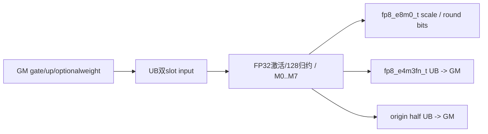

```block-beta
 columns 1
 G["可选counts双槽+sum32 -> V_S -> Reset"]
 M["main: weight(w2) + origin(2) + x0(2) + x1(2) + y(2) + scale(2)"]
```

##### 字节账与复用顺序

```text
Umain=8R A16F+2R A32F+2A32(RSF)+w8A8R+4R A16F
UBpeak=max(group?16A4GF+32:0,Umain)
GM有效名义读=4LC+w4L+group*8E*launch_cores
GM有效名义写=LC+LS+2LC
正式输出allocation=3NC+NS B
main资源IDs=8+2w+2；group已消费2，Reset不恢复mask
```

按无算术溢出/窄化域推导，名义传输不等运行成功保证。不round时额外float写4maSF为错误请求，不代表实际已分配足够空间。

| 边/复用子区 | producer | offset/extent | dtype/layout | consumer | ordering/sync | owner/lifetime | 安全条件 |
|---|---|---|---|---|---|---|---|
| group→main | count VF/scalar | 同poolbase，Ug→Umain | int64→多queue | main | V_S读sum+Reset三barrier | 旧view失效 | 字节max成立，bufID条件独立 |
| weight跨D | MTE2 | T | FP32 | VF M1/3/5/7 | DeQue→最后D后Free | 当前row块 | 无weight子路线不分配 |
| scale/y→GM | VF | 双slot | fp8_e8m0_t/fp8_e4m3fn_t | MTE3 | EnQue/DeQue/Free | 当前D片 | r=False的错误store不得忽略 |
| origin→GM | VF | O | half | MTE3 | y/scale之后独立queue搬出 | 当前D片 | 前L行有效，不能反馈到量化 |

#### 同步、精度与尾块

##### 同步与数值边界表

| 阶段 | primitive/机制 | producer | consumer/等待点 | 保护对象 | 精度/尾块 |
|---|---|---|---|---|---|
| counts | queue/ZEROING尾/V_S/Reset | MTE2/VF | scalar/main | group UB | 非负sum/无窄化前提 |
| 激活 | FP32 Exp/Div/Mul/Add0 | half | VF归约/origin | 128值组 | M0…M7 clamp/weight精确开关 |
| scale | maxAbs≥1e-4、/448、可选bit round | FP32 a | q/scaleGM | fp8_e8m0_t | 非round类型错；roundE8编码 |
| y/origin | CAST_RINT/NO_SAT，CTRL60=0 | FP32 a/q | outputqueues | 当前D片 | origin按输入dtypeRINT；fa128倍数无reminder执行体 |
| 结束 | 队列/stream/恢复CTRL60 | 当前Kernel | 外部caller | GM/tensor | 无自有Host同步等待、无核间sum |

#### 关键实现

##### 符号证据表

| 阶段 | 文件 | 符号/模板实例 | 实现事实 |
|---|---|---|---|
| Host/Tiling producer | csrc/activation/swiglu_group_quant/op_host/swiglu_group_quant.cpp | CalcFp8QuantOpTiling | O=1、Ts=fp8_e8m0_t、R/F/U |
| Kernel entry/router | csrc/activation/swiglu_group_quant/op_kernel/swiglu_group_quant.cpp | RUN_FP8(half,fp8_e4m3fn_t,fp8_e8m0_t,true) | key32/code4 |
| Device body/helper | csrc/activation/swiglu_group_quant/op_kernel/swiglu_group_quant_base.h | V<fp8_e4m3fn_t,half,fp8_e8m0_t,r,c,true,w> | M0…M7八个实例全列于执行矩阵 |

### Route R-005：half→fp8_e5m2_t，scalefloat，origin0

#### 适用条件

950/mode3，key31/dtype2，精确Tx=half,Ty=fp8_e5m2_t,Ts=float,outputOrigin=false。8个子路线M0…M7均按上表逐key展开，group有无、whole/split与前尾核/行列尾均保留。FP32scale所有round布尔组合使用对应公式；origin返回缓冲未写。

##### 选择证据

| 层级 | 文件 | 符号 | 源码谓词/参数 | 结果/下一跳 |
|---|---|---|---|---|
| entry | csrc/activation/swiglu_group_quant/op_kernel/swiglu_group_quant.cpp | RUN_FP8 | key31/code2 | PerToken<half,fp8_e5m2_t,float,false> |
| VF分发 | csrc/activation/swiglu_group_quant/op_kernel/swiglu_group_quant_base.h | Fp8QuantPerTokenDispatcher | maskBit0…7完整子表 | V<fp8_e5m2_t,half,float,r,c,false,w> |

#### Device 数据流

##### 函数级调用链

```text
entry -> SwigluFp8QuantPerToken<half,fp8_e5m2_t,float,false>::Init/Process
 -> optionalCountVF/Reset -> CopyIn -> Dispatcher[M0..M7]
 -> V<fp8_e5m2_t,half,float,r,c,false,w> -> VFSwiGlu/scale bits/Cast -> CopyOut
```

##### 源码等价伪码

执行公共完整伪码，固定输入half/输出fp8_e5m2_t/scalefloat/originfalse；M0…M7的r/c/w逐项取精确子表。两FP8目标scale分母都448。origin LocalTensor参数不消费，返回storage未写。r=False写s FP32；r=True写2^k FP32。

#### 内存与数据搬运

##### 资源与搬运表

| 层级/缓冲区 | offset/地址公式 | extent/容量公式 | dtype/layout | producer | consumer | owner/lifetime | 对齐/复用 |
|---|---|---|---|---|---|---|---|
| GM x/y/scale/origin | x=2(row*2C+dF)，up加2C；y/origin=(row*C+dF)*dtypeBytes；scale=(row*S+dSF)*4 | 4NC /NC /4NS /2NC B | half/fp8_e5m2_t/float/half | caller / VF+MTE3 | Device/caller | record_stream | 前L有效，origin未写 |
| groupstage | countslots0/8A4GF，sum16A4GF | Ug=16A4GF+32 B | int64 | MTE2/VF | scalar rows | 到V_S/Reset | 字节复用，IDs未重置 |
| weight/origin | topk offset0、origin从T | T=w8A8R；O=0 | FP32/half双slot | MTE2/VF | VF/MTE3 | row块/D片 | w由子路线0/1决定 |
| x0/x1/y | x0=T+O；x1=T+O+X0；y=T+O+X0+X1 | X0=X1=4RA16F，Y=2RA32F | half/fp8_e5m2_t双slot | MTE2/VF | VF/MTE3 | 当前D片 | 块容量与depth2都计入 |
| scale | T+O+X0+X1+Y | 8A8(RSF) B，双slot | float Compact | VF | MTE3 | 当前D片 | FP32标量连续写 |
| 寄存器 | VF Reg/Mask | 逻辑256B/Reg；物理compiler边界 | FP32/uint32/int32 | VF | VF | group128 | 不新增GM/UB FP32中间矩阵 |
| L1/L0/workspace | L1/L0 N/A；W非空check | W=库查询+32B | Byte | Host | entry | stream周期 | body不读，无Cube |

##### 分层内存布局

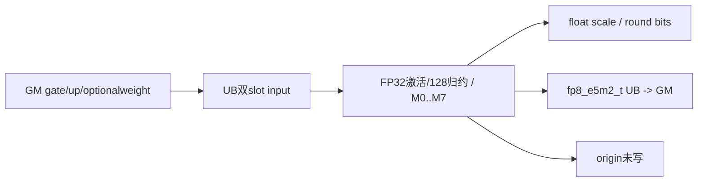

```block-beta
 columns 1
 G["可选counts双槽+sum32 -> V_S -> Reset"]
 M["main: weight(w2) + origin(0) + x0(2) + x1(2) + y(2) + scale(2)"]
```

##### 字节账与复用顺序

```text
Umain=8R A16F+2R A32F+8A8(RSF)+w8A8R
UBpeak=max(group?16A4GF+32:0,Umain)
GM有效名义读=4LC+w4L+group*8E*launch_cores
GM有效名义写=LC+4LS
正式输出allocation=3NC+4NS B
main资源IDs=8+2w+0；group已消费2，Reset不恢复mask
```

按无算术溢出/窄化域推导，名义传输不等运行成功保证。增R Host估计与实际FP32scale双槽相同。

| 边/复用子区 | producer | offset/extent | dtype/layout | consumer | ordering/sync | owner/lifetime | 安全条件 |
|---|---|---|---|---|---|---|---|
| group→main | count VF/scalar | 同poolbase，Ug→Umain | int64→多queue | main | V_S读sum+Reset三barrier | 旧view失效 | 字节max成立，bufID条件独立 |
| weight跨D | MTE2 | T | FP32 | VF M1/3/5/7 | DeQue→最后D后Free | 当前row块 | 无weight子路线不分配 |
| scale/y→GM | VF | 双slot | float/fp8_e5m2_t | MTE3 | EnQue/DeQue/Free | 当前D片 | Compact FP32 stride匹配 |
| origin→GM | VF | O | half | MTE3 | 无消费者 | 当前D片 | 不可读返回origin |

#### 同步、精度与尾块

##### 同步与数值边界表

| 阶段 | primitive/机制 | producer | consumer/等待点 | 保护对象 | 精度/尾块 |
|---|---|---|---|---|---|
| counts | queue/ZEROING尾/V_S/Reset | MTE2/VF | scalar/main | group UB | 非负sum/无窄化前提 |
| 激活 | FP32 Exp/Div/Mul/Add0 | half | VF归约/origin | 128值组 | M0…M7 clamp/weight精确开关 |
| scale | maxAbs≥1e-4、/448、可选bit round | FP32 a | q/scaleGM | float | 两种round都FP32存 |
| y/origin | CAST_RINT/NO_SAT，CTRL60=0 | FP32 a/q | outputqueues | 当前D片 | origin无写；fa128倍数无reminder执行体 |
| 结束 | 队列/stream/恢复CTRL60 | 当前Kernel | 外部caller | GM/tensor | 无自有Host同步等待、无核间sum |

#### 关键实现

##### 符号证据表

| 阶段 | 文件 | 符号/模板实例 | 实现事实 |
|---|---|---|---|
| Host/Tiling producer | csrc/activation/swiglu_group_quant/op_host/swiglu_group_quant.cpp | CalcFp8QuantOpTiling | O=0、Ts=float、R/F/U |
| Kernel entry/router | csrc/activation/swiglu_group_quant/op_kernel/swiglu_group_quant.cpp | RUN_FP8(half,fp8_e5m2_t,float,false) | key31/code2 |
| Device body/helper | csrc/activation/swiglu_group_quant/op_kernel/swiglu_group_quant_base.h | V<fp8_e5m2_t,half,float,r,c,false,w> | M0…M7八个实例全列于执行矩阵 |

### Route R-006：half→fp8_e5m2_t，scalefloat，origin1

#### 适用条件

950/mode3，key32/dtype2，精确Tx=half,Ty=fp8_e5m2_t,Ts=float,outputOrigin=true。8个子路线M0…M7均按上表逐key展开，group有无、whole/split与前尾核/行列尾均保留。FP32scale所有round布尔组合使用对应公式；group+weight的bufID条件必须另审。

##### 选择证据

| 层级 | 文件 | 符号 | 源码谓词/参数 | 结果/下一跳 |
|---|---|---|---|---|
| entry | csrc/activation/swiglu_group_quant/op_kernel/swiglu_group_quant.cpp | RUN_FP8 | key32/code2 | PerToken<half,fp8_e5m2_t,float,true> |
| VF分发 | csrc/activation/swiglu_group_quant/op_kernel/swiglu_group_quant_base.h | Fp8QuantPerTokenDispatcherYOrigin | maskBit0…7完整子表 | V<fp8_e5m2_t,half,float,r,c,true,w> |

#### Device 数据流

##### 函数级调用链

```text
entry -> SwigluFp8QuantPerToken<half,fp8_e5m2_t,float,true>::Init/Process
 -> optionalCountVF/Reset -> CopyIn -> DispatcherYOrigin[M0..M7]
 -> V<fp8_e5m2_t,half,float,r,c,true,w> -> VFSwiGlu/scale bits/Cast -> CopyOut
```

##### 源码等价伪码

执行公共完整伪码，固定输入half/输出fp8_e5m2_t/scalefloat/origintrue；M0…M7的r/c/w逐项取精确子表。两FP8目标scale分母都448。origin先把FP32激活RINT到half写回，仍用原FP32激活量化。r=False写s FP32；r=True写2^k FP32。

#### 内存与数据搬运

##### 资源与搬运表

| 层级/缓冲区 | offset/地址公式 | extent/容量公式 | dtype/layout | producer | consumer | owner/lifetime | 对齐/复用 |
|---|---|---|---|---|---|---|---|
| GM x/y/scale/origin | x=2(row*2C+dF)，up加2C；y/origin=(row*C+dF)*dtypeBytes；scale=(row*S+dSF)*4 | 4NC /NC /4NS /2NC B | half/fp8_e5m2_t/float/half | caller / VF+MTE3 | Device/caller | record_stream | 前L有效，origin有效 |
| groupstage | countslots0/8A4GF，sum16A4GF | Ug=16A4GF+32 B | int64 | MTE2/VF | scalar rows | 到V_S/Reset | 字节复用，IDs未重置 |
| weight/origin | topk offset0、origin从T | T=w8A8R；O=4R A16F | FP32/half双slot | MTE2/VF | VF/MTE3 | row块/D片 | w由子路线0/1决定 |
| x0/x1/y | x0=T+O；x1=T+O+X0；y=T+O+X0+X1 | X0=X1=4RA16F，Y=2RA32F | half/fp8_e5m2_t双slot | MTE2/VF | VF/MTE3 | 当前D片 | 块容量与depth2都计入 |
| scale | T+O+X0+X1+Y | 8A8(RSF) B，双slot | float Compact | VF | MTE3 | 当前D片 | FP32标量连续写 |
| 寄存器 | VF Reg/Mask | 逻辑256B/Reg；物理compiler边界 | FP32/uint32/int32 | VF | VF | group128 | 不新增GM/UB FP32中间矩阵 |
| L1/L0/workspace | L1/L0 N/A；W非空check | W=库查询+32B | Byte | Host | entry | stream周期 | body不读，无Cube |

##### 分层内存布局

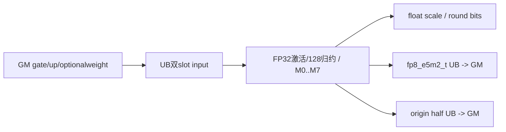

```block-beta
 columns 1
 G["可选counts双槽+sum32 -> V_S -> Reset"]
 M["main: weight(w2) + origin(2) + x0(2) + x1(2) + y(2) + scale(2)"]
```

##### 字节账与复用顺序

```text
Umain=8R A16F+2R A32F+8A8(RSF)+w8A8R+4R A16F
UBpeak=max(group?16A4GF+32:0,Umain)
GM有效名义读=4LC+w4L+group*8E*launch_cores
GM有效名义写=LC+4LS+2LC
正式输出allocation=3NC+4NS B
main资源IDs=8+2w+2；group已消费2，Reset不恢复mask
```

按无算术溢出/窄化域推导，名义传输不等运行成功保证。增R Host估计与实际FP32scale双槽相同。

| 边/复用子区 | producer | offset/extent | dtype/layout | consumer | ordering/sync | owner/lifetime | 安全条件 |
|---|---|---|---|---|---|---|---|
| group→main | count VF/scalar | 同poolbase，Ug→Umain | int64→多queue | main | V_S读sum+Reset三barrier | 旧view失效 | 字节max成立，bufID条件独立 |
| weight跨D | MTE2 | T | FP32 | VF M1/3/5/7 | DeQue→最后D后Free | 当前row块 | 无weight子路线不分配 |
| scale/y→GM | VF | 双slot | float/fp8_e5m2_t | MTE3 | EnQue/DeQue/Free | 当前D片 | Compact FP32 stride匹配 |
| origin→GM | VF | O | half | MTE3 | y/scale之后独立queue搬出 | 当前D片 | 前L行有效，不能反馈到量化 |

#### 同步、精度与尾块

##### 同步与数值边界表

| 阶段 | primitive/机制 | producer | consumer/等待点 | 保护对象 | 精度/尾块 |
|---|---|---|---|---|---|
| counts | queue/ZEROING尾/V_S/Reset | MTE2/VF | scalar/main | group UB | 非负sum/无窄化前提 |
| 激活 | FP32 Exp/Div/Mul/Add0 | half | VF归约/origin | 128值组 | M0…M7 clamp/weight精确开关 |
| scale | maxAbs≥1e-4、/448、可选bit round | FP32 a | q/scaleGM | float | 两种round都FP32存 |
| y/origin | CAST_RINT/NO_SAT，CTRL60=0 | FP32 a/q | outputqueues | 当前D片 | origin按输入dtypeRINT；fa128倍数无reminder执行体 |
| 结束 | 队列/stream/恢复CTRL60 | 当前Kernel | 外部caller | GM/tensor | 无自有Host同步等待、无核间sum |

#### 关键实现

##### 符号证据表

| 阶段 | 文件 | 符号/模板实例 | 实现事实 |
|---|---|---|---|
| Host/Tiling producer | csrc/activation/swiglu_group_quant/op_host/swiglu_group_quant.cpp | CalcFp8QuantOpTiling | O=1、Ts=float、R/F/U |
| Kernel entry/router | csrc/activation/swiglu_group_quant/op_kernel/swiglu_group_quant.cpp | RUN_FP8(half,fp8_e5m2_t,float,true) | key32/code2 |
| Device body/helper | csrc/activation/swiglu_group_quant/op_kernel/swiglu_group_quant_base.h | V<fp8_e5m2_t,half,float,r,c,true,w> | M0…M7八个实例全列于执行矩阵 |

### Route R-007：half→fp8_e5m2_t，scalefp8_e8m0_t，origin0

#### 适用条件

950/mode3，key31/dtype6，精确Tx=half,Ty=fp8_e5m2_t,Ts=fp8_e8m0_t,outputOrigin=false。8个子路线M0…M7均按上表逐key展开，group有无、whole/split与前尾核/行列尾均保留。M0…M3不round时有float写E8缓冲缺陷；origin返回缓冲未写。

##### 选择证据

| 层级 | 文件 | 符号 | 源码谓词/参数 | 结果/下一跳 |
|---|---|---|---|---|
| entry | csrc/activation/swiglu_group_quant/op_kernel/swiglu_group_quant.cpp | RUN_FP8 | key31/code6 | PerToken<half,fp8_e5m2_t,fp8_e8m0_t,false> |
| VF分发 | csrc/activation/swiglu_group_quant/op_kernel/swiglu_group_quant_base.h | Fp8QuantPerTokenDispatcher | maskBit0…7完整子表 | V<fp8_e5m2_t,half,fp8_e8m0_t,r,c,false,w> |

#### Device 数据流

##### 函数级调用链

```text
entry -> SwigluFp8QuantPerToken<half,fp8_e5m2_t,fp8_e8m0_t,false>::Init/Process
 -> optionalCountVF/Reset -> CopyIn -> Dispatcher[M0..M7]
 -> V<fp8_e5m2_t,half,fp8_e8m0_t,r,c,false,w> -> VFSwiGlu/scale bits/Cast -> CopyOut
```

##### 源码等价伪码

执行公共完整伪码，固定输入half/输出fp8_e5m2_t/scalefp8_e8m0_t/originfalse；M0…M7的r/c/w逐项取精确子表。两FP8目标scale分母都448。origin LocalTensor参数不消费，返回storage未写。r=False保持硬转float*的原始错误写；r=True按E8编码存单字节。

#### 内存与数据搬运

##### 资源与搬运表

| 层级/缓冲区 | offset/地址公式 | extent/容量公式 | dtype/layout | producer | consumer | owner/lifetime | 对齐/复用 |
|---|---|---|---|---|---|---|---|
| GM x/y/scale/origin | x=2(row*2C+dF)，up加2C；y/origin=(row*C+dF)*dtypeBytes；scale=(row*S+dSF)*1 | 4NC /NC /NS /2NC B | half/fp8_e5m2_t/fp8_e8m0_t/half | caller / VF+MTE3 | Device/caller | record_stream | 前L有效，origin未写 |
| groupstage | countslots0/8A4GF，sum16A4GF | Ug=16A4GF+32 B | int64 | MTE2/VF | scalar rows | 到V_S/Reset | 字节复用，IDs未重置 |
| weight/origin | topk offset0、origin从T | T=w8A8R；O=0 | FP32/half双slot | MTE2/VF | VF/MTE3 | row块/D片 | w由子路线0/1决定 |
| x0/x1/y | x0=T+O；x1=T+O+X0；y=T+O+X0+X1 | X0=X1=4RA16F，Y=2RA32F | half/fp8_e5m2_t双slot | MTE2/VF | VF/MTE3 | 当前D片 | 块容量与depth2都计入 |
| scale | T+O+X0+X1+Y | 2A32(RSF) B，双slot | fp8_e8m0_t Compact | VF | MTE3 | 当前D片 | 非round写4maSF B，不符合此slot容量/编码 |
| 寄存器 | VF Reg/Mask | 逻辑256B/Reg；物理compiler边界 | FP32/uint32/int32 | VF | VF | group128 | 不新增GM/UB FP32中间矩阵 |
| L1/L0/workspace | L1/L0 N/A；W非空check | W=库查询+32B | Byte | Host | entry | stream周期 | body不读，无Cube |

##### 分层内存布局

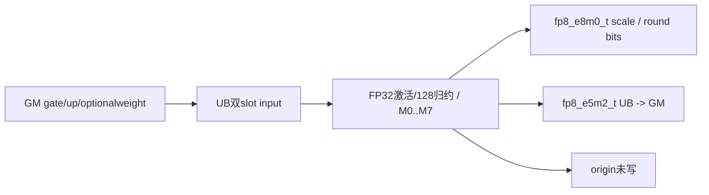

```block-beta
 columns 1
 G["可选counts双槽+sum32 -> V_S -> Reset"]
 M["main: weight(w2) + origin(0) + x0(2) + x1(2) + y(2) + scale(2)"]
```

##### 字节账与复用顺序

```text
Umain=8R A16F+2R A32F+2A32(RSF)+w8A8R
UBpeak=max(group?16A4GF+32:0,Umain)
GM有效名义读=4LC+w4L+group*8E*launch_cores
GM有效名义写=LC+LS
正式输出allocation=3NC+NS B
main资源IDs=8+2w+0；group已消费2，Reset不恢复mask
```

按无算术溢出/窄化域推导，名义传输不等运行成功保证。不round时额外float写4maSF为错误请求，不代表实际已分配足够空间。

| 边/复用子区 | producer | offset/extent | dtype/layout | consumer | ordering/sync | owner/lifetime | 安全条件 |
|---|---|---|---|---|---|---|---|
| group→main | count VF/scalar | 同poolbase，Ug→Umain | int64→多queue | main | V_S读sum+Reset三barrier | 旧view失效 | 字节max成立，bufID条件独立 |
| weight跨D | MTE2 | T | FP32 | VF M1/3/5/7 | DeQue→最后D后Free | 当前row块 | 无weight子路线不分配 |
| scale/y→GM | VF | 双slot | fp8_e8m0_t/fp8_e5m2_t | MTE3 | EnQue/DeQue/Free | 当前D片 | r=False的错误store不得忽略 |
| origin→GM | VF | O | half | MTE3 | 无消费者 | 当前D片 | 不可读返回origin |

#### 同步、精度与尾块

##### 同步与数值边界表

| 阶段 | primitive/机制 | producer | consumer/等待点 | 保护对象 | 精度/尾块 |
|---|---|---|---|---|---|
| counts | queue/ZEROING尾/V_S/Reset | MTE2/VF | scalar/main | group UB | 非负sum/无窄化前提 |
| 激活 | FP32 Exp/Div/Mul/Add0 | half | VF归约/origin | 128值组 | M0…M7 clamp/weight精确开关 |
| scale | maxAbs≥1e-4、/448、可选bit round | FP32 a | q/scaleGM | fp8_e8m0_t | 非round类型错；roundE8编码 |
| y/origin | CAST_RINT/NO_SAT，CTRL60=0 | FP32 a/q | outputqueues | 当前D片 | origin无写；fa128倍数无reminder执行体 |
| 结束 | 队列/stream/恢复CTRL60 | 当前Kernel | 外部caller | GM/tensor | 无自有Host同步等待、无核间sum |

#### 关键实现

##### 符号证据表

| 阶段 | 文件 | 符号/模板实例 | 实现事实 |
|---|---|---|---|
| Host/Tiling producer | csrc/activation/swiglu_group_quant/op_host/swiglu_group_quant.cpp | CalcFp8QuantOpTiling | O=0、Ts=fp8_e8m0_t、R/F/U |
| Kernel entry/router | csrc/activation/swiglu_group_quant/op_kernel/swiglu_group_quant.cpp | RUN_FP8(half,fp8_e5m2_t,fp8_e8m0_t,false) | key31/code6 |
| Device body/helper | csrc/activation/swiglu_group_quant/op_kernel/swiglu_group_quant_base.h | V<fp8_e5m2_t,half,fp8_e8m0_t,r,c,false,w> | M0…M7八个实例全列于执行矩阵 |

### Route R-008：half→fp8_e5m2_t，scalefp8_e8m0_t，origin1

#### 适用条件

950/mode3，key32/dtype6，精确Tx=half,Ty=fp8_e5m2_t,Ts=fp8_e8m0_t,outputOrigin=true。8个子路线M0…M7均按上表逐key展开，group有无、whole/split与前尾核/行列尾均保留。M0…M3不round时有float写E8缓冲缺陷；group+weight的bufID条件必须另审。

##### 选择证据

| 层级 | 文件 | 符号 | 源码谓词/参数 | 结果/下一跳 |
|---|---|---|---|---|
| entry | csrc/activation/swiglu_group_quant/op_kernel/swiglu_group_quant.cpp | RUN_FP8 | key32/code6 | PerToken<half,fp8_e5m2_t,fp8_e8m0_t,true> |
| VF分发 | csrc/activation/swiglu_group_quant/op_kernel/swiglu_group_quant_base.h | Fp8QuantPerTokenDispatcherYOrigin | maskBit0…7完整子表 | V<fp8_e5m2_t,half,fp8_e8m0_t,r,c,true,w> |

#### Device 数据流

##### 函数级调用链

```text
entry -> SwigluFp8QuantPerToken<half,fp8_e5m2_t,fp8_e8m0_t,true>::Init/Process
 -> optionalCountVF/Reset -> CopyIn -> DispatcherYOrigin[M0..M7]
 -> V<fp8_e5m2_t,half,fp8_e8m0_t,r,c,true,w> -> VFSwiGlu/scale bits/Cast -> CopyOut
```

##### 源码等价伪码

执行公共完整伪码，固定输入half/输出fp8_e5m2_t/scalefp8_e8m0_t/origintrue；M0…M7的r/c/w逐项取精确子表。两FP8目标scale分母都448。origin先把FP32激活RINT到half写回，仍用原FP32激活量化。r=False保持硬转float*的原始错误写；r=True按E8编码存单字节。

#### 内存与数据搬运

##### 资源与搬运表

| 层级/缓冲区 | offset/地址公式 | extent/容量公式 | dtype/layout | producer | consumer | owner/lifetime | 对齐/复用 |
|---|---|---|---|---|---|---|---|
| GM x/y/scale/origin | x=2(row*2C+dF)，up加2C；y/origin=(row*C+dF)*dtypeBytes；scale=(row*S+dSF)*1 | 4NC /NC /NS /2NC B | half/fp8_e5m2_t/fp8_e8m0_t/half | caller / VF+MTE3 | Device/caller | record_stream | 前L有效，origin有效 |
| groupstage | countslots0/8A4GF，sum16A4GF | Ug=16A4GF+32 B | int64 | MTE2/VF | scalar rows | 到V_S/Reset | 字节复用，IDs未重置 |
| weight/origin | topk offset0、origin从T | T=w8A8R；O=4R A16F | FP32/half双slot | MTE2/VF | VF/MTE3 | row块/D片 | w由子路线0/1决定 |
| x0/x1/y | x0=T+O；x1=T+O+X0；y=T+O+X0+X1 | X0=X1=4RA16F，Y=2RA32F | half/fp8_e5m2_t双slot | MTE2/VF | VF/MTE3 | 当前D片 | 块容量与depth2都计入 |
| scale | T+O+X0+X1+Y | 2A32(RSF) B，双slot | fp8_e8m0_t Compact | VF | MTE3 | 当前D片 | 非round写4maSF B，不符合此slot容量/编码 |
| 寄存器 | VF Reg/Mask | 逻辑256B/Reg；物理compiler边界 | FP32/uint32/int32 | VF | VF | group128 | 不新增GM/UB FP32中间矩阵 |
| L1/L0/workspace | L1/L0 N/A；W非空check | W=库查询+32B | Byte | Host | entry | stream周期 | body不读，无Cube |

##### 分层内存布局


```block-beta
 columns 1
 G["可选counts双槽+sum32 -> V_S -> Reset"]
 M["main: weight(w2) + origin(2) + x0(2) + x1(2) + y(2) + scale(2)"]
```

##### 字节账与复用顺序

```text
Umain=8R A16F+2R A32F+2A32(RSF)+w8A8R+4R A16F
UBpeak=max(group?16A4GF+32:0,Umain)
GM有效名义读=4LC+w4L+group*8E*launch_cores
GM有效名义写=LC+LS+2LC
正式输出allocation=3NC+NS B
main资源IDs=8+2w+2；group已消费2，Reset不恢复mask
```

按无算术溢出/窄化域推导，名义传输不等运行成功保证。不round时额外float写4maSF为错误请求，不代表实际已分配足够空间。

| 边/复用子区 | producer | offset/extent | dtype/layout | consumer | ordering/sync | owner/lifetime | 安全条件 |
|---|---|---|---|---|---|---|---|
| group→main | count VF/scalar | 同poolbase，Ug→Umain | int64→多queue | main | V_S读sum+Reset三barrier | 旧view失效 | 字节max成立，bufID条件独立 |
| weight跨D | MTE2 | T | FP32 | VF M1/3/5/7 | DeQue→最后D后Free | 当前row块 | 无weight子路线不分配 |
| scale/y→GM | VF | 双slot | fp8_e8m0_t/fp8_e5m2_t | MTE3 | EnQue/DeQue/Free | 当前D片 | r=False的错误store不得忽略 |
| origin→GM | VF | O | half | MTE3 | y/scale之后独立queue搬出 | 当前D片 | 前L行有效，不能反馈到量化 |

#### 同步、精度与尾块

##### 同步与数值边界表

| 阶段 | primitive/机制 | producer | consumer/等待点 | 保护对象 | 精度/尾块 |
|---|---|---|---|---|---|
| counts | queue/ZEROING尾/V_S/Reset | MTE2/VF | scalar/main | group UB | 非负sum/无窄化前提 |
| 激活 | FP32 Exp/Div/Mul/Add0 | half | VF归约/origin | 128值组 | M0…M7 clamp/weight精确开关 |
| scale | maxAbs≥1e-4、/448、可选bit round | FP32 a | q/scaleGM | fp8_e8m0_t | 非round类型错；roundE8编码 |
| y/origin | CAST_RINT/NO_SAT，CTRL60=0 | FP32 a/q | outputqueues | 当前D片 | origin按输入dtypeRINT；fa128倍数无reminder执行体 |
| 结束 | 队列/stream/恢复CTRL60 | 当前Kernel | 外部caller | GM/tensor | 无自有Host同步等待、无核间sum |

#### 关键实现

##### 符号证据表

| 阶段 | 文件 | 符号/模板实例 | 实现事实 |
|---|---|---|---|
| Host/Tiling producer | csrc/activation/swiglu_group_quant/op_host/swiglu_group_quant.cpp | CalcFp8QuantOpTiling | O=1、Ts=fp8_e8m0_t、R/F/U |
| Kernel entry/router | csrc/activation/swiglu_group_quant/op_kernel/swiglu_group_quant.cpp | RUN_FP8(half,fp8_e5m2_t,fp8_e8m0_t,true) | key32/code6 |
| Device body/helper | csrc/activation/swiglu_group_quant/op_kernel/swiglu_group_quant_base.h | V<fp8_e5m2_t,half,fp8_e8m0_t,r,c,true,w> | M0…M7八个实例全列于执行矩阵 |

### Route R-009：bfloat16_t→fp8_e4m3fn_t，scalefloat，origin0

#### 适用条件

950/mode3，key31/dtype1，精确Tx=bfloat16_t,Ty=fp8_e4m3fn_t,Ts=float,outputOrigin=false。8个子路线M0…M7均按上表逐key展开，group有无、whole/split与前尾核/行列尾均保留。FP32scale所有round布尔组合使用对应公式；origin返回缓冲未写。

##### 选择证据

| 层级 | 文件 | 符号 | 源码谓词/参数 | 结果/下一跳 |
|---|---|---|---|---|
| entry | csrc/activation/swiglu_group_quant/op_kernel/swiglu_group_quant.cpp | RUN_FP8 | key31/code1 | PerToken<bfloat16_t,fp8_e4m3fn_t,float,false> |
| VF分发 | csrc/activation/swiglu_group_quant/op_kernel/swiglu_group_quant_base.h | Fp8QuantPerTokenDispatcher | maskBit0…7完整子表 | V<fp8_e4m3fn_t,bfloat16_t,float,r,c,false,w> |

#### Device 数据流

##### 函数级调用链

```text
entry -> SwigluFp8QuantPerToken<bfloat16_t,fp8_e4m3fn_t,float,false>::Init/Process
 -> optionalCountVF/Reset -> CopyIn -> Dispatcher[M0..M7]
 -> V<fp8_e4m3fn_t,bfloat16_t,float,r,c,false,w> -> VFSwiGlu/scale bits/Cast -> CopyOut
```

##### 源码等价伪码

执行公共完整伪码，固定输入bfloat16_t/输出fp8_e4m3fn_t/scalefloat/originfalse；M0…M7的r/c/w逐项取精确子表。两FP8目标scale分母都448。origin LocalTensor参数不消费，返回storage未写。r=False写s FP32；r=True写2^k FP32。

#### 内存与数据搬运

##### 资源与搬运表

| 层级/缓冲区 | offset/地址公式 | extent/容量公式 | dtype/layout | producer | consumer | owner/lifetime | 对齐/复用 |
|---|---|---|---|---|---|---|---|
| GM x/y/scale/origin | x=2(row*2C+dF)，up加2C；y/origin=(row*C+dF)*dtypeBytes；scale=(row*S+dSF)*4 | 4NC /NC /4NS /2NC B | bfloat16_t/fp8_e4m3fn_t/float/bfloat16_t | caller / VF+MTE3 | Device/caller | record_stream | 前L有效，origin未写 |
| groupstage | countslots0/8A4GF，sum16A4GF | Ug=16A4GF+32 B | int64 | MTE2/VF | scalar rows | 到V_S/Reset | 字节复用，IDs未重置 |
| weight/origin | topk offset0、origin从T | T=w8A8R；O=0 | FP32/bfloat16_t双slot | MTE2/VF | VF/MTE3 | row块/D片 | w由子路线0/1决定 |
| x0/x1/y | x0=T+O；x1=T+O+X0；y=T+O+X0+X1 | X0=X1=4RA16F，Y=2RA32F | bfloat16_t/fp8_e4m3fn_t双slot | MTE2/VF | VF/MTE3 | 当前D片 | 块容量与depth2都计入 |
| scale | T+O+X0+X1+Y | 8A8(RSF) B，双slot | float Compact | VF | MTE3 | 当前D片 | FP32标量连续写 |
| 寄存器 | VF Reg/Mask | 逻辑256B/Reg；物理compiler边界 | FP32/uint32/int32 | VF | VF | group128 | 不新增GM/UB FP32中间矩阵 |
| L1/L0/workspace | L1/L0 N/A；W非空check | W=库查询+32B | Byte | Host | entry | stream周期 | body不读，无Cube |

##### 分层内存布局


```block-beta
 columns 1
 G["可选counts双槽+sum32 -> V_S -> Reset"]
 M["main: weight(w2) + origin(0) + x0(2) + x1(2) + y(2) + scale(2)"]
```

##### 字节账与复用顺序

```text
Umain=8R A16F+2R A32F+8A8(RSF)+w8A8R
UBpeak=max(group?16A4GF+32:0,Umain)
GM有效名义读=4LC+w4L+group*8E*launch_cores
GM有效名义写=LC+4LS
正式输出allocation=3NC+4NS B
main资源IDs=8+2w+0；group已消费2，Reset不恢复mask
```

按无算术溢出/窄化域推导，名义传输不等运行成功保证。增R Host估计与实际FP32scale双槽相同。

| 边/复用子区 | producer | offset/extent | dtype/layout | consumer | ordering/sync | owner/lifetime | 安全条件 |
|---|---|---|---|---|---|---|---|
| group→main | count VF/scalar | 同poolbase，Ug→Umain | int64→多queue | main | V_S读sum+Reset三barrier | 旧view失效 | 字节max成立，bufID条件独立 |
| weight跨D | MTE2 | T | FP32 | VF M1/3/5/7 | DeQue→最后D后Free | 当前row块 | 无weight子路线不分配 |
| scale/y→GM | VF | 双slot | float/fp8_e4m3fn_t | MTE3 | EnQue/DeQue/Free | 当前D片 | Compact FP32 stride匹配 |
| origin→GM | VF | O | bfloat16_t | MTE3 | 无消费者 | 当前D片 | 不可读返回origin |

#### 同步、精度与尾块

##### 同步与数值边界表

| 阶段 | primitive/机制 | producer | consumer/等待点 | 保护对象 | 精度/尾块 |
|---|---|---|---|---|---|
| counts | queue/ZEROING尾/V_S/Reset | MTE2/VF | scalar/main | group UB | 非负sum/无窄化前提 |
| 激活 | FP32 Exp/Div/Mul/Add0 | bfloat16_t | VF归约/origin | 128值组 | M0…M7 clamp/weight精确开关 |
| scale | maxAbs≥1e-4、/448、可选bit round | FP32 a | q/scaleGM | float | 两种round都FP32存 |
| y/origin | CAST_RINT/NO_SAT，CTRL60=0 | FP32 a/q | outputqueues | 当前D片 | origin无写；fa128倍数无reminder执行体 |
| 结束 | 队列/stream/恢复CTRL60 | 当前Kernel | 外部caller | GM/tensor | 无自有Host同步等待、无核间sum |

#### 关键实现

##### 符号证据表

| 阶段 | 文件 | 符号/模板实例 | 实现事实 |
|---|---|---|---|
| Host/Tiling producer | csrc/activation/swiglu_group_quant/op_host/swiglu_group_quant.cpp | CalcFp8QuantOpTiling | O=0、Ts=float、R/F/U |
| Kernel entry/router | csrc/activation/swiglu_group_quant/op_kernel/swiglu_group_quant.cpp | RUN_FP8(bfloat16_t,fp8_e4m3fn_t,float,false) | key31/code1 |
| Device body/helper | csrc/activation/swiglu_group_quant/op_kernel/swiglu_group_quant_base.h | V<fp8_e4m3fn_t,bfloat16_t,float,r,c,false,w> | M0…M7八个实例全列于执行矩阵 |

### Route R-010：bfloat16_t→fp8_e4m3fn_t，scalefloat，origin1

#### 适用条件

950/mode3，key32/dtype1，精确Tx=bfloat16_t,Ty=fp8_e4m3fn_t,Ts=float,outputOrigin=true。8个子路线M0…M7均按上表逐key展开，group有无、whole/split与前尾核/行列尾均保留。FP32scale所有round布尔组合使用对应公式；group+weight的bufID条件必须另审。

##### 选择证据

| 层级 | 文件 | 符号 | 源码谓词/参数 | 结果/下一跳 |
|---|---|---|---|---|
| entry | csrc/activation/swiglu_group_quant/op_kernel/swiglu_group_quant.cpp | RUN_FP8 | key32/code1 | PerToken<bfloat16_t,fp8_e4m3fn_t,float,true> |
| VF分发 | csrc/activation/swiglu_group_quant/op_kernel/swiglu_group_quant_base.h | Fp8QuantPerTokenDispatcherYOrigin | maskBit0…7完整子表 | V<fp8_e4m3fn_t,bfloat16_t,float,r,c,true,w> |

#### Device 数据流

##### 函数级调用链

```text
entry -> SwigluFp8QuantPerToken<bfloat16_t,fp8_e4m3fn_t,float,true>::Init/Process
 -> optionalCountVF/Reset -> CopyIn -> DispatcherYOrigin[M0..M7]
 -> V<fp8_e4m3fn_t,bfloat16_t,float,r,c,true,w> -> VFSwiGlu/scale bits/Cast -> CopyOut
```

##### 源码等价伪码

执行公共完整伪码，固定输入bfloat16_t/输出fp8_e4m3fn_t/scalefloat/origintrue；M0…M7的r/c/w逐项取精确子表。两FP8目标scale分母都448。origin先把FP32激活RINT到bfloat16_t写回，仍用原FP32激活量化。r=False写s FP32；r=True写2^k FP32。

#### 内存与数据搬运

##### 资源与搬运表

| 层级/缓冲区 | offset/地址公式 | extent/容量公式 | dtype/layout | producer | consumer | owner/lifetime | 对齐/复用 |
|---|---|---|---|---|---|---|---|
| GM x/y/scale/origin | x=2(row*2C+dF)，up加2C；y/origin=(row*C+dF)*dtypeBytes；scale=(row*S+dSF)*4 | 4NC /NC /4NS /2NC B | bfloat16_t/fp8_e4m3fn_t/float/bfloat16_t | caller / VF+MTE3 | Device/caller | record_stream | 前L有效，origin有效 |
| groupstage | countslots0/8A4GF，sum16A4GF | Ug=16A4GF+32 B | int64 | MTE2/VF | scalar rows | 到V_S/Reset | 字节复用，IDs未重置 |
| weight/origin | topk offset0、origin从T | T=w8A8R；O=4R A16F | FP32/bfloat16_t双slot | MTE2/VF | VF/MTE3 | row块/D片 | w由子路线0/1决定 |
| x0/x1/y | x0=T+O；x1=T+O+X0；y=T+O+X0+X1 | X0=X1=4RA16F，Y=2RA32F | bfloat16_t/fp8_e4m3fn_t双slot | MTE2/VF | VF/MTE3 | 当前D片 | 块容量与depth2都计入 |
| scale | T+O+X0+X1+Y | 8A8(RSF) B，双slot | float Compact | VF | MTE3 | 当前D片 | FP32标量连续写 |
| 寄存器 | VF Reg/Mask | 逻辑256B/Reg；物理compiler边界 | FP32/uint32/int32 | VF | VF | group128 | 不新增GM/UB FP32中间矩阵 |
| L1/L0/workspace | L1/L0 N/A；W非空check | W=库查询+32B | Byte | Host | entry | stream周期 | body不读，无Cube |

##### 分层内存布局

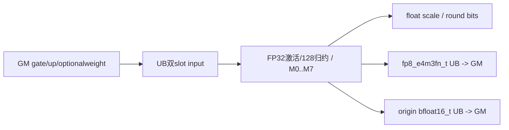

```block-beta
 columns 1
 G["可选counts双槽+sum32 -> V_S -> Reset"]
 M["main: weight(w2) + origin(2) + x0(2) + x1(2) + y(2) + scale(2)"]
```

##### 字节账与复用顺序

```text
Umain=8R A16F+2R A32F+8A8(RSF)+w8A8R+4R A16F
UBpeak=max(group?16A4GF+32:0,Umain)
GM有效名义读=4LC+w4L+group*8E*launch_cores
GM有效名义写=LC+4LS+2LC
正式输出allocation=3NC+4NS B
main资源IDs=8+2w+2；group已消费2，Reset不恢复mask
```

按无算术溢出/窄化域推导，名义传输不等运行成功保证。增R Host估计与实际FP32scale双槽相同。

| 边/复用子区 | producer | offset/extent | dtype/layout | consumer | ordering/sync | owner/lifetime | 安全条件 |
|---|---|---|---|---|---|---|---|
| group→main | count VF/scalar | 同poolbase，Ug→Umain | int64→多queue | main | V_S读sum+Reset三barrier | 旧view失效 | 字节max成立，bufID条件独立 |
| weight跨D | MTE2 | T | FP32 | VF M1/3/5/7 | DeQue→最后D后Free | 当前row块 | 无weight子路线不分配 |
| scale/y→GM | VF | 双slot | float/fp8_e4m3fn_t | MTE3 | EnQue/DeQue/Free | 当前D片 | Compact FP32 stride匹配 |
| origin→GM | VF | O | bfloat16_t | MTE3 | y/scale之后独立queue搬出 | 当前D片 | 前L行有效，不能反馈到量化 |

#### 同步、精度与尾块

##### 同步与数值边界表

| 阶段 | primitive/机制 | producer | consumer/等待点 | 保护对象 | 精度/尾块 |
|---|---|---|---|---|---|
| counts | queue/ZEROING尾/V_S/Reset | MTE2/VF | scalar/main | group UB | 非负sum/无窄化前提 |
| 激活 | FP32 Exp/Div/Mul/Add0 | bfloat16_t | VF归约/origin | 128值组 | M0…M7 clamp/weight精确开关 |
| scale | maxAbs≥1e-4、/448、可选bit round | FP32 a | q/scaleGM | float | 两种round都FP32存 |
| y/origin | CAST_RINT/NO_SAT，CTRL60=0 | FP32 a/q | outputqueues | 当前D片 | origin按输入dtypeRINT；fa128倍数无reminder执行体 |
| 结束 | 队列/stream/恢复CTRL60 | 当前Kernel | 外部caller | GM/tensor | 无自有Host同步等待、无核间sum |

#### 关键实现

##### 符号证据表

| 阶段 | 文件 | 符号/模板实例 | 实现事实 |
|---|---|---|---|
| Host/Tiling producer | csrc/activation/swiglu_group_quant/op_host/swiglu_group_quant.cpp | CalcFp8QuantOpTiling | O=1、Ts=float、R/F/U |
| Kernel entry/router | csrc/activation/swiglu_group_quant/op_kernel/swiglu_group_quant.cpp | RUN_FP8(bfloat16_t,fp8_e4m3fn_t,float,true) | key32/code1 |
| Device body/helper | csrc/activation/swiglu_group_quant/op_kernel/swiglu_group_quant_base.h | V<fp8_e4m3fn_t,bfloat16_t,float,r,c,true,w> | M0…M7八个实例全列于执行矩阵 |

### Route R-011：bfloat16_t→fp8_e4m3fn_t，scalefp8_e8m0_t，origin0

#### 适用条件

950/mode3，key31/dtype5，精确Tx=bfloat16_t,Ty=fp8_e4m3fn_t,Ts=fp8_e8m0_t,outputOrigin=false。8个子路线M0…M7均按上表逐key展开，group有无、whole/split与前尾核/行列尾均保留。M0…M3不round时有float写E8缓冲缺陷；origin返回缓冲未写。

##### 选择证据

| 层级 | 文件 | 符号 | 源码谓词/参数 | 结果/下一跳 |
|---|---|---|---|---|
| entry | csrc/activation/swiglu_group_quant/op_kernel/swiglu_group_quant.cpp | RUN_FP8 | key31/code5 | PerToken<bfloat16_t,fp8_e4m3fn_t,fp8_e8m0_t,false> |
| VF分发 | csrc/activation/swiglu_group_quant/op_kernel/swiglu_group_quant_base.h | Fp8QuantPerTokenDispatcher | maskBit0…7完整子表 | V<fp8_e4m3fn_t,bfloat16_t,fp8_e8m0_t,r,c,false,w> |

#### Device 数据流

##### 函数级调用链

```text
entry -> SwigluFp8QuantPerToken<bfloat16_t,fp8_e4m3fn_t,fp8_e8m0_t,false>::Init/Process
 -> optionalCountVF/Reset -> CopyIn -> Dispatcher[M0..M7]
 -> V<fp8_e4m3fn_t,bfloat16_t,fp8_e8m0_t,r,c,false,w> -> VFSwiGlu/scale bits/Cast -> CopyOut
```

##### 源码等价伪码

执行公共完整伪码，固定输入bfloat16_t/输出fp8_e4m3fn_t/scalefp8_e8m0_t/originfalse；M0…M7的r/c/w逐项取精确子表。两FP8目标scale分母都448。origin LocalTensor参数不消费，返回storage未写。r=False保持硬转float*的原始错误写；r=True按E8编码存单字节。

#### 内存与数据搬运

##### 资源与搬运表

| 层级/缓冲区 | offset/地址公式 | extent/容量公式 | dtype/layout | producer | consumer | owner/lifetime | 对齐/复用 |
|---|---|---|---|---|---|---|---|
| GM x/y/scale/origin | x=2(row*2C+dF)，up加2C；y/origin=(row*C+dF)*dtypeBytes；scale=(row*S+dSF)*1 | 4NC /NC /NS /2NC B | bfloat16_t/fp8_e4m3fn_t/fp8_e8m0_t/bfloat16_t | caller / VF+MTE3 | Device/caller | record_stream | 前L有效，origin未写 |
| groupstage | countslots0/8A4GF，sum16A4GF | Ug=16A4GF+32 B | int64 | MTE2/VF | scalar rows | 到V_S/Reset | 字节复用，IDs未重置 |
| weight/origin | topk offset0、origin从T | T=w8A8R；O=0 | FP32/bfloat16_t双slot | MTE2/VF | VF/MTE3 | row块/D片 | w由子路线0/1决定 |
| x0/x1/y | x0=T+O；x1=T+O+X0；y=T+O+X0+X1 | X0=X1=4RA16F，Y=2RA32F | bfloat16_t/fp8_e4m3fn_t双slot | MTE2/VF | VF/MTE3 | 当前D片 | 块容量与depth2都计入 |
| scale | T+O+X0+X1+Y | 2A32(RSF) B，双slot | fp8_e8m0_t Compact | VF | MTE3 | 当前D片 | 非round写4maSF B，不符合此slot容量/编码 |
| 寄存器 | VF Reg/Mask | 逻辑256B/Reg；物理compiler边界 | FP32/uint32/int32 | VF | VF | group128 | 不新增GM/UB FP32中间矩阵 |
| L1/L0/workspace | L1/L0 N/A；W非空check | W=库查询+32B | Byte | Host | entry | stream周期 | body不读，无Cube |

##### 分层内存布局


```block-beta
 columns 1
 G["可选counts双槽+sum32 -> V_S -> Reset"]
 M["main: weight(w2) + origin(0) + x0(2) + x1(2) + y(2) + scale(2)"]
```

##### 字节账与复用顺序

```text
Umain=8R A16F+2R A32F+2A32(RSF)+w8A8R
UBpeak=max(group?16A4GF+32:0,Umain)
GM有效名义读=4LC+w4L+group*8E*launch_cores
GM有效名义写=LC+LS
正式输出allocation=3NC+NS B
main资源IDs=8+2w+0；group已消费2，Reset不恢复mask
```

按无算术溢出/窄化域推导，名义传输不等运行成功保证。不round时额外float写4maSF为错误请求，不代表实际已分配足够空间。

| 边/复用子区 | producer | offset/extent | dtype/layout | consumer | ordering/sync | owner/lifetime | 安全条件 |
|---|---|---|---|---|---|---|---|
| group→main | count VF/scalar | 同poolbase，Ug→Umain | int64→多queue | main | V_S读sum+Reset三barrier | 旧view失效 | 字节max成立，bufID条件独立 |
| weight跨D | MTE2 | T | FP32 | VF M1/3/5/7 | DeQue→最后D后Free | 当前row块 | 无weight子路线不分配 |
| scale/y→GM | VF | 双slot | fp8_e8m0_t/fp8_e4m3fn_t | MTE3 | EnQue/DeQue/Free | 当前D片 | r=False的错误store不得忽略 |
| origin→GM | VF | O | bfloat16_t | MTE3 | 无消费者 | 当前D片 | 不可读返回origin |

#### 同步、精度与尾块

##### 同步与数值边界表

| 阶段 | primitive/机制 | producer | consumer/等待点 | 保护对象 | 精度/尾块 |
|---|---|---|---|---|---|
| counts | queue/ZEROING尾/V_S/Reset | MTE2/VF | scalar/main | group UB | 非负sum/无窄化前提 |
| 激活 | FP32 Exp/Div/Mul/Add0 | bfloat16_t | VF归约/origin | 128值组 | M0…M7 clamp/weight精确开关 |
| scale | maxAbs≥1e-4、/448、可选bit round | FP32 a | q/scaleGM | fp8_e8m0_t | 非round类型错；roundE8编码 |
| y/origin | CAST_RINT/NO_SAT，CTRL60=0 | FP32 a/q | outputqueues | 当前D片 | origin无写；fa128倍数无reminder执行体 |
| 结束 | 队列/stream/恢复CTRL60 | 当前Kernel | 外部caller | GM/tensor | 无自有Host同步等待、无核间sum |

#### 关键实现

##### 符号证据表

| 阶段 | 文件 | 符号/模板实例 | 实现事实 |
|---|---|---|---|
| Host/Tiling producer | csrc/activation/swiglu_group_quant/op_host/swiglu_group_quant.cpp | CalcFp8QuantOpTiling | O=0、Ts=fp8_e8m0_t、R/F/U |
| Kernel entry/router | csrc/activation/swiglu_group_quant/op_kernel/swiglu_group_quant.cpp | RUN_FP8(bfloat16_t,fp8_e4m3fn_t,fp8_e8m0_t,false) | key31/code5 |
| Device body/helper | csrc/activation/swiglu_group_quant/op_kernel/swiglu_group_quant_base.h | V<fp8_e4m3fn_t,bfloat16_t,fp8_e8m0_t,r,c,false,w> | M0…M7八个实例全列于执行矩阵 |

### Route R-012：bfloat16_t→fp8_e4m3fn_t，scalefp8_e8m0_t，origin1

#### 适用条件

950/mode3，key32/dtype5，精确Tx=bfloat16_t,Ty=fp8_e4m3fn_t,Ts=fp8_e8m0_t,outputOrigin=true。8个子路线M0…M7均按上表逐key展开，group有无、whole/split与前尾核/行列尾均保留。M0…M3不round时有float写E8缓冲缺陷；group+weight的bufID条件必须另审。

##### 选择证据

| 层级 | 文件 | 符号 | 源码谓词/参数 | 结果/下一跳 |
|---|---|---|---|---|
| entry | csrc/activation/swiglu_group_quant/op_kernel/swiglu_group_quant.cpp | RUN_FP8 | key32/code5 | PerToken<bfloat16_t,fp8_e4m3fn_t,fp8_e8m0_t,true> |
| VF分发 | csrc/activation/swiglu_group_quant/op_kernel/swiglu_group_quant_base.h | Fp8QuantPerTokenDispatcherYOrigin | maskBit0…7完整子表 | V<fp8_e4m3fn_t,bfloat16_t,fp8_e8m0_t,r,c,true,w> |

#### Device 数据流

##### 函数级调用链

```text
entry -> SwigluFp8QuantPerToken<bfloat16_t,fp8_e4m3fn_t,fp8_e8m0_t,true>::Init/Process
 -> optionalCountVF/Reset -> CopyIn -> DispatcherYOrigin[M0..M7]
 -> V<fp8_e4m3fn_t,bfloat16_t,fp8_e8m0_t,r,c,true,w> -> VFSwiGlu/scale bits/Cast -> CopyOut
```

##### 源码等价伪码

执行公共完整伪码，固定输入bfloat16_t/输出fp8_e4m3fn_t/scalefp8_e8m0_t/origintrue；M0…M7的r/c/w逐项取精确子表。两FP8目标scale分母都448。origin先把FP32激活RINT到bfloat16_t写回，仍用原FP32激活量化。r=False保持硬转float*的原始错误写；r=True按E8编码存单字节。

#### 内存与数据搬运

##### 资源与搬运表

| 层级/缓冲区 | offset/地址公式 | extent/容量公式 | dtype/layout | producer | consumer | owner/lifetime | 对齐/复用 |
|---|---|---|---|---|---|---|---|
| GM x/y/scale/origin | x=2(row*2C+dF)，up加2C；y/origin=(row*C+dF)*dtypeBytes；scale=(row*S+dSF)*1 | 4NC /NC /NS /2NC B | bfloat16_t/fp8_e4m3fn_t/fp8_e8m0_t/bfloat16_t | caller / VF+MTE3 | Device/caller | record_stream | 前L有效，origin有效 |
| groupstage | countslots0/8A4GF，sum16A4GF | Ug=16A4GF+32 B | int64 | MTE2/VF | scalar rows | 到V_S/Reset | 字节复用，IDs未重置 |
| weight/origin | topk offset0、origin从T | T=w8A8R；O=4R A16F | FP32/bfloat16_t双slot | MTE2/VF | VF/MTE3 | row块/D片 | w由子路线0/1决定 |
| x0/x1/y | x0=T+O；x1=T+O+X0；y=T+O+X0+X1 | X0=X1=4RA16F，Y=2RA32F | bfloat16_t/fp8_e4m3fn_t双slot | MTE2/VF | VF/MTE3 | 当前D片 | 块容量与depth2都计入 |
| scale | T+O+X0+X1+Y | 2A32(RSF) B，双slot | fp8_e8m0_t Compact | VF | MTE3 | 当前D片 | 非round写4maSF B，不符合此slot容量/编码 |
| 寄存器 | VF Reg/Mask | 逻辑256B/Reg；物理compiler边界 | FP32/uint32/int32 | VF | VF | group128 | 不新增GM/UB FP32中间矩阵 |
| L1/L0/workspace | L1/L0 N/A；W非空check | W=库查询+32B | Byte | Host | entry | stream周期 | body不读，无Cube |

##### 分层内存布局

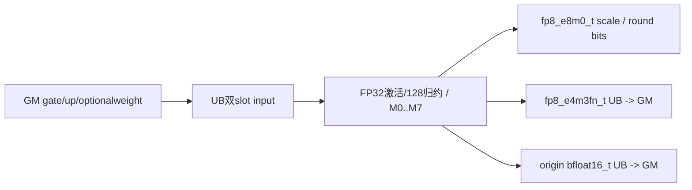

```block-beta
 columns 1
 G["可选counts双槽+sum32 -> V_S -> Reset"]
 M["main: weight(w2) + origin(2) + x0(2) + x1(2) + y(2) + scale(2)"]
```

##### 字节账与复用顺序

```text
Umain=8R A16F+2R A32F+2A32(RSF)+w8A8R+4R A16F
UBpeak=max(group?16A4GF+32:0,Umain)
GM有效名义读=4LC+w4L+group*8E*launch_cores
GM有效名义写=LC+LS+2LC
正式输出allocation=3NC+NS B
main资源IDs=8+2w+2；group已消费2，Reset不恢复mask
```

按无算术溢出/窄化域推导，名义传输不等运行成功保证。不round时额外float写4maSF为错误请求，不代表实际已分配足够空间。

| 边/复用子区 | producer | offset/extent | dtype/layout | consumer | ordering/sync | owner/lifetime | 安全条件 |
|---|---|---|---|---|---|---|---|
| group→main | count VF/scalar | 同poolbase，Ug→Umain | int64→多queue | main | V_S读sum+Reset三barrier | 旧view失效 | 字节max成立，bufID条件独立 |
| weight跨D | MTE2 | T | FP32 | VF M1/3/5/7 | DeQue→最后D后Free | 当前row块 | 无weight子路线不分配 |
| scale/y→GM | VF | 双slot | fp8_e8m0_t/fp8_e4m3fn_t | MTE3 | EnQue/DeQue/Free | 当前D片 | r=False的错误store不得忽略 |
| origin→GM | VF | O | bfloat16_t | MTE3 | y/scale之后独立queue搬出 | 当前D片 | 前L行有效，不能反馈到量化 |

#### 同步、精度与尾块

##### 同步与数值边界表

| 阶段 | primitive/机制 | producer | consumer/等待点 | 保护对象 | 精度/尾块 |
|---|---|---|---|---|---|
| counts | queue/ZEROING尾/V_S/Reset | MTE2/VF | scalar/main | group UB | 非负sum/无窄化前提 |
| 激活 | FP32 Exp/Div/Mul/Add0 | bfloat16_t | VF归约/origin | 128值组 | M0…M7 clamp/weight精确开关 |
| scale | maxAbs≥1e-4、/448、可选bit round | FP32 a | q/scaleGM | fp8_e8m0_t | 非round类型错；roundE8编码 |
| y/origin | CAST_RINT/NO_SAT，CTRL60=0 | FP32 a/q | outputqueues | 当前D片 | origin按输入dtypeRINT；fa128倍数无reminder执行体 |
| 结束 | 队列/stream/恢复CTRL60 | 当前Kernel | 外部caller | GM/tensor | 无自有Host同步等待、无核间sum |

#### 关键实现

##### 符号证据表

| 阶段 | 文件 | 符号/模板实例 | 实现事实 |
|---|---|---|---|
| Host/Tiling producer | csrc/activation/swiglu_group_quant/op_host/swiglu_group_quant.cpp | CalcFp8QuantOpTiling | O=1、Ts=fp8_e8m0_t、R/F/U |
| Kernel entry/router | csrc/activation/swiglu_group_quant/op_kernel/swiglu_group_quant.cpp | RUN_FP8(bfloat16_t,fp8_e4m3fn_t,fp8_e8m0_t,true) | key32/code5 |
| Device body/helper | csrc/activation/swiglu_group_quant/op_kernel/swiglu_group_quant_base.h | V<fp8_e4m3fn_t,bfloat16_t,fp8_e8m0_t,r,c,true,w> | M0…M7八个实例全列于执行矩阵 |

### Route R-013：bfloat16_t→fp8_e5m2_t，scalefloat，origin0

#### 适用条件

950/mode3，key31/dtype3，精确Tx=bfloat16_t,Ty=fp8_e5m2_t,Ts=float,outputOrigin=false。8个子路线M0…M7均按上表逐key展开，group有无、whole/split与前尾核/行列尾均保留。FP32scale所有round布尔组合使用对应公式；origin返回缓冲未写。

##### 选择证据

| 层级 | 文件 | 符号 | 源码谓词/参数 | 结果/下一跳 |
|---|---|---|---|---|
| entry | csrc/activation/swiglu_group_quant/op_kernel/swiglu_group_quant.cpp | RUN_FP8 | key31/code3 | PerToken<bfloat16_t,fp8_e5m2_t,float,false> |
| VF分发 | csrc/activation/swiglu_group_quant/op_kernel/swiglu_group_quant_base.h | Fp8QuantPerTokenDispatcher | maskBit0…7完整子表 | V<fp8_e5m2_t,bfloat16_t,float,r,c,false,w> |

#### Device 数据流

##### 函数级调用链

```text
entry -> SwigluFp8QuantPerToken<bfloat16_t,fp8_e5m2_t,float,false>::Init/Process
 -> optionalCountVF/Reset -> CopyIn -> Dispatcher[M0..M7]
 -> V<fp8_e5m2_t,bfloat16_t,float,r,c,false,w> -> VFSwiGlu/scale bits/Cast -> CopyOut
```

##### 源码等价伪码

执行公共完整伪码，固定输入bfloat16_t/输出fp8_e5m2_t/scalefloat/originfalse；M0…M7的r/c/w逐项取精确子表。两FP8目标scale分母都448。origin LocalTensor参数不消费，返回storage未写。r=False写s FP32；r=True写2^k FP32。

#### 内存与数据搬运

##### 资源与搬运表

| 层级/缓冲区 | offset/地址公式 | extent/容量公式 | dtype/layout | producer | consumer | owner/lifetime | 对齐/复用 |
|---|---|---|---|---|---|---|---|
| GM x/y/scale/origin | x=2(row*2C+dF)，up加2C；y/origin=(row*C+dF)*dtypeBytes；scale=(row*S+dSF)*4 | 4NC /NC /4NS /2NC B | bfloat16_t/fp8_e5m2_t/float/bfloat16_t | caller / VF+MTE3 | Device/caller | record_stream | 前L有效，origin未写 |
| groupstage | countslots0/8A4GF，sum16A4GF | Ug=16A4GF+32 B | int64 | MTE2/VF | scalar rows | 到V_S/Reset | 字节复用，IDs未重置 |
| weight/origin | topk offset0、origin从T | T=w8A8R；O=0 | FP32/bfloat16_t双slot | MTE2/VF | VF/MTE3 | row块/D片 | w由子路线0/1决定 |
| x0/x1/y | x0=T+O；x1=T+O+X0；y=T+O+X0+X1 | X0=X1=4RA16F，Y=2RA32F | bfloat16_t/fp8_e5m2_t双slot | MTE2/VF | VF/MTE3 | 当前D片 | 块容量与depth2都计入 |
| scale | T+O+X0+X1+Y | 8A8(RSF) B，双slot | float Compact | VF | MTE3 | 当前D片 | FP32标量连续写 |
| 寄存器 | VF Reg/Mask | 逻辑256B/Reg；物理compiler边界 | FP32/uint32/int32 | VF | VF | group128 | 不新增GM/UB FP32中间矩阵 |
| L1/L0/workspace | L1/L0 N/A；W非空check | W=库查询+32B | Byte | Host | entry | stream周期 | body不读，无Cube |

##### 分层内存布局


```block-beta
 columns 1
 G["可选counts双槽+sum32 -> V_S -> Reset"]
 M["main: weight(w2) + origin(0) + x0(2) + x1(2) + y(2) + scale(2)"]
```

##### 字节账与复用顺序

```text
Umain=8R A16F+2R A32F+8A8(RSF)+w8A8R
UBpeak=max(group?16A4GF+32:0,Umain)
GM有效名义读=4LC+w4L+group*8E*launch_cores
GM有效名义写=LC+4LS
正式输出allocation=3NC+4NS B
main资源IDs=8+2w+0；group已消费2，Reset不恢复mask
```

按无算术溢出/窄化域推导，名义传输不等运行成功保证。增R Host估计与实际FP32scale双槽相同。

| 边/复用子区 | producer | offset/extent | dtype/layout | consumer | ordering/sync | owner/lifetime | 安全条件 |
|---|---|---|---|---|---|---|---|
| group→main | count VF/scalar | 同poolbase，Ug→Umain | int64→多queue | main | V_S读sum+Reset三barrier | 旧view失效 | 字节max成立，bufID条件独立 |
| weight跨D | MTE2 | T | FP32 | VF M1/3/5/7 | DeQue→最后D后Free | 当前row块 | 无weight子路线不分配 |
| scale/y→GM | VF | 双slot | float/fp8_e5m2_t | MTE3 | EnQue/DeQue/Free | 当前D片 | Compact FP32 stride匹配 |
| origin→GM | VF | O | bfloat16_t | MTE3 | 无消费者 | 当前D片 | 不可读返回origin |

#### 同步、精度与尾块

##### 同步与数值边界表

| 阶段 | primitive/机制 | producer | consumer/等待点 | 保护对象 | 精度/尾块 |
|---|---|---|---|---|---|
| counts | queue/ZEROING尾/V_S/Reset | MTE2/VF | scalar/main | group UB | 非负sum/无窄化前提 |
| 激活 | FP32 Exp/Div/Mul/Add0 | bfloat16_t | VF归约/origin | 128值组 | M0…M7 clamp/weight精确开关 |
| scale | maxAbs≥1e-4、/448、可选bit round | FP32 a | q/scaleGM | float | 两种round都FP32存 |
| y/origin | CAST_RINT/NO_SAT，CTRL60=0 | FP32 a/q | outputqueues | 当前D片 | origin无写；fa128倍数无reminder执行体 |
| 结束 | 队列/stream/恢复CTRL60 | 当前Kernel | 外部caller | GM/tensor | 无自有Host同步等待、无核间sum |

#### 关键实现

##### 符号证据表

| 阶段 | 文件 | 符号/模板实例 | 实现事实 |
|---|---|---|---|
| Host/Tiling producer | csrc/activation/swiglu_group_quant/op_host/swiglu_group_quant.cpp | CalcFp8QuantOpTiling | O=0、Ts=float、R/F/U |
| Kernel entry/router | csrc/activation/swiglu_group_quant/op_kernel/swiglu_group_quant.cpp | RUN_FP8(bfloat16_t,fp8_e5m2_t,float,false) | key31/code3 |
| Device body/helper | csrc/activation/swiglu_group_quant/op_kernel/swiglu_group_quant_base.h | V<fp8_e5m2_t,bfloat16_t,float,r,c,false,w> | M0…M7八个实例全列于执行矩阵 |

### Route R-014：bfloat16_t→fp8_e5m2_t，scalefloat，origin1

#### 适用条件

950/mode3，key32/dtype3，精确Tx=bfloat16_t,Ty=fp8_e5m2_t,Ts=float,outputOrigin=true。8个子路线M0…M7均按上表逐key展开，group有无、whole/split与前尾核/行列尾均保留。FP32scale所有round布尔组合使用对应公式；group+weight的bufID条件必须另审。

##### 选择证据

| 层级 | 文件 | 符号 | 源码谓词/参数 | 结果/下一跳 |
|---|---|---|---|---|
| entry | csrc/activation/swiglu_group_quant/op_kernel/swiglu_group_quant.cpp | RUN_FP8 | key32/code3 | PerToken<bfloat16_t,fp8_e5m2_t,float,true> |
| VF分发 | csrc/activation/swiglu_group_quant/op_kernel/swiglu_group_quant_base.h | Fp8QuantPerTokenDispatcherYOrigin | maskBit0…7完整子表 | V<fp8_e5m2_t,bfloat16_t,float,r,c,true,w> |

#### Device 数据流

##### 函数级调用链

```text
entry -> SwigluFp8QuantPerToken<bfloat16_t,fp8_e5m2_t,float,true>::Init/Process
 -> optionalCountVF/Reset -> CopyIn -> DispatcherYOrigin[M0..M7]
 -> V<fp8_e5m2_t,bfloat16_t,float,r,c,true,w> -> VFSwiGlu/scale bits/Cast -> CopyOut
```

##### 源码等价伪码

执行公共完整伪码，固定输入bfloat16_t/输出fp8_e5m2_t/scalefloat/origintrue；M0…M7的r/c/w逐项取精确子表。两FP8目标scale分母都448。origin先把FP32激活RINT到bfloat16_t写回，仍用原FP32激活量化。r=False写s FP32；r=True写2^k FP32。

#### 内存与数据搬运

##### 资源与搬运表

| 层级/缓冲区 | offset/地址公式 | extent/容量公式 | dtype/layout | producer | consumer | owner/lifetime | 对齐/复用 |
|---|---|---|---|---|---|---|---|
| GM x/y/scale/origin | x=2(row*2C+dF)，up加2C；y/origin=(row*C+dF)*dtypeBytes；scale=(row*S+dSF)*4 | 4NC /NC /4NS /2NC B | bfloat16_t/fp8_e5m2_t/float/bfloat16_t | caller / VF+MTE3 | Device/caller | record_stream | 前L有效，origin有效 |
| groupstage | countslots0/8A4GF，sum16A4GF | Ug=16A4GF+32 B | int64 | MTE2/VF | scalar rows | 到V_S/Reset | 字节复用，IDs未重置 |
| weight/origin | topk offset0、origin从T | T=w8A8R；O=4R A16F | FP32/bfloat16_t双slot | MTE2/VF | VF/MTE3 | row块/D片 | w由子路线0/1决定 |
| x0/x1/y | x0=T+O；x1=T+O+X0；y=T+O+X0+X1 | X0=X1=4RA16F，Y=2RA32F | bfloat16_t/fp8_e5m2_t双slot | MTE2/VF | VF/MTE3 | 当前D片 | 块容量与depth2都计入 |
| scale | T+O+X0+X1+Y | 8A8(RSF) B，双slot | float Compact | VF | MTE3 | 当前D片 | FP32标量连续写 |
| 寄存器 | VF Reg/Mask | 逻辑256B/Reg；物理compiler边界 | FP32/uint32/int32 | VF | VF | group128 | 不新增GM/UB FP32中间矩阵 |
| L1/L0/workspace | L1/L0 N/A；W非空check | W=库查询+32B | Byte | Host | entry | stream周期 | body不读，无Cube |

##### 分层内存布局

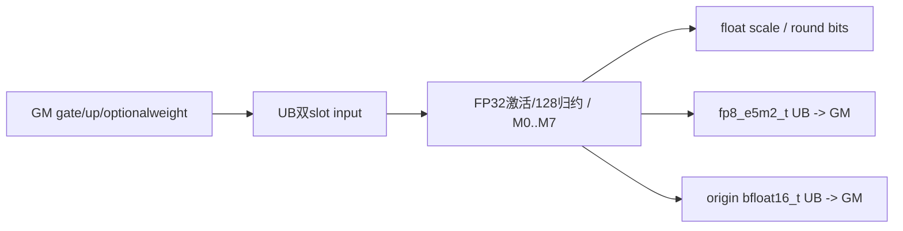

```block-beta
 columns 1
 G["可选counts双槽+sum32 -> V_S -> Reset"]
 M["main: weight(w2) + origin(2) + x0(2) + x1(2) + y(2) + scale(2)"]
```

##### 字节账与复用顺序

```text
Umain=8R A16F+2R A32F+8A8(RSF)+w8A8R+4R A16F
UBpeak=max(group?16A4GF+32:0,Umain)
GM有效名义读=4LC+w4L+group*8E*launch_cores
GM有效名义写=LC+4LS+2LC
正式输出allocation=3NC+4NS B
main资源IDs=8+2w+2；group已消费2，Reset不恢复mask
```

按无算术溢出/窄化域推导，名义传输不等运行成功保证。增R Host估计与实际FP32scale双槽相同。

| 边/复用子区 | producer | offset/extent | dtype/layout | consumer | ordering/sync | owner/lifetime | 安全条件 |
|---|---|---|---|---|---|---|---|
| group→main | count VF/scalar | 同poolbase，Ug→Umain | int64→多queue | main | V_S读sum+Reset三barrier | 旧view失效 | 字节max成立，bufID条件独立 |
| weight跨D | MTE2 | T | FP32 | VF M1/3/5/7 | DeQue→最后D后Free | 当前row块 | 无weight子路线不分配 |
| scale/y→GM | VF | 双slot | float/fp8_e5m2_t | MTE3 | EnQue/DeQue/Free | 当前D片 | Compact FP32 stride匹配 |
| origin→GM | VF | O | bfloat16_t | MTE3 | y/scale之后独立queue搬出 | 当前D片 | 前L行有效，不能反馈到量化 |

#### 同步、精度与尾块

##### 同步与数值边界表

| 阶段 | primitive/机制 | producer | consumer/等待点 | 保护对象 | 精度/尾块 |
|---|---|---|---|---|---|
| counts | queue/ZEROING尾/V_S/Reset | MTE2/VF | scalar/main | group UB | 非负sum/无窄化前提 |
| 激活 | FP32 Exp/Div/Mul/Add0 | bfloat16_t | VF归约/origin | 128值组 | M0…M7 clamp/weight精确开关 |
| scale | maxAbs≥1e-4、/448、可选bit round | FP32 a | q/scaleGM | float | 两种round都FP32存 |
| y/origin | CAST_RINT/NO_SAT，CTRL60=0 | FP32 a/q | outputqueues | 当前D片 | origin按输入dtypeRINT；fa128倍数无reminder执行体 |
| 结束 | 队列/stream/恢复CTRL60 | 当前Kernel | 外部caller | GM/tensor | 无自有Host同步等待、无核间sum |

#### 关键实现

##### 符号证据表

| 阶段 | 文件 | 符号/模板实例 | 实现事实 |
|---|---|---|---|
| Host/Tiling producer | csrc/activation/swiglu_group_quant/op_host/swiglu_group_quant.cpp | CalcFp8QuantOpTiling | O=1、Ts=float、R/F/U |
| Kernel entry/router | csrc/activation/swiglu_group_quant/op_kernel/swiglu_group_quant.cpp | RUN_FP8(bfloat16_t,fp8_e5m2_t,float,true) | key32/code3 |
| Device body/helper | csrc/activation/swiglu_group_quant/op_kernel/swiglu_group_quant_base.h | V<fp8_e5m2_t,bfloat16_t,float,r,c,true,w> | M0…M7八个实例全列于执行矩阵 |

### Route R-015：bfloat16_t→fp8_e5m2_t，scalefp8_e8m0_t，origin0

#### 适用条件

950/mode3，key31/dtype7，精确Tx=bfloat16_t,Ty=fp8_e5m2_t,Ts=fp8_e8m0_t,outputOrigin=false。8个子路线M0…M7均按上表逐key展开，group有无、whole/split与前尾核/行列尾均保留。M0…M3不round时有float写E8缓冲缺陷；origin返回缓冲未写。

##### 选择证据

| 层级 | 文件 | 符号 | 源码谓词/参数 | 结果/下一跳 |
|---|---|---|---|---|
| entry | csrc/activation/swiglu_group_quant/op_kernel/swiglu_group_quant.cpp | RUN_FP8 | key31/code7 | PerToken<bfloat16_t,fp8_e5m2_t,fp8_e8m0_t,false> |
| VF分发 | csrc/activation/swiglu_group_quant/op_kernel/swiglu_group_quant_base.h | Fp8QuantPerTokenDispatcher | maskBit0…7完整子表 | V<fp8_e5m2_t,bfloat16_t,fp8_e8m0_t,r,c,false,w> |

#### Device 数据流

##### 函数级调用链

```text
entry -> SwigluFp8QuantPerToken<bfloat16_t,fp8_e5m2_t,fp8_e8m0_t,false>::Init/Process
 -> optionalCountVF/Reset -> CopyIn -> Dispatcher[M0..M7]
 -> V<fp8_e5m2_t,bfloat16_t,fp8_e8m0_t,r,c,false,w> -> VFSwiGlu/scale bits/Cast -> CopyOut
```

##### 源码等价伪码

执行公共完整伪码，固定输入bfloat16_t/输出fp8_e5m2_t/scalefp8_e8m0_t/originfalse；M0…M7的r/c/w逐项取精确子表。两FP8目标scale分母都448。origin LocalTensor参数不消费，返回storage未写。r=False保持硬转float*的原始错误写；r=True按E8编码存单字节。

#### 内存与数据搬运

##### 资源与搬运表

| 层级/缓冲区 | offset/地址公式 | extent/容量公式 | dtype/layout | producer | consumer | owner/lifetime | 对齐/复用 |
|---|---|---|---|---|---|---|---|
| GM x/y/scale/origin | x=2(row*2C+dF)，up加2C；y/origin=(row*C+dF)*dtypeBytes；scale=(row*S+dSF)*1 | 4NC /NC /NS /2NC B | bfloat16_t/fp8_e5m2_t/fp8_e8m0_t/bfloat16_t | caller / VF+MTE3 | Device/caller | record_stream | 前L有效，origin未写 |
| groupstage | countslots0/8A4GF，sum16A4GF | Ug=16A4GF+32 B | int64 | MTE2/VF | scalar rows | 到V_S/Reset | 字节复用，IDs未重置 |
| weight/origin | topk offset0、origin从T | T=w8A8R；O=0 | FP32/bfloat16_t双slot | MTE2/VF | VF/MTE3 | row块/D片 | w由子路线0/1决定 |
| x0/x1/y | x0=T+O；x1=T+O+X0；y=T+O+X0+X1 | X0=X1=4RA16F，Y=2RA32F | bfloat16_t/fp8_e5m2_t双slot | MTE2/VF | VF/MTE3 | 当前D片 | 块容量与depth2都计入 |
| scale | T+O+X0+X1+Y | 2A32(RSF) B，双slot | fp8_e8m0_t Compact | VF | MTE3 | 当前D片 | 非round写4maSF B，不符合此slot容量/编码 |
| 寄存器 | VF Reg/Mask | 逻辑256B/Reg；物理compiler边界 | FP32/uint32/int32 | VF | VF | group128 | 不新增GM/UB FP32中间矩阵 |
| L1/L0/workspace | L1/L0 N/A；W非空check | W=库查询+32B | Byte | Host | entry | stream周期 | body不读，无Cube |

##### 分层内存布局


```block-beta
 columns 1
 G["可选counts双槽+sum32 -> V_S -> Reset"]
 M["main: weight(w2) + origin(0) + x0(2) + x1(2) + y(2) + scale(2)"]
```

##### 字节账与复用顺序

```text
Umain=8R A16F+2R A32F+2A32(RSF)+w8A8R
UBpeak=max(group?16A4GF+32:0,Umain)
GM有效名义读=4LC+w4L+group*8E*launch_cores
GM有效名义写=LC+LS
正式输出allocation=3NC+NS B
main资源IDs=8+2w+0；group已消费2，Reset不恢复mask
```

按无算术溢出/窄化域推导，名义传输不等运行成功保证。不round时额外float写4maSF为错误请求，不代表实际已分配足够空间。

| 边/复用子区 | producer | offset/extent | dtype/layout | consumer | ordering/sync | owner/lifetime | 安全条件 |
|---|---|---|---|---|---|---|---|
| group→main | count VF/scalar | 同poolbase，Ug→Umain | int64→多queue | main | V_S读sum+Reset三barrier | 旧view失效 | 字节max成立，bufID条件独立 |
| weight跨D | MTE2 | T | FP32 | VF M1/3/5/7 | DeQue→最后D后Free | 当前row块 | 无weight子路线不分配 |
| scale/y→GM | VF | 双slot | fp8_e8m0_t/fp8_e5m2_t | MTE3 | EnQue/DeQue/Free | 当前D片 | r=False的错误store不得忽略 |
| origin→GM | VF | O | bfloat16_t | MTE3 | 无消费者 | 当前D片 | 不可读返回origin |

#### 同步、精度与尾块

##### 同步与数值边界表

| 阶段 | primitive/机制 | producer | consumer/等待点 | 保护对象 | 精度/尾块 |
|---|---|---|---|---|---|
| counts | queue/ZEROING尾/V_S/Reset | MTE2/VF | scalar/main | group UB | 非负sum/无窄化前提 |
| 激活 | FP32 Exp/Div/Mul/Add0 | bfloat16_t | VF归约/origin | 128值组 | M0…M7 clamp/weight精确开关 |
| scale | maxAbs≥1e-4、/448、可选bit round | FP32 a | q/scaleGM | fp8_e8m0_t | 非round类型错；roundE8编码 |
| y/origin | CAST_RINT/NO_SAT，CTRL60=0 | FP32 a/q | outputqueues | 当前D片 | origin无写；fa128倍数无reminder执行体 |
| 结束 | 队列/stream/恢复CTRL60 | 当前Kernel | 外部caller | GM/tensor | 无自有Host同步等待、无核间sum |

#### 关键实现

##### 符号证据表

| 阶段 | 文件 | 符号/模板实例 | 实现事实 |
|---|---|---|---|
| Host/Tiling producer | csrc/activation/swiglu_group_quant/op_host/swiglu_group_quant.cpp | CalcFp8QuantOpTiling | O=0、Ts=fp8_e8m0_t、R/F/U |
| Kernel entry/router | csrc/activation/swiglu_group_quant/op_kernel/swiglu_group_quant.cpp | RUN_FP8(bfloat16_t,fp8_e5m2_t,fp8_e8m0_t,false) | key31/code7 |
| Device body/helper | csrc/activation/swiglu_group_quant/op_kernel/swiglu_group_quant_base.h | V<fp8_e5m2_t,bfloat16_t,fp8_e8m0_t,r,c,false,w> | M0…M7八个实例全列于执行矩阵 |

### Route R-016：bfloat16_t→fp8_e5m2_t，scalefp8_e8m0_t，origin1

#### 适用条件

950/mode3，key32/dtype7，精确Tx=bfloat16_t,Ty=fp8_e5m2_t,Ts=fp8_e8m0_t,outputOrigin=true。8个子路线M0…M7均按上表逐key展开，group有无、whole/split与前尾核/行列尾均保留。M0…M3不round时有float写E8缓冲缺陷；group+weight的bufID条件必须另审。

##### 选择证据

| 层级 | 文件 | 符号 | 源码谓词/参数 | 结果/下一跳 |
|---|---|---|---|---|
| entry | csrc/activation/swiglu_group_quant/op_kernel/swiglu_group_quant.cpp | RUN_FP8 | key32/code7 | PerToken<bfloat16_t,fp8_e5m2_t,fp8_e8m0_t,true> |
| VF分发 | csrc/activation/swiglu_group_quant/op_kernel/swiglu_group_quant_base.h | Fp8QuantPerTokenDispatcherYOrigin | maskBit0…7完整子表 | V<fp8_e5m2_t,bfloat16_t,fp8_e8m0_t,r,c,true,w> |

#### Device 数据流

##### 函数级调用链

```text
entry -> SwigluFp8QuantPerToken<bfloat16_t,fp8_e5m2_t,fp8_e8m0_t,true>::Init/Process
 -> optionalCountVF/Reset -> CopyIn -> DispatcherYOrigin[M0..M7]
 -> V<fp8_e5m2_t,bfloat16_t,fp8_e8m0_t,r,c,true,w> -> VFSwiGlu/scale bits/Cast -> CopyOut
```

##### 源码等价伪码

执行公共完整伪码，固定输入bfloat16_t/输出fp8_e5m2_t/scalefp8_e8m0_t/origintrue；M0…M7的r/c/w逐项取精确子表。两FP8目标scale分母都448。origin先把FP32激活RINT到bfloat16_t写回，仍用原FP32激活量化。r=False保持硬转float*的原始错误写；r=True按E8编码存单字节。

#### 内存与数据搬运

##### 资源与搬运表

| 层级/缓冲区 | offset/地址公式 | extent/容量公式 | dtype/layout | producer | consumer | owner/lifetime | 对齐/复用 |
|---|---|---|---|---|---|---|---|
| GM x/y/scale/origin | x=2(row*2C+dF)，up加2C；y/origin=(row*C+dF)*dtypeBytes；scale=(row*S+dSF)*1 | 4NC /NC /NS /2NC B | bfloat16_t/fp8_e5m2_t/fp8_e8m0_t/bfloat16_t | caller / VF+MTE3 | Device/caller | record_stream | 前L有效，origin有效 |
| groupstage | countslots0/8A4GF，sum16A4GF | Ug=16A4GF+32 B | int64 | MTE2/VF | scalar rows | 到V_S/Reset | 字节复用，IDs未重置 |
| weight/origin | topk offset0、origin从T | T=w8A8R；O=4R A16F | FP32/bfloat16_t双slot | MTE2/VF | VF/MTE3 | row块/D片 | w由子路线0/1决定 |
| x0/x1/y | x0=T+O；x1=T+O+X0；y=T+O+X0+X1 | X0=X1=4RA16F，Y=2RA32F | bfloat16_t/fp8_e5m2_t双slot | MTE2/VF | VF/MTE3 | 当前D片 | 块容量与depth2都计入 |
| scale | T+O+X0+X1+Y | 2A32(RSF) B，双slot | fp8_e8m0_t Compact | VF | MTE3 | 当前D片 | 非round写4maSF B，不符合此slot容量/编码 |
| 寄存器 | VF Reg/Mask | 逻辑256B/Reg；物理compiler边界 | FP32/uint32/int32 | VF | VF | group128 | 不新增GM/UB FP32中间矩阵 |
| L1/L0/workspace | L1/L0 N/A；W非空check | W=库查询+32B | Byte | Host | entry | stream周期 | body不读，无Cube |

##### 分层内存布局

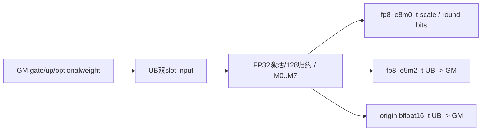

```block-beta
 columns 1
 G["可选counts双槽+sum32 -> V_S -> Reset"]
 M["main: weight(w2) + origin(2) + x0(2) + x1(2) + y(2) + scale(2)"]
```

##### 字节账与复用顺序

```text
Umain=8R A16F+2R A32F+2A32(RSF)+w8A8R+4R A16F
UBpeak=max(group?16A4GF+32:0,Umain)
GM有效名义读=4LC+w4L+group*8E*launch_cores
GM有效名义写=LC+LS+2LC
正式输出allocation=3NC+NS B
main资源IDs=8+2w+2；group已消费2，Reset不恢复mask
```

按无算术溢出/窄化域推导，名义传输不等运行成功保证。不round时额外float写4maSF为错误请求，不代表实际已分配足够空间。

| 边/复用子区 | producer | offset/extent | dtype/layout | consumer | ordering/sync | owner/lifetime | 安全条件 |
|---|---|---|---|---|---|---|---|
| group→main | count VF/scalar | 同poolbase，Ug→Umain | int64→多queue | main | V_S读sum+Reset三barrier | 旧view失效 | 字节max成立，bufID条件独立 |
| weight跨D | MTE2 | T | FP32 | VF M1/3/5/7 | DeQue→最后D后Free | 当前row块 | 无weight子路线不分配 |
| scale/y→GM | VF | 双slot | fp8_e8m0_t/fp8_e5m2_t | MTE3 | EnQue/DeQue/Free | 当前D片 | r=False的错误store不得忽略 |
| origin→GM | VF | O | bfloat16_t | MTE3 | y/scale之后独立queue搬出 | 当前D片 | 前L行有效，不能反馈到量化 |

#### 同步、精度与尾块

##### 同步与数值边界表

| 阶段 | primitive/机制 | producer | consumer/等待点 | 保护对象 | 精度/尾块 |
|---|---|---|---|---|---|
| counts | queue/ZEROING尾/V_S/Reset | MTE2/VF | scalar/main | group UB | 非负sum/无窄化前提 |
| 激活 | FP32 Exp/Div/Mul/Add0 | bfloat16_t | VF归约/origin | 128值组 | M0…M7 clamp/weight精确开关 |
| scale | maxAbs≥1e-4、/448、可选bit round | FP32 a | q/scaleGM | fp8_e8m0_t | 非round类型错；roundE8编码 |
| y/origin | CAST_RINT/NO_SAT，CTRL60=0 | FP32 a/q | outputqueues | 当前D片 | origin按输入dtypeRINT；fa128倍数无reminder执行体 |
| 结束 | 队列/stream/恢复CTRL60 | 当前Kernel | 外部caller | GM/tensor | 无自有Host同步等待、无核间sum |

#### 关键实现

##### 符号证据表

| 阶段 | 文件 | 符号/模板实例 | 实现事实 |
|---|---|---|---|
| Host/Tiling producer | csrc/activation/swiglu_group_quant/op_host/swiglu_group_quant.cpp | CalcFp8QuantOpTiling | O=1、Ts=fp8_e8m0_t、R/F/U |
| Kernel entry/router | csrc/activation/swiglu_group_quant/op_kernel/swiglu_group_quant.cpp | RUN_FP8(bfloat16_t,fp8_e5m2_t,fp8_e8m0_t,true) | key32/code7 |
| Device body/helper | csrc/activation/swiglu_group_quant/op_kernel/swiglu_group_quant_base.h | V<fp8_e5m2_t,bfloat16_t,fp8_e8m0_t,r,c,true,w> | M0…M7八个实例全列于执行矩阵 |

## 算子特定优化

### Trick T-001：128值scale在寄存器内按float位构造上取2幂

#### 触发与源码依据

全部typed Route的M4…M7启用round；M0…M3采用相邻源码中的非round公式。Golden来源：[固定源码799–814行](https://github.com/sgl-project/sgl-kernel-npu/blob/dda6d36b0cdb4081e102d14c0a2fb276fc416e69/csrc/activation/swiglu_group_quant/op_kernel/swiglu_group_quant_base.h#L799-L814)。

```cpp
                Max(scale, scale0, scale1, pregMerge);
                Maxs(clampScale, scale, 0.0001f, pregMerge);  // amax

                Mul(scale, clampScale, (RegTensor<float> &)coeff, pregMerge);  // sf = amax / 448.0
                if constexpr (!hasRoundScale) {
                    Div(invScale, invCoeff, clampScale, pregMerge);
                    DataCopy<float, AscendC::MicroAPI::StoreDist::DIST_FIRST_ELEMENT_B32>(
                        (__local_mem__ float *)scaleLocalAddr + j + i * scaleColNum, scale,
                        pregMerge);  // copy out scale
                } else {
                    // bits == (RegTensor<uint32_t>&)scale
                    ShiftRights(scale2, (RegTensor<uint32_t> &)scale, static_cast<int16_t>(FAST_LOG_SHIFT_BITS),
                                pregMerge);
                    And(scale2, scale2, tmp0, pregMerge);                        // exp
                    And(scale3, (RegTensor<uint32_t> &)scale, tmp1, pregMerge);  // man_bits
                    Compare<uint32_t, AscendC::CMPMODE::NE>(compareMask0, scale3, zeroUint32, pregMerge);
```

#### 机制与设计原因

先amax下限1e-4、乘1/448，round路线从FP32 exponent和mantissa得到ceil二进制指数；同一k产生scale与inverse，避免每元素log/exp。FP32和E8分别存2^k float或k+127字节。非round路线使用448/amax inverse，数学与round不同；E8非round的硬floatstore是原实现缺陷，不能作为该trick安全用法。

#### 迁移边界

正规有限positive s条件下才用理想ceil(log2)解释；NaNInf与异常位模式必须按源码处理。每组128，不能套mode2 exponent算法。本次未编译、运行或测试。

#### 错误做法

只把scale换E8 dtype却沿用非roundfloatstore，会令编码与容量不匹配；当前源码正有此可复验缺陷。

### Trick T-002：可选origin直接复用FP32激活并独立双槽写回

#### 触发与源码依据

key32/outputOrigin=True的typed Route；Golden来源：[固定源码95–106行](https://github.com/sgl-project/sgl-kernel-npu/blob/dda6d36b0cdb4081e102d14c0a2fb276fc416e69/csrc/activation/swiglu_group_quant/op_kernel/swiglu_fp8_quant_per_token.h#L95-L106)。

```cpp
            hasTopkWeight_ = true;
            topkWeightGm.SetGlobalBuffer((__gm__ float *)topkWeight);
            tBufPool.InitBuffer(topkWeightQue, 2, RoundUp<float>(tilingData->rowFactor) * sizeof(float));
        }
        if constexpr (outputOrigin) {
            yOriginGm.SetGlobalBuffer((__gm__ T0 *)yOrigin);
            tBufPool.InitBuffer(yOriginQue, 2, tilingData->rowFactor * RoundUp<T0>(tilingData->dFactor) * sizeof(T0));
        }

        tBufPool.InitBuffer(x0Que, 2, tilingData->rowFactor * RoundUp<T0>(tilingData->dFactor) * sizeof(T0));
        tBufPool.InitBuffer(x1Que, 2, tilingData->rowFactor * RoundUp<T0>(tilingData->dFactor) * sizeof(T0));
        tBufPool.InitBuffer(yQue, 2, tilingData->rowFactor * RoundUp<T1>(tilingData->dFactor) * sizeof(T1));
```

#### 机制与设计原因

origin有自己的输入dtype双槽，仅开启时分配/写回；VF在量化前已有FP32激活，顺手RINT存origin，不额外重算SwiGLU或创建GM FP32中间。量化继续使用原FP32激活，origin舍入不能改变scale。这省去重复数学的结构事实未经性能验证。

#### 迁移边界

增加O=4R A16F B，以及2个bufID。group+weight+origin组合在固定3510 SDK Reset保留已消耗mask时会无足够独立ID，必须保留限制，不把字节fit当完整资源安全。未执行编译、真机、数值或性能测试。

#### 错误做法

先把origin写为输入dtype，再读它来量化，会改成不同数学；当前源码量化不读origin。

## 模板与实现对比

| 对比维度 | FP32scale typed Routes | E8scale typed Routes | 设计选择依据 |
|---|---|---|---|
| 命中条件/优先级 | ue8False，x/y/origin各独立 | ue8True，x/y/origin各独立 | entry dtype bit2 |
| 执行族/节点图 | 单AIV、每typed八maskBit | 同左 | 无Cube |
| M/N/K、tile 与 scheduler | R/F128对齐、可选group重分核 | 同左 | Host基于U预算 |
| workspace/L1/L0/UB | scale双槽8A8(RSF) | scale双槽2A32(RSF)，增R仍按FP32保守估计 | 实际dtype容量 |
| AIC/AIV 或 kernel 交接 | 无 | 无 | 同核VF/queue |
| 同步、精度与 tail | !round写s，round写2^k | round写E8；!round仍硬floatstore缺陷 | 保留真实分支 |
| fallback/失败边界 | 可选origin/weight/count bufID条件 | 另有E8非round编码/越槽条件 | 无safe fallback，draft |

## 平台差异

| 项目 | A2 | A3 | Ascend 950 |
|---|---|---|---|
| 支持状态 | 公开原生不支持 | 同左 | arch35公开支持/3510构建 |
| Host/Launcher | 不扩展 | 不扩展 | SGL ACLNN/currentstream |
| Kernel/资源 | 不外推 | 不外推 | AIV/Reg，pool12，实际U查询 |
| 本次验证 | 未执行 | 未执行 | 未执行，draft |

## 限制与失败边界

- E8且roundFalse可达：Ts=fp8_e8m0_t，scale单slot=A32(RSF)B，VF !round却float*连续写4maSF B。正确编码不成立；若4maSF>A32(RSF)则跨该slot。整数不溢出且R=ma1/F8192/SF64的条件例：单slot64B、floatstore跨度256B；若Host U容许该R/F即可达。不要推成所有shape越槽，也不宣称越出整个UB或已复现故障。随后Compact按E8字节拷出，不能修复错误storage。
- group&&weight&&origin：固定SDK3510 InitBufPool为pool12预留12个MutexID，group queue InitBuffer耗2，group sum TBuf不耗ID；Reset仅barrier/curBufSize/maxAddr复位，不恢复availableIdMask。main六个双slotqueue要12，累计需要14个不同位，最后分配无剩余software mask位；SDK调用sff1时不能保证再得到合法独立bufID。仅字节fit及curBufSize≤12不足以证明安全；不把未知sff1(0)返回或assert行为编造成真机终点。
- public d256倍数使fa128倍数，VF只实现完整128组，loopCountReminder变量未消费；裸d0/空形状仍缺完整guard。adapterN0早退不等于裸Host所有空域稳定支持。
- 两FP8目标都用448，mode3不是mode1 E5M2除57344。quant用FP32原激活，origin舍入不反馈；mode2则不同，不能混卡。
- round位构造对正常有限positive scale可等价2幂上取，非有限位模式不保证理想数学。CTRL60=0为单指令模式，最终cast NO_SAT/RINT，不能照错误注释称强制全局饱和。
- counts非负、int64sum无溢出/下游int32或uint16转换不窄化是必要前提；API可选Tensor合同未完整检查。只定义前L有效行，origin关闭时全域未写。
- source_closed只表示可追溯固定代码与SDK primitive，不表运行正确。本次未安装、编译、真机、数值或性能测试，draft不可当安全可用/收益验证的推荐。

## 源码索引

### 链路索引

| 链路阶段 | 文件 | 关键符号 | 支撑内容 |
|---|---|---|---|
| 公开合同 | [docs/api/zh/operators/activation/swiglu_group_quant.md](https://github.com/sgl-project/sgl-kernel-npu/blob/dda6d36b0cdb4081e102d14c0a2fb276fc416e69/docs/api/zh/operators/activation/swiglu_group_quant.md) | swiglu_group_quant | mode3/950/128值FP8，round/E8/origin显式属性路线 |
| 适配 | [csrc/activation/swiglu_group_quant/torch_adapter.cpp](https://github.com/sgl-project/sgl-kernel-npu/blob/dda6d36b0cdb4081e102d14c0a2fb276fc416e69/csrc/activation/swiglu_group_quant/torch_adapter.cpp) | ConstructOutputs/swiglu_group_quant | 可选Tensor存在性、分配/ACLNN/stream |
| Host/Infer/OpDef | [csrc/activation/swiglu_group_quant/op_host/swiglu_group_quant.cpp](https://github.com/sgl-project/sgl-kernel-npu/blob/dda6d36b0cdb4081e102d14c0a2fb276fc416e69/csrc/activation/swiglu_group_quant/op_host/swiglu_group_quant.cpp) | SwigluGroupQuantTiling/InferShapeSwigluGroupQuant | 行列/专家tiling、workspace、dtype/shape |
| POD | [csrc/activation/swiglu_group_quant/op_kernel/swiglu_group_quant_tiling_data.h](https://github.com/sgl-project/sgl-kernel-npu/blob/dda6d36b0cdb4081e102d14c0a2fb276fc416e69/csrc/activation/swiglu_group_quant/op_kernel/swiglu_group_quant_tiling_data.h) | SwigluGroupQuantTilingData | 212B packed/28字段/bit code |
| entry | [csrc/activation/swiglu_group_quant/op_kernel/swiglu_group_quant.cpp](https://github.com/sgl-project/sgl-kernel-npu/blob/dda6d36b0cdb4081e102d14c0a2fb276fc416e69/csrc/activation/swiglu_group_quant/op_kernel/swiglu_group_quant.cpp) | sgl_swiglu_group_quant | AIV_ONLY、key1与dtype、CTRL60保存恢复 |
| 模式3body | [csrc/activation/swiglu_group_quant/op_kernel/swiglu_fp8_quant_per_token.h](https://github.com/sgl-project/sgl-kernel-npu/blob/dda6d36b0cdb4081e102d14c0a2fb276fc416e69/csrc/activation/swiglu_group_quant/op_kernel/swiglu_fp8_quant_per_token.h) | SwigluFp8QuantPerToken<Tx,Ty,Ts,origin>::Init/Process | maskBit八路、origin/scale队列、row/D/counter生命周期 |
| 共享VF/搬运 | [csrc/activation/swiglu_group_quant/op_kernel/swiglu_group_quant_base.h](https://github.com/sgl-project/sgl-kernel-npu/blob/dda6d36b0cdb4081e102d14c0a2fb276fc416e69/csrc/activation/swiglu_group_quant/op_kernel/swiglu_group_quant_base.h) | VFProcessSwigluFp8QuantPerToken/Fp8QuantPerTokenDispatcher/YOrigin/VFSwiGlu/GroupIndex/CopyIn/Out | FP32 amax floor1e-4 /448 /round bit构造/错误E8非round写入 |
| 构建声明 | [csrc/activation/swiglu_group_quant/CMakeLists.txt](https://github.com/sgl-project/sgl-kernel-npu/blob/dda6d36b0cdb4081e102d14c0a2fb276fc416e69/csrc/activation/swiglu_group_quant/CMakeLists.txt) | sgl_register_operator | 3510 only与实际native源 |
| 共享适配 | [csrc/aclnn_torch_adapter/aclnn_runtime.h](https://github.com/sgl-project/sgl-kernel-npu/blob/dda6d36b0cdb4081e102d14c0a2fb276fc416e69/csrc/aclnn_torch_adapter/aclnn_runtime.h) | op_api_symbol/tensor_descriptor | vendor动态库与描述符生命周期 |
| domain入口 | [csrc/cmake/domains.cmake](https://github.com/sgl-project/sgl-kernel-npu/blob/dda6d36b0cdb4081e102d14c0a2fb276fc416e69/csrc/cmake/domains.cmake) | sgl_add_cann_operator_domains | 域接线 |
| 算子解析 | [csrc/cmake/operators.cmake](https://github.com/sgl-project/sgl-kernel-npu/blob/dda6d36b0cdb4081e102d14c0a2fb276fc416e69/csrc/cmake/operators.cmake) | sgl_resolve_operator/sgl_select_cann_operators | 架构过滤、源角色与唯一Kernel |
| 生成接线 | [csrc/cmake/cann_ops.cmake](https://github.com/sgl-project/sgl-kernel-npu/blob/dda6d36b0cdb4081e102d14c0a2fb276fc416e69/csrc/cmake/cann_ops.cmake) | sgl_generate_cann_interfaces/sgl_add_cann_tiling/sgl_add_cann_host_libraries/sgl_add_cann_kernels | OpDef生成ACLNN、tiling/host/kernel库 |
| 构建入口 | [csrc/CMakeLists.txt](https://github.com/sgl-project/sgl-kernel-npu/blob/dda6d36b0cdb4081e102d14c0a2fb276fc416e69/csrc/CMakeLists.txt) | SGL_ARCH_VERSION/SGL_CANN_BUILD_STAGE | 独立CANN构建阶段与vendor包 |
| 平台映射 | [csrc/cmake/architectures.json](https://github.com/sgl-project/sgl-kernel-npu/blob/dda6d36b0cdb4081e102d14c0a2fb276fc416e69/csrc/cmake/architectures.json) | 2201/3510 | 910b/910_93/950 |
| 公开构建说明 | [python/sgl_kernel_npu/README.md](https://github.com/sgl-project/sgl-kernel-npu/blob/dda6d36b0cdb4081e102d14c0a2fb276fc416e69/python/sgl_kernel_npu/README.md) | architecture mapping/REFACTOR | arch22/35与直接ACLNN用途 |
| 版本配置 | [.github/workflows/pr-test-kernels.yml](https://github.com/sgl-project/sgl-kernel-npu/blob/dda6d36b0cdb4081e102d14c0a2fb276fc416e69/.github/workflows/pr-test-kernels.yml) | test-fused-ops等版本矩阵 | CANN9.1.0、a3/950配置，非本次执行 |
| CI消费 | [.github/workflows/pr-test-kernel-group.yml](https://github.com/sgl-project/sgl-kernel-npu/blob/dda6d36b0cdb4081e102d14c0a2fb276fc416e69/.github/workflows/pr-test-kernel-group.yml) | run-kernel-group | 复用版本容器参数 |
| SDK资源声明 | [include/basic_api/kernel_tpipe.h](https://gitcode.com/cann/asc-devkit/blob/e5451c7feba11f9e259f4fbc19c4bf82f8c0496c/include/basic_api/kernel_tpipe.h) | TBufPool/TQue/TPipe | 3510选择ExtImpl |
| SDK pool基类 | [impl/basic_api/kernel_tpipe_base.h](https://gitcode.com/cann/asc-devkit/blob/e5451c7feba11f9e259f4fbc19c4bf82f8c0496c/impl/basic_api/kernel_tpipe_base.h) | TBufPoolExtImpl | 字段/资源位置 |
| SDK编译分流 | [impl/basic_api/kernel_tpipe_impl.h](https://gitcode.com/cann/asc-devkit/blob/e5451c7feba11f9e259f4fbc19c4bf82f8c0496c/impl/basic_api/kernel_tpipe_impl.h) | __NPU_ARCH__==3510 | 实际两个c310实现 |
| SDK pool资源 | [impl/basic_api/dav_3510/kernel_tpipe_impl_c310.h](https://gitcode.com/cann/asc-devkit/blob/e5451c7feba11f9e259f4fbc19c4bf82f8c0496c/impl/basic_api/dav_3510/kernel_tpipe_impl_c310.h) | TPipe::InitBufPool | 字节对齐/MutexID池 |
| SDK3510资源/队列 | [impl/basic_api/dav_3510/kernel_tpipe_impl_c310_vec.h](https://gitcode.com/cann/asc-devkit/blob/e5451c7feba11f9e259f4fbc19c4bf82f8c0496c/impl/basic_api/dav_3510/kernel_tpipe_impl_c310_vec.h) | TBufPoolExtImpl::Reset/InitBuffer/TQueBind | 三pipebarrier、offset回绕、双块/队列同步 |
| SDK兼容命名 | [impl/basic_api/kernel_macros.h](https://gitcode.com/cann/asc-devkit/blob/e5451c7feba11f9e259f4fbc19c4bf82f8c0496c/impl/basic_api/kernel_macros.h) | namespace MicroAPI=Reg | 实际Reg API别名 |
| SDK scalar声明 | [include/basic_api/reg_compute/kernel_reg_compute_vec_binary_scalar_intf.h](https://gitcode.com/cann/asc-devkit/blob/e5451c7feba11f9e259f4fbc19c4bf82f8c0496c/include/basic_api/reg_compute/kernel_reg_compute_vec_binary_scalar_intf.h) | Adds | ZEROING默认 |
| SDK scalar转发 | [impl/basic_api/reg_compute/kernel_reg_compute_vec_binary_scalar_intf_impl.h](https://gitcode.com/cann/asc-devkit/blob/e5451c7feba11f9e259f4fbc19c4bf82f8c0496c/impl/basic_api/reg_compute/kernel_reg_compute_vec_binary_scalar_intf_impl.h) | Adds | 当前AddsImpl |
| SDK tail清零 | [impl/basic_api/reg_compute/dav_3510/kernel_reg_compute_vec_binary_scalar_impl.h](https://gitcode.com/cann/asc-devkit/blob/e5451c7feba11f9e259f4fbc19c4bf82f8c0496c/impl/basic_api/reg_compute/dav_3510/kernel_reg_compute_vec_binary_scalar_impl.h) | AddsImpl | ZEROING限定，group reduce tail |
| SDK选择入口 | [impl/basic_api/reg_compute/kernel_reg_compute_vec_cmpsel_intf_impl.h](https://gitcode.com/cann/asc-devkit/blob/e5451c7feba11f9e259f4fbc19c4bf82f8c0496c/impl/basic_api/reg_compute/kernel_reg_compute_vec_cmpsel_intf_impl.h) | Select | 对应SelectImpl |
| SDK选择实现 | [impl/basic_api/reg_compute/dav_3510/kernel_reg_compute_vec_cmpsel_impl.h](https://gitcode.com/cann/asc-devkit/blob/e5451c7feba11f9e259f4fbc19c4bf82f8c0496c/impl/basic_api/reg_compute/dav_3510/kernel_reg_compute_vec_cmpsel_impl.h) | SelectImpl/vsel | 真mask取src0 |
| SDK Select合同 | [docs/api/SIMD-API/基础API/Reg矢量计算/比较与选择/Select-43.md](https://gitcode.com/cann/asc-devkit/blob/e5451c7feba11f9e259f4fbc19c4bf82f8c0496c/docs/api/SIMD-API/基础API/Reg矢量计算/比较与选择/Select-43.md) | Select | mask1选src0、0选src1 |
| SDK CTRL合同 | [docs/api/SIMD-API/基础API/特殊寄存器访问/SetCtrlSpr_ISASI.md](https://gitcode.com/cann/asc-devkit/blob/e5451c7feba11f9e259f4fbc19c4bf82f8c0496c/docs/api/SIMD-API/基础API/特殊寄存器访问/SetCtrlSpr_ISASI.md) | CTRL[60]/Cast SatMode | 0单指令，NO_SAT非饱和 |

### 实现复用检查

| 检查项 | 可复用事实 | 不得改变的约束 | 源码符号 |
|---|---|---|---|
| ABI/POD | 212B/28字段、31/32、dtype bits与8maskBit | 128个真实模板逐项在矩阵，active flags不当inactive | POD/entry/dispatcher |
| 调用顺序 | group/V_S/Reset→main，origin量化前产生 | 不读回origin代替FP32激活 | PerToken/VF |
| workspace/内存 | 实际double2、O/T/scale字节、UBstage max | E8非round原错误store、bufID独立约束 | InitBuffer/SDK |
| 同步 | queue、V_S、Reset三barrier、CTRL恢复 | Reset不恢复available ID mask，不虚构核间sum | SDK/entry |
| 精度与尾块 | 128组、amax≥1e-4、/448、round bit构造 | 两目标同448，FP8NO_SAT/RINT，origin可选 | VF |
| 失败边界 | 真实静态条件可复查 | 未测试，不保证所有域正确安全 | Host/VF/SDK |
