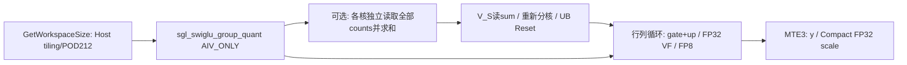
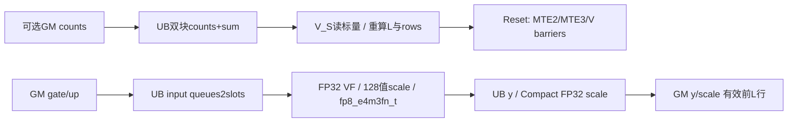
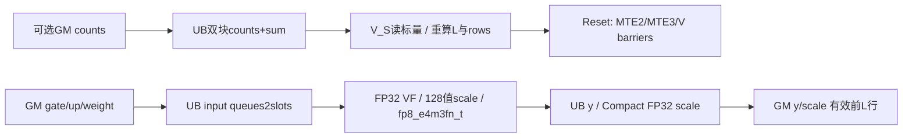
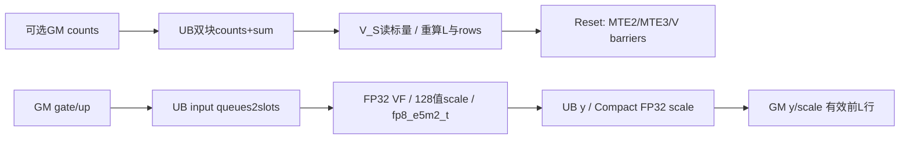

# SwigluGroupQuantFP8 950 ACLNN 算子知识

## 算子速览

| 项目 | 内容 |
|---|---|
| 实际入口 | `aclnnSglSwigluGroupQuantGetWorkspaceSize/aclnnSglSwigluGroupQuant`，本卡固定`quant_mode==1` |
| 计算语义 | gate/up分半，FP32 SwiGLU，按可选clamp与逐行weight处理，每128值amax/目标FP8上限生成FP32 scale，再转E4M3FN/E5M2 |
| 输入输出 | FP16/BF16 x[...,2C]→FP8 y[...,C]、FP32 scale[...,C/128]；y_origin分配但mode1不写 |
| 执行类型 | 单AIV_VECTOR，VF/Reg计算；所有可达节点无Cube/MIX/SIMT |
| Kernel 路线 | R-001…R-016=输入2dtype×输出2FP8×weight有无×clamp有无；各自覆盖group前缀有无、整列/切列、前核/尾核及行尾 |
| 核心资源 | 主阶段UB=8R·A16(F)+2R·A32(F)+8A8(R·ceil(F/128))+weight·8A8(R)；专家阶段16A4(GF)+32，Reset后复用取max |
| 来源闭包 | `source_closed`：adapter/OpDef/Infer/Tiling、212B POD、key1/dtype、Init/Process、全部实际VF/helper、3510资源SDK及构建链闭合；量化/非有限/边界未经运行验证 |
| 验证状态 | draft；本次未执行安装、编译、真机、数值或性能测试。CTRL60=0是单指令模式，不能按源码注释误称强制全局饱和 |

## 接口与语义

### 计算语义

N为前导维乘积，C=d/2，S=ceil(C/128)。公开mode1要求d%256=0，因此C/128整除。对合法非负group counts，实际有效行数L为无group时N、有group时min(N,sum(counts))。仅前L行y/scale有定义；其余行保持empty分配内容。输入不修改。

```text
gate = float32(x[n,0:C]); up = float32(x[n,C:2C])
if has_clamp: gate=min(gate,c); up=min(max(up,-c),c)
a = gate / (1+exp(-gate)) * up
if has_weight: a *= topk_weight[n]
for each 128-value block:
  ordinary finite domain: scale = max(abs(a)) / R
  R = 448 for E4M3FN, 57344 for E5M2
  if block all zero: stored scale=0; NaN quotient path selects original zero
  else q = a / scale
  y = FP8_CAST_RINT_NO_SAT(q)
```

实际VF还用`a*0`的自比较、mask、ReduceMax、Min(inf)和Select处理NaN/Inf；并非简单调用torch.amax。对非有限值保留原始指令序列见公共Kernel，不能由有限域公式推定跨后端一致。mode1没有amax下限1e-4或固定448覆盖E5M2；这些属于别的冻结模式。round_scale/ue8m0_scale/output_origin在mode1不改变数值，origin始终未写。group_size兼容参数没有进入ACLNN attrs，不改变128分组。

### 输入、输出与属性

| 参数 | shape/layout | dtype | 约束、默认值与语义 |
|---|---|---|---|
| x | [...,2C]连续ND | FP16/BF16 | rank≥1、公开mode1 d%256=0、同NPU |
| topk_weight | 可空或[N]连续 | FP32 | adapter仅按defined且numel>0判断存在；合法shape/dtype/device是调用方合同 |
| group_index | 可空或[E]连续 | int64 | group_list_type0、非负计数；None/空经adapter传真正nullptr |
| quant_mode | scalar int64 | — | 本卡严格1；其它模式分别独立任务 |
| dst_type/y_e5m2 | dtype/bool | — | E4M3FN默认或E5M2，决定R与dtype bit1 |
| group_size | scalar int64 | — | 兼容参数，adapter不转发 |
| clamp_value/has_clamp_value | double→float/bool | — | 默认0关闭；adapter用!=0，裸ACLNN显式bool；公开正值clamp语义 |
| round_scale | bool | — | mode1 inactive |
| ue8m0_scale | bool | — | mode1 inactive；scale仍FP32 |
| output_origin | bool | — | mode1 inactive；不可读取origin |
| group_list_type | int64 | — | 仅0，否则adapter/Host失败 |
| y | [...,C]连续 | FP8 E4M3FN/E5M2 | 新storage，前L行写 |
| scale | [...,C/128]连续 | FP32 | 新storage，前L行写，UB Compact搬出 |
| y_origin | [...,C]连续 | x dtype | 返回但此模式全域未定义 |

### 入口与版本

复用已全文阅读的[SGL三种SwiGLU量化API](../../../../apis/sgl_kernel_npu/sgl_swiglu_group_quant.md)。固定SGL提交`dda6d36b0cdb4081e102d14c0a2fb276fc416e69`；CANN9.1.0为固定README/CI版本配置。SDK官方v9.1.0固定`e5451c7feba11f9e259f4fbc19c4bf82f8c0496c`，不是所有同名二进制SDK的等价保证。仅950：公开ascendc arch35支持、arch22不支持，当前CMake3510及生成SGL_CANN_CONFIGS一致。普通官方`aclnnSwigluGroupQuant`为不同符号/版本，不能套用其quantMode编号与额外Route。

## Host/Launcher 执行流程

### 参数校验与前处理

adapter依次检查x rank/dtype/连续、模式1/2/3、dst_type、模式1宽度%256和%2→把可选输入统一为present&&defined&&numel>0→DeviceGuard(x.device)→分配y/scale/origin→算N，N0直接返回三空输出→group_list_type0→构造6个ND descriptors、为tensor记录当前NPU stream→query→分配并record_stream工作区→RunOpApi执行。可选Tensor的shape/dtype/同device/连续性未像公开合同那样完整校验，descriptor用预定ACL_FLOAT/INT64；不把裸指针误用当合法支持。

Host callback读x storage rank、N/d、可选shape存在性E、attrs及平台。GetShapeAttrs检查d偶数、合法mode、mode3宽度%256、group_list_type0；mode1缺少独立d%256检查。再算C/S、group tiling、row/column tiling、填POD。无Contiguous修复或Torch数学fallback。裸ACLNN N0/d0/空group的行为不能套用adapter N0早退，Host没有完整正维保护。

### 参数、Workspace 与生命周期

Host工作区`W=platform.GetLibApiWorkSpaceSize()+32`字节，kernel只检查非空然后透传，各模式1body不读。区分平台库查询值与自有32B；不能套用系统常数或把不读当允许nullptr。adapter按query真实W分配Byte Tensor，≤INT64_MAX后转换。x、可选输入、3输出、workspace record_stream，lambda捕获tensor/descriptors/workspace/executor/stream；调用异步返回需保活，SGL动态库句柄静态保持；生成executor内部ABI/释放为框架边界。

POD212B由CANN raw tiling管理，entry逐字段复制25int64+clampValue，dtype/key直接从GM读为局部，不用GM struct按值转换。LocalTensor/TPipe/POD副本在当前kernel内；group计数UB与主计算UB分阶段复用，不使用GM中间结果。正式输出allocation`3NC+4NS`字节，含未写origin2NC；不把实际有效前缀L替代输出分配N。

### 启动图与失败传播



无group grid=usedCoreNums；有group grid=coreNumAiv，所有launch核先独立求sum，再Process跳过core_idx≥实际usedCoreNums。没有核间归约/SyncAll/atomic，group sum不是共享GM通信。workspace nullptr立即返回不写输出；unknown key无body，仍恢复CTRL。成功key1只进Group类，模式2/31/32不纳本卡。同步query/launch错误抛出，异步错误由框架暴露，无后端fallback。

## Route 与参数设计

### 分核与资源计算

记Ae(t)=向上对齐t到e元素；U为平台查询UB字节，P为AIV核数(查询≤0则Host修为1)。GF由group tiling选择：专家阶段`Ug=16A4(GF)+32`；初始GF=E，若不适配则从base2递增取ceil(E/base)，满足Ug<U后若GF>16向下对齐16；gLoop=ceil(E/GF)、tailGF=E%GF或GF。无group这些POD字段0。

N正时former=ceil(N/P)，used=min(ceil(N/former),P)，tail=N-(used-1)former，R初始min(former,1)=1。模式1一整行主阶段`Um(R,F)=8R·A16(F)+2R·A32(F)+8A8(R·ceil(F/128))+w·8A8(R)`。若Um(1,C)≤U则F=C；否则枚举F=128,256,…≤C，取最后满足Um(1,F)≤U者，没有候选则Tiling失败；tailF=C-(dLoop-1)F。仅F=C时继续逐一增R直到下一个不fit，回退1；F<C时R保持1。然后分别计算前核/尾核rowLoop及tailRowFactor。

实际group存在时Device先计算L，再以相同P与已选R重算former/tail/loops；不会为更小L重新选择R/F。helper`CeilDiv/RoundUp`参数为int32，VF curRowNum/curGroupNum为uint16，Host POD为int64：内存预算、计数和地址数学结论都要求相关转换/乘法未溢出或窄化。不能只凭宽POD假设所有下游64位计算。

### Route 选择

| 顺序 | Route | Key/模板 | 精确选择条件与优先级 | 不适用去向 |
|---:|---|---|---|---|
| 1 | R-001 | key1,dtype0,VF<fp8_e4m3fn_t,half,float,false,false> | x=half,y=fp8_e4m3fn_t,topk指针空,hasClampValue=0 | 同key其它组合取对应实例；非法输入Host/框架失败 |
| 2 | R-002 | key1,dtype0,VF<fp8_e4m3fn_t,half,float,false,true> | x=half,y=fp8_e4m3fn_t,topk指针空,hasClampValue=1 | 同key其它组合取对应实例；非法输入Host/框架失败 |
| 3 | R-003 | key1,dtype0,VF<fp8_e4m3fn_t,half,float,true,false> | x=half,y=fp8_e4m3fn_t,topk指针非空,hasClampValue=0 | 同key其它组合取对应实例；非法输入Host/框架失败 |
| 4 | R-004 | key1,dtype0,VF<fp8_e4m3fn_t,half,float,true,true> | x=half,y=fp8_e4m3fn_t,topk指针非空,hasClampValue=1 | 同key其它组合取对应实例；非法输入Host/框架失败 |
| 5 | R-005 | key1,dtype2,VF<fp8_e5m2_t,half,float,false,false> | x=half,y=fp8_e5m2_t,topk指针空,hasClampValue=0 | 同key其它组合取对应实例；非法输入Host/框架失败 |
| 6 | R-006 | key1,dtype2,VF<fp8_e5m2_t,half,float,false,true> | x=half,y=fp8_e5m2_t,topk指针空,hasClampValue=1 | 同key其它组合取对应实例；非法输入Host/框架失败 |
| 7 | R-007 | key1,dtype2,VF<fp8_e5m2_t,half,float,true,false> | x=half,y=fp8_e5m2_t,topk指针非空,hasClampValue=0 | 同key其它组合取对应实例；非法输入Host/框架失败 |
| 8 | R-008 | key1,dtype2,VF<fp8_e5m2_t,half,float,true,true> | x=half,y=fp8_e5m2_t,topk指针非空,hasClampValue=1 | 同key其它组合取对应实例；非法输入Host/框架失败 |
| 9 | R-009 | key1,dtype1,VF<fp8_e4m3fn_t,bfloat16_t,float,false,false> | x=bfloat16_t,y=fp8_e4m3fn_t,topk指针空,hasClampValue=0 | 同key其它组合取对应实例；非法输入Host/框架失败 |
| 10 | R-010 | key1,dtype1,VF<fp8_e4m3fn_t,bfloat16_t,float,false,true> | x=bfloat16_t,y=fp8_e4m3fn_t,topk指针空,hasClampValue=1 | 同key其它组合取对应实例；非法输入Host/框架失败 |
| 11 | R-011 | key1,dtype1,VF<fp8_e4m3fn_t,bfloat16_t,float,true,false> | x=bfloat16_t,y=fp8_e4m3fn_t,topk指针非空,hasClampValue=0 | 同key其它组合取对应实例；非法输入Host/框架失败 |
| 12 | R-012 | key1,dtype1,VF<fp8_e4m3fn_t,bfloat16_t,float,true,true> | x=bfloat16_t,y=fp8_e4m3fn_t,topk指针非空,hasClampValue=1 | 同key其它组合取对应实例；非法输入Host/框架失败 |
| 13 | R-013 | key1,dtype3,VF<fp8_e5m2_t,bfloat16_t,float,false,false> | x=bfloat16_t,y=fp8_e5m2_t,topk指针空,hasClampValue=0 | 同key其它组合取对应实例；非法输入Host/框架失败 |
| 14 | R-014 | key1,dtype3,VF<fp8_e5m2_t,bfloat16_t,float,false,true> | x=bfloat16_t,y=fp8_e5m2_t,topk指针空,hasClampValue=1 | 同key其它组合取对应实例；非法输入Host/框架失败 |
| 15 | R-015 | key1,dtype3,VF<fp8_e5m2_t,bfloat16_t,float,true,false> | x=bfloat16_t,y=fp8_e5m2_t,topk指针非空,hasClampValue=0 | 同key其它组合取对应实例；非法输入Host/框架失败 |
| 16 | R-016 | key1,dtype3,VF<fp8_e5m2_t,bfloat16_t,float,true,true> | x=bfloat16_t,y=fp8_e5m2_t,topk指针非空,hasClampValue=1 | 同key其它组合取对应实例；非法输入Host/框架失败 |

```text
quant_mode=1 -> POD.key1; dtype bit0=xBF16, bit1=yE5m2, bit2=0
  group ptr nullptr -> Host row tiling
  group ptr non-null -> groupListType0 -> 每核sumcounts -> L -> Device row tiling -> Reset
  x dtype x y dtype x weight presence x clamp flag -> R-001..R-016 exact VF
    F=C -> 可多行R；F<C -> R1、列切片128倍数
    former/tail core -> full/tail row loop -> full/tail D loop -> y/scale
```

### 模板/实现执行矩阵

| Route | key/selector | dtype/shape/platform 完整命中条件 | 执行族与 kernel 节点 | 实际模板/body | 内存与同步特征 | tail/fallback |
|---|---|---|---|---|---|---|
| R-001 | key1/dtype0/w0/c0 | 950，公共mode1合同，half→fp8_e4m3fn_t，Rmax448 | 单AIV_VECTOR | SwigluGroupQuantPerf<half,fp8_e4m3fn_t,float>→VFProcessSwigluGroupQuant<fp8_e4m3fn_t,half,float,false,false> | Um含weight0；group前stage可有无，Reset后max(Ug,Um) | row/D尾；裸mode1非128倍有VF reminder分支但超公开域；无回退 |
| R-002 | key1/dtype0/w0/c1 | 950，公共mode1合同，half→fp8_e4m3fn_t，Rmax448 | 单AIV_VECTOR | SwigluGroupQuantPerf<half,fp8_e4m3fn_t,float>→VFProcessSwigluGroupQuant<fp8_e4m3fn_t,half,float,false,true> | Um含weight0；group前stage可有无，Reset后max(Ug,Um) | row/D尾；裸mode1非128倍有VF reminder分支但超公开域；无回退 |
| R-003 | key1/dtype0/w1/c0 | 950，公共mode1合同，half→fp8_e4m3fn_t，Rmax448 | 单AIV_VECTOR | SwigluGroupQuantPerf<half,fp8_e4m3fn_t,float>→VFProcessSwigluGroupQuant<fp8_e4m3fn_t,half,float,true,false> | Um含weight1；group前stage可有无，Reset后max(Ug,Um) | row/D尾；裸mode1非128倍有VF reminder分支但超公开域；无回退 |
| R-004 | key1/dtype0/w1/c1 | 950，公共mode1合同，half→fp8_e4m3fn_t，Rmax448 | 单AIV_VECTOR | SwigluGroupQuantPerf<half,fp8_e4m3fn_t,float>→VFProcessSwigluGroupQuant<fp8_e4m3fn_t,half,float,true,true> | Um含weight1；group前stage可有无，Reset后max(Ug,Um) | row/D尾；裸mode1非128倍有VF reminder分支但超公开域；无回退 |
| R-005 | key1/dtype2/w0/c0 | 950，公共mode1合同，half→fp8_e5m2_t，Rmax57344 | 单AIV_VECTOR | SwigluGroupQuantPerf<half,fp8_e5m2_t,float>→VFProcessSwigluGroupQuant<fp8_e5m2_t,half,float,false,false> | Um含weight0；group前stage可有无，Reset后max(Ug,Um) | row/D尾；裸mode1非128倍有VF reminder分支但超公开域；无回退 |
| R-006 | key1/dtype2/w0/c1 | 950，公共mode1合同，half→fp8_e5m2_t，Rmax57344 | 单AIV_VECTOR | SwigluGroupQuantPerf<half,fp8_e5m2_t,float>→VFProcessSwigluGroupQuant<fp8_e5m2_t,half,float,false,true> | Um含weight0；group前stage可有无，Reset后max(Ug,Um) | row/D尾；裸mode1非128倍有VF reminder分支但超公开域；无回退 |
| R-007 | key1/dtype2/w1/c0 | 950，公共mode1合同，half→fp8_e5m2_t，Rmax57344 | 单AIV_VECTOR | SwigluGroupQuantPerf<half,fp8_e5m2_t,float>→VFProcessSwigluGroupQuant<fp8_e5m2_t,half,float,true,false> | Um含weight1；group前stage可有无，Reset后max(Ug,Um) | row/D尾；裸mode1非128倍有VF reminder分支但超公开域；无回退 |
| R-008 | key1/dtype2/w1/c1 | 950，公共mode1合同，half→fp8_e5m2_t，Rmax57344 | 单AIV_VECTOR | SwigluGroupQuantPerf<half,fp8_e5m2_t,float>→VFProcessSwigluGroupQuant<fp8_e5m2_t,half,float,true,true> | Um含weight1；group前stage可有无，Reset后max(Ug,Um) | row/D尾；裸mode1非128倍有VF reminder分支但超公开域；无回退 |
| R-009 | key1/dtype1/w0/c0 | 950，公共mode1合同，bfloat16_t→fp8_e4m3fn_t，Rmax448 | 单AIV_VECTOR | SwigluGroupQuantPerf<bfloat16_t,fp8_e4m3fn_t,float>→VFProcessSwigluGroupQuant<fp8_e4m3fn_t,bfloat16_t,float,false,false> | Um含weight0；group前stage可有无，Reset后max(Ug,Um) | row/D尾；裸mode1非128倍有VF reminder分支但超公开域；无回退 |
| R-010 | key1/dtype1/w0/c1 | 950，公共mode1合同，bfloat16_t→fp8_e4m3fn_t，Rmax448 | 单AIV_VECTOR | SwigluGroupQuantPerf<bfloat16_t,fp8_e4m3fn_t,float>→VFProcessSwigluGroupQuant<fp8_e4m3fn_t,bfloat16_t,float,false,true> | Um含weight0；group前stage可有无，Reset后max(Ug,Um) | row/D尾；裸mode1非128倍有VF reminder分支但超公开域；无回退 |
| R-011 | key1/dtype1/w1/c0 | 950，公共mode1合同，bfloat16_t→fp8_e4m3fn_t，Rmax448 | 单AIV_VECTOR | SwigluGroupQuantPerf<bfloat16_t,fp8_e4m3fn_t,float>→VFProcessSwigluGroupQuant<fp8_e4m3fn_t,bfloat16_t,float,true,false> | Um含weight1；group前stage可有无，Reset后max(Ug,Um) | row/D尾；裸mode1非128倍有VF reminder分支但超公开域；无回退 |
| R-012 | key1/dtype1/w1/c1 | 950，公共mode1合同，bfloat16_t→fp8_e4m3fn_t，Rmax448 | 单AIV_VECTOR | SwigluGroupQuantPerf<bfloat16_t,fp8_e4m3fn_t,float>→VFProcessSwigluGroupQuant<fp8_e4m3fn_t,bfloat16_t,float,true,true> | Um含weight1；group前stage可有无，Reset后max(Ug,Um) | row/D尾；裸mode1非128倍有VF reminder分支但超公开域；无回退 |
| R-013 | key1/dtype3/w0/c0 | 950，公共mode1合同，bfloat16_t→fp8_e5m2_t，Rmax57344 | 单AIV_VECTOR | SwigluGroupQuantPerf<bfloat16_t,fp8_e5m2_t,float>→VFProcessSwigluGroupQuant<fp8_e5m2_t,bfloat16_t,float,false,false> | Um含weight0；group前stage可有无，Reset后max(Ug,Um) | row/D尾；裸mode1非128倍有VF reminder分支但超公开域；无回退 |
| R-014 | key1/dtype3/w0/c1 | 950，公共mode1合同，bfloat16_t→fp8_e5m2_t，Rmax57344 | 单AIV_VECTOR | SwigluGroupQuantPerf<bfloat16_t,fp8_e5m2_t,float>→VFProcessSwigluGroupQuant<fp8_e5m2_t,bfloat16_t,float,false,true> | Um含weight0；group前stage可有无，Reset后max(Ug,Um) | row/D尾；裸mode1非128倍有VF reminder分支但超公开域；无回退 |
| R-015 | key1/dtype3/w1/c0 | 950，公共mode1合同，bfloat16_t→fp8_e5m2_t，Rmax57344 | 单AIV_VECTOR | SwigluGroupQuantPerf<bfloat16_t,fp8_e5m2_t,float>→VFProcessSwigluGroupQuant<fp8_e5m2_t,bfloat16_t,float,true,false> | Um含weight1；group前stage可有无，Reset后max(Ug,Um) | row/D尾；裸mode1非128倍有VF reminder分支但超公开域；无回退 |
| R-016 | key1/dtype3/w1/c1 | 950，公共mode1合同，bfloat16_t→fp8_e5m2_t，Rmax57344 | 单AIV_VECTOR | SwigluGroupQuantPerf<bfloat16_t,fp8_e5m2_t,float>→VFProcessSwigluGroupQuant<fp8_e5m2_t,bfloat16_t,float,true,true> | Um含weight1；group前stage可有无，Reset后max(Ug,Um) | row/D尾；裸mode1非128倍有VF reminder分支但超公开域；无回退 |

group有无不改变entry/VF模板身份，各Route内完整保留上述前stage分支及独立资源/lifetime；整列/切列、前核/尾核均是同一body的动态循环边界，不用代表shape省略。

### 隐藏性能 Guard

| Guard | Host/Tiling 条件 | Device/资源原因 | 影响 Route | 不满足时去向 | 源码符号 |
|---|---|---|---|---|---|
| mode1 C分组 | adapter d%256==0；裸Host只查偶数 | 每128值一scale、两64-lane VF | 全部 | adapter失败；裸Host可能进入尾分支，不保证公开域外可用 | adapter/GetShapeAttrs |
| UB主预算 | Um≤U；列候选128递增 | depth2四/五队列的真实字节 | 全部 | 减R、切F或Tiling失败 | CalcGroupQuantOpTiling/CalcColumnTiling |
| 专家UB预算 | Ug≤U/分割时严格<U | 双groupqueue+32Bsum | group子路径 | 切GF，缺少极端U/算术防护 | CalcGroupIndexTiling |
| group合同 | group_list_type0、非负counts由调用方 | L=min(sum,N)，上界截断，非负性未检查 | group子路径 | 非0 listType失败；负/溢出count无自有safe fallback | VFProcessGroupIndex/Init |
| 非空workspace | Host W=库量+32 | entry空指针早退，body虽不读 | 全部 | 静默返回无输出 | kernel entry |
| 可选Tensor合法 | 公开shape/dtype/同NPU/连续 | 原始pointer+固定descriptor type | weight/group子路径 | adapter未完整检查，依赖调用方/框架 | torch_adapter |
| CTRL模式 | Init写60=0，cast NO_SAT | 单指令非饱和而非强制全局饱和 | 全部 | 保存恢复仅60位 | entry/StoreOutputData/SDK合同 |
| 窄化/空域 | R/GF/D长度helper int32/uint16，Host无全guard | DMA/VF参数位宽 | 全部 | 未统一拒绝；裸空域可能0因子/0len | helper signatures/Tiling |

### POD/ABI

SwigluGroupQuantTilingData packed sizeof212/align1：前25int64占0…199，float clampValue offset200，int32 dtype204，uint32 tilingKey208。按固定声明静态推导，未编译测量；所有int64字段从GM逐一复制，天然偏移8对齐但struct base仍需CANN保证。CANN outer tilingKey=0，不等内部key1。下表每字段独立列出。

| 结构 | 字段 | 类型/位宽 | ABI 布局 | 单位 | Host/launcher producer | Device consumer | 边界 |
|---|---|---|---|---|---|---|---|
| SwigluGroupQuantTilingData | bs | int64 | offset0,size8,结构align1 | 元素/次数/标志，依字段 | 展平行数N | 所有row偏移 | group字段无group时0；转换范围需调用方满足 |
| SwigluGroupQuantTilingData | d | int64 | offset8,size8,结构align1 | 元素/次数/标志，依字段 | 输入宽2C | gate/up行stride | group字段无group时0；转换范围需调用方满足 |
| SwigluGroupQuantTilingData | splitD | int64 | offset16,size8,结构align1 | 元素/次数/标志，依字段 | d/2=C | 输出stride/up起点 | group字段无group时0；转换范围需调用方满足 |
| SwigluGroupQuantTilingData | scaleCol | int64 | offset24,size8,结构align1 | 元素/次数/标志，依字段 | ceil(C/128) | scaleGM行stride | group字段无group时0；转换范围需调用方满足 |
| SwigluGroupQuantTilingData | rowOfFormerBlock | int64 | offset32,size8,结构align1 | 元素/次数/标志，依字段 | ceil(N/coreNum) | 无group时Device分核 | group字段无group时0；转换范围需调用方满足 |
| SwigluGroupQuantTilingData | rowOfTailBlock | int64 | offset40,size8,结构align1 | 元素/次数/标志，依字段 | N-(used-1)*former | 尾核行数 | group字段无group时0；转换范围需调用方满足 |
| SwigluGroupQuantTilingData | rowLoopOfFormerBlock | int64 | offset48,size8,结构align1 | 元素/次数/标志，依字段 | ceil(former/R) | 无group前核循环 | group字段无group时0；转换范围需调用方满足 |
| SwigluGroupQuantTilingData | rowLoopOfTailBlock | int64 | offset56,size8,结构align1 | 元素/次数/标志，依字段 | ceil(tail/R) | 无group尾核循环 | group字段无group时0；转换范围需调用方满足 |
| SwigluGroupQuantTilingData | rowFactor | int64 | offset64,size8,结构align1 | 元素/次数/标志，依字段 | Host UB预算选择R | 每次处理行数/队列容量 | group字段无group时0；转换范围需调用方满足 |
| SwigluGroupQuantTilingData | tailRowFactorOfFormerBlock | int64 | offset72,size8,结构align1 | 元素/次数/标志，依字段 | former%R或R | 无group前核尾loop | group字段无group时0；转换范围需调用方满足 |
| SwigluGroupQuantTilingData | tailRowFactorOfTailBlock | int64 | offset80,size8,结构align1 | 元素/次数/标志，依字段 | tail%R或R | 无group尾核尾loop | group字段无group时0；转换范围需调用方满足 |
| SwigluGroupQuantTilingData | dLoop | int64 | offset88,size8,结构align1 | 元素/次数/标志，依字段 | ceil(C/F) | 列循环 | group字段无group时0；转换范围需调用方满足 |
| SwigluGroupQuantTilingData | dFactor | int64 | offset96,size8,结构align1 | 元素/次数/标志，依字段 | Host whole/split选F | 队列容量/列步长 | group字段无group时0；转换范围需调用方满足 |
| SwigluGroupQuantTilingData | tailDFactor | int64 | offset104,size8,结构align1 | 元素/次数/标志，依字段 | C-(dLoop-1)F | 列尾大小 | group字段无group时0；转换范围需调用方满足 |
| SwigluGroupQuantTilingData | roundScale | int64 | offset112,size8,结构align1 | 元素/次数/标志，依字段 | 属性bool | mode1不读 | 此模式inactive仍复制 |
| SwigluGroupQuantTilingData | ue8m0Scale | int64 | offset120,size8,结构align1 | 元素/次数/标志，依字段 | 属性bool | mode1不读，scale固定FP32 | 此模式inactive仍复制 |
| SwigluGroupQuantTilingData | outputOrigin | int64 | offset128,size8,结构align1 | 元素/次数/标志，依字段 | 属性bool | mode1不写origin | 此模式inactive仍复制 |
| SwigluGroupQuantTilingData | hasClampValue | int64 | offset136,size8,结构align1 | 元素/次数/标志，依字段 | adapter clamp_value!=0.0 或裸属性 | VF hasClampValue实例 | group字段无group时0；转换范围需调用方满足 |
| SwigluGroupQuantTilingData | g | int64 | offset144,size8,结构align1 | 元素/次数/标志，依字段 | group_index元素数E或0 | count阶段 | group字段无group时0；转换范围需调用方满足 |
| SwigluGroupQuantTilingData | ubSize | int64 | offset152,size8,结构align1 | 字节 | 平台UB字节查询 | InitBufPool完整池 | group字段无group时0；转换范围需调用方满足 |
| SwigluGroupQuantTilingData | gLoop | int64 | offset160,size8,结构align1 | 元素/次数/标志，依字段 | ceil(E/GF)或0 | count块循环 | group字段无group时0；转换范围需调用方满足 |
| SwigluGroupQuantTilingData | gFactor | int64 | offset168,size8,结构align1 | 元素/次数/标志，依字段 | GF=Host count tiling | groupqueue容量/步长 | group字段无group时0；转换范围需调用方满足 |
| SwigluGroupQuantTilingData | tailGFactor | int64 | offset176,size8,结构align1 | 元素/次数/标志，依字段 | E%GF或GF | count尾块 | group字段无group时0；转换范围需调用方满足 |
| SwigluGroupQuantTilingData | groupListType | int64 | offset184,size8,结构align1 | 元素/次数/标志，依字段 | 固定合法0 | count阶段谓词 | group字段无group时0；转换范围需调用方满足 |
| SwigluGroupQuantTilingData | coreNum | int64 | offset192,size8,结构align1 | 元素/次数/标志，依字段 | AIV查询，<=0修成1 | group存在时重新分核 | group字段无group时0；转换范围需调用方满足 |
| SwigluGroupQuantTilingData | clampValue | float32 | offset200,size4 | 夹值 | attrs double/float转换 | 4个VF布尔实例 | 仅hasClamp生效 |
| SwigluGroupQuantTilingData | dtype | int32 | offset204,size4 | bit flags | bit0 xBF16、bit1 yE5M2、mode1 bit2=0 | entry局部xBf16/yE5m2 | 不拷入class POD副本对应未用字段 |
| SwigluGroupQuantTilingData | tilingKey | uint32 | offset208,size4 | key | mode1映射1 | entry局部dispatch | 非0外层CANN key |

Host输入结构SwigluGroupQuantInputs逐字段：bs/d int64由shape；hasTopkWeight bool由optional shape；g int64和hasGroupIndex bool由group shape；quantMode/roundScale/ue8m0Scale/outputOrigin/groupListType int64由attrs；clampValue float及hasClampValue int64由attrs。它不跨GM、offset为Host ABI，未据源编译测量，不将该Host对象当packed POD。entry ABI顺序为x/topkWeight/groupIndex/y/scale/yOrigin/workspace/tiling共8个GM_ADDR，CANN生成bridge布局是外部边界。

### Route 源码闭包

| Route | Key/selector | Host/Tiling producer | POD/参数 | Kernel entry/router | Kernel body/直接依赖 | 构建接线 |
|---|---|---|---|---|---|---|
| R-001 | key1,dtype0,w0,c0 | TilingSwigluGroupQuant→CalcGroupQuantOpTiling | 212B POD→local逐字段副本 | sgl_swiglu_group_quant→RUN_GROUP(half,fp8_e4m3fn_t) | Perf Init/Process→VF<fp8_e4m3fn_t,half,float,false,false>、GroupIndex/CopyIn/Out | 当前activation域CMake3510，codegen/tiling/infer/kernel实际源 |
| R-002 | key1,dtype0,w0,c1 | TilingSwigluGroupQuant→CalcGroupQuantOpTiling | 212B POD→local逐字段副本 | sgl_swiglu_group_quant→RUN_GROUP(half,fp8_e4m3fn_t) | Perf Init/Process→VF<fp8_e4m3fn_t,half,float,false,true>、GroupIndex/CopyIn/Out | 当前activation域CMake3510，codegen/tiling/infer/kernel实际源 |
| R-003 | key1,dtype0,w1,c0 | TilingSwigluGroupQuant→CalcGroupQuantOpTiling | 212B POD→local逐字段副本 | sgl_swiglu_group_quant→RUN_GROUP(half,fp8_e4m3fn_t) | Perf Init/Process→VF<fp8_e4m3fn_t,half,float,true,false>、GroupIndex/CopyIn/Out | 当前activation域CMake3510，codegen/tiling/infer/kernel实际源 |
| R-004 | key1,dtype0,w1,c1 | TilingSwigluGroupQuant→CalcGroupQuantOpTiling | 212B POD→local逐字段副本 | sgl_swiglu_group_quant→RUN_GROUP(half,fp8_e4m3fn_t) | Perf Init/Process→VF<fp8_e4m3fn_t,half,float,true,true>、GroupIndex/CopyIn/Out | 当前activation域CMake3510，codegen/tiling/infer/kernel实际源 |
| R-005 | key1,dtype2,w0,c0 | TilingSwigluGroupQuant→CalcGroupQuantOpTiling | 212B POD→local逐字段副本 | sgl_swiglu_group_quant→RUN_GROUP(half,fp8_e5m2_t) | Perf Init/Process→VF<fp8_e5m2_t,half,float,false,false>、GroupIndex/CopyIn/Out | 当前activation域CMake3510，codegen/tiling/infer/kernel实际源 |
| R-006 | key1,dtype2,w0,c1 | TilingSwigluGroupQuant→CalcGroupQuantOpTiling | 212B POD→local逐字段副本 | sgl_swiglu_group_quant→RUN_GROUP(half,fp8_e5m2_t) | Perf Init/Process→VF<fp8_e5m2_t,half,float,false,true>、GroupIndex/CopyIn/Out | 当前activation域CMake3510，codegen/tiling/infer/kernel实际源 |
| R-007 | key1,dtype2,w1,c0 | TilingSwigluGroupQuant→CalcGroupQuantOpTiling | 212B POD→local逐字段副本 | sgl_swiglu_group_quant→RUN_GROUP(half,fp8_e5m2_t) | Perf Init/Process→VF<fp8_e5m2_t,half,float,true,false>、GroupIndex/CopyIn/Out | 当前activation域CMake3510，codegen/tiling/infer/kernel实际源 |
| R-008 | key1,dtype2,w1,c1 | TilingSwigluGroupQuant→CalcGroupQuantOpTiling | 212B POD→local逐字段副本 | sgl_swiglu_group_quant→RUN_GROUP(half,fp8_e5m2_t) | Perf Init/Process→VF<fp8_e5m2_t,half,float,true,true>、GroupIndex/CopyIn/Out | 当前activation域CMake3510，codegen/tiling/infer/kernel实际源 |
| R-009 | key1,dtype1,w0,c0 | TilingSwigluGroupQuant→CalcGroupQuantOpTiling | 212B POD→local逐字段副本 | sgl_swiglu_group_quant→RUN_GROUP(bfloat16_t,fp8_e4m3fn_t) | Perf Init/Process→VF<fp8_e4m3fn_t,bfloat16_t,float,false,false>、GroupIndex/CopyIn/Out | 当前activation域CMake3510，codegen/tiling/infer/kernel实际源 |
| R-010 | key1,dtype1,w0,c1 | TilingSwigluGroupQuant→CalcGroupQuantOpTiling | 212B POD→local逐字段副本 | sgl_swiglu_group_quant→RUN_GROUP(bfloat16_t,fp8_e4m3fn_t) | Perf Init/Process→VF<fp8_e4m3fn_t,bfloat16_t,float,false,true>、GroupIndex/CopyIn/Out | 当前activation域CMake3510，codegen/tiling/infer/kernel实际源 |
| R-011 | key1,dtype1,w1,c0 | TilingSwigluGroupQuant→CalcGroupQuantOpTiling | 212B POD→local逐字段副本 | sgl_swiglu_group_quant→RUN_GROUP(bfloat16_t,fp8_e4m3fn_t) | Perf Init/Process→VF<fp8_e4m3fn_t,bfloat16_t,float,true,false>、GroupIndex/CopyIn/Out | 当前activation域CMake3510，codegen/tiling/infer/kernel实际源 |
| R-012 | key1,dtype1,w1,c1 | TilingSwigluGroupQuant→CalcGroupQuantOpTiling | 212B POD→local逐字段副本 | sgl_swiglu_group_quant→RUN_GROUP(bfloat16_t,fp8_e4m3fn_t) | Perf Init/Process→VF<fp8_e4m3fn_t,bfloat16_t,float,true,true>、GroupIndex/CopyIn/Out | 当前activation域CMake3510，codegen/tiling/infer/kernel实际源 |
| R-013 | key1,dtype3,w0,c0 | TilingSwigluGroupQuant→CalcGroupQuantOpTiling | 212B POD→local逐字段副本 | sgl_swiglu_group_quant→RUN_GROUP(bfloat16_t,fp8_e5m2_t) | Perf Init/Process→VF<fp8_e5m2_t,bfloat16_t,float,false,false>、GroupIndex/CopyIn/Out | 当前activation域CMake3510，codegen/tiling/infer/kernel实际源 |
| R-014 | key1,dtype3,w0,c1 | TilingSwigluGroupQuant→CalcGroupQuantOpTiling | 212B POD→local逐字段副本 | sgl_swiglu_group_quant→RUN_GROUP(bfloat16_t,fp8_e5m2_t) | Perf Init/Process→VF<fp8_e5m2_t,bfloat16_t,float,false,true>、GroupIndex/CopyIn/Out | 当前activation域CMake3510，codegen/tiling/infer/kernel实际源 |
| R-015 | key1,dtype3,w1,c0 | TilingSwigluGroupQuant→CalcGroupQuantOpTiling | 212B POD→local逐字段副本 | sgl_swiglu_group_quant→RUN_GROUP(bfloat16_t,fp8_e5m2_t) | Perf Init/Process→VF<fp8_e5m2_t,bfloat16_t,float,true,false>、GroupIndex/CopyIn/Out | 当前activation域CMake3510，codegen/tiling/infer/kernel实际源 |
| R-016 | key1,dtype3,w1,c1 | TilingSwigluGroupQuant→CalcGroupQuantOpTiling | 212B POD→local逐字段副本 | sgl_swiglu_group_quant→RUN_GROUP(bfloat16_t,fp8_e5m2_t) | Perf Init/Process→VF<fp8_e5m2_t,bfloat16_t,float,true,true>、GroupIndex/CopyIn/Out | 当前activation域CMake3510，codegen/tiling/infer/kernel实际源 |

## Kernel 实现

### 公共执行流程

entry检查workspace、创建TPipe、逐字段复制POD、读取dtype/key、保存CTRL60；key1实例Perf<Tx,Ty,float>。Init创建完整U字节TBufPool<VECCALC,12>。有group时先建2块groupIndexQue(各8A4(GF)B)及32Bsum；每GF块CopyIn→EnQue/DeQue→VFProcessGroupIndex<int64,false首块/true后块>→FreeTensor。VF按32个int64一vector，loop<4串行累加；否则4路展开、合并、ReduceSum，尾用默认ZEROING Adds(x,x,0,mask)清无效lane，再全mask累加。V_S Set/Wait确保sum.GetValue可读，L=min(sum,N)仅上界截断；重算rows后Reset。无group直接用Hostrow参数与GetBlockNum。

固定SDK3510选择ExtImpl：Reset对UB做PIPE_MTE2/MTE3/V barrier，再curBufSize=0,maxAddr=startAddr，保留maxLen；与普通非3510实现不同。主阶段按可选topk队列、x0/x1/y/scale顺序在同池分配，每队列2块，TQue声明depth1不等内存仅1块。group阶段和主阶段不并存，UB峰值取max。group队列对象不再访问；不能在Reset后继续使用旧LocalTensor。

Process先跳过超used核，设maxValue=1/R，遍历每核rowLoop与每行块的dLoop。weight仅每row块读一次，跨所有d片保留；x0/x1按stride d=2C分别CopyIn，y/scale分配后进入相应VF。gate/up显式升FP32，clamp gate只有上界、up双界，SwiGLU后乘weight。VF每128值用两个64-lane RegTensor，Abs/ReduceMax各半→单laneMax→非0时乘1/R→Min(inf)→广播scale，连续不对齐写scale；两半分别Div、q*0自比较、Select(原a,q,异常mask)，最后FP8 cast/store。StoreOutputData trait是RegLayoutZERO/SatModeNO_SAT/MaskMergeZEROING/CAST_RINT，pack4_B32。尾不足128有单64-lane reminder分支，公开mode1宽度域不会出现。完成所有scale标量后DataCopyUnAlignPost flush。

```text
Init:
 if group!=null:
   sum=0; for group chunk: CopyIn int64 / VF reduce / accumulate
   V_S wait; L=min(sum,N); recompute row tiling; pool.Reset()
 else: L=N; rows=Host POD
 allocate optional topk(2 slots), x0(2),x1(2),y(2),scale(2)
 set CTRL60=0
Process:
 if core>=used: return
 for rowblock:
   read optional weight[rows], retain across D loops
   for dblock:
     ma = row tail/full; fa = column tail/full
     CopyIn gate/up [ma,fa], row stride2C
     VF finite formula + exact nonfinite compare/Select sequence
     free x0/x1
     enqueue/dequeue y; CopyOut [ma,fa], GM rowstrideC; free
     enqueue/dequeue scale; Compact CopyOut [ma,ceil(fa/128)], strideS; free
   free optional weight
entry restores original CTRL60
```

CopyIn使用DataCopyExtParams(blockCount=行数uint16,blockLen=copyLen*sizeof(T)字节,srcStride=srcGapElems*sizeof(T)字节,dstStride0)，DataCopyPadExtParams isPad=false左右0/padvalue0，不保证额外UB尾自动为零。输出CopyOut用blockLen实际有效字节、srcStride0、dstStride=(GM行宽-实际宽)*sizeof(T)字节；y Normal模式，scale Compact模式防止每行scale UB对齐缝隙。EnQue/DeQue/FreeTensor负责MTE2↔V与V↔MTE3/缓冲空闲的资源同步；低层3510bufID实现为固定SDK primitive，不假定与旧架构硬事件分配一一相同。

### Route R-001：half→fp8_e4m3fn_t，weight0/clamp0

#### 适用条件

mode1、950、dtype code0，weight指针空，hasClampValue=0。允许group有无、Host整列/切列、前核/尾核和row/D尾；这些分支的参数与资源按公共章节完整公式消费。

##### 选择证据

| 层级 | 文件 | 符号 | 源码谓词/参数 | 结果/下一跳 |
|---|---|---|---|---|
| entry | csrc/activation/swiglu_group_quant/op_kernel/swiglu_group_quant.cpp | RUN_GROUP | key1,dtype0 | Perf<half,fp8_e4m3fn_t,float> |
| body | csrc/activation/swiglu_group_quant/op_kernel/swiglu_group_quant_perf.h | Process | hasTopkWeight=false,hasClampValue=false | VF<fp8_e4m3fn_t,half,float,false,false> |

#### Device 数据流

##### 函数级调用链

```text
entry(key1,dtype0) -> Perf<half,fp8_e4m3fn_t,float>::Init
 -> optional VFProcessGroupIndex / pool.Reset -> Process
 -> CopyIn -> VFProcessSwigluGroupQuant<fp8_e4m3fn_t,half,float,false,false>
 -> VFSwiGlu / ReduceMax / Div / Cast -> CopyOut(y,scale)
```

##### 源码等价伪码

执行公共完整伪码，x load=half→FP32，Rmax=448，不clamp，无weight读/乘，scale为FP32。原始a全0时保留0，非有限按实际compare/Select，不另加1e-4。origin不读写。

#### 内存与数据搬运

##### 资源与搬运表

| 层级/缓冲区 | offset/地址公式 | extent/容量公式 | dtype/layout | producer | consumer | owner/lifetime | 对齐/复用 |
|---|---|---|---|---|---|---|---|
| GM x | 2*(row*2C+didx*F)，up额外2C B | 4NC B | half ND | caller | CopyIn | 至stream完成 | fa有效拷贝；rowstride2C |
| GM y/scale/origin | row*C+didxF /4*(row*S+didxceil(F/128)) | NC /4NS /2NC B | fp8_e4m3fn_t/FP32/half | VF+MTE3；origin无producer | caller | 新输出tensor | 前L行；origin完全未定义 |
| 专家UB，可选 | group slots0、8A4(GF)，sum16A4(GF) | Ug=16A4(GF)+32 B | int64 | MTE2/VF reduce | scalar分核 | Init阶段至V_S/Reset | Reset后同地址给主stage |
| 主UB weight | offset0（仅weight有） | T=0 B | FP32，2slot | MTE2 | VF broadcast | 当前row块跨D loop | 无分配 |
| 主UB x0/x1 | T /T+4R A16(F) | 各4R A16(F) B，2slot | half | MTE2 | VF | 当前D片 | 每slot2R A16(F)B |
| 主UB y | T+8R A16(F) | 2R A32(F) B，2slot | fp8_e4m3fn_t | VF | MTE3 | 当前D片 | 每slotR A32(F)B |
| 主UB scale | T+8R A16(F)+2R A32(F) | 8A8(R ceil(F/128)) B，2slot | FP32 Compact | VF标量连续store | MTE3 Compact | 当前D片 | 每slot4A8(RS_F)B |
| 寄存器 | 两64-lane FP32及辅助Reg/Mask | 一个Reg逻辑256B，实际寄存器分配compiler边界 | FP32/uint32/int64 | VF | VF | VF scope | 不把多个Reg总和误计UB |
| L1/L0/workspace | L1/L0 N/A，workspace仅非空指针 | W=库查询+32，body不读 | Byte | Host | entry check | query/execute异步周期 | 无Cube或GM中间语义节点 |

##### 分层内存布局



```block-beta
 columns 1
 A["Reset前: counts双块 + sum32B (仅group)"]
 B["Reset后: x0双块 + x1双块 + y双块 + scale双块"]
```

##### 字节账与复用顺序

```text
Um = 8R A16(F)+2R A32(F)+8A8(R ceil(F/128))
Ug = 16A4(GF)+32，只有group存在
UB峰值 = max(Ug,Um) <= U，阶段间Reset后复用；不是Ug+Um
正式输出allocation = 3NC+4NS B，origin2NC未写
有效GM名义读 = 4LC + group*(8E*launch_coreNum)
有效GM名义写 = LC+4LS；workspace自有请求 = 库查询+32B，Device未读
```

每核都读全E个counts，因此group流量乘launch核数；不能误写为全算子只读E。GM名义量不含allocator对齐/cache或框架开销。

| 边/复用子区 | producer | offset/extent | dtype/layout | consumer | ordering/sync | owner/lifetime | 安全条件 |
|---|---|---|---|---|---|---|---|
| counts→sum→scalar | MTE2/VF | Ug内 | int64 | Init分核 | queue同步→V_S Set/Wait | 专家stage | 非负sum且不溢出/窄化 |
| groupstage→mainstage | 旧UB | 相同pool base，extent max(Ug,Um) | 两阶段异dtype | 新queues | 3510 Reset三pipebarrier | 旧LocalTensor失效 | 不在Reset后访问旧views |
| weight跨D | MTE2 | T内 | FP32 | 每D VF | DeQue就绪，最后D后Free | 当前row块 | 此Route无该边 |
| y/scale→GM | VF | 两输出queue各slot | FP8/FP32 | MTE3 | EnQue/DeQue→DataCopyPad→Free | 当前D片 | Compact scale与GM stride匹配 |

#### 同步、精度与尾块

##### 同步与数值边界表

| 阶段 | primitive/机制 | producer | consumer/等待点 | 保护对象 | 精度/尾块 |
|---|---|---|---|---|---|
| 计数 | ZEROING Adds / ReduceSum / V_S | group queue | 标量GetValue | int64sum | GF尾mask、四路/短循环；uint16/int32转换前提 |
| 激活 | Cast→Exp/Div/Mul | half input | FP32VF | 当前tile | 无clamp；FP32中间 |
| 量化 | ReduceMax×2→Max→1/448→Div→Select→CAST_RINT_NO_SAT | a/scale | fp8_e4m3fn_t output | 128值组 | 非有限按指令，CTRL60=0单指令模式 |
| 输出 | Normal y / Compact scale CopyOut | VF queues | GM | 前L行 | row/D实际extent，origin不写 |
| 生命周期 | poolReset及queues | 旧/新stage | 各自consumer | 复用UB | 无核间同步、无跨kernel交接 |

#### 关键实现

##### 符号证据表

| 阶段 | 文件 | 符号/模板实例 | 实现事实 |
|---|---|---|---|
| Host/Tiling producer | csrc/activation/swiglu_group_quant/op_host/swiglu_group_quant.cpp | CalcGroupQuantOpTiling/SetTilingData | U/R/F/GF、key1/dtype0 |
| Kernel entry/router | csrc/activation/swiglu_group_quant/op_kernel/swiglu_group_quant.cpp | RUN_GROUP(half,fp8_e4m3fn_t) | T2=float，当前模式唯一类 |
| Device body/helper | csrc/activation/swiglu_group_quant/op_kernel/swiglu_group_quant_base.h | VF<fp8_e4m3fn_t,half,float,false,false> | 当前clamp/weight及FP8范围448 |

### Route R-002：half→fp8_e4m3fn_t，weight0/clamp1

#### 适用条件

mode1、950、dtype code0，weight指针空，hasClampValue=1。允许group有无、Host整列/切列、前核/尾核和row/D尾；这些分支的参数与资源按公共章节完整公式消费。

##### 选择证据

| 层级 | 文件 | 符号 | 源码谓词/参数 | 结果/下一跳 |
|---|---|---|---|---|
| entry | csrc/activation/swiglu_group_quant/op_kernel/swiglu_group_quant.cpp | RUN_GROUP | key1,dtype0 | Perf<half,fp8_e4m3fn_t,float> |
| body | csrc/activation/swiglu_group_quant/op_kernel/swiglu_group_quant_perf.h | Process | hasTopkWeight=false,hasClampValue=true | VF<fp8_e4m3fn_t,half,float,false,true> |

#### Device 数据流

##### 函数级调用链

```text
entry(key1,dtype0) -> Perf<half,fp8_e4m3fn_t,float>::Init
 -> optional VFProcessGroupIndex / pool.Reset -> Process
 -> CopyIn -> VFProcessSwigluGroupQuant<fp8_e4m3fn_t,half,float,false,true>
 -> VFSwiGlu / ReduceMax / Div / Cast -> CopyOut(y,scale)
```

##### 源码等价伪码

执行公共完整伪码，x load=half→FP32，Rmax=448，先gate上界min/up双边clamp，无weight读/乘，scale为FP32。原始a全0时保留0，非有限按实际compare/Select，不另加1e-4。origin不读写。

#### 内存与数据搬运

##### 资源与搬运表

| 层级/缓冲区 | offset/地址公式 | extent/容量公式 | dtype/layout | producer | consumer | owner/lifetime | 对齐/复用 |
|---|---|---|---|---|---|---|---|
| GM x | 2*(row*2C+didx*F)，up额外2C B | 4NC B | half ND | caller | CopyIn | 至stream完成 | fa有效拷贝；rowstride2C |
| GM y/scale/origin | row*C+didxF /4*(row*S+didxceil(F/128)) | NC /4NS /2NC B | fp8_e4m3fn_t/FP32/half | VF+MTE3；origin无producer | caller | 新输出tensor | 前L行；origin完全未定义 |
| 专家UB，可选 | group slots0、8A4(GF)，sum16A4(GF) | Ug=16A4(GF)+32 B | int64 | MTE2/VF reduce | scalar分核 | Init阶段至V_S/Reset | Reset后同地址给主stage |
| 主UB weight | offset0（仅weight有） | T=0 B | FP32，2slot | MTE2 | VF broadcast | 当前row块跨D loop | 无分配 |
| 主UB x0/x1 | T /T+4R A16(F) | 各4R A16(F) B，2slot | half | MTE2 | VF | 当前D片 | 每slot2R A16(F)B |
| 主UB y | T+8R A16(F) | 2R A32(F) B，2slot | fp8_e4m3fn_t | VF | MTE3 | 当前D片 | 每slotR A32(F)B |
| 主UB scale | T+8R A16(F)+2R A32(F) | 8A8(R ceil(F/128)) B，2slot | FP32 Compact | VF标量连续store | MTE3 Compact | 当前D片 | 每slot4A8(RS_F)B |
| 寄存器 | 两64-lane FP32及辅助Reg/Mask | 一个Reg逻辑256B，实际寄存器分配compiler边界 | FP32/uint32/int64 | VF | VF | VF scope | 不把多个Reg总和误计UB |
| L1/L0/workspace | L1/L0 N/A，workspace仅非空指针 | W=库查询+32，body不读 | Byte | Host | entry check | query/execute异步周期 | 无Cube或GM中间语义节点 |

##### 分层内存布局


```block-beta
 columns 1
 A["Reset前: counts双块 + sum32B (仅group)"]
 B["Reset后: x0双块 + x1双块 + y双块 + scale双块"]
```

##### 字节账与复用顺序

```text
Um = 8R A16(F)+2R A32(F)+8A8(R ceil(F/128))
Ug = 16A4(GF)+32，只有group存在
UB峰值 = max(Ug,Um) <= U，阶段间Reset后复用；不是Ug+Um
正式输出allocation = 3NC+4NS B，origin2NC未写
有效GM名义读 = 4LC + group*(8E*launch_coreNum)
有效GM名义写 = LC+4LS；workspace自有请求 = 库查询+32B，Device未读
```

每核都读全E个counts，因此group流量乘launch核数；不能误写为全算子只读E。GM名义量不含allocator对齐/cache或框架开销。

| 边/复用子区 | producer | offset/extent | dtype/layout | consumer | ordering/sync | owner/lifetime | 安全条件 |
|---|---|---|---|---|---|---|---|
| counts→sum→scalar | MTE2/VF | Ug内 | int64 | Init分核 | queue同步→V_S Set/Wait | 专家stage | 非负sum且不溢出/窄化 |
| groupstage→mainstage | 旧UB | 相同pool base，extent max(Ug,Um) | 两阶段异dtype | 新queues | 3510 Reset三pipebarrier | 旧LocalTensor失效 | 不在Reset后访问旧views |
| weight跨D | MTE2 | T内 | FP32 | 每D VF | DeQue就绪，最后D后Free | 当前row块 | 此Route无该边 |
| y/scale→GM | VF | 两输出queue各slot | FP8/FP32 | MTE3 | EnQue/DeQue→DataCopyPad→Free | 当前D片 | Compact scale与GM stride匹配 |

#### 同步、精度与尾块

##### 同步与数值边界表

| 阶段 | primitive/机制 | producer | consumer/等待点 | 保护对象 | 精度/尾块 |
|---|---|---|---|---|---|
| 计数 | ZEROING Adds / ReduceSum / V_S | group queue | 标量GetValue | int64sum | GF尾mask、四路/短循环；uint16/int32转换前提 |
| 激活 | Cast→Exp/Div/Mul / clamp | half input | FP32VF | 当前tile | gate上界/up双界；FP32中间 |
| 量化 | ReduceMax×2→Max→1/448→Div→Select→CAST_RINT_NO_SAT | a/scale | fp8_e4m3fn_t output | 128值组 | 非有限按指令，CTRL60=0单指令模式 |
| 输出 | Normal y / Compact scale CopyOut | VF queues | GM | 前L行 | row/D实际extent，origin不写 |
| 生命周期 | poolReset及queues | 旧/新stage | 各自consumer | 复用UB | 无核间同步、无跨kernel交接 |

#### 关键实现

##### 符号证据表

| 阶段 | 文件 | 符号/模板实例 | 实现事实 |
|---|---|---|---|
| Host/Tiling producer | csrc/activation/swiglu_group_quant/op_host/swiglu_group_quant.cpp | CalcGroupQuantOpTiling/SetTilingData | U/R/F/GF、key1/dtype0 |
| Kernel entry/router | csrc/activation/swiglu_group_quant/op_kernel/swiglu_group_quant.cpp | RUN_GROUP(half,fp8_e4m3fn_t) | T2=float，当前模式唯一类 |
| Device body/helper | csrc/activation/swiglu_group_quant/op_kernel/swiglu_group_quant_base.h | VF<fp8_e4m3fn_t,half,float,false,true> | 当前clamp/weight及FP8范围448 |

### Route R-003：half→fp8_e4m3fn_t，weight1/clamp0

#### 适用条件

mode1、950、dtype code0，weight指针非空，hasClampValue=0。允许group有无、Host整列/切列、前核/尾核和row/D尾；这些分支的参数与资源按公共章节完整公式消费。

##### 选择证据

| 层级 | 文件 | 符号 | 源码谓词/参数 | 结果/下一跳 |
|---|---|---|---|---|
| entry | csrc/activation/swiglu_group_quant/op_kernel/swiglu_group_quant.cpp | RUN_GROUP | key1,dtype0 | Perf<half,fp8_e4m3fn_t,float> |
| body | csrc/activation/swiglu_group_quant/op_kernel/swiglu_group_quant_perf.h | Process | hasTopkWeight=true,hasClampValue=false | VF<fp8_e4m3fn_t,half,float,true,false> |

#### Device 数据流

##### 函数级调用链

```text
entry(key1,dtype0) -> Perf<half,fp8_e4m3fn_t,float>::Init
 -> optional VFProcessGroupIndex / pool.Reset -> Process
 -> CopyIn -> VFProcessSwigluGroupQuant<fp8_e4m3fn_t,half,float,true,false>
 -> VFSwiGlu / ReduceMax / Div / Cast -> CopyOut(y,scale)
```

##### 源码等价伪码

执行公共完整伪码，x load=half→FP32，Rmax=448，不clamp，SwiGLU后乘每行FP32weight，scale为FP32。原始a全0时保留0，非有限按实际compare/Select，不另加1e-4。origin不读写。

#### 内存与数据搬运

##### 资源与搬运表

| 层级/缓冲区 | offset/地址公式 | extent/容量公式 | dtype/layout | producer | consumer | owner/lifetime | 对齐/复用 |
|---|---|---|---|---|---|---|---|
| GM x | 2*(row*2C+didx*F)，up额外2C B | 4NC B | half ND | caller | CopyIn | 至stream完成 | fa有效拷贝；rowstride2C |
| GM y/scale/origin | row*C+didxF /4*(row*S+didxceil(F/128)) | NC /4NS /2NC B | fp8_e4m3fn_t/FP32/half | VF+MTE3；origin无producer | caller | 新输出tensor | 前L行；origin完全未定义 |
| 专家UB，可选 | group slots0、8A4(GF)，sum16A4(GF) | Ug=16A4(GF)+32 B | int64 | MTE2/VF reduce | scalar分核 | Init阶段至V_S/Reset | Reset后同地址给主stage |
| 主UB weight | offset0（仅weight有） | T=8A8(R) B | FP32，2slot | MTE2 | VF broadcast | 当前row块跨D loop | 保持至所有D片结束 |
| 主UB x0/x1 | T /T+4R A16(F) | 各4R A16(F) B，2slot | half | MTE2 | VF | 当前D片 | 每slot2R A16(F)B |
| 主UB y | T+8R A16(F) | 2R A32(F) B，2slot | fp8_e4m3fn_t | VF | MTE3 | 当前D片 | 每slotR A32(F)B |
| 主UB scale | T+8R A16(F)+2R A32(F) | 8A8(R ceil(F/128)) B，2slot | FP32 Compact | VF标量连续store | MTE3 Compact | 当前D片 | 每slot4A8(RS_F)B |
| 寄存器 | 两64-lane FP32及辅助Reg/Mask | 一个Reg逻辑256B，实际寄存器分配compiler边界 | FP32/uint32/int64 | VF | VF | VF scope | 不把多个Reg总和误计UB |
| L1/L0/workspace | L1/L0 N/A，workspace仅非空指针 | W=库查询+32，body不读 | Byte | Host | entry check | query/execute异步周期 | 无Cube或GM中间语义节点 |

##### 分层内存布局



```block-beta
 columns 1
 A["Reset前: counts双块 + sum32B (仅group)"]
 B["Reset后: weight双块 + x0双块 + x1双块 + y双块 + scale双块"]
```

##### 字节账与复用顺序

```text
Um = 8R A16(F)+2R A32(F)+8A8(R ceil(F/128))+8A8(R)
Ug = 16A4(GF)+32，只有group存在
UB峰值 = max(Ug,Um) <= U，阶段间Reset后复用；不是Ug+Um
正式输出allocation = 3NC+4NS B，origin2NC未写
有效GM名义读 = 4LC+4L + group*(8E*launch_coreNum)
有效GM名义写 = LC+4LS；workspace自有请求 = 库查询+32B，Device未读
```

每核都读全E个counts，因此group流量乘launch核数；不能误写为全算子只读E。GM名义量不含allocator对齐/cache或框架开销。

| 边/复用子区 | producer | offset/extent | dtype/layout | consumer | ordering/sync | owner/lifetime | 安全条件 |
|---|---|---|---|---|---|---|---|
| counts→sum→scalar | MTE2/VF | Ug内 | int64 | Init分核 | queue同步→V_S Set/Wait | 专家stage | 非负sum且不溢出/窄化 |
| groupstage→mainstage | 旧UB | 相同pool base，extent max(Ug,Um) | 两阶段异dtype | 新queues | 3510 Reset三pipebarrier | 旧LocalTensor失效 | 不在Reset后访问旧views |
| weight跨D | MTE2 | T内 | FP32 | 每D VF | DeQue就绪，最后D后Free | 当前row块 | 保留实际weight |
| y/scale→GM | VF | 两输出queue各slot | FP8/FP32 | MTE3 | EnQue/DeQue→DataCopyPad→Free | 当前D片 | Compact scale与GM stride匹配 |

#### 同步、精度与尾块

##### 同步与数值边界表

| 阶段 | primitive/机制 | producer | consumer/等待点 | 保护对象 | 精度/尾块 |
|---|---|---|---|---|---|
| 计数 | ZEROING Adds / ReduceSum / V_S | group queue | 标量GetValue | int64sum | GF尾mask、四路/短循环；uint16/int32转换前提 |
| 激活 | Cast→Exp/Div/Mul / weight | half input | FP32VF | 当前tile | 无clamp；FP32中间 |
| 量化 | ReduceMax×2→Max→1/448→Div→Select→CAST_RINT_NO_SAT | a/scale | fp8_e4m3fn_t output | 128值组 | 非有限按指令，CTRL60=0单指令模式 |
| 输出 | Normal y / Compact scale CopyOut | VF queues | GM | 前L行 | row/D实际extent，origin不写 |
| 生命周期 | poolReset及queues | 旧/新stage | 各自consumer | 复用UB | 无核间同步、无跨kernel交接 |

#### 关键实现

##### 符号证据表

| 阶段 | 文件 | 符号/模板实例 | 实现事实 |
|---|---|---|---|
| Host/Tiling producer | csrc/activation/swiglu_group_quant/op_host/swiglu_group_quant.cpp | CalcGroupQuantOpTiling/SetTilingData | U/R/F/GF、key1/dtype0 |
| Kernel entry/router | csrc/activation/swiglu_group_quant/op_kernel/swiglu_group_quant.cpp | RUN_GROUP(half,fp8_e4m3fn_t) | T2=float，当前模式唯一类 |
| Device body/helper | csrc/activation/swiglu_group_quant/op_kernel/swiglu_group_quant_base.h | VF<fp8_e4m3fn_t,half,float,true,false> | 当前clamp/weight及FP8范围448 |

### Route R-004：half→fp8_e4m3fn_t，weight1/clamp1

#### 适用条件

mode1、950、dtype code0，weight指针非空，hasClampValue=1。允许group有无、Host整列/切列、前核/尾核和row/D尾；这些分支的参数与资源按公共章节完整公式消费。

##### 选择证据

| 层级 | 文件 | 符号 | 源码谓词/参数 | 结果/下一跳 |
|---|---|---|---|---|
| entry | csrc/activation/swiglu_group_quant/op_kernel/swiglu_group_quant.cpp | RUN_GROUP | key1,dtype0 | Perf<half,fp8_e4m3fn_t,float> |
| body | csrc/activation/swiglu_group_quant/op_kernel/swiglu_group_quant_perf.h | Process | hasTopkWeight=true,hasClampValue=true | VF<fp8_e4m3fn_t,half,float,true,true> |

#### Device 数据流

##### 函数级调用链

```text
entry(key1,dtype0) -> Perf<half,fp8_e4m3fn_t,float>::Init
 -> optional VFProcessGroupIndex / pool.Reset -> Process
 -> CopyIn -> VFProcessSwigluGroupQuant<fp8_e4m3fn_t,half,float,true,true>
 -> VFSwiGlu / ReduceMax / Div / Cast -> CopyOut(y,scale)
```

##### 源码等价伪码

执行公共完整伪码，x load=half→FP32，Rmax=448，先gate上界min/up双边clamp，SwiGLU后乘每行FP32weight，scale为FP32。原始a全0时保留0，非有限按实际compare/Select，不另加1e-4。origin不读写。

#### 内存与数据搬运

##### 资源与搬运表

| 层级/缓冲区 | offset/地址公式 | extent/容量公式 | dtype/layout | producer | consumer | owner/lifetime | 对齐/复用 |
|---|---|---|---|---|---|---|---|
| GM x | 2*(row*2C+didx*F)，up额外2C B | 4NC B | half ND | caller | CopyIn | 至stream完成 | fa有效拷贝；rowstride2C |
| GM y/scale/origin | row*C+didxF /4*(row*S+didxceil(F/128)) | NC /4NS /2NC B | fp8_e4m3fn_t/FP32/half | VF+MTE3；origin无producer | caller | 新输出tensor | 前L行；origin完全未定义 |
| 专家UB，可选 | group slots0、8A4(GF)，sum16A4(GF) | Ug=16A4(GF)+32 B | int64 | MTE2/VF reduce | scalar分核 | Init阶段至V_S/Reset | Reset后同地址给主stage |
| 主UB weight | offset0（仅weight有） | T=8A8(R) B | FP32，2slot | MTE2 | VF broadcast | 当前row块跨D loop | 保持至所有D片结束 |
| 主UB x0/x1 | T /T+4R A16(F) | 各4R A16(F) B，2slot | half | MTE2 | VF | 当前D片 | 每slot2R A16(F)B |
| 主UB y | T+8R A16(F) | 2R A32(F) B，2slot | fp8_e4m3fn_t | VF | MTE3 | 当前D片 | 每slotR A32(F)B |
| 主UB scale | T+8R A16(F)+2R A32(F) | 8A8(R ceil(F/128)) B，2slot | FP32 Compact | VF标量连续store | MTE3 Compact | 当前D片 | 每slot4A8(RS_F)B |
| 寄存器 | 两64-lane FP32及辅助Reg/Mask | 一个Reg逻辑256B，实际寄存器分配compiler边界 | FP32/uint32/int64 | VF | VF | VF scope | 不把多个Reg总和误计UB |
| L1/L0/workspace | L1/L0 N/A，workspace仅非空指针 | W=库查询+32，body不读 | Byte | Host | entry check | query/execute异步周期 | 无Cube或GM中间语义节点 |

##### 分层内存布局


```block-beta
 columns 1
 A["Reset前: counts双块 + sum32B (仅group)"]
 B["Reset后: weight双块 + x0双块 + x1双块 + y双块 + scale双块"]
```

##### 字节账与复用顺序

```text
Um = 8R A16(F)+2R A32(F)+8A8(R ceil(F/128))+8A8(R)
Ug = 16A4(GF)+32，只有group存在
UB峰值 = max(Ug,Um) <= U，阶段间Reset后复用；不是Ug+Um
正式输出allocation = 3NC+4NS B，origin2NC未写
有效GM名义读 = 4LC+4L + group*(8E*launch_coreNum)
有效GM名义写 = LC+4LS；workspace自有请求 = 库查询+32B，Device未读
```

每核都读全E个counts，因此group流量乘launch核数；不能误写为全算子只读E。GM名义量不含allocator对齐/cache或框架开销。

| 边/复用子区 | producer | offset/extent | dtype/layout | consumer | ordering/sync | owner/lifetime | 安全条件 |
|---|---|---|---|---|---|---|---|
| counts→sum→scalar | MTE2/VF | Ug内 | int64 | Init分核 | queue同步→V_S Set/Wait | 专家stage | 非负sum且不溢出/窄化 |
| groupstage→mainstage | 旧UB | 相同pool base，extent max(Ug,Um) | 两阶段异dtype | 新queues | 3510 Reset三pipebarrier | 旧LocalTensor失效 | 不在Reset后访问旧views |
| weight跨D | MTE2 | T内 | FP32 | 每D VF | DeQue就绪，最后D后Free | 当前row块 | 保留实际weight |
| y/scale→GM | VF | 两输出queue各slot | FP8/FP32 | MTE3 | EnQue/DeQue→DataCopyPad→Free | 当前D片 | Compact scale与GM stride匹配 |

#### 同步、精度与尾块

##### 同步与数值边界表

| 阶段 | primitive/机制 | producer | consumer/等待点 | 保护对象 | 精度/尾块 |
|---|---|---|---|---|---|
| 计数 | ZEROING Adds / ReduceSum / V_S | group queue | 标量GetValue | int64sum | GF尾mask、四路/短循环；uint16/int32转换前提 |
| 激活 | Cast→Exp/Div/Mul / clamp / weight | half input | FP32VF | 当前tile | gate上界/up双界；FP32中间 |
| 量化 | ReduceMax×2→Max→1/448→Div→Select→CAST_RINT_NO_SAT | a/scale | fp8_e4m3fn_t output | 128值组 | 非有限按指令，CTRL60=0单指令模式 |
| 输出 | Normal y / Compact scale CopyOut | VF queues | GM | 前L行 | row/D实际extent，origin不写 |
| 生命周期 | poolReset及queues | 旧/新stage | 各自consumer | 复用UB | 无核间同步、无跨kernel交接 |

#### 关键实现

##### 符号证据表

| 阶段 | 文件 | 符号/模板实例 | 实现事实 |
|---|---|---|---|
| Host/Tiling producer | csrc/activation/swiglu_group_quant/op_host/swiglu_group_quant.cpp | CalcGroupQuantOpTiling/SetTilingData | U/R/F/GF、key1/dtype0 |
| Kernel entry/router | csrc/activation/swiglu_group_quant/op_kernel/swiglu_group_quant.cpp | RUN_GROUP(half,fp8_e4m3fn_t) | T2=float，当前模式唯一类 |
| Device body/helper | csrc/activation/swiglu_group_quant/op_kernel/swiglu_group_quant_base.h | VF<fp8_e4m3fn_t,half,float,true,true> | 当前clamp/weight及FP8范围448 |

### Route R-005：half→fp8_e5m2_t，weight0/clamp0

#### 适用条件

mode1、950、dtype code2，weight指针空，hasClampValue=0。允许group有无、Host整列/切列、前核/尾核和row/D尾；这些分支的参数与资源按公共章节完整公式消费。

##### 选择证据

| 层级 | 文件 | 符号 | 源码谓词/参数 | 结果/下一跳 |
|---|---|---|---|---|
| entry | csrc/activation/swiglu_group_quant/op_kernel/swiglu_group_quant.cpp | RUN_GROUP | key1,dtype2 | Perf<half,fp8_e5m2_t,float> |
| body | csrc/activation/swiglu_group_quant/op_kernel/swiglu_group_quant_perf.h | Process | hasTopkWeight=false,hasClampValue=false | VF<fp8_e5m2_t,half,float,false,false> |

#### Device 数据流

##### 函数级调用链

```text
entry(key1,dtype2) -> Perf<half,fp8_e5m2_t,float>::Init
 -> optional VFProcessGroupIndex / pool.Reset -> Process
 -> CopyIn -> VFProcessSwigluGroupQuant<fp8_e5m2_t,half,float,false,false>
 -> VFSwiGlu / ReduceMax / Div / Cast -> CopyOut(y,scale)
```

##### 源码等价伪码

执行公共完整伪码，x load=half→FP32，Rmax=57344，不clamp，无weight读/乘，scale为FP32。原始a全0时保留0，非有限按实际compare/Select，不另加1e-4。origin不读写。

#### 内存与数据搬运

##### 资源与搬运表

| 层级/缓冲区 | offset/地址公式 | extent/容量公式 | dtype/layout | producer | consumer | owner/lifetime | 对齐/复用 |
|---|---|---|---|---|---|---|---|
| GM x | 2*(row*2C+didx*F)，up额外2C B | 4NC B | half ND | caller | CopyIn | 至stream完成 | fa有效拷贝；rowstride2C |
| GM y/scale/origin | row*C+didxF /4*(row*S+didxceil(F/128)) | NC /4NS /2NC B | fp8_e5m2_t/FP32/half | VF+MTE3；origin无producer | caller | 新输出tensor | 前L行；origin完全未定义 |
| 专家UB，可选 | group slots0、8A4(GF)，sum16A4(GF) | Ug=16A4(GF)+32 B | int64 | MTE2/VF reduce | scalar分核 | Init阶段至V_S/Reset | Reset后同地址给主stage |
| 主UB weight | offset0（仅weight有） | T=0 B | FP32，2slot | MTE2 | VF broadcast | 当前row块跨D loop | 无分配 |
| 主UB x0/x1 | T /T+4R A16(F) | 各4R A16(F) B，2slot | half | MTE2 | VF | 当前D片 | 每slot2R A16(F)B |
| 主UB y | T+8R A16(F) | 2R A32(F) B，2slot | fp8_e5m2_t | VF | MTE3 | 当前D片 | 每slotR A32(F)B |
| 主UB scale | T+8R A16(F)+2R A32(F) | 8A8(R ceil(F/128)) B，2slot | FP32 Compact | VF标量连续store | MTE3 Compact | 当前D片 | 每slot4A8(RS_F)B |
| 寄存器 | 两64-lane FP32及辅助Reg/Mask | 一个Reg逻辑256B，实际寄存器分配compiler边界 | FP32/uint32/int64 | VF | VF | VF scope | 不把多个Reg总和误计UB |
| L1/L0/workspace | L1/L0 N/A，workspace仅非空指针 | W=库查询+32，body不读 | Byte | Host | entry check | query/execute异步周期 | 无Cube或GM中间语义节点 |

##### 分层内存布局



```block-beta
 columns 1
 A["Reset前: counts双块 + sum32B (仅group)"]
 B["Reset后: x0双块 + x1双块 + y双块 + scale双块"]
```

##### 字节账与复用顺序

```text
Um = 8R A16(F)+2R A32(F)+8A8(R ceil(F/128))
Ug = 16A4(GF)+32，只有group存在
UB峰值 = max(Ug,Um) <= U，阶段间Reset后复用；不是Ug+Um
正式输出allocation = 3NC+4NS B，origin2NC未写
有效GM名义读 = 4LC + group*(8E*launch_coreNum)
有效GM名义写 = LC+4LS；workspace自有请求 = 库查询+32B，Device未读
```

每核都读全E个counts，因此group流量乘launch核数；不能误写为全算子只读E。GM名义量不含allocator对齐/cache或框架开销。

| 边/复用子区 | producer | offset/extent | dtype/layout | consumer | ordering/sync | owner/lifetime | 安全条件 |
|---|---|---|---|---|---|---|---|
| counts→sum→scalar | MTE2/VF | Ug内 | int64 | Init分核 | queue同步→V_S Set/Wait | 专家stage | 非负sum且不溢出/窄化 |
| groupstage→mainstage | 旧UB | 相同pool base，extent max(Ug,Um) | 两阶段异dtype | 新queues | 3510 Reset三pipebarrier | 旧LocalTensor失效 | 不在Reset后访问旧views |
| weight跨D | MTE2 | T内 | FP32 | 每D VF | DeQue就绪，最后D后Free | 当前row块 | 此Route无该边 |
| y/scale→GM | VF | 两输出queue各slot | FP8/FP32 | MTE3 | EnQue/DeQue→DataCopyPad→Free | 当前D片 | Compact scale与GM stride匹配 |

#### 同步、精度与尾块

##### 同步与数值边界表

| 阶段 | primitive/机制 | producer | consumer/等待点 | 保护对象 | 精度/尾块 |
|---|---|---|---|---|---|
| 计数 | ZEROING Adds / ReduceSum / V_S | group queue | 标量GetValue | int64sum | GF尾mask、四路/短循环；uint16/int32转换前提 |
| 激活 | Cast→Exp/Div/Mul | half input | FP32VF | 当前tile | 无clamp；FP32中间 |
| 量化 | ReduceMax×2→Max→1/57344→Div→Select→CAST_RINT_NO_SAT | a/scale | fp8_e5m2_t output | 128值组 | 非有限按指令，CTRL60=0单指令模式 |
| 输出 | Normal y / Compact scale CopyOut | VF queues | GM | 前L行 | row/D实际extent，origin不写 |
| 生命周期 | poolReset及queues | 旧/新stage | 各自consumer | 复用UB | 无核间同步、无跨kernel交接 |

#### 关键实现

##### 符号证据表

| 阶段 | 文件 | 符号/模板实例 | 实现事实 |
|---|---|---|---|
| Host/Tiling producer | csrc/activation/swiglu_group_quant/op_host/swiglu_group_quant.cpp | CalcGroupQuantOpTiling/SetTilingData | U/R/F/GF、key1/dtype2 |
| Kernel entry/router | csrc/activation/swiglu_group_quant/op_kernel/swiglu_group_quant.cpp | RUN_GROUP(half,fp8_e5m2_t) | T2=float，当前模式唯一类 |
| Device body/helper | csrc/activation/swiglu_group_quant/op_kernel/swiglu_group_quant_base.h | VF<fp8_e5m2_t,half,float,false,false> | 当前clamp/weight及FP8范围57344 |

### Route R-006：half→fp8_e5m2_t，weight0/clamp1

#### 适用条件

mode1、950、dtype code2，weight指针空，hasClampValue=1。允许group有无、Host整列/切列、前核/尾核和row/D尾；这些分支的参数与资源按公共章节完整公式消费。

##### 选择证据

| 层级 | 文件 | 符号 | 源码谓词/参数 | 结果/下一跳 |
|---|---|---|---|---|
| entry | csrc/activation/swiglu_group_quant/op_kernel/swiglu_group_quant.cpp | RUN_GROUP | key1,dtype2 | Perf<half,fp8_e5m2_t,float> |
| body | csrc/activation/swiglu_group_quant/op_kernel/swiglu_group_quant_perf.h | Process | hasTopkWeight=false,hasClampValue=true | VF<fp8_e5m2_t,half,float,false,true> |

#### Device 数据流

##### 函数级调用链

```text
entry(key1,dtype2) -> Perf<half,fp8_e5m2_t,float>::Init
 -> optional VFProcessGroupIndex / pool.Reset -> Process
 -> CopyIn -> VFProcessSwigluGroupQuant<fp8_e5m2_t,half,float,false,true>
 -> VFSwiGlu / ReduceMax / Div / Cast -> CopyOut(y,scale)
```

##### 源码等价伪码

执行公共完整伪码，x load=half→FP32，Rmax=57344，先gate上界min/up双边clamp，无weight读/乘，scale为FP32。原始a全0时保留0，非有限按实际compare/Select，不另加1e-4。origin不读写。

#### 内存与数据搬运

##### 资源与搬运表

| 层级/缓冲区 | offset/地址公式 | extent/容量公式 | dtype/layout | producer | consumer | owner/lifetime | 对齐/复用 |
|---|---|---|---|---|---|---|---|
| GM x | 2*(row*2C+didx*F)，up额外2C B | 4NC B | half ND | caller | CopyIn | 至stream完成 | fa有效拷贝；rowstride2C |
| GM y/scale/origin | row*C+didxF /4*(row*S+didxceil(F/128)) | NC /4NS /2NC B | fp8_e5m2_t/FP32/half | VF+MTE3；origin无producer | caller | 新输出tensor | 前L行；origin完全未定义 |
| 专家UB，可选 | group slots0、8A4(GF)，sum16A4(GF) | Ug=16A4(GF)+32 B | int64 | MTE2/VF reduce | scalar分核 | Init阶段至V_S/Reset | Reset后同地址给主stage |
| 主UB weight | offset0（仅weight有） | T=0 B | FP32，2slot | MTE2 | VF broadcast | 当前row块跨D loop | 无分配 |
| 主UB x0/x1 | T /T+4R A16(F) | 各4R A16(F) B，2slot | half | MTE2 | VF | 当前D片 | 每slot2R A16(F)B |
| 主UB y | T+8R A16(F) | 2R A32(F) B，2slot | fp8_e5m2_t | VF | MTE3 | 当前D片 | 每slotR A32(F)B |
| 主UB scale | T+8R A16(F)+2R A32(F) | 8A8(R ceil(F/128)) B，2slot | FP32 Compact | VF标量连续store | MTE3 Compact | 当前D片 | 每slot4A8(RS_F)B |
| 寄存器 | 两64-lane FP32及辅助Reg/Mask | 一个Reg逻辑256B，实际寄存器分配compiler边界 | FP32/uint32/int64 | VF | VF | VF scope | 不把多个Reg总和误计UB |
| L1/L0/workspace | L1/L0 N/A，workspace仅非空指针 | W=库查询+32，body不读 | Byte | Host | entry check | query/execute异步周期 | 无Cube或GM中间语义节点 |

##### 分层内存布局


```block-beta
 columns 1
 A["Reset前: counts双块 + sum32B (仅group)"]
 B["Reset后: x0双块 + x1双块 + y双块 + scale双块"]
```

##### 字节账与复用顺序

```text
Um = 8R A16(F)+2R A32(F)+8A8(R ceil(F/128))
Ug = 16A4(GF)+32，只有group存在
UB峰值 = max(Ug,Um) <= U，阶段间Reset后复用；不是Ug+Um
正式输出allocation = 3NC+4NS B，origin2NC未写
有效GM名义读 = 4LC + group*(8E*launch_coreNum)
有效GM名义写 = LC+4LS；workspace自有请求 = 库查询+32B，Device未读
```

每核都读全E个counts，因此group流量乘launch核数；不能误写为全算子只读E。GM名义量不含allocator对齐/cache或框架开销。

| 边/复用子区 | producer | offset/extent | dtype/layout | consumer | ordering/sync | owner/lifetime | 安全条件 |
|---|---|---|---|---|---|---|---|
| counts→sum→scalar | MTE2/VF | Ug内 | int64 | Init分核 | queue同步→V_S Set/Wait | 专家stage | 非负sum且不溢出/窄化 |
| groupstage→mainstage | 旧UB | 相同pool base，extent max(Ug,Um) | 两阶段异dtype | 新queues | 3510 Reset三pipebarrier | 旧LocalTensor失效 | 不在Reset后访问旧views |
| weight跨D | MTE2 | T内 | FP32 | 每D VF | DeQue就绪，最后D后Free | 当前row块 | 此Route无该边 |
| y/scale→GM | VF | 两输出queue各slot | FP8/FP32 | MTE3 | EnQue/DeQue→DataCopyPad→Free | 当前D片 | Compact scale与GM stride匹配 |

#### 同步、精度与尾块

##### 同步与数值边界表

| 阶段 | primitive/机制 | producer | consumer/等待点 | 保护对象 | 精度/尾块 |
|---|---|---|---|---|---|
| 计数 | ZEROING Adds / ReduceSum / V_S | group queue | 标量GetValue | int64sum | GF尾mask、四路/短循环；uint16/int32转换前提 |
| 激活 | Cast→Exp/Div/Mul / clamp | half input | FP32VF | 当前tile | gate上界/up双界；FP32中间 |
| 量化 | ReduceMax×2→Max→1/57344→Div→Select→CAST_RINT_NO_SAT | a/scale | fp8_e5m2_t output | 128值组 | 非有限按指令，CTRL60=0单指令模式 |
| 输出 | Normal y / Compact scale CopyOut | VF queues | GM | 前L行 | row/D实际extent，origin不写 |
| 生命周期 | poolReset及queues | 旧/新stage | 各自consumer | 复用UB | 无核间同步、无跨kernel交接 |

#### 关键实现

##### 符号证据表

| 阶段 | 文件 | 符号/模板实例 | 实现事实 |
|---|---|---|---|
| Host/Tiling producer | csrc/activation/swiglu_group_quant/op_host/swiglu_group_quant.cpp | CalcGroupQuantOpTiling/SetTilingData | U/R/F/GF、key1/dtype2 |
| Kernel entry/router | csrc/activation/swiglu_group_quant/op_kernel/swiglu_group_quant.cpp | RUN_GROUP(half,fp8_e5m2_t) | T2=float，当前模式唯一类 |
| Device body/helper | csrc/activation/swiglu_group_quant/op_kernel/swiglu_group_quant_base.h | VF<fp8_e5m2_t,half,float,false,true> | 当前clamp/weight及FP8范围57344 |

### Route R-007：half→fp8_e5m2_t，weight1/clamp0

#### 适用条件

mode1、950、dtype code2，weight指针非空，hasClampValue=0。允许group有无、Host整列/切列、前核/尾核和row/D尾；这些分支的参数与资源按公共章节完整公式消费。

##### 选择证据

| 层级 | 文件 | 符号 | 源码谓词/参数 | 结果/下一跳 |
|---|---|---|---|---|
| entry | csrc/activation/swiglu_group_quant/op_kernel/swiglu_group_quant.cpp | RUN_GROUP | key1,dtype2 | Perf<half,fp8_e5m2_t,float> |
| body | csrc/activation/swiglu_group_quant/op_kernel/swiglu_group_quant_perf.h | Process | hasTopkWeight=true,hasClampValue=false | VF<fp8_e5m2_t,half,float,true,false> |

#### Device 数据流

##### 函数级调用链

```text
entry(key1,dtype2) -> Perf<half,fp8_e5m2_t,float>::Init
 -> optional VFProcessGroupIndex / pool.Reset -> Process
 -> CopyIn -> VFProcessSwigluGroupQuant<fp8_e5m2_t,half,float,true,false>
 -> VFSwiGlu / ReduceMax / Div / Cast -> CopyOut(y,scale)
```

##### 源码等价伪码

执行公共完整伪码，x load=half→FP32，Rmax=57344，不clamp，SwiGLU后乘每行FP32weight，scale为FP32。原始a全0时保留0，非有限按实际compare/Select，不另加1e-4。origin不读写。

#### 内存与数据搬运

##### 资源与搬运表

| 层级/缓冲区 | offset/地址公式 | extent/容量公式 | dtype/layout | producer | consumer | owner/lifetime | 对齐/复用 |
|---|---|---|---|---|---|---|---|
| GM x | 2*(row*2C+didx*F)，up额外2C B | 4NC B | half ND | caller | CopyIn | 至stream完成 | fa有效拷贝；rowstride2C |
| GM y/scale/origin | row*C+didxF /4*(row*S+didxceil(F/128)) | NC /4NS /2NC B | fp8_e5m2_t/FP32/half | VF+MTE3；origin无producer | caller | 新输出tensor | 前L行；origin完全未定义 |
| 专家UB，可选 | group slots0、8A4(GF)，sum16A4(GF) | Ug=16A4(GF)+32 B | int64 | MTE2/VF reduce | scalar分核 | Init阶段至V_S/Reset | Reset后同地址给主stage |
| 主UB weight | offset0（仅weight有） | T=8A8(R) B | FP32，2slot | MTE2 | VF broadcast | 当前row块跨D loop | 保持至所有D片结束 |
| 主UB x0/x1 | T /T+4R A16(F) | 各4R A16(F) B，2slot | half | MTE2 | VF | 当前D片 | 每slot2R A16(F)B |
| 主UB y | T+8R A16(F) | 2R A32(F) B，2slot | fp8_e5m2_t | VF | MTE3 | 当前D片 | 每slotR A32(F)B |
| 主UB scale | T+8R A16(F)+2R A32(F) | 8A8(R ceil(F/128)) B，2slot | FP32 Compact | VF标量连续store | MTE3 Compact | 当前D片 | 每slot4A8(RS_F)B |
| 寄存器 | 两64-lane FP32及辅助Reg/Mask | 一个Reg逻辑256B，实际寄存器分配compiler边界 | FP32/uint32/int64 | VF | VF | VF scope | 不把多个Reg总和误计UB |
| L1/L0/workspace | L1/L0 N/A，workspace仅非空指针 | W=库查询+32，body不读 | Byte | Host | entry check | query/execute异步周期 | 无Cube或GM中间语义节点 |

##### 分层内存布局


```block-beta
 columns 1
 A["Reset前: counts双块 + sum32B (仅group)"]
 B["Reset后: weight双块 + x0双块 + x1双块 + y双块 + scale双块"]
```

##### 字节账与复用顺序

```text
Um = 8R A16(F)+2R A32(F)+8A8(R ceil(F/128))+8A8(R)
Ug = 16A4(GF)+32，只有group存在
UB峰值 = max(Ug,Um) <= U，阶段间Reset后复用；不是Ug+Um
正式输出allocation = 3NC+4NS B，origin2NC未写
有效GM名义读 = 4LC+4L + group*(8E*launch_coreNum)
有效GM名义写 = LC+4LS；workspace自有请求 = 库查询+32B，Device未读
```

每核都读全E个counts，因此group流量乘launch核数；不能误写为全算子只读E。GM名义量不含allocator对齐/cache或框架开销。

| 边/复用子区 | producer | offset/extent | dtype/layout | consumer | ordering/sync | owner/lifetime | 安全条件 |
|---|---|---|---|---|---|---|---|
| counts→sum→scalar | MTE2/VF | Ug内 | int64 | Init分核 | queue同步→V_S Set/Wait | 专家stage | 非负sum且不溢出/窄化 |
| groupstage→mainstage | 旧UB | 相同pool base，extent max(Ug,Um) | 两阶段异dtype | 新queues | 3510 Reset三pipebarrier | 旧LocalTensor失效 | 不在Reset后访问旧views |
| weight跨D | MTE2 | T内 | FP32 | 每D VF | DeQue就绪，最后D后Free | 当前row块 | 保留实际weight |
| y/scale→GM | VF | 两输出queue各slot | FP8/FP32 | MTE3 | EnQue/DeQue→DataCopyPad→Free | 当前D片 | Compact scale与GM stride匹配 |

#### 同步、精度与尾块

##### 同步与数值边界表

| 阶段 | primitive/机制 | producer | consumer/等待点 | 保护对象 | 精度/尾块 |
|---|---|---|---|---|---|
| 计数 | ZEROING Adds / ReduceSum / V_S | group queue | 标量GetValue | int64sum | GF尾mask、四路/短循环；uint16/int32转换前提 |
| 激活 | Cast→Exp/Div/Mul / weight | half input | FP32VF | 当前tile | 无clamp；FP32中间 |
| 量化 | ReduceMax×2→Max→1/57344→Div→Select→CAST_RINT_NO_SAT | a/scale | fp8_e5m2_t output | 128值组 | 非有限按指令，CTRL60=0单指令模式 |
| 输出 | Normal y / Compact scale CopyOut | VF queues | GM | 前L行 | row/D实际extent，origin不写 |
| 生命周期 | poolReset及queues | 旧/新stage | 各自consumer | 复用UB | 无核间同步、无跨kernel交接 |

#### 关键实现

##### 符号证据表

| 阶段 | 文件 | 符号/模板实例 | 实现事实 |
|---|---|---|---|
| Host/Tiling producer | csrc/activation/swiglu_group_quant/op_host/swiglu_group_quant.cpp | CalcGroupQuantOpTiling/SetTilingData | U/R/F/GF、key1/dtype2 |
| Kernel entry/router | csrc/activation/swiglu_group_quant/op_kernel/swiglu_group_quant.cpp | RUN_GROUP(half,fp8_e5m2_t) | T2=float，当前模式唯一类 |
| Device body/helper | csrc/activation/swiglu_group_quant/op_kernel/swiglu_group_quant_base.h | VF<fp8_e5m2_t,half,float,true,false> | 当前clamp/weight及FP8范围57344 |

### Route R-008：half→fp8_e5m2_t，weight1/clamp1

#### 适用条件

mode1、950、dtype code2，weight指针非空，hasClampValue=1。允许group有无、Host整列/切列、前核/尾核和row/D尾；这些分支的参数与资源按公共章节完整公式消费。

##### 选择证据

| 层级 | 文件 | 符号 | 源码谓词/参数 | 结果/下一跳 |
|---|---|---|---|---|
| entry | csrc/activation/swiglu_group_quant/op_kernel/swiglu_group_quant.cpp | RUN_GROUP | key1,dtype2 | Perf<half,fp8_e5m2_t,float> |
| body | csrc/activation/swiglu_group_quant/op_kernel/swiglu_group_quant_perf.h | Process | hasTopkWeight=true,hasClampValue=true | VF<fp8_e5m2_t,half,float,true,true> |

#### Device 数据流

##### 函数级调用链

```text
entry(key1,dtype2) -> Perf<half,fp8_e5m2_t,float>::Init
 -> optional VFProcessGroupIndex / pool.Reset -> Process
 -> CopyIn -> VFProcessSwigluGroupQuant<fp8_e5m2_t,half,float,true,true>
 -> VFSwiGlu / ReduceMax / Div / Cast -> CopyOut(y,scale)
```

##### 源码等价伪码

执行公共完整伪码，x load=half→FP32，Rmax=57344，先gate上界min/up双边clamp，SwiGLU后乘每行FP32weight，scale为FP32。原始a全0时保留0，非有限按实际compare/Select，不另加1e-4。origin不读写。

#### 内存与数据搬运

##### 资源与搬运表

| 层级/缓冲区 | offset/地址公式 | extent/容量公式 | dtype/layout | producer | consumer | owner/lifetime | 对齐/复用 |
|---|---|---|---|---|---|---|---|
| GM x | 2*(row*2C+didx*F)，up额外2C B | 4NC B | half ND | caller | CopyIn | 至stream完成 | fa有效拷贝；rowstride2C |
| GM y/scale/origin | row*C+didxF /4*(row*S+didxceil(F/128)) | NC /4NS /2NC B | fp8_e5m2_t/FP32/half | VF+MTE3；origin无producer | caller | 新输出tensor | 前L行；origin完全未定义 |
| 专家UB，可选 | group slots0、8A4(GF)，sum16A4(GF) | Ug=16A4(GF)+32 B | int64 | MTE2/VF reduce | scalar分核 | Init阶段至V_S/Reset | Reset后同地址给主stage |
| 主UB weight | offset0（仅weight有） | T=8A8(R) B | FP32，2slot | MTE2 | VF broadcast | 当前row块跨D loop | 保持至所有D片结束 |
| 主UB x0/x1 | T /T+4R A16(F) | 各4R A16(F) B，2slot | half | MTE2 | VF | 当前D片 | 每slot2R A16(F)B |
| 主UB y | T+8R A16(F) | 2R A32(F) B，2slot | fp8_e5m2_t | VF | MTE3 | 当前D片 | 每slotR A32(F)B |
| 主UB scale | T+8R A16(F)+2R A32(F) | 8A8(R ceil(F/128)) B，2slot | FP32 Compact | VF标量连续store | MTE3 Compact | 当前D片 | 每slot4A8(RS_F)B |
| 寄存器 | 两64-lane FP32及辅助Reg/Mask | 一个Reg逻辑256B，实际寄存器分配compiler边界 | FP32/uint32/int64 | VF | VF | VF scope | 不把多个Reg总和误计UB |
| L1/L0/workspace | L1/L0 N/A，workspace仅非空指针 | W=库查询+32，body不读 | Byte | Host | entry check | query/execute异步周期 | 无Cube或GM中间语义节点 |

##### 分层内存布局


```block-beta
 columns 1
 A["Reset前: counts双块 + sum32B (仅group)"]
 B["Reset后: weight双块 + x0双块 + x1双块 + y双块 + scale双块"]
```

##### 字节账与复用顺序

```text
Um = 8R A16(F)+2R A32(F)+8A8(R ceil(F/128))+8A8(R)
Ug = 16A4(GF)+32，只有group存在
UB峰值 = max(Ug,Um) <= U，阶段间Reset后复用；不是Ug+Um
正式输出allocation = 3NC+4NS B，origin2NC未写
有效GM名义读 = 4LC+4L + group*(8E*launch_coreNum)
有效GM名义写 = LC+4LS；workspace自有请求 = 库查询+32B，Device未读
```

每核都读全E个counts，因此group流量乘launch核数；不能误写为全算子只读E。GM名义量不含allocator对齐/cache或框架开销。

| 边/复用子区 | producer | offset/extent | dtype/layout | consumer | ordering/sync | owner/lifetime | 安全条件 |
|---|---|---|---|---|---|---|---|
| counts→sum→scalar | MTE2/VF | Ug内 | int64 | Init分核 | queue同步→V_S Set/Wait | 专家stage | 非负sum且不溢出/窄化 |
| groupstage→mainstage | 旧UB | 相同pool base，extent max(Ug,Um) | 两阶段异dtype | 新queues | 3510 Reset三pipebarrier | 旧LocalTensor失效 | 不在Reset后访问旧views |
| weight跨D | MTE2 | T内 | FP32 | 每D VF | DeQue就绪，最后D后Free | 当前row块 | 保留实际weight |
| y/scale→GM | VF | 两输出queue各slot | FP8/FP32 | MTE3 | EnQue/DeQue→DataCopyPad→Free | 当前D片 | Compact scale与GM stride匹配 |

#### 同步、精度与尾块

##### 同步与数值边界表

| 阶段 | primitive/机制 | producer | consumer/等待点 | 保护对象 | 精度/尾块 |
|---|---|---|---|---|---|
| 计数 | ZEROING Adds / ReduceSum / V_S | group queue | 标量GetValue | int64sum | GF尾mask、四路/短循环；uint16/int32转换前提 |
| 激活 | Cast→Exp/Div/Mul / clamp / weight | half input | FP32VF | 当前tile | gate上界/up双界；FP32中间 |
| 量化 | ReduceMax×2→Max→1/57344→Div→Select→CAST_RINT_NO_SAT | a/scale | fp8_e5m2_t output | 128值组 | 非有限按指令，CTRL60=0单指令模式 |
| 输出 | Normal y / Compact scale CopyOut | VF queues | GM | 前L行 | row/D实际extent，origin不写 |
| 生命周期 | poolReset及queues | 旧/新stage | 各自consumer | 复用UB | 无核间同步、无跨kernel交接 |

#### 关键实现

##### 符号证据表

| 阶段 | 文件 | 符号/模板实例 | 实现事实 |
|---|---|---|---|
| Host/Tiling producer | csrc/activation/swiglu_group_quant/op_host/swiglu_group_quant.cpp | CalcGroupQuantOpTiling/SetTilingData | U/R/F/GF、key1/dtype2 |
| Kernel entry/router | csrc/activation/swiglu_group_quant/op_kernel/swiglu_group_quant.cpp | RUN_GROUP(half,fp8_e5m2_t) | T2=float，当前模式唯一类 |
| Device body/helper | csrc/activation/swiglu_group_quant/op_kernel/swiglu_group_quant_base.h | VF<fp8_e5m2_t,half,float,true,true> | 当前clamp/weight及FP8范围57344 |

### Route R-009：bfloat16_t→fp8_e4m3fn_t，weight0/clamp0

#### 适用条件

mode1、950、dtype code1，weight指针空，hasClampValue=0。允许group有无、Host整列/切列、前核/尾核和row/D尾；这些分支的参数与资源按公共章节完整公式消费。

##### 选择证据

| 层级 | 文件 | 符号 | 源码谓词/参数 | 结果/下一跳 |
|---|---|---|---|---|
| entry | csrc/activation/swiglu_group_quant/op_kernel/swiglu_group_quant.cpp | RUN_GROUP | key1,dtype1 | Perf<bfloat16_t,fp8_e4m3fn_t,float> |
| body | csrc/activation/swiglu_group_quant/op_kernel/swiglu_group_quant_perf.h | Process | hasTopkWeight=false,hasClampValue=false | VF<fp8_e4m3fn_t,bfloat16_t,float,false,false> |

#### Device 数据流

##### 函数级调用链

```text
entry(key1,dtype1) -> Perf<bfloat16_t,fp8_e4m3fn_t,float>::Init
 -> optional VFProcessGroupIndex / pool.Reset -> Process
 -> CopyIn -> VFProcessSwigluGroupQuant<fp8_e4m3fn_t,bfloat16_t,float,false,false>
 -> VFSwiGlu / ReduceMax / Div / Cast -> CopyOut(y,scale)
```

##### 源码等价伪码

执行公共完整伪码，x load=bfloat16_t→FP32，Rmax=448，不clamp，无weight读/乘，scale为FP32。原始a全0时保留0，非有限按实际compare/Select，不另加1e-4。origin不读写。

#### 内存与数据搬运

##### 资源与搬运表

| 层级/缓冲区 | offset/地址公式 | extent/容量公式 | dtype/layout | producer | consumer | owner/lifetime | 对齐/复用 |
|---|---|---|---|---|---|---|---|
| GM x | 2*(row*2C+didx*F)，up额外2C B | 4NC B | bfloat16_t ND | caller | CopyIn | 至stream完成 | fa有效拷贝；rowstride2C |
| GM y/scale/origin | row*C+didxF /4*(row*S+didxceil(F/128)) | NC /4NS /2NC B | fp8_e4m3fn_t/FP32/bfloat16_t | VF+MTE3；origin无producer | caller | 新输出tensor | 前L行；origin完全未定义 |
| 专家UB，可选 | group slots0、8A4(GF)，sum16A4(GF) | Ug=16A4(GF)+32 B | int64 | MTE2/VF reduce | scalar分核 | Init阶段至V_S/Reset | Reset后同地址给主stage |
| 主UB weight | offset0（仅weight有） | T=0 B | FP32，2slot | MTE2 | VF broadcast | 当前row块跨D loop | 无分配 |
| 主UB x0/x1 | T /T+4R A16(F) | 各4R A16(F) B，2slot | bfloat16_t | MTE2 | VF | 当前D片 | 每slot2R A16(F)B |
| 主UB y | T+8R A16(F) | 2R A32(F) B，2slot | fp8_e4m3fn_t | VF | MTE3 | 当前D片 | 每slotR A32(F)B |
| 主UB scale | T+8R A16(F)+2R A32(F) | 8A8(R ceil(F/128)) B，2slot | FP32 Compact | VF标量连续store | MTE3 Compact | 当前D片 | 每slot4A8(RS_F)B |
| 寄存器 | 两64-lane FP32及辅助Reg/Mask | 一个Reg逻辑256B，实际寄存器分配compiler边界 | FP32/uint32/int64 | VF | VF | VF scope | 不把多个Reg总和误计UB |
| L1/L0/workspace | L1/L0 N/A，workspace仅非空指针 | W=库查询+32，body不读 | Byte | Host | entry check | query/execute异步周期 | 无Cube或GM中间语义节点 |

##### 分层内存布局


```block-beta
 columns 1
 A["Reset前: counts双块 + sum32B (仅group)"]
 B["Reset后: x0双块 + x1双块 + y双块 + scale双块"]
```

##### 字节账与复用顺序

```text
Um = 8R A16(F)+2R A32(F)+8A8(R ceil(F/128))
Ug = 16A4(GF)+32，只有group存在
UB峰值 = max(Ug,Um) <= U，阶段间Reset后复用；不是Ug+Um
正式输出allocation = 3NC+4NS B，origin2NC未写
有效GM名义读 = 4LC + group*(8E*launch_coreNum)
有效GM名义写 = LC+4LS；workspace自有请求 = 库查询+32B，Device未读
```

每核都读全E个counts，因此group流量乘launch核数；不能误写为全算子只读E。GM名义量不含allocator对齐/cache或框架开销。

| 边/复用子区 | producer | offset/extent | dtype/layout | consumer | ordering/sync | owner/lifetime | 安全条件 |
|---|---|---|---|---|---|---|---|
| counts→sum→scalar | MTE2/VF | Ug内 | int64 | Init分核 | queue同步→V_S Set/Wait | 专家stage | 非负sum且不溢出/窄化 |
| groupstage→mainstage | 旧UB | 相同pool base，extent max(Ug,Um) | 两阶段异dtype | 新queues | 3510 Reset三pipebarrier | 旧LocalTensor失效 | 不在Reset后访问旧views |
| weight跨D | MTE2 | T内 | FP32 | 每D VF | DeQue就绪，最后D后Free | 当前row块 | 此Route无该边 |
| y/scale→GM | VF | 两输出queue各slot | FP8/FP32 | MTE3 | EnQue/DeQue→DataCopyPad→Free | 当前D片 | Compact scale与GM stride匹配 |

#### 同步、精度与尾块

##### 同步与数值边界表

| 阶段 | primitive/机制 | producer | consumer/等待点 | 保护对象 | 精度/尾块 |
|---|---|---|---|---|---|
| 计数 | ZEROING Adds / ReduceSum / V_S | group queue | 标量GetValue | int64sum | GF尾mask、四路/短循环；uint16/int32转换前提 |
| 激活 | Cast→Exp/Div/Mul | bfloat16_t input | FP32VF | 当前tile | 无clamp；FP32中间 |
| 量化 | ReduceMax×2→Max→1/448→Div→Select→CAST_RINT_NO_SAT | a/scale | fp8_e4m3fn_t output | 128值组 | 非有限按指令，CTRL60=0单指令模式 |
| 输出 | Normal y / Compact scale CopyOut | VF queues | GM | 前L行 | row/D实际extent，origin不写 |
| 生命周期 | poolReset及queues | 旧/新stage | 各自consumer | 复用UB | 无核间同步、无跨kernel交接 |

#### 关键实现

##### 符号证据表

| 阶段 | 文件 | 符号/模板实例 | 实现事实 |
|---|---|---|---|
| Host/Tiling producer | csrc/activation/swiglu_group_quant/op_host/swiglu_group_quant.cpp | CalcGroupQuantOpTiling/SetTilingData | U/R/F/GF、key1/dtype1 |
| Kernel entry/router | csrc/activation/swiglu_group_quant/op_kernel/swiglu_group_quant.cpp | RUN_GROUP(bfloat16_t,fp8_e4m3fn_t) | T2=float，当前模式唯一类 |
| Device body/helper | csrc/activation/swiglu_group_quant/op_kernel/swiglu_group_quant_base.h | VF<fp8_e4m3fn_t,bfloat16_t,float,false,false> | 当前clamp/weight及FP8范围448 |

### Route R-010：bfloat16_t→fp8_e4m3fn_t，weight0/clamp1

#### 适用条件

mode1、950、dtype code1，weight指针空，hasClampValue=1。允许group有无、Host整列/切列、前核/尾核和row/D尾；这些分支的参数与资源按公共章节完整公式消费。

##### 选择证据

| 层级 | 文件 | 符号 | 源码谓词/参数 | 结果/下一跳 |
|---|---|---|---|---|
| entry | csrc/activation/swiglu_group_quant/op_kernel/swiglu_group_quant.cpp | RUN_GROUP | key1,dtype1 | Perf<bfloat16_t,fp8_e4m3fn_t,float> |
| body | csrc/activation/swiglu_group_quant/op_kernel/swiglu_group_quant_perf.h | Process | hasTopkWeight=false,hasClampValue=true | VF<fp8_e4m3fn_t,bfloat16_t,float,false,true> |

#### Device 数据流

##### 函数级调用链

```text
entry(key1,dtype1) -> Perf<bfloat16_t,fp8_e4m3fn_t,float>::Init
 -> optional VFProcessGroupIndex / pool.Reset -> Process
 -> CopyIn -> VFProcessSwigluGroupQuant<fp8_e4m3fn_t,bfloat16_t,float,false,true>
 -> VFSwiGlu / ReduceMax / Div / Cast -> CopyOut(y,scale)
```

##### 源码等价伪码

执行公共完整伪码，x load=bfloat16_t→FP32，Rmax=448，先gate上界min/up双边clamp，无weight读/乘，scale为FP32。原始a全0时保留0，非有限按实际compare/Select，不另加1e-4。origin不读写。

#### 内存与数据搬运

##### 资源与搬运表

| 层级/缓冲区 | offset/地址公式 | extent/容量公式 | dtype/layout | producer | consumer | owner/lifetime | 对齐/复用 |
|---|---|---|---|---|---|---|---|
| GM x | 2*(row*2C+didx*F)，up额外2C B | 4NC B | bfloat16_t ND | caller | CopyIn | 至stream完成 | fa有效拷贝；rowstride2C |
| GM y/scale/origin | row*C+didxF /4*(row*S+didxceil(F/128)) | NC /4NS /2NC B | fp8_e4m3fn_t/FP32/bfloat16_t | VF+MTE3；origin无producer | caller | 新输出tensor | 前L行；origin完全未定义 |
| 专家UB，可选 | group slots0、8A4(GF)，sum16A4(GF) | Ug=16A4(GF)+32 B | int64 | MTE2/VF reduce | scalar分核 | Init阶段至V_S/Reset | Reset后同地址给主stage |
| 主UB weight | offset0（仅weight有） | T=0 B | FP32，2slot | MTE2 | VF broadcast | 当前row块跨D loop | 无分配 |
| 主UB x0/x1 | T /T+4R A16(F) | 各4R A16(F) B，2slot | bfloat16_t | MTE2 | VF | 当前D片 | 每slot2R A16(F)B |
| 主UB y | T+8R A16(F) | 2R A32(F) B，2slot | fp8_e4m3fn_t | VF | MTE3 | 当前D片 | 每slotR A32(F)B |
| 主UB scale | T+8R A16(F)+2R A32(F) | 8A8(R ceil(F/128)) B，2slot | FP32 Compact | VF标量连续store | MTE3 Compact | 当前D片 | 每slot4A8(RS_F)B |
| 寄存器 | 两64-lane FP32及辅助Reg/Mask | 一个Reg逻辑256B，实际寄存器分配compiler边界 | FP32/uint32/int64 | VF | VF | VF scope | 不把多个Reg总和误计UB |
| L1/L0/workspace | L1/L0 N/A，workspace仅非空指针 | W=库查询+32，body不读 | Byte | Host | entry check | query/execute异步周期 | 无Cube或GM中间语义节点 |

##### 分层内存布局


```block-beta
 columns 1
 A["Reset前: counts双块 + sum32B (仅group)"]
 B["Reset后: x0双块 + x1双块 + y双块 + scale双块"]
```

##### 字节账与复用顺序

```text
Um = 8R A16(F)+2R A32(F)+8A8(R ceil(F/128))
Ug = 16A4(GF)+32，只有group存在
UB峰值 = max(Ug,Um) <= U，阶段间Reset后复用；不是Ug+Um
正式输出allocation = 3NC+4NS B，origin2NC未写
有效GM名义读 = 4LC + group*(8E*launch_coreNum)
有效GM名义写 = LC+4LS；workspace自有请求 = 库查询+32B，Device未读
```

每核都读全E个counts，因此group流量乘launch核数；不能误写为全算子只读E。GM名义量不含allocator对齐/cache或框架开销。

| 边/复用子区 | producer | offset/extent | dtype/layout | consumer | ordering/sync | owner/lifetime | 安全条件 |
|---|---|---|---|---|---|---|---|
| counts→sum→scalar | MTE2/VF | Ug内 | int64 | Init分核 | queue同步→V_S Set/Wait | 专家stage | 非负sum且不溢出/窄化 |
| groupstage→mainstage | 旧UB | 相同pool base，extent max(Ug,Um) | 两阶段异dtype | 新queues | 3510 Reset三pipebarrier | 旧LocalTensor失效 | 不在Reset后访问旧views |
| weight跨D | MTE2 | T内 | FP32 | 每D VF | DeQue就绪，最后D后Free | 当前row块 | 此Route无该边 |
| y/scale→GM | VF | 两输出queue各slot | FP8/FP32 | MTE3 | EnQue/DeQue→DataCopyPad→Free | 当前D片 | Compact scale与GM stride匹配 |

#### 同步、精度与尾块

##### 同步与数值边界表

| 阶段 | primitive/机制 | producer | consumer/等待点 | 保护对象 | 精度/尾块 |
|---|---|---|---|---|---|
| 计数 | ZEROING Adds / ReduceSum / V_S | group queue | 标量GetValue | int64sum | GF尾mask、四路/短循环；uint16/int32转换前提 |
| 激活 | Cast→Exp/Div/Mul / clamp | bfloat16_t input | FP32VF | 当前tile | gate上界/up双界；FP32中间 |
| 量化 | ReduceMax×2→Max→1/448→Div→Select→CAST_RINT_NO_SAT | a/scale | fp8_e4m3fn_t output | 128值组 | 非有限按指令，CTRL60=0单指令模式 |
| 输出 | Normal y / Compact scale CopyOut | VF queues | GM | 前L行 | row/D实际extent，origin不写 |
| 生命周期 | poolReset及queues | 旧/新stage | 各自consumer | 复用UB | 无核间同步、无跨kernel交接 |

#### 关键实现

##### 符号证据表

| 阶段 | 文件 | 符号/模板实例 | 实现事实 |
|---|---|---|---|
| Host/Tiling producer | csrc/activation/swiglu_group_quant/op_host/swiglu_group_quant.cpp | CalcGroupQuantOpTiling/SetTilingData | U/R/F/GF、key1/dtype1 |
| Kernel entry/router | csrc/activation/swiglu_group_quant/op_kernel/swiglu_group_quant.cpp | RUN_GROUP(bfloat16_t,fp8_e4m3fn_t) | T2=float，当前模式唯一类 |
| Device body/helper | csrc/activation/swiglu_group_quant/op_kernel/swiglu_group_quant_base.h | VF<fp8_e4m3fn_t,bfloat16_t,float,false,true> | 当前clamp/weight及FP8范围448 |

### Route R-011：bfloat16_t→fp8_e4m3fn_t，weight1/clamp0

#### 适用条件

mode1、950、dtype code1，weight指针非空，hasClampValue=0。允许group有无、Host整列/切列、前核/尾核和row/D尾；这些分支的参数与资源按公共章节完整公式消费。

##### 选择证据

| 层级 | 文件 | 符号 | 源码谓词/参数 | 结果/下一跳 |
|---|---|---|---|---|
| entry | csrc/activation/swiglu_group_quant/op_kernel/swiglu_group_quant.cpp | RUN_GROUP | key1,dtype1 | Perf<bfloat16_t,fp8_e4m3fn_t,float> |
| body | csrc/activation/swiglu_group_quant/op_kernel/swiglu_group_quant_perf.h | Process | hasTopkWeight=true,hasClampValue=false | VF<fp8_e4m3fn_t,bfloat16_t,float,true,false> |

#### Device 数据流

##### 函数级调用链

```text
entry(key1,dtype1) -> Perf<bfloat16_t,fp8_e4m3fn_t,float>::Init
 -> optional VFProcessGroupIndex / pool.Reset -> Process
 -> CopyIn -> VFProcessSwigluGroupQuant<fp8_e4m3fn_t,bfloat16_t,float,true,false>
 -> VFSwiGlu / ReduceMax / Div / Cast -> CopyOut(y,scale)
```

##### 源码等价伪码

执行公共完整伪码，x load=bfloat16_t→FP32，Rmax=448，不clamp，SwiGLU后乘每行FP32weight，scale为FP32。原始a全0时保留0，非有限按实际compare/Select，不另加1e-4。origin不读写。

#### 内存与数据搬运

##### 资源与搬运表

| 层级/缓冲区 | offset/地址公式 | extent/容量公式 | dtype/layout | producer | consumer | owner/lifetime | 对齐/复用 |
|---|---|---|---|---|---|---|---|
| GM x | 2*(row*2C+didx*F)，up额外2C B | 4NC B | bfloat16_t ND | caller | CopyIn | 至stream完成 | fa有效拷贝；rowstride2C |
| GM y/scale/origin | row*C+didxF /4*(row*S+didxceil(F/128)) | NC /4NS /2NC B | fp8_e4m3fn_t/FP32/bfloat16_t | VF+MTE3；origin无producer | caller | 新输出tensor | 前L行；origin完全未定义 |
| 专家UB，可选 | group slots0、8A4(GF)，sum16A4(GF) | Ug=16A4(GF)+32 B | int64 | MTE2/VF reduce | scalar分核 | Init阶段至V_S/Reset | Reset后同地址给主stage |
| 主UB weight | offset0（仅weight有） | T=8A8(R) B | FP32，2slot | MTE2 | VF broadcast | 当前row块跨D loop | 保持至所有D片结束 |
| 主UB x0/x1 | T /T+4R A16(F) | 各4R A16(F) B，2slot | bfloat16_t | MTE2 | VF | 当前D片 | 每slot2R A16(F)B |
| 主UB y | T+8R A16(F) | 2R A32(F) B，2slot | fp8_e4m3fn_t | VF | MTE3 | 当前D片 | 每slotR A32(F)B |
| 主UB scale | T+8R A16(F)+2R A32(F) | 8A8(R ceil(F/128)) B，2slot | FP32 Compact | VF标量连续store | MTE3 Compact | 当前D片 | 每slot4A8(RS_F)B |
| 寄存器 | 两64-lane FP32及辅助Reg/Mask | 一个Reg逻辑256B，实际寄存器分配compiler边界 | FP32/uint32/int64 | VF | VF | VF scope | 不把多个Reg总和误计UB |
| L1/L0/workspace | L1/L0 N/A，workspace仅非空指针 | W=库查询+32，body不读 | Byte | Host | entry check | query/execute异步周期 | 无Cube或GM中间语义节点 |

##### 分层内存布局


```block-beta
 columns 1
 A["Reset前: counts双块 + sum32B (仅group)"]
 B["Reset后: weight双块 + x0双块 + x1双块 + y双块 + scale双块"]
```

##### 字节账与复用顺序

```text
Um = 8R A16(F)+2R A32(F)+8A8(R ceil(F/128))+8A8(R)
Ug = 16A4(GF)+32，只有group存在
UB峰值 = max(Ug,Um) <= U，阶段间Reset后复用；不是Ug+Um
正式输出allocation = 3NC+4NS B，origin2NC未写
有效GM名义读 = 4LC+4L + group*(8E*launch_coreNum)
有效GM名义写 = LC+4LS；workspace自有请求 = 库查询+32B，Device未读
```

每核都读全E个counts，因此group流量乘launch核数；不能误写为全算子只读E。GM名义量不含allocator对齐/cache或框架开销。

| 边/复用子区 | producer | offset/extent | dtype/layout | consumer | ordering/sync | owner/lifetime | 安全条件 |
|---|---|---|---|---|---|---|---|
| counts→sum→scalar | MTE2/VF | Ug内 | int64 | Init分核 | queue同步→V_S Set/Wait | 专家stage | 非负sum且不溢出/窄化 |
| groupstage→mainstage | 旧UB | 相同pool base，extent max(Ug,Um) | 两阶段异dtype | 新queues | 3510 Reset三pipebarrier | 旧LocalTensor失效 | 不在Reset后访问旧views |
| weight跨D | MTE2 | T内 | FP32 | 每D VF | DeQue就绪，最后D后Free | 当前row块 | 保留实际weight |
| y/scale→GM | VF | 两输出queue各slot | FP8/FP32 | MTE3 | EnQue/DeQue→DataCopyPad→Free | 当前D片 | Compact scale与GM stride匹配 |

#### 同步、精度与尾块

##### 同步与数值边界表

| 阶段 | primitive/机制 | producer | consumer/等待点 | 保护对象 | 精度/尾块 |
|---|---|---|---|---|---|
| 计数 | ZEROING Adds / ReduceSum / V_S | group queue | 标量GetValue | int64sum | GF尾mask、四路/短循环；uint16/int32转换前提 |
| 激活 | Cast→Exp/Div/Mul / weight | bfloat16_t input | FP32VF | 当前tile | 无clamp；FP32中间 |
| 量化 | ReduceMax×2→Max→1/448→Div→Select→CAST_RINT_NO_SAT | a/scale | fp8_e4m3fn_t output | 128值组 | 非有限按指令，CTRL60=0单指令模式 |
| 输出 | Normal y / Compact scale CopyOut | VF queues | GM | 前L行 | row/D实际extent，origin不写 |
| 生命周期 | poolReset及queues | 旧/新stage | 各自consumer | 复用UB | 无核间同步、无跨kernel交接 |

#### 关键实现

##### 符号证据表

| 阶段 | 文件 | 符号/模板实例 | 实现事实 |
|---|---|---|---|
| Host/Tiling producer | csrc/activation/swiglu_group_quant/op_host/swiglu_group_quant.cpp | CalcGroupQuantOpTiling/SetTilingData | U/R/F/GF、key1/dtype1 |
| Kernel entry/router | csrc/activation/swiglu_group_quant/op_kernel/swiglu_group_quant.cpp | RUN_GROUP(bfloat16_t,fp8_e4m3fn_t) | T2=float，当前模式唯一类 |
| Device body/helper | csrc/activation/swiglu_group_quant/op_kernel/swiglu_group_quant_base.h | VF<fp8_e4m3fn_t,bfloat16_t,float,true,false> | 当前clamp/weight及FP8范围448 |

### Route R-012：bfloat16_t→fp8_e4m3fn_t，weight1/clamp1

#### 适用条件

mode1、950、dtype code1，weight指针非空，hasClampValue=1。允许group有无、Host整列/切列、前核/尾核和row/D尾；这些分支的参数与资源按公共章节完整公式消费。

##### 选择证据

| 层级 | 文件 | 符号 | 源码谓词/参数 | 结果/下一跳 |
|---|---|---|---|---|
| entry | csrc/activation/swiglu_group_quant/op_kernel/swiglu_group_quant.cpp | RUN_GROUP | key1,dtype1 | Perf<bfloat16_t,fp8_e4m3fn_t,float> |
| body | csrc/activation/swiglu_group_quant/op_kernel/swiglu_group_quant_perf.h | Process | hasTopkWeight=true,hasClampValue=true | VF<fp8_e4m3fn_t,bfloat16_t,float,true,true> |

#### Device 数据流

##### 函数级调用链

```text
entry(key1,dtype1) -> Perf<bfloat16_t,fp8_e4m3fn_t,float>::Init
 -> optional VFProcessGroupIndex / pool.Reset -> Process
 -> CopyIn -> VFProcessSwigluGroupQuant<fp8_e4m3fn_t,bfloat16_t,float,true,true>
 -> VFSwiGlu / ReduceMax / Div / Cast -> CopyOut(y,scale)
```

##### 源码等价伪码

执行公共完整伪码，x load=bfloat16_t→FP32，Rmax=448，先gate上界min/up双边clamp，SwiGLU后乘每行FP32weight，scale为FP32。原始a全0时保留0，非有限按实际compare/Select，不另加1e-4。origin不读写。

#### 内存与数据搬运

##### 资源与搬运表

| 层级/缓冲区 | offset/地址公式 | extent/容量公式 | dtype/layout | producer | consumer | owner/lifetime | 对齐/复用 |
|---|---|---|---|---|---|---|---|
| GM x | 2*(row*2C+didx*F)，up额外2C B | 4NC B | bfloat16_t ND | caller | CopyIn | 至stream完成 | fa有效拷贝；rowstride2C |
| GM y/scale/origin | row*C+didxF /4*(row*S+didxceil(F/128)) | NC /4NS /2NC B | fp8_e4m3fn_t/FP32/bfloat16_t | VF+MTE3；origin无producer | caller | 新输出tensor | 前L行；origin完全未定义 |
| 专家UB，可选 | group slots0、8A4(GF)，sum16A4(GF) | Ug=16A4(GF)+32 B | int64 | MTE2/VF reduce | scalar分核 | Init阶段至V_S/Reset | Reset后同地址给主stage |
| 主UB weight | offset0（仅weight有） | T=8A8(R) B | FP32，2slot | MTE2 | VF broadcast | 当前row块跨D loop | 保持至所有D片结束 |
| 主UB x0/x1 | T /T+4R A16(F) | 各4R A16(F) B，2slot | bfloat16_t | MTE2 | VF | 当前D片 | 每slot2R A16(F)B |
| 主UB y | T+8R A16(F) | 2R A32(F) B，2slot | fp8_e4m3fn_t | VF | MTE3 | 当前D片 | 每slotR A32(F)B |
| 主UB scale | T+8R A16(F)+2R A32(F) | 8A8(R ceil(F/128)) B，2slot | FP32 Compact | VF标量连续store | MTE3 Compact | 当前D片 | 每slot4A8(RS_F)B |
| 寄存器 | 两64-lane FP32及辅助Reg/Mask | 一个Reg逻辑256B，实际寄存器分配compiler边界 | FP32/uint32/int64 | VF | VF | VF scope | 不把多个Reg总和误计UB |
| L1/L0/workspace | L1/L0 N/A，workspace仅非空指针 | W=库查询+32，body不读 | Byte | Host | entry check | query/execute异步周期 | 无Cube或GM中间语义节点 |

##### 分层内存布局


```block-beta
 columns 1
 A["Reset前: counts双块 + sum32B (仅group)"]
 B["Reset后: weight双块 + x0双块 + x1双块 + y双块 + scale双块"]
```

##### 字节账与复用顺序

```text
Um = 8R A16(F)+2R A32(F)+8A8(R ceil(F/128))+8A8(R)
Ug = 16A4(GF)+32，只有group存在
UB峰值 = max(Ug,Um) <= U，阶段间Reset后复用；不是Ug+Um
正式输出allocation = 3NC+4NS B，origin2NC未写
有效GM名义读 = 4LC+4L + group*(8E*launch_coreNum)
有效GM名义写 = LC+4LS；workspace自有请求 = 库查询+32B，Device未读
```

每核都读全E个counts，因此group流量乘launch核数；不能误写为全算子只读E。GM名义量不含allocator对齐/cache或框架开销。

| 边/复用子区 | producer | offset/extent | dtype/layout | consumer | ordering/sync | owner/lifetime | 安全条件 |
|---|---|---|---|---|---|---|---|
| counts→sum→scalar | MTE2/VF | Ug内 | int64 | Init分核 | queue同步→V_S Set/Wait | 专家stage | 非负sum且不溢出/窄化 |
| groupstage→mainstage | 旧UB | 相同pool base，extent max(Ug,Um) | 两阶段异dtype | 新queues | 3510 Reset三pipebarrier | 旧LocalTensor失效 | 不在Reset后访问旧views |
| weight跨D | MTE2 | T内 | FP32 | 每D VF | DeQue就绪，最后D后Free | 当前row块 | 保留实际weight |
| y/scale→GM | VF | 两输出queue各slot | FP8/FP32 | MTE3 | EnQue/DeQue→DataCopyPad→Free | 当前D片 | Compact scale与GM stride匹配 |

#### 同步、精度与尾块

##### 同步与数值边界表

| 阶段 | primitive/机制 | producer | consumer/等待点 | 保护对象 | 精度/尾块 |
|---|---|---|---|---|---|
| 计数 | ZEROING Adds / ReduceSum / V_S | group queue | 标量GetValue | int64sum | GF尾mask、四路/短循环；uint16/int32转换前提 |
| 激活 | Cast→Exp/Div/Mul / clamp / weight | bfloat16_t input | FP32VF | 当前tile | gate上界/up双界；FP32中间 |
| 量化 | ReduceMax×2→Max→1/448→Div→Select→CAST_RINT_NO_SAT | a/scale | fp8_e4m3fn_t output | 128值组 | 非有限按指令，CTRL60=0单指令模式 |
| 输出 | Normal y / Compact scale CopyOut | VF queues | GM | 前L行 | row/D实际extent，origin不写 |
| 生命周期 | poolReset及queues | 旧/新stage | 各自consumer | 复用UB | 无核间同步、无跨kernel交接 |

#### 关键实现

##### 符号证据表

| 阶段 | 文件 | 符号/模板实例 | 实现事实 |
|---|---|---|---|
| Host/Tiling producer | csrc/activation/swiglu_group_quant/op_host/swiglu_group_quant.cpp | CalcGroupQuantOpTiling/SetTilingData | U/R/F/GF、key1/dtype1 |
| Kernel entry/router | csrc/activation/swiglu_group_quant/op_kernel/swiglu_group_quant.cpp | RUN_GROUP(bfloat16_t,fp8_e4m3fn_t) | T2=float，当前模式唯一类 |
| Device body/helper | csrc/activation/swiglu_group_quant/op_kernel/swiglu_group_quant_base.h | VF<fp8_e4m3fn_t,bfloat16_t,float,true,true> | 当前clamp/weight及FP8范围448 |

### Route R-013：bfloat16_t→fp8_e5m2_t，weight0/clamp0

#### 适用条件

mode1、950、dtype code3，weight指针空，hasClampValue=0。允许group有无、Host整列/切列、前核/尾核和row/D尾；这些分支的参数与资源按公共章节完整公式消费。

##### 选择证据

| 层级 | 文件 | 符号 | 源码谓词/参数 | 结果/下一跳 |
|---|---|---|---|---|
| entry | csrc/activation/swiglu_group_quant/op_kernel/swiglu_group_quant.cpp | RUN_GROUP | key1,dtype3 | Perf<bfloat16_t,fp8_e5m2_t,float> |
| body | csrc/activation/swiglu_group_quant/op_kernel/swiglu_group_quant_perf.h | Process | hasTopkWeight=false,hasClampValue=false | VF<fp8_e5m2_t,bfloat16_t,float,false,false> |

#### Device 数据流

##### 函数级调用链

```text
entry(key1,dtype3) -> Perf<bfloat16_t,fp8_e5m2_t,float>::Init
 -> optional VFProcessGroupIndex / pool.Reset -> Process
 -> CopyIn -> VFProcessSwigluGroupQuant<fp8_e5m2_t,bfloat16_t,float,false,false>
 -> VFSwiGlu / ReduceMax / Div / Cast -> CopyOut(y,scale)
```

##### 源码等价伪码

执行公共完整伪码，x load=bfloat16_t→FP32，Rmax=57344，不clamp，无weight读/乘，scale为FP32。原始a全0时保留0，非有限按实际compare/Select，不另加1e-4。origin不读写。

#### 内存与数据搬运

##### 资源与搬运表

| 层级/缓冲区 | offset/地址公式 | extent/容量公式 | dtype/layout | producer | consumer | owner/lifetime | 对齐/复用 |
|---|---|---|---|---|---|---|---|
| GM x | 2*(row*2C+didx*F)，up额外2C B | 4NC B | bfloat16_t ND | caller | CopyIn | 至stream完成 | fa有效拷贝；rowstride2C |
| GM y/scale/origin | row*C+didxF /4*(row*S+didxceil(F/128)) | NC /4NS /2NC B | fp8_e5m2_t/FP32/bfloat16_t | VF+MTE3；origin无producer | caller | 新输出tensor | 前L行；origin完全未定义 |
| 专家UB，可选 | group slots0、8A4(GF)，sum16A4(GF) | Ug=16A4(GF)+32 B | int64 | MTE2/VF reduce | scalar分核 | Init阶段至V_S/Reset | Reset后同地址给主stage |
| 主UB weight | offset0（仅weight有） | T=0 B | FP32，2slot | MTE2 | VF broadcast | 当前row块跨D loop | 无分配 |
| 主UB x0/x1 | T /T+4R A16(F) | 各4R A16(F) B，2slot | bfloat16_t | MTE2 | VF | 当前D片 | 每slot2R A16(F)B |
| 主UB y | T+8R A16(F) | 2R A32(F) B，2slot | fp8_e5m2_t | VF | MTE3 | 当前D片 | 每slotR A32(F)B |
| 主UB scale | T+8R A16(F)+2R A32(F) | 8A8(R ceil(F/128)) B，2slot | FP32 Compact | VF标量连续store | MTE3 Compact | 当前D片 | 每slot4A8(RS_F)B |
| 寄存器 | 两64-lane FP32及辅助Reg/Mask | 一个Reg逻辑256B，实际寄存器分配compiler边界 | FP32/uint32/int64 | VF | VF | VF scope | 不把多个Reg总和误计UB |
| L1/L0/workspace | L1/L0 N/A，workspace仅非空指针 | W=库查询+32，body不读 | Byte | Host | entry check | query/execute异步周期 | 无Cube或GM中间语义节点 |

##### 分层内存布局


```block-beta
 columns 1
 A["Reset前: counts双块 + sum32B (仅group)"]
 B["Reset后: x0双块 + x1双块 + y双块 + scale双块"]
```

##### 字节账与复用顺序

```text
Um = 8R A16(F)+2R A32(F)+8A8(R ceil(F/128))
Ug = 16A4(GF)+32，只有group存在
UB峰值 = max(Ug,Um) <= U，阶段间Reset后复用；不是Ug+Um
正式输出allocation = 3NC+4NS B，origin2NC未写
有效GM名义读 = 4LC + group*(8E*launch_coreNum)
有效GM名义写 = LC+4LS；workspace自有请求 = 库查询+32B，Device未读
```

每核都读全E个counts，因此group流量乘launch核数；不能误写为全算子只读E。GM名义量不含allocator对齐/cache或框架开销。

| 边/复用子区 | producer | offset/extent | dtype/layout | consumer | ordering/sync | owner/lifetime | 安全条件 |
|---|---|---|---|---|---|---|---|
| counts→sum→scalar | MTE2/VF | Ug内 | int64 | Init分核 | queue同步→V_S Set/Wait | 专家stage | 非负sum且不溢出/窄化 |
| groupstage→mainstage | 旧UB | 相同pool base，extent max(Ug,Um) | 两阶段异dtype | 新queues | 3510 Reset三pipebarrier | 旧LocalTensor失效 | 不在Reset后访问旧views |
| weight跨D | MTE2 | T内 | FP32 | 每D VF | DeQue就绪，最后D后Free | 当前row块 | 此Route无该边 |
| y/scale→GM | VF | 两输出queue各slot | FP8/FP32 | MTE3 | EnQue/DeQue→DataCopyPad→Free | 当前D片 | Compact scale与GM stride匹配 |

#### 同步、精度与尾块

##### 同步与数值边界表

| 阶段 | primitive/机制 | producer | consumer/等待点 | 保护对象 | 精度/尾块 |
|---|---|---|---|---|---|
| 计数 | ZEROING Adds / ReduceSum / V_S | group queue | 标量GetValue | int64sum | GF尾mask、四路/短循环；uint16/int32转换前提 |
| 激活 | Cast→Exp/Div/Mul | bfloat16_t input | FP32VF | 当前tile | 无clamp；FP32中间 |
| 量化 | ReduceMax×2→Max→1/57344→Div→Select→CAST_RINT_NO_SAT | a/scale | fp8_e5m2_t output | 128值组 | 非有限按指令，CTRL60=0单指令模式 |
| 输出 | Normal y / Compact scale CopyOut | VF queues | GM | 前L行 | row/D实际extent，origin不写 |
| 生命周期 | poolReset及queues | 旧/新stage | 各自consumer | 复用UB | 无核间同步、无跨kernel交接 |

#### 关键实现

##### 符号证据表

| 阶段 | 文件 | 符号/模板实例 | 实现事实 |
|---|---|---|---|
| Host/Tiling producer | csrc/activation/swiglu_group_quant/op_host/swiglu_group_quant.cpp | CalcGroupQuantOpTiling/SetTilingData | U/R/F/GF、key1/dtype3 |
| Kernel entry/router | csrc/activation/swiglu_group_quant/op_kernel/swiglu_group_quant.cpp | RUN_GROUP(bfloat16_t,fp8_e5m2_t) | T2=float，当前模式唯一类 |
| Device body/helper | csrc/activation/swiglu_group_quant/op_kernel/swiglu_group_quant_base.h | VF<fp8_e5m2_t,bfloat16_t,float,false,false> | 当前clamp/weight及FP8范围57344 |

### Route R-014：bfloat16_t→fp8_e5m2_t，weight0/clamp1

#### 适用条件

mode1、950、dtype code3，weight指针空，hasClampValue=1。允许group有无、Host整列/切列、前核/尾核和row/D尾；这些分支的参数与资源按公共章节完整公式消费。

##### 选择证据

| 层级 | 文件 | 符号 | 源码谓词/参数 | 结果/下一跳 |
|---|---|---|---|---|
| entry | csrc/activation/swiglu_group_quant/op_kernel/swiglu_group_quant.cpp | RUN_GROUP | key1,dtype3 | Perf<bfloat16_t,fp8_e5m2_t,float> |
| body | csrc/activation/swiglu_group_quant/op_kernel/swiglu_group_quant_perf.h | Process | hasTopkWeight=false,hasClampValue=true | VF<fp8_e5m2_t,bfloat16_t,float,false,true> |

#### Device 数据流

##### 函数级调用链

```text
entry(key1,dtype3) -> Perf<bfloat16_t,fp8_e5m2_t,float>::Init
 -> optional VFProcessGroupIndex / pool.Reset -> Process
 -> CopyIn -> VFProcessSwigluGroupQuant<fp8_e5m2_t,bfloat16_t,float,false,true>
 -> VFSwiGlu / ReduceMax / Div / Cast -> CopyOut(y,scale)
```

##### 源码等价伪码

执行公共完整伪码，x load=bfloat16_t→FP32，Rmax=57344，先gate上界min/up双边clamp，无weight读/乘，scale为FP32。原始a全0时保留0，非有限按实际compare/Select，不另加1e-4。origin不读写。

#### 内存与数据搬运

##### 资源与搬运表

| 层级/缓冲区 | offset/地址公式 | extent/容量公式 | dtype/layout | producer | consumer | owner/lifetime | 对齐/复用 |
|---|---|---|---|---|---|---|---|
| GM x | 2*(row*2C+didx*F)，up额外2C B | 4NC B | bfloat16_t ND | caller | CopyIn | 至stream完成 | fa有效拷贝；rowstride2C |
| GM y/scale/origin | row*C+didxF /4*(row*S+didxceil(F/128)) | NC /4NS /2NC B | fp8_e5m2_t/FP32/bfloat16_t | VF+MTE3；origin无producer | caller | 新输出tensor | 前L行；origin完全未定义 |
| 专家UB，可选 | group slots0、8A4(GF)，sum16A4(GF) | Ug=16A4(GF)+32 B | int64 | MTE2/VF reduce | scalar分核 | Init阶段至V_S/Reset | Reset后同地址给主stage |
| 主UB weight | offset0（仅weight有） | T=0 B | FP32，2slot | MTE2 | VF broadcast | 当前row块跨D loop | 无分配 |
| 主UB x0/x1 | T /T+4R A16(F) | 各4R A16(F) B，2slot | bfloat16_t | MTE2 | VF | 当前D片 | 每slot2R A16(F)B |
| 主UB y | T+8R A16(F) | 2R A32(F) B，2slot | fp8_e5m2_t | VF | MTE3 | 当前D片 | 每slotR A32(F)B |
| 主UB scale | T+8R A16(F)+2R A32(F) | 8A8(R ceil(F/128)) B，2slot | FP32 Compact | VF标量连续store | MTE3 Compact | 当前D片 | 每slot4A8(RS_F)B |
| 寄存器 | 两64-lane FP32及辅助Reg/Mask | 一个Reg逻辑256B，实际寄存器分配compiler边界 | FP32/uint32/int64 | VF | VF | VF scope | 不把多个Reg总和误计UB |
| L1/L0/workspace | L1/L0 N/A，workspace仅非空指针 | W=库查询+32，body不读 | Byte | Host | entry check | query/execute异步周期 | 无Cube或GM中间语义节点 |

##### 分层内存布局


```block-beta
 columns 1
 A["Reset前: counts双块 + sum32B (仅group)"]
 B["Reset后: x0双块 + x1双块 + y双块 + scale双块"]
```

##### 字节账与复用顺序

```text
Um = 8R A16(F)+2R A32(F)+8A8(R ceil(F/128))
Ug = 16A4(GF)+32，只有group存在
UB峰值 = max(Ug,Um) <= U，阶段间Reset后复用；不是Ug+Um
正式输出allocation = 3NC+4NS B，origin2NC未写
有效GM名义读 = 4LC + group*(8E*launch_coreNum)
有效GM名义写 = LC+4LS；workspace自有请求 = 库查询+32B，Device未读
```

每核都读全E个counts，因此group流量乘launch核数；不能误写为全算子只读E。GM名义量不含allocator对齐/cache或框架开销。

| 边/复用子区 | producer | offset/extent | dtype/layout | consumer | ordering/sync | owner/lifetime | 安全条件 |
|---|---|---|---|---|---|---|---|
| counts→sum→scalar | MTE2/VF | Ug内 | int64 | Init分核 | queue同步→V_S Set/Wait | 专家stage | 非负sum且不溢出/窄化 |
| groupstage→mainstage | 旧UB | 相同pool base，extent max(Ug,Um) | 两阶段异dtype | 新queues | 3510 Reset三pipebarrier | 旧LocalTensor失效 | 不在Reset后访问旧views |
| weight跨D | MTE2 | T内 | FP32 | 每D VF | DeQue就绪，最后D后Free | 当前row块 | 此Route无该边 |
| y/scale→GM | VF | 两输出queue各slot | FP8/FP32 | MTE3 | EnQue/DeQue→DataCopyPad→Free | 当前D片 | Compact scale与GM stride匹配 |

#### 同步、精度与尾块

##### 同步与数值边界表

| 阶段 | primitive/机制 | producer | consumer/等待点 | 保护对象 | 精度/尾块 |
|---|---|---|---|---|---|
| 计数 | ZEROING Adds / ReduceSum / V_S | group queue | 标量GetValue | int64sum | GF尾mask、四路/短循环；uint16/int32转换前提 |
| 激活 | Cast→Exp/Div/Mul / clamp | bfloat16_t input | FP32VF | 当前tile | gate上界/up双界；FP32中间 |
| 量化 | ReduceMax×2→Max→1/57344→Div→Select→CAST_RINT_NO_SAT | a/scale | fp8_e5m2_t output | 128值组 | 非有限按指令，CTRL60=0单指令模式 |
| 输出 | Normal y / Compact scale CopyOut | VF queues | GM | 前L行 | row/D实际extent，origin不写 |
| 生命周期 | poolReset及queues | 旧/新stage | 各自consumer | 复用UB | 无核间同步、无跨kernel交接 |

#### 关键实现

##### 符号证据表

| 阶段 | 文件 | 符号/模板实例 | 实现事实 |
|---|---|---|---|
| Host/Tiling producer | csrc/activation/swiglu_group_quant/op_host/swiglu_group_quant.cpp | CalcGroupQuantOpTiling/SetTilingData | U/R/F/GF、key1/dtype3 |
| Kernel entry/router | csrc/activation/swiglu_group_quant/op_kernel/swiglu_group_quant.cpp | RUN_GROUP(bfloat16_t,fp8_e5m2_t) | T2=float，当前模式唯一类 |
| Device body/helper | csrc/activation/swiglu_group_quant/op_kernel/swiglu_group_quant_base.h | VF<fp8_e5m2_t,bfloat16_t,float,false,true> | 当前clamp/weight及FP8范围57344 |

### Route R-015：bfloat16_t→fp8_e5m2_t，weight1/clamp0

#### 适用条件

mode1、950、dtype code3，weight指针非空，hasClampValue=0。允许group有无、Host整列/切列、前核/尾核和row/D尾；这些分支的参数与资源按公共章节完整公式消费。

##### 选择证据

| 层级 | 文件 | 符号 | 源码谓词/参数 | 结果/下一跳 |
|---|---|---|---|---|
| entry | csrc/activation/swiglu_group_quant/op_kernel/swiglu_group_quant.cpp | RUN_GROUP | key1,dtype3 | Perf<bfloat16_t,fp8_e5m2_t,float> |
| body | csrc/activation/swiglu_group_quant/op_kernel/swiglu_group_quant_perf.h | Process | hasTopkWeight=true,hasClampValue=false | VF<fp8_e5m2_t,bfloat16_t,float,true,false> |

#### Device 数据流

##### 函数级调用链

```text
entry(key1,dtype3) -> Perf<bfloat16_t,fp8_e5m2_t,float>::Init
 -> optional VFProcessGroupIndex / pool.Reset -> Process
 -> CopyIn -> VFProcessSwigluGroupQuant<fp8_e5m2_t,bfloat16_t,float,true,false>
 -> VFSwiGlu / ReduceMax / Div / Cast -> CopyOut(y,scale)
```

##### 源码等价伪码

执行公共完整伪码，x load=bfloat16_t→FP32，Rmax=57344，不clamp，SwiGLU后乘每行FP32weight，scale为FP32。原始a全0时保留0，非有限按实际compare/Select，不另加1e-4。origin不读写。

#### 内存与数据搬运

##### 资源与搬运表

| 层级/缓冲区 | offset/地址公式 | extent/容量公式 | dtype/layout | producer | consumer | owner/lifetime | 对齐/复用 |
|---|---|---|---|---|---|---|---|
| GM x | 2*(row*2C+didx*F)，up额外2C B | 4NC B | bfloat16_t ND | caller | CopyIn | 至stream完成 | fa有效拷贝；rowstride2C |
| GM y/scale/origin | row*C+didxF /4*(row*S+didxceil(F/128)) | NC /4NS /2NC B | fp8_e5m2_t/FP32/bfloat16_t | VF+MTE3；origin无producer | caller | 新输出tensor | 前L行；origin完全未定义 |
| 专家UB，可选 | group slots0、8A4(GF)，sum16A4(GF) | Ug=16A4(GF)+32 B | int64 | MTE2/VF reduce | scalar分核 | Init阶段至V_S/Reset | Reset后同地址给主stage |
| 主UB weight | offset0（仅weight有） | T=8A8(R) B | FP32，2slot | MTE2 | VF broadcast | 当前row块跨D loop | 保持至所有D片结束 |
| 主UB x0/x1 | T /T+4R A16(F) | 各4R A16(F) B，2slot | bfloat16_t | MTE2 | VF | 当前D片 | 每slot2R A16(F)B |
| 主UB y | T+8R A16(F) | 2R A32(F) B，2slot | fp8_e5m2_t | VF | MTE3 | 当前D片 | 每slotR A32(F)B |
| 主UB scale | T+8R A16(F)+2R A32(F) | 8A8(R ceil(F/128)) B，2slot | FP32 Compact | VF标量连续store | MTE3 Compact | 当前D片 | 每slot4A8(RS_F)B |
| 寄存器 | 两64-lane FP32及辅助Reg/Mask | 一个Reg逻辑256B，实际寄存器分配compiler边界 | FP32/uint32/int64 | VF | VF | VF scope | 不把多个Reg总和误计UB |
| L1/L0/workspace | L1/L0 N/A，workspace仅非空指针 | W=库查询+32，body不读 | Byte | Host | entry check | query/execute异步周期 | 无Cube或GM中间语义节点 |

##### 分层内存布局


```block-beta
 columns 1
 A["Reset前: counts双块 + sum32B (仅group)"]
 B["Reset后: weight双块 + x0双块 + x1双块 + y双块 + scale双块"]
```

##### 字节账与复用顺序

```text
Um = 8R A16(F)+2R A32(F)+8A8(R ceil(F/128))+8A8(R)
Ug = 16A4(GF)+32，只有group存在
UB峰值 = max(Ug,Um) <= U，阶段间Reset后复用；不是Ug+Um
正式输出allocation = 3NC+4NS B，origin2NC未写
有效GM名义读 = 4LC+4L + group*(8E*launch_coreNum)
有效GM名义写 = LC+4LS；workspace自有请求 = 库查询+32B，Device未读
```

每核都读全E个counts，因此group流量乘launch核数；不能误写为全算子只读E。GM名义量不含allocator对齐/cache或框架开销。

| 边/复用子区 | producer | offset/extent | dtype/layout | consumer | ordering/sync | owner/lifetime | 安全条件 |
|---|---|---|---|---|---|---|---|
| counts→sum→scalar | MTE2/VF | Ug内 | int64 | Init分核 | queue同步→V_S Set/Wait | 专家stage | 非负sum且不溢出/窄化 |
| groupstage→mainstage | 旧UB | 相同pool base，extent max(Ug,Um) | 两阶段异dtype | 新queues | 3510 Reset三pipebarrier | 旧LocalTensor失效 | 不在Reset后访问旧views |
| weight跨D | MTE2 | T内 | FP32 | 每D VF | DeQue就绪，最后D后Free | 当前row块 | 保留实际weight |
| y/scale→GM | VF | 两输出queue各slot | FP8/FP32 | MTE3 | EnQue/DeQue→DataCopyPad→Free | 当前D片 | Compact scale与GM stride匹配 |

#### 同步、精度与尾块

##### 同步与数值边界表

| 阶段 | primitive/机制 | producer | consumer/等待点 | 保护对象 | 精度/尾块 |
|---|---|---|---|---|---|
| 计数 | ZEROING Adds / ReduceSum / V_S | group queue | 标量GetValue | int64sum | GF尾mask、四路/短循环；uint16/int32转换前提 |
| 激活 | Cast→Exp/Div/Mul / weight | bfloat16_t input | FP32VF | 当前tile | 无clamp；FP32中间 |
| 量化 | ReduceMax×2→Max→1/57344→Div→Select→CAST_RINT_NO_SAT | a/scale | fp8_e5m2_t output | 128值组 | 非有限按指令，CTRL60=0单指令模式 |
| 输出 | Normal y / Compact scale CopyOut | VF queues | GM | 前L行 | row/D实际extent，origin不写 |
| 生命周期 | poolReset及queues | 旧/新stage | 各自consumer | 复用UB | 无核间同步、无跨kernel交接 |

#### 关键实现

##### 符号证据表

| 阶段 | 文件 | 符号/模板实例 | 实现事实 |
|---|---|---|---|
| Host/Tiling producer | csrc/activation/swiglu_group_quant/op_host/swiglu_group_quant.cpp | CalcGroupQuantOpTiling/SetTilingData | U/R/F/GF、key1/dtype3 |
| Kernel entry/router | csrc/activation/swiglu_group_quant/op_kernel/swiglu_group_quant.cpp | RUN_GROUP(bfloat16_t,fp8_e5m2_t) | T2=float，当前模式唯一类 |
| Device body/helper | csrc/activation/swiglu_group_quant/op_kernel/swiglu_group_quant_base.h | VF<fp8_e5m2_t,bfloat16_t,float,true,false> | 当前clamp/weight及FP8范围57344 |

### Route R-016：bfloat16_t→fp8_e5m2_t，weight1/clamp1

#### 适用条件

mode1、950、dtype code3，weight指针非空，hasClampValue=1。允许group有无、Host整列/切列、前核/尾核和row/D尾；这些分支的参数与资源按公共章节完整公式消费。

##### 选择证据

| 层级 | 文件 | 符号 | 源码谓词/参数 | 结果/下一跳 |
|---|---|---|---|---|
| entry | csrc/activation/swiglu_group_quant/op_kernel/swiglu_group_quant.cpp | RUN_GROUP | key1,dtype3 | Perf<bfloat16_t,fp8_e5m2_t,float> |
| body | csrc/activation/swiglu_group_quant/op_kernel/swiglu_group_quant_perf.h | Process | hasTopkWeight=true,hasClampValue=true | VF<fp8_e5m2_t,bfloat16_t,float,true,true> |

#### Device 数据流

##### 函数级调用链

```text
entry(key1,dtype3) -> Perf<bfloat16_t,fp8_e5m2_t,float>::Init
 -> optional VFProcessGroupIndex / pool.Reset -> Process
 -> CopyIn -> VFProcessSwigluGroupQuant<fp8_e5m2_t,bfloat16_t,float,true,true>
 -> VFSwiGlu / ReduceMax / Div / Cast -> CopyOut(y,scale)
```

##### 源码等价伪码

执行公共完整伪码，x load=bfloat16_t→FP32，Rmax=57344，先gate上界min/up双边clamp，SwiGLU后乘每行FP32weight，scale为FP32。原始a全0时保留0，非有限按实际compare/Select，不另加1e-4。origin不读写。

#### 内存与数据搬运

##### 资源与搬运表

| 层级/缓冲区 | offset/地址公式 | extent/容量公式 | dtype/layout | producer | consumer | owner/lifetime | 对齐/复用 |
|---|---|---|---|---|---|---|---|
| GM x | 2*(row*2C+didx*F)，up额外2C B | 4NC B | bfloat16_t ND | caller | CopyIn | 至stream完成 | fa有效拷贝；rowstride2C |
| GM y/scale/origin | row*C+didxF /4*(row*S+didxceil(F/128)) | NC /4NS /2NC B | fp8_e5m2_t/FP32/bfloat16_t | VF+MTE3；origin无producer | caller | 新输出tensor | 前L行；origin完全未定义 |
| 专家UB，可选 | group slots0、8A4(GF)，sum16A4(GF) | Ug=16A4(GF)+32 B | int64 | MTE2/VF reduce | scalar分核 | Init阶段至V_S/Reset | Reset后同地址给主stage |
| 主UB weight | offset0（仅weight有） | T=8A8(R) B | FP32，2slot | MTE2 | VF broadcast | 当前row块跨D loop | 保持至所有D片结束 |
| 主UB x0/x1 | T /T+4R A16(F) | 各4R A16(F) B，2slot | bfloat16_t | MTE2 | VF | 当前D片 | 每slot2R A16(F)B |
| 主UB y | T+8R A16(F) | 2R A32(F) B，2slot | fp8_e5m2_t | VF | MTE3 | 当前D片 | 每slotR A32(F)B |
| 主UB scale | T+8R A16(F)+2R A32(F) | 8A8(R ceil(F/128)) B，2slot | FP32 Compact | VF标量连续store | MTE3 Compact | 当前D片 | 每slot4A8(RS_F)B |
| 寄存器 | 两64-lane FP32及辅助Reg/Mask | 一个Reg逻辑256B，实际寄存器分配compiler边界 | FP32/uint32/int64 | VF | VF | VF scope | 不把多个Reg总和误计UB |
| L1/L0/workspace | L1/L0 N/A，workspace仅非空指针 | W=库查询+32，body不读 | Byte | Host | entry check | query/execute异步周期 | 无Cube或GM中间语义节点 |

##### 分层内存布局


```block-beta
 columns 1
 A["Reset前: counts双块 + sum32B (仅group)"]
 B["Reset后: weight双块 + x0双块 + x1双块 + y双块 + scale双块"]
```

##### 字节账与复用顺序

```text
Um = 8R A16(F)+2R A32(F)+8A8(R ceil(F/128))+8A8(R)
Ug = 16A4(GF)+32，只有group存在
UB峰值 = max(Ug,Um) <= U，阶段间Reset后复用；不是Ug+Um
正式输出allocation = 3NC+4NS B，origin2NC未写
有效GM名义读 = 4LC+4L + group*(8E*launch_coreNum)
有效GM名义写 = LC+4LS；workspace自有请求 = 库查询+32B，Device未读
```

每核都读全E个counts，因此group流量乘launch核数；不能误写为全算子只读E。GM名义量不含allocator对齐/cache或框架开销。

| 边/复用子区 | producer | offset/extent | dtype/layout | consumer | ordering/sync | owner/lifetime | 安全条件 |
|---|---|---|---|---|---|---|---|
| counts→sum→scalar | MTE2/VF | Ug内 | int64 | Init分核 | queue同步→V_S Set/Wait | 专家stage | 非负sum且不溢出/窄化 |
| groupstage→mainstage | 旧UB | 相同pool base，extent max(Ug,Um) | 两阶段异dtype | 新queues | 3510 Reset三pipebarrier | 旧LocalTensor失效 | 不在Reset后访问旧views |
| weight跨D | MTE2 | T内 | FP32 | 每D VF | DeQue就绪，最后D后Free | 当前row块 | 保留实际weight |
| y/scale→GM | VF | 两输出queue各slot | FP8/FP32 | MTE3 | EnQue/DeQue→DataCopyPad→Free | 当前D片 | Compact scale与GM stride匹配 |

#### 同步、精度与尾块

##### 同步与数值边界表

| 阶段 | primitive/机制 | producer | consumer/等待点 | 保护对象 | 精度/尾块 |
|---|---|---|---|---|---|
| 计数 | ZEROING Adds / ReduceSum / V_S | group queue | 标量GetValue | int64sum | GF尾mask、四路/短循环；uint16/int32转换前提 |
| 激活 | Cast→Exp/Div/Mul / clamp / weight | bfloat16_t input | FP32VF | 当前tile | gate上界/up双界；FP32中间 |
| 量化 | ReduceMax×2→Max→1/57344→Div→Select→CAST_RINT_NO_SAT | a/scale | fp8_e5m2_t output | 128值组 | 非有限按指令，CTRL60=0单指令模式 |
| 输出 | Normal y / Compact scale CopyOut | VF queues | GM | 前L行 | row/D实际extent，origin不写 |
| 生命周期 | poolReset及queues | 旧/新stage | 各自consumer | 复用UB | 无核间同步、无跨kernel交接 |

#### 关键实现

##### 符号证据表

| 阶段 | 文件 | 符号/模板实例 | 实现事实 |
|---|---|---|---|
| Host/Tiling producer | csrc/activation/swiglu_group_quant/op_host/swiglu_group_quant.cpp | CalcGroupQuantOpTiling/SetTilingData | U/R/F/GF、key1/dtype3 |
| Kernel entry/router | csrc/activation/swiglu_group_quant/op_kernel/swiglu_group_quant.cpp | RUN_GROUP(bfloat16_t,fp8_e5m2_t) | T2=float，当前模式唯一类 |
| Device body/helper | csrc/activation/swiglu_group_quant/op_kernel/swiglu_group_quant_base.h | VF<fp8_e5m2_t,bfloat16_t,float,true,true> | 当前clamp/weight及FP8范围57344 |

## 算子特定优化

### Trick T-001：scale紧凑写入与双块队列

#### 触发与源码依据

全部Route。Golden来源：[固定源码99–104行](https://github.com/sgl-project/sgl-kernel-npu/blob/dda6d36b0cdb4081e102d14c0a2fb276fc416e69/csrc/activation/swiglu_group_quant/op_kernel/swiglu_group_quant_perf.h#L99-L104)。

```cpp
        tBufPool.InitBuffer(x0Que, 2, tilingData->rowFactor * RoundUp<T0>(tilingData->dFactor) * sizeof(T0));
        tBufPool.InitBuffer(x1Que, 2, tilingData->rowFactor * RoundUp<T0>(tilingData->dFactor) * sizeof(T0));
        tBufPool.InitBuffer(yQue, 2, tilingData->rowFactor * RoundUp<T1>(tilingData->dFactor) * sizeof(T1));
        // scale 在ub内连续写，拷出时采用Compact模式进行搬出
        int64_t scaleColNum = CeilDiv(tilingData->dFactor, PER_BLOCK_FP16);
        tBufPool.InitBuffer(scaleQue, 2, RoundUp<T2>(tilingData->rowFactor * scaleColNum) * sizeof(T2));
```

#### 机制与设计原因

x0/x1/y每行按其dtype的32B对齐stride，scale却按R*scaleCols整体对齐并由VF连续写入；CopyOut指定Compact使每行短scale无需在UB预留32B缝隙。所有InitBuffer num2是真实两块容量，尽管TQue模板depth1；字节账必须乘2。行内weight一次加载跨D片复用。

#### 迁移边界

仅模式1 FP32scale，S_F=ceil(F/128)。若改成Normal scale搬出，必须同时变更UB行间距与容量；不能直接套用MX E8M0布局。本次知识提取未执行编译、真机、数值或性能测试。

#### 错误做法

按每行scale分别32B对齐却沿用Compact VF地址，或按depth1漏算一半物理块，会改变实际地址/容量；固定仓未提供运行反例。

### Trick T-002：专家计数阶段结束后通过3510池Reset复用全部UB

#### 触发与源码依据

group非空子路径，Perf::Init81行调用Reset。Golden来源：[固定SDK1233–1240行](https://gitcode.com/cann/asc-devkit/blob/e5451c7feba11f9e259f4fbc19c4bf82f8c0496c/impl/basic_api/dav_3510/kernel_tpipe_impl_c310_vec.h#L1233-L1240)。

```cpp
template <TPosition pos, uint32_t bufIDSize>
__aicore__ inline void TBufPoolExtImpl<pos, bufIDSize>::Reset()
{
    auto ptr = this->tBufPoolImpl.buf_;
    if constexpr (GetPhyType(poolPos) == Hardware::UB) {
        PipeBarrier<PIPE_MTE2>();
        PipeBarrier<PIPE_MTE3>();
        PipeBarrier<PIPE_V>();
```

#### 机制与设计原因

3510的UB Reset先等待MTE2/MTE3/V三pipe，之后maxAddr回到start而保留maxLen，允许主队列重占groupIndex阶段地址。有效行数已通过V_S读为标量，不再依赖旧sumUB。UB峰值为max(Ug,Um)，Host分别检查两阶段；不需要额外GM sum或核间通信。

#### 迁移边界

必须命中SDK3510 ExtImpl、先完成group scalar消费、之后不再使用旧LocalTensor；其他平台不能凭同名Reset推断同一barrier实现。SDK tag来源不保证所有二进制相同。本次知识提取未执行编译、真机、数值或性能测试。

#### 错误做法

删除Reset后直接按Host分别≤U判断两阶段可共存，会把需要复用的资源叠加并超过预算；反之迁移到另版本也不能假定Reset只改offset无需同步。

## 模板与实现对比

| 对比维度 | weight为空的8实例 | weight非空的8实例 | 设计选择依据 |
|---|---|---|---|
| 命中条件/优先级 | pointer nullptr | pointer非空 | adapter统一None/empty |
| 执行族/节点图 | AIV，group前stage可选 | 同左+每row块weight读 | 无Cube |
| M/N/K、tile 与 scheduler | N/C业务轴，R/F分块，core连续行 | 同左，R预算含weight | FP32逐行broadcast |
| workspace/L1/L0/UB | Um无topk项 | Um额外8A8(R)B | 双slot |
| AIC/AIV 或 kernel 交接 | 无 | 无 | 单kernel localstage复用 |
| 同步、精度与 tail | dtype2×目标2×clamp2分别Route | 同左，加SwiGLU后乘weight | 真实VF模板，不把FP16/BF16 cast合并 |
| fallback/失败边界 | Host失败、workspace null无输出 | 额外可选Tensor合同 | 无动态后端回退 |

## 平台差异

| 项目 | A2 | A3 | Ascend 950 |
|---|---|---|---|
| 支持状态 | 公开原生不支持，不纳本卡 | 同左 | 公开arch35支持，3510构建 |
| Host/Launcher | 无本任务原生支持 | 同左 | 当前SGL ACLNN/adapter |
| Kernel/资源 | 不外推 | 不外推 | AIV VF，ExtImpl池Reset与实际UB查询 |
| 本次验证 | 未执行 | 未执行 | 未执行，draft |

## 限制与失败边界

- 本卡唯一mode1；mode2/MX与mode3/分块量化分别建卡。三个兼容flag在此模式不启用额外数学；origin从未写入。
- 源码注释把CTRL60写0称饱和不准确；固定SDK合同是单指令模式，当前FP8 cast trait NO_SAT，不能承诺全局饱和/任意NaNInf输出。入口只保存恢复60位。
- 非负counts及sum不溢出为调用方前提。所有核独立读counts，输出只定义前L行；L=0时Process各核返回，仍可能已完成主队列Init。groupListType非0拒绝。
- adapterN0早退发生于输出分配后、groupListType检查前。裸ACLNN Host缺完整正维/非空检查；N0可能出现rowFactor0及后续取模，d0可能产生零长度queue，固定SDKInitBuffer要求len>0。不声称全部空域稳定支持。
- optional Tensor实际dtype/shape/layout/device未完整校验，descriptor硬编码预期dtype不能修复底层数据错误。公开同NPU/连续/非负与合法width合同必须满足。
- Host用int64保存，Device公共RoundUp/CeilDiv是int32，VF row/group计数uint16、DMA行数uint16/字节uint32。相关公式仅在实际窄化/乘积无溢出的域成立；缺统一范围guard，draft不可当任意大形状安全实现。
- 公开mode1 d%256约束在adapter落实，原生Host未独立落实；超公开域可达VF reminder路径不等于已验证支持，masked register计算不能自动证明所有无maskUB load的可读padding。
- groupstage Reset/queue同步是当前SDK源码证据；物理寄存器分配、VF指令具体吞吐、运行精度/成功传输不在本次运行证据中。未安装、编译、运行或测试，不能宣称收益或真机复现。

## 源码索引

### 链路索引

| 链路阶段 | 文件 | 关键符号 | 支撑内容 |
|---|---|---|---|
| 公开合同 | [docs/api/zh/operators/activation/swiglu_group_quant.md](https://github.com/sgl-project/sgl-kernel-npu/blob/dda6d36b0cdb4081e102d14c0a2fb276fc416e69/docs/api/zh/operators/activation/swiglu_group_quant.md) | swiglu_group_quant | 模式1/950/128值FP32scale |
| 适配 | [csrc/activation/swiglu_group_quant/torch_adapter.cpp](https://github.com/sgl-project/sgl-kernel-npu/blob/dda6d36b0cdb4081e102d14c0a2fb276fc416e69/csrc/activation/swiglu_group_quant/torch_adapter.cpp) | ConstructOutputs/swiglu_group_quant | 可选Tensor存在性、分配/ACLNN/stream |
| Host/Infer/OpDef | [csrc/activation/swiglu_group_quant/op_host/swiglu_group_quant.cpp](https://github.com/sgl-project/sgl-kernel-npu/blob/dda6d36b0cdb4081e102d14c0a2fb276fc416e69/csrc/activation/swiglu_group_quant/op_host/swiglu_group_quant.cpp) | SwigluGroupQuantTiling/InferShapeSwigluGroupQuant | 行列/专家tiling、workspace、dtype/shape |
| POD | [csrc/activation/swiglu_group_quant/op_kernel/swiglu_group_quant_tiling_data.h](https://github.com/sgl-project/sgl-kernel-npu/blob/dda6d36b0cdb4081e102d14c0a2fb276fc416e69/csrc/activation/swiglu_group_quant/op_kernel/swiglu_group_quant_tiling_data.h) | SwigluGroupQuantTilingData | 212B packed/28字段/bit code |
| entry | [csrc/activation/swiglu_group_quant/op_kernel/swiglu_group_quant.cpp](https://github.com/sgl-project/sgl-kernel-npu/blob/dda6d36b0cdb4081e102d14c0a2fb276fc416e69/csrc/activation/swiglu_group_quant/op_kernel/swiglu_group_quant.cpp) | sgl_swiglu_group_quant | AIV_ONLY、key1与dtype、CTRL60保存恢复 |
| 模式1body | [csrc/activation/swiglu_group_quant/op_kernel/swiglu_group_quant_perf.h](https://github.com/sgl-project/sgl-kernel-npu/blob/dda6d36b0cdb4081e102d14c0a2fb276fc416e69/csrc/activation/swiglu_group_quant/op_kernel/swiglu_group_quant_perf.h) | SwigluGroupQuantPerf::Init/Process | 专家前缀/UB复用/四VF布尔实例 |
| 共享VF/搬运 | [csrc/activation/swiglu_group_quant/op_kernel/swiglu_group_quant_base.h](https://github.com/sgl-project/sgl-kernel-npu/blob/dda6d36b0cdb4081e102d14c0a2fb276fc416e69/csrc/activation/swiglu_group_quant/op_kernel/swiglu_group_quant_base.h) | VFProcessSwigluGroupQuant/VFSwiGlu/VFProcessGroupIndex/CopyIn/CopyOut | 128值reduce/FP8trait/byte-stride |
| 构建声明 | [csrc/activation/swiglu_group_quant/CMakeLists.txt](https://github.com/sgl-project/sgl-kernel-npu/blob/dda6d36b0cdb4081e102d14c0a2fb276fc416e69/csrc/activation/swiglu_group_quant/CMakeLists.txt) | sgl_register_operator | 3510 only与实际native源 |
| 共享适配 | [csrc/aclnn_torch_adapter/aclnn_runtime.h](https://github.com/sgl-project/sgl-kernel-npu/blob/dda6d36b0cdb4081e102d14c0a2fb276fc416e69/csrc/aclnn_torch_adapter/aclnn_runtime.h) | op_api_symbol/tensor_descriptor | vendor动态库与描述符生命周期 |
| domain入口 | [csrc/cmake/domains.cmake](https://github.com/sgl-project/sgl-kernel-npu/blob/dda6d36b0cdb4081e102d14c0a2fb276fc416e69/csrc/cmake/domains.cmake) | sgl_add_cann_operator_domains | 域接线 |
| 算子解析 | [csrc/cmake/operators.cmake](https://github.com/sgl-project/sgl-kernel-npu/blob/dda6d36b0cdb4081e102d14c0a2fb276fc416e69/csrc/cmake/operators.cmake) | sgl_resolve_operator/sgl_select_cann_operators | 架构过滤、源角色与唯一Kernel |
| 生成接线 | [csrc/cmake/cann_ops.cmake](https://github.com/sgl-project/sgl-kernel-npu/blob/dda6d36b0cdb4081e102d14c0a2fb276fc416e69/csrc/cmake/cann_ops.cmake) | sgl_generate_cann_interfaces/sgl_add_cann_tiling/sgl_add_cann_host_libraries/sgl_add_cann_kernels | OpDef生成ACLNN、tiling/host/kernel库 |
| 构建入口 | [csrc/CMakeLists.txt](https://github.com/sgl-project/sgl-kernel-npu/blob/dda6d36b0cdb4081e102d14c0a2fb276fc416e69/csrc/CMakeLists.txt) | SGL_ARCH_VERSION/SGL_CANN_BUILD_STAGE | 独立CANN构建阶段与vendor包 |
| 平台映射 | [csrc/cmake/architectures.json](https://github.com/sgl-project/sgl-kernel-npu/blob/dda6d36b0cdb4081e102d14c0a2fb276fc416e69/csrc/cmake/architectures.json) | 2201/3510 | 910b/910_93/950 |
| 公开构建说明 | [python/sgl_kernel_npu/README.md](https://github.com/sgl-project/sgl-kernel-npu/blob/dda6d36b0cdb4081e102d14c0a2fb276fc416e69/python/sgl_kernel_npu/README.md) | architecture mapping/REFACTOR | arch22/35与直接ACLNN用途 |
| 版本配置 | [.github/workflows/pr-test-kernels.yml](https://github.com/sgl-project/sgl-kernel-npu/blob/dda6d36b0cdb4081e102d14c0a2fb276fc416e69/.github/workflows/pr-test-kernels.yml) | test-fused-ops等版本矩阵 | CANN9.1.0、a3/950配置，非本次执行 |
| CI消费 | [.github/workflows/pr-test-kernel-group.yml](https://github.com/sgl-project/sgl-kernel-npu/blob/dda6d36b0cdb4081e102d14c0a2fb276fc416e69/.github/workflows/pr-test-kernel-group.yml) | run-kernel-group | 复用版本容器参数 |
| SDK资源声明 | [include/basic_api/kernel_tpipe.h](https://gitcode.com/cann/asc-devkit/blob/e5451c7feba11f9e259f4fbc19c4bf82f8c0496c/include/basic_api/kernel_tpipe.h) | TBufPool/TQue/TPipe | 3510选择ExtImpl |
| SDK pool基类 | [impl/basic_api/kernel_tpipe_base.h](https://gitcode.com/cann/asc-devkit/blob/e5451c7feba11f9e259f4fbc19c4bf82f8c0496c/impl/basic_api/kernel_tpipe_base.h) | TBufPoolExtImpl | 字段/资源位置 |
| SDK编译分流 | [impl/basic_api/kernel_tpipe_impl.h](https://gitcode.com/cann/asc-devkit/blob/e5451c7feba11f9e259f4fbc19c4bf82f8c0496c/impl/basic_api/kernel_tpipe_impl.h) | __NPU_ARCH__==3510 | 实际两个c310实现 |
| SDK pool资源 | [impl/basic_api/dav_3510/kernel_tpipe_impl_c310.h](https://gitcode.com/cann/asc-devkit/blob/e5451c7feba11f9e259f4fbc19c4bf82f8c0496c/impl/basic_api/dav_3510/kernel_tpipe_impl_c310.h) | TPipe::InitBufPool | 字节对齐/MutexID池 |
| SDK3510资源/队列 | [impl/basic_api/dav_3510/kernel_tpipe_impl_c310_vec.h](https://gitcode.com/cann/asc-devkit/blob/e5451c7feba11f9e259f4fbc19c4bf82f8c0496c/impl/basic_api/dav_3510/kernel_tpipe_impl_c310_vec.h) | TBufPoolExtImpl::Reset/InitBuffer/TQueBind | 三pipebarrier、offset回绕、双块/队列同步 |
| SDK兼容命名 | [impl/basic_api/kernel_macros.h](https://gitcode.com/cann/asc-devkit/blob/e5451c7feba11f9e259f4fbc19c4bf82f8c0496c/impl/basic_api/kernel_macros.h) | namespace MicroAPI=Reg | 实际Reg API别名 |
| SDK scalar声明 | [include/basic_api/reg_compute/kernel_reg_compute_vec_binary_scalar_intf.h](https://gitcode.com/cann/asc-devkit/blob/e5451c7feba11f9e259f4fbc19c4bf82f8c0496c/include/basic_api/reg_compute/kernel_reg_compute_vec_binary_scalar_intf.h) | Adds | ZEROING默认 |
| SDK scalar转发 | [impl/basic_api/reg_compute/kernel_reg_compute_vec_binary_scalar_intf_impl.h](https://gitcode.com/cann/asc-devkit/blob/e5451c7feba11f9e259f4fbc19c4bf82f8c0496c/impl/basic_api/reg_compute/kernel_reg_compute_vec_binary_scalar_intf_impl.h) | Adds | 当前AddsImpl |
| SDK tail清零 | [impl/basic_api/reg_compute/dav_3510/kernel_reg_compute_vec_binary_scalar_impl.h](https://gitcode.com/cann/asc-devkit/blob/e5451c7feba11f9e259f4fbc19c4bf82f8c0496c/impl/basic_api/reg_compute/dav_3510/kernel_reg_compute_vec_binary_scalar_impl.h) | AddsImpl | ZEROING限定，group reduce tail |
| SDK选择入口 | [impl/basic_api/reg_compute/kernel_reg_compute_vec_cmpsel_intf_impl.h](https://gitcode.com/cann/asc-devkit/blob/e5451c7feba11f9e259f4fbc19c4bf82f8c0496c/impl/basic_api/reg_compute/kernel_reg_compute_vec_cmpsel_intf_impl.h) | Select | 对应SelectImpl |
| SDK选择实现 | [impl/basic_api/reg_compute/dav_3510/kernel_reg_compute_vec_cmpsel_impl.h](https://gitcode.com/cann/asc-devkit/blob/e5451c7feba11f9e259f4fbc19c4bf82f8c0496c/impl/basic_api/reg_compute/dav_3510/kernel_reg_compute_vec_cmpsel_impl.h) | SelectImpl/vsel | 真mask取src0 |
| SDK Select合同 | [docs/api/SIMD-API/基础API/Reg矢量计算/比较与选择/Select-43.md](https://gitcode.com/cann/asc-devkit/blob/e5451c7feba11f9e259f4fbc19c4bf82f8c0496c/docs/api/SIMD-API/基础API/Reg矢量计算/比较与选择/Select-43.md) | Select | mask1选src0、0选src1 |
| SDK CTRL合同 | [docs/api/SIMD-API/基础API/特殊寄存器访问/SetCtrlSpr_ISASI.md](https://gitcode.com/cann/asc-devkit/blob/e5451c7feba11f9e259f4fbc19c4bf82f8c0496c/docs/api/SIMD-API/基础API/特殊寄存器访问/SetCtrlSpr_ISASI.md) | CTRL[60]/Cast SatMode | 0单指令，NO_SAT非饱和 |

### 实现复用检查

| 检查项 | 可复用事实 | 不得改变的约束 | 源码符号 |
|---|---|---|---|
| ABI/POD | 212B/28字段、key1、dtype bits | 外层key0/内部key1、inactive flags、逐字段GM复制 | POD/entry |
| 调用顺序 | query/record_stream/execute，group scalar→Reset→main | optional empty传nullptr、owner保活 | adapter/Perf::Init |
| workspace/内存 | W=库量+32，UB分阶段max | 32B字节对齐、真实depth2、Compact scale | Host/InitBuffer |
| 同步 | queues+V_S+3510 Reset三barrier | 旧UB不能跨Reset使用，无核间sum | Perf/SDKExtImpl |
| 精度与尾块 | 输入升FP32、128值scale、FP8RINT/NO_SAT | E5M2范围57344，mode1无amax下限，无origin | VF/StoreOutputData |
| 失败边界 | 公开合同/optional/空域/整数边界可复查 | source_closed不代表数值或运行验证 | Host/helper/entry |
