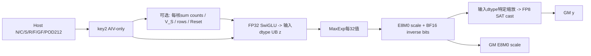
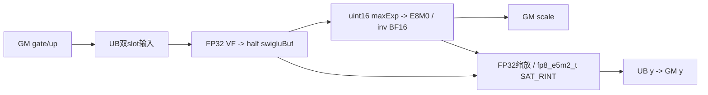
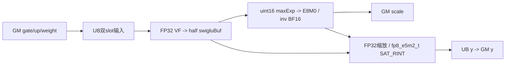
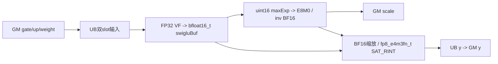
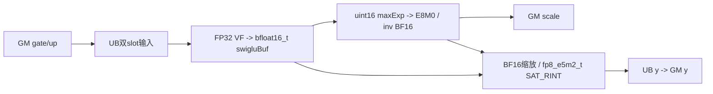
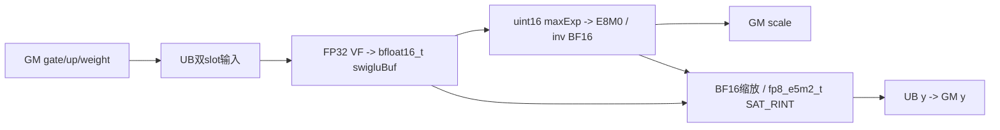

# SwigluGroupQuantMXFP8 950 ACLNN 算子知识

## 算子速览

| 项目 | 内容 |
|---|---|
| 实际入口 | `aclnnSglSwigluGroupQuantGetWorkspaceSize/aclnnSglSwigluGroupQuant`，唯一子语义`quant_mode==2` |
| 计算语义 | FP32 SwiGLU后先RINT回输入FP16/BF16，再每32值求BF16指数并构造E8M0 scale，按输入dtype特定缩放路线转FP8 |
| 输入输出 | x[...,2C] FP16/BF16连续→FP8 y[...,C]、E8M0 scale[...,C/64,2]；origin返回未写 |
| 执行类型 | 单AIV_VECTOR/VF；无Cube、MIX、通信或额外核心算子节点 |
| Kernel 路线 | R-001…R-016=输入dtype2×FP8目标2×weight2×clamp2，含group前缀与行列分块全部动态分支 |
| 核心资源 | Umain=10R A16(F)+2R A32(F)+4R A16(SF)+2R A32(SF)+w·8A8(R)，SF=ceil(F/32)；group阶段16A4(GF)+32，Reset后取max |
| 来源闭包 | `source_closed`：Host/POD212B/key2、Mx类及三量化VF与共享helpers、3510 SDK资源/Reg搬运/mask和构建闭合 |
| 验证状态 | draft，本次未编译或运行。VFComputeData的四个相同mask计数可使公开合法尾宽写出yQueue单块；unmasked Reg load也可能超出局部buffer有效span，详见限制 |

## 接口与语义

### 计算语义

N为前导维乘积、C=d/2；公开mode2 d%128=0，因此C%64=0、S=C/32为偶数。无group L=N，有group L=min(N,sum非负counts)，只定义前L行y/scale。scale物理为每32值1个E8M0字节，通过[...,C/64,2]视图承载，非每64值只有一个scale。令A为FP32计算的SiLU(gate)*up，含可选gate上限、up双限clamp及事后逐行FP32weight。

```text
z = input_dtype_CAST_RINT_NO_SAT(A)        # swigluBuf，先舍入回FP16/BF16
for each group of 32 z:
  if input half:
    t = BF16_CAST_TRUNC(z)
    e = max(exponent_bits(t)); original-half NaN/Inf forces e=0x7f80
  else:
    e = max(BF16 exponent_bits(z))
  bound = 0x0400(E4M3FN) or 0x0780(E5M2)
  e = max(e,bound)
  shared = e-bound
  E8M0 byte = shared >> 7
  inverse_BF16_bits = 0x7f00-shared
  if e==0x7f80: scale=0xff; inverse=0x7f81
  source also has e==0 and shared==0x7f00 Select branches
  if input half: q_float32 = float32(z)*float32(BF16(inverse_bits))
  else: q_bf16 = BF16_Mul(z, BF16(inverse_bits)); q_float32=float32(q_bf16)
  y = FP8_CAST_RINT_SAT(q_float32)
```

BF16指数掩码0x7f80；输入half先检查原half指数0x7c00，再CAST_TRUNC到BF16，避免丢失原NaN/Inf标记。每32组选择指数，实际scale依据输入dtype舍入后的激活，不等于直接用FP32 amax/R。bound分别对应8/15个BF16指数单位；对普通有限非极端值，可理解为二进制幂scale，但特殊值、下限和位构造以源码为准。SetMaxValue虽设1/448或1/57344，此mode2计算没有消费该变量，不能误套mode1公式。数学合同不证明尾块实现安全或运行一致。

### 输入、输出与属性

| 参数 | shape/layout | dtype | 约束、默认值与语义 |
|---|---|---|---|
| x | [...,2C]连续ND | FP16/BF16 | rank≥1；mode2公开d%128=0 |
| topk_weight | None/空或[N]连续 | FP32 | 存在时SwiGLU后逐行乘，adapter未完整校验optional合同 |
| group_index | None/空或[E]连续 | int64 | 非负counts，group_list_type0；限制有效前缀 |
| dst_type | scalar dtype | E4M3FN默认/E5M2 | 决定bound与最终FP8格式 |
| quant_mode | scalar int64 | — | 本卡严格2 |
| group_size | int64 | — | 兼容参数，未转发，不改变32分组 |
| round_scale/ue8m0_scale/output_origin | bool | — | mode2均inactive，scale始终E8M0，origin始终未写 |
| clamp_value/has_clamp_value | float/bool | — | adapter !=0启用，公开正值；gate只上限/up双限 |
| group_list_type | int64 | — | 仅0 |
| y | 新[...,C]连续 | FP8 | 前L行由实际body尝试写 |
| scale | 新[...,C/64,2]连续 | E8M0 | 物理每行S字节 |
| y_origin | 新[...,C]连续 | x dtype | 全域未定义，不读取 |

### 入口与版本

同一SGL pair冻结本卡mode2；[公开三模式API](../../../../apis/sgl_kernel_npu/sgl_swiglu_group_quant.md)已全文阅读并链接复用。固定SGL dda6d36b0cdb4081e102d14c0a2fb276fc416e69、CANN baseline9.1.0来自README/CI配置，非本次运行。固定官方SDK v9.1.0=e5451c7feba11f9e259f4fbc19c4bf82f8c0496c，不假定所有同名二进制相同。公开原生仅arch35/950，CMake SUPPORTED_ARCHS3510，OpDef使用该构建的SGL_CANN_CONFIGS；不扩到A2/A3或旧legacy目录实现。

## Host/Launcher 执行流程

### 参数校验与前处理

adapter检查x rank/dtype/连续、mode/dst_type、mode2 d%128与%2，按present&&defined&&numel>0统一可选输入，DeviceGuard→ConstructOutputs→算N，N0返回empty输出→group_list_type0→6个ND descriptors及record_stream→query→Byte workspace→record_stream→RunOpApi。输入不做Contiguous修复，不调用Torch量化fallback。optional dtype/shape/device/layout由公开合同要求，adapter没完整检查，给descriptor预定ACL_FLOAT/INT64不修复错误storage。

Host callback读storage维度、N/d、optional存在性与group E、attrs；GetShapeAttrs检查d偶数/mode合法/listType0，但mode2未独立检查d%128；splitFactor32，C=d/2、scaleCol=ceil(C/32)。InferShape scale[...,ceil(C/64),2]，裸ACLNN超公开域若ceil(C/32)为奇数，会与POD的物理rowstride不一致，不能将其当验证支持。

### 参数、Workspace 与生命周期

W=平台GetLibApiWorkSpaceSize()+32B，entry要求workspace非空，Mx类没有实际读写该pointer；query实际返回量为adapter分配依据。3输出allocation=3NC+N·2ceil(C/64)字节，含未写origin2NC；公开C64倍数时等于3NC+NS。GM tiling212B由CANN保活，entry逐字段复制，dtype/key为局部值。lambda捕获tensor/descriptors/ws/executor/current stream，所有有效tensor与ws record_stream；返回不表示完成。shared vendor符号handle静态存活，generated executor生命周期属于框架边界。

片上pool拥有U字节；group count阶段结束后V_S读sum、重算rows、Reset，再分配main resources。物理池复用不会释放GM输入/输出；旧group local view不能跨Reset继续使用。FP16/BF16 swiglu中间仅UB，不落GM；maxExp/invScale仅UB。

### 启动图与失败传播



无group blockDim=Host usedCoreNums；有group blockDim=coreNum，所有核求sum后Process跳过多余核。没有核间sum/SyncAll/atomic。entry保存CTRL60，Init设0(单指令模式)，mode2最终cast显式SAT、RINT；entry结束恢复原60位。workspace nullptr提前返回；未知key无body，输出不初始化。同步错误停止后继语句，异步错误由框架暴露，无后端回退。

## Route 与参数设计

### 分核与资源计算

Ae(t)表示向上对齐e元素，U为平台UB查询、P为AIV核数(<=0修1)。专家参数GF、gLoop、tailGF由Ug=16A4(GF)+32选择，若E整段不fit就用ceil(E/base)逐步减小，GF>16时向下16对齐；满足后groupstage单独占池。N正时former=ceil(N/P)、used=min(ceil(N/former),P)、tail=N-(used-1)former；R起始1。

模式2主UB真实分配：
```text
SF=ceil(F/32)
T=w*8A8(R)
X=8R A16(F)             # xQue两块，每块含gate+up
Y=2R A32(F)             # yQue两块
S8=2R A32(SF)           # scaleQue两块，行32B对齐
Z=2R A16(F)             # swigluBuf一块，输入dtype
E=2R A16(SF)            # maxExpBuf一块uint16
I=2R A16(SF)            # invScaleBuf一块uint16
Umain=T+X+Y+S8+Z+E+I
UBpeak=max(Ug,Umain)
```

若Umain(1,C)≤U则F=C，否则F按64递增取最后fit候选，R保持1；无fit失败。仅F=C时逐一增R，超过U退1。再算rowLoop与两种tail。scaleCols=2ceil(globalS/2)，perLoopScaleCols=ceil(F/32)，末片validS=globalS-(dLoop-1)*perLoopS，loopScaleCols=scaleCols-(dLoop-1)*perLoopS；前者mask控制有效值，后者用于偶数scale排布。group存在时根据L重算row循环，保留Host R/F。

Host F64对齐只保证32分组和成对scale，不保证VFComputeData所需的256范围。以下静态分析以整数未溢出/窄化、默认256B Reg/FP32 mask64 lane、PACK4_B32按每有效FP32 lane存1字节及postUpdate64字节契约为前提；固定SDK透传到相应vlds/vsts/plt_b32，无LocalTensor长度自动裁剪。

### Route 选择

| 顺序 | Route | Key/模板 | 精确选择条件与优先级 | 不适用去向 |
|---:|---|---|---|---|
| 1 | R-001 | key2,dtype4,VF<T=half,w0,c0> | xhalf/yfp8_e4m3fn_t、weight无、clamp无 | 其它合法组合对应Route，非法Host失败 |
| 2 | R-002 | key2,dtype4,VF<T=half,w0,c1> | xhalf/yfp8_e4m3fn_t、weight无、clamp有 | 其它合法组合对应Route，非法Host失败 |
| 3 | R-003 | key2,dtype4,VF<T=half,w1,c0> | xhalf/yfp8_e4m3fn_t、weight有、clamp无 | 其它合法组合对应Route，非法Host失败 |
| 4 | R-004 | key2,dtype4,VF<T=half,w1,c1> | xhalf/yfp8_e4m3fn_t、weight有、clamp有 | 其它合法组合对应Route，非法Host失败 |
| 5 | R-005 | key2,dtype6,VF<T=half,w0,c0> | xhalf/yfp8_e5m2_t、weight无、clamp无 | 其它合法组合对应Route，非法Host失败 |
| 6 | R-006 | key2,dtype6,VF<T=half,w0,c1> | xhalf/yfp8_e5m2_t、weight无、clamp有 | 其它合法组合对应Route，非法Host失败 |
| 7 | R-007 | key2,dtype6,VF<T=half,w1,c0> | xhalf/yfp8_e5m2_t、weight有、clamp无 | 其它合法组合对应Route，非法Host失败 |
| 8 | R-008 | key2,dtype6,VF<T=half,w1,c1> | xhalf/yfp8_e5m2_t、weight有、clamp有 | 其它合法组合对应Route，非法Host失败 |
| 9 | R-009 | key2,dtype5,VF<T=bfloat16_t,w0,c0> | xbfloat16_t/yfp8_e4m3fn_t、weight无、clamp无 | 其它合法组合对应Route，非法Host失败 |
| 10 | R-010 | key2,dtype5,VF<T=bfloat16_t,w0,c1> | xbfloat16_t/yfp8_e4m3fn_t、weight无、clamp有 | 其它合法组合对应Route，非法Host失败 |
| 11 | R-011 | key2,dtype5,VF<T=bfloat16_t,w1,c0> | xbfloat16_t/yfp8_e4m3fn_t、weight有、clamp无 | 其它合法组合对应Route，非法Host失败 |
| 12 | R-012 | key2,dtype5,VF<T=bfloat16_t,w1,c1> | xbfloat16_t/yfp8_e4m3fn_t、weight有、clamp有 | 其它合法组合对应Route，非法Host失败 |
| 13 | R-013 | key2,dtype7,VF<T=bfloat16_t,w0,c0> | xbfloat16_t/yfp8_e5m2_t、weight无、clamp无 | 其它合法组合对应Route，非法Host失败 |
| 14 | R-014 | key2,dtype7,VF<T=bfloat16_t,w0,c1> | xbfloat16_t/yfp8_e5m2_t、weight无、clamp有 | 其它合法组合对应Route，非法Host失败 |
| 15 | R-015 | key2,dtype7,VF<T=bfloat16_t,w1,c0> | xbfloat16_t/yfp8_e5m2_t、weight有、clamp无 | 其它合法组合对应Route，非法Host失败 |
| 16 | R-016 | key2,dtype7,VF<T=bfloat16_t,w1,c1> | xbfloat16_t/yfp8_e5m2_t、weight有、clamp有 | 其它合法组合对应Route，非法Host失败 |

```text
mode2 -> key2, dtype bit2=1 -> RUN_MX(xType,yType)
 optional counts -> group sum -> L/Device rows -> Reset; else Host rows
 x2 * y2 * weight2 * clamp2 -> R-001..R-016
 F=C or F64-blocked; former/tail core; full/tail row/D
 VF activation(round inputdtype) -> maxexp -> scale/inv -> quant data -> store
```

### 模板/实现执行矩阵

| Route | key/selector | dtype/shape/platform 完整命中条件 | 执行族与 kernel 节点 | 实际模板/body | 内存与同步特征 | tail/fallback |
|---|---|---|---|---|---|---|
| R-001 | key2/code4/w0/c0 | 950、公共mode2域、half→fp8_e4m3fn_t | 单AIV_VECTOR | MxPerf<half,fp8_e4m3fn_t,fp8_e8m0_t>→VFAct<half,false,false>/MaxExp/Scale/Data | Umain含w0、group Reset可选；输入dtype中间 | F64切片/行尾；四mask输出尾风险见限制，无fallback |
| R-002 | key2/code4/w0/c1 | 950、公共mode2域、half→fp8_e4m3fn_t | 单AIV_VECTOR | MxPerf<half,fp8_e4m3fn_t,fp8_e8m0_t>→VFAct<half,false,true>/MaxExp/Scale/Data | Umain含w0、group Reset可选；输入dtype中间 | F64切片/行尾；四mask输出尾风险见限制，无fallback |
| R-003 | key2/code4/w1/c0 | 950、公共mode2域、half→fp8_e4m3fn_t | 单AIV_VECTOR | MxPerf<half,fp8_e4m3fn_t,fp8_e8m0_t>→VFAct<half,true,false>/MaxExp/Scale/Data | Umain含w1、group Reset可选；输入dtype中间 | F64切片/行尾；四mask输出尾风险见限制，无fallback |
| R-004 | key2/code4/w1/c1 | 950、公共mode2域、half→fp8_e4m3fn_t | 单AIV_VECTOR | MxPerf<half,fp8_e4m3fn_t,fp8_e8m0_t>→VFAct<half,true,true>/MaxExp/Scale/Data | Umain含w1、group Reset可选；输入dtype中间 | F64切片/行尾；四mask输出尾风险见限制，无fallback |
| R-005 | key2/code6/w0/c0 | 950、公共mode2域、half→fp8_e5m2_t | 单AIV_VECTOR | MxPerf<half,fp8_e5m2_t,fp8_e8m0_t>→VFAct<half,false,false>/MaxExp/Scale/Data | Umain含w0、group Reset可选；输入dtype中间 | F64切片/行尾；四mask输出尾风险见限制，无fallback |
| R-006 | key2/code6/w0/c1 | 950、公共mode2域、half→fp8_e5m2_t | 单AIV_VECTOR | MxPerf<half,fp8_e5m2_t,fp8_e8m0_t>→VFAct<half,false,true>/MaxExp/Scale/Data | Umain含w0、group Reset可选；输入dtype中间 | F64切片/行尾；四mask输出尾风险见限制，无fallback |
| R-007 | key2/code6/w1/c0 | 950、公共mode2域、half→fp8_e5m2_t | 单AIV_VECTOR | MxPerf<half,fp8_e5m2_t,fp8_e8m0_t>→VFAct<half,true,false>/MaxExp/Scale/Data | Umain含w1、group Reset可选；输入dtype中间 | F64切片/行尾；四mask输出尾风险见限制，无fallback |
| R-008 | key2/code6/w1/c1 | 950、公共mode2域、half→fp8_e5m2_t | 单AIV_VECTOR | MxPerf<half,fp8_e5m2_t,fp8_e8m0_t>→VFAct<half,true,true>/MaxExp/Scale/Data | Umain含w1、group Reset可选；输入dtype中间 | F64切片/行尾；四mask输出尾风险见限制，无fallback |
| R-009 | key2/code5/w0/c0 | 950、公共mode2域、bfloat16_t→fp8_e4m3fn_t | 单AIV_VECTOR | MxPerf<bfloat16_t,fp8_e4m3fn_t,fp8_e8m0_t>→VFAct<bfloat16_t,false,false>/MaxExp/Scale/Data | Umain含w0、group Reset可选；输入dtype中间 | F64切片/行尾；四mask输出尾风险见限制，无fallback |
| R-010 | key2/code5/w0/c1 | 950、公共mode2域、bfloat16_t→fp8_e4m3fn_t | 单AIV_VECTOR | MxPerf<bfloat16_t,fp8_e4m3fn_t,fp8_e8m0_t>→VFAct<bfloat16_t,false,true>/MaxExp/Scale/Data | Umain含w0、group Reset可选；输入dtype中间 | F64切片/行尾；四mask输出尾风险见限制，无fallback |
| R-011 | key2/code5/w1/c0 | 950、公共mode2域、bfloat16_t→fp8_e4m3fn_t | 单AIV_VECTOR | MxPerf<bfloat16_t,fp8_e4m3fn_t,fp8_e8m0_t>→VFAct<bfloat16_t,true,false>/MaxExp/Scale/Data | Umain含w1、group Reset可选；输入dtype中间 | F64切片/行尾；四mask输出尾风险见限制，无fallback |
| R-012 | key2/code5/w1/c1 | 950、公共mode2域、bfloat16_t→fp8_e4m3fn_t | 单AIV_VECTOR | MxPerf<bfloat16_t,fp8_e4m3fn_t,fp8_e8m0_t>→VFAct<bfloat16_t,true,true>/MaxExp/Scale/Data | Umain含w1、group Reset可选；输入dtype中间 | F64切片/行尾；四mask输出尾风险见限制，无fallback |
| R-013 | key2/code7/w0/c0 | 950、公共mode2域、bfloat16_t→fp8_e5m2_t | 单AIV_VECTOR | MxPerf<bfloat16_t,fp8_e5m2_t,fp8_e8m0_t>→VFAct<bfloat16_t,false,false>/MaxExp/Scale/Data | Umain含w0、group Reset可选；输入dtype中间 | F64切片/行尾；四mask输出尾风险见限制，无fallback |
| R-014 | key2/code7/w0/c1 | 950、公共mode2域、bfloat16_t→fp8_e5m2_t | 单AIV_VECTOR | MxPerf<bfloat16_t,fp8_e5m2_t,fp8_e8m0_t>→VFAct<bfloat16_t,false,true>/MaxExp/Scale/Data | Umain含w0、group Reset可选；输入dtype中间 | F64切片/行尾；四mask输出尾风险见限制，无fallback |
| R-015 | key2/code7/w1/c0 | 950、公共mode2域、bfloat16_t→fp8_e5m2_t | 单AIV_VECTOR | MxPerf<bfloat16_t,fp8_e5m2_t,fp8_e8m0_t>→VFAct<bfloat16_t,true,false>/MaxExp/Scale/Data | Umain含w1、group Reset可选；输入dtype中间 | F64切片/行尾；四mask输出尾风险见限制，无fallback |
| R-016 | key2/code7/w1/c1 | 950、公共mode2域、bfloat16_t→fp8_e5m2_t | 单AIV_VECTOR | MxPerf<bfloat16_t,fp8_e5m2_t,fp8_e8m0_t>→VFAct<bfloat16_t,true,true>/MaxExp/Scale/Data | Umain含w1、group Reset可选；输入dtype中间 | F64切片/行尾；四mask输出尾风险见限制，无fallback |

### 隐藏性能 Guard

| Guard | Host/Tiling 条件 | Device/资源原因 | 影响 Route | 不满足时去向 | 源码符号 |
|---|---|---|---|---|---|
| 公开宽度 | adapter d%128=0；裸Host仅偶数 | C64倍数、scale成对视图 | 全部 | adapter失败；裸域外未保证 | adapter/InferShape |
| UB | Umain≤U，F按64取候选，R逐增 | 双slot+3 TBuf | 全部 | 减R、切F或失败 | CalcMxQuantOpTiling |
| count前stage | Ug≤U，分块时严格<U | 2countslot+sum32 | group子路径 | 切GF，Reset后复用 | CalcGroupIndexTiling |
| 256尾块 | Host无F%256 guard | Data VF每轮4个64字节store、4个相同初始化mask计数 | 全部 | 无修复/fallback，draft静态越queue块推导 | VFComputeData |
| 无mask Reg读 | 无单独A256 padding资源guard | DINTLV双16bitReg每轮读取256元素；MaxExp读128个uint16 | 所有量化VF | 可跨local view有效span，不据此宣称越整个UB | VFComputeMaxExp/Scale/Data |
| 计数/转换 | 非负counts，int32 helper/uint16 VF/DMA参数 | sum与下游位宽不同 | 全部 | 无统一上限guard | VFProcessGroupIndex/helper |
| optional/workspace | 合法Tensor合同；ws!=nullptr | descriptor/原始地址/entry早退 | 对应子路径/全部 | 框架异常或无输出终点 | adapter/entry |

### POD/ABI


SwigluGroupQuantTilingData packed sizeof212/align1：前25int64占0…199，float clampValue offset200，int32 dtype204，uint32 tilingKey208。按固定声明静态推导，未编译测量；所有int64字段从GM逐一复制，天然偏移8对齐但struct base仍需CANN保证。CANN outer tilingKey=0，不等内部key2。下表每字段独立列出。

| 结构 | 字段 | 类型/位宽 | ABI 布局 | 单位 | Host/launcher producer | Device consumer | 边界 |
|---|---|---|---|---|---|---|---|
| SwigluGroupQuantTilingData | bs | int64 | offset0,size8,结构align1 | 元素/次数/标志，依字段 | 展平行数N | 所有row偏移 | group字段无group时0；转换范围需调用方满足 |
| SwigluGroupQuantTilingData | d | int64 | offset8,size8,结构align1 | 元素/次数/标志，依字段 | 输入宽2C | gate/up行stride | group字段无group时0；转换范围需调用方满足 |
| SwigluGroupQuantTilingData | splitD | int64 | offset16,size8,结构align1 | 元素/次数/标志，依字段 | d/2=C | 输出stride/up起点 | group字段无group时0；转换范围需调用方满足 |
| SwigluGroupQuantTilingData | scaleCol | int64 | offset24,size8,结构align1 | 元素/次数/标志，依字段 | ceil(C/32) | scaleGM行stride | group字段无group时0；转换范围需调用方满足 |
| SwigluGroupQuantTilingData | rowOfFormerBlock | int64 | offset32,size8,结构align1 | 元素/次数/标志，依字段 | ceil(N/coreNum) | 无group时Device分核 | group字段无group时0；转换范围需调用方满足 |
| SwigluGroupQuantTilingData | rowOfTailBlock | int64 | offset40,size8,结构align1 | 元素/次数/标志，依字段 | N-(used-1)*former | 尾核行数 | group字段无group时0；转换范围需调用方满足 |
| SwigluGroupQuantTilingData | rowLoopOfFormerBlock | int64 | offset48,size8,结构align1 | 元素/次数/标志，依字段 | ceil(former/R) | 无group前核循环 | group字段无group时0；转换范围需调用方满足 |
| SwigluGroupQuantTilingData | rowLoopOfTailBlock | int64 | offset56,size8,结构align1 | 元素/次数/标志，依字段 | ceil(tail/R) | 无group尾核循环 | group字段无group时0；转换范围需调用方满足 |
| SwigluGroupQuantTilingData | rowFactor | int64 | offset64,size8,结构align1 | 元素/次数/标志，依字段 | Host UB预算选择R | 每次处理行数/队列容量 | group字段无group时0；转换范围需调用方满足 |
| SwigluGroupQuantTilingData | tailRowFactorOfFormerBlock | int64 | offset72,size8,结构align1 | 元素/次数/标志，依字段 | former%R或R | 无group前核尾loop | group字段无group时0；转换范围需调用方满足 |
| SwigluGroupQuantTilingData | tailRowFactorOfTailBlock | int64 | offset80,size8,结构align1 | 元素/次数/标志，依字段 | tail%R或R | 无group尾核尾loop | group字段无group时0；转换范围需调用方满足 |
| SwigluGroupQuantTilingData | dLoop | int64 | offset88,size8,结构align1 | 元素/次数/标志，依字段 | ceil(C/F) | 列循环 | group字段无group时0；转换范围需调用方满足 |
| SwigluGroupQuantTilingData | dFactor | int64 | offset96,size8,结构align1 | 元素/次数/标志，依字段 | Host whole/split选F | 队列容量/列步长 | group字段无group时0；转换范围需调用方满足 |
| SwigluGroupQuantTilingData | tailDFactor | int64 | offset104,size8,结构align1 | 元素/次数/标志，依字段 | C-(dLoop-1)F | 列尾大小 | group字段无group时0；转换范围需调用方满足 |
| SwigluGroupQuantTilingData | roundScale | int64 | offset112,size8,结构align1 | 元素/次数/标志，依字段 | 属性bool | mode2不读 | 此模式inactive仍复制 |
| SwigluGroupQuantTilingData | ue8m0Scale | int64 | offset120,size8,结构align1 | 元素/次数/标志，依字段 | 属性bool | mode2不读，scale固定E8M0 | 此模式inactive仍复制 |
| SwigluGroupQuantTilingData | outputOrigin | int64 | offset128,size8,结构align1 | 元素/次数/标志，依字段 | 属性bool | mode2不写origin | 此模式inactive仍复制 |
| SwigluGroupQuantTilingData | hasClampValue | int64 | offset136,size8,结构align1 | 元素/次数/标志，依字段 | adapter clamp_value!=0.0 或裸属性 | VF hasClampValue实例 | group字段无group时0；转换范围需调用方满足 |
| SwigluGroupQuantTilingData | g | int64 | offset144,size8,结构align1 | 元素/次数/标志，依字段 | group_index元素数E或0 | count阶段 | group字段无group时0；转换范围需调用方满足 |
| SwigluGroupQuantTilingData | ubSize | int64 | offset152,size8,结构align1 | 字节 | 平台UB字节查询 | InitBufPool完整池 | group字段无group时0；转换范围需调用方满足 |
| SwigluGroupQuantTilingData | gLoop | int64 | offset160,size8,结构align1 | 元素/次数/标志，依字段 | ceil(E/GF)或0 | count块循环 | group字段无group时0；转换范围需调用方满足 |
| SwigluGroupQuantTilingData | gFactor | int64 | offset168,size8,结构align1 | 元素/次数/标志，依字段 | GF=Host count tiling | groupqueue容量/步长 | group字段无group时0；转换范围需调用方满足 |
| SwigluGroupQuantTilingData | tailGFactor | int64 | offset176,size8,结构align1 | 元素/次数/标志，依字段 | E%GF或GF | count尾块 | group字段无group时0；转换范围需调用方满足 |
| SwigluGroupQuantTilingData | groupListType | int64 | offset184,size8,结构align1 | 元素/次数/标志，依字段 | 固定合法0 | count阶段谓词 | group字段无group时0；转换范围需调用方满足 |
| SwigluGroupQuantTilingData | coreNum | int64 | offset192,size8,结构align1 | 元素/次数/标志，依字段 | AIV查询，<=0修成1 | group存在时重新分核 | group字段无group时0；转换范围需调用方满足 |
| SwigluGroupQuantTilingData | clampValue | float32 | offset200,size4 | 夹值 | attrs double/float转换 | 4个VF布尔实例 | 仅hasClamp生效 |
| SwigluGroupQuantTilingData | dtype | int32 | offset204,size4 | bit flags | bit0 xBF16、bit1 yE5M2、mode2 bit2=4 | entry局部xBf16/yE5m2 | 不拷入class POD副本对应未用字段 |
| SwigluGroupQuantTilingData | tilingKey | uint32 | offset208,size4 | key | mode2映射2 | entry局部dispatch | 外层CANN key0不等内部key2 |

Host输入结构SwigluGroupQuantInputs逐字段：bs/d int64由shape；hasTopkWeight bool由optional shape；g int64和hasGroupIndex bool由group shape；quantMode/roundScale/ue8m0Scale/outputOrigin/groupListType int64由attrs；clampValue float及hasClampValue int64由attrs。它不跨GM、offset为Host ABI，未据源编译测量，不将该Host对象当packed POD。entry ABI顺序为x/topkWeight/groupIndex/y/scale/yOrigin/workspace/tiling共8个GM_ADDR，CANN生成bridge布局是外部边界。


### Route 源码闭包

| Route | Key/selector | Host/Tiling producer | POD/参数 | Kernel entry/router | Kernel body/直接依赖 | 构建接线 |
|---|---|---|---|---|---|---|
| R-001 | key2/code4/w0/c0 | CalcMxQuantOpTiling | 212B参数表 | RUN_MX(half,fp8_e4m3fn_t) | MxPerf Init/Process + VFAct/MaxExp/Scale/Data + GroupIndex/Copy helpers | 当前activation域3510，CANN codegen/infer/tiling/kernel |
| R-002 | key2/code4/w0/c1 | CalcMxQuantOpTiling | 212B参数表 | RUN_MX(half,fp8_e4m3fn_t) | MxPerf Init/Process + VFAct/MaxExp/Scale/Data + GroupIndex/Copy helpers | 当前activation域3510，CANN codegen/infer/tiling/kernel |
| R-003 | key2/code4/w1/c0 | CalcMxQuantOpTiling | 212B参数表 | RUN_MX(half,fp8_e4m3fn_t) | MxPerf Init/Process + VFAct/MaxExp/Scale/Data + GroupIndex/Copy helpers | 当前activation域3510，CANN codegen/infer/tiling/kernel |
| R-004 | key2/code4/w1/c1 | CalcMxQuantOpTiling | 212B参数表 | RUN_MX(half,fp8_e4m3fn_t) | MxPerf Init/Process + VFAct/MaxExp/Scale/Data + GroupIndex/Copy helpers | 当前activation域3510，CANN codegen/infer/tiling/kernel |
| R-005 | key2/code6/w0/c0 | CalcMxQuantOpTiling | 212B参数表 | RUN_MX(half,fp8_e5m2_t) | MxPerf Init/Process + VFAct/MaxExp/Scale/Data + GroupIndex/Copy helpers | 当前activation域3510，CANN codegen/infer/tiling/kernel |
| R-006 | key2/code6/w0/c1 | CalcMxQuantOpTiling | 212B参数表 | RUN_MX(half,fp8_e5m2_t) | MxPerf Init/Process + VFAct/MaxExp/Scale/Data + GroupIndex/Copy helpers | 当前activation域3510，CANN codegen/infer/tiling/kernel |
| R-007 | key2/code6/w1/c0 | CalcMxQuantOpTiling | 212B参数表 | RUN_MX(half,fp8_e5m2_t) | MxPerf Init/Process + VFAct/MaxExp/Scale/Data + GroupIndex/Copy helpers | 当前activation域3510，CANN codegen/infer/tiling/kernel |
| R-008 | key2/code6/w1/c1 | CalcMxQuantOpTiling | 212B参数表 | RUN_MX(half,fp8_e5m2_t) | MxPerf Init/Process + VFAct/MaxExp/Scale/Data + GroupIndex/Copy helpers | 当前activation域3510，CANN codegen/infer/tiling/kernel |
| R-009 | key2/code5/w0/c0 | CalcMxQuantOpTiling | 212B参数表 | RUN_MX(bfloat16_t,fp8_e4m3fn_t) | MxPerf Init/Process + VFAct/MaxExp/Scale/Data + GroupIndex/Copy helpers | 当前activation域3510，CANN codegen/infer/tiling/kernel |
| R-010 | key2/code5/w0/c1 | CalcMxQuantOpTiling | 212B参数表 | RUN_MX(bfloat16_t,fp8_e4m3fn_t) | MxPerf Init/Process + VFAct/MaxExp/Scale/Data + GroupIndex/Copy helpers | 当前activation域3510，CANN codegen/infer/tiling/kernel |
| R-011 | key2/code5/w1/c0 | CalcMxQuantOpTiling | 212B参数表 | RUN_MX(bfloat16_t,fp8_e4m3fn_t) | MxPerf Init/Process + VFAct/MaxExp/Scale/Data + GroupIndex/Copy helpers | 当前activation域3510，CANN codegen/infer/tiling/kernel |
| R-012 | key2/code5/w1/c1 | CalcMxQuantOpTiling | 212B参数表 | RUN_MX(bfloat16_t,fp8_e4m3fn_t) | MxPerf Init/Process + VFAct/MaxExp/Scale/Data + GroupIndex/Copy helpers | 当前activation域3510，CANN codegen/infer/tiling/kernel |
| R-013 | key2/code7/w0/c0 | CalcMxQuantOpTiling | 212B参数表 | RUN_MX(bfloat16_t,fp8_e5m2_t) | MxPerf Init/Process + VFAct/MaxExp/Scale/Data + GroupIndex/Copy helpers | 当前activation域3510，CANN codegen/infer/tiling/kernel |
| R-014 | key2/code7/w0/c1 | CalcMxQuantOpTiling | 212B参数表 | RUN_MX(bfloat16_t,fp8_e5m2_t) | MxPerf Init/Process + VFAct/MaxExp/Scale/Data + GroupIndex/Copy helpers | 当前activation域3510，CANN codegen/infer/tiling/kernel |
| R-015 | key2/code7/w1/c0 | CalcMxQuantOpTiling | 212B参数表 | RUN_MX(bfloat16_t,fp8_e5m2_t) | MxPerf Init/Process + VFAct/MaxExp/Scale/Data + GroupIndex/Copy helpers | 当前activation域3510，CANN codegen/infer/tiling/kernel |
| R-016 | key2/code7/w1/c1 | CalcMxQuantOpTiling | 212B参数表 | RUN_MX(bfloat16_t,fp8_e5m2_t) | MxPerf Init/Process + VFAct/MaxExp/Scale/Data + GroupIndex/Copy helpers | 当前activation域3510，CANN codegen/infer/tiling/kernel |

## Kernel 实现

### 公共执行流程

Init/专家阶段完整流程：InitBufPool(U)，group非空时2×8A4(GF)countqueue+sum32，逐GF CopyIn→queue→VF int64 reduce(短循环或四路展开、ZEROING tail Adds)→Free，V_S Set/Wait→sum.GetValue→min(sum,N)→重算rows→Reset(MTE2/MTE3/V三barrier)。group不存在使用Host rows/GetBlockNum。之后按topk(可选)→xQue→yQue→scaleQue→swigluBuf→maxExpBuf→invScaleBuf顺序Init；保存3个TBuf LocalTensor，设FP8格式bound、scaleCols、CTRL60=0。主阶段描述符最多11个≤12，group的旧descriptor经Reset清除；MutexID位池与字节池是不同资源，不将Reset伪称重新malloc。

Process每row块先读一次weight并跨d片保留；每d片分配xQue一个块，gate写其前ma行，up从`ma*A16(F)`元素起写第二部分。两个CopyIn均为[ma,fa]，GM rowstride2C；queue等待之后调用4布尔激活VF之一，FP32激活/weight后CAST_RINT_NO_SAT写回inputdtype swigluBuf。xQue一直保留到后续量化Data VF结束。

VFComputeMaxExp以256个2B值为一轮，DINTLV_B16拆奇偶128lane，half转换到BF16用CAST_TRUNC且原half NaN/Inf单独标记；掩指数、逐laneMax奇偶，再ReduceMaxWithDataBlock得到8个32值组指数，非对齐写maxExpBuf。VFComputeScale加载128个uint16寄存器，按validS与偶数S各建mask，Max(bound)→shared→移7位→inf/zero Select→pack为E8字节，同时inv=0x7f00-shared并处理NaN/特殊min分支，写uint16 inverse。scale queue先输出GM并free。

VFComputeData再次DINTLV读swiglu及E2B_B16广播每组inverse。half路径把half和BF16inverse升FP32后Mul、做layout0/1及多次Interleave；BF16路径先RegTensor<BF16>相乘再升FP32/Interleave。最终四个FP8寄存器使用CAST_RINT、SatModeSAT，依次PACK4_B32 postUpdate64写yLocal；这些mask各自从相同fa初始化，尾界风险不能由后续GM CopyOut(fa)修复。xQue Free之后y EnQue/DeQue→CopyOut Normal→Free，最后D片后freeweight。entry恢复CTRL60。

```text
for each active core / rowblock / Dblock:
  CopyIn(gate, xslot[0:]); CopyIn(up, xslot[ma*A16(F):])
  z = inputdtype_RINT(FP32_SwiGLU_then_optional_weight/clamp)
  maxExp = group32_exponent(z)
  (E8scale, BF16_inv_bits)=bit_construct(maxExp, lowerBound)
  CopyOut(scale, rowstride=globalS)
  for each row:
    sreg[0..3] = fa                   # 四份独立计数，原样保留
    for j in ceil(fa/256):
      masks[k] = UpdateMask<float>(sreg[k]), k=0..3
      load 256 z without loadmask; broadcast 8 inverse groups
      dtype-specific multiply, Interleave
      four FP8 SAT_RINT casts and four store64 postupdates
  CopyOut(y, ma,fa,rowstride=C)
```

CopyIn/DataCopyExtParams以字节传blockLen=fa*sizeof(T)、srcStride=(2C-fa)*sizeof(T)、dstStride0，blockCount=ma uint16、DataCopyPad isPad=false。CopyOut scale为Normal模式，UB行宽A32(SF)字节，GM strideS；y Normal，UB行宽A32(fa)。所有queue同步由固定SDK3510bufID primitive负责；三VF间依赖按VF完成/后继数据使用语义，不虚构额外GM节点、crosscore flag或全核barrier。

### Route R-001：half→fp8_e4m3fn_t，weight0/clamp0

#### 适用条件

950/mode2，dtype code4；weight无、clamp无。group有无、R/F整列或切列、前核/尾核与所有有效tail按公共完整分支运行。

##### 选择证据

| 层级 | 文件 | 符号 | 源码谓词/参数 | 结果/下一跳 |
|---|---|---|---|---|
| entry | csrc/activation/swiglu_group_quant/op_kernel/swiglu_group_quant.cpp | RUN_MX | key2/code4 | MxPerf<half,fp8_e4m3fn_t,fp8_e8m0_t> |
| Process | csrc/activation/swiglu_group_quant/op_kernel/swiglu_mx_quant_perf.h | VFProcessSwigluGroupQuant | w0/c0 | VFAct<half,false,false> |

#### Device 数据流

##### 函数级调用链

```text
entry -> MxPerf<half,fp8_e4m3fn_t,fp8_e8m0_t>::Init/Process
 -> optionalGroupIndex/Reset -> CopyIn -> VFAct<half,false,false>
 -> VFComputeMaxExp<half> -> VFComputeScale -> VFComputeData<half,fp8_e4m3fn_t> -> CopyOut
```

##### 源码等价伪码

执行公共伪码的当前确切类型/布尔值：激活先RINT到half，不clamp，不读weight，bound=0x0400；指数路径half→BF16_TRUNC并保留原NaN/Inf标记，缩放half/BF16inverse升FP32相乘；FP8输出RINT/SAT。四个计数和poststore保持源码，不自行修正tail。

#### 内存与数据搬运

##### 资源与搬运表

| 层级/缓冲区 | offset/地址公式 | extent/容量公式 | dtype/layout | producer | consumer | owner/lifetime | 对齐/复用 |
|---|---|---|---|---|---|---|---|
| GM x/y/scale/origin | x=2(row*2C+dF)；y=row*C+dF；scale=row*S+dceil(F/32) | 4NC/NC/NS/2NC B | half/fp8_e4m3fn_t/E8M0/half | caller / VF+MTE3 | Device / caller | record_stream | origin不写，只有前L行有效 |
| group阶段 | base0 count双slot，sum在16A4(GF) | Ug=16A4(GF)+32 B | int64 | MTE2/VF | scalar rows | 至V_S/Reset | 重用同pool |
| topk/x/y/scale | T=0；x从T，y从T+X，scale从T+X+Y | T /X=8RA16F /Y=2RA32F /S8=2RA32SF | FP32/half/fp8_e4m3fn_t/E8M0，均双slot | MTE2/VF | VF/MTE3 | row块/D块 | x每slotgate+up，scale Normal |
| swiglu/maxExp/inv | 顺次T+X+Y+S8；后加Z、E | Z=2RA16F，E=I=2RA16SF | half/uint16/uint16 | VFAct/MaxExp/Scale | 量化后继VF | 当前D片 | 单TBuf，实际无额外256读padding |
| 寄存器 | VF local Reg/Mask | 逻辑每Reg256B；实际寄存器数compiler决定 | BF16/FP16/FP32/u16 | VF | VF | scope | 不计成UB分配 |
| workspace/L1/L0 | ws非空check，L1/L0 N/A | W=库查询+32B | byte | Host | entry | stream周期 | body未用，无Cube |

##### 分层内存布局


```block-beta
 columns 1
 U["group可选: counts双块 + sum32 -> Reset"]
 M["main: x2 + y2 + scale2 + swiglu1 + maxExp1 + inv1"]
```

##### 字节账与复用顺序

```text
Umain=10R A16(F)+2R A32(F)+4R A16(SF)+2R A32(SF)
UBpeak=max(group?16A4(GF)+32:0, Umain) <= U
GM有效名义读=4LC+group*8E*launch_cores；写=LC+LS
输出allocation=3NC+NS，含未写origin2NC；W=库查询+32
```

以实际转换未溢出为前提。队列槽大小按allocation列，不随VF越槽store请求扩大；后者是静态缺陷，不能加到“合法UB需求”掩盖原分配。

| 边/复用子区 | producer | offset/extent | dtype/layout | consumer | ordering/sync | owner/lifetime | 安全条件 |
|---|---|---|---|---|---|---|---|
| group→main | counts/VFsum | samepool，Ug→Umain | int64→queues | main | V_S读sum + Reset三pipebarrier | 不跨阶段持旧view | max计费，不并存 |
| act→max/data | VFAct | Z | half aligned16行 | 两量化VF | VF依赖 | 当前D片 | unmasked读跨度需另审 |
| max→scale→data | VFMaxExp/Scale | E/I/S8 | uint16/E8M0 | Scale/Data/MTE3 | 同核VF/queue顺序 | 当前D片 | rawbit布局不能当FP32scale |
| y→GM | VFData | y单slot=R A32(F) | fp8_e4m3fn_t | MTE3 | queue依赖 | 当前D片 | 四store尾风险，GM copy长度不修复UB越槽 |

#### 同步、精度与尾块

##### 同步与数值边界表

| 阶段 | primitive/机制 | producer | consumer/等待点 | 保护对象 | 精度/尾块 |
|---|---|---|---|---|---|
| 输入/group | queues/V_S/Reset | MTE2/VF | scalar/act | count/输入 | counts尾ZEROING，actual rows |
| 激活 | FP32→half CAST_RINT_NO_SAT | gate/up | swigluBuf | Z | 无clamp |
| 指数/scale | BF16 exponent masks / bit subtract | Z/max | Scale/Data | 32值组 | bound0x0400、NaN code0xff |
| 量化 | FP32 Mul→FP8 RINT/SAT | Z/inv | y | 当前D片 | 独立4计数可使tailstore越槽 |
| 输出 | DataCopyPad Normal | queue | GM | y/scale | fa/SF实际拷贝；没有额外尾修复 |

#### 关键实现

##### 符号证据表

| 阶段 | 文件 | 符号/模板实例 | 实现事实 |
|---|---|---|---|
| Host/Tiling producer | csrc/activation/swiglu_group_quant/op_host/swiglu_group_quant.cpp | CalcMxQuantOpTiling | F64候选/R/U，key2 |
| Kernel entry/router | csrc/activation/swiglu_group_quant/op_kernel/swiglu_group_quant.cpp | RUN_MX(half,fp8_e4m3fn_t) | scale固定E8M0 |
| Device body/helper | csrc/activation/swiglu_group_quant/op_kernel/swiglu_group_quant_base.h | Act<half,false,false>/MaxExp/Scale/Data<half,fp8_e4m3fn_t> | 当前dtype精度/指数/尾store |

### Route R-002：half→fp8_e4m3fn_t，weight0/clamp1

#### 适用条件

950/mode2，dtype code4；weight无、clamp有。group有无、R/F整列或切列、前核/尾核与所有有效tail按公共完整分支运行。

##### 选择证据

| 层级 | 文件 | 符号 | 源码谓词/参数 | 结果/下一跳 |
|---|---|---|---|---|
| entry | csrc/activation/swiglu_group_quant/op_kernel/swiglu_group_quant.cpp | RUN_MX | key2/code4 | MxPerf<half,fp8_e4m3fn_t,fp8_e8m0_t> |
| Process | csrc/activation/swiglu_group_quant/op_kernel/swiglu_mx_quant_perf.h | VFProcessSwigluGroupQuant | w0/c1 | VFAct<half,false,true> |

#### Device 数据流

##### 函数级调用链

```text
entry -> MxPerf<half,fp8_e4m3fn_t,fp8_e8m0_t>::Init/Process
 -> optionalGroupIndex/Reset -> CopyIn -> VFAct<half,false,true>
 -> VFComputeMaxExp<half> -> VFComputeScale -> VFComputeData<half,fp8_e4m3fn_t> -> CopyOut
```

##### 源码等价伪码

执行公共伪码的当前确切类型/布尔值：激活先RINT到half，启用gate上/up双clamp，不读weight，bound=0x0400；指数路径half→BF16_TRUNC并保留原NaN/Inf标记，缩放half/BF16inverse升FP32相乘；FP8输出RINT/SAT。四个计数和poststore保持源码，不自行修正tail。

#### 内存与数据搬运

##### 资源与搬运表

| 层级/缓冲区 | offset/地址公式 | extent/容量公式 | dtype/layout | producer | consumer | owner/lifetime | 对齐/复用 |
|---|---|---|---|---|---|---|---|
| GM x/y/scale/origin | x=2(row*2C+dF)；y=row*C+dF；scale=row*S+dceil(F/32) | 4NC/NC/NS/2NC B | half/fp8_e4m3fn_t/E8M0/half | caller / VF+MTE3 | Device / caller | record_stream | origin不写，只有前L行有效 |
| group阶段 | base0 count双slot，sum在16A4(GF) | Ug=16A4(GF)+32 B | int64 | MTE2/VF | scalar rows | 至V_S/Reset | 重用同pool |
| topk/x/y/scale | T=0；x从T，y从T+X，scale从T+X+Y | T /X=8RA16F /Y=2RA32F /S8=2RA32SF | FP32/half/fp8_e4m3fn_t/E8M0，均双slot | MTE2/VF | VF/MTE3 | row块/D块 | x每slotgate+up，scale Normal |
| swiglu/maxExp/inv | 顺次T+X+Y+S8；后加Z、E | Z=2RA16F，E=I=2RA16SF | half/uint16/uint16 | VFAct/MaxExp/Scale | 量化后继VF | 当前D片 | 单TBuf，实际无额外256读padding |
| 寄存器 | VF local Reg/Mask | 逻辑每Reg256B；实际寄存器数compiler决定 | BF16/FP16/FP32/u16 | VF | VF | scope | 不计成UB分配 |
| workspace/L1/L0 | ws非空check，L1/L0 N/A | W=库查询+32B | byte | Host | entry | stream周期 | body未用，无Cube |

##### 分层内存布局


```block-beta
 columns 1
 U["group可选: counts双块 + sum32 -> Reset"]
 M["main: x2 + y2 + scale2 + swiglu1 + maxExp1 + inv1"]
```

##### 字节账与复用顺序

```text
Umain=10R A16(F)+2R A32(F)+4R A16(SF)+2R A32(SF)
UBpeak=max(group?16A4(GF)+32:0, Umain) <= U
GM有效名义读=4LC+group*8E*launch_cores；写=LC+LS
输出allocation=3NC+NS，含未写origin2NC；W=库查询+32
```

以实际转换未溢出为前提。队列槽大小按allocation列，不随VF越槽store请求扩大；后者是静态缺陷，不能加到“合法UB需求”掩盖原分配。

| 边/复用子区 | producer | offset/extent | dtype/layout | consumer | ordering/sync | owner/lifetime | 安全条件 |
|---|---|---|---|---|---|---|---|
| group→main | counts/VFsum | samepool，Ug→Umain | int64→queues | main | V_S读sum + Reset三pipebarrier | 不跨阶段持旧view | max计费，不并存 |
| act→max/data | VFAct | Z | half aligned16行 | 两量化VF | VF依赖 | 当前D片 | unmasked读跨度需另审 |
| max→scale→data | VFMaxExp/Scale | E/I/S8 | uint16/E8M0 | Scale/Data/MTE3 | 同核VF/queue顺序 | 当前D片 | rawbit布局不能当FP32scale |
| y→GM | VFData | y单slot=R A32(F) | fp8_e4m3fn_t | MTE3 | queue依赖 | 当前D片 | 四store尾风险，GM copy长度不修复UB越槽 |

#### 同步、精度与尾块

##### 同步与数值边界表

| 阶段 | primitive/机制 | producer | consumer/等待点 | 保护对象 | 精度/尾块 |
|---|---|---|---|---|---|
| 输入/group | queues/V_S/Reset | MTE2/VF | scalar/act | count/输入 | counts尾ZEROING，actual rows |
| 激活 | FP32→half CAST_RINT_NO_SAT | gate/up | swigluBuf | Z | clamp |
| 指数/scale | BF16 exponent masks / bit subtract | Z/max | Scale/Data | 32值组 | bound0x0400、NaN code0xff |
| 量化 | FP32 Mul→FP8 RINT/SAT | Z/inv | y | 当前D片 | 独立4计数可使tailstore越槽 |
| 输出 | DataCopyPad Normal | queue | GM | y/scale | fa/SF实际拷贝；没有额外尾修复 |

#### 关键实现

##### 符号证据表

| 阶段 | 文件 | 符号/模板实例 | 实现事实 |
|---|---|---|---|
| Host/Tiling producer | csrc/activation/swiglu_group_quant/op_host/swiglu_group_quant.cpp | CalcMxQuantOpTiling | F64候选/R/U，key2 |
| Kernel entry/router | csrc/activation/swiglu_group_quant/op_kernel/swiglu_group_quant.cpp | RUN_MX(half,fp8_e4m3fn_t) | scale固定E8M0 |
| Device body/helper | csrc/activation/swiglu_group_quant/op_kernel/swiglu_group_quant_base.h | Act<half,false,true>/MaxExp/Scale/Data<half,fp8_e4m3fn_t> | 当前dtype精度/指数/尾store |

### Route R-003：half→fp8_e4m3fn_t，weight1/clamp0

#### 适用条件

950/mode2，dtype code4；weight有、clamp无。group有无、R/F整列或切列、前核/尾核与所有有效tail按公共完整分支运行。

##### 选择证据

| 层级 | 文件 | 符号 | 源码谓词/参数 | 结果/下一跳 |
|---|---|---|---|---|
| entry | csrc/activation/swiglu_group_quant/op_kernel/swiglu_group_quant.cpp | RUN_MX | key2/code4 | MxPerf<half,fp8_e4m3fn_t,fp8_e8m0_t> |
| Process | csrc/activation/swiglu_group_quant/op_kernel/swiglu_mx_quant_perf.h | VFProcessSwigluGroupQuant | w1/c0 | VFAct<half,true,false> |

#### Device 数据流

##### 函数级调用链

```text
entry -> MxPerf<half,fp8_e4m3fn_t,fp8_e8m0_t>::Init/Process
 -> optionalGroupIndex/Reset -> CopyIn -> VFAct<half,true,false>
 -> VFComputeMaxExp<half> -> VFComputeScale -> VFComputeData<half,fp8_e4m3fn_t> -> CopyOut
```

##### 源码等价伪码

执行公共伪码的当前确切类型/布尔值：激活先RINT到half，不clamp，事后乘FP32weight，bound=0x0400；指数路径half→BF16_TRUNC并保留原NaN/Inf标记，缩放half/BF16inverse升FP32相乘；FP8输出RINT/SAT。四个计数和poststore保持源码，不自行修正tail。

#### 内存与数据搬运

##### 资源与搬运表

| 层级/缓冲区 | offset/地址公式 | extent/容量公式 | dtype/layout | producer | consumer | owner/lifetime | 对齐/复用 |
|---|---|---|---|---|---|---|---|
| GM x/y/scale/origin | x=2(row*2C+dF)；y=row*C+dF；scale=row*S+dceil(F/32) | 4NC/NC/NS/2NC B | half/fp8_e4m3fn_t/E8M0/half | caller / VF+MTE3 | Device / caller | record_stream | origin不写，只有前L行有效 |
| group阶段 | base0 count双slot，sum在16A4(GF) | Ug=16A4(GF)+32 B | int64 | MTE2/VF | scalar rows | 至V_S/Reset | 重用同pool |
| topk/x/y/scale | T=8A8(R)；x从T，y从T+X，scale从T+X+Y | T /X=8RA16F /Y=2RA32F /S8=2RA32SF | FP32/half/fp8_e4m3fn_t/E8M0，均双slot | MTE2/VF | VF/MTE3 | row块/D块 | x每slotgate+up，scale Normal |
| swiglu/maxExp/inv | 顺次T+X+Y+S8；后加Z、E | Z=2RA16F，E=I=2RA16SF | half/uint16/uint16 | VFAct/MaxExp/Scale | 量化后继VF | 当前D片 | 单TBuf，实际无额外256读padding |
| 寄存器 | VF local Reg/Mask | 逻辑每Reg256B；实际寄存器数compiler决定 | BF16/FP16/FP32/u16 | VF | VF | scope | 不计成UB分配 |
| workspace/L1/L0 | ws非空check，L1/L0 N/A | W=库查询+32B | byte | Host | entry | stream周期 | body未用，无Cube |

##### 分层内存布局


```block-beta
 columns 1
 U["group可选: counts双块 + sum32 -> Reset"]
 M["main: weight2 + x2 + y2 + scale2 + swiglu1 + maxExp1 + inv1"]
```

##### 字节账与复用顺序

```text
Umain=10R A16(F)+2R A32(F)+4R A16(SF)+2R A32(SF)+8A8(R)
UBpeak=max(group?16A4(GF)+32:0, Umain) <= U
GM有效名义读=4LC+4L+group*8E*launch_cores；写=LC+LS
输出allocation=3NC+NS，含未写origin2NC；W=库查询+32
```

以实际转换未溢出为前提。队列槽大小按allocation列，不随VF越槽store请求扩大；后者是静态缺陷，不能加到“合法UB需求”掩盖原分配。

| 边/复用子区 | producer | offset/extent | dtype/layout | consumer | ordering/sync | owner/lifetime | 安全条件 |
|---|---|---|---|---|---|---|---|
| group→main | counts/VFsum | samepool，Ug→Umain | int64→queues | main | V_S读sum + Reset三pipebarrier | 不跨阶段持旧view | max计费，不并存 |
| act→max/data | VFAct | Z | half aligned16行 | 两量化VF | VF依赖 | 当前D片 | unmasked读跨度需另审 |
| max→scale→data | VFMaxExp/Scale | E/I/S8 | uint16/E8M0 | Scale/Data/MTE3 | 同核VF/queue顺序 | 当前D片 | rawbit布局不能当FP32scale |
| y→GM | VFData | y单slot=R A32(F) | fp8_e4m3fn_t | MTE3 | queue依赖 | 当前D片 | 四store尾风险，GM copy长度不修复UB越槽 |

#### 同步、精度与尾块

##### 同步与数值边界表

| 阶段 | primitive/机制 | producer | consumer/等待点 | 保护对象 | 精度/尾块 |
|---|---|---|---|---|---|
| 输入/group | queues/V_S/Reset | MTE2/VF | scalar/act | count/输入 | counts尾ZEROING，actual rows |
| 激活 | FP32→half CAST_RINT_NO_SAT | gate/up | swigluBuf | Z | 无clamp+weight |
| 指数/scale | BF16 exponent masks / bit subtract | Z/max | Scale/Data | 32值组 | bound0x0400、NaN code0xff |
| 量化 | FP32 Mul→FP8 RINT/SAT | Z/inv | y | 当前D片 | 独立4计数可使tailstore越槽 |
| 输出 | DataCopyPad Normal | queue | GM | y/scale | fa/SF实际拷贝；没有额外尾修复 |

#### 关键实现

##### 符号证据表

| 阶段 | 文件 | 符号/模板实例 | 实现事实 |
|---|---|---|---|
| Host/Tiling producer | csrc/activation/swiglu_group_quant/op_host/swiglu_group_quant.cpp | CalcMxQuantOpTiling | F64候选/R/U，key2 |
| Kernel entry/router | csrc/activation/swiglu_group_quant/op_kernel/swiglu_group_quant.cpp | RUN_MX(half,fp8_e4m3fn_t) | scale固定E8M0 |
| Device body/helper | csrc/activation/swiglu_group_quant/op_kernel/swiglu_group_quant_base.h | Act<half,true,false>/MaxExp/Scale/Data<half,fp8_e4m3fn_t> | 当前dtype精度/指数/尾store |

### Route R-004：half→fp8_e4m3fn_t，weight1/clamp1

#### 适用条件

950/mode2，dtype code4；weight有、clamp有。group有无、R/F整列或切列、前核/尾核与所有有效tail按公共完整分支运行。

##### 选择证据

| 层级 | 文件 | 符号 | 源码谓词/参数 | 结果/下一跳 |
|---|---|---|---|---|
| entry | csrc/activation/swiglu_group_quant/op_kernel/swiglu_group_quant.cpp | RUN_MX | key2/code4 | MxPerf<half,fp8_e4m3fn_t,fp8_e8m0_t> |
| Process | csrc/activation/swiglu_group_quant/op_kernel/swiglu_mx_quant_perf.h | VFProcessSwigluGroupQuant | w1/c1 | VFAct<half,true,true> |

#### Device 数据流

##### 函数级调用链

```text
entry -> MxPerf<half,fp8_e4m3fn_t,fp8_e8m0_t>::Init/Process
 -> optionalGroupIndex/Reset -> CopyIn -> VFAct<half,true,true>
 -> VFComputeMaxExp<half> -> VFComputeScale -> VFComputeData<half,fp8_e4m3fn_t> -> CopyOut
```

##### 源码等价伪码

执行公共伪码的当前确切类型/布尔值：激活先RINT到half，启用gate上/up双clamp，事后乘FP32weight，bound=0x0400；指数路径half→BF16_TRUNC并保留原NaN/Inf标记，缩放half/BF16inverse升FP32相乘；FP8输出RINT/SAT。四个计数和poststore保持源码，不自行修正tail。

#### 内存与数据搬运

##### 资源与搬运表

| 层级/缓冲区 | offset/地址公式 | extent/容量公式 | dtype/layout | producer | consumer | owner/lifetime | 对齐/复用 |
|---|---|---|---|---|---|---|---|
| GM x/y/scale/origin | x=2(row*2C+dF)；y=row*C+dF；scale=row*S+dceil(F/32) | 4NC/NC/NS/2NC B | half/fp8_e4m3fn_t/E8M0/half | caller / VF+MTE3 | Device / caller | record_stream | origin不写，只有前L行有效 |
| group阶段 | base0 count双slot，sum在16A4(GF) | Ug=16A4(GF)+32 B | int64 | MTE2/VF | scalar rows | 至V_S/Reset | 重用同pool |
| topk/x/y/scale | T=8A8(R)；x从T，y从T+X，scale从T+X+Y | T /X=8RA16F /Y=2RA32F /S8=2RA32SF | FP32/half/fp8_e4m3fn_t/E8M0，均双slot | MTE2/VF | VF/MTE3 | row块/D块 | x每slotgate+up，scale Normal |
| swiglu/maxExp/inv | 顺次T+X+Y+S8；后加Z、E | Z=2RA16F，E=I=2RA16SF | half/uint16/uint16 | VFAct/MaxExp/Scale | 量化后继VF | 当前D片 | 单TBuf，实际无额外256读padding |
| 寄存器 | VF local Reg/Mask | 逻辑每Reg256B；实际寄存器数compiler决定 | BF16/FP16/FP32/u16 | VF | VF | scope | 不计成UB分配 |
| workspace/L1/L0 | ws非空check，L1/L0 N/A | W=库查询+32B | byte | Host | entry | stream周期 | body未用，无Cube |

##### 分层内存布局


```block-beta
 columns 1
 U["group可选: counts双块 + sum32 -> Reset"]
 M["main: weight2 + x2 + y2 + scale2 + swiglu1 + maxExp1 + inv1"]
```

##### 字节账与复用顺序

```text
Umain=10R A16(F)+2R A32(F)+4R A16(SF)+2R A32(SF)+8A8(R)
UBpeak=max(group?16A4(GF)+32:0, Umain) <= U
GM有效名义读=4LC+4L+group*8E*launch_cores；写=LC+LS
输出allocation=3NC+NS，含未写origin2NC；W=库查询+32
```

以实际转换未溢出为前提。队列槽大小按allocation列，不随VF越槽store请求扩大；后者是静态缺陷，不能加到“合法UB需求”掩盖原分配。

| 边/复用子区 | producer | offset/extent | dtype/layout | consumer | ordering/sync | owner/lifetime | 安全条件 |
|---|---|---|---|---|---|---|---|
| group→main | counts/VFsum | samepool，Ug→Umain | int64→queues | main | V_S读sum + Reset三pipebarrier | 不跨阶段持旧view | max计费，不并存 |
| act→max/data | VFAct | Z | half aligned16行 | 两量化VF | VF依赖 | 当前D片 | unmasked读跨度需另审 |
| max→scale→data | VFMaxExp/Scale | E/I/S8 | uint16/E8M0 | Scale/Data/MTE3 | 同核VF/queue顺序 | 当前D片 | rawbit布局不能当FP32scale |
| y→GM | VFData | y单slot=R A32(F) | fp8_e4m3fn_t | MTE3 | queue依赖 | 当前D片 | 四store尾风险，GM copy长度不修复UB越槽 |

#### 同步、精度与尾块

##### 同步与数值边界表

| 阶段 | primitive/机制 | producer | consumer/等待点 | 保护对象 | 精度/尾块 |
|---|---|---|---|---|---|
| 输入/group | queues/V_S/Reset | MTE2/VF | scalar/act | count/输入 | counts尾ZEROING，actual rows |
| 激活 | FP32→half CAST_RINT_NO_SAT | gate/up | swigluBuf | Z | clamp+weight |
| 指数/scale | BF16 exponent masks / bit subtract | Z/max | Scale/Data | 32值组 | bound0x0400、NaN code0xff |
| 量化 | FP32 Mul→FP8 RINT/SAT | Z/inv | y | 当前D片 | 独立4计数可使tailstore越槽 |
| 输出 | DataCopyPad Normal | queue | GM | y/scale | fa/SF实际拷贝；没有额外尾修复 |

#### 关键实现

##### 符号证据表

| 阶段 | 文件 | 符号/模板实例 | 实现事实 |
|---|---|---|---|
| Host/Tiling producer | csrc/activation/swiglu_group_quant/op_host/swiglu_group_quant.cpp | CalcMxQuantOpTiling | F64候选/R/U，key2 |
| Kernel entry/router | csrc/activation/swiglu_group_quant/op_kernel/swiglu_group_quant.cpp | RUN_MX(half,fp8_e4m3fn_t) | scale固定E8M0 |
| Device body/helper | csrc/activation/swiglu_group_quant/op_kernel/swiglu_group_quant_base.h | Act<half,true,true>/MaxExp/Scale/Data<half,fp8_e4m3fn_t> | 当前dtype精度/指数/尾store |

### Route R-005：half→fp8_e5m2_t，weight0/clamp0

#### 适用条件

950/mode2，dtype code6；weight无、clamp无。group有无、R/F整列或切列、前核/尾核与所有有效tail按公共完整分支运行。

##### 选择证据

| 层级 | 文件 | 符号 | 源码谓词/参数 | 结果/下一跳 |
|---|---|---|---|---|
| entry | csrc/activation/swiglu_group_quant/op_kernel/swiglu_group_quant.cpp | RUN_MX | key2/code6 | MxPerf<half,fp8_e5m2_t,fp8_e8m0_t> |
| Process | csrc/activation/swiglu_group_quant/op_kernel/swiglu_mx_quant_perf.h | VFProcessSwigluGroupQuant | w0/c0 | VFAct<half,false,false> |

#### Device 数据流

##### 函数级调用链

```text
entry -> MxPerf<half,fp8_e5m2_t,fp8_e8m0_t>::Init/Process
 -> optionalGroupIndex/Reset -> CopyIn -> VFAct<half,false,false>
 -> VFComputeMaxExp<half> -> VFComputeScale -> VFComputeData<half,fp8_e5m2_t> -> CopyOut
```

##### 源码等价伪码

执行公共伪码的当前确切类型/布尔值：激活先RINT到half，不clamp，不读weight，bound=0x0780；指数路径half→BF16_TRUNC并保留原NaN/Inf标记，缩放half/BF16inverse升FP32相乘；FP8输出RINT/SAT。四个计数和poststore保持源码，不自行修正tail。

#### 内存与数据搬运

##### 资源与搬运表

| 层级/缓冲区 | offset/地址公式 | extent/容量公式 | dtype/layout | producer | consumer | owner/lifetime | 对齐/复用 |
|---|---|---|---|---|---|---|---|
| GM x/y/scale/origin | x=2(row*2C+dF)；y=row*C+dF；scale=row*S+dceil(F/32) | 4NC/NC/NS/2NC B | half/fp8_e5m2_t/E8M0/half | caller / VF+MTE3 | Device / caller | record_stream | origin不写，只有前L行有效 |
| group阶段 | base0 count双slot，sum在16A4(GF) | Ug=16A4(GF)+32 B | int64 | MTE2/VF | scalar rows | 至V_S/Reset | 重用同pool |
| topk/x/y/scale | T=0；x从T，y从T+X，scale从T+X+Y | T /X=8RA16F /Y=2RA32F /S8=2RA32SF | FP32/half/fp8_e5m2_t/E8M0，均双slot | MTE2/VF | VF/MTE3 | row块/D块 | x每slotgate+up，scale Normal |
| swiglu/maxExp/inv | 顺次T+X+Y+S8；后加Z、E | Z=2RA16F，E=I=2RA16SF | half/uint16/uint16 | VFAct/MaxExp/Scale | 量化后继VF | 当前D片 | 单TBuf，实际无额外256读padding |
| 寄存器 | VF local Reg/Mask | 逻辑每Reg256B；实际寄存器数compiler决定 | BF16/FP16/FP32/u16 | VF | VF | scope | 不计成UB分配 |
| workspace/L1/L0 | ws非空check，L1/L0 N/A | W=库查询+32B | byte | Host | entry | stream周期 | body未用，无Cube |

##### 分层内存布局



```block-beta
 columns 1
 U["group可选: counts双块 + sum32 -> Reset"]
 M["main: x2 + y2 + scale2 + swiglu1 + maxExp1 + inv1"]
```

##### 字节账与复用顺序

```text
Umain=10R A16(F)+2R A32(F)+4R A16(SF)+2R A32(SF)
UBpeak=max(group?16A4(GF)+32:0, Umain) <= U
GM有效名义读=4LC+group*8E*launch_cores；写=LC+LS
输出allocation=3NC+NS，含未写origin2NC；W=库查询+32
```

以实际转换未溢出为前提。队列槽大小按allocation列，不随VF越槽store请求扩大；后者是静态缺陷，不能加到“合法UB需求”掩盖原分配。

| 边/复用子区 | producer | offset/extent | dtype/layout | consumer | ordering/sync | owner/lifetime | 安全条件 |
|---|---|---|---|---|---|---|---|
| group→main | counts/VFsum | samepool，Ug→Umain | int64→queues | main | V_S读sum + Reset三pipebarrier | 不跨阶段持旧view | max计费，不并存 |
| act→max/data | VFAct | Z | half aligned16行 | 两量化VF | VF依赖 | 当前D片 | unmasked读跨度需另审 |
| max→scale→data | VFMaxExp/Scale | E/I/S8 | uint16/E8M0 | Scale/Data/MTE3 | 同核VF/queue顺序 | 当前D片 | rawbit布局不能当FP32scale |
| y→GM | VFData | y单slot=R A32(F) | fp8_e5m2_t | MTE3 | queue依赖 | 当前D片 | 四store尾风险，GM copy长度不修复UB越槽 |

#### 同步、精度与尾块

##### 同步与数值边界表

| 阶段 | primitive/机制 | producer | consumer/等待点 | 保护对象 | 精度/尾块 |
|---|---|---|---|---|---|
| 输入/group | queues/V_S/Reset | MTE2/VF | scalar/act | count/输入 | counts尾ZEROING，actual rows |
| 激活 | FP32→half CAST_RINT_NO_SAT | gate/up | swigluBuf | Z | 无clamp |
| 指数/scale | BF16 exponent masks / bit subtract | Z/max | Scale/Data | 32值组 | bound0x0780、NaN code0xff |
| 量化 | FP32 Mul→FP8 RINT/SAT | Z/inv | y | 当前D片 | 独立4计数可使tailstore越槽 |
| 输出 | DataCopyPad Normal | queue | GM | y/scale | fa/SF实际拷贝；没有额外尾修复 |

#### 关键实现

##### 符号证据表

| 阶段 | 文件 | 符号/模板实例 | 实现事实 |
|---|---|---|---|
| Host/Tiling producer | csrc/activation/swiglu_group_quant/op_host/swiglu_group_quant.cpp | CalcMxQuantOpTiling | F64候选/R/U，key2 |
| Kernel entry/router | csrc/activation/swiglu_group_quant/op_kernel/swiglu_group_quant.cpp | RUN_MX(half,fp8_e5m2_t) | scale固定E8M0 |
| Device body/helper | csrc/activation/swiglu_group_quant/op_kernel/swiglu_group_quant_base.h | Act<half,false,false>/MaxExp/Scale/Data<half,fp8_e5m2_t> | 当前dtype精度/指数/尾store |

### Route R-006：half→fp8_e5m2_t，weight0/clamp1

#### 适用条件

950/mode2，dtype code6；weight无、clamp有。group有无、R/F整列或切列、前核/尾核与所有有效tail按公共完整分支运行。

##### 选择证据

| 层级 | 文件 | 符号 | 源码谓词/参数 | 结果/下一跳 |
|---|---|---|---|---|
| entry | csrc/activation/swiglu_group_quant/op_kernel/swiglu_group_quant.cpp | RUN_MX | key2/code6 | MxPerf<half,fp8_e5m2_t,fp8_e8m0_t> |
| Process | csrc/activation/swiglu_group_quant/op_kernel/swiglu_mx_quant_perf.h | VFProcessSwigluGroupQuant | w0/c1 | VFAct<half,false,true> |

#### Device 数据流

##### 函数级调用链

```text
entry -> MxPerf<half,fp8_e5m2_t,fp8_e8m0_t>::Init/Process
 -> optionalGroupIndex/Reset -> CopyIn -> VFAct<half,false,true>
 -> VFComputeMaxExp<half> -> VFComputeScale -> VFComputeData<half,fp8_e5m2_t> -> CopyOut
```

##### 源码等价伪码

执行公共伪码的当前确切类型/布尔值：激活先RINT到half，启用gate上/up双clamp，不读weight，bound=0x0780；指数路径half→BF16_TRUNC并保留原NaN/Inf标记，缩放half/BF16inverse升FP32相乘；FP8输出RINT/SAT。四个计数和poststore保持源码，不自行修正tail。

#### 内存与数据搬运

##### 资源与搬运表

| 层级/缓冲区 | offset/地址公式 | extent/容量公式 | dtype/layout | producer | consumer | owner/lifetime | 对齐/复用 |
|---|---|---|---|---|---|---|---|
| GM x/y/scale/origin | x=2(row*2C+dF)；y=row*C+dF；scale=row*S+dceil(F/32) | 4NC/NC/NS/2NC B | half/fp8_e5m2_t/E8M0/half | caller / VF+MTE3 | Device / caller | record_stream | origin不写，只有前L行有效 |
| group阶段 | base0 count双slot，sum在16A4(GF) | Ug=16A4(GF)+32 B | int64 | MTE2/VF | scalar rows | 至V_S/Reset | 重用同pool |
| topk/x/y/scale | T=0；x从T，y从T+X，scale从T+X+Y | T /X=8RA16F /Y=2RA32F /S8=2RA32SF | FP32/half/fp8_e5m2_t/E8M0，均双slot | MTE2/VF | VF/MTE3 | row块/D块 | x每slotgate+up，scale Normal |
| swiglu/maxExp/inv | 顺次T+X+Y+S8；后加Z、E | Z=2RA16F，E=I=2RA16SF | half/uint16/uint16 | VFAct/MaxExp/Scale | 量化后继VF | 当前D片 | 单TBuf，实际无额外256读padding |
| 寄存器 | VF local Reg/Mask | 逻辑每Reg256B；实际寄存器数compiler决定 | BF16/FP16/FP32/u16 | VF | VF | scope | 不计成UB分配 |
| workspace/L1/L0 | ws非空check，L1/L0 N/A | W=库查询+32B | byte | Host | entry | stream周期 | body未用，无Cube |

##### 分层内存布局


```block-beta
 columns 1
 U["group可选: counts双块 + sum32 -> Reset"]
 M["main: x2 + y2 + scale2 + swiglu1 + maxExp1 + inv1"]
```

##### 字节账与复用顺序

```text
Umain=10R A16(F)+2R A32(F)+4R A16(SF)+2R A32(SF)
UBpeak=max(group?16A4(GF)+32:0, Umain) <= U
GM有效名义读=4LC+group*8E*launch_cores；写=LC+LS
输出allocation=3NC+NS，含未写origin2NC；W=库查询+32
```

以实际转换未溢出为前提。队列槽大小按allocation列，不随VF越槽store请求扩大；后者是静态缺陷，不能加到“合法UB需求”掩盖原分配。

| 边/复用子区 | producer | offset/extent | dtype/layout | consumer | ordering/sync | owner/lifetime | 安全条件 |
|---|---|---|---|---|---|---|---|
| group→main | counts/VFsum | samepool，Ug→Umain | int64→queues | main | V_S读sum + Reset三pipebarrier | 不跨阶段持旧view | max计费，不并存 |
| act→max/data | VFAct | Z | half aligned16行 | 两量化VF | VF依赖 | 当前D片 | unmasked读跨度需另审 |
| max→scale→data | VFMaxExp/Scale | E/I/S8 | uint16/E8M0 | Scale/Data/MTE3 | 同核VF/queue顺序 | 当前D片 | rawbit布局不能当FP32scale |
| y→GM | VFData | y单slot=R A32(F) | fp8_e5m2_t | MTE3 | queue依赖 | 当前D片 | 四store尾风险，GM copy长度不修复UB越槽 |

#### 同步、精度与尾块

##### 同步与数值边界表

| 阶段 | primitive/机制 | producer | consumer/等待点 | 保护对象 | 精度/尾块 |
|---|---|---|---|---|---|
| 输入/group | queues/V_S/Reset | MTE2/VF | scalar/act | count/输入 | counts尾ZEROING，actual rows |
| 激活 | FP32→half CAST_RINT_NO_SAT | gate/up | swigluBuf | Z | clamp |
| 指数/scale | BF16 exponent masks / bit subtract | Z/max | Scale/Data | 32值组 | bound0x0780、NaN code0xff |
| 量化 | FP32 Mul→FP8 RINT/SAT | Z/inv | y | 当前D片 | 独立4计数可使tailstore越槽 |
| 输出 | DataCopyPad Normal | queue | GM | y/scale | fa/SF实际拷贝；没有额外尾修复 |

#### 关键实现

##### 符号证据表

| 阶段 | 文件 | 符号/模板实例 | 实现事实 |
|---|---|---|---|
| Host/Tiling producer | csrc/activation/swiglu_group_quant/op_host/swiglu_group_quant.cpp | CalcMxQuantOpTiling | F64候选/R/U，key2 |
| Kernel entry/router | csrc/activation/swiglu_group_quant/op_kernel/swiglu_group_quant.cpp | RUN_MX(half,fp8_e5m2_t) | scale固定E8M0 |
| Device body/helper | csrc/activation/swiglu_group_quant/op_kernel/swiglu_group_quant_base.h | Act<half,false,true>/MaxExp/Scale/Data<half,fp8_e5m2_t> | 当前dtype精度/指数/尾store |

### Route R-007：half→fp8_e5m2_t，weight1/clamp0

#### 适用条件

950/mode2，dtype code6；weight有、clamp无。group有无、R/F整列或切列、前核/尾核与所有有效tail按公共完整分支运行。

##### 选择证据

| 层级 | 文件 | 符号 | 源码谓词/参数 | 结果/下一跳 |
|---|---|---|---|---|
| entry | csrc/activation/swiglu_group_quant/op_kernel/swiglu_group_quant.cpp | RUN_MX | key2/code6 | MxPerf<half,fp8_e5m2_t,fp8_e8m0_t> |
| Process | csrc/activation/swiglu_group_quant/op_kernel/swiglu_mx_quant_perf.h | VFProcessSwigluGroupQuant | w1/c0 | VFAct<half,true,false> |

#### Device 数据流

##### 函数级调用链

```text
entry -> MxPerf<half,fp8_e5m2_t,fp8_e8m0_t>::Init/Process
 -> optionalGroupIndex/Reset -> CopyIn -> VFAct<half,true,false>
 -> VFComputeMaxExp<half> -> VFComputeScale -> VFComputeData<half,fp8_e5m2_t> -> CopyOut
```

##### 源码等价伪码

执行公共伪码的当前确切类型/布尔值：激活先RINT到half，不clamp，事后乘FP32weight，bound=0x0780；指数路径half→BF16_TRUNC并保留原NaN/Inf标记，缩放half/BF16inverse升FP32相乘；FP8输出RINT/SAT。四个计数和poststore保持源码，不自行修正tail。

#### 内存与数据搬运

##### 资源与搬运表

| 层级/缓冲区 | offset/地址公式 | extent/容量公式 | dtype/layout | producer | consumer | owner/lifetime | 对齐/复用 |
|---|---|---|---|---|---|---|---|
| GM x/y/scale/origin | x=2(row*2C+dF)；y=row*C+dF；scale=row*S+dceil(F/32) | 4NC/NC/NS/2NC B | half/fp8_e5m2_t/E8M0/half | caller / VF+MTE3 | Device / caller | record_stream | origin不写，只有前L行有效 |
| group阶段 | base0 count双slot，sum在16A4(GF) | Ug=16A4(GF)+32 B | int64 | MTE2/VF | scalar rows | 至V_S/Reset | 重用同pool |
| topk/x/y/scale | T=8A8(R)；x从T，y从T+X，scale从T+X+Y | T /X=8RA16F /Y=2RA32F /S8=2RA32SF | FP32/half/fp8_e5m2_t/E8M0，均双slot | MTE2/VF | VF/MTE3 | row块/D块 | x每slotgate+up，scale Normal |
| swiglu/maxExp/inv | 顺次T+X+Y+S8；后加Z、E | Z=2RA16F，E=I=2RA16SF | half/uint16/uint16 | VFAct/MaxExp/Scale | 量化后继VF | 当前D片 | 单TBuf，实际无额外256读padding |
| 寄存器 | VF local Reg/Mask | 逻辑每Reg256B；实际寄存器数compiler决定 | BF16/FP16/FP32/u16 | VF | VF | scope | 不计成UB分配 |
| workspace/L1/L0 | ws非空check，L1/L0 N/A | W=库查询+32B | byte | Host | entry | stream周期 | body未用，无Cube |

##### 分层内存布局



```block-beta
 columns 1
 U["group可选: counts双块 + sum32 -> Reset"]
 M["main: weight2 + x2 + y2 + scale2 + swiglu1 + maxExp1 + inv1"]
```

##### 字节账与复用顺序

```text
Umain=10R A16(F)+2R A32(F)+4R A16(SF)+2R A32(SF)+8A8(R)
UBpeak=max(group?16A4(GF)+32:0, Umain) <= U
GM有效名义读=4LC+4L+group*8E*launch_cores；写=LC+LS
输出allocation=3NC+NS，含未写origin2NC；W=库查询+32
```

以实际转换未溢出为前提。队列槽大小按allocation列，不随VF越槽store请求扩大；后者是静态缺陷，不能加到“合法UB需求”掩盖原分配。

| 边/复用子区 | producer | offset/extent | dtype/layout | consumer | ordering/sync | owner/lifetime | 安全条件 |
|---|---|---|---|---|---|---|---|
| group→main | counts/VFsum | samepool，Ug→Umain | int64→queues | main | V_S读sum + Reset三pipebarrier | 不跨阶段持旧view | max计费，不并存 |
| act→max/data | VFAct | Z | half aligned16行 | 两量化VF | VF依赖 | 当前D片 | unmasked读跨度需另审 |
| max→scale→data | VFMaxExp/Scale | E/I/S8 | uint16/E8M0 | Scale/Data/MTE3 | 同核VF/queue顺序 | 当前D片 | rawbit布局不能当FP32scale |
| y→GM | VFData | y单slot=R A32(F) | fp8_e5m2_t | MTE3 | queue依赖 | 当前D片 | 四store尾风险，GM copy长度不修复UB越槽 |

#### 同步、精度与尾块

##### 同步与数值边界表

| 阶段 | primitive/机制 | producer | consumer/等待点 | 保护对象 | 精度/尾块 |
|---|---|---|---|---|---|
| 输入/group | queues/V_S/Reset | MTE2/VF | scalar/act | count/输入 | counts尾ZEROING，actual rows |
| 激活 | FP32→half CAST_RINT_NO_SAT | gate/up | swigluBuf | Z | 无clamp+weight |
| 指数/scale | BF16 exponent masks / bit subtract | Z/max | Scale/Data | 32值组 | bound0x0780、NaN code0xff |
| 量化 | FP32 Mul→FP8 RINT/SAT | Z/inv | y | 当前D片 | 独立4计数可使tailstore越槽 |
| 输出 | DataCopyPad Normal | queue | GM | y/scale | fa/SF实际拷贝；没有额外尾修复 |

#### 关键实现

##### 符号证据表

| 阶段 | 文件 | 符号/模板实例 | 实现事实 |
|---|---|---|---|
| Host/Tiling producer | csrc/activation/swiglu_group_quant/op_host/swiglu_group_quant.cpp | CalcMxQuantOpTiling | F64候选/R/U，key2 |
| Kernel entry/router | csrc/activation/swiglu_group_quant/op_kernel/swiglu_group_quant.cpp | RUN_MX(half,fp8_e5m2_t) | scale固定E8M0 |
| Device body/helper | csrc/activation/swiglu_group_quant/op_kernel/swiglu_group_quant_base.h | Act<half,true,false>/MaxExp/Scale/Data<half,fp8_e5m2_t> | 当前dtype精度/指数/尾store |

### Route R-008：half→fp8_e5m2_t，weight1/clamp1

#### 适用条件

950/mode2，dtype code6；weight有、clamp有。group有无、R/F整列或切列、前核/尾核与所有有效tail按公共完整分支运行。

##### 选择证据

| 层级 | 文件 | 符号 | 源码谓词/参数 | 结果/下一跳 |
|---|---|---|---|---|
| entry | csrc/activation/swiglu_group_quant/op_kernel/swiglu_group_quant.cpp | RUN_MX | key2/code6 | MxPerf<half,fp8_e5m2_t,fp8_e8m0_t> |
| Process | csrc/activation/swiglu_group_quant/op_kernel/swiglu_mx_quant_perf.h | VFProcessSwigluGroupQuant | w1/c1 | VFAct<half,true,true> |

#### Device 数据流

##### 函数级调用链

```text
entry -> MxPerf<half,fp8_e5m2_t,fp8_e8m0_t>::Init/Process
 -> optionalGroupIndex/Reset -> CopyIn -> VFAct<half,true,true>
 -> VFComputeMaxExp<half> -> VFComputeScale -> VFComputeData<half,fp8_e5m2_t> -> CopyOut
```

##### 源码等价伪码

执行公共伪码的当前确切类型/布尔值：激活先RINT到half，启用gate上/up双clamp，事后乘FP32weight，bound=0x0780；指数路径half→BF16_TRUNC并保留原NaN/Inf标记，缩放half/BF16inverse升FP32相乘；FP8输出RINT/SAT。四个计数和poststore保持源码，不自行修正tail。

#### 内存与数据搬运

##### 资源与搬运表

| 层级/缓冲区 | offset/地址公式 | extent/容量公式 | dtype/layout | producer | consumer | owner/lifetime | 对齐/复用 |
|---|---|---|---|---|---|---|---|
| GM x/y/scale/origin | x=2(row*2C+dF)；y=row*C+dF；scale=row*S+dceil(F/32) | 4NC/NC/NS/2NC B | half/fp8_e5m2_t/E8M0/half | caller / VF+MTE3 | Device / caller | record_stream | origin不写，只有前L行有效 |
| group阶段 | base0 count双slot，sum在16A4(GF) | Ug=16A4(GF)+32 B | int64 | MTE2/VF | scalar rows | 至V_S/Reset | 重用同pool |
| topk/x/y/scale | T=8A8(R)；x从T，y从T+X，scale从T+X+Y | T /X=8RA16F /Y=2RA32F /S8=2RA32SF | FP32/half/fp8_e5m2_t/E8M0，均双slot | MTE2/VF | VF/MTE3 | row块/D块 | x每slotgate+up，scale Normal |
| swiglu/maxExp/inv | 顺次T+X+Y+S8；后加Z、E | Z=2RA16F，E=I=2RA16SF | half/uint16/uint16 | VFAct/MaxExp/Scale | 量化后继VF | 当前D片 | 单TBuf，实际无额外256读padding |
| 寄存器 | VF local Reg/Mask | 逻辑每Reg256B；实际寄存器数compiler决定 | BF16/FP16/FP32/u16 | VF | VF | scope | 不计成UB分配 |
| workspace/L1/L0 | ws非空check，L1/L0 N/A | W=库查询+32B | byte | Host | entry | stream周期 | body未用，无Cube |

##### 分层内存布局


```block-beta
 columns 1
 U["group可选: counts双块 + sum32 -> Reset"]
 M["main: weight2 + x2 + y2 + scale2 + swiglu1 + maxExp1 + inv1"]
```

##### 字节账与复用顺序

```text
Umain=10R A16(F)+2R A32(F)+4R A16(SF)+2R A32(SF)+8A8(R)
UBpeak=max(group?16A4(GF)+32:0, Umain) <= U
GM有效名义读=4LC+4L+group*8E*launch_cores；写=LC+LS
输出allocation=3NC+NS，含未写origin2NC；W=库查询+32
```

以实际转换未溢出为前提。队列槽大小按allocation列，不随VF越槽store请求扩大；后者是静态缺陷，不能加到“合法UB需求”掩盖原分配。

| 边/复用子区 | producer | offset/extent | dtype/layout | consumer | ordering/sync | owner/lifetime | 安全条件 |
|---|---|---|---|---|---|---|---|
| group→main | counts/VFsum | samepool，Ug→Umain | int64→queues | main | V_S读sum + Reset三pipebarrier | 不跨阶段持旧view | max计费，不并存 |
| act→max/data | VFAct | Z | half aligned16行 | 两量化VF | VF依赖 | 当前D片 | unmasked读跨度需另审 |
| max→scale→data | VFMaxExp/Scale | E/I/S8 | uint16/E8M0 | Scale/Data/MTE3 | 同核VF/queue顺序 | 当前D片 | rawbit布局不能当FP32scale |
| y→GM | VFData | y单slot=R A32(F) | fp8_e5m2_t | MTE3 | queue依赖 | 当前D片 | 四store尾风险，GM copy长度不修复UB越槽 |

#### 同步、精度与尾块

##### 同步与数值边界表

| 阶段 | primitive/机制 | producer | consumer/等待点 | 保护对象 | 精度/尾块 |
|---|---|---|---|---|---|
| 输入/group | queues/V_S/Reset | MTE2/VF | scalar/act | count/输入 | counts尾ZEROING，actual rows |
| 激活 | FP32→half CAST_RINT_NO_SAT | gate/up | swigluBuf | Z | clamp+weight |
| 指数/scale | BF16 exponent masks / bit subtract | Z/max | Scale/Data | 32值组 | bound0x0780、NaN code0xff |
| 量化 | FP32 Mul→FP8 RINT/SAT | Z/inv | y | 当前D片 | 独立4计数可使tailstore越槽 |
| 输出 | DataCopyPad Normal | queue | GM | y/scale | fa/SF实际拷贝；没有额外尾修复 |

#### 关键实现

##### 符号证据表

| 阶段 | 文件 | 符号/模板实例 | 实现事实 |
|---|---|---|---|
| Host/Tiling producer | csrc/activation/swiglu_group_quant/op_host/swiglu_group_quant.cpp | CalcMxQuantOpTiling | F64候选/R/U，key2 |
| Kernel entry/router | csrc/activation/swiglu_group_quant/op_kernel/swiglu_group_quant.cpp | RUN_MX(half,fp8_e5m2_t) | scale固定E8M0 |
| Device body/helper | csrc/activation/swiglu_group_quant/op_kernel/swiglu_group_quant_base.h | Act<half,true,true>/MaxExp/Scale/Data<half,fp8_e5m2_t> | 当前dtype精度/指数/尾store |

### Route R-009：bfloat16_t→fp8_e4m3fn_t，weight0/clamp0

#### 适用条件

950/mode2，dtype code5；weight无、clamp无。group有无、R/F整列或切列、前核/尾核与所有有效tail按公共完整分支运行。

##### 选择证据

| 层级 | 文件 | 符号 | 源码谓词/参数 | 结果/下一跳 |
|---|---|---|---|---|
| entry | csrc/activation/swiglu_group_quant/op_kernel/swiglu_group_quant.cpp | RUN_MX | key2/code5 | MxPerf<bfloat16_t,fp8_e4m3fn_t,fp8_e8m0_t> |
| Process | csrc/activation/swiglu_group_quant/op_kernel/swiglu_mx_quant_perf.h | VFProcessSwigluGroupQuant | w0/c0 | VFAct<bfloat16_t,false,false> |

#### Device 数据流

##### 函数级调用链

```text
entry -> MxPerf<bfloat16_t,fp8_e4m3fn_t,fp8_e8m0_t>::Init/Process
 -> optionalGroupIndex/Reset -> CopyIn -> VFAct<bfloat16_t,false,false>
 -> VFComputeMaxExp<bfloat16_t> -> VFComputeScale -> VFComputeData<bfloat16_t,fp8_e4m3fn_t> -> CopyOut
```

##### 源码等价伪码

执行公共伪码的当前确切类型/布尔值：激活先RINT到bfloat16_t，不clamp，不读weight，bound=0x0400；指数直接取BF16 bits，缩放先BF16 Reg Mul再升FP32；FP8输出RINT/SAT。四个计数和poststore保持源码，不自行修正tail。

#### 内存与数据搬运

##### 资源与搬运表

| 层级/缓冲区 | offset/地址公式 | extent/容量公式 | dtype/layout | producer | consumer | owner/lifetime | 对齐/复用 |
|---|---|---|---|---|---|---|---|
| GM x/y/scale/origin | x=2(row*2C+dF)；y=row*C+dF；scale=row*S+dceil(F/32) | 4NC/NC/NS/2NC B | bfloat16_t/fp8_e4m3fn_t/E8M0/bfloat16_t | caller / VF+MTE3 | Device / caller | record_stream | origin不写，只有前L行有效 |
| group阶段 | base0 count双slot，sum在16A4(GF) | Ug=16A4(GF)+32 B | int64 | MTE2/VF | scalar rows | 至V_S/Reset | 重用同pool |
| topk/x/y/scale | T=0；x从T，y从T+X，scale从T+X+Y | T /X=8RA16F /Y=2RA32F /S8=2RA32SF | FP32/bfloat16_t/fp8_e4m3fn_t/E8M0，均双slot | MTE2/VF | VF/MTE3 | row块/D块 | x每slotgate+up，scale Normal |
| swiglu/maxExp/inv | 顺次T+X+Y+S8；后加Z、E | Z=2RA16F，E=I=2RA16SF | bfloat16_t/uint16/uint16 | VFAct/MaxExp/Scale | 量化后继VF | 当前D片 | 单TBuf，实际无额外256读padding |
| 寄存器 | VF local Reg/Mask | 逻辑每Reg256B；实际寄存器数compiler决定 | BF16/FP16/FP32/u16 | VF | VF | scope | 不计成UB分配 |
| workspace/L1/L0 | ws非空check，L1/L0 N/A | W=库查询+32B | byte | Host | entry | stream周期 | body未用，无Cube |

##### 分层内存布局


```block-beta
 columns 1
 U["group可选: counts双块 + sum32 -> Reset"]
 M["main: x2 + y2 + scale2 + swiglu1 + maxExp1 + inv1"]
```

##### 字节账与复用顺序

```text
Umain=10R A16(F)+2R A32(F)+4R A16(SF)+2R A32(SF)
UBpeak=max(group?16A4(GF)+32:0, Umain) <= U
GM有效名义读=4LC+group*8E*launch_cores；写=LC+LS
输出allocation=3NC+NS，含未写origin2NC；W=库查询+32
```

以实际转换未溢出为前提。队列槽大小按allocation列，不随VF越槽store请求扩大；后者是静态缺陷，不能加到“合法UB需求”掩盖原分配。

| 边/复用子区 | producer | offset/extent | dtype/layout | consumer | ordering/sync | owner/lifetime | 安全条件 |
|---|---|---|---|---|---|---|---|
| group→main | counts/VFsum | samepool，Ug→Umain | int64→queues | main | V_S读sum + Reset三pipebarrier | 不跨阶段持旧view | max计费，不并存 |
| act→max/data | VFAct | Z | bfloat16_t aligned16行 | 两量化VF | VF依赖 | 当前D片 | unmasked读跨度需另审 |
| max→scale→data | VFMaxExp/Scale | E/I/S8 | uint16/E8M0 | Scale/Data/MTE3 | 同核VF/queue顺序 | 当前D片 | rawbit布局不能当FP32scale |
| y→GM | VFData | y单slot=R A32(F) | fp8_e4m3fn_t | MTE3 | queue依赖 | 当前D片 | 四store尾风险，GM copy长度不修复UB越槽 |

#### 同步、精度与尾块

##### 同步与数值边界表

| 阶段 | primitive/机制 | producer | consumer/等待点 | 保护对象 | 精度/尾块 |
|---|---|---|---|---|---|
| 输入/group | queues/V_S/Reset | MTE2/VF | scalar/act | count/输入 | counts尾ZEROING，actual rows |
| 激活 | FP32→bfloat16_t CAST_RINT_NO_SAT | gate/up | swigluBuf | Z | 无clamp |
| 指数/scale | BF16 exponent masks / bit subtract | Z/max | Scale/Data | 32值组 | bound0x0400、NaN code0xff |
| 量化 | BF16 Mul→FP8 RINT/SAT | Z/inv | y | 当前D片 | 独立4计数可使tailstore越槽 |
| 输出 | DataCopyPad Normal | queue | GM | y/scale | fa/SF实际拷贝；没有额外尾修复 |

#### 关键实现

##### 符号证据表

| 阶段 | 文件 | 符号/模板实例 | 实现事实 |
|---|---|---|---|
| Host/Tiling producer | csrc/activation/swiglu_group_quant/op_host/swiglu_group_quant.cpp | CalcMxQuantOpTiling | F64候选/R/U，key2 |
| Kernel entry/router | csrc/activation/swiglu_group_quant/op_kernel/swiglu_group_quant.cpp | RUN_MX(bfloat16_t,fp8_e4m3fn_t) | scale固定E8M0 |
| Device body/helper | csrc/activation/swiglu_group_quant/op_kernel/swiglu_group_quant_base.h | Act<bfloat16_t,false,false>/MaxExp/Scale/Data<bfloat16_t,fp8_e4m3fn_t> | 当前dtype精度/指数/尾store |

### Route R-010：bfloat16_t→fp8_e4m3fn_t，weight0/clamp1

#### 适用条件

950/mode2，dtype code5；weight无、clamp有。group有无、R/F整列或切列、前核/尾核与所有有效tail按公共完整分支运行。

##### 选择证据

| 层级 | 文件 | 符号 | 源码谓词/参数 | 结果/下一跳 |
|---|---|---|---|---|
| entry | csrc/activation/swiglu_group_quant/op_kernel/swiglu_group_quant.cpp | RUN_MX | key2/code5 | MxPerf<bfloat16_t,fp8_e4m3fn_t,fp8_e8m0_t> |
| Process | csrc/activation/swiglu_group_quant/op_kernel/swiglu_mx_quant_perf.h | VFProcessSwigluGroupQuant | w0/c1 | VFAct<bfloat16_t,false,true> |

#### Device 数据流

##### 函数级调用链

```text
entry -> MxPerf<bfloat16_t,fp8_e4m3fn_t,fp8_e8m0_t>::Init/Process
 -> optionalGroupIndex/Reset -> CopyIn -> VFAct<bfloat16_t,false,true>
 -> VFComputeMaxExp<bfloat16_t> -> VFComputeScale -> VFComputeData<bfloat16_t,fp8_e4m3fn_t> -> CopyOut
```

##### 源码等价伪码

执行公共伪码的当前确切类型/布尔值：激活先RINT到bfloat16_t，启用gate上/up双clamp，不读weight，bound=0x0400；指数直接取BF16 bits，缩放先BF16 Reg Mul再升FP32；FP8输出RINT/SAT。四个计数和poststore保持源码，不自行修正tail。

#### 内存与数据搬运

##### 资源与搬运表

| 层级/缓冲区 | offset/地址公式 | extent/容量公式 | dtype/layout | producer | consumer | owner/lifetime | 对齐/复用 |
|---|---|---|---|---|---|---|---|
| GM x/y/scale/origin | x=2(row*2C+dF)；y=row*C+dF；scale=row*S+dceil(F/32) | 4NC/NC/NS/2NC B | bfloat16_t/fp8_e4m3fn_t/E8M0/bfloat16_t | caller / VF+MTE3 | Device / caller | record_stream | origin不写，只有前L行有效 |
| group阶段 | base0 count双slot，sum在16A4(GF) | Ug=16A4(GF)+32 B | int64 | MTE2/VF | scalar rows | 至V_S/Reset | 重用同pool |
| topk/x/y/scale | T=0；x从T，y从T+X，scale从T+X+Y | T /X=8RA16F /Y=2RA32F /S8=2RA32SF | FP32/bfloat16_t/fp8_e4m3fn_t/E8M0，均双slot | MTE2/VF | VF/MTE3 | row块/D块 | x每slotgate+up，scale Normal |
| swiglu/maxExp/inv | 顺次T+X+Y+S8；后加Z、E | Z=2RA16F，E=I=2RA16SF | bfloat16_t/uint16/uint16 | VFAct/MaxExp/Scale | 量化后继VF | 当前D片 | 单TBuf，实际无额外256读padding |
| 寄存器 | VF local Reg/Mask | 逻辑每Reg256B；实际寄存器数compiler决定 | BF16/FP16/FP32/u16 | VF | VF | scope | 不计成UB分配 |
| workspace/L1/L0 | ws非空check，L1/L0 N/A | W=库查询+32B | byte | Host | entry | stream周期 | body未用，无Cube |

##### 分层内存布局


```block-beta
 columns 1
 U["group可选: counts双块 + sum32 -> Reset"]
 M["main: x2 + y2 + scale2 + swiglu1 + maxExp1 + inv1"]
```

##### 字节账与复用顺序

```text
Umain=10R A16(F)+2R A32(F)+4R A16(SF)+2R A32(SF)
UBpeak=max(group?16A4(GF)+32:0, Umain) <= U
GM有效名义读=4LC+group*8E*launch_cores；写=LC+LS
输出allocation=3NC+NS，含未写origin2NC；W=库查询+32
```

以实际转换未溢出为前提。队列槽大小按allocation列，不随VF越槽store请求扩大；后者是静态缺陷，不能加到“合法UB需求”掩盖原分配。

| 边/复用子区 | producer | offset/extent | dtype/layout | consumer | ordering/sync | owner/lifetime | 安全条件 |
|---|---|---|---|---|---|---|---|
| group→main | counts/VFsum | samepool，Ug→Umain | int64→queues | main | V_S读sum + Reset三pipebarrier | 不跨阶段持旧view | max计费，不并存 |
| act→max/data | VFAct | Z | bfloat16_t aligned16行 | 两量化VF | VF依赖 | 当前D片 | unmasked读跨度需另审 |
| max→scale→data | VFMaxExp/Scale | E/I/S8 | uint16/E8M0 | Scale/Data/MTE3 | 同核VF/queue顺序 | 当前D片 | rawbit布局不能当FP32scale |
| y→GM | VFData | y单slot=R A32(F) | fp8_e4m3fn_t | MTE3 | queue依赖 | 当前D片 | 四store尾风险，GM copy长度不修复UB越槽 |

#### 同步、精度与尾块

##### 同步与数值边界表

| 阶段 | primitive/机制 | producer | consumer/等待点 | 保护对象 | 精度/尾块 |
|---|---|---|---|---|---|
| 输入/group | queues/V_S/Reset | MTE2/VF | scalar/act | count/输入 | counts尾ZEROING，actual rows |
| 激活 | FP32→bfloat16_t CAST_RINT_NO_SAT | gate/up | swigluBuf | Z | clamp |
| 指数/scale | BF16 exponent masks / bit subtract | Z/max | Scale/Data | 32值组 | bound0x0400、NaN code0xff |
| 量化 | BF16 Mul→FP8 RINT/SAT | Z/inv | y | 当前D片 | 独立4计数可使tailstore越槽 |
| 输出 | DataCopyPad Normal | queue | GM | y/scale | fa/SF实际拷贝；没有额外尾修复 |

#### 关键实现

##### 符号证据表

| 阶段 | 文件 | 符号/模板实例 | 实现事实 |
|---|---|---|---|
| Host/Tiling producer | csrc/activation/swiglu_group_quant/op_host/swiglu_group_quant.cpp | CalcMxQuantOpTiling | F64候选/R/U，key2 |
| Kernel entry/router | csrc/activation/swiglu_group_quant/op_kernel/swiglu_group_quant.cpp | RUN_MX(bfloat16_t,fp8_e4m3fn_t) | scale固定E8M0 |
| Device body/helper | csrc/activation/swiglu_group_quant/op_kernel/swiglu_group_quant_base.h | Act<bfloat16_t,false,true>/MaxExp/Scale/Data<bfloat16_t,fp8_e4m3fn_t> | 当前dtype精度/指数/尾store |

### Route R-011：bfloat16_t→fp8_e4m3fn_t，weight1/clamp0

#### 适用条件

950/mode2，dtype code5；weight有、clamp无。group有无、R/F整列或切列、前核/尾核与所有有效tail按公共完整分支运行。

##### 选择证据

| 层级 | 文件 | 符号 | 源码谓词/参数 | 结果/下一跳 |
|---|---|---|---|---|
| entry | csrc/activation/swiglu_group_quant/op_kernel/swiglu_group_quant.cpp | RUN_MX | key2/code5 | MxPerf<bfloat16_t,fp8_e4m3fn_t,fp8_e8m0_t> |
| Process | csrc/activation/swiglu_group_quant/op_kernel/swiglu_mx_quant_perf.h | VFProcessSwigluGroupQuant | w1/c0 | VFAct<bfloat16_t,true,false> |

#### Device 数据流

##### 函数级调用链

```text
entry -> MxPerf<bfloat16_t,fp8_e4m3fn_t,fp8_e8m0_t>::Init/Process
 -> optionalGroupIndex/Reset -> CopyIn -> VFAct<bfloat16_t,true,false>
 -> VFComputeMaxExp<bfloat16_t> -> VFComputeScale -> VFComputeData<bfloat16_t,fp8_e4m3fn_t> -> CopyOut
```

##### 源码等价伪码

执行公共伪码的当前确切类型/布尔值：激活先RINT到bfloat16_t，不clamp，事后乘FP32weight，bound=0x0400；指数直接取BF16 bits，缩放先BF16 Reg Mul再升FP32；FP8输出RINT/SAT。四个计数和poststore保持源码，不自行修正tail。

#### 内存与数据搬运

##### 资源与搬运表

| 层级/缓冲区 | offset/地址公式 | extent/容量公式 | dtype/layout | producer | consumer | owner/lifetime | 对齐/复用 |
|---|---|---|---|---|---|---|---|
| GM x/y/scale/origin | x=2(row*2C+dF)；y=row*C+dF；scale=row*S+dceil(F/32) | 4NC/NC/NS/2NC B | bfloat16_t/fp8_e4m3fn_t/E8M0/bfloat16_t | caller / VF+MTE3 | Device / caller | record_stream | origin不写，只有前L行有效 |
| group阶段 | base0 count双slot，sum在16A4(GF) | Ug=16A4(GF)+32 B | int64 | MTE2/VF | scalar rows | 至V_S/Reset | 重用同pool |
| topk/x/y/scale | T=8A8(R)；x从T，y从T+X，scale从T+X+Y | T /X=8RA16F /Y=2RA32F /S8=2RA32SF | FP32/bfloat16_t/fp8_e4m3fn_t/E8M0，均双slot | MTE2/VF | VF/MTE3 | row块/D块 | x每slotgate+up，scale Normal |
| swiglu/maxExp/inv | 顺次T+X+Y+S8；后加Z、E | Z=2RA16F，E=I=2RA16SF | bfloat16_t/uint16/uint16 | VFAct/MaxExp/Scale | 量化后继VF | 当前D片 | 单TBuf，实际无额外256读padding |
| 寄存器 | VF local Reg/Mask | 逻辑每Reg256B；实际寄存器数compiler决定 | BF16/FP16/FP32/u16 | VF | VF | scope | 不计成UB分配 |
| workspace/L1/L0 | ws非空check，L1/L0 N/A | W=库查询+32B | byte | Host | entry | stream周期 | body未用，无Cube |

##### 分层内存布局



```block-beta
 columns 1
 U["group可选: counts双块 + sum32 -> Reset"]
 M["main: weight2 + x2 + y2 + scale2 + swiglu1 + maxExp1 + inv1"]
```

##### 字节账与复用顺序

```text
Umain=10R A16(F)+2R A32(F)+4R A16(SF)+2R A32(SF)+8A8(R)
UBpeak=max(group?16A4(GF)+32:0, Umain) <= U
GM有效名义读=4LC+4L+group*8E*launch_cores；写=LC+LS
输出allocation=3NC+NS，含未写origin2NC；W=库查询+32
```

以实际转换未溢出为前提。队列槽大小按allocation列，不随VF越槽store请求扩大；后者是静态缺陷，不能加到“合法UB需求”掩盖原分配。

| 边/复用子区 | producer | offset/extent | dtype/layout | consumer | ordering/sync | owner/lifetime | 安全条件 |
|---|---|---|---|---|---|---|---|
| group→main | counts/VFsum | samepool，Ug→Umain | int64→queues | main | V_S读sum + Reset三pipebarrier | 不跨阶段持旧view | max计费，不并存 |
| act→max/data | VFAct | Z | bfloat16_t aligned16行 | 两量化VF | VF依赖 | 当前D片 | unmasked读跨度需另审 |
| max→scale→data | VFMaxExp/Scale | E/I/S8 | uint16/E8M0 | Scale/Data/MTE3 | 同核VF/queue顺序 | 当前D片 | rawbit布局不能当FP32scale |
| y→GM | VFData | y单slot=R A32(F) | fp8_e4m3fn_t | MTE3 | queue依赖 | 当前D片 | 四store尾风险，GM copy长度不修复UB越槽 |

#### 同步、精度与尾块

##### 同步与数值边界表

| 阶段 | primitive/机制 | producer | consumer/等待点 | 保护对象 | 精度/尾块 |
|---|---|---|---|---|---|
| 输入/group | queues/V_S/Reset | MTE2/VF | scalar/act | count/输入 | counts尾ZEROING，actual rows |
| 激活 | FP32→bfloat16_t CAST_RINT_NO_SAT | gate/up | swigluBuf | Z | 无clamp+weight |
| 指数/scale | BF16 exponent masks / bit subtract | Z/max | Scale/Data | 32值组 | bound0x0400、NaN code0xff |
| 量化 | BF16 Mul→FP8 RINT/SAT | Z/inv | y | 当前D片 | 独立4计数可使tailstore越槽 |
| 输出 | DataCopyPad Normal | queue | GM | y/scale | fa/SF实际拷贝；没有额外尾修复 |

#### 关键实现

##### 符号证据表

| 阶段 | 文件 | 符号/模板实例 | 实现事实 |
|---|---|---|---|
| Host/Tiling producer | csrc/activation/swiglu_group_quant/op_host/swiglu_group_quant.cpp | CalcMxQuantOpTiling | F64候选/R/U，key2 |
| Kernel entry/router | csrc/activation/swiglu_group_quant/op_kernel/swiglu_group_quant.cpp | RUN_MX(bfloat16_t,fp8_e4m3fn_t) | scale固定E8M0 |
| Device body/helper | csrc/activation/swiglu_group_quant/op_kernel/swiglu_group_quant_base.h | Act<bfloat16_t,true,false>/MaxExp/Scale/Data<bfloat16_t,fp8_e4m3fn_t> | 当前dtype精度/指数/尾store |

### Route R-012：bfloat16_t→fp8_e4m3fn_t，weight1/clamp1

#### 适用条件

950/mode2，dtype code5；weight有、clamp有。group有无、R/F整列或切列、前核/尾核与所有有效tail按公共完整分支运行。

##### 选择证据

| 层级 | 文件 | 符号 | 源码谓词/参数 | 结果/下一跳 |
|---|---|---|---|---|
| entry | csrc/activation/swiglu_group_quant/op_kernel/swiglu_group_quant.cpp | RUN_MX | key2/code5 | MxPerf<bfloat16_t,fp8_e4m3fn_t,fp8_e8m0_t> |
| Process | csrc/activation/swiglu_group_quant/op_kernel/swiglu_mx_quant_perf.h | VFProcessSwigluGroupQuant | w1/c1 | VFAct<bfloat16_t,true,true> |

#### Device 数据流

##### 函数级调用链

```text
entry -> MxPerf<bfloat16_t,fp8_e4m3fn_t,fp8_e8m0_t>::Init/Process
 -> optionalGroupIndex/Reset -> CopyIn -> VFAct<bfloat16_t,true,true>
 -> VFComputeMaxExp<bfloat16_t> -> VFComputeScale -> VFComputeData<bfloat16_t,fp8_e4m3fn_t> -> CopyOut
```

##### 源码等价伪码

执行公共伪码的当前确切类型/布尔值：激活先RINT到bfloat16_t，启用gate上/up双clamp，事后乘FP32weight，bound=0x0400；指数直接取BF16 bits，缩放先BF16 Reg Mul再升FP32；FP8输出RINT/SAT。四个计数和poststore保持源码，不自行修正tail。

#### 内存与数据搬运

##### 资源与搬运表

| 层级/缓冲区 | offset/地址公式 | extent/容量公式 | dtype/layout | producer | consumer | owner/lifetime | 对齐/复用 |
|---|---|---|---|---|---|---|---|
| GM x/y/scale/origin | x=2(row*2C+dF)；y=row*C+dF；scale=row*S+dceil(F/32) | 4NC/NC/NS/2NC B | bfloat16_t/fp8_e4m3fn_t/E8M0/bfloat16_t | caller / VF+MTE3 | Device / caller | record_stream | origin不写，只有前L行有效 |
| group阶段 | base0 count双slot，sum在16A4(GF) | Ug=16A4(GF)+32 B | int64 | MTE2/VF | scalar rows | 至V_S/Reset | 重用同pool |
| topk/x/y/scale | T=8A8(R)；x从T，y从T+X，scale从T+X+Y | T /X=8RA16F /Y=2RA32F /S8=2RA32SF | FP32/bfloat16_t/fp8_e4m3fn_t/E8M0，均双slot | MTE2/VF | VF/MTE3 | row块/D块 | x每slotgate+up，scale Normal |
| swiglu/maxExp/inv | 顺次T+X+Y+S8；后加Z、E | Z=2RA16F，E=I=2RA16SF | bfloat16_t/uint16/uint16 | VFAct/MaxExp/Scale | 量化后继VF | 当前D片 | 单TBuf，实际无额外256读padding |
| 寄存器 | VF local Reg/Mask | 逻辑每Reg256B；实际寄存器数compiler决定 | BF16/FP16/FP32/u16 | VF | VF | scope | 不计成UB分配 |
| workspace/L1/L0 | ws非空check，L1/L0 N/A | W=库查询+32B | byte | Host | entry | stream周期 | body未用，无Cube |

##### 分层内存布局


```block-beta
 columns 1
 U["group可选: counts双块 + sum32 -> Reset"]
 M["main: weight2 + x2 + y2 + scale2 + swiglu1 + maxExp1 + inv1"]
```

##### 字节账与复用顺序

```text
Umain=10R A16(F)+2R A32(F)+4R A16(SF)+2R A32(SF)+8A8(R)
UBpeak=max(group?16A4(GF)+32:0, Umain) <= U
GM有效名义读=4LC+4L+group*8E*launch_cores；写=LC+LS
输出allocation=3NC+NS，含未写origin2NC；W=库查询+32
```

以实际转换未溢出为前提。队列槽大小按allocation列，不随VF越槽store请求扩大；后者是静态缺陷，不能加到“合法UB需求”掩盖原分配。

| 边/复用子区 | producer | offset/extent | dtype/layout | consumer | ordering/sync | owner/lifetime | 安全条件 |
|---|---|---|---|---|---|---|---|
| group→main | counts/VFsum | samepool，Ug→Umain | int64→queues | main | V_S读sum + Reset三pipebarrier | 不跨阶段持旧view | max计费，不并存 |
| act→max/data | VFAct | Z | bfloat16_t aligned16行 | 两量化VF | VF依赖 | 当前D片 | unmasked读跨度需另审 |
| max→scale→data | VFMaxExp/Scale | E/I/S8 | uint16/E8M0 | Scale/Data/MTE3 | 同核VF/queue顺序 | 当前D片 | rawbit布局不能当FP32scale |
| y→GM | VFData | y单slot=R A32(F) | fp8_e4m3fn_t | MTE3 | queue依赖 | 当前D片 | 四store尾风险，GM copy长度不修复UB越槽 |

#### 同步、精度与尾块

##### 同步与数值边界表

| 阶段 | primitive/机制 | producer | consumer/等待点 | 保护对象 | 精度/尾块 |
|---|---|---|---|---|---|
| 输入/group | queues/V_S/Reset | MTE2/VF | scalar/act | count/输入 | counts尾ZEROING，actual rows |
| 激活 | FP32→bfloat16_t CAST_RINT_NO_SAT | gate/up | swigluBuf | Z | clamp+weight |
| 指数/scale | BF16 exponent masks / bit subtract | Z/max | Scale/Data | 32值组 | bound0x0400、NaN code0xff |
| 量化 | BF16 Mul→FP8 RINT/SAT | Z/inv | y | 当前D片 | 独立4计数可使tailstore越槽 |
| 输出 | DataCopyPad Normal | queue | GM | y/scale | fa/SF实际拷贝；没有额外尾修复 |

#### 关键实现

##### 符号证据表

| 阶段 | 文件 | 符号/模板实例 | 实现事实 |
|---|---|---|---|
| Host/Tiling producer | csrc/activation/swiglu_group_quant/op_host/swiglu_group_quant.cpp | CalcMxQuantOpTiling | F64候选/R/U，key2 |
| Kernel entry/router | csrc/activation/swiglu_group_quant/op_kernel/swiglu_group_quant.cpp | RUN_MX(bfloat16_t,fp8_e4m3fn_t) | scale固定E8M0 |
| Device body/helper | csrc/activation/swiglu_group_quant/op_kernel/swiglu_group_quant_base.h | Act<bfloat16_t,true,true>/MaxExp/Scale/Data<bfloat16_t,fp8_e4m3fn_t> | 当前dtype精度/指数/尾store |

### Route R-013：bfloat16_t→fp8_e5m2_t，weight0/clamp0

#### 适用条件

950/mode2，dtype code7；weight无、clamp无。group有无、R/F整列或切列、前核/尾核与所有有效tail按公共完整分支运行。

##### 选择证据

| 层级 | 文件 | 符号 | 源码谓词/参数 | 结果/下一跳 |
|---|---|---|---|---|
| entry | csrc/activation/swiglu_group_quant/op_kernel/swiglu_group_quant.cpp | RUN_MX | key2/code7 | MxPerf<bfloat16_t,fp8_e5m2_t,fp8_e8m0_t> |
| Process | csrc/activation/swiglu_group_quant/op_kernel/swiglu_mx_quant_perf.h | VFProcessSwigluGroupQuant | w0/c0 | VFAct<bfloat16_t,false,false> |

#### Device 数据流

##### 函数级调用链

```text
entry -> MxPerf<bfloat16_t,fp8_e5m2_t,fp8_e8m0_t>::Init/Process
 -> optionalGroupIndex/Reset -> CopyIn -> VFAct<bfloat16_t,false,false>
 -> VFComputeMaxExp<bfloat16_t> -> VFComputeScale -> VFComputeData<bfloat16_t,fp8_e5m2_t> -> CopyOut
```

##### 源码等价伪码

执行公共伪码的当前确切类型/布尔值：激活先RINT到bfloat16_t，不clamp，不读weight，bound=0x0780；指数直接取BF16 bits，缩放先BF16 Reg Mul再升FP32；FP8输出RINT/SAT。四个计数和poststore保持源码，不自行修正tail。

#### 内存与数据搬运

##### 资源与搬运表

| 层级/缓冲区 | offset/地址公式 | extent/容量公式 | dtype/layout | producer | consumer | owner/lifetime | 对齐/复用 |
|---|---|---|---|---|---|---|---|
| GM x/y/scale/origin | x=2(row*2C+dF)；y=row*C+dF；scale=row*S+dceil(F/32) | 4NC/NC/NS/2NC B | bfloat16_t/fp8_e5m2_t/E8M0/bfloat16_t | caller / VF+MTE3 | Device / caller | record_stream | origin不写，只有前L行有效 |
| group阶段 | base0 count双slot，sum在16A4(GF) | Ug=16A4(GF)+32 B | int64 | MTE2/VF | scalar rows | 至V_S/Reset | 重用同pool |
| topk/x/y/scale | T=0；x从T，y从T+X，scale从T+X+Y | T /X=8RA16F /Y=2RA32F /S8=2RA32SF | FP32/bfloat16_t/fp8_e5m2_t/E8M0，均双slot | MTE2/VF | VF/MTE3 | row块/D块 | x每slotgate+up，scale Normal |
| swiglu/maxExp/inv | 顺次T+X+Y+S8；后加Z、E | Z=2RA16F，E=I=2RA16SF | bfloat16_t/uint16/uint16 | VFAct/MaxExp/Scale | 量化后继VF | 当前D片 | 单TBuf，实际无额外256读padding |
| 寄存器 | VF local Reg/Mask | 逻辑每Reg256B；实际寄存器数compiler决定 | BF16/FP16/FP32/u16 | VF | VF | scope | 不计成UB分配 |
| workspace/L1/L0 | ws非空check，L1/L0 N/A | W=库查询+32B | byte | Host | entry | stream周期 | body未用，无Cube |

##### 分层内存布局



```block-beta
 columns 1
 U["group可选: counts双块 + sum32 -> Reset"]
 M["main: x2 + y2 + scale2 + swiglu1 + maxExp1 + inv1"]
```

##### 字节账与复用顺序

```text
Umain=10R A16(F)+2R A32(F)+4R A16(SF)+2R A32(SF)
UBpeak=max(group?16A4(GF)+32:0, Umain) <= U
GM有效名义读=4LC+group*8E*launch_cores；写=LC+LS
输出allocation=3NC+NS，含未写origin2NC；W=库查询+32
```

以实际转换未溢出为前提。队列槽大小按allocation列，不随VF越槽store请求扩大；后者是静态缺陷，不能加到“合法UB需求”掩盖原分配。

| 边/复用子区 | producer | offset/extent | dtype/layout | consumer | ordering/sync | owner/lifetime | 安全条件 |
|---|---|---|---|---|---|---|---|
| group→main | counts/VFsum | samepool，Ug→Umain | int64→queues | main | V_S读sum + Reset三pipebarrier | 不跨阶段持旧view | max计费，不并存 |
| act→max/data | VFAct | Z | bfloat16_t aligned16行 | 两量化VF | VF依赖 | 当前D片 | unmasked读跨度需另审 |
| max→scale→data | VFMaxExp/Scale | E/I/S8 | uint16/E8M0 | Scale/Data/MTE3 | 同核VF/queue顺序 | 当前D片 | rawbit布局不能当FP32scale |
| y→GM | VFData | y单slot=R A32(F) | fp8_e5m2_t | MTE3 | queue依赖 | 当前D片 | 四store尾风险，GM copy长度不修复UB越槽 |

#### 同步、精度与尾块

##### 同步与数值边界表

| 阶段 | primitive/机制 | producer | consumer/等待点 | 保护对象 | 精度/尾块 |
|---|---|---|---|---|---|
| 输入/group | queues/V_S/Reset | MTE2/VF | scalar/act | count/输入 | counts尾ZEROING，actual rows |
| 激活 | FP32→bfloat16_t CAST_RINT_NO_SAT | gate/up | swigluBuf | Z | 无clamp |
| 指数/scale | BF16 exponent masks / bit subtract | Z/max | Scale/Data | 32值组 | bound0x0780、NaN code0xff |
| 量化 | BF16 Mul→FP8 RINT/SAT | Z/inv | y | 当前D片 | 独立4计数可使tailstore越槽 |
| 输出 | DataCopyPad Normal | queue | GM | y/scale | fa/SF实际拷贝；没有额外尾修复 |

#### 关键实现

##### 符号证据表

| 阶段 | 文件 | 符号/模板实例 | 实现事实 |
|---|---|---|---|
| Host/Tiling producer | csrc/activation/swiglu_group_quant/op_host/swiglu_group_quant.cpp | CalcMxQuantOpTiling | F64候选/R/U，key2 |
| Kernel entry/router | csrc/activation/swiglu_group_quant/op_kernel/swiglu_group_quant.cpp | RUN_MX(bfloat16_t,fp8_e5m2_t) | scale固定E8M0 |
| Device body/helper | csrc/activation/swiglu_group_quant/op_kernel/swiglu_group_quant_base.h | Act<bfloat16_t,false,false>/MaxExp/Scale/Data<bfloat16_t,fp8_e5m2_t> | 当前dtype精度/指数/尾store |

### Route R-014：bfloat16_t→fp8_e5m2_t，weight0/clamp1

#### 适用条件

950/mode2，dtype code7；weight无、clamp有。group有无、R/F整列或切列、前核/尾核与所有有效tail按公共完整分支运行。

##### 选择证据

| 层级 | 文件 | 符号 | 源码谓词/参数 | 结果/下一跳 |
|---|---|---|---|---|
| entry | csrc/activation/swiglu_group_quant/op_kernel/swiglu_group_quant.cpp | RUN_MX | key2/code7 | MxPerf<bfloat16_t,fp8_e5m2_t,fp8_e8m0_t> |
| Process | csrc/activation/swiglu_group_quant/op_kernel/swiglu_mx_quant_perf.h | VFProcessSwigluGroupQuant | w0/c1 | VFAct<bfloat16_t,false,true> |

#### Device 数据流

##### 函数级调用链

```text
entry -> MxPerf<bfloat16_t,fp8_e5m2_t,fp8_e8m0_t>::Init/Process
 -> optionalGroupIndex/Reset -> CopyIn -> VFAct<bfloat16_t,false,true>
 -> VFComputeMaxExp<bfloat16_t> -> VFComputeScale -> VFComputeData<bfloat16_t,fp8_e5m2_t> -> CopyOut
```

##### 源码等价伪码

执行公共伪码的当前确切类型/布尔值：激活先RINT到bfloat16_t，启用gate上/up双clamp，不读weight，bound=0x0780；指数直接取BF16 bits，缩放先BF16 Reg Mul再升FP32；FP8输出RINT/SAT。四个计数和poststore保持源码，不自行修正tail。

#### 内存与数据搬运

##### 资源与搬运表

| 层级/缓冲区 | offset/地址公式 | extent/容量公式 | dtype/layout | producer | consumer | owner/lifetime | 对齐/复用 |
|---|---|---|---|---|---|---|---|
| GM x/y/scale/origin | x=2(row*2C+dF)；y=row*C+dF；scale=row*S+dceil(F/32) | 4NC/NC/NS/2NC B | bfloat16_t/fp8_e5m2_t/E8M0/bfloat16_t | caller / VF+MTE3 | Device / caller | record_stream | origin不写，只有前L行有效 |
| group阶段 | base0 count双slot，sum在16A4(GF) | Ug=16A4(GF)+32 B | int64 | MTE2/VF | scalar rows | 至V_S/Reset | 重用同pool |
| topk/x/y/scale | T=0；x从T，y从T+X，scale从T+X+Y | T /X=8RA16F /Y=2RA32F /S8=2RA32SF | FP32/bfloat16_t/fp8_e5m2_t/E8M0，均双slot | MTE2/VF | VF/MTE3 | row块/D块 | x每slotgate+up，scale Normal |
| swiglu/maxExp/inv | 顺次T+X+Y+S8；后加Z、E | Z=2RA16F，E=I=2RA16SF | bfloat16_t/uint16/uint16 | VFAct/MaxExp/Scale | 量化后继VF | 当前D片 | 单TBuf，实际无额外256读padding |
| 寄存器 | VF local Reg/Mask | 逻辑每Reg256B；实际寄存器数compiler决定 | BF16/FP16/FP32/u16 | VF | VF | scope | 不计成UB分配 |
| workspace/L1/L0 | ws非空check，L1/L0 N/A | W=库查询+32B | byte | Host | entry | stream周期 | body未用，无Cube |

##### 分层内存布局


```block-beta
 columns 1
 U["group可选: counts双块 + sum32 -> Reset"]
 M["main: x2 + y2 + scale2 + swiglu1 + maxExp1 + inv1"]
```

##### 字节账与复用顺序

```text
Umain=10R A16(F)+2R A32(F)+4R A16(SF)+2R A32(SF)
UBpeak=max(group?16A4(GF)+32:0, Umain) <= U
GM有效名义读=4LC+group*8E*launch_cores；写=LC+LS
输出allocation=3NC+NS，含未写origin2NC；W=库查询+32
```

以实际转换未溢出为前提。队列槽大小按allocation列，不随VF越槽store请求扩大；后者是静态缺陷，不能加到“合法UB需求”掩盖原分配。

| 边/复用子区 | producer | offset/extent | dtype/layout | consumer | ordering/sync | owner/lifetime | 安全条件 |
|---|---|---|---|---|---|---|---|
| group→main | counts/VFsum | samepool，Ug→Umain | int64→queues | main | V_S读sum + Reset三pipebarrier | 不跨阶段持旧view | max计费，不并存 |
| act→max/data | VFAct | Z | bfloat16_t aligned16行 | 两量化VF | VF依赖 | 当前D片 | unmasked读跨度需另审 |
| max→scale→data | VFMaxExp/Scale | E/I/S8 | uint16/E8M0 | Scale/Data/MTE3 | 同核VF/queue顺序 | 当前D片 | rawbit布局不能当FP32scale |
| y→GM | VFData | y单slot=R A32(F) | fp8_e5m2_t | MTE3 | queue依赖 | 当前D片 | 四store尾风险，GM copy长度不修复UB越槽 |

#### 同步、精度与尾块

##### 同步与数值边界表

| 阶段 | primitive/机制 | producer | consumer/等待点 | 保护对象 | 精度/尾块 |
|---|---|---|---|---|---|
| 输入/group | queues/V_S/Reset | MTE2/VF | scalar/act | count/输入 | counts尾ZEROING，actual rows |
| 激活 | FP32→bfloat16_t CAST_RINT_NO_SAT | gate/up | swigluBuf | Z | clamp |
| 指数/scale | BF16 exponent masks / bit subtract | Z/max | Scale/Data | 32值组 | bound0x0780、NaN code0xff |
| 量化 | BF16 Mul→FP8 RINT/SAT | Z/inv | y | 当前D片 | 独立4计数可使tailstore越槽 |
| 输出 | DataCopyPad Normal | queue | GM | y/scale | fa/SF实际拷贝；没有额外尾修复 |

#### 关键实现

##### 符号证据表

| 阶段 | 文件 | 符号/模板实例 | 实现事实 |
|---|---|---|---|
| Host/Tiling producer | csrc/activation/swiglu_group_quant/op_host/swiglu_group_quant.cpp | CalcMxQuantOpTiling | F64候选/R/U，key2 |
| Kernel entry/router | csrc/activation/swiglu_group_quant/op_kernel/swiglu_group_quant.cpp | RUN_MX(bfloat16_t,fp8_e5m2_t) | scale固定E8M0 |
| Device body/helper | csrc/activation/swiglu_group_quant/op_kernel/swiglu_group_quant_base.h | Act<bfloat16_t,false,true>/MaxExp/Scale/Data<bfloat16_t,fp8_e5m2_t> | 当前dtype精度/指数/尾store |

### Route R-015：bfloat16_t→fp8_e5m2_t，weight1/clamp0

#### 适用条件

950/mode2，dtype code7；weight有、clamp无。group有无、R/F整列或切列、前核/尾核与所有有效tail按公共完整分支运行。

##### 选择证据

| 层级 | 文件 | 符号 | 源码谓词/参数 | 结果/下一跳 |
|---|---|---|---|---|
| entry | csrc/activation/swiglu_group_quant/op_kernel/swiglu_group_quant.cpp | RUN_MX | key2/code7 | MxPerf<bfloat16_t,fp8_e5m2_t,fp8_e8m0_t> |
| Process | csrc/activation/swiglu_group_quant/op_kernel/swiglu_mx_quant_perf.h | VFProcessSwigluGroupQuant | w1/c0 | VFAct<bfloat16_t,true,false> |

#### Device 数据流

##### 函数级调用链

```text
entry -> MxPerf<bfloat16_t,fp8_e5m2_t,fp8_e8m0_t>::Init/Process
 -> optionalGroupIndex/Reset -> CopyIn -> VFAct<bfloat16_t,true,false>
 -> VFComputeMaxExp<bfloat16_t> -> VFComputeScale -> VFComputeData<bfloat16_t,fp8_e5m2_t> -> CopyOut
```

##### 源码等价伪码

执行公共伪码的当前确切类型/布尔值：激活先RINT到bfloat16_t，不clamp，事后乘FP32weight，bound=0x0780；指数直接取BF16 bits，缩放先BF16 Reg Mul再升FP32；FP8输出RINT/SAT。四个计数和poststore保持源码，不自行修正tail。

#### 内存与数据搬运

##### 资源与搬运表

| 层级/缓冲区 | offset/地址公式 | extent/容量公式 | dtype/layout | producer | consumer | owner/lifetime | 对齐/复用 |
|---|---|---|---|---|---|---|---|
| GM x/y/scale/origin | x=2(row*2C+dF)；y=row*C+dF；scale=row*S+dceil(F/32) | 4NC/NC/NS/2NC B | bfloat16_t/fp8_e5m2_t/E8M0/bfloat16_t | caller / VF+MTE3 | Device / caller | record_stream | origin不写，只有前L行有效 |
| group阶段 | base0 count双slot，sum在16A4(GF) | Ug=16A4(GF)+32 B | int64 | MTE2/VF | scalar rows | 至V_S/Reset | 重用同pool |
| topk/x/y/scale | T=8A8(R)；x从T，y从T+X，scale从T+X+Y | T /X=8RA16F /Y=2RA32F /S8=2RA32SF | FP32/bfloat16_t/fp8_e5m2_t/E8M0，均双slot | MTE2/VF | VF/MTE3 | row块/D块 | x每slotgate+up，scale Normal |
| swiglu/maxExp/inv | 顺次T+X+Y+S8；后加Z、E | Z=2RA16F，E=I=2RA16SF | bfloat16_t/uint16/uint16 | VFAct/MaxExp/Scale | 量化后继VF | 当前D片 | 单TBuf，实际无额外256读padding |
| 寄存器 | VF local Reg/Mask | 逻辑每Reg256B；实际寄存器数compiler决定 | BF16/FP16/FP32/u16 | VF | VF | scope | 不计成UB分配 |
| workspace/L1/L0 | ws非空check，L1/L0 N/A | W=库查询+32B | byte | Host | entry | stream周期 | body未用，无Cube |

##### 分层内存布局



```block-beta
 columns 1
 U["group可选: counts双块 + sum32 -> Reset"]
 M["main: weight2 + x2 + y2 + scale2 + swiglu1 + maxExp1 + inv1"]
```

##### 字节账与复用顺序

```text
Umain=10R A16(F)+2R A32(F)+4R A16(SF)+2R A32(SF)+8A8(R)
UBpeak=max(group?16A4(GF)+32:0, Umain) <= U
GM有效名义读=4LC+4L+group*8E*launch_cores；写=LC+LS
输出allocation=3NC+NS，含未写origin2NC；W=库查询+32
```

以实际转换未溢出为前提。队列槽大小按allocation列，不随VF越槽store请求扩大；后者是静态缺陷，不能加到“合法UB需求”掩盖原分配。

| 边/复用子区 | producer | offset/extent | dtype/layout | consumer | ordering/sync | owner/lifetime | 安全条件 |
|---|---|---|---|---|---|---|---|
| group→main | counts/VFsum | samepool，Ug→Umain | int64→queues | main | V_S读sum + Reset三pipebarrier | 不跨阶段持旧view | max计费，不并存 |
| act→max/data | VFAct | Z | bfloat16_t aligned16行 | 两量化VF | VF依赖 | 当前D片 | unmasked读跨度需另审 |
| max→scale→data | VFMaxExp/Scale | E/I/S8 | uint16/E8M0 | Scale/Data/MTE3 | 同核VF/queue顺序 | 当前D片 | rawbit布局不能当FP32scale |
| y→GM | VFData | y单slot=R A32(F) | fp8_e5m2_t | MTE3 | queue依赖 | 当前D片 | 四store尾风险，GM copy长度不修复UB越槽 |

#### 同步、精度与尾块

##### 同步与数值边界表

| 阶段 | primitive/机制 | producer | consumer/等待点 | 保护对象 | 精度/尾块 |
|---|---|---|---|---|---|
| 输入/group | queues/V_S/Reset | MTE2/VF | scalar/act | count/输入 | counts尾ZEROING，actual rows |
| 激活 | FP32→bfloat16_t CAST_RINT_NO_SAT | gate/up | swigluBuf | Z | 无clamp+weight |
| 指数/scale | BF16 exponent masks / bit subtract | Z/max | Scale/Data | 32值组 | bound0x0780、NaN code0xff |
| 量化 | BF16 Mul→FP8 RINT/SAT | Z/inv | y | 当前D片 | 独立4计数可使tailstore越槽 |
| 输出 | DataCopyPad Normal | queue | GM | y/scale | fa/SF实际拷贝；没有额外尾修复 |

#### 关键实现

##### 符号证据表

| 阶段 | 文件 | 符号/模板实例 | 实现事实 |
|---|---|---|---|
| Host/Tiling producer | csrc/activation/swiglu_group_quant/op_host/swiglu_group_quant.cpp | CalcMxQuantOpTiling | F64候选/R/U，key2 |
| Kernel entry/router | csrc/activation/swiglu_group_quant/op_kernel/swiglu_group_quant.cpp | RUN_MX(bfloat16_t,fp8_e5m2_t) | scale固定E8M0 |
| Device body/helper | csrc/activation/swiglu_group_quant/op_kernel/swiglu_group_quant_base.h | Act<bfloat16_t,true,false>/MaxExp/Scale/Data<bfloat16_t,fp8_e5m2_t> | 当前dtype精度/指数/尾store |

### Route R-016：bfloat16_t→fp8_e5m2_t，weight1/clamp1

#### 适用条件

950/mode2，dtype code7；weight有、clamp有。group有无、R/F整列或切列、前核/尾核与所有有效tail按公共完整分支运行。

##### 选择证据

| 层级 | 文件 | 符号 | 源码谓词/参数 | 结果/下一跳 |
|---|---|---|---|---|
| entry | csrc/activation/swiglu_group_quant/op_kernel/swiglu_group_quant.cpp | RUN_MX | key2/code7 | MxPerf<bfloat16_t,fp8_e5m2_t,fp8_e8m0_t> |
| Process | csrc/activation/swiglu_group_quant/op_kernel/swiglu_mx_quant_perf.h | VFProcessSwigluGroupQuant | w1/c1 | VFAct<bfloat16_t,true,true> |

#### Device 数据流

##### 函数级调用链

```text
entry -> MxPerf<bfloat16_t,fp8_e5m2_t,fp8_e8m0_t>::Init/Process
 -> optionalGroupIndex/Reset -> CopyIn -> VFAct<bfloat16_t,true,true>
 -> VFComputeMaxExp<bfloat16_t> -> VFComputeScale -> VFComputeData<bfloat16_t,fp8_e5m2_t> -> CopyOut
```

##### 源码等价伪码

执行公共伪码的当前确切类型/布尔值：激活先RINT到bfloat16_t，启用gate上/up双clamp，事后乘FP32weight，bound=0x0780；指数直接取BF16 bits，缩放先BF16 Reg Mul再升FP32；FP8输出RINT/SAT。四个计数和poststore保持源码，不自行修正tail。

#### 内存与数据搬运

##### 资源与搬运表

| 层级/缓冲区 | offset/地址公式 | extent/容量公式 | dtype/layout | producer | consumer | owner/lifetime | 对齐/复用 |
|---|---|---|---|---|---|---|---|
| GM x/y/scale/origin | x=2(row*2C+dF)；y=row*C+dF；scale=row*S+dceil(F/32) | 4NC/NC/NS/2NC B | bfloat16_t/fp8_e5m2_t/E8M0/bfloat16_t | caller / VF+MTE3 | Device / caller | record_stream | origin不写，只有前L行有效 |
| group阶段 | base0 count双slot，sum在16A4(GF) | Ug=16A4(GF)+32 B | int64 | MTE2/VF | scalar rows | 至V_S/Reset | 重用同pool |
| topk/x/y/scale | T=8A8(R)；x从T，y从T+X，scale从T+X+Y | T /X=8RA16F /Y=2RA32F /S8=2RA32SF | FP32/bfloat16_t/fp8_e5m2_t/E8M0，均双slot | MTE2/VF | VF/MTE3 | row块/D块 | x每slotgate+up，scale Normal |
| swiglu/maxExp/inv | 顺次T+X+Y+S8；后加Z、E | Z=2RA16F，E=I=2RA16SF | bfloat16_t/uint16/uint16 | VFAct/MaxExp/Scale | 量化后继VF | 当前D片 | 单TBuf，实际无额外256读padding |
| 寄存器 | VF local Reg/Mask | 逻辑每Reg256B；实际寄存器数compiler决定 | BF16/FP16/FP32/u16 | VF | VF | scope | 不计成UB分配 |
| workspace/L1/L0 | ws非空check，L1/L0 N/A | W=库查询+32B | byte | Host | entry | stream周期 | body未用，无Cube |

##### 分层内存布局


```block-beta
 columns 1
 U["group可选: counts双块 + sum32 -> Reset"]
 M["main: weight2 + x2 + y2 + scale2 + swiglu1 + maxExp1 + inv1"]
```

##### 字节账与复用顺序

```text
Umain=10R A16(F)+2R A32(F)+4R A16(SF)+2R A32(SF)+8A8(R)
UBpeak=max(group?16A4(GF)+32:0, Umain) <= U
GM有效名义读=4LC+4L+group*8E*launch_cores；写=LC+LS
输出allocation=3NC+NS，含未写origin2NC；W=库查询+32
```

以实际转换未溢出为前提。队列槽大小按allocation列，不随VF越槽store请求扩大；后者是静态缺陷，不能加到“合法UB需求”掩盖原分配。

| 边/复用子区 | producer | offset/extent | dtype/layout | consumer | ordering/sync | owner/lifetime | 安全条件 |
|---|---|---|---|---|---|---|---|
| group→main | counts/VFsum | samepool，Ug→Umain | int64→queues | main | V_S读sum + Reset三pipebarrier | 不跨阶段持旧view | max计费，不并存 |
| act→max/data | VFAct | Z | bfloat16_t aligned16行 | 两量化VF | VF依赖 | 当前D片 | unmasked读跨度需另审 |
| max→scale→data | VFMaxExp/Scale | E/I/S8 | uint16/E8M0 | Scale/Data/MTE3 | 同核VF/queue顺序 | 当前D片 | rawbit布局不能当FP32scale |
| y→GM | VFData | y单slot=R A32(F) | fp8_e5m2_t | MTE3 | queue依赖 | 当前D片 | 四store尾风险，GM copy长度不修复UB越槽 |

#### 同步、精度与尾块

##### 同步与数值边界表

| 阶段 | primitive/机制 | producer | consumer/等待点 | 保护对象 | 精度/尾块 |
|---|---|---|---|---|---|
| 输入/group | queues/V_S/Reset | MTE2/VF | scalar/act | count/输入 | counts尾ZEROING，actual rows |
| 激活 | FP32→bfloat16_t CAST_RINT_NO_SAT | gate/up | swigluBuf | Z | clamp+weight |
| 指数/scale | BF16 exponent masks / bit subtract | Z/max | Scale/Data | 32值组 | bound0x0780、NaN code0xff |
| 量化 | BF16 Mul→FP8 RINT/SAT | Z/inv | y | 当前D片 | 独立4计数可使tailstore越槽 |
| 输出 | DataCopyPad Normal | queue | GM | y/scale | fa/SF实际拷贝；没有额外尾修复 |

#### 关键实现

##### 符号证据表

| 阶段 | 文件 | 符号/模板实例 | 实现事实 |
|---|---|---|---|
| Host/Tiling producer | csrc/activation/swiglu_group_quant/op_host/swiglu_group_quant.cpp | CalcMxQuantOpTiling | F64候选/R/U，key2 |
| Kernel entry/router | csrc/activation/swiglu_group_quant/op_kernel/swiglu_group_quant.cpp | RUN_MX(bfloat16_t,fp8_e5m2_t) | scale固定E8M0 |
| Device body/helper | csrc/activation/swiglu_group_quant/op_kernel/swiglu_group_quant_base.h | Act<bfloat16_t,true,true>/MaxExp/Scale/Data<bfloat16_t,fp8_e5m2_t> | 当前dtype精度/指数/尾store |

## 算子特定优化

### Trick T-001：输入dtype激活缓存与UB指数中间值避免GM物化

#### 触发与源码依据

全部mode2 Route；Golden来源：[固定源码99–107行](https://github.com/sgl-project/sgl-kernel-npu/blob/dda6d36b0cdb4081e102d14c0a2fb276fc416e69/csrc/activation/swiglu_group_quant/op_kernel/swiglu_mx_quant_perf.h#L99-L107)。

```cpp
        tBufPool.InitBuffer(xQue, 2, tilingData->rowFactor * RoundUp<T0>(tilingData->dFactor) * sizeof(T0) * 2);
        tBufPool.InitBuffer(yQue, 2, tilingData->rowFactor * RoundUp<T1>(tilingData->dFactor) * sizeof(T1));
        scaleColNum = CeilDiv(tilingData->dFactor, PER_MX_FP16);
        tBufPool.InitBuffer(scaleQue, 2, tilingData->rowFactor * RoundUp<T2>(scaleColNum) * sizeof(T2));

        tBufPool.InitBuffer(swigluBuf, tilingData->rowFactor * RoundUp<T0>(tilingData->dFactor) * sizeof(T0));
        tBufPool.InitBuffer(maxExpBuf, tilingData->rowFactor * RoundUp<uint16_t>(scaleColNum) * sizeof(uint16_t));
        tBufPool.InitBuffer(invScaleBuf, tilingData->rowFactor * RoundUp<uint16_t>(scaleColNum) * sizeof(uint16_t));

```

#### 机制与设计原因

gate/up共用同一双slot xQue，单块内先存全部gate行再存up行；激活立即RINT到输入dtype的swigluBuf，指数与inverse使用uint16 TBuf。FP32激活矩阵不落GM，后继VF在UB内取指数与数据。省去GM物化是源码结构事实，不能宣称收益；输入dtype舍入是数学语义的一部分。

#### 迁移边界

FP16/BF16、每32值E8M0、mode2。缓存改成FP32会改变scale与BF16缩放精度。必须重审256元素Reg读尾padding和四storemask缺陷，不能直接推荐安全复用。本次未编译、运行或测试。

#### 错误做法

按FP32激活amax直接计算E8scale会跳过输入dtype舍入，得到不同量化结果；固定仓未提供运行反例。

### Trick T-002：共享指数位直接产生scale与BF16 inverse

#### 触发与源码依据

全部Route，32值最大指数已完成；Golden来源：[固定源码471–477行](https://github.com/sgl-project/sgl-kernel-npu/blob/dda6d36b0cdb4081e102d14c0a2fb276fc416e69/csrc/activation/swiglu_group_quant/op_kernel/swiglu_group_quant_base.h#L471-L477)。

```cpp
                DataCopy<uint16_t, PostLiteral::POST_MODE_UPDATE>(maxExp, maxExpLocalLocalAddr, vlForT);
                Compare<uint16_t, CMPMODE::LT>(maskLowExp, maxExp, expLowerBound, maskValid);
                Select<uint16_t>(maxExp, expLowerBound, maxExp, maskLowExp);
                Sub(sharedExp, maxExp, expLowerBound, maskValid);
                ShiftRights(mxScale, sharedExp, BF16_EXP_SHR_BITS, maskValid);
                Compare<uint16_t, CMPMODE::EQ>(maskInfBF16, maxExp, infBF16, maskValid);
                Select<uint16_t>(mxScale, nanForE8M0, mxScale, maskInfBF16);
```

#### 机制与设计原因

e先钳到格式相关bound，减bound得到共享指数，右移7直接生成E8编码，同时用0x7f00-shared生成BF16inverse；避免每元素求log/exp或FP32除法。NaN/Inf单独映射0xff与0x7f81，不能只保留普通有限域公式。

#### 迁移边界

bound E4=0x0400、E5=0x0780；BF16位布局与输入half→BF16_TRUNC路径不可省。输入half和BF16量化乘法dtype不同。本次知识提取未执行编译、真机、数值或性能测试。

#### 错误做法

使用mode1 amax/448或把E8 scale当FP32数据搬出，会同时改变数值与storage；当前mode2不消费SetMaxValue的1/R变量。

## 模板与实现对比

| 对比维度 | FP16输入8实例 | BF16输入8实例 | 设计选择依据 |
|---|---|---|---|
| 命中条件/优先级 | dtype bit0=0 | bit0=1 | 与目标/weight/clamp组合独立Route |
| 执行族/节点图 | 单AIV三VF量化stage | 同左 | 无Cube |
| M/N/K、tile 与 scheduler | R/F，F64对齐 | 同左 | UB资源选择 |
| workspace/L1/L0/UB | Umain相同字节，Z为half | Z为BF16 | 都是2B |
| AIC/AIV 或 kernel 交接 | 无；UB VF依赖 | 无 | 单kernel |
| 同步、精度与 tail | 指数half→BF16_TRUNC，缩放升FP32 | 直接BF16指数，先BF16乘 | 不能合并为同精度 |
| fallback/失败边界 | 四计数tailstore/无mask读静态风险 | 同左 | 无fallback，draft |

## 平台差异

| 项目 | A2 | A3 | Ascend 950 |
|---|---|---|---|
| 支持状态 | 公开原生不支持 | 同左 | arch35公开支持、3510构建 |
| Host/Launcher | 不扩展 | 不扩展 | SGL pair/currentstream |
| Kernel/资源 | 不外推 | 不外推 | AIV、ExtImpl pool、U查询、Reg primitive |
| 本次验证 | 未执行 | 未执行 | 未执行，draft |

## 限制与失败边界

- 静态输出范围：VFComputeData四个sreg0…3均从fa独立开始，loopCount=ceil(fa/256)，每轮四次64B poststore。在整数未溢出、64 FP32 lane mask/PACK4契约下，公开fa为64倍数时四mask均全64，每行写A256(fa)字节。若ma=R、fa=F且F%256!=0，最后行写到`(R-1)A32(F)+A256(F)>R A32(F)`，超出yQueue当前单块。可达例N1/C64、U足够选R1/F64：单块64B却请求256B store；整个y双块128B也不足。可能跨入相邻queue/TBuf，不能由GM CopyOut只拷64B修复；不据此声称越出整个UB或真机故障。
- 静态读范围：MaxExp与Data VF的DINTLV_B16无loadmask，每轮读256个2B值；swigluBuf仅2R A16(F)B。R1/F64时逻辑view128B而单轮load跨度512B。Scale VF还对maxExp无mask读128个uint16，而小SF对应TBuf可仅32B。后续mask不取消已发生的UB读；可能读相邻/未初始化区域，未证明跨整个UB或实际失败。
- public mode2 d%128保证成对scale，不保证F%256。裸Host未完整验证该width域；POD S若奇数与scale输出成对视图rowstride不同。不要把源码可达当稳定扩域。
- origin全域未写；round/ue8/outputOrigin在mode2inactive。计数只上界min、非负及不溢出由调用方保证，有效前L外不定义。
- adapterN0早退不覆盖裸ACLNN空域；Host可能零rowFactor取模或Device零len InitBuffer，缺完整正维guard。optional Tensor合同未完整检查。
- int64 POD不取消int32 helper、uint16 VF与DMA参数窄化；字节/地址公式只在相关算术未溢出且原始参数保持的域成立，缺统一大形状guard。
- CTRL60=0为单指令模式；本模式最终FP8 cast明确SAT/RINT，不能称强制全局饱和或套mode1 NO_SAT。激活先输入dtypeRINT、half/BF16缩放差异及特殊指数映射必须保留。
- 本次未安装、编译、运行或测试；source_closed仅表示当前源码链可追溯，draft不可当安全正确或收益已验证实现推荐。

## 源码索引

### 链路索引

| 链路阶段 | 文件 | 关键符号 | 支撑内容 |
|---|---|---|---|
| 公开合同 | [docs/api/zh/operators/activation/swiglu_group_quant.md](https://github.com/sgl-project/sgl-kernel-npu/blob/dda6d36b0cdb4081e102d14c0a2fb276fc416e69/docs/api/zh/operators/activation/swiglu_group_quant.md) | swiglu_group_quant | 模式2/950/32值MXFP8 E8M0scale |
| 适配 | [csrc/activation/swiglu_group_quant/torch_adapter.cpp](https://github.com/sgl-project/sgl-kernel-npu/blob/dda6d36b0cdb4081e102d14c0a2fb276fc416e69/csrc/activation/swiglu_group_quant/torch_adapter.cpp) | ConstructOutputs/swiglu_group_quant | 可选Tensor存在性、分配/ACLNN/stream |
| Host/Infer/OpDef | [csrc/activation/swiglu_group_quant/op_host/swiglu_group_quant.cpp](https://github.com/sgl-project/sgl-kernel-npu/blob/dda6d36b0cdb4081e102d14c0a2fb276fc416e69/csrc/activation/swiglu_group_quant/op_host/swiglu_group_quant.cpp) | SwigluGroupQuantTiling/InferShapeSwigluGroupQuant | 行列/专家tiling、workspace、dtype/shape |
| POD | [csrc/activation/swiglu_group_quant/op_kernel/swiglu_group_quant_tiling_data.h](https://github.com/sgl-project/sgl-kernel-npu/blob/dda6d36b0cdb4081e102d14c0a2fb276fc416e69/csrc/activation/swiglu_group_quant/op_kernel/swiglu_group_quant_tiling_data.h) | SwigluGroupQuantTilingData | 212B packed/28字段/bit code |
| entry | [csrc/activation/swiglu_group_quant/op_kernel/swiglu_group_quant.cpp](https://github.com/sgl-project/sgl-kernel-npu/blob/dda6d36b0cdb4081e102d14c0a2fb276fc416e69/csrc/activation/swiglu_group_quant/op_kernel/swiglu_group_quant.cpp) | sgl_swiglu_group_quant | AIV_ONLY、key1与dtype、CTRL60保存恢复 |
| 模式2body | [csrc/activation/swiglu_group_quant/op_kernel/swiglu_mx_quant_perf.h](https://github.com/sgl-project/sgl-kernel-npu/blob/dda6d36b0cdb4081e102d14c0a2fb276fc416e69/csrc/activation/swiglu_group_quant/op_kernel/swiglu_mx_quant_perf.h) | SwigluMxQuantPerf::Init/Process | 输入dtype激活缓存/指数与invScale/VF/尾mask |
| 共享VF/搬运 | [csrc/activation/swiglu_group_quant/op_kernel/swiglu_group_quant_base.h](https://github.com/sgl-project/sgl-kernel-npu/blob/dda6d36b0cdb4081e102d14c0a2fb276fc416e69/csrc/activation/swiglu_group_quant/op_kernel/swiglu_group_quant_base.h) | VFProcessSwigluGroupQuant/VFComputeMaxExp/VFComputeScale/VFComputeData/GroupIndex/CopyIn/Out | FP16/BF16中间舍入/32值指数/位构造/4store尾界 |
| 构建声明 | [csrc/activation/swiglu_group_quant/CMakeLists.txt](https://github.com/sgl-project/sgl-kernel-npu/blob/dda6d36b0cdb4081e102d14c0a2fb276fc416e69/csrc/activation/swiglu_group_quant/CMakeLists.txt) | sgl_register_operator | 3510 only与实际native源 |
| 共享适配 | [csrc/aclnn_torch_adapter/aclnn_runtime.h](https://github.com/sgl-project/sgl-kernel-npu/blob/dda6d36b0cdb4081e102d14c0a2fb276fc416e69/csrc/aclnn_torch_adapter/aclnn_runtime.h) | op_api_symbol/tensor_descriptor | vendor动态库与描述符生命周期 |
| domain入口 | [csrc/cmake/domains.cmake](https://github.com/sgl-project/sgl-kernel-npu/blob/dda6d36b0cdb4081e102d14c0a2fb276fc416e69/csrc/cmake/domains.cmake) | sgl_add_cann_operator_domains | 域接线 |
| 算子解析 | [csrc/cmake/operators.cmake](https://github.com/sgl-project/sgl-kernel-npu/blob/dda6d36b0cdb4081e102d14c0a2fb276fc416e69/csrc/cmake/operators.cmake) | sgl_resolve_operator/sgl_select_cann_operators | 架构过滤、源角色与唯一Kernel |
| 生成接线 | [csrc/cmake/cann_ops.cmake](https://github.com/sgl-project/sgl-kernel-npu/blob/dda6d36b0cdb4081e102d14c0a2fb276fc416e69/csrc/cmake/cann_ops.cmake) | sgl_generate_cann_interfaces/sgl_add_cann_tiling/sgl_add_cann_host_libraries/sgl_add_cann_kernels | OpDef生成ACLNN、tiling/host/kernel库 |
| 构建入口 | [csrc/CMakeLists.txt](https://github.com/sgl-project/sgl-kernel-npu/blob/dda6d36b0cdb4081e102d14c0a2fb276fc416e69/csrc/CMakeLists.txt) | SGL_ARCH_VERSION/SGL_CANN_BUILD_STAGE | 独立CANN构建阶段与vendor包 |
| 平台映射 | [csrc/cmake/architectures.json](https://github.com/sgl-project/sgl-kernel-npu/blob/dda6d36b0cdb4081e102d14c0a2fb276fc416e69/csrc/cmake/architectures.json) | 2201/3510 | 910b/910_93/950 |
| 公开构建说明 | [python/sgl_kernel_npu/README.md](https://github.com/sgl-project/sgl-kernel-npu/blob/dda6d36b0cdb4081e102d14c0a2fb276fc416e69/python/sgl_kernel_npu/README.md) | architecture mapping/REFACTOR | arch22/35与直接ACLNN用途 |
| 版本配置 | [.github/workflows/pr-test-kernels.yml](https://github.com/sgl-project/sgl-kernel-npu/blob/dda6d36b0cdb4081e102d14c0a2fb276fc416e69/.github/workflows/pr-test-kernels.yml) | test-fused-ops等版本矩阵 | CANN9.1.0、a3/950配置，非本次执行 |
| CI消费 | [.github/workflows/pr-test-kernel-group.yml](https://github.com/sgl-project/sgl-kernel-npu/blob/dda6d36b0cdb4081e102d14c0a2fb276fc416e69/.github/workflows/pr-test-kernel-group.yml) | run-kernel-group | 复用版本容器参数 |
| SDK资源声明 | [include/basic_api/kernel_tpipe.h](https://gitcode.com/cann/asc-devkit/blob/e5451c7feba11f9e259f4fbc19c4bf82f8c0496c/include/basic_api/kernel_tpipe.h) | TBufPool/TQue/TPipe | 3510选择ExtImpl |
| SDK pool基类 | [impl/basic_api/kernel_tpipe_base.h](https://gitcode.com/cann/asc-devkit/blob/e5451c7feba11f9e259f4fbc19c4bf82f8c0496c/impl/basic_api/kernel_tpipe_base.h) | TBufPoolExtImpl | 字段/资源位置 |
| SDK编译分流 | [impl/basic_api/kernel_tpipe_impl.h](https://gitcode.com/cann/asc-devkit/blob/e5451c7feba11f9e259f4fbc19c4bf82f8c0496c/impl/basic_api/kernel_tpipe_impl.h) | __NPU_ARCH__==3510 | 实际两个c310实现 |
| SDK pool资源 | [impl/basic_api/dav_3510/kernel_tpipe_impl_c310.h](https://gitcode.com/cann/asc-devkit/blob/e5451c7feba11f9e259f4fbc19c4bf82f8c0496c/impl/basic_api/dav_3510/kernel_tpipe_impl_c310.h) | TPipe::InitBufPool | 字节对齐/MutexID池 |
| SDK3510资源/队列 | [impl/basic_api/dav_3510/kernel_tpipe_impl_c310_vec.h](https://gitcode.com/cann/asc-devkit/blob/e5451c7feba11f9e259f4fbc19c4bf82f8c0496c/impl/basic_api/dav_3510/kernel_tpipe_impl_c310_vec.h) | TBufPoolExtImpl::Reset/InitBuffer/TQueBind | 三pipebarrier、offset回绕、双块/队列同步 |
| SDK兼容命名 | [impl/basic_api/kernel_macros.h](https://gitcode.com/cann/asc-devkit/blob/e5451c7feba11f9e259f4fbc19c4bf82f8c0496c/impl/basic_api/kernel_macros.h) | namespace MicroAPI=Reg | 实际Reg API别名 |
| SDK scalar声明 | [include/basic_api/reg_compute/kernel_reg_compute_vec_binary_scalar_intf.h](https://gitcode.com/cann/asc-devkit/blob/e5451c7feba11f9e259f4fbc19c4bf82f8c0496c/include/basic_api/reg_compute/kernel_reg_compute_vec_binary_scalar_intf.h) | Adds | ZEROING默认 |
| SDK scalar转发 | [impl/basic_api/reg_compute/kernel_reg_compute_vec_binary_scalar_intf_impl.h](https://gitcode.com/cann/asc-devkit/blob/e5451c7feba11f9e259f4fbc19c4bf82f8c0496c/impl/basic_api/reg_compute/kernel_reg_compute_vec_binary_scalar_intf_impl.h) | Adds | 当前AddsImpl |
| SDK tail清零 | [impl/basic_api/reg_compute/dav_3510/kernel_reg_compute_vec_binary_scalar_impl.h](https://gitcode.com/cann/asc-devkit/blob/e5451c7feba11f9e259f4fbc19c4bf82f8c0496c/impl/basic_api/reg_compute/dav_3510/kernel_reg_compute_vec_binary_scalar_impl.h) | AddsImpl | ZEROING限定，group reduce tail |
| SDK选择入口 | [impl/basic_api/reg_compute/kernel_reg_compute_vec_cmpsel_intf_impl.h](https://gitcode.com/cann/asc-devkit/blob/e5451c7feba11f9e259f4fbc19c4bf82f8c0496c/impl/basic_api/reg_compute/kernel_reg_compute_vec_cmpsel_intf_impl.h) | Select | 对应SelectImpl |
| SDK选择实现 | [impl/basic_api/reg_compute/dav_3510/kernel_reg_compute_vec_cmpsel_impl.h](https://gitcode.com/cann/asc-devkit/blob/e5451c7feba11f9e259f4fbc19c4bf82f8c0496c/impl/basic_api/reg_compute/dav_3510/kernel_reg_compute_vec_cmpsel_impl.h) | SelectImpl/vsel | 真mask取src0 |
| SDK Select合同 | [docs/api/SIMD-API/基础API/Reg矢量计算/比较与选择/Select-43.md](https://gitcode.com/cann/asc-devkit/blob/e5451c7feba11f9e259f4fbc19c4bf82f8c0496c/docs/api/SIMD-API/基础API/Reg矢量计算/比较与选择/Select-43.md) | Select | mask1选src0、0选src1 |
| SDK CTRL合同 | [docs/api/SIMD-API/基础API/特殊寄存器访问/SetCtrlSpr_ISASI.md](https://gitcode.com/cann/asc-devkit/blob/e5451c7feba11f9e259f4fbc19c4bf82f8c0496c/docs/api/SIMD-API/基础API/特殊寄存器访问/SetCtrlSpr_ISASI.md) | CTRL[60]/Cast SatMode | 0单指令，NO_SAT非饱和 |
| SDK寄存器契约 | [include/basic_api/reg_compute/kernel_reg_compute_struct_intf.h](https://gitcode.com/cann/asc-devkit/blob/e5451c7feba11f9e259f4fbc19c4bf82f8c0496c/include/basic_api/reg_compute/kernel_reg_compute_struct_intf.h) | RegTensor/RegTraitNumOne | 实际Reg包装类型 |
| SDK寄存器契约 | [impl/basic_api/reg_compute/kernel_reg_compute_datacopy_intf_impl.h](https://gitcode.com/cann/asc-devkit/blob/e5451c7feba11f9e259f4fbc19c4bf82f8c0496c/impl/basic_api/reg_compute/kernel_reg_compute_datacopy_intf_impl.h) | DataCopy | dual load与masked poststore转发 |
| SDK寄存器契约 | [impl/basic_api/reg_compute/dav_3510/kernel_reg_compute_datacopy_load_impl.h](https://gitcode.com/cann/asc-devkit/blob/e5451c7feba11f9e259f4fbc19c4bf82f8c0496c/impl/basic_api/reg_compute/dav_3510/kernel_reg_compute_datacopy_load_impl.h) | DataCopyImpl dual/postupdate | DINTLV_B16→无mask vlds双Reg |
| SDK寄存器契约 | [impl/basic_api/reg_compute/dav_3510/kernel_reg_compute_datacopy_store_impl.h](https://gitcode.com/cann/asc-devkit/blob/e5451c7feba11f9e259f4fbc19c4bf82f8c0496c/impl/basic_api/reg_compute/dav_3510/kernel_reg_compute_datacopy_store_impl.h) | DataCopyImpl postupdate | PACK4_B32→vsts及pointer stride |
| SDK寄存器契约 | [include/basic_api/reg_compute/kernel_reg_compute_maskreg_intf.h](https://gitcode.com/cann/asc-devkit/blob/e5451c7feba11f9e259f4fbc19c4bf82f8c0496c/include/basic_api/reg_compute/kernel_reg_compute_maskreg_intf.h) | UpdateMask | uint32引用/default1Reg |
| SDK寄存器契约 | [impl/basic_api/reg_compute/kernel_reg_compute_maskreg_intf_impl.h](https://gitcode.com/cann/asc-devkit/blob/e5451c7feba11f9e259f4fbc19c4bf82f8c0496c/impl/basic_api/reg_compute/kernel_reg_compute_maskreg_intf_impl.h) | UpdateMask | 实际UpdateMaskImpl转发 |
| SDK寄存器契约 | [impl/basic_api/reg_compute/dav_3510/kernel_reg_compute_maskreg_impl.h](https://gitcode.com/cann/asc-devkit/blob/e5451c7feba11f9e259f4fbc19c4bf82f8c0496c/impl/basic_api/reg_compute/dav_3510/kernel_reg_compute_maskreg_impl.h) | UpdateMaskImpl | plt_b32 POST_UPDATE |

### 实现复用检查

| 检查项 | 可复用事实 | 不得改变的约束 | 源码符号 |
|---|---|---|---|
| ABI/POD | 212B/28字段、key2/dtype bit2 | E8物理字节与成对view、inactive flags | POD/Host/entry |
| 调用顺序 | group→V_S→Reset→Act→MaxExp→Scale→Data | 旧group views失效，Z/E/I保留至消费 | MxPerf |
| workspace/内存 | Umain/Ug max、double2、singleTBuf3 | 不用多加padding掩盖原始alloc不足 | InitBuffer |
| 同步 | queue/3510Reset/CTRL恢复 | 无核间sum/额外GM边 | SDK资源/entry |
| 精度与尾块 | inputdtypeRINT、指数位构造、dtype特定缩放、FP8SAT | 四mask尾与unmasked读风险保持可复验 | 三VF/SDKDataCopy |
| 失败边界 | workspace null无输出、Host guard/裸域外 | 不把静态推导称运行复现 | entry/Host/VFData |
