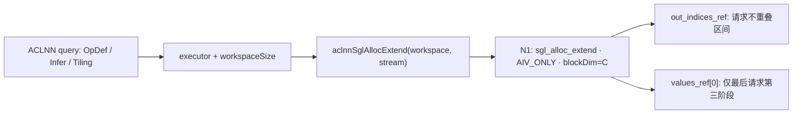
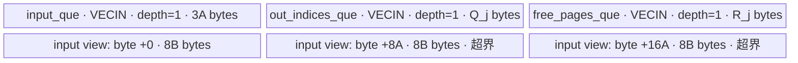

# AllocExtend A2/A3 ACLNN 算子知识

## 算子速览

| 项目 | 内容 |
|---|---|
| 实际入口 | 公开 ACLNN `aclnnSglAllocExtendGetWorkspaceSize` / `aclnnSglAllocExtend`；OpType `SglAllocExtend` |
| 计算语义 | 按请求顺序生成新增 token 的分页槽位：旧页余量→完整新页→末尾不满新页；不移动 KV、不弹出空闲页 |
| 输入输出 | 六个稠密一维 ND `int64` Tensor、`page_size` 属性；原地写 `out_indices`，条件写 `values[0]` |
| 执行类型 | 单 Device 节点 N1，`KERNEL_TYPE_AIV_ONLY`；AIV 上 Scalar `GetValue/SetValue` 与 GM↔UB DMA，无 Cube、SIMT、NDDMA、通信节点 |
| Kernel 路线 | R-001，TilingKey=0，`sgl_alloc_extend` → `KernelAllocExtent::Init/Process`，无备用 Route |
| 核心资源 | 三个 `TQue<VECIN,1>`，depth=1；全部索引算术是整数 Scalar；库 workspace 由平台接口给出、body 未使用 |
| 来源闭包 | `source_closed`：自有 OpDef/Tiling、四字段 POD、唯一 Device body、构建映射与适配层全部可追踪；生成 ACLNN bridge/executor 和 AscendC primitives 是明确框架边界 |
| 静态缺陷 | `A=align_up(8B,32)` 是字节，输入队列仅分配 `3A` 字节，但 `int64` LocalTensor 用 `A/2A` 作元素偏移；按元素下标契约访问 `8A/16A` 字节处。此草稿记录原实现，不证明内存安全，不推荐原样复用 |
| 验证状态 | 已完成源码链路检查；本次知识提取未执行编译、真机、数值或性能测试；没有声称复现 UB 越界 |

## 接口与语义

### 计算语义

接口契约另见[分页新增槽位 API](../../../../apis/sgl_kernel_npu/sgl_alloc_extend.md)。设请求数为 `B>0`，页大小 `p>0`，请求 `j` 的前缀长度为 `a_j`、目标长度为 `s_j>=a_j`，`last_loc[j]` 为旧前缀最后槽位，空前缀用 `-1`。定义：

```text
e_j = s_j - a_j
n_j = ceil(s_j / p) - ceil(a_j / p)
E_j = sum(i=0..j, e_i)        # 包含当前请求的新增 token 前缀和
N_j = sum(i=0..j, n_i)        # 包含当前请求的新页前缀和
O_j = E_j - e_j              # 当前请求 out_indices 起点，单位元素
F_j = N_j - n_j              # 当前请求 free_pages 起点，单位元素
c_j = ceil(a_j / p) * p
part1 = min(s_j, c_j) - a_j
```

先对 `i in [0,part1)` 写 `out_indices[O_j+i]=last_loc[j]+1+i`。若 `a_j+part1==s_j`，当前请求完成。否则令 `part2=floor(s_j/p)*p-c_j`，对每个完整新页 `q` 和页内位置 `i`，写：

```text
out_indices[O_j + part1 + q*p + i] = free_pages[F_j+q]*p + i
```

若 `a_j+part1+part2==s_j`，当前请求完成；否则 `part3=s_j%p`，取 `free_pages[F_j+n_j-1]` 写最后 `part3` 个槽位。只有到达此第三阶段且 `j==B-1` 才写 `values[0]=N_j`；前两条 early-return 路径以及 `values[1:]` 均没有写入。不能将旧 `values[0]` 无条件当作本批新页数。

以上为公开契约和 Device 算术的对应关系；下文保留 UB 下标错误，不能由上述理想数学关系推导固定实现实际输出正确。

### 输入、输出与属性

| 参数 | shape/layout | dtype | 约束、默认值与语义 |
|---|---|---|---|
| `pre_lens` | 稠密 ND `[B]` | int64 | `B>0`，非负已有长度；Host 用 dim0 产生 int32 `batch_size` |
| `seq_lens` | 稠密 ND `[B]` | int64 | 每项不小于已有长度；Kernel 不做数据值校验 |
| `last_loc` | 稠密 ND `[B]` | int64 | 已有最后槽位；空前缀用 -1；由调用者保证与前缀/页对应 |
| `free_pages` | 稠密 ND `[P]` | int64 | 按消费顺序排列，`P>=sum(n_j)`；Kernel 每任务复制 `[0,N_j)`，不修改池 |
| `out_indices` | 稠密 ND `[sum(e_j)]` | int64 | 作为同名输入/输出的可变缓冲区；不是可任意放大的 capacity 参数 |
| `values` | 稠密 ND `[V]`，`V>=1` | int64 | 条件写第0项；其余保留；适配层未像其它五个 Tensor 那样显式检查 dtype，但按 ACL_INT64 描述 |
| `page_size` | 必选属性 | OpDef Int / ACLNN int64，POD int32 | 文档要求 int32 可表示的正数；Tiling 直接窄化，未检查正数或越界 |
| `workspaceSize/executor` | ACLNN 查询结果 | uint64 / aclOpExecutor* | 查询成功后由执行接口消费；workspace 和 executor 细节属于生成框架边界 |
| `workspace/stream` | 执行接口参数 | void* / aclrtStream | 按查询容量提供、生命周期覆盖异步执行；不是 Device 业务数据 |

OpDef 六项输入与两项同名输出全部注册 `DT_INT64/FORMAT_ND`。同名输出通过生成接口保留原地协议；Kernel 有八个业务 GM 形参，实际写 `out_indices_ref/values_ref`，而不是输入形参 `out_indices/values`。

### 入口与版本

本卡入口为 ACLNN 二阶段 API，固定提交没有手写 `aclnn_sgl_alloc_extend.h/.cpp`。`csrc/cmake/cann_ops.cmake::sgl_generate_cann_interfaces` 对 `SglAllocExtend` 的 OpDef 调用 SDK `npu_op_code_gen`，生成 `aclnn*.h/.cpp`；`sgl_add_cann_host_libraries` 收集生成文件到 `sgl_cann_opapi`。精确符号与调用顺序由 `torch_adapter.cpp` 的 `decltype` 和 `op_api_symbol` 同时证明：

```text
aclnnSglAllocExtendGetWorkspaceSize(
  pre_lens, seq_lens, last_loc, free_pages, out_indices, values,
  page_size, &workspaceSize, &executor)
aclnnSglAllocExtend(workspace, workspaceSize, executor, stream)
```

这是源码中的调用形状，不冒充未读取的生成头文件逐字声明。当前固定集合只有这对未带版本后缀的公开入口；旧 `csrc/alloc_extend/` 是独立旧构建的 Direct Invoke，不能混作此 ACLNN 的 Device 起点。

本卡覆盖A2/A3：公开API产品表的arch22支持在构建README与architectures.json中对应2201，编译目标为ascend910b和ascend910_93。算子声明SUPPORTED_ARCHS同时含2201/3510，Host用生成的SGL_CANN_CONFIGS注册当前构建目标；本卡没有把950混入Frontmatter。

CANN 版本记为 `9.1.0`：固定提交 `.github/workflows/pr-test-kernels.yml::test-cache-ops` 的矩阵为 `cann_version=['9.1.0']`、`npu_hardware=[a3,'950']`，复用 workflow 按参数选择 CANN 容器；这是上游配置证据。A2 的产品支持来自文档与2201映射，不能宣称该矩阵实际运行过 A2，更不代表本次执行任何 CI。

## Host/Launcher 执行流程

### 参数校验与前处理

直接 ACLNN 的通用空指针、布局归一化、executor 错误码由生成 bridge/SDK 所有；固定仓不包含生成正文，不能补造检查。算子拥有的 `TilingAllocExtend` 顺序是：

1. 取输入0 shape、输入4 shape、属性0 `page_size`、RawTilingData、1项 workspace 槽。
2. 若上述对象、平台信息、raw data为空，或 raw capacity 小于24字节，返回 `GRAPH_FAILED`。
3. 若 prefix/output 的 OriginShape 维数小于1，返回失败；这里只检查存在 dim0，不检查确实是一维。
4. 获取 typed POD，失败即返回。创建 `PlatformAscendC`，把 prefix dim0 和属性直接 `static_cast<int32_t>`；用平台 AIV 数和 batch 的 min 生成 blockDim。
5. `used_core_num<=0` 返回失败；否则写 workspace、24字节数据长度、blockDim、key0，返回成功。

`InferShapeAllocExtend` 分别把输入4/5 shape拷给输出0/1；缺 shape对象返回失败。`InferDataTypeAllocExtend`分别继承输入4/5 dtype。没有自有的多 Route selector、内部外部 Sort/Scan Kernel，也没有 Host 读取请求长度求前缀和。

Torch 适配层是公开 ACLNN 的调用实例：只显式检查前五个 Tensor 为 int64，`DeviceGuard(pre_lens.device())` 后构建六个 ACL_INT64 描述；`tensor_descriptor` 使用 Tensor 自身 sizes/strides、ND、offset=0和 `data_ptr()`，未调用 contiguous，也未验证全部Tensor同设备。文档要求的稠密、同设备和值域仍由调用者满足。

### 参数、Workspace 与生命周期

令 `C=min(int32(platform.GetCoreNumAiv()),int32(B))`。POD 原始写入24字节；其中12..15为对齐空隙，不是第五个字段，未发现显式初始化 padding。`workspace[0]=platform.GetLibApiWorkSpaceSize()` 是唯一自有 Tiling workspace 请求；生成executor查询的总 `workspaceSize` 可能还包含框架安排，不能把二者无依据视为恒等。

`KernelAllocExtent::Init`接收 `workspace_in` 但没有读取、切片或写入；因此业务 workspace extent=0，没有跨 Kernel 中间 GM 边。输入、输出由调用者拥有，业务输出不存在临时GM副本；各核心UB由局部 `TPipe` 管理。适配层对查询失败立即 `TORCH_CHECK`，容量超过INT64_MAX时停止；成功时按字节分配workspace。

适配层捕获六个 Tensor、六个 `shared_ptr<aclTensor>`、workspace、executor及stream到launch lambda；`record_stream`记录所有Tensor/workspace的异步设备使用，`op_api_symbol`长期保留动态库handle，描述符由shared_ptr删除器 `aclDestroyTensor`释放。executor执行/销毁协议属于ACLNN框架，固定仓未提供额外释放代码。

### 启动图与失败传播



| 节点/边 | producer → consumer | 参数/介质 | 顺序、owner/lifetime和失败 |
|---|---|---|---|
| Host Tiling→N1 | `TilingAllocExtend`→`sgl_alloc_extend` | 24字节POD，key0，blockDim=C | 框架持有Tiling数据至执行；Tiling失败不产生成功executor，具体框架错误码不在固定仓 |
| N1输入边 | 调用者→`KernelAllocExtent` | 六个GM基址；其中输入out/values用ref输出别名写入 | 输入值和输出别名必须在stream完成前有效；不允许调用者并发覆盖 |
| N1→output | `CopyOut`→调用者 | `out_indices_ref[O_j:O_j+e_j]`，`8e_j`字节 | 单kernel，正常语义下请求区间互斥；无后继Device节点 |
| N1→counter | 最后请求第三阶段→调用者 | `values_ref[0]`，8字节Scalar store | 无跨核consumer；在整体stream完成后消费。其它路径不写、不归零 |
| 执行失败 | ACLNN execute→适配层 | 执行返回status | 非ACL_SUCCESS抛错；成功提交不证明异步Device完成。UB缺陷没有显式错误/fallback分支 |

## Route 与参数设计

### 分核与资源计算

核心 `c=GetBlockIdx()` 的任务为 `j=c+k*C < B`，实际步长使用 `GetBlockNum()`，不是POD里保存的 `used_core_num`。每核任务数是 `1+floor((B-1-c)/C)`；存在最多一个任务差，没有单独former/tail core字段。每个任务重新搬运三条长度B的元数据，并Scalar扫描 `i=0..j`；在相关循环计数和字节长度未溢出/截断的域内，名义前缀扫描次数为 `B(B+1)/2`，三路元数据的名义有效字节 DMA 请求量为 `24B²` 字节，不包含页ID和输出；这不是实际成功传输保证，元数据UB访问仍存在下述静态缺陷。

定义 `align32(x)=ceil(x/32)*32`，`A=align32(8B)`、`Q_j=align32(8e_j)`、`R_j=align32(8N_j)`。每核首次请求 `input_que=3A` 字节；每任务 `Compute` 再请求 `out_indices_que=Q_j`、`free_pages_que=R_j`，三个depth均1。单任务名义字节和为 `3A+Q_j+R_j`，无double buffer、无TBuf、无自有寄存器vector对象。Host没有查询UB容量U或比较此和与U；重复InitBuffer是否累计占用属于未展开的TPipe实现，不能把FreeTensor等同释放整个物理分配。

更严重的是元数据UB视图。以下证明限定在 `B>0` 且 `8B`、`ceil_div` 的 uint32 返回值、后续对齐乘法、成员 `total_size_aligned` 的 int32 保存以及 `2A/3A` 均未发生溢出或窄化截断的域内，此时实际成员值才等于数学量 `A=align32(8B)`。按[LocalTensor下标契约](../../../../../../ops/ascendc/apis/simd_api/basic_api/data_structures/local_tensor/operator.md)，`pre_lens_ub[A]`的字节偏移是 `8A`，`pre_lens_ub[2A]`是 `16A`，均超出声明的 `[0,3A)`。在上述非溢出非空域内 `A>=32`、`8A>3A`，该分配/寻址组合不满足队列空间边界；超大B发生截断时，不能继续将数学A当作实际成员值，须另按实际整数转换分析。这是一项静态推导，不是本次真机观测。

### Route 选择

| 顺序 | Route | Key/模板 | 精确选择条件与优先级 | 不适用去向 |
|---:|---|---|---|---|
| 1 | R-001 请求循环分配 | key0；无类模板参数；`KernelAllocExtent` | 选中alloc_extend、平台属于本卡范围；OpDef dtype/layout匹配；Tiling对象/容量/shape维数检查通过且窄化后的C>0 | Tiling显式失败；没有其它key或安全fallback |

```text
平台/选包和 OpDef 支持
  -> metadata/raw/workspace/pod 对象缺失或raw<24字节? GRAPH_FAILED
  -> prefix/output无dim0? GRAPH_FAILED
  -> B=int32(prefix.dim0), p=int32(attr0), C=min(AIV,B)
  -> C<=0? GRAPH_FAILED
  -> key=0, blockDim=C, N1
     -> 每任务part1后到达目标? enqueue/free/return Compute
     -> 否则part2后到达目标? enqueue/free/return Compute
     -> 否则part3；若j=B-1写values[0]
```

### 模板/实现执行矩阵

| Route | key/selector | dtype/shape/platform 完整命中条件 | 执行拓扑与 Kernel 节点 | 实际模板/body | 内存与同步特征 | tail/fallback |
|---|---|---|---|---|---|---|
| R-001 | 0，entry无key if分支 | ND int64；文档B>0、p正int32、s>=a、足量free_pages、精确输出跨度；代码仅落实部分检查；A2/A3 | 单N1 AIV_ONLY，C个block | `KernelAllocExtent::Init→Process→CopyIn→Compute→CopyOut` | 三个VECIN队列depth1，EnQue/DeQue/FreeTensor；按元素偏移推导元数据UB越界 | 三阶段runtime分支；DataCopyPad输出有效字节；零新增、UB过大无fallback |

part1-only、整新页结束、末尾不完整页是同一body内的输出阶段分支，参数布局、启动图和实现身份相同，不虚构为三种TilingKey。

### 隐藏性能 Guard

| Guard | Host/Tiling 条件 | Device/资源原因 | 影响 Route | 不满足时去向 | 源码符号 |
|---|---|---|---|---|---|
| 非空分核 | `C=min(AIV,int32(B))>0` | Process按C步长，不能零block | R-001 | GRAPH_FAILED | `TilingAllocExtend` |
| Raw POD容量 | `raw.capacity>=sizeof(POD)=24` | 需写完整四字段及ABI空隙 | R-001 | GRAPH_FAILED | `TilingAllocExtend` |
| 32字节DMA容量 | Device显式align32；Host无UB guard | 三队列请求必须容纳有效字节，depth1 | R-001 | 无fallback，不保证分配成功 | `Init/Compute` |
| 字节/元素一致性缺失 | Host无检查；`A`用于int64下标 | 元数据第二、三视图分别偏移8A/16A字节 | R-001 | 原实现继续，没有合法安全备用路 | `CopyIn/Compute` |
| int32窄化边界缺失 | B/p直接static_cast；只检查C>0 | B/p截断会改变分核或除法，p=0导致后续除零 | R-001 | 大B可能失败或错误通过；p没有显式失败 | `TilingAllocExtend/Compute` |
| uint32搬运长度缺失 | `8B`、`8N_j`与`8e_j`转uint32 | DMA blockLen单位字节，越界会截断 | R-001 | 无fallback/错误分支 | `CopyIn/Compute/CopyOut` |
| 空新增缺失 | B>0时即使sum(e)=0仍进入 | `InitBuffer(...,0)`和零长DMA未特殊处理 | R-001 | 依赖primitive；固定仓未定义成功空域路线 | `Compute/CopyOut` |
| 请求合法性缺失 | 不读s/a/page池内容做Host检查 | negative长度、free_pages不足、非对应last_loc破坏地址域 | R-001 | 无业务错误码或校正 | `Compute` |

### POD/ABI

结构 `optiling::AllocExtendTilingData`由Host和Device同头引用；固定头显式assert `sizeof=24`、`offsetof(total_extend_tokens)=16`。前三个int32偏移0/4/8；int64在16；C++目标ABI对应8字节对齐，`alignof`没有独立static_assert，未执行编译测量。

| 结构 | 字段 | 类型/位宽 | ABI 布局 | 单位 | Host/launcher producer | Device consumer | 边界 |
|---|---|---|---|---|---|---|---|
| AllocExtendTilingData | batch_size | int32_t/32 | offset0，4字节 | 请求数 | `int32(prefix.OriginShape.dim0)` | `Init`绑定三路GM长度、计算A；`Process/Compute`任务/最后请求判定 | 文档B>0；Host不做窄化范围检查 |
| AllocExtendTilingData | page_size | int32_t/32 | offset4，4字节 | token/页 | `int32(*pageSize)` | `Init`保存；`Compute`整数除法、槽位公式 | p>0由调用者满足，Host未检查 |
| AllocExtendTilingData | used_core_num | int32_t/32 | offset8，4字节 | AIV block数 | `min(int32(GetCoreNumAiv()),batch_size)`；同时SetBlockDim | `Init`存成员后没有进一步使用；Process真正用GetBlockNum | C<=0显式失败；不能把它当Device动态步长 |
| AllocExtendTilingData | total_extend_tokens | int64_t/64 | offset16，8字节；12..15 padding | 输出元素数 | `input4.OriginShape.dim0` | `Init`绑定out_indices_gm span | 不从s-a核验sum；不能用更大capacity冒充有效长度 |

### Route 源码闭包

| Route | Key/selector | Host/Tiling producer | POD/参数 | Kernel entry/router 节点 | Kernel body/直接依赖 | 构建接线 |
|---|---|---|---|---|---|---|
| R-001 | key0，无多模板selector | `op_host/alloc_extend.cpp::TilingAllocExtend` | 同目录`../op_kernel/alloc_extend_tiling_data.h`四字段 | `op_kernel/alloc_extend.cpp::sgl_alloc_extend`；GET_TILING_DATA | 同文件`ceil_div`、`KernelAllocExtent`全部方法；外部kernel_operator primitives | 本算子CMake→domains/mem_cache发现→operators resolve→cann_ops codegen/tiling/kernel映射；无ARCH variant |

## Kernel 实现

### 公共执行流程

entry按顺序接收 `pre_lens,seq_lens,last_loc,free_pages,out_indices,values,out_indices_ref,values_ref,workspace,tiling`。设置AIV_ONLY、注册POD、GET_TILING_DATA后实例化局部op，传入ref输出指针执行。输入的out_indices/values在body中未读取；workspace被传到Init但不消费；没有按TilingKey或dtype二次分支。

Scalar整除、逐元素GetValue/SetValue是核心计算；没有Vector Add/Reduce、repeat、vector mask、cast或浮点累加。搬运粒度由 `DataCopyExtParams` 决定，不把普通DataCopyPad称为NDDMA执行族。

### Route R-001：请求循环分配

#### 适用条件

##### 选择证据

| 层级 | 文件 | 符号 | 源码谓词/参数 | 结果/下一跳 |
|---|---|---|---|---|
| API约束 | `docs/api/zh/operators/mem_cache/alloc_extend.md` | alloc_extend | ascendc两代支持；B>0、int64稠密、p正、s>=a | 定义合法逻辑语义，不能替代实现校验 |
| Tiling | `csrc/mem_cache/alloc_extend/op_host/alloc_extend.cpp` | TilingAllocExtend | 指针/raw容量/shape维数检查；C>0 | key0、blockDim=C |
| entry | `csrc/mem_cache/alloc_extend/op_kernel/alloc_extend.cpp` | sgl_alloc_extend | 无if key；AIV_ONLY | 唯一KernelAllocExtent |
| body | 同一kernel文件 | Process/Compute | `j=core_id;j<B;j+=GetBlockNum()`；part1/part2早退 | 每请求一次CopyIn/Compute/CopyOut，缺陷没有旁路 |

#### Device 数据流

##### 函数级调用链

```text
aclnnSglAllocExtendGetWorkspaceSize
  -> SDK生成bridge / SglAllocExtend OpDef
  -> InferShapeAllocExtend / InferDataTypeAllocExtend / TilingAllocExtend
aclnnSglAllocExtend(workspace,size,executor,stream)
  -> SDK生成executor launch N1 sgl_alloc_extend
    -> KERNEL_TASK_TYPE_DEFAULT(AIV_ONLY), GET_TILING_DATA
    -> KernelAllocExtent::Init(ref_outputs,POD)
      -> bind six GlobalTensor<int64_t>
      -> InitBuffer(input_que,1,3*A)
    -> Process
      -> for j=core_id; j<B; j+=GetBlockNum
        -> CopyIn: AllocTensor / three DataCopyPad / EnQue
        -> Compute(j): DeQue / scalar prefix scan / two InitBuffer
           / free_pages DMA+queue / three-phase SetValue
           / output EnQue / input and free-page FreeTensor
        -> CopyOut: output DeQue / DataCopyPad(ref+O_j) / FreeTensor
```

##### 源码等价伪码

下列是保留原始下标与分支的伪码；`A`不被偷偷除以8，故保留静态缺陷。

```text
B,p <- POD; C_actual <- GetBlockNum(); A=ceil_div(8*B,32)*32
InitBuffer(inputQ,1,3*A)
for j=GetBlockIdx(); j<B; j+=C_actual:
  buf=inputQ.AllocTensor<int64>()
  DMA_to_UB(buf, pre_lens, bytes=8*B)
  DMA_to_UB(buf[A], seq_lens, bytes=8*B)       # A是元素偏移，实际8A字节
  DMA_to_UB(buf[2*A], last_loc, bytes=8*B)     # 实际16A字节
  inputQ.EnQue(buf); buf=inputQ.DeQue<int64>()
  seq=buf[A]; last=buf[2*A]; E=0; N=0
  for i=0..j:
    s=seq.GetValue(i); a=buf.GetValue(i); e=s-a
    n=(s+p-1)/p-(a+p-1)/p; E+=e; N+=n
  InitBuffer(outQ,1,align32(8*e)); InitBuffer(freeQ,1,align32(8*N))
  free=freeQ.AllocTensor<int64>()
  DMA_to_UB(free,free_pages,bytes=8*N)
  freeQ.EnQue(free); pages=freeQ.DeQue<int64>()
  O=E-e; F=N-n; part1=min(s,ceil(a/p)*p)-a
  out=outQ.AllocTensor<int64>()
  for i=0..part1-1: out.SetValue(i,last.GetValue(j)+1+i)
  if a+part1==s: enqueue_out_and_free_inputs(); goto copy_out
  part2=floor(s/p)*p-ceil(a/p)*p
  if part2>0:
    for page_i=0..part2/p-1:
      page=pages.GetValue(F+page_i)
      for i=0..p-1: out.SetValue(part1+page_i*p+i,page*p+i)
  if a+part1+part2==s: enqueue_out_and_free_inputs(); goto copy_out
  part3=s-floor(s/p)*p; page=pages.GetValue(F+n-1)
  for i=0..part3-1: out.SetValue(part1+part2+i,page*p+i)
  if j==B-1: values_ref.SetValue(0,N)
  enqueue_out_and_free_inputs()
copy_out:
  out=outQ.DeQue<int64>(); bytes=uint32(uint32(e)*8)
  DMA_to_GM(out_indices_ref[O],out,bytes)
  outQ.FreeTensor(out)
```

#### 内存与数据搬运

##### 资源与搬运表

| 层级/缓冲区 | offset/地址公式 | extent/容量公式 | dtype/layout | producer | consumer | owner/lifetime | 对齐/复用 |
|---|---|---|---|---|---|---|---|
| GM pre_lens | base+8i | 8B字节 | int64 ND | caller | CopyIn | caller，整个kernel有效 | 稠密 |
| GM seq_lens | 独立base+8i | 8B字节 | int64 ND | caller | CopyIn | 同上 | 无cast |
| GM last_loc | 独立base+8i | 8B字节 | int64 ND | caller | CopyIn/Compute | 同上 | 无预取缓存跨任务 |
| GM free_pages | base+8q | caller容量8P；每任务读取8N_j | int64 ND | caller | free_pages DMA/GetValue | caller；所有请求只读 | `[0,N_j)`前缀重复读取 |
| GM out_indices_ref | base+8O_j | 每请求8e_j；总8sum(e) | int64 ND | CopyOut | caller | caller；无中间output GM | 请求区间互斥为语义前提 |
| GM values_ref | base+0 | 条件写8字节，其余不动 | int64 ND | 最后任务第三阶段 | caller | caller；不能提前清空或读取 | 无atomic、无共享自增 |
| UB input_que | allocator未知base；声明容量[0,3A) | depth1×3A | int64 LocalTensor | CopyIn DMA | Scalar前缀和 | TPipe；每任务Alloc/DeQue/Free | pre视图0；seq视图8A；last视图16A，后两者越界 |
| UB out_indices_que | 独立allocator base，out[k]偏移8k | depth1×Q_j | int64，VECIN | Scalar SetValue | CopyOut DMA | 同任务Compute→CopyOut→FreeTensor | 只搬8e_j，无尾padding写GM |
| UB free_pages_que | 独立allocator base，pages[q]偏移8q | depth1×R_j | int64，VECIN | DataCopyPad | Scalar GetValue | 同任务EnQue/DeQue后FreeTensor | 只读N_j项；Free原allocation handle，read视图别名 |
| Scalar/寄存器 | 局部循环计数和int64累计变量 | 编译器分配不可见，不能伪报字节 | int32/int64 | Process/Compute | Scalar流程 | 当前任务 | 非RegTensor，无显式dynamic UB |
| 框架workspace | 未切片 | Tiling库请求L；查询总量W由executor返回 | byte | caller/adapter分配 | SDK框架；body未使用 | 覆盖stream执行 | 业务workspace=0，W不冒充0 |

GM→UB三路及free_pages均用 `DataCopyExtParams{1,uint32(valid_bytes),0,0,0}`：一个连续block，blockLen为有效字节，srcStride/dstStride为0，其余保留0。pad参数 `{true,0,0,0}` 没有左右额外填充元素；容量另向32字节取整。UB→GM使用 `DataCopyPad<int64_t>(out_gm[O_j],out_ub,{1,copy_bytes,0,0,0})`，只提交有效字节。传入参数本身不修复UB目的地址越界。

##### 分层内存布局



第一行是源码InitBuffer请求，第二行是对input队列的实际地址视图，不代表又分配了三个buffer，也不能把它画成合法的0/A/2A字节三分区。三个队列物理相对地址由TPipe决定，固定业务源码未给出，不能推测越界具体覆盖哪个队列。

##### 字节账与复用顺序

```text
A=align32(8B)
Q_j=align32(8e_j)
R_j=align32(8N_j)
input_requested = 1*3A
out_requested(j) = 1*Q_j
free_requested(j) = 1*R_j
single_task_requested_sum = 3A+Q_j+R_j
required: requested allocation/physical peak <= platform usable UB U
Host实际行为: 不查询U、不比较此式、不做tile fallback
input名义最高有效访问边界 = 16A+8B > 3A
  前提: B>0，且A计算、uint32返回值、int32保存及2A/3A均未溢出/截断
dynamic_ub=N/A，纯AIV Scalar+DMA
business_workspace=0；framework workspace query=W，Tiling库请求=L
```

不能用名义 `single_task_requested_sum<=U` 掩盖超出单队列的视图；即便总UB有空余，queue allocation extent仍不满足。每任务重复调用out/free的InitBuffer、没有显式TPipe reset，物理峰值是否累计或重绑依赖SDK内部，固定仓无法证明可安全跨任务重初始化。`FreeTensor`归还队列Tensor，不足以证明撤销InitBuffer所做的物理分配。

| 复用子区 | 写入者 | 读取者/消费点 | 下一次覆盖 | 同步或释放依据 | 安全条件 |
|---|---|---|---|---|---|
| input_que allocation | CopyIn三路DMA | Compute的GetValue | 同核下一个j的CopyIn | EnQue→DeQue→各退出点FreeTensor | 逻辑lifetime配对存在；实际A/2A下标越界，空间安全不成立 |
| free_pages allocation | free_pages DataCopyPad | Compute页循环 | 下任务InitBuffer/Alloc | EnQue→DeQue，所有Compute出口FreeTensor | 页池充足、N_j可表示；重复InitBuffer物理复用未证 |
| output allocation | Scalar逐槽SetValue | CopyOut DataCopyPad | 下任务InitBuffer/Alloc | EnQue→DeQue→CopyOut后FreeTensor | e_j非负、容量和字节不截断；未验证零长语义 |

#### 同步、精度与尾块

##### 同步与数值边界表

| 阶段 | primitive/机制 | producer | consumer/等待点 | 保护对象 | 精度/尾块 |
|---|---|---|---|---|---|
| 元数据装载→Scalar读 | input_que EnQue/DeQue | 三次DataCopyPad | Compute入口DeQue | 同一个input allocation及视图 | SDK队列同步实现为primitive边界；越界不被队列同步修复 |
| 页池装载→Scalar读 | free_pages_que EnQue/DeQue | 页ID DMA | DeQue后的GetValue | R_j字节allocation | int64页ID；没有浮点cast |
| Scalar写→输出DMA | out_indices_que EnQue/DeQue | SetValue循环 | CopyOut DeQue/DataCopyPad | Q_j字节allocation | 无显式手动SetFlag/WaitFlag；队列/编译器具体S/MTE同步不在业务源码展开 |
| 输出DMA→队列复用 | FreeTensor | CopyOut | 下任务资源申请 | 当前out allocation | 源码使用primitive释放协议，未读取SDK实现，不宣称物理InitBuffer回收 |
| 请求之间 | 无barrier/atomic | 各核心请求j | 无跨核心consumer | 不重叠输出区；values仅末请求写 | 互斥区依赖合法前缀和；没有全局append计数 |
| 整数与搬运尾部 | Scalar int64；DMA有效字节 | Compute/CopyOut | GM输出 | `8e_j`有效字节 | ceil公式a+p-1存在int64溢出边界；uint32 blockLen截断；非32倍输出不写邻请求padding |
| 最后计数 | GlobalTensor.SetValue | j=B-1第三阶段 | 调用者stream完成后读取 | values[0] | 前两阶段返回时保留旧值；无总是写计数的承诺 |

#### 关键实现

##### 符号证据表

| 阶段 | 文件 | 符号/模板实例 | 实现事实 |
|---|---|---|---|
| Host/Tiling producer | `csrc/mem_cache/alloc_extend/op_host/alloc_extend.cpp` | TilingAllocExtend | dim0/attr窄化、AIV分核、key0、库workspace |
| ABI | `csrc/mem_cache/alloc_extend/op_kernel/alloc_extend_tiling_data.h` | AllocExtendTilingData | 四字段、24字节、int64 offset16 |
| Kernel entry/router | `csrc/mem_cache/alloc_extend/op_kernel/alloc_extend.cpp` | sgl_alloc_extend | AIV_ONLY、使用ref输出、唯一body |
| Device body/helper | `csrc/mem_cache/alloc_extend/op_kernel/alloc_extend.cpp` | Init/CopyIn | 3A分配及A/2A元素下标；静态冲突位置 |
| Device body/helper | `csrc/mem_cache/alloc_extend/op_kernel/alloc_extend.cpp` | Process/Compute/CopyOut/ceil_div | 循环请求、两前缀和、三阶段写槽位、条件values、有效字节DMA |

## 算子特定优化

### Trick T-001：每请求重算前缀以形成互斥输出区

#### 触发与源码依据

- 适用 Route：R-001。
- 触发条件：每个可达请求j；三路元数据可正确寻址、请求长度合法时，Scalar扫描0..j产生两类包含当前项的前缀和。
- Golden 来源：[Compute前缀累计，固定提交连续83–90行](https://github.com/sgl-project/sgl-kernel-npu/blob/dda6d36b0cdb4081e102d14c0a2fb276fc416e69/csrc/mem_cache/alloc_extend/op_kernel/alloc_extend.cpp#L83-L90)。

**官方源码（固定 Commit 连续逐字摘录）**：

```cpp
        for (int i = 0; i < task_id + 1; i++) {
            cur_seq = seq_lens_ub.GetValue(i);
            cur_pre_seq = pre_lens_ub.GetValue(i);
            cur_extend_len = cur_seq - cur_pre_seq;
            cur_need_pages = (cur_seq + this->page_size - 1) / this->page_size -
                             (cur_pre_seq + this->page_size - 1) / this->page_size;
            extend_lens_sum = extend_lens_sum + cur_extend_len;
            num_new_pages_sum = num_new_pages_sum + cur_need_pages;
```

#### 机制与设计原因

`output_start_loc=extend_lens_sum-cur_extend_len`与`new_pages_start_loc=num_new_pages_sum-cur_need_pages`把两个前缀和还原为当前请求的排他起点。不同核心独立确定输出区间和消费页区间，因此不需要共享append指针、atomic增量、前缀workspace或另一个scan Kernel；这是单Kernel设计减少全局中间状态的结构性取舍。在相关整数计数/字节长度未溢出或截断的域内，名义代价是B(B+1)/2次Scalar迭代、24B²字节元数据DMA请求及每请求读取页池前缀；存在未定义内存访问，不能保证实际成功传输这些字节，也不能宣称大B下高效。原实现的UB下标问题独立存在，此结构不使其安全。

#### 迁移边界

- 适用：请求数量可控、每请求输出跨度可由只读元数据计算且互斥的索引生成。
- 前提：先满足字节/元素单位一致、队列容量/UB峰值、非负长度、页池容量和整数范围；固定版本未满足全部前提。
- 失效：请求规模使重算成本/UB容量不可接受时，源码没有scan备用Route；本卡不替上游添加新的实现。
- 未验证：本次知识提取未执行编译、真机、数值或性能测试。

#### 错误做法

固定源码本身提供可核验的空间单位反例：`InitBuffer(...,3A)`的A按字节产生，却在`LocalTensor<int64_t>`使用A/2A元素偏移；应据此审查搬运地址，不能因为prefix公式正确就认定原实现可复用。此处只记录静态推导，不提供未经验证的修复代码或虚构运行报错。

## 模板与实现对比

| 对比维度 | R-001 请求循环分配 | 设计选择依据 |
|---|---|---|
| 命中条件/优先级 | 唯一key0；无其它候选 | 失败止于Tiling或primitive，无备用Route |
| 模板与 dtype | 无类模板参数；六个int64 Tensor | 无FP16/BF16分支，也没有Cube |
| 循环与分核 | j=core_id+k*C；任务内部扫描0..j | 静态轮转请求，互斥前缀输出 |
| Queue/TBuf/寄存器/dynamic UB/通信 window | 三个VECIN depth1；无TBuf/RegTensor/窗口 | 不以普通C++变量虚报寄存器容量 |
| 内存总占用与复用 | 单任务请求3A+Q_j+R_j；重复InitBuffer物理峰值未证 | metadata视图超3A，不能给出安全UB预算结论 |
| 搬运/Vector/SIMT/NDDMA/通信 API | DataCopyPad + Scalar GetValue/SetValue | 核心是索引算术，没有Vector repeat/float compute |
| 同步、精度与 tail | 队列协议、int64算术、精确有效字节 | 无跨核consumer；保留未写counter条件 |
| fallback/失败边界 | part1/part2返回只减少后续填充；不是替代实现 | 无UB过大/零长/非法p安全fallback |

## 平台差异

| 项目 | A2 | A3 | Ascend 950 |
|---|---|---|---|
| 支持状态 | 公开arch22支持，2201映射ascend910b | 公开arch22支持，2201映射ascend910_93 | 公开arch35支持，3510映射ascend950 |
| Host/Launcher | 相同Tiling；C来自运行平台AIV数 | 相同；CI配置9.1.0/a3 | 相同；CI配置9.1.0/950 |
| Kernel/资源 | 同一个sgl_alloc_extend，三depth1队列 | 同一body，无单独specialization | 同一body，无arch35独立优化 |
| 共同静态边界 | 3A分配与8A/16A视图冲突；Host无UB容量guard | 同左 | 同左；不能因为UB规格不同就认定冲突消失 |

本卡Frontmatter限定A2/A3；[950同源码草稿](sgl_alloc_extend_950.md)单独承载950证据。平台变化只改变AIV数量和SDK资源，固定body的单位冲突共同存在。

## 限制与失败边界

- 本卡为`draft`：源码链路可闭合，但唯一body的元数据UB视图按已知元素下标契约超出声明allocation，不能作为稳定安全实现推荐。没有为解释算法而修正固定源码。
- 该结论是固定业务代码与[LocalTensor operator[]](../../../../apis/simd_api/basic_api/data_structures/local_tensor/operator.md)、[InitBuffer字节容量契约](../../../../../../ops/ascendc/apis/simd_api/basic_api/resource_management/t_pipe/init_buffer.md)相结合的静态推导；没有读取所选本机CANN9.1.0头文件或真机观测，具体破坏对象、报错或结果不作推测。
- 单任务名义UB预算不等于真实安全峰值；Compute重复InitBuffer的物理回收/累计行为及零字节分配/DMA仍处于SDK primitive边界，Host没有保护或fallback。
- `ceil_div`返回uint32；A再保存int32；B/p从int64窄化int32；DataCopyPad字节长度截成uint32；Scalar循环计数还使用int。调用者必须约束相关中间量，没有源码检查保证所有运算可表示。
- page_size=0/负数、长度回退、非法页ID/短页池、精确输出跨度不符、非稠密缓冲区、错设备或values dtype不符没有完整显式自有校验，不能把API文档要求写成Host已拒绝。
- 前两阶段完成、最后请求没有新尾页时，values[0]保留旧值；不从最后token或总页数推导恒写counter。
- entry只写ref输出；直接绕过生成ACLNN协议调用底层kernel时必须自己保证别名和生命周期，这种Direct Invoke不属于本卡入口。
- 本次知识提取未执行编译、真机、数值或性能测试；CANN9.1.0与产品支持来自固定来源配置，不能生成verified或宣称测试通过。

## 源码索引

### 链路索引

| 链路阶段 | 文件 | 关键符号 | 支撑内容 |
|---|---|---|---|
| 入口声明/约束 | `docs/api/zh/operators/mem_cache/alloc_extend.md` | alloc_extend | 数学契约、原地counter条件、产品表 |
| 入口实现 | `csrc/mem_cache/alloc_extend/torch_adapter.cpp` | alloc_extend / query / execute | 生成接口名称、参数顺序、status与stream生命周期 |
| 公共适配依赖 | `csrc/aclnn_torch_adapter/aclnn_runtime.h` | op_api_symbol/tensor_descriptor | 指定vendor库symbol、描述符、library lifetime |
| Host/Tiling/Launcher | `csrc/mem_cache/alloc_extend/op_host/alloc_extend.cpp` | SglAllocExtend/TilingAllocExtend/InferShapeAllocExtend/InferDataTypeAllocExtend | OpDef、平台config、POD生产和失败 |
| POD/ABI | `csrc/mem_cache/alloc_extend/op_kernel/alloc_extend_tiling_data.h` | AllocExtendTilingData | 四字段、24字节、offset16 |
| Kernel entry/body | `csrc/mem_cache/alloc_extend/op_kernel/alloc_extend.cpp` | sgl_alloc_extend/KernelAllocExtent/ceil_div | AIV唯一Route、内存、同步、prefix/三阶段与缺陷 |
| 构建声明 | `csrc/mem_cache/alloc_extend/CMakeLists.txt` | sgl_register_operator(ID alloc_extend) | AICORE、OpType、源文件、2201/3510 |
| domain发现 | `csrc/mem_cache/CMakeLists.txt` | sgl_discover_operators | 当前算子目录接入 |
| domain接线 | `csrc/cmake/domains.cmake` | sgl_add_cann_operator_domains/sgl_discover_operators | mem_cache和直接子目录发现 |
| 构建解析 | `csrc/cmake/operators.cmake` | sgl_register_operator/sgl_resolve_operator/sgl_select_cann_operators | arch可用、文件存在、唯一AICORE kernel入口 |
| 构建生成 | `csrc/cmake/cann_ops.cmake` | sgl_generate_cann_interfaces/sgl_add_cann_tiling/sgl_add_cann_host_libraries/sgl_add_cann_kernels | config数组、生成ACLNN、Tiling/Kernel映射 |
| 构建入口 | `csrc/CMakeLists.txt` | SGL_ARCH_VERSION/SGL_CANN_BUILD_STAGE | 独立CANN编译入口、SDK/package接线；与legacy路径区分 |
| 架构映射 | `csrc/cmake/architectures.json` | 2201/3510 | ascend910b/ascend910_93/ascend950 |
| 公开构建说明 | `python/sgl_kernel_npu/README.md` | REFACTOR builds/architecture mapping | `.run`直接ACLNN公开用法与硬件映射 |
| CANN配置来源 | `.github/workflows/pr-test-kernels.yml` | test-cache-ops | 9.1.0、a3/950矩阵 |
| CI参数消费 | `.github/workflows/pr-test-kernel-group.yml` | run-kernel-group | CANN容器、hardware runner和环境参数 |

每行文件均在Frontmatter sources；生成ACLNN头、SDK executor和kernel_operator内部没有伪造固定仓路径。产品接口的已有正文继续由[API卡](../../../../apis/sgl_kernel_npu/sgl_alloc_extend.md)维护，本卡补充实现与缺陷。

### 实现复用检查

| 检查项 | 可复用事实 | 不得改变的约束 | 源码符号 |
|---|---|---|---|
| ABI/POD | 同头四字段、sizeof24、int64 offset16 | 字段顺序、位宽、padding和单位；used_core_num不替代GetBlockNum | AllocExtendTilingData/Init/Process |
| 调用顺序 | query→workspace/executor→execute；每任务CopyIn→Compute→CopyOut | 查询失败不能执行；stream完成前数据和描述符有效 | torch_adapter/Process |
| workspace/内存 | 业务workspace未用，输出直接回GM | 保留真实3A/Q_j/R_j请求；必须显式面对A/2A元素下标冲突，不把理论分区当实装 | Init/CopyIn/Compute/CopyOut |
| 同步 | 三队列EnQue/DeQue/FreeTensor，无跨核数据依赖 | 不把FreeTensor等同TPipe物理回收，不用Host书写顺序替代异步完成 | Process/Compute/CopyOut |
| 精度与尾块 | int64索引、有效字节DMA、counter条件写 | 避免窄化/ceil溢出；不向GM写padding、不把counter当总是初始化 | ceil_div/Compute/CopyOut |
| 失败边界 | Tiling对象/容量/C检查；其余多为未guard前提 | 不宣称非法值/UB过大已拒绝，也不宣称静态缺陷真机复现 | TilingAllocExtend/KernelAllocExtent |
