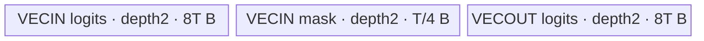
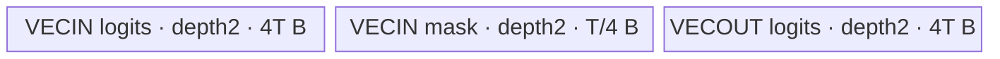

# ApplyTokenBitMask A2/A3 ACLNN 算子知识

## 算子速览

| 项目 | 内容 |
|---|---|
| 实际入口 | `aclnnSglApplyTokenBitMaskGetWorkspaceSize` / `aclnnSglApplyTokenBitMask`，OpType SglApplyTokenBitMask |
| 计算语义 | 工作张量每个mask word的低位起对应32个词元；bit0写负无穷，bit1保留输入位模式，原地返回logits |
| 输入输出 | 连续ND logits[N,V] FP32/FP16/BF16；mask[N,M] INT32；raw ACLNN要求V>0且为256倍数，M>=V/32，不接收indices |
| 执行类型 | 单节点AIV_VECTOR数据路径，DMA与Scalar位测试/SetValue；无Cube/SIMT/NDDMA/通信节点；entry未显式声明KERNEL_TASK_TYPE_DEFAULT |
| Kernel 路线 | Host Key0；R-001 FP32，R-002 FP16/BF16显式两实例；相同数学语义，不将Torch预处理当新增自有Kernel |
| 核心资源 | 三个depth2队列，UB=4Td+T/4；无TBuf、dynamic UB、通信window或自有workspace；16KiB平台UB余量 |
| 来源闭包 | source_closed：精确ACLNN入口→注册/Host→36B POD→单entry→三dtype全部自有Device方法及构建闭合；生成框架和DMA/queue primitive为边界 |
| 草稿边界 | 上游公开文档仍标记待NPU验收；外层indices/zero/narrow/copy/index_put由外部Torch实现，不据此声称整个Torch调用图的自有源码闭包 |
| 验证状态 | 本次知识提取未执行编译、真机、数值或性能测试；无verified，无测得加速或运行正确性声明 |

## 接口与语义

### 计算语义

公共合同见[词表掩码API](../../../../apis/sgl_kernel_npu/sgl_apply_token_bitmask.md)。本卡的冻结入口是其**原始ACLNN工作张量核心**。令N为工作行数、V为工作词表宽度、M为mask行步长（INT32元素），u=floor(j/32)、b=j%32：

```text
out[n,j] = logits_before[n,j]            if ((mask[n,u] >> b) & 1) == 1
           cast_T(-infinity)            otherwise
0<=n<N, 0<=j<V
```

初始UB到UB复制保留bit1位置原位模式，包括已有NaN/无穷；不是乘0/1，也不做归约。负无穷由float表达式`-1.0f/0.0f`转T。代码以signed int32右移再取低位；这里描述固定实现，不另许诺跨任意C++实现的signed shift可移植性。原始ACLNN没有缺word视零或选行参数；这些属于Torch适配合同。

### 输入、输出与属性

| 参数 | shape/layout | dtype | 约束、默认值与语义 |
|---|---|---|---|
| logits / logitsRef | [N,V]、连续ND、同存储Ref | FP32/FP16/BF16 | N>=0，V>0且V%256=0；元素步长V |
| bitmask | [N,M]、连续ND | INT32 | M>=V/32；每word低位先行；多余words不读取 |
| workspace | SDK query给出实际W | BYTE | 自有Host workspace[0]=0，Device形参不消费；不可把SDK最终W强行假定为0 |
| tiling | 36B POD | 九uint32 | 由Host填充；调用者不直接伪造POD |
| indices | raw ACLNN无该参数 | N/A | Torch非空indices先gather工作行，执行后index_put_；None/空indices选全部行 |

### 入口与版本

精确pair在torch_adapter.cpp通过vendor libcust_opapi.so解析，OpDef同名input/output生成Ref ACLNN。Python auto/ascendc调用torch.ops.npu.apply_token_bitmask；torch_native显式选择，既非该ACLNN fallback，也不纳入本卡自有Device节点。

SGL固定提交`dda6d36b0cdb4081e102d14c0a2fb276fc416e69`。CANN9.1.0来自上游CI的norm/cache/fused等组版本配置与其复用容器消费；该配置本身不是sampler专项验收，不是本次安装/运行版本报告。公开文档arch22/arch35与2201/3510构建映射支持A2/A3、950；CI硬件矩阵a3/950不证明本次或A2实测。

## Host/Launcher 执行流程

### 参数校验与前处理

raw Host先检查shape/desc/platform指针，再检查两个StorageShape恰2D、同行、N>=0、V>0且V%256=0、M>=V/32、maskINT32；logits只接受FLOAT/FLOAT16/BF16。读取AIV数C和UB字节U，C<=0失败。N、V、M各不得超过UINT32_MAX；N>0时同时保护N*V-1及(N-1)*M+V/32-1。随后计算分核/UB、检查V+T-1、raw tiling容量>=36B及workspace/typedPOD指针；任一失败返回GRAPH_FAILED，无备用Kernel。InferShape复制input0 shape，InferDataType复制input0 dtype。

Torch适配先验证同NPU、连续、二维及dtype，非空indices转long/contiguous并以外部index选行；Nselected=0直接返回、不调用ACLNN。任意原始V先补齐至ceil(V/256)*256，缺mask words用外部zeros/narrow/copy补零；最后narrow回原V及index_put_/copy_。这些外部Torch算子是清楚的实现边界，不能将raw Host的严格工作域宣称为公共输入V限制，也不能声称本卡闭合外部Torch Device实现。

### 参数、Workspace 与生命周期

query以两个Tensor描述符返回executor与W，W<=INT64_MAX才分配BYTE workspace。适配使用logits所在设备的DeviceGuard，当前NPU stream；workingLogits、workingBitmask、workspace均record_stream，lambda捕获Tensor及shared_ptr描述符覆盖Host队列期，record_stream覆盖异步Device使用。描述符按Tensor sizes/strides、ND、offset0、data_ptr创建并由shared_ptr析构aclDestroyTensor；动态库handle为静态保存。executor执行/释放规则属于生成ACLNN Runtime，不伪造源码中未见的手动销毁步骤。

自有Host workspace[0]=0，Device未读workspace，故无workspace slice、跨Kernel边或中间GM。working logits N*V*d字节、mask实际[N,M]存储由caller持有，直到stream完成不得释放或并发改写；Ref与输入logits同存储是有意alias。

### 启动图与失败传播

| 节点/边 | producer→consumer | offset/extent与layout | ordering/owner/lifetime | 失败 |
|---|---|---|---|---|
| Host launch N1 | query/tiling→aclnnSglApplyTokenBitMask→sgl_apply_token_bit_mask | K blocks，36B POD，logits/mask/ref/workspace/tiling参数 | 单次当前stream提交，生成executor负责launch；Tensor/描述符由上述捕获保护 | query/execute非ACL_SUCCESS抛TORCH_CHECK |
| GM logits输入/Ref输出 | caller→N1→caller | 每核独占整行子集，tile区间[nV+o,nV+o+c)，T元素单位 | tile先CopyIn再CopyOut；不同核行不重叠，无跨核同步 | Host合法形状不代替caller存储/alias保证 |
| GM mask只读 | caller→N1 | [nM+o/32, nM+o/32+c/32) INT32 | 与logits同stream、有足量实际存储 | 外部并发写未保护 |

构建链为csrc根→sampler domain→单算子注册(AICORE,2201/3510)→operators解析→cann_ops的OpDef生成ACLNN/配置、tiling/host库、Kernel映射/库。SDK生成桥接源码不在冻结SGL仓，作为框架边界；不存在未闭合的另一个自有Kernel。

## Route 与参数设计

### 分核与资源计算

K=min(N,C)，零改1；q=floor(N/K)，r=N%K。核c<r负责[q+1]行，start=c(q+1)；其余负责q行，start=r(q+1)+(c-r)q。N=0时K=1、q=r=0，Init仍分配UB，Process零行，不写GM。

令d=sizeof(T)，H=U>16384?U-16384:U，P=2*(2*256*d+8*4)。H<P失败。源码先令T=uint32(floor(H/P)*256)，再夹至V且不小于256；数学无窄化域可写T=min(V,256floor(H/P))。FP32 P=4160，FP16/BF16 P=2112。超大虚构U不能忽略先uint32窄化；以下预算式均以tile计算/字节计数可表示为前提。

每槽logit Td、mask T/8、output Td，三队列深度均2，因此UB=4Td+T/4；T为256倍数，使每槽恰32B对齐。按正常非窄化域UB<=H<=U，Host预算与Device相符，不包含虚构TBuf。尾tile c=V-o也是256倍数，因此mask c/32为8倍数，AlignUp不多读额外mask word。

### Route 选择

| 顺序 | Route | Key/模板 | 精确选择条件与优先级 | 不适用去向 |
|---:|---|---|---|---|
| 1 | R-001 FP32 | key0 / KernelApplyTokenBitmask<float> | 所有Host公共guard且logits DT_FLOAT | 类型不符检查R-002；其它guard失败即GRAPH_FAILED |
| 2 | R-002 两字节浮点 | key0 / KernelApplyTokenBitmask<half>或<bfloat16_t> | 公共guard且DT_FLOAT16或DT_BF16；对应同名Ref dtype | 其它dtype失败，无fallback |

```text
pointer/2D/row/V%256/mask checks -> dtype switch
DT_FLOAT:d4 -> FP32 instance -> R-001
DT_FLOAT16:d2 -> half instance -> R-002
DT_BF16:d2 -> bfloat16_t instance -> R-002
other -> failed
C/U/index/tiling-capacity guard -> SetTilingKey(0), launch K blocks
```

### 模板/实现执行矩阵

| Route | key/selector | dtype/shape/platform 完整命中条件 | 执行拓扑与 Kernel 节点 | 实际模板/body | 内存与同步特征 | tail/fallback |
|---|---|---|---|---|---|---|
| R-001 | key0，DT_FLOAT | 公共guard，2201或3510 | 单N1 AIV DMA/Scalar | KernelApplyTokenBitmask<float>::Init/Process/CopyIn/Compute/CopyOut/AlignUp | UB=16T+T/4；queue深度2；无手动event | c为256倍数；不补读word，无fallback |
| R-002 | key0，DT_FLOAT16 | 同公共guard/平台 | 同N1 | KernelApplyTokenBitmask<half>相同全部方法 | UB=8T+T/4；负无穷转half | 同左 |
| R-002 | key0，DT_BF16 | 同公共guard/平台 | 同N1 | KernelApplyTokenBitmask<bfloat16_t>相同全部方法 | UB=8T+T/4；负无穷转BF16 | 同左 |

### 隐藏性能 Guard

| Guard | Host/Tiling 条件 | Device/资源原因 | 影响 Route | 不满足时去向 | 源码符号 |
|---|---|---|---|---|---|
| 联合对齐 | V>0,V%256=0,M>=V/32 | c*d与(c/32)*4均32B整块；不能把公共未pad输入直送核心 | 全部 | GRAPH_FAILED | TilingApplyTokenBitMask/ALIGN_UNIT |
| UB | H>=P | 六queue槽容量4Td+T/4；U>16KiB预留16KiB | 全部 | GRAPH_FAILED | usableUb/bytesPerUnit |
| 地址计数 | N,V,M<=U32，N>0时两个最大元素偏移<=U32，V+T-1<=U32 | uint32行/列地址、ceil tile加法 | 全部 | GRAPH_FAILED | maxIndex |
| 空输入 | N=0 ->K1,q0,r0 | 零循环，仍须有效UB/tiling | 全部 | 非失败；Torch通常提前return | blockDim/Process |

### POD/ABI

SglApplyTokenBitMaskTilingData为九个连续uint32，普通标准布局推导alignof4、sizeof36（源码static_assert验证sizeof）；无pack、指针或隐含payload。offset按该声明顺序，不声称已运行ABI probe。

| 结构 | 字段 | 类型/位宽 | ABI 布局 | 单位 | Host/launcher producer | Device consumer | 边界 |
|---|---|---|---|---|---|---|---|
| SglApplyTokenBitMaskTilingData | numRows | uint32/32 | offset0,size4；总36/align4 | 行/核计数 | TilingApplyTokenBitMask: N | Init存入numRows；实际循环由localRows驱动 | Host对应guard；无指针payload |
| SglApplyTokenBitMaskTilingData | vocabSize | uint32/32 | offset4,size4；总36/align4 | 元素 | TilingApplyTokenBitMask: V | Process的tile数量与tail | Host对应guard；无指针payload |
| SglApplyTokenBitMaskTilingData | logitsStride | uint32/32 | offset8,size4；总36/align4 | 元素 | TilingApplyTokenBitMask: V | CopyIn/CopyOut的行元素步长 | Host对应guard；无指针payload |
| SglApplyTokenBitMaskTilingData | bitmaskStride | uint32/32 | offset12,size4；总36/align4 | 元素 | TilingApplyTokenBitMask: M | CopyIn的mask行元素步长 | Host对应guard；无指针payload |
| SglApplyTokenBitMaskTilingData | baseRows | uint32/32 | offset16,size4；总36/align4 | 行/核计数 | TilingApplyTokenBitMask: floor(N/K) | Init分核 | Host对应guard；无指针payload |
| SglApplyTokenBitMaskTilingData | extraCores | uint32/32 | offset20,size4；总36/align4 | 行/核计数 | TilingApplyTokenBitMask: N%K | Init前extra核多1行 | Host对应guard；无指针payload |
| SglApplyTokenBitMaskTilingData | tileLength | uint32/32 | offset24,size4；总36/align4 | 元素 | TilingApplyTokenBitMask: T | InitBuffer、Process与GM列偏移 | Host对应guard；无指针payload |
| SglApplyTokenBitMaskTilingData | blockDim | uint32/32 | offset28,size4；总36/align4 | 行/核计数 | TilingApplyTokenBitMask: K | Host SetBlockDim；Init参数未消费 | Host对应guard；无指针payload |
| SglApplyTokenBitMaskTilingData | dtypeSize | uint32/32 | offset32,size4；总36/align4 | 字节 | TilingApplyTokenBitMask: d | Init保存成员；实际申请用sizeof(T) | Host对应guard；无指针payload |

### Route 源码闭包

| Route | Key/selector | Host/Tiling producer | POD/参数 | Kernel entry/router 节点 | Kernel body/直接依赖 | 构建接线 |
|---|---|---|---|---|---|---|
| R-001 | 0 / FLOAT | op_host/apply_token_bitmask.cpp::TilingApplyTokenBitMask | 36B,d4 | sgl_apply_token_bit_mask→KernelApplyTokenBitmask<float> | op_kernel/apply_token_bitmask.cpp全部方法/类内AlignUp；外部AscendC primitive | 单算子CMake AICORE，root/domain/operators/cann_ops |
| R-002 | 0 / FLOAT16、BF16 | 同Host，两dtype显式注册 | 36B,d2 | 同entry→half / bfloat16_t实例 | 同文件全部方法，无另一个dtype特化文件 | 同2201/3510注册 |

## Kernel 实现

### 公共执行流程

entry只GET_TILING_DATA、构造DTYPE_LOGITS实例、Init并Process，既无key分支，也无后续Kernel。key0是Host设置值，dtype实例由OpDef生成；不能伪造key1路线。每核逐行、每行逐tile：CopyIn(logit+mask)→Compute(UB复制+Scalar位测试)→CopyOut。无Cube节点，故使用VV；AICORE构建名本身不代表Cube。numRows/dtypeSize仅存成员不参与实际循环或申请，blockDim传入后未使用。


### Route R-001：FP32词元掩码

#### 适用条件

R-001命中完整公共guard及FP32，d=4；在本卡A2/A3构建族使用相同自有body。R-002两实例显式同shape/调度、容量和同一逐位语义，只有存储表示/负无穷转换目标不同。

##### 选择证据

| 层级 | 文件 | 符号 | 源码谓词/参数 | 结果/下一跳 |
|---|---|---|---|---|
| OpDef/Host | csrc/sampler/apply_token_bitmask/op_host/apply_token_bitmask.cpp | SglApplyTokenBitMask/TilingApplyTokenBitMask | FP32，dtypeSize=4，公共shape/index/UB guard | key0,P=4160,36B |
| entry | csrc/sampler/apply_token_bitmask/op_kernel/apply_token_bitmask.cpp | sgl_apply_token_bit_mask | DTYPE_LOGITS=float | KernelApplyTokenBitmask<float>，无额外router |

#### Device 数据流

##### 函数级调用链

```text
aclnnSglApplyTokenBitMask -> generated single launch N1
 -> sgl_apply_token_bit_mask
  -> KernelApplyTokenBitmask<float>::Init
   -> GetBlockIdx; SetGlobalBuffer; InitBuffer x3
  -> Process row/tile
   -> CopyIn: AllocTensor/DataCopy/EnQue logits + int32 mask
   -> Compute: DeQue x2 -> Alloc out -> UB DataCopy -> GetValue/SetValue
              -> out EnQue -> input FreeTensor x2
   -> CopyOut: output DeQue -> GM DataCopy -> FreeTensor
```

##### 源码等价伪码

```text
# 伪码；所有offset/count按元素，不是字节
rows = q + (core<r); start = core<r ? core*(q+1) : r*(q+1)+(core-r)*q
for row in start..start+rows:
 for tile in 0..ceil(V/T):
  o=tile*T; c=min(T,V-o)
  input = GMlogits[row*V+o : +c]
  words = GMmask[row*M+o/32 : +AlignUp(ceil(c/32),8)]
  out = UBcopy(input,c)
  for w in 0..ceil(c/32):
   packed=words.GetValue(w)
   if packed==-1: continue
   for bit in 0..32:
    i=32*w+bit
    if i>=c: break
    if ((packed>>bit)&1)==0: out.SetValue(i,cast_FP32(-inf))
  GMref[row*V+o : +c] = out
```

#### 内存与数据搬运

##### 资源与搬运表

| 层级/缓冲区 | offset/地址公式 | extent/容量公式 | dtype/layout | producer | consumer | owner/lifetime | 对齐/复用 |
|---|---|---|---|---|---|---|---|
| GM logits/Ref | (row*V+o)*4B | 每tile c*4B；整N*V*4B | FP32 ND | caller/CopyOut | CopyIn/caller | caller，stream完成前有效 | 行互斥；输入/Ref有意alias，同tile先读后写 |
| GM mask | (row*M+o/32)*4B | 每tile c/8B；实际[N,M]*4B | INT32 packed32 | caller | CopyIn | caller，只读 | count为32B倍数；多余M不消费 |
| inQueueLogits VECIN | queue管理槽，未公开物理base | depth2，每槽4T B，合8T B | FP32 | CopyIn DataCopy | Compute DeQue/UB复制 | 当前TPipe，每tileAlloc→Free | T与c均256倍数，下一tile槽复用 |
| inQueueBitmask VECIN | queue管理槽 | depth2，每槽T/8B，合T/4B | INT32 | CopyIn DataCopy | Compute GetValue | 当前TPipe，每tileAlloc→Free | 每槽32B整块，无独立TBuf |
| outQueueLogits VECOUT | queue管理槽 | depth2，每槽4T B，合8T B | FP32 | UB DataCopy/Scalar SetValue | CopyOut | 当前TPipe，Alloc→EnQue→DeQue→Free | 不与输入queue别名 |
| workspace/寄存器 | N/A | 自有0；Scalar packed/bit/i/negInf | 标量 | Compute | Compute | 当前方法；无手工寄存器buffer申请 | 无跨kernel中间存储 |

##### 分层内存布局



##### 字节账与复用顺序

```text
UB_total = 2*T*4 + 2*(T/32)*4 + 2*T*4
         = 16T + T/4 B = (T/256)*4160 B <= H <= U
dynamic_ub = N/A; workspace_total(自有)=0
每tile GM输入 c*4+c/8 B，GM输出 c*4 B，另UB复制 c*4 B。
数学预算以Host tile计算、整数转换及primitive count均可表示为前提。
```

| 复用子区 | 写入者 | 读取者/消费点 | 下一次覆盖 | 同步或释放依据 | 安全条件 |
|---|---|---|---|---|---|
| input logit槽 | CopyIn | Compute UB DataCopy | 后续tile Alloc | EnQue/DeQue/FreeTensor | 当前输入消费完才Free |
| input mask槽 | CopyIn | GetValue位循环 | 后续tile Alloc | EnQue/DeQue/FreeTensor | 最后mask读取完才Free |
| output槽 | Compute初始DataCopy与SetValue | CopyOut GM DataCopy | 后续tile Alloc | out EnQue/DeQue/FreeTensor | 不把depth2等同已测得重叠；Scalar依赖由SDK/编译器管线处理 |
| GM tile | caller/本tile CopyOut | 本tile CopyIn/caller后续 | caller下一次修改 | 当前stream顺序，无跨核通信 | Ref原地只在各自不重叠区间，输入mask不能别名被改写区域 |

#### 同步、精度与尾块

##### 同步与数值边界表

| 阶段 | primitive/机制 | producer | consumer/等待点 | 保护对象 | 精度/尾块 |
|---|---|---|---|---|---|
| GM→UB | input EnQue/DeQue | 两DataCopy | Compute | 两VECIN槽 | mask ceil/AlignUp在合法域等于c/32 |
| UB复制→Scalar | DataCopy与GetValue/SetValue管线依赖 | logit UB复制、mask读取 | Scalar循环 | output/packed | 源码未手写event/barrier；不虚构V_S或S_MTE3 |
| UB→GM | output EnQue/DeQue/FreeTensor | Compute | CopyOut | output槽/Ref tile | FP32 bit1原位保留，bit0负无穷转换，无归约/累加 |
| 核间 | 无同步需求的行划分 | 每core | caller | 独占行 | q/r分核覆盖一次；N0零行，但仍Init |
| tail | c=min(T,V-o) | Process | 三方法 | 最后tile | V/T/c均256倍数，c/32整8word；不是任意未补齐V的fallback |

#### 关键实现

##### 符号证据表

| 阶段 | 文件 | 符号/模板实例 | 实现事实 |
|---|---|---|---|
| Host/Tiling producer | csrc/sampler/apply_token_bitmask/op_host/apply_token_bitmask.cpp | TilingApplyTokenBitMask | d4/P4160预算、q/r与36B key0 |
| Kernel entry/router | csrc/sampler/apply_token_bitmask/op_kernel/apply_token_bitmask.cpp | sgl_apply_token_bit_mask/KernelApplyTokenBitmask<float> | 单entry、无额外selector |
| Device body/helper | 同kernel文件 | Init/Process/CopyIn/Compute/CopyOut/AlignUp | 三depth2队列、GM/UB复制、packed==-1跳过、tail c |

### Route R-002：FP16/BF16词元掩码

#### 适用条件

R-002命中完整公共guard及FP16 / BF16，d=2；在本卡A2/A3构建族使用相同自有body。R-002两实例显式同shape/调度、容量和同一逐位语义，只有存储表示/负无穷转换目标不同。

##### 选择证据

| 层级 | 文件 | 符号 | 源码谓词/参数 | 结果/下一跳 |
|---|---|---|---|---|
| OpDef/Host | csrc/sampler/apply_token_bitmask/op_host/apply_token_bitmask.cpp | SglApplyTokenBitMask/TilingApplyTokenBitMask | FP16 / BF16，dtypeSize=2，公共shape/index/UB guard | key0,P=2112,36B |
| entry | csrc/sampler/apply_token_bitmask/op_kernel/apply_token_bitmask.cpp | sgl_apply_token_bit_mask | DTYPE_LOGITS=half / bfloat16_t | KernelApplyTokenBitmask<half / bfloat16_t>，无额外router |

#### Device 数据流

##### 函数级调用链

```text
aclnnSglApplyTokenBitMask -> generated single launch N1
 -> sgl_apply_token_bit_mask
  -> KernelApplyTokenBitmask<half / bfloat16_t>::Init
   -> GetBlockIdx; SetGlobalBuffer; InitBuffer x3
  -> Process row/tile
   -> CopyIn: AllocTensor/DataCopy/EnQue logits + int32 mask
   -> Compute: DeQue x2 -> Alloc out -> UB DataCopy -> GetValue/SetValue
              -> out EnQue -> input FreeTensor x2
   -> CopyOut: output DeQue -> GM DataCopy -> FreeTensor
```

##### 源码等价伪码

```text
# 伪码；所有offset/count按元素，不是字节
rows = q + (core<r); start = core<r ? core*(q+1) : r*(q+1)+(core-r)*q
for row in start..start+rows:
 for tile in 0..ceil(V/T):
  o=tile*T; c=min(T,V-o)
  input = GMlogits[row*V+o : +c]
  words = GMmask[row*M+o/32 : +AlignUp(ceil(c/32),8)]
  out = UBcopy(input,c)
  for w in 0..ceil(c/32):
   packed=words.GetValue(w)
   if packed==-1: continue
   for bit in 0..32:
    i=32*w+bit
    if i>=c: break
    if ((packed>>bit)&1)==0: out.SetValue(i,cast_FP16/BF16(-inf))
  GMref[row*V+o : +c] = out
```

#### 内存与数据搬运

##### 资源与搬运表

| 层级/缓冲区 | offset/地址公式 | extent/容量公式 | dtype/layout | producer | consumer | owner/lifetime | 对齐/复用 |
|---|---|---|---|---|---|---|---|
| GM logits/Ref | (row*V+o)*2B | 每tile c*2B；整N*V*2B | FP16/BF16 ND | caller/CopyOut | CopyIn/caller | caller，stream完成前有效 | 行互斥；输入/Ref有意alias，同tile先读后写 |
| GM mask | (row*M+o/32)*4B | 每tile c/8B；实际[N,M]*4B | INT32 packed32 | caller | CopyIn | caller，只读 | count为32B倍数；多余M不消费 |
| inQueueLogits VECIN | queue管理槽，未公开物理base | depth2，每槽2T B，合4T B | FP16/BF16 | CopyIn DataCopy | Compute DeQue/UB复制 | 当前TPipe，每tileAlloc→Free | T与c均256倍数，下一tile槽复用 |
| inQueueBitmask VECIN | queue管理槽 | depth2，每槽T/8B，合T/4B | INT32 | CopyIn DataCopy | Compute GetValue | 当前TPipe，每tileAlloc→Free | 每槽32B整块，无独立TBuf |
| outQueueLogits VECOUT | queue管理槽 | depth2，每槽2T B，合4T B | FP16/BF16 | UB DataCopy/Scalar SetValue | CopyOut | 当前TPipe，Alloc→EnQue→DeQue→Free | 不与输入queue别名 |
| workspace/寄存器 | N/A | 自有0；Scalar packed/bit/i/negInf | 标量 | Compute | Compute | 当前方法；无手工寄存器buffer申请 | 无跨kernel中间存储 |

##### 分层内存布局



##### 字节账与复用顺序

```text
UB_total = 2*T*2 + 2*(T/32)*4 + 2*T*2
         = 8T + T/4 B = (T/256)*2112 B <= H <= U
dynamic_ub = N/A; workspace_total(自有)=0
每tile GM输入 c*2+c/8 B，GM输出 c*2 B，另UB复制 c*2 B。
数学预算以Host tile计算、整数转换及primitive count均可表示为前提。
```

| 复用子区 | 写入者 | 读取者/消费点 | 下一次覆盖 | 同步或释放依据 | 安全条件 |
|---|---|---|---|---|---|
| input logit槽 | CopyIn | Compute UB DataCopy | 后续tile Alloc | EnQue/DeQue/FreeTensor | 当前输入消费完才Free |
| input mask槽 | CopyIn | GetValue位循环 | 后续tile Alloc | EnQue/DeQue/FreeTensor | 最后mask读取完才Free |
| output槽 | Compute初始DataCopy与SetValue | CopyOut GM DataCopy | 后续tile Alloc | out EnQue/DeQue/FreeTensor | 不把depth2等同已测得重叠；Scalar依赖由SDK/编译器管线处理 |
| GM tile | caller/本tile CopyOut | 本tile CopyIn/caller后续 | caller下一次修改 | 当前stream顺序，无跨核通信 | Ref原地只在各自不重叠区间，输入mask不能别名被改写区域 |

#### 同步、精度与尾块

##### 同步与数值边界表

| 阶段 | primitive/机制 | producer | consumer/等待点 | 保护对象 | 精度/尾块 |
|---|---|---|---|---|---|
| GM→UB | input EnQue/DeQue | 两DataCopy | Compute | 两VECIN槽 | mask ceil/AlignUp在合法域等于c/32 |
| UB复制→Scalar | DataCopy与GetValue/SetValue管线依赖 | logit UB复制、mask读取 | Scalar循环 | output/packed | 源码未手写event/barrier；不虚构V_S或S_MTE3 |
| UB→GM | output EnQue/DeQue/FreeTensor | Compute | CopyOut | output槽/Ref tile | FP16 / BF16 bit1原位保留，bit0负无穷转换，无归约/累加 |
| 核间 | 无同步需求的行划分 | 每core | caller | 独占行 | q/r分核覆盖一次；N0零行，但仍Init |
| tail | c=min(T,V-o) | Process | 三方法 | 最后tile | V/T/c均256倍数，c/32整8word；不是任意未补齐V的fallback |

#### 关键实现

##### 符号证据表

| 阶段 | 文件 | 符号/模板实例 | 实现事实 |
|---|---|---|---|
| Host/Tiling producer | csrc/sampler/apply_token_bitmask/op_host/apply_token_bitmask.cpp | TilingApplyTokenBitMask | d2/P2112预算、q/r与36B key0 |
| Kernel entry/router | csrc/sampler/apply_token_bitmask/op_kernel/apply_token_bitmask.cpp | sgl_apply_token_bit_mask/KernelApplyTokenBitmask<half / bfloat16_t> | 单entry、无额外selector |
| Device body/helper | 同kernel文件 | Init/Process/CopyIn/Compute/CopyOut/AlignUp | 三depth2队列、GM/UB复制、packed==-1跳过、tail c |

## 算子特定优化

### Trick T-001：按32词元整word跳过全保留段

#### 触发与源码依据

- 适用 Route：R-001/R-002。
- 触发条件：当前mask word的signed INT32值为-1，即32位全部为1。
- Golden 来源：[固定提交连续108–118行](https://github.com/sgl-project/sgl-kernel-npu/blob/dda6d36b0cdb4081e102d14c0a2fb276fc416e69/csrc/sampler/apply_token_bitmask/op_kernel/apply_token_bitmask.cpp#L108-L118)。

**官方源码（固定 Commit 连续逐字摘录）**：

```cpp
        T negInf = static_cast<T>(-1.0f / 0.0f);
        for (uint32_t intIdx = 0; intIdx < (curTileLen + BITS_PER_INT32 - 1) / BITS_PER_INT32; intIdx++) {
            int32_t packed = bitmaskLocal.GetValue(intIdx);
            if (packed == -1) continue;  // All bits are 1, no masking needed
            for (uint32_t bitIdx = 0; bitIdx < BITS_PER_INT32; bitIdx++) {
                uint32_t i = intIdx * BITS_PER_INT32 + bitIdx;
                if (i >= curTileLen) break;
                if (((packed >> static_cast<int32_t>(bitIdx)) & 1) == 0) {
                    outLocal.SetValue(i, negInf);
                }
            }
```

#### 机制与设计原因

先整tile复制logits到out，之后只对被清零的bit做Scalar写；全1word跳过最多32次内层bit检查与潜在标量写，保留原logit位模式。它不跳过该word的GM mask输入、也不跳过logits输入/输出DMA，不能把它宣传为全1mask时整Kernel免搬运。没有测得性能数据。

#### 迁移边界

- 适用：bit1保持原值、输出已完整初始化的packed32掩码。
- 前提：先执行UB DataCopy；word位序与负无穷表示符合当前合同。
- 失效：若输出槽未初始化便continue，全1word的输出无来源；固定仓未提供该变体的运行反例。
- 未验证：本次知识提取未执行编译、真机、数值或性能测试。

#### 错误做法

不能将packed==0也continue；零word要求每个词元写负无穷，跳过会保留旧值。该结论是源码条件及数学合同推导，不是运行故障复现。

### Trick T-002：以256词元把logit和packed mask共同对齐并精确计费

#### 触发与源码依据

- 适用 Route：R-001/R-002。
- 触发条件：raw Host已拒绝V%256!=0，P计算覆盖三队列的双槽。
- Golden 来源：[固定提交连续67–79行](https://github.com/sgl-project/sgl-kernel-npu/blob/dda6d36b0cdb4081e102d14c0a2fb276fc416e69/csrc/sampler/apply_token_bitmask/op_host/apply_token_bitmask.cpp#L67-L79)。

**官方源码（固定 Commit 连续逐字摘录）**：

```cpp
    constexpr int32_t hostBufferNum = 2;
    uint64_t usableUb = (ubSize > 16384) ? (ubSize - 16384) : ubSize;
    int64_t bytesPerUnit = static_cast<int64_t>(hostBufferNum) *
                           (2 * ALIGN_UNIT * dtypeSize + (ALIGN_UNIT / 32) * static_cast<int64_t>(sizeof(int32_t)));
    if (usableUb < static_cast<uint64_t>(bytesPerUnit)) return ge::GRAPH_FAILED;
    uint32_t tileLength =
        static_cast<uint32_t>((usableUb / static_cast<uint64_t>(bytesPerUnit)) * static_cast<uint64_t>(ALIGN_UNIT));
    if (tileLength > static_cast<uint32_t>(paddedVocabSize)) {
        tileLength = static_cast<uint32_t>(paddedVocabSize);
    }
    if (tileLength < static_cast<uint32_t>(ALIGN_UNIT)) {
        tileLength = static_cast<uint32_t>(ALIGN_UNIT);
    }
```

#### 机制与设计原因

256 logits在d2/d4时分别512/1024B，256/32个mask words恰32B，使同一T同时满足logit与mask长度对齐。P中的2来自队列深度，内层2项logit分别是input/output，mask独立计费；因此P分别4160/2112B。U>16384时保留16KiB，剩余按整256单位填充、再夹至V。末tile仍是256整数倍，所以mask的AlignUp不会多读逻辑word。深度2是实际容量，不等于已证同时in-flight两tile。

#### 迁移边界

- 适用：每32个元素一INT32 mask、输入输出同dtype并按同tile搬运。
- 前提：先满足V%256=0、足量mask、所有整数计算/保存可表示。
- 失效：改变word位宽、队列深度、增加临时buffer或不补齐V必须重算P与tail，不能沿用现预算。
- 未验证：本次知识提取未执行编译、真机、数值或性能测试。

#### 错误做法

仅按两个logit槽预算会漏掉另两个output槽及mask双槽；使用任意公共V直接调用raw ACLNN则Host失败。源码不存在自动回退至Torch reference的路径。

## 模板与实现对比

| 对比维度 | R-001 FP32 | R-002 FP16/BF16 | 设计选择依据 |
|---|---|---|---|
| 命中条件/优先级 | FLOAT，共同guard | FLOAT16/BF16，共同guard | Host switch与OpDef生成dtype实例 |
| 模板与 dtype | float | half / bfloat16_t两实例 | 只变payload表示与负无穷cast |
| 循环与分核 | q/r整行、T分词表 | 同左 | 每core行互斥，无Cube或跨核边 |
| Queue/TBuf/寄存器/dynamic UB/通信 window | 三depth2队列，无TBuf/dynamic/window | 同左 | packed/bit/negInf为Scalar |
| 内存总占用与复用 | 16T+T/4；P4160 | 8T+T/4；P2112 | 对应sizeof(T)，queue槽生命周期一致 |
| 搬运/Vector/SIMT/NDDMA/通信 API | GM/UB DataCopy、GetValue/SetValue | 同左 | 主要Scalar逐bit，无伪造向量mask API |
| 同步、精度与 tail | queue与自动依赖、bit1位保留 | 同左，negInf转目标表示 | tail256倍数；无FP32累计或中间cast |
| fallback/失败边界 | Host失败，无备用路 | 同左 | Torch外部padding/选行不是raw fallback |

## 平台差异

| 项目 | A2 | A3 | Ascend 950 |
|---|---|---|---|
| 支持状态 | arch22/2201→ascend910b；文档待NPU验收 | arch22/2201→ascend910_93；同状态 | arch35/3510→ascend950；同状态 |
| Host/Launcher | 查询本平台C/U，按相同公式 | 相同 | 相同 |
| Kernel/资源 | 单一自有DMA/Scalar body、同三队列 | 相同 | 相同；无业务平台特化 |
| 数值/同步边界 | AscendC primitive/compiler实现 | 相同 | SDK后端可不同，不假称二进制相同或已测得等价 |

本卡限定A2/A3，配套视图见[950视图](sgl_apply_token_bitmask_950.md)。上游CI配置CANN9.1.0/a3/950是版本/计划证据，不是本次上机结论。

## 限制与失败边界

- draft保留公开文档待NPU验收及本次未运行事实；source_closed仅指raw ACLNN自有链路，不是安全或性能认证。
- 原始ACLNN只接受V的256倍数和足量mask，不提供indices/缺word补零；公共API可接受未补齐V，是外层Torch预处理的结果。外部index/index_put/zeros/copy内核未纳入自有Device闭包。
- 平台UB/核数由Runtime查询，不能硬编码某一设备容量。T计算在夹V之前uint32保存，预算数学式限定无溢出/窄化域；源码未对任意虚构超大U加完整保护。
- logits/Ref预期同存储，mask只读且不能与被改写范围产生有害别名；caller负责实际存储、基础地址及DataCopy primitive要求，不从shape guard推导任意stride/view可用。
- 源码无显式manual事件，依赖queue与AscendC编译器管线模型处理DMA/Scalar依赖；没有添加不存在的barrier，也没有观察编译产物。深度2不证明实现了跨tile重叠。
- N0 raw路线仍Init/申请UB而不写GM；Torch Nselected0直接返回。不可混同两层空输入行为。超大地址/tiling-capacity等失败由Host拒绝，无自动reference回退。
- 生成ACLNN桥接/executor、OpCommand/Runtime及AscendC primitive内部是框架边界，未用测试存在替代本次运行。未执行安装、编译、真机、数值或性能测试。

## 源码索引

### 链路索引

| 链路阶段 | 文件 | 关键符号 | 支撑内容 |
|---|---|---|---|
| 公开入口 | docs/api/zh/operators/sampler/apply_token_bitmask.md | apply_token_bitmask | 语义、arch22/35、待NPU验收 |
| Host/OpDef | csrc/sampler/apply_token_bitmask/op_host/apply_token_bitmask.cpp | TilingApplyTokenBitMask/InferShape/InferDataType/SglApplyTokenBitMask | 工作张量校验、POD与分核 |
| POD | csrc/sampler/apply_token_bitmask/op_kernel/apply_token_bitmask_tiling.h | SglApplyTokenBitMaskTilingData | 九uint32、36B |
| Device | csrc/sampler/apply_token_bitmask/op_kernel/apply_token_bitmask.cpp | sgl_apply_token_bit_mask/KernelApplyTokenBitmask<T> | 三dtype完整DMA/Scalar body |
| 公开调用实例 | csrc/sampler/apply_token_bitmask/torch_adapter.cpp | apply_token_bitmask | 精确ACLNN pair、padding/indices外部边界、stream/lifetime |
| 共享适配 | csrc/aclnn_torch_adapter/aclnn_runtime.h | op_api_symbol/tensor_descriptor | vendor动态库与描述符生命周期 |
| Python门面 | python/sgl_kernel_npu/sgl_kernel_npu/operators/sampler/apply_token_bitmask.py | apply_token_bitmask/_ascendc_impl | auto/ascendc分发，无自动fallback |
| 算子构建 | csrc/sampler/apply_token_bitmask/CMakeLists.txt | sgl_register_operator | AICORE、2201/3510与单Kernel |
| domain | csrc/sampler/CMakeLists.txt | sgl_discover_operators | sampler发现 |
| domain入口 | csrc/cmake/domains.cmake | sgl_add_cann_operator_domains | 域接线 |
| 算子解析 | csrc/cmake/operators.cmake | sgl_resolve_operator/sgl_select_cann_operators | 架构过滤、源角色与唯一Kernel |
| 生成接线 | csrc/cmake/cann_ops.cmake | sgl_generate_cann_interfaces/sgl_add_cann_tiling/sgl_add_cann_host_libraries/sgl_add_cann_kernels | OpDef生成ACLNN、tiling/host/kernel库 |
| 构建入口 | csrc/CMakeLists.txt | SGL_ARCH_VERSION/SGL_CANN_BUILD_STAGE | 独立CANN构建阶段与vendor包 |
| 平台映射 | csrc/cmake/architectures.json | 2201/3510 | 910b/910_93/950 |
| 公开构建说明 | python/sgl_kernel_npu/README.md | architecture mapping/REFACTOR | arch22/35与直接ACLNN用途 |
| 版本配置 | .github/workflows/pr-test-kernels.yml | test-fused-ops等版本矩阵 | CANN9.1.0、a3/950配置，非本次执行 |
| CI消费 | .github/workflows/pr-test-kernel-group.yml | run-kernel-group | 复用版本容器参数 |

每行一个文件，均在Frontmatter sources。SGL仓恰一primary，其余按实现/header/supporting引用；所有远程文件固定同一40位commit。

### 实现复用检查

| 检查项 | 可复用事实 | 不得改变的约束 | 源码符号 |
|---|---|---|---|
| ABI/POD | 九uint32/36B，key0 | offset顺序、元素单位；inactive成员不捏造用途 | SglApplyTokenBitMaskTilingData/Init |
| 调用顺序 | query→execute，CopyIn→Compute→CopyOut | raw工作张量与Torch包装分层；单Kernel | adapter/Process |
| workspace/内存 | 三depth2队列，4Td+T/4，自有W0 | 256联合对齐、P与d对应、caller存储/生命周期 | Host预算/InitBuffer |
| 同步 | queue/FreeTensor与自动管线依赖 | 不捏造event；input/out不同UB槽、GM按行独占 | CopyIn/Compute/CopyOut |
| 精度与尾块 | bit1位保留、bit0负无穷；c256倍数 | 先UB复制再word跳过，不改为乘掩码 | Compute/packed==-1 |
| 失败边界 | Host GRAPH_FAILED/adapter TORCH_CHECK | 无自动Torch fallback、无运行验收宣称 | TilingApplyTokenBitMask/_ascendc_impl |
