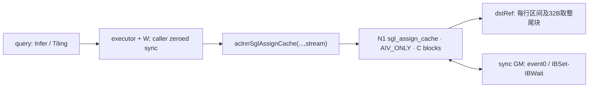
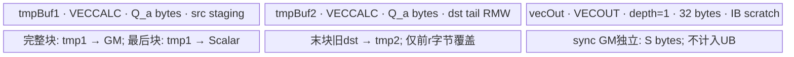

# AssignCache 950 ACLNN 算子知识

## 算子速览

| 项目 | 内容 |
|---|---|
| 实际入口 | 公开 ACLNN `aclnnSglAssignCacheGetWorkspaceSize` / `aclnnSglAssignCache`；OpType `SglAssignCache` |
| 计算语义 | 按请求行把打包src区间按位复制到dst对应起始列；长度只由src_end-src_start决定，dst_end被读但不参与计算 |
| 输入输出 | dst为ND整数carrier，src为原始UINT8字节视图，四个INT64索引，UINT8 sync；输出dst与输入同名原地 |
| 执行类型 | 单节点N1，`KERNEL_TYPE_AIV_ONLY`；四个int8/int16/int32/int64模板执行同一Scalar+DMA流程，无Cube/SIMT/NDDMA/通信Kernel |
| Kernel 路线 | R-001整数位模式分段复制；TilingKey0，按typeBytes=1/2/4/8选择模板 |
| 核心资源 | 两个VECCALC TBuf各请求`Q=ubSize>>2`字节；一个VECOUT深度1、32字节IB scratch队列；调用者提供跨核GM sync |
| 来源闭包 | `source_closed`：OpDef/Tiling、20字节POD、四模板entry、完整body、同步helper和构建映射闭合；生成ACLNN/executor、AscendC primitives为框架边界 |
| 草稿边界 | 有未校验的uint32范围、索引/长度/取整访问前提；sync字节长度被当作int32元素跨度绑定；IB只串行尾块，取整访问重叠时不能推导整个复制安全 |
| 验证状态 | 已完成源码链路分析；本次知识提取未执行编译、真机、数值或性能测试。条件性失败为静态推导，没有声称运行复现 |

## 接口与语义

### 计算语义

已有[变长缓存片段复制API卡](../../../../apis/sgl_kernel_npu/sgl_assign_cache_segments.md)维护公开参数和布尔状态。本卡展开实际ACLNN实现。令dst逻辑shape为`[B,W]`，carrier宽度为`b∈{1,2,4,8}`字节；行j的源起止为`s_j,e_j`，目的起始列为`d_j`。不发生整数截断/溢出、缓冲区可访问且同步前提成立时，核心意图为：

```text
n_j = e_j-s_j > 0
for k in [0,n_j):
  bitpattern(dst[j,d_j+k]) = bitpattern(src_as_carrier[s_j+k])
```

不是dtype数值转换。浮点等payload由适配层按目的元素字节数重解释成相同宽度的有符号整数carrier。原生body读取`dst_end[j]`但不用它求长度、不验证`dst_end-dst_start==src_end-src_start`；匹配长度及`0<=d_j<=d_j+n_j<=W`是调用者责任。

尾块物理DMA覆盖`align_up(tailBytes,32)`字节；先读取该范围的旧dst，再Scalar替换有效tailBytes，回写整块，意在保留逻辑区间外位模式。源/目的末尾必须有取整后的可访问存储，且取整区间与其它并发写的关系还须另行检查。公开文档的末尾可访问要求本身不构成并发互斥证明。

Python包装器返回False的缺失/标量/索引长度检查发生在`operators/mem_cache/assign_cache_op.py`；ACLNN接口返回status，不能移植成该布尔协议。Torch适配层对不支持的元素宽度直接返回True且不调用ACLNN；execute成功提交后也返回True，均不意味着异步数据已经完成或正确。

### 输入、输出与属性

| 参数 | shape/layout | dtype | 约束、默认值与语义 |
|---|---|---|---|
| dst / dstRef | ND稠密`[B,W]` | ACLNN INT8/INT16/INT32/INT64 | 原地位模式目标；Kernel以dstRef绑定实际输出，原始dstPtr不使用 |
| src | ND字节视图`[source_bytes]` | UINT8 | OpDef固定UINT8；Device转成`GlobalTensor<T>`，索引单位为T元素，非UINT8字节 |
| dst_start | ND至少B项 | INT64 | Device取值后窄化uint32，作为每行目标起点 |
| dst_end | ND至少B项 | INT64 | Device读取并窄化，但计算中不再使用；不提供实际写边界保护 |
| src_start | ND至少B项 | INT64 | Device窄化uint32，源T元素起点 |
| src_end | ND至少B项 | INT64 | Device窄化uint32，与src_start相减决定实际长度 |
| sync | ND `[S]` | UINT8 | 调用者提供、共享、首次使用前清零；event0需要足够32字节flag槽。不是ACLNN通用workspace |
| workspaceSize/executor | query输出 | uint64 / aclOpExecutor* | 生成接口决定总容量；Tiling另请求库workspace |
| workspace/stream | execute输入 | void* / aclrtStream | 按query容量提供，生命周期覆盖异步Device执行 |

没有算子属性。公开Python要求src与dst元素宽度一致；Torch适配层实际未验证该关系，`SourceBytes`只把src的`numel()*element_size()`描述成UINT8数组。四索引的int64、稠密、设备与长度也没有在原生适配层完整验证。

### 入口与版本

固定仓没有手写`aclnn_sgl_assign_cache.h/.cpp`；CANN构建对`SglAssignCache` OpDef调用`npu_op_code_gen`生成它们，`sgl_cann_opapi`链接生成实现。`torch_adapter.cpp`的`decltype`、dlsym名称和实际调用形成精确符号证据：

```text
aclnnSglAssignCacheGetWorkspaceSize(
  dstDesc, srcBytesDesc, dstStartDesc, dstEndDesc,
  srcStartDesc, srcEndDesc, syncDesc, &workspaceSize, &executor)
aclnnSglAssignCache(workspace, workspaceSize, executor, stream)
```

这是固定源码调用形状，不伪造未读取的生成头声明。只有此版本族入口；旧`csrc/assign_cache_op/`属于legacy Direct Invoke构建，不是本ACLNN的source起点。

本卡覆盖Ascend950：公开API产品表明确arch35 ascendc支持；README和architectures.json将3510映射ascend950；算子SUPPORTED_ARCHS包含3510，SglAssignCache把生成SGL_CANN_CONFIGS注册到AICore。支持由公开产品表、构建与实际body共同支撑，不仅由文件名推断。

版本范围记CANN`9.1.0`：固定`.github/workflows/pr-test-kernels.yml::test-cache-ops`配置9.1.0与a3/950，复用workflow消费版本选择容器。A2支持由公开产品表与2201构建映射支撑，不能声称该矩阵已实测A2，配置也不是本次运行结果。

## Host/Launcher 执行流程

### 参数校验与前处理

`TilingAssignCacheOp`按以下顺序执行：

1. 取输入0的shape/desc、输入6 sync shape、RawTilingData与1项workspace槽；任一对象/平台信息/raw data缺失或容量小于20字节则`GRAPH_FAILED`。
2. dst OriginShape维数小于2失败；没有检查恰好二维、B/W正数、源/四索引shape或sync容量下界。
3. 创建PlatformAscendC、获取typed POD；无POD或AIV核数为0失败。查询uint64 UB容量，将dst dim0/dim1、sync ShapeSize及UB容量直接写入uint32字段。
4. 根据dst dtype：INT8→1、INT16→2、INT32→4、INT64→8；其它dtype失败。
5. blockDim设为全部平台AIV数C，不取min(B,C)；TilingKey设0、RawDataSize设20，workspace[0]设平台库workspace大小，返回成功。

InferShape复制输入dst shape给同名输出；缺shape对象失败。InferDataType继承dst dtype。OpDef按四个carrier dtype列同时注册src UINT8、四索引INT64、sync UINT8，并注册当前构建的SGL_CANN_CONFIGS。

Torch调用实例先用`PayloadType(dst.element_size())`选择carrier；不支持宽度直接True返回。随后DeviceGuard(dst.device())、解析两个ACLNN符号，并用设备ID查询vector core数：先`aclrtGetDeviceInfo(...ACL_DEV_ATTR_VECTOR_CORE_NUM...)`，失败或非正再`aclGetDeviceCapability(...ACL_DEVICE_INFO_VECTOR_CORE_NUM...)`；仍失败即抛错。再用`at::zeros`分配`64*C_A+32`字节sync，此`C_A`来自适配层设备查询，不是POD字段。

### 参数、Workspace 与生命周期

POD为五个uint32，共20字节。`Q=uint32(ubSize)>>2`由Device算，不在Host预先tiling成分块长度；C来自Platform.GetCoreNumAiv。直接ACLNN调用者必须提供已清零sync；Torch适配层的`at::zeros`是此调用实例的初始化机制，不能写成ACLNN会自动清零。

sync是独立必选业务输入：在AIVOnly、eventID=0、blockIdx最大C-1条件下，[IBSet](../../../../../../ops/ascendc/apis/simd_api/basic_api/sync_control/inter_core_sync/ib_set.md)/[IBWait](../../../../../../ops/ascendc/apis/simd_api/basic_api/sync_control/inter_core_sync/ib_wait.md)契约要求至少`32C`字节共享GM，UB scratch至少32字节。适配层申请`64*C_A+32`字节，仅当设备查询与实际launch核数一致等容量前提成立时足量；Tiling未验证`S>=32C`，未比较`C_A/C`。

Host把UINT8 sync ShapeSize（字节数S）存入`syncWorkspaceSize`，Device却`SetGlobalBuffer<int32_t>(sync,S)`，由此逻辑Tensor跨度描述为4S字节，而实际申请S字节。应记录此单位不一致；IB实际访问只由flag槽决定，不能仅凭错误span描述断言已访问越界。调用者仍要按真实字节存储校验槽位范围。

通用workspace与sync不同：Tiling请求`L=GetLibApiWorkSpaceSize()`，query返回总量W，适配层分配W字节；Device entry的workspace形参未使用，没有自有workspace切片或跨Kernel中间结果。SDK bridge/executor的额外workspace安排保留为框架边界。

适配层捕获七个Tensor、七个shared_ptr描述符、workspace、executor和stream到lambda；所有Tensor和workspace调用record_stream，描述符经shared_ptr删除器aclDestroyTensor释放。`op_api_symbol`长期保留vendor库handle。query失败、W超过INT64_MAX、execute返回失败分别停止并抛错；生成executor资源回收属于SDK协议，固定业务源码没有额外销毁实现。

### 启动图与失败传播



| 节点/边 | producer → consumer | offset/extent、dtype/layout | 顺序、owner/lifetime与失败 |
|---|---|---|---|
| Host→N1 | TilingAssignCacheOp→entry | 20B POD、key0、blockDim=C | 框架持有tiling；Tiling失败无成功执行路径 |
| src→N1→dst | caller→DMA/Scalar→caller | 源T元素`srcStart+o`；目的T元素`j*W+dstStart+o` | caller保持payload/索引至stream完成；必须考虑32B取整物理范围 |
| N1跨核心依赖 | 任务j-1尾块完成→任务j尾块提交 | event0，flag slot对应前驱core，名义32C字节共享GM | IBWait清除前驱通知，IBSet发布本core通知；具体flag搬运是AscendC primitive边界 |
| UB复用 | 当前DMA→同core下块DMA | Q字节tmp1、tmp2；32Bscratch | 显式MTE2/MTE3事件保护DMA次序；Scalar相关自动同步不在业务源码显式展开 |
| API执行失败 | SDK execute→Torch lambda | status | 返回非成功抛错；成功只是提交，不证明Device完成、未死锁或复制正确 |

## Route 与参数设计

### 分核与资源计算

核心c处理`j=c+k*C<B`，C是所有平台AIV数，B<C时多余核心仍Init然后没有任务。对于同一core各请求按Process循环串行；不同core可先各自执行完整块，只有最后块在发布前驱依赖处等待。

以下数学式限定所有uint32窄化、乘加、差值以及uint16 blockLen均可表示，且索引非负、源终点不小于起点：

```text
U = POD.ubSize                       # 原uint64平台值先写uint32
Q = U >> 2                          # 每个TBuf请求字节
b = sizeof(T)                       # 1/2/4/8
q = Q / b                           # 每满块T元素数
D_j = (srcEnd_j-srcStart_j) * b       # 源码保存为uint32字节数
L_j = (D_j+Q-1)/Q                    # uint32；需Q>0且加法不溢出
r_j = D_j % Q
if D_j>0 and r_j==0: r_j=Q           # 整除时最后块仍是满Q字节
full blockLen = uint16(q*b/32)
last blockLen = uint16((r_j+31)/32)
last physical bytes = 32*ceil(r_j/32)
loopOffset = loopId*q                # T元素，不是字节
```

Q为32的倍数时，q*b=Q，完整块每次复制Q字节；否则完整块DataCopy向下按32B块表达而loopOffset仍按q推进，存在漏字节/尾块整除问题，源码没有alignment guard。UB各InitBuffer请求按32字节补齐的分配契约另见[InitBuffer](../../../../../../ops/ascendc/apis/simd_api/basic_api/resource_management/t_pipe/init_buffer.md)。记`Q_a=align32(Q)`，每核物理名义分配`2Q_a+32`字节；没有double buffer、没有跨任务重复InitBuffer。

### Route 选择

| 顺序 | Route | Key/模板 | 精确选择条件与优先级 | 不适用去向 |
|---:|---|---|---|---|
| 1 | R-001 位模式复制，b=1 | key0，AssignCacheOp<int8_t> | Host dst.dtype=INT8→typeBytes=1，entry ASCEND_IS_AIV且typeByte==1 | 按else-if尝试2/4/8 |
| 2 | R-001 位模式复制，b=2 | key0，AssignCacheOp<int16_t> | Host INT16→2，entry前项不匹配且typeByte==2 | 尝试4/8 |
| 3 | R-001 位模式复制，b=4 | key0，AssignCacheOp<int32_t> | Host INT32→4，entry前项不匹配且typeByte==4 | 尝试8 |
| 4 | R-001 位模式复制，b=8 | key0，AssignCacheOp<int64_t> | Host INT64→8，entry前项不匹配且typeByte==8 | Host不支持dtype已失败；伪造POD其它值entry无分支无写 |

```text
Host对象/raw20B/dst至少2维/AIV数/dtype检查
  -> GRAPH_FAILED 或 key0 + POD.typeBytes
entry AIV_ONLY
  -> ASCEND_IS_AIV?
    -> typeBytes==1? AssignCacheOp<int8_t>
    -> else ==2? AssignCacheOp<int16_t>
    -> else ==4? AssignCacheOp<int32_t>
    -> else ==8? AssignCacheOp<int64_t>
    -> else return，无error/fallback
每模板Process：非最后块直接tmp1→GM；最后块旧dst→tmp2、Scalar覆盖、IBWait、tmp2→GM、条件IBSet
```

### 模板/实现执行矩阵

| Route | key/selector | dtype/shape/platform 完整命中条件 | 执行拓扑与 Kernel 节点 | 实际模板/body | 内存与同步特征 | tail/fallback |
|---|---|---|---|---|---|---|
| R-001 | 0，typeBytes1 | dst INT8、src UINT8、索引INT64、syncUINT8；文档合法稠密域；950 | 单N1 AIV_ONLY | AssignCacheOp<int8_t>，q=Q，尾Scalar次数r_j | 2Q_a+32B，事件1/2+IB event0 | 32B取整RMW，无备用实现 |
| R-001 | 0，typeBytes2 | dst INT16，其余类型/域同上 | 同一N1 | AssignCacheOp<int16_t>，q=Q/2，尾次数r_j/2 | 相同字节分配、pipeline和同步 | 同上；要求尾字节可按T分割 |
| R-001 | 0，typeBytes4 | dst INT32，其余同上 | 同一N1 | AssignCacheOp<int32_t>，q=Q/4，尾次数r_j/4 | 同上 | 同上 |
| R-001 | 0，typeBytes8 | dst INT64，其余同上 | 同一N1 | AssignCacheOp<int64_t>，q=Q/8，尾次数r_j/8 | 同上 | 同上 |

四实例按字节具有相同两缓冲布局、DMA/Scalar顺序、IB图和尾保留策略，没有数值转换差异，合并为同一实现族；逐selector保留具体T和元素步长。最后块/完整块是该族内运行时阶段，不虚构额外key。

### 隐藏性能 Guard

| Guard | Host/Tiling 条件 | Device/资源原因 | 影响 Route | 不满足时去向 | 源码符号 |
|---|---|---|---|---|---|
| POD/平台 | raw>=20、dst.dim>=2、AIV>0、supported dst dtype | 五字段、单AIV entry | R-001全部实例 | GRAPH_FAILED | TilingAssignCacheOp |
| UB预算 | Host读取U，DeviceQ=U>>2；没有验证Q>0或2align32(Q)+32<=U | 两TBuf与32B IB scratch | 全部 | 无fallback；Q=0会除零 | Init/Process |
| Q对齐缺失 | 未检查Q%32==0 | blockLen按32B、元素步长q必须对应搬运字节 | 全部 | 可能缺块/尾元素不齐，无修复 | Process |
| 源/目的取整范围 | 仅公开文档要求末尾存储足量，Host不检查索引内容 | 最后块读取src与dst并写回align32(r_j)字节 | 全部 | 没有DataCopyPad或tail保护替代 | Process |
| 索引与乘加范围缺失 | int64索引、shape/U/S直接uint32 | D_j、jW+d+offset、D_j+Q-1都可截断/溢出 | 全部 | 无错误分支 | Tiling/Process |
| blockLen上限缺失 | full与tail块数直接uint16 | DataCopyParams blockLen单位32B、最大65535 | 全部 | 截断，没有split guard | Process |
| sync容量/初始化 | Tiling不检查S>=32C或全0；adapter分配0初始化 | event0需可访问共享flag槽 | 全部 | raw ACLNN可能错误等待；不保证抛错 | Tiling/Init/IBWait |
| 正长度/发布链 | 文档要求n_j>0；Host没有落实 | D_j=0时L_j=0，既不IBWait也不IBSet | 全部 | 若后继等待此行则缺发布，可静态推导阻塞风险 | Process |
| 取整重叠域 | 未验证物理取整写区间互斥 | 只有尾块等待，后继完整块可先写 | 全部 | 特定重叠与调度下数据竞争，无安全fallback | Process |

### POD/ABI

`optiling::CustomAssignTilingData`由同一个头同时供Host/Device消费，源码assert sizeof=20。五个uint32偏移按顺序为0/4/8/12/16，无显式padding字段；常用目标ABI为4字节对齐，源码未单独assert alignof，未编译测量。

| 结构 | 字段 | 类型/位宽 | ABI 布局 | 单位 | Host/launcher producer | Device consumer | 边界 |
|---|---|---|---|---|---|---|---|
| CustomAssignTilingData | batchSize | uint32_t/32 | offset0，4B | 行/请求 | dst.OriginShape.dim0隐式窄化 | ParseTilingData→Process的j<B | 无窄化/正值检查 |
| CustomAssignTilingData | tokenPoolLength | uint32_t/32 | offset4，4B | T元素/目标行 | dst.OriginShape.dim1 | Process地址j*W+d+offset | 未从stride生产，只适合稠密行 |
| CustomAssignTilingData | typeBytes | uint32_t/32 | offset8，4B | byte/T元素 | dst dtype switch写1/2/4/8 | entry if-else选择完整T模板 | ParseTilingData不另保存；Host其它dtype失败 |
| CustomAssignTilingData | syncWorkspaceSize | uint32_t/32 | offset12，4B | Host为UINT8元素数，即字节 | sync.OriginShape.GetShapeSize() | Init作为GlobalTensor<int32>元素span | 绑定单位不一致；真实存储仍是S字节 |
| CustomAssignTilingData | ubSize | uint32_t/32 | offset16，4B | byte | uint64 GetCoreMemSize(UB)隐式窄化 | ParseTilingData→Q=ubSize>>2 | 没有核验uint64值可表示、Q对齐或总UB需求 |

### Route 源码闭包

| Route | Key/selector | Host/Tiling producer | POD/参数 | Kernel entry/router 节点 | Kernel body/直接依赖 | 构建接线 |
|---|---|---|---|---|---|---|
| R-001，b1/2/4/8 | key0，typeBytes1/2/4/8 | op_host/assign_cache_op.cpp::TilingAssignCacheOp | op_kernel/assign_cache_tiling.h::CustomAssignTilingData | op_kernel/assign_cache_op.cpp::sgl_assign_cache | AssignCacheOp<T>::ParseTilingData/Init/Process/CopyElement，SET_FLAG/WAIT_FLAG；DataCopy/IB primitives为SDK边界 | 本算子CMake→mem_cache/domain发现→operators解析→cann_ops生成ACLNN/tiling/kernel；无arch variant |

## Kernel 实现

### 公共执行流程

entry参数为`dstPtr,srcPtr,dstStartIdxPtr,dstEndIdxPtr,srcStartIdxPtr,srcEndIdxPtr,sync,dstRef,workspace,tilingPtr`。设置AIV_ONLY，GET_TILING_DATA后读取typeBytes，仅在ASCEND_IS_AIV中创建对应T实例；始终把dstRef而非dstPtr传给Init，workspace不使用。

Init先解析四个成员字段，typeBytes只供entry；Q=U>>2，绑定dst/src为T、索引为int64、sync为int32，申请两TBuf和32B队列。没有AIC分支、没有跨Kernel工作区、没有Vector repeat/mask、没有浮点cast/累加；核心数学是地址和字节数。

### Route R-001：整数位模式分段复制

#### 适用条件

##### 选择证据

| 层级 | 文件 | 符号 | 源码谓词/参数 | 结果/下一跳 |
|---|---|---|---|---|
| 公开约束 | docs/api/zh/operators/mem_cache/assign_cache_op.md | assign_cache_op | 两代支持、正长度、32B尾部可访问 | 定义公共前提，不是已实现参数检查 |
| Host | csrc/mem_cache/assign_cache_op/op_host/assign_cache_op.cpp | TilingAssignCacheOp | 4种dst整数dtype、有效shape/platform/raw | typeBytes=1/2/4/8，key0 |
| entry | csrc/mem_cache/assign_cache_op/op_kernel/assign_cache_op.cpp | sgl_assign_cache | ASCEND_IS_AIV与typeByte的顺序else-if | T=int8/int16/int32/int64实例 |
| body | 同kernel文件 | Process | j=c+k*C；loopId<L_j；loopId==L_j-1 | 完整块直接DMA；尾块RMW及IB链 |

#### Device 数据流

##### 函数级调用链

```text
aclnnSglAssignCacheGetWorkspaceSize
  -> SDK bridge / SglAssignCache OpDef
  -> InferShapeAssignCacheOp / InferDataTypeAssignCacheOp / TilingAssignCacheOp
aclnnSglAssignCache(workspace,size,executor,stream)
  -> SDK executor N1 sgl_assign_cache
    -> AIV_ONLY / GET_TILING_DATA / typeBytes router
    -> AssignCacheOp<int8_t|int16_t|int32_t|int64_t>::Init
      -> ParseTilingData / Q=U>>2
      -> bind GM / InitBuffer(tmpBuf1,Q) / InitBuffer(tmpBuf2,Q)
      -> InitBuffer(vecOut,1,32)
    -> Process
      -> j=c+k*C / load four int64 indices then uint32
      -> each tile srcGM→tmpTensor1 + MTE2_MTE3 event1
        -> non-last: tmpTensor1→dstGM + MTE3_MTE2 event1
        -> last: dstGM→tmpTensor2 + MTE2_MTE3 event2
           -> CopyElement<T>(tmp2,tmp1,tailBytes)
           -> if j>0: IBWait(predecessor,event0)
           -> tmp2→dstGM + MTE3_MTE2 event1
           -> if j!=B-1: IBSet(current,event0)
```

##### 源码等价伪码

```text
T <- typeBytes的精确carrier实例; b=sizeof(T)
U=uint32(POD.ubSize); Q=U>>2
allocate tmp1(Q bytes), tmp2(Q bytes), IBscratch(depth1,32 bytes)
for j=core_id; j<batchSize; j+=GetBlockNum():
  ss=uint32(src_start.GetValue(j)); se=uint32(src_end.GetValue(j))
  ds=uint32(dst_start.GetValue(j)); de=uint32(dst_end.GetValue(j))  # de不用
  D=uint32((se-ss)*b); L=uint32(D+Q-1)/Q; r=D%Q
  if D>0 and r==0: r=Q
  o=0; q=Q/b
  for l=0; l<L; l++:
    blocks=uint16(q*b/32)
    if l==L-1: blocks=uint16((r+31)/32)
    params={blockCount=1,blockLen=blocks,srcStride=0,dstStride=0}
    DataCopy(tmp1, srcT[ss+o], params)
    SetFlag<MTE2_MTE3>(1); WaitFlag<MTE2_MTE3>(1)
    if l==L-1:
      DataCopy(tmp2, dstT[j*W+ds+o], params)
      SetFlag<MTE2_MTE3>(2); WaitFlag<MTE2_MTE3>(2)
      for i=0; i<r/b; i++: tmp2.SetValue(i,tmp1.GetValue(i))
      if j>0:
        s=vecOut.AllocTensor<int32>()
        IBWait(syncGm,s,(core_id==0 ? C-1 : core_id-1),0)
        vecOut.FreeTensor(s)
      DataCopy(dstT[j*W+ds+o],tmp2,params)
      SetFlag<MTE3_MTE2>(1); WaitFlag<MTE3_MTE2>(1)
      if j!=B-1:
        s=vecOut.AllocTensor<int32>()
        IBSet(syncGm,s,core_id,0)
        vecOut.FreeTensor(s)
      break
    DataCopy(dstT[j*W+ds+o],tmp1,params)
    SetFlag<MTE3_MTE2>(1); WaitFlag<MTE3_MTE2>(1)
    o += q
```

伪码保留原生无符号截断和固定硬件事件ID，不能把dst_end补入长度判断、把IBWait前移或把DataCopy换成DataCopyPad后还称原实现。

#### 内存与数据搬运

##### 资源与搬运表

| 层级/缓冲区 | offset/地址公式 | extent/容量公式 | dtype/layout | producer | consumer | owner/lifetime | 对齐/复用 |
|---|---|---|---|---|---|---|---|
| GM src | base+b*(ss+o) | 完整块Q；末块align32(r) | T carrier，OpDef为UINT8字节视图 | caller | DataCopy到tmp1 | caller；整个stream有效 | GM按T对齐，末尾多读要在实际存储内 |
| GM dstRef | base+b*(jW+ds+o) | 完整块Q；末块align32(r) | 稠密T `[B,W]` | caller旧值 / DMA新值 | 末块预读及caller | caller；原地，不得与src产生未分析alias | 物理尾写可超过有效n_j但意图保留旧位模式 |
| GM dst_start | base+8j | 至少8B字节 | int64 | caller | Scalar GetValue→uint32 | 全kernel | 未校验范围 |
| GM dst_end | base+8j | 至少8B字节 | int64 | caller | Scalar读取后未用 | 同上 | 不保护写域 |
| GM src_start | base+8j | 至少8B字节 | int64 | caller | Scalar→uint32 | 同上 | 单位为T元素 |
| GM src_end | base+8j | 至少8B字节 | int64 | caller | Scalar→uint32、D_j | 同上 | 需se>=ss并防减乘溢出 |
| UB tmpBuf1 | allocator基址+bi | 请求Q，分配Q_a | VECCALC TBuf/T | 每块src DMA | 满块输出DMA；末块CopyElement | 每核Init一次，所有j/l复用 | 非double buffer；MTE3→MTE2等候后覆盖 |
| UB tmpBuf2 | 独立allocator基址+bi | 请求Q，分配Q_a | VECCALC TBuf/T | 最后一块旧dst DMA和Scalar覆盖 | 尾块输出DMA | 每核Init一次；只在每行最后块使用 | r..align32(r)保留旧dst；无同物理别名证据 |
| UB vecOut | queue allocation | depth1×32字节 | VECOUT int32 | IB primitive | IBWait/IBSet内部 | 单次Alloc→IB调用→Free | 未用EnQue/DeQue；不是payload output Queue |
| GM sync | slot逻辑blockIdx/event0；按IB契约每槽32B | raw存储S字节；至少32C；adapter64C_A+32 | UINT8 input，Device GlobalTensor<int32> | caller零初始化/IBSet | IBWait读并清零 | 跨核心共享、跨本次kernel有效，不能并发复用同一组flag | Device声明S个int32导致逻辑span4S，与实际容量有单位差异 |
| 通用workspace | body未寻址 | query总W；Tiling库L | byte | caller/adapter | SDK框架 | 覆盖异步execute | 无自有业务slice |
| Scalar状态 | 局部变量 | 寄存器占用由编译器决定，未测 | uint32/int32/T | Process/CopyElement | 同循环 | 当前core | 无RegTensor/dynamic UB/通信window |

`DataCopyParams{1,blockLen,0,0}`只有一个连续数据块，blockLen单位32字节，src/dst步进均0；不是按元素传blockLen。数据搬运API契约及GM/UB地址要求见[GM与UB分块DataCopy](../../../../../../ops/ascendc/apis/simd_api/basic_api/memory_vector_compute/data_move/data_copy_gm_and_ub_highdim_split.md)。源码用VECCALC TBuf承载payload，不能因为队列名vecOut就把它画成payload的数据通路。

在Q对齐且无整数截断的数学域，每行名义payload DMA请求量：源读`(L_j-1)*Q+align32(r_j)`，目的旧值读`align32(r_j)`，目的写`(L_j-1)*Q+align32(r_j)`。这些是请求字节，不是实际成功传输或同步正确的保证；IB内部flag搬运由primitive实现，不凭API名猜次数。

##### 分层内存布局



三块是不同InitBuffer分配，没有alias扣减；其物理相对偏移是TPipe allocator边界，不能随意假定相邻。tmpTensor1/2分别是对应TBuf的T视图，无额外UB申请。

##### 字节账与复用顺序

```text
U=uint32(platform_UB_bytes); Q=floor(U/4); Q_a=align32(Q)
UB_total = Q_a + Q_a + 1*32 = 2Q_a+32
必要条件: Q>0, 2Q_a+32<=usable_UB
完整块正确字节推进还需要: Q%32==0
DMA字段需: Q/32<=65535 且 ceil(r_j/32)<=65535
Host实际: 只把U写POD，没有显式比较上述条件或InitBuffer返回状态
sync_GM_min = (eventStride*0 + (C-1)+1)*32 = 32C bytes
adapter_sync = 64C_A+32 bytes；前提是容量计算未溢出且覆盖实际C
business_workspace_slice=0；framework workspace query=W，Tiling库请求=L
dynamic_ub=N/A
```

UB quarter设计让两个payload缓冲只请求约半个平台UB，加32Bscratch；这不是Host资源Guard。U转uint32、Q对齐补齐、SDK保留资源和编译器内部占用未被业务Host校验，不能把数学预算写成所有平台/shape已获安全证明。

| 复用子区 | 写入者 | 读取者/消费点 | 下一次覆盖 | 同步或释放依据 | 安全条件 |
|---|---|---|---|---|---|
| tmp1 | 当前块MTE2 | 满块MTE3或末块Scalar | 下一loop src DMA | 显式MTE2→MTE3 event1；满/尾块输出后MTE3→MTE2 event1 | 无可跳过等候的重叠流水；Scalar依赖是否由编译器补齐属于外部边界 |
| tmp2前r字节 | 旧dst MTE2，再CopyElement Scalar | 尾块MTE3 | 下一任务尾块旧dst DMA | MTE2→MTE3 event2、输出后MTE3→MTE2 event1 | 对S流水无自有显式事件；不能凭MTE事件声称完成Scalar依赖验证 |
| tmp2取整剩余字节 | 旧dst DMA | 同次尾块输出 | 下次尾块预读 | 与同块DMA生命周期相同 | 必须排除会让旧值回写破坏其它逻辑结果的重叠调度 |
| vecOut scratch | IB内部 | IB内部 | 下一IB调用 | AllocTensor→IBWait/IBSet→FreeTensor | 32B、depth1；slot/event一致，不能并发复用共享sync |

#### 同步、精度与尾块

##### 同步与数值边界表

| 阶段 | primitive/机制 | producer | consumer/等待点 | 保护对象 | 精度/尾块 |
|---|---|---|---|---|---|
| src DMA→输出DMA | SetFlag/WaitFlag HardEvent::MTE2_MTE3，ID1 | MTE2装载tmp1 | MTE3后续写 | tmp1 payload | 无cast；T按位承载 |
| 旧dst DMA→尾输出DMA | MTE2_MTE3，ID2 | MTE2装载tmp2 | MTE3后续写 | tmp2旧值 | Scalar CopyElement在二者之间；源码无MTE2_S/S_MTE3显式事件，自动同步是编译器边界 |
| 输出DMA→下块覆盖 | MTE3_MTE2，ID1 | 当前MTE3 | 后续MTE2 | tmp1/tmp2复用 | 顺序串行，无double buffer交叠 |
| 行j-1→j尾块 | IBWait(sync,scratch,pred(c),0) | 前驱IBSet | 当前最后块写前 | GM flag及尾写先后 | pred(c)=c-1，c=0时C-1；j=0不等待 |
| 当前尾块完成→后继 | IBSet(sync,scratch,c,0)，在MTE3_MTE2等待后 | 当前最后块 | 下一个请求的IBWait | 当前core event0槽 | j=B-1不发布；IBWait成功消费后清0，便于下轮 |
| 正长度约束 | D_j>0才进入tile循环 | caller | Process | 发布链 | 空行不产生flag，后继若依赖就可能等待不到；公开契约要求正长度 |
| 精度与取整 | CopyElement<T>，次数r_j/b | tmp1 GetValue | tmp2 SetValue | 前r_j字节 | 整数carrier拷贝无数值换算；32B尾部其余保留旧目标 |
| 全局可见性 | stream/executor完成 | 整个kernel | caller | dst和sync | API正常返回不等同完成；外部并发alias须额外约束 |

[SetFlag/WaitFlag](../../../../../../ops/ascendc/apis/simd_api/basic_api/sync_control/intra_core_sync/set_flag_wait_flag_isasi.md)的硬件ID1/2和IB的软件event0是不同编号体系，不应合并成同一event或用它们互相替代。源码使用固定硬件ID，未调用FetchEventID/AllocEventID；不推测其与SDK内部事件是否冲突。

静态并发边界：IBWait在当前行的完整块写入、最后块旧dst读取与CopyElement之后才执行。因此可证明的只是尾块提交链，不是整行复制严格串行。当上一行的32B取整尾写覆盖下一行的逻辑数据、下一行存在已提前执行的完整块时，可构造前者旧padding回写覆盖后者新数据的交错；该条件不是仅凭逻辑行区间不重叠就能排除。若所有物理取整区间与其它行写域互斥，则这项跨行交错条件不存在。这里是读写集合与先后关系的静态分析，没有声称真机复现。

#### 关键实现

##### 符号证据表

| 阶段 | 文件 | 符号/模板实例 | 实现事实 |
|---|---|---|---|
| Host/Tiling producer | csrc/mem_cache/assign_cache_op/op_host/assign_cache_op.cpp | TilingAssignCacheOp | 五字段、全AIV分核、四dtype→typeBytes、key0 |
| ABI | csrc/mem_cache/assign_cache_op/op_kernel/assign_cache_tiling.h | CustomAssignTilingData | 五uint32、20B共享布局 |
| Kernel entry/router | csrc/mem_cache/assign_cache_op/op_kernel/assign_cache_op.cpp | sgl_assign_cache | AIV_ONLY/ASCEND_IS_AIV/typeBytes四分支 |
| Device body/helper | 同kernel文件 | AssignCacheOp<int8_t/int16_t/int32_t/int64_t>::Init/Process | 两Q缓冲、逐请求分块、32B RMW、IB链 |
| Scalar helper | 同kernel文件 | CopyElement<T> | 前r_j/b个元素读写，不计算dst_end或转换数值 |
| 同步helper | 同kernel文件 | SET_FLAG/WAIT_FLAG | HardEvent trigger_waiter模板展开、固定ID1/2 |

## 算子特定优化

### Trick T-001：完整块直接搬运，最后一块保留目标尾部

#### 触发与源码依据

- 适用 Route：R-001全部四实例。
- 触发条件：当前tile为`loopId==ubLoopNum-1`；即使D_j整除Q，最后块仍进入该分支、tailBytes被设为Q。
- Golden 来源：[固定提交连续115–119行](https://github.com/sgl-project/sgl-kernel-npu/blob/dda6d36b0cdb4081e102d14c0a2fb276fc416e69/csrc/mem_cache/assign_cache_op/op_kernel/assign_cache_op.cpp#L115-L119)。

**官方源码（固定 Commit 连续逐字摘录）**：

```cpp
            if (loopId == ubLoopNum - 1) {
                DataCopy(tmpTensor2_, dstGM_[batchId * tokenPoolLength_ + dstStartIdx + loopOffset], copyParams);
                SET_FLAG(MTE2, MTE3, EVENT_ID2);
                WAIT_FLAG(MTE2, MTE3, EVENT_ID2);
                CopyElement(tmpTensor2_, tmpTensor1_, tailBytes);
```

#### 机制与设计原因

完整非最后块在同文件138行直接tmp1→dst，不Scalar逐元素复制，也不预读旧dst。只有最后块额外读取旧目的32B取整范围，在tmp2前r_j字节写入src，保留尾padding。这样把Scalar GetValue/SetValue与额外旧dst读取限制在每请求最后块；不是所有payload都经Scalar，不是增加第二个输出Kernel。末块仍为满Q时也走这条较重路径，不能把它描述成只处理不对齐尾。

#### 迁移边界

- 适用：需要保留有效区间后原字节、但底层DMA长度以32B为单位的分段复制。
- 前提：源/目标末尾可访问，Q与DMA字段合法，Scalar/DMA依赖成立，物理取整范围和并发写关系可证明安全。
- 失效：padding物理不可访问、与后继完整块写域重叠而没有充分顺序、src/dst未分析alias时，原实现没有替代Route。
- 未验证：本次知识提取未执行编译、真机、数值或性能测试。

#### 错误做法

不能只检查n_j个逻辑元素在shape内，就认定DataCopy的取整访问合法；也不能将旧dst预读当作自动排除跨核心覆盖。固定body存在尾块等待之前即可发出的完整块写，因此“IB使所有区间整体串行”与源码不符。

### Trick T-002：用可消费的core环形flag串联最后块

#### 触发与源码依据

- 适用 Route：R-001全部四实例。
- 触发条件：正长度请求的最后一块；j>0等待前驱core，j!=B-1发布本core；core0前驱环绕至C-1。
- Golden 来源：[固定提交连续120–134行](https://github.com/sgl-project/sgl-kernel-npu/blob/dda6d36b0cdb4081e102d14c0a2fb276fc416e69/csrc/mem_cache/assign_cache_op/op_kernel/assign_cache_op.cpp#L120-L134)。

**官方源码（固定 Commit 连续逐字摘录）**：

```cpp
                if (batchId > 0) {
                    auto syncBuf = vecOut_.AllocTensor<int32_t>();
                    // wait for last kernel copy data from UB to GM
                    AscendC::IBWait(syncGm_, syncBuf, (vecIdx == 0) ? coreNum - 1 : vecIdx - 1, 0);
                    vecOut_.FreeTensor(syncBuf);
                }
                DataCopy(dstGM_[batchId * tokenPoolLength_ + dstStartIdx + loopOffset], tmpTensor2_, copyParams);
                SET_FLAG(MTE3, MTE2, EVENT_ID1);
                WAIT_FLAG(MTE3, MTE2, EVENT_ID1);
                if (batchId != batchSize_ - 1) {
                    auto syncBuf = vecOut_.AllocTensor<int32_t>();
                    // publish event current kernel has finished copying date from UB to GM
                    AscendC::IBSet(syncGm_, syncBuf, vecIdx, 0);
                    vecOut_.FreeTensor(syncBuf);
                }
```

#### 机制与设计原因

j按core轮转，故前一个请求j-1所在core正是pred(c)。只需要C个event0 flag槽就可复用到多轮请求；IBWait消费并清除前驱通知，IBSet在本尾DMA完成后发布。数据仍由多core先搬完整块，最后块提交增加请求先后依赖，不需要按B个请求各分一个flag或另启全局同步Kernel。源码没有收益百分比，也没有证明这种局部顺序对所有取整重叠都足够。

#### 迁移边界

- 适用：全部参与请求有匹配发布、core轮转稳定、只需要该尾提交顺序的数据图。
- 前提：sync首次清零且>=32C字节、32B UB scratch，C不大于实际可同时运行AIV核数；同一sync不被并发launch复用。
- 失效：正长度契约外的空行会跳过发布，后继可能永远等不到；flag初值不正确可能提前通过或错误等待；原body没有超时恢复。
- 未验证：本次知识提取未执行编译、真机、数值或性能测试。

#### 错误做法

把IB软件event0当作硬件EVENT_ID1/2，或只分配C个int32而非按32B槽给足共享GM，均不满足既有primitive契约。也不能对空请求省略IBSet后继续假定每个后继都能收到前驱通知；这是静态发布链反例，不是运行日志。

## 模板与实现对比

| 对比维度 | R-001四carrier实例 | 设计选择依据 |
|---|---|---|
| 命中条件/优先级 | key0，typeBytes依次1/2/4/8 | Host dtype switch与entry严格对应，无fallback |
| 模板与 dtype | int8_t/int16_t/int32_t/int64_t | b改变T元素步长和Scalar次数，不改变位模式语义 |
| 循环与分核 | j=c+k*C；每请求ceil(D_j/Q)块 | C为全AIV；完整块并发、尾块有IB依赖 |
| Queue/TBuf/寄存器/dynamic UB/通信 window | 两VECCALC TBuf、32B VECOUT scratch | scratch不承载payload，无double buffer/窗口 |
| 内存总占用与复用 | 2align32(U>>2)+32字节/核 | 每核Init一次，跨块/行复用；无alias扣减 |
| 搬运/Vector/SIMT/NDDMA/通信 API | DataCopy 32B块；CopyElement仅最后块 | 无Vector数值运算、无独立通信节点 |
| 同步、精度与 tail | MTE事件1/2；IB event0；T位模式RMW | 分别描述核内DMA依赖和核间尾写链 |
| fallback/失败边界 | Host部分失败；非法POD值entry静默无写 | 无校正src/dst长度、无整数溢出或取整重叠备用路 |

## 平台差异

| 项目 | A2 | A3 | Ascend 950 |
|---|---|---|---|
| 支持状态 | 公开arch22支持，2201→ascend910b | 公开arch22支持，2201→ascend910_93 | 公开arch35支持，3510→ascend950 |
| Host/Launcher | 相同Tiling，U/C来自平台 | 相同；上游CI配置9.1.0/a3 | 相同；上游CI配置9.1.0/950 |
| Kernel/资源 | 四模板同body、Q=U>>2 | 同左 | 同左，无arch35特化 |
| 同步 | AIV_ONLY，MTE2/MTE3事件及IB默认AIVOnly | 同左 | 同左；未把ISASI硬件事件跨代等价当作本次验证 |
| 限制 | 索引窄化、sync跨度单位、取整重叠前提 | 同左 | 同左，产品支持不替代资源/顺序证明 |

本卡Frontmatter仅含950；[A2/A3同源码草稿](sgl_assign_cache.md)承载2201族。950没有独立regbase body或额外tail fallback，需同样审查资源、整数范围和IB顺序。

## 限制与失败边界

- 本卡为draft：完整自有源码可闭合，但原生Host未保证整数范围、区间/容量和所有取整并发前提；不能将算法意图、公开支持或ACLNN成功返回当作安全可复用证明。
- dst_end虽读取但不用；长度只由uint32(src_end)-uint32(src_start)产生。索引int64转uint32、shape/U/S转uint32、jW及offset加法、D_j+Q-1与uint16 blockLen均无范围检查。上述数学公式只在相关计算未溢出/截断的域使用。
- 源/目的必须按carrier宽度可访问，最后块按32B向上取整；原实现没有DataCopyPad路径。物理取整写域与其它行提前执行的完整块重叠时，尾块IB链不够证明整体安全；不应伪造已复现的覆盖结果。
- syncWorkspaceSize从UINT8字节数产生、却被用于int32元素span，声明跨度4S与真实S字节不符；这本身不证明实际IB flag已越界。应按实际C/event0和真实GM容量核对，不依赖错误span。
- 直接ACLNN调用者须在首次IB使用前清零共享sync，并保证至少32C字节及整个launch生命周期。Torch适配层零初始化/record_stream是一个调用实例；不把它提升为ACLNN自动行为。
- 公开要求正长度区间；空区间使Process不发IBSet，若后继仍等待此行会形成缺发布风险。没有安全空请求Route、计时退出或错误恢复。
- 两TBuf的DMA/Scalar混用只有显式MTE2_MTE3/MTE3_MTE2事件；相关Scalar自动同步和IB内部事件资源为SDK/编译器边界，没有源码级证据可声称已验证它们在本次9.1.0环境的行为。
- 布尔False来自Python元数据检查；原生adapter不支持元素宽度时True/no-op，支持宽度时True也只表示正常提交。原始ACLNNstatus与Pythonbool不能互换。
- 本次知识提取未执行编译、真机、数值或性能测试；CANN9.1.0与平台支持取自固定来源，无verified。

## 源码索引

### 链路索引

| 链路阶段 | 文件 | 关键符号 | 支撑内容 |
|---|---|---|---|
| 入口声明/约束 | docs/api/zh/operators/mem_cache/assign_cache_op.md | assign_cache_op | 产品表、位模式、正长度和取整存储要求 |
| Python公开门面 | python/sgl_kernel_npu/sgl_kernel_npu/operators/mem_cache/assign_cache_op.py | assign_cache_op/_ascendc_impl | False检查与Torch分发的实际位置 |
| 入口调用实例 | csrc/mem_cache/assign_cache_op/torch_adapter.cpp | PayloadType/SourceBytes/assign_cache_op | 两阶段ACLNN、sync零初始化、W及stream owner |
| 共享适配层 | csrc/aclnn_torch_adapter/aclnn_runtime.h | op_api_symbol/tensor_descriptor | vendor动态库和描述符生命周期 |
| Host/Tiling/Launcher | csrc/mem_cache/assign_cache_op/op_host/assign_cache_op.cpp | SglAssignCache/TilingAssignCacheOp/InferShapeAssignCacheOp/InferDataTypeAssignCacheOp | 七输入、同名dst输出、typeBytes、C/U/S生产 |
| POD/ABI | csrc/mem_cache/assign_cache_op/op_kernel/assign_cache_tiling.h | CustomAssignTilingData | 五uint32字段、20B共享布局 |
| Kernel entry/body | csrc/mem_cache/assign_cache_op/op_kernel/assign_cache_op.cpp | sgl_assign_cache/AssignCacheOp<T>/SET_FLAG/WAIT_FLAG | 四模板、Q分块、RMW、硬件事件和IB链 |
| 构建声明 | csrc/mem_cache/assign_cache_op/CMakeLists.txt | sgl_register_operator | AICORE、OpType、源文件与2201/3510 |
| domain发现 | csrc/mem_cache/CMakeLists.txt | sgl_discover_operators | 算子直接子目录接入 |
| domain接线 | csrc/cmake/domains.cmake | sgl_add_cann_operator_domains/sgl_discover_operators | mem_cache发现与注册 |
| 构建解析 | csrc/cmake/operators.cmake | sgl_register_operator/sgl_resolve_operator/sgl_select_cann_operators | 合法arch、源文件、唯一AICORE Kernel entry |
| 接口/Device生成 | csrc/cmake/cann_ops.cmake | sgl_generate_cann_interfaces/sgl_add_cann_tiling/sgl_add_cann_host_libraries/sgl_add_cann_kernels | config数组、生成ACLNN、Tiling库和Kernel映射 |
| 构建入口 | csrc/CMakeLists.txt | SGL_ARCH_VERSION/SGL_CANN_BUILD_STAGE | 独立CANN构建、SDK/package目标 |
| 平台映射 | csrc/cmake/architectures.json | 2201/3510 | 910b/910_93/950产品目标 |
| 公开构建说明 | python/sgl_kernel_npu/README.md | REFACTOR builds / architecture mapping | 独立ACLNN run用途和产品映射 |
| CANN版本来源 | .github/workflows/pr-test-kernels.yml | test-cache-ops | 9.1.0/a3/950矩阵配置 |
| CI参数消费 | .github/workflows/pr-test-kernel-group.yml | run-kernel-group | 容器版本和runner参数 |

每行对应Frontmatter一个固定文件来源；生成接口、SDK primitive和编译器边界没有伪造仓内文件。已有[API卡](../../../../apis/sgl_kernel_npu/sgl_assign_cache_segments.md)继续承载接口层说明，本卡保留实现细节和风险证据。

### 实现复用检查

| 检查项 | 可复用事实 | 不得改变的约束 | 源码符号 |
|---|---|---|---|
| ABI/POD | 五uint32、20B、typeBytes四分支 | 字段顺序、单位、S字节与int32 span区别 | CustomAssignTilingData/Tiling/Init |
| 调用顺序 | query→execute；每请求块循环，尾块RMW→IBWait→写→IBSet | 不把辅助顺序改成整体串行，也不补dst_end长度检查冒充原实现 | Process/CopyElement |
| workspace/内存 | 两Q TBuf加32Bscratch；sync独立GM | Q对齐、容量、32B尾访问、stream owner；W与L不无依据等同 | Init/SourceBytes/adapter |
| 同步 | MTE硬件事件1/2与IB软件event0分层 | flag首次0、槽位容量、每个依赖都有发布，不能共享并发sync | SET_FLAG/WAIT_FLAG/IBWait/IBSet |
| 精度与尾块 | 1/2/4/8B carrier按位搬运 | 无dtype数值转换；末块即使满Q也走RMW；取整余量需可访问且无冲突 | PayloadType/CopyElement/Process |
| 失败边界 | Host部分GRAPH_FAILED、Python部分False、adapter部分True/no-op | 不将bool当完成/正确性信号，不虚构未验证的静态风险运行结果 | Tiling/Python入口/adapter |
