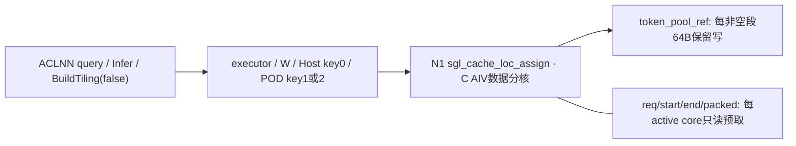
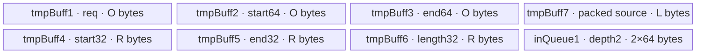

# CacheLocAssign 950 ACLNN 算子知识

## 算子速览

| 项目 | 内容 |
|---|---|
| 实际入口 | `aclnnSglCacheLocAssignGetWorkspaceSize` / `aclnnSglCacheLocAssign`，OpType `SglCacheLocAssign` |
| 计算语义 | **从打包out_cache_loc读取槽位，scatter写入token_pool_ref**；不是从pool打包读出；返回别名是token_pool |
| 输入输出 | req_indices为INT32/INT64，token_pool和打包源为INT32，start/end为INT64；同名token_pool输出原地 |
| 执行类型 | 单Device节点N1的AIV_VECTOR数据路径，包含DMA、Vector Cast/Sub和Scalar前缀/拷贝；无Cube/SIMT/NDDMA/通信节点；entry未显式设置KERNEL_TASK_TYPE_DEFAULT |
| Kernel 路线 | Host TilingKey固定0；POD.key=1选择R-001 int32行号，POD.key=2选择R-002 int64行号 |
| 核心资源 | 每核七个VECCALC TBuf、inQueue1深度2且每块64B；Host workspace[0]=0；各核心独立预取整批metadata和打包源 |
| 来源闭包 | `source_closed`：固定SGL入口→BuildTiling(false)→128B POD→完整Assign body；固定asc-devkit SDK补齐LocalTensor减法/赋值、目标长度和Sub实现，不以未知重载代替闭包 |
| 草稿边界 | Host UB guard与真实分配不相等；对齐预取超逻辑长度需实际padding；int64偏移降int32、固定16元素保留写和重叠域未获完整保护。源码闭合不证明运行正确或安全 |
| 验证状态 | 本次知识提取未执行安装、编译、真机、数值或性能测试；未生成verified |

## 接口与语义

### 计算语义

公共接口说明复用[缓存槽位打包写入与读出API](../../../../apis/sgl_kernel_npu/sgl_cache_locations.md)。本卡只分析Assign。令请求数B，pool为`[P,W]`，行号`r_i`，start/end为`a_i,e_i`，`d_i=e_i-a_i`，打包源逻辑元素数为S。合法数学关系是：

```text
c_i = sum(k=0..i-1, d_k)
for j in [0,d_i):
  token_pool[r_i,a_i+j] = out_cache_loc_flat[c_i+j]
```

`d_i=0`不占打包空间，Assign body跳过该行token池读写。非空段公开限制`d_i<=16`；打包源至少容纳sum(d_i)，pool与源不能alias，行号应互异、范围有效。实现先读pool起点后的16个int32，替换前d_i项，再写回完整64字节，意在保留段后原值；物理64B读写窗口必须可访问并满足并发不冲突前提。返回token_pool同存储Tensor，不分配新的业务输出。

数学c_i由SDK已闭合的int32长度结果累计；只有start/end及其差均在int32可表示域、所有累计/地址运算无溢出时，才可用上式证明实际前缀与原int64输入一致。

### 输入、输出与属性

| 参数 | shape/layout | dtype | 约束、默认值与语义 |
|---|---|---|---|
| req_indices | ND稠密`[B]` | INT32或INT64 | pool行号互异且有效；原生Host不检查Tensor内值 |
| token_pool / token_pool_ref | ND稠密`[P,W]` | INT32 | Assign写目标；entry绑定ref输出；同名输出shape/dtype继承输入1 |
| start_offset | ND稠密`[B]` | INT64 | 每段起始列；Vector降int32后参与长度，原int64仍供Scalar寻址 |
| end_offset | ND稠密`[B]` | INT64 | 结束列，不小于start；非空差不超过16 |
| out_cache_loc | 连续任意shape，逻辑numel=S | INT32 | Assign只读打包源；按一维读取，S至少为段长和；预取的补齐区还需物理可读 |
| workspaceSize/executor | query输出 | uint64 / aclOpExecutor* | 由生成ACLNN框架返回；自有Tiling请求0字节不等于可无依据断言query总量恒0 |
| workspace/stream | execute输入 | void* / aclrtStream | 依query容量提供；生命周期覆盖异步Device执行 |

无算子属性。Python门面只显式检查打包源连续、五Tensor dtype组合；文档要求的同设备、稠密metadata、有效行号/区间/长度/无重叠、metadata补齐存储不是该检查函数已全部验证的内容。

### 入口与版本

两阶段调用形状由`torch_adapter.cpp::cache_loc_assign/Launch`精确证明：

```text
aclnnSglCacheLocAssignGetWorkspaceSize(
  reqDesc,poolDesc,startDesc,endDesc,packedDesc,&workspaceSize,&executor)
aclnnSglCacheLocAssign(workspace,workspaceSize,executor,stream)
```

固定SGL仓没有手写生成的`aclnn_sgl_cache_loc_assign.h/.cpp`。`sgl_generate_cann_interfaces`根据OpDef生成接口，`sgl_add_cann_host_libraries`收集到sgl_cann_opapi；生成bridge/executor是明确框架边界。OpDef同名输出token_pool产生ref协议，Device实际写token_pool_ref；旧`csrc/cache_location_assign/` Direct Invoke不是本入口body。

本卡限Ascend950：公开API表明确arch35支持，README/architectures.json将3510映射ascend950；SUPPORTED_ARCHS含3510，OpDef注册生成的ascend950 config。不是仅凭arch35目录推断支持。

CANN版本记9.1.0：固定SGL的cache CI矩阵配置9.1.0和a3/950，A2支持来自产品表与2201映射而非该CI实测。补充SDK固定为官方asc-devkit v9.1.0对应commit `e5451c7feba11f9e259f4fbc19c4bf82f8c0496c`，用于证明重载和primitive源码契约；官方tag匹配不保证所有标为9.1.0的二进制SDK均逐字相同，没有安装或编译验证本机SDK。

## Host/Launcher 执行流程

### 参数校验与前处理

`SglCacheLocAssign`注册五输入、同名pool输出，InferShape<1>/InferDataType<1>继承pool，TilingAssign只调用BuildTiling(context,false)。其顺序为：

1. 取req/pool/packed shape、req desc及platform；对象缺失失败。req维数<1、pool维数<2、B/P/W或packed ShapeSize为负失败；不强制恰好1D/2D，不检查start/end shape或数据值。
2. RawTilingData缺失、data为空、capacity<128或workspace槽缺失则失败；typed POD为空失败。
3. Assign的blockDim=C=GetCoreNumAiv()，C为0失败；用B/C与B%C生产连续行分核。不是Update的1核选择。
4. req dtype为INT32写POD.key1、按8元素补齐行号；INT64写key2、按4元素补齐；其它dtype失败。
5. 生产固定16-token缓冲、两offset列对齐长度、packed逻辑S及对齐字节数。查询平台UB容量U，若源码guard G>U失败；否则写128B、blockDim=C、Host TilingKey0、workspace[0]=0。

`host_utils::alinInt32Count(n)=8*ceil(n/8)`、`alinInt64Count(n)=4*ceil(n/4)`，实现来自递归公共依赖`csrc/utils/common.h`，不把相似命名的其它RoundUp/helper混入。

适配层Launch(...,is_update=false)将target设为pool，DeviceGuard(target.device())，构建五个描述符；req为at::kInt则ACL_INT32，否则ACL_INT64，其余强制按固定dtype描述。没有原生metadata连续化或设备/值域检查；直接Torch调用者必须满足公开契约。Python门面的check_cache_loc_inputs与此原生路径应区分。

### 参数、Workspace 与生命周期

POD为16个uint64、128字节，共享同头定义，Host生成所有字段。Req和offset/packed对齐字节数由逻辑shape产生，不由backing allocation推测。Host guard与真实UB分配分别见下文，不能将guard通过当作成功分配/内存安全证明。

自有workspace为0，无跨Kernel中间buffer。ACLNN query仍返回实际W和executor，adapter按W分配byte Tensor，W=0时传nullptr；body workspace形参未使用。五Tensor与workspace都record_stream，lambda捕获Tensor、shared_ptr描述符、workspace、executor、stream及execute/name；描述符由aclDestroyTensor删除器管理。op_api_symbol固定定位本extension旁vendor库并保留handle，不依赖进程全局同名库。

query失败、W>INT64_MAX、execute失败分别TORCH_CHECK，失败不继续成功路径。execute正常返回是提交结果，不代表Device已完成。caller需保持pool、packed、metadata及workspace至stream完成，不并发覆盖源或复用输出。executor生命周期细节属于生成ACLNN框架。

### 启动图与失败传播



| 节点/边 | producer → consumer | 介质、offset/extent | 顺序、owner/lifetime和失败 |
|---|---|---|---|
| Tiling→N1 | BuildTiling(false)→entry | 128B POD，Host key0，POD key1/2，C | SDK持有tiling/executor；显式Host失败终止 |
| metadata/packed→N1 | caller→PreProcess | 补齐32B后的只读GM→独立UB TBuf | 每active core预取一次；MTE2_V显式event后Cast/Sub，保留物理padding前提 |
| pool→UB→pool | caller旧pool→CopyIn/Compute→caller目标 | `4*(reqIdx*W+start)`，固定64B | VECIN queue EnQue/DeQue，Scalar覆写前step项再DataCopyPad64B；pool_ref别名有效 |
| core间输出 | 各core→pool | 依据req_indices选行与64B窗口 | 没有跨corebarrier/atomic；须证明物理写域无冲突，互异行号不自动排除跨行窗口 |
| API失败 | SDK返回status→adapter | query/execute错误 | 抛错；没有自有非法索引或UB越界的Device错误码/fallback |

## Route 与参数设计

### 分核与资源计算

令C为平台AIV数，q=floor(B/C)，t=B%C。核心c处理连续区间：

```text
rowNum(c)=q+(c<t ? 1 : 0)
rowOffset(c)=q*c+min(c,t)
rowIdx=rowOffset+i，i=0..rowNum-1
```

C不按B裁剪；B<C时前B个core各1行，其余仍Init资源但不PreProcess。B进入Device成员batchSize时会由uint64窄化为uint32，故以下数学计费限定该窄化及所有对齐、乘加、API参数转换都未溢出或截断：

```text
A32(n)=8*ceil(n/8)；A64(n)=4*ceil(n/4)
R=4*A32(B)=align32(4B)
O=8*A64(B)=align32(8B)
L=4*A32(S)=align32(4S)
Rreq=R (R-001) 或 O (R-002)
Host guard G=64+3O+12B+L
Device UB请求/对齐计费 D=Rreq+2O+3R+L+2*64
```

两个offset int64 TBuf各O，三个int32 TBuf各请求4B但实际各R；packed TBuf为L；token队列depth2每块64B，不能只计一块。R-002中`D-G=64+3*(R-4B)>=64`；R-001中`D-G=4R-O-12B+64`，可正可负，不能套用固定差值。Host只比较G与U，没有后续D<=U验证；primitive资源/系统预留仍须额外考虑。

### Route 选择

| 顺序 | Route | Key/模板 | 精确选择条件与优先级 | 不适用去向 |
|---:|---|---|---|---|
| 1 | R-001 int32请求行号 | Host key0；POD.key1；CacheLocAssignKernel<int32_t> | Host公共校验通过，req desc INT32，G<=U；entry data.key==1 | req INT64走R-002；其它dtype Host失败 |
| 2 | R-002 int64请求行号 | Host key0；POD.key2；CacheLocAssignKernel<int64_t> | Host公共校验通过，req desc INT64，G<=U；entry先未命中1、再data.key==2 | 其它dtype Host失败；伪造其它POD.key无body/无写 |

```text
公共shape/raw128B/platform与C检查
  -> req.dtype INT32? POD.key1 / req申请R字节
  -> else INT64? POD.key2 / req申请O字节
  -> else GRAPH_FAILED
  -> G>U? GRAPH_FAILED
  -> Host key0 / C / workspace0 / N1
entry data.key1或2 -> Init -> ASCEND_IS_AIV下ProcessForTokenPoolAssign
  -> rowNum==0: 不PreProcess
  -> 每请求start==end: 跳过token读写
  -> 非空: CopyIn64B / packed前缀读 / 保留写64B
```

### 模板/实现执行矩阵

| Route | key/selector | dtype/shape/platform 完整命中条件 | 执行拓扑与 Kernel 节点 | 实际模板/body | 内存与同步特征 | tail/fallback |
|---|---|---|---|---|---|---|
| R-001 | Host0/POD1 | req INT32、pool/packed INT32、offset INT64；文档稠密、有效互异行、0<=step<=16、足量packed；950 | 单N1 AIV_VECTOR | CacheLocAssignKernel<int32_t>；ProcessForTokenPoolAssign | req R字节，D=4R+2O+L+128；MTE2_V+队列，SDK int32 Sub | 空段跳过，非空固定16元素窗口；无长段/资源备用路 |
| R-002 | Host0/POD2 | req INT64，其余同上 | 同N1 | CacheLocAssignKernel<int64_t> | req O字节，D=3R+3O+L+128；其余同步相同 | 同上；Host guard比D至少少64B（非溢出域） |

两路线仅req模板不同，但req TBuf容量不同，故分开列Route；不能把Host的key0误写成两个TilingKey，也不把空段跳过另造模板。

### 隐藏性能 Guard

| Guard | Host/Tiling 条件 | Device/资源原因 | 影响 Route | 不满足时去向 | 源码符号 |
|---|---|---|---|---|---|
| 公共对象/shape | req.dim>=1、pool.dim>=2、B/P/W/S非负，raw>=128，C>0 | POD/分核和合法shape读取 | 两Route | GRAPH_FAILED | BuildTiling |
| Host UB guard | G<=U | 名义资源容量检查；与真实D不等 | 两Route | G>U失败；D>U没有单独拒绝 | BuildTiling/Init |
| 16元素限制 | 文档step<=16，Host不读值验证 | tokenQueue每槽64B，循环写step个int32 | 两Route | step>16可能越界，无分块fallback | CopyIn/ComputeForTokenPoolAssign |
| metadata padding | Host按A32/A64计数，普通DataCopy预取 | req/offset/packed GM实际访问可超过逻辑numel | 两Route | 没有DataCopyPad metadata替代或物理容量检查 | PreProcess |
| int64→int32范围 | CAST_NONE，未检查offset值范围 | int32差供prefix，原int64又供寻址 | 两Route | 不保证两种表示一致，无fallback | PreProcess/GetCacheIdx |
| batch/长度窄化 | POD uint64；Device batchSize uint32；primitive长度uint32/int32 | 资源/循环/地址需可表示 | 两Route | 无窄化检查；UB guard本身也可算术溢出 | BuildTiling/Init/SDK SubImpl |
| 物理写域 | req行号互异是公开约束，未检查64B窗口是否交叠 | 固定窗口保留写可超出逻辑段或行 | 两Route | 没有跨核同步/冲突处理 | ProcessForTokenPoolAssign |

### POD/ABI

`optiling::SglCacheLocTilingData`由Host/Device共享，同头assert sizeof=16*sizeof(uint64)=128；各字段uint64依序每8字节，offset如下。常用目标ABI对齐8，源码未独立assert alignof，未编译测量。

| 结构 | 字段 | 类型/位宽 | ABI 布局 | 单位 | Host/launcher producer | Device consumer | 边界 |
|---|---|---|---|---|---|---|---|
| SglCacheLocTilingData | key | uint64/64 | offset0 | req类型selector | INT32→1、INT64→2 | entry if/else模板 | 不等于Host TilingKey0 |
| 同上 | vcoreNum | uint64/64 | offset8 | AIV数 | C=GetCoreNumAiv，Assign false分支 | Init保存，用于Host已生成行数；Process无动态核数重算 | C=0失败 |
| 同上 | poolSize | uint64/64 | offset16 | pool行数 | pool.dim0 | Init绑定poolSize*rowSize GM span | 不检查reqIdx内容 |
| 同上 | batchSize | uint64/64 | offset24 | 请求数 | req.dim0 | Init保存到uint32成员；metadata/临时buf分配 | 高位截断未检查 |
| 同上 | rowNumNoTail | uint64/64 | offset32 | 行/core | B/C | Init产生rowNum与rowOffset | 与同一C匹配 |
| 同上 | tailNum | uint64/64 | offset40 | 多一行的core数 | B%C | Init分支coreId<tailNum | 非DMA尾字节 |
| 同上 | rowSize | uint64/64 | offset48 | int32元素/行 | pool.dim1 | tokenPoolGM基址reqIdx*rowSize+start | 稠密行，非stride字段 |
| 同上 | reqInxBufferCount | uint64/64 | offset56 | T元素 | INT32 A32(B) / INT64 A64(B) | PreProcess req DataCopy count | 超B补齐读取 |
| 同上 | reqInxBufferSize | uint64/64 | offset64 | byte | 上字段*sizeof(T) | Init tmpBuff1申请 | R或O；R-001/R-002差异 |
| 同上 | tokenCountAlignInt32 | uint64/64 | offset72 | int32元素 | A32(MAX_STEP)=16 | CopyIn固定DataCopy count | 不按实际step缩短 |
| 同上 | tokenColAlignInt32 | uint64/64 | offset80 | byte/队列块 | 16*4=64 | Init inQueue1 depth2申请；Host G计一次 | 实际队列128B |
| 同上 | offsetCountAlignInt64 | uint64/64 | offset88 | int64元素 | A64(B) | PreProcess start/end DataCopy及Cast count | Cast只写A64(B)个int32 |
| 同上 | offsetColAlignInt64 | uint64/64 | offset96 | byte | A64(B)*8=O | Init tmpBuff2/3；Host G用3O | 不是每个int32buf真实容量 |
| 同上 | cacheLocSize | uint64/64 | offset104 | packed逻辑元素 | locShape.GetShapeSize()=S | Init GM span，类成员保存；Assign写回不使用S生成输出长度 | 不从各段和核验 |
| 同上 | cacheLocCountAlignInt32 | uint64/64 | offset112 | int32元素 | A32(S) | PreProcess packed DataCopy count | 补齐区需可读 |
| 同上 | cacheLocAlignInt32 | uint64/64 | offset120 | byte | A32(S)*4=L | Init tmpBuff7申请，Host G | S大时整缓冲进UB，无tile fallback |

### Route 源码闭包

| Route | Key/selector | Host/Tiling producer | POD/参数 | Kernel entry/router 节点 | Kernel body/直接依赖 | 构建接线 |
|---|---|---|---|---|---|---|
| R-001 | Host0/POD1 | cache_loc_host.cpp::TilingAssign/BuildTiling(false)；utils/common.h对齐helper | SglCacheLocTilingData，req R字节 | cache_loc_kernel.cpp::sgl_cache_loc_assign → CacheLocAssignKernel<int32_t> | Init/ProcessForTokenPoolAssign/PreProcess/CopyIn/ComputeForTokenPoolAssign/GetCacheIdx；SDK减法/赋值/Sub已补齐 | cache_locations CMake→mem_cache/domain→operators resolve→cann_ops codegen/tiling/kernel |
| R-002 | Host0/POD2 | 同Host，INT64 req分支 | 同POD，req O字节 | 同entry → CacheLocAssignKernel<int64_t> | 同方法；req读取类型不同 | 相同源映射，无arch variant |

构建声明因同一Host文件同时注册两个OpType而自动补齐Assign/Update的源映射，CMake中的DEFER还原请求缓存不改变最终resolved映射。此建包耦合不表示Assign运行时启动Update；`ProcessForCacheUpdate/sgl_cache_loc_update`不是本入口可达节点，不在本卡扩展其逻辑语义。

## Kernel 实现

### 公共执行流程

N1参数顺序是`req_indices,token_pool,start_offset,end_offset,out_cache_loc,token_pool_ref,workspace,tiling`。GET_TILING_DATA后按POD.key1/2初始化对应类，Init使用token_pool_ref；只有ASCEND_IS_AIV分支调用Assign Process。entry没有显式KERNEL_TASK_TYPE_DEFAULT，不能补造AIV_ONLY宏，但其可达计算只有AIV Vector/Scalar/DMA，无Cube/AIC计算实例。

PreProcess的关键SDK闭包现已读取固定源码：

```text
ubEndOffsetInt32 - ubStartOffsetInt32
 -> LocalTensor<int32>::operator- 返回 SymbolOverrideSub<int32>(两源const引用)
ubCacheLength = 表达式
 -> LocalTensor::operator=(SymbolOverrideSub)
 -> expression.Process(ubCacheLength)
 -> SubImpl(dst.GetPhyAddr(),end.GetPhyAddr(),start.GetPhyAddr(),dst.GetSize())
```

赋值写入tmpBuff6原有地址，既不把ubCacheLength重绑到源也不分配隐藏UB。引用在此完整表达式期间指向仍存活的成员Tensor。固定SDK的TPipe::InitBuffer把4B补齐为R，TBuf::Get<int32>()使用整bufLen，LocalTensor::GetSize返回dataLen/4，所以Sub的真实count为`R/4=A32(B)`。此前两Cast各count为A64(B)，A64(B)<=A32(B)；前B个源lane有效，可能额外未初始化的padding lane不参与GetCacheIdx的有效前缀，不能把它们描述为已清零。

在本卡3510平台，SDK连续SubImpl<int32>选择单寄存器RegTensor<int32>、Reg::Sub ZEROING，经BinaryContinuousImplTemplate按VL=256字节即64个int32/repeat循环：repeatTime=uint16(ceil(count/64))，UpdateMask根据剩余count生成mask，两次LoadAlign读取两源且均不传mask，Reg::Sub与StoreAlign才受mask保护。Reg::Sub int32最终调用vsub(...,mask,ZEROING)；无隐藏UB临时块，源码显式三个RegTensor及MaskReg，编译器实际寄存器分配未测。

SDK `SymbolOverrideSub::Process`处于`#pragma begin_pipe(V)`，没有添加新的手动event；LocalTensor::GetValue标记`__inout_pipe__(S)`并对普通int32/64直接解引用UB。业务PreProcess只有MTE2_V显式event，Vector→Scalar、Scalar→MTE3等必要编译器调度仍是自动同步/codegen边界，不声称未执行的汇编或运行验证。

### Route R-001：int32请求行号

#### 适用条件

##### 选择证据

| 层级 | 文件 | 符号 | 源码谓词/参数 | 结果/下一跳 |
|---|---|---|---|---|
| API/Host | docs/api/zh/operators/mem_cache/cache_locations.md；op_host/cache_loc_host.cpp | SglCacheLocAssign/BuildTiling(false) | req dtype=INT32、公共shape/raw/C/UB检查通过 | Host key0、POD.key=1 |
| entry | csrc/mem_cache/cache_locations/op_kernel/cache_loc_kernel.cpp | sgl_cache_loc_assign | data.key==1 | CacheLocAssignKernel<int32_t>::Init |
| body | 同kernel文件 | ProcessForTokenPoolAssign | rowNum>0；逐行空段跳过 | PreProcess一次→每非空行CopyIn/Compute |
| SDK表达式 | SDK kernel_tensor_impl.h / kernel_operator_symbol_override_impl.h | operator-/operator=/SymbolOverrideSub::Process | int32目的tmpBuff6，GetSize=R/4 | 对既有目的Vector Sub，不重绑 |

#### Device 数据流

##### 函数级调用链

```text
aclnnSglCacheLocAssignGetWorkspaceSize -> generated bridge -> BuildTiling(false)
aclnnSglCacheLocAssign -> N1 sgl_cache_loc_assign [Host key0/POD key1]
  -> CacheLocAssignKernel<int32_t>::Init
     -> contiguous row partition / seven TBufs / inQueue1(depth2,64B)
  -> ASCEND_IS_AIV: ProcessForTokenPoolAssign
     -> rowNum>0: PreProcess
        -> req/start/end/packed aligned DataCopy
        -> FetchEventID(MTE2_V), SetFlag/WaitFlag
        -> Cast<int64→int32>(start/end,count=A64(B),CAST_NONE)
        -> LocalTensor operator-/assignment -> SubImpl<int32>(count=R/4)
     -> for i=0..rowNum-1:
        -> rowIdx=rowOffset+i; empty? continue
        -> reqIdx=ubReqPoolIndices.GetValue(rowIdx)
        -> CopyIn: AllocTensor / DataCopy16 / EnQue
        -> ComputeForTokenPoolAssign:
           DeQue / GetCacheIdx / Scalar packed read→tokenLocal SetValue
           / DataCopyPad64B→pool_ref / FreeTensor
```

##### 源码等价伪码

```text
T=int32_t; POD.key=1; Rreq=R
c=GetBlockIdx(); batchSize=uint32(POD.batchSize)
rows=q+(c<t); rowOffset=q*c+min(c,t)
allocate req(Rreq),start64(O),end64(O),start32(R),end32(R),len32(R),packed(L)
allocate tokenQueue(depth=2,bytes_per_slot=64)
lastRowIdx=0; packedStart=0
if rows>0:
  DMA req[A32(B)],start[A64(B)],end[A64(B)],packed[A32(S)]
  MTE2_V event set/wait
  Cast(start32,start64,CAST_NONE,A64(B)); Cast(end32,end64,CAST_NONE,A64(B))
  len32[0:R/4] = SDK_Sub(end32,start32,dst_existing=len32,count=R/4)
  for i=0; i<rows; ++i:
    row=rowOffset+i
    if start64.GetValue(row)==end64.GetValue(row): continue
    reqIdx=uint64(req.GetValue(row))
    token=tokenQueue.AllocTensor<int32>()
    DMA token[0:16] <- pool_ref[reqIdx*W+start64[row] : +16]
    tokenQueue.EnQue(token); token=tokenQueue.DeQue<int32>()
    start=start64.GetValue(row); step=end64.GetValue(row)-start
    for k=lastRowIdx; k<row; ++k: packedStart += len32.GetValue(k)
    lastRowIdx=row
    for j=0; j<step; ++j: token.SetValue(j,packed.GetValue(packedStart+j))
    DataCopyPad(pool_ref[reqIdx*W+start],token,{1,64,0,0,0})
    tokenQueue.FreeTensor(token)
```

这是保留源码实际分核、空段跳过、整16窗口与前缀状态的伪码；未把metadata普通DataCopy换成Pad，未增加源码没有的长度检查或跨核同步。

#### 内存与数据搬运

##### 资源与搬运表

| 层级/缓冲区 | offset/地址公式 | extent/容量公式 | dtype/layout | producer | consumer | owner/lifetime | 对齐/复用 |
|---|---|---|---|---|---|---|---|
| GM req_indices | base+4*row | 逻辑4B；每active core DMA R字节 | int32_t ND | caller | PreProcess/Scalar row select | caller整个stream | 物理padding需覆盖R |
| GM start/end | 各base+8row | 各逻辑8B；DMA各O | int64 ND | caller | DMA→Cast及Scalar start/step | 同上 | 补齐数A64(B) |
| GM packed源 | base+4*(packedStart+j) | 逻辑4S；DMA L | int32连续 | caller | ubCacheLoc | 同上，只读 | S任意shape的numel；padding物理可读 |
| GM pool_ref | base+4*(reqIdx*W+start) | 每非空段读64B、写64B | int32稠密 | caller旧值/Compute新值 | CopyIn/调用者 | 原地，整个stream；不与packed alias | 窗口内step之后保留旧值；跨请求物理窗口须无冲突 |
| UB tmpBuff1 | allocator基址 | R字节 | T视图ubReqPoolIndices | req DMA | Scalar GetValue | TPipe在Init申请，当前core kernel有效 | 只读复用整个行区间 |
| UB tmpBuff2/3 | 两个独立基址 | 各O字节 | int64 start/end | metadata DMA | Cast和Scalar | TPipe，PreProcess后跨所有行 | 不与int32目的别名 |
| UB tmpBuff4/5 | 两个独立基址 | 各请求4B、实际R字节 | int32 start/end | Cast(count=A64(B)) | SymbolOverrideSub源 | 同上 | 后部padding未必初始化 |
| UB tmpBuff6 | 独立基址+4k | 请求4B、实际R字节 | int32 ubCacheLength | SDK_Sub(count=R/4) | GetCacheIdx Scalar | 同上，赋值不改变此地址 | 前B项有效长度，额外lane不用于prefix |
| UB tmpBuff7 | 独立基址+4k | L字节 | int32 ubCacheLoc | packed DMA | Compute Scalar | 同上，仅只读 | 每active core整缓冲副本 |
| UB inQueue1 | 两个64B slot | depth2×64=128B | VECIN int32 | CopyIn oldpool、Scalar overwrite | DataCopyPad回pool | 每非空行Alloc→EnQue→DeQue→Free | 只见逐行立即消费，不能由depth2宣称已流水重叠 |
| SDK Vector寄存器 | 平台Sub backend | 三个256B逻辑RegTensor和mask，非UB | int32/mask | SDK SubImpl | 同Sub写回 | 当前Vector调用 | 不额外计入UB，不虚报编译器最终寄存器数 |
| workspace | entry不寻址 | 自有0；query返回W由框架决定 | byte | caller/adapter | SDK executor | 覆盖异步执行 | 无自有slice/跨节点边 |

普通DataCopy的count单位为元素：req数A32(B)，start/end各A64(B)，packed数A32(S)，每行token数16。回pool用DataCopyExtParams{blockCount=1,blockLen=64,srcStride=0,dstStride=0,rsv=0}，blockLen单位字节，无按step裁剪、无额外output queue。

##### 分层内存布局


SDK InitBuffer按32字节分配并推进对应pool地址，TBuf::Get仅绑定已分配地址；七个TBuf和两个Queue slot不因局部C++包装器而变成同一物理块。len赋值使用既有tmpBuff6，不能无依据从总量扣掉它。

##### 字节账与复用顺序

```text
R-001 D = 4R+2O+L+128
Host G = 64+3O+12B+L
D-G = 4R-O-12B+64，可正可负
必须区分: Host只保证它计算的G<=U，不保证D<=U
有效域: B的Device uint32保存、所有对齐乘加/InitBuffer参数无溢出窄化
workspace_business=0，dynamic_ub=N/A
```

| 复用子区 | 写入者 | 读取者/消费点 | 下一次覆盖 | 同步或释放依据 | 安全条件 |
|---|---|---|---|---|---|
| metadata/packed TBuf | 每active core首次PreProcess DMA | Cast/Sub/所有行Scalar | 本次kernel不再覆盖 | MTE2_V set/wait，Vector/Scalar具体依赖由编译器管线模型处理 | GM实际padding可读、各dtype跨度有效 |
| start32/end32 | 两Cast | SDK_Sub | 本次不再覆盖 | 同Vector调用顺序，未插入额外手动barrier | 前B项可表示；不把padding推导为0 |
| len32 | SDK_Sub写tmpBuff6 | GetCacheIdx | 本次不再覆盖 | SDK声明Vector和Scalar管线注解；无业务V_S显式event | 前B项差值无int32溢出，prefix不读无效lane |
| tokenQueue slot | CopyIn DMA、Scalar覆盖前step | DataCopyPad回GM | 后续行复用slot | EnQue/DeQue/FreeTensor；没有自有输出event或MTE3显式wait | primitive/编译器同步前提、step<=16、物理写域无冲突 |

#### 同步、精度与尾块

##### 同步与数值边界表

| 阶段 | primitive/机制 | producer | consumer/等待点 | 保护对象 | 精度/尾块 |
|---|---|---|---|---|---|
| metadata DMA→Cast | FetchEventID(MTE2_V)+SetFlag/WaitFlag | 四路DataCopy | 两Cast和后续Vector | req/offset/packed UB | 对齐输入padding不保证初始化 |
| Cast→Sub | 顺序Vector调用，SDK Sub标注V管线 | INT64→INT32 Cast NONE | SubImpl<int32> | tmpBuff4/5/6 | 需a/e/diff可表示；count由目的R/4决定 |
| Sub→prefix | GetValue __inout_pipe__(S) | SDK Vector Sub | Scalar GetCacheIdx | len32前B项 | 无业务V_S显式事件，codegen自动同步未运行验证 |
| pool DMA→Scalar改写 | inQueue1 EnQue/DeQue | CopyIn64B | Compute Scalar | 当前64B token slot | step=0在进入queue前跳过 |
| Scalar改写→pool回写/slot释放 | DataCopyPad+FreeTensor | SetValue前step项 | GM输出/后续slot分配 | 同slot及64B窗口 | 源码未写独立S_MTE3/MTE3_MTE2事件；不能补造已执行验证 |
| core之间 | 无atomic/跨核barrier | 每core处理选中请求 | 无共享prefix consumer | pool_ref不同窗口 | req互异且实际64B写窗口互斥才可无冲突 |
| 整数精度 | INT64原offset、INT32缓存长度、INT64累计packedStart | metadata/SDK Sub | 地址和循环 | 逻辑区间与packed索引 | 非空step<=16；负行号转换uint64或窄化不由Host拒绝 |

#### 关键实现

##### 符号证据表

| 阶段 | 文件 | 符号/模板实例 | 实现事实 |
|---|---|---|---|
| Host/Tiling producer | csrc/mem_cache/cache_locations/op_host/cache_loc_host.cpp | TilingAssign/BuildTiling(false) | INT32→POD.key1，连续分核、G guard |
| Kernel entry/router | csrc/mem_cache/cache_locations/op_kernel/cache_loc_kernel.cpp | sgl_cache_loc_assign / CacheLocAssignKernel<int32_t> | ref pool、AIV Process、无Update runtime节点 |
| Device body/helper | 同kernel文件 | PreProcess/CopyIn/ComputeForTokenPoolAssign/GetCacheIdx | metadata整批预取、16元素窗口、packed prefix、保留写 |
| SDK表达式 | SDK impl/basic_api/kernel_tensor_impl.h | operator-/operator=(SymbolOverrideSub) | 构造源引用表达式，Process写既有目的 |
| SDK计算 | SDK impl/basic_api/kernel_operator_symbol_override_impl.h | SymbolOverrideSub<int32>::Process | SubImpl(dst,src0,src1,dst.GetSize()) |
| SDK长度/分配 | SDK kernel_tbuf_impl.h / kernel_tpipe_impl.h | TBuf::Get/TPipe::InitBuffer | 对齐容量R和目的元素count=R/4 |
| SDK平台body | impl/basic_api/dav_3510/kernel_operator_vec_binary_continuous_impl.h | SubImpl<int32> | 64lane/repeat、ZEROING掩码Reg Sub/Store |

### Route R-002：int64请求行号

#### 适用条件

##### 选择证据

| 层级 | 文件 | 符号 | 源码谓词/参数 | 结果/下一跳 |
|---|---|---|---|---|
| API/Host | docs/api/zh/operators/mem_cache/cache_locations.md；op_host/cache_loc_host.cpp | SglCacheLocAssign/BuildTiling(false) | req dtype=INT64、公共shape/raw/C/UB检查通过 | Host key0、POD.key=2 |
| entry | csrc/mem_cache/cache_locations/op_kernel/cache_loc_kernel.cpp | sgl_cache_loc_assign | data.key先不为1、再等于2 | CacheLocAssignKernel<int64_t>::Init |
| body | 同kernel文件 | ProcessForTokenPoolAssign | rowNum>0；逐行空段跳过 | PreProcess一次→每非空行CopyIn/Compute |
| SDK表达式 | SDK kernel_tensor_impl.h / kernel_operator_symbol_override_impl.h | operator-/operator=/SymbolOverrideSub::Process | int32目的tmpBuff6，GetSize=R/4 | 对既有目的Vector Sub，不重绑 |

#### Device 数据流

##### 函数级调用链

```text
aclnnSglCacheLocAssignGetWorkspaceSize -> generated bridge -> BuildTiling(false)
aclnnSglCacheLocAssign -> N1 sgl_cache_loc_assign [Host key0/POD key2]
  -> CacheLocAssignKernel<int64_t>::Init
     -> contiguous row partition / seven TBufs / inQueue1(depth2,64B)
  -> ASCEND_IS_AIV: ProcessForTokenPoolAssign
     -> rowNum>0: PreProcess
        -> req/start/end/packed aligned DataCopy
        -> FetchEventID(MTE2_V), SetFlag/WaitFlag
        -> Cast<int64→int32>(start/end,count=A64(B),CAST_NONE)
        -> LocalTensor operator-/assignment -> SubImpl<int32>(count=R/4)
     -> for i=0..rowNum-1:
        -> rowIdx=rowOffset+i; empty? continue
        -> reqIdx=ubReqPoolIndices.GetValue(rowIdx)
        -> CopyIn: AllocTensor / DataCopy16 / EnQue
        -> ComputeForTokenPoolAssign:
           DeQue / GetCacheIdx / Scalar packed read→tokenLocal SetValue
           / DataCopyPad64B→pool_ref / FreeTensor
```

##### 源码等价伪码

```text
T=int64_t; POD.key=2; Rreq=O
c=GetBlockIdx(); batchSize=uint32(POD.batchSize)
rows=q+(c<t); rowOffset=q*c+min(c,t)
allocate req(Rreq),start64(O),end64(O),start32(R),end32(R),len32(R),packed(L)
allocate tokenQueue(depth=2,bytes_per_slot=64)
lastRowIdx=0; packedStart=0
if rows>0:
  DMA req[A64(B)],start[A64(B)],end[A64(B)],packed[A32(S)]
  MTE2_V event set/wait
  Cast(start32,start64,CAST_NONE,A64(B)); Cast(end32,end64,CAST_NONE,A64(B))
  len32[0:R/4] = SDK_Sub(end32,start32,dst_existing=len32,count=R/4)
  for i=0; i<rows; ++i:
    row=rowOffset+i
    if start64.GetValue(row)==end64.GetValue(row): continue
    reqIdx=uint64(req.GetValue(row))
    token=tokenQueue.AllocTensor<int32>()
    DMA token[0:16] <- pool_ref[reqIdx*W+start64[row] : +16]
    tokenQueue.EnQue(token); token=tokenQueue.DeQue<int32>()
    start=start64.GetValue(row); step=end64.GetValue(row)-start
    for k=lastRowIdx; k<row; ++k: packedStart += len32.GetValue(k)
    lastRowIdx=row
    for j=0; j<step; ++j: token.SetValue(j,packed.GetValue(packedStart+j))
    DataCopyPad(pool_ref[reqIdx*W+start],token,{1,64,0,0,0})
    tokenQueue.FreeTensor(token)
```

这是保留源码实际分核、空段跳过、整16窗口与前缀状态的伪码；未把metadata普通DataCopy换成Pad，未增加源码没有的长度检查或跨核同步。

#### 内存与数据搬运

##### 资源与搬运表

| 层级/缓冲区 | offset/地址公式 | extent/容量公式 | dtype/layout | producer | consumer | owner/lifetime | 对齐/复用 |
|---|---|---|---|---|---|---|---|
| GM req_indices | base+8*row | 逻辑8B；每active core DMA O字节 | int64_t ND | caller | PreProcess/Scalar row select | caller整个stream | 物理padding需覆盖O |
| GM start/end | 各base+8row | 各逻辑8B；DMA各O | int64 ND | caller | DMA→Cast及Scalar start/step | 同上 | 补齐数A64(B) |
| GM packed源 | base+4*(packedStart+j) | 逻辑4S；DMA L | int32连续 | caller | ubCacheLoc | 同上，只读 | S任意shape的numel；padding物理可读 |
| GM pool_ref | base+4*(reqIdx*W+start) | 每非空段读64B、写64B | int32稠密 | caller旧值/Compute新值 | CopyIn/调用者 | 原地，整个stream；不与packed alias | 窗口内step之后保留旧值；跨请求物理窗口须无冲突 |
| UB tmpBuff1 | allocator基址 | O字节 | T视图ubReqPoolIndices | req DMA | Scalar GetValue | TPipe在Init申请，当前core kernel有效 | 只读复用整个行区间 |
| UB tmpBuff2/3 | 两个独立基址 | 各O字节 | int64 start/end | metadata DMA | Cast和Scalar | TPipe，PreProcess后跨所有行 | 不与int32目的别名 |
| UB tmpBuff4/5 | 两个独立基址 | 各请求4B、实际R字节 | int32 start/end | Cast(count=A64(B)) | SymbolOverrideSub源 | 同上 | 后部padding未必初始化 |
| UB tmpBuff6 | 独立基址+4k | 请求4B、实际R字节 | int32 ubCacheLength | SDK_Sub(count=R/4) | GetCacheIdx Scalar | 同上，赋值不改变此地址 | 前B项有效长度，额外lane不用于prefix |
| UB tmpBuff7 | 独立基址+4k | L字节 | int32 ubCacheLoc | packed DMA | Compute Scalar | 同上，仅只读 | 每active core整缓冲副本 |
| UB inQueue1 | 两个64B slot | depth2×64=128B | VECIN int32 | CopyIn oldpool、Scalar overwrite | DataCopyPad回pool | 每非空行Alloc→EnQue→DeQue→Free | 只见逐行立即消费，不能由depth2宣称已流水重叠 |
| SDK Vector寄存器 | 平台Sub backend | 三个256B逻辑RegTensor和mask，非UB | int32/mask | SDK SubImpl | 同Sub写回 | 当前Vector调用 | 不额外计入UB，不虚报编译器最终寄存器数 |
| workspace | entry不寻址 | 自有0；query返回W由框架决定 | byte | caller/adapter | SDK executor | 覆盖异步执行 | 无自有slice/跨节点边 |

普通DataCopy的count单位为元素：req数A64(B)，start/end各A64(B)，packed数A32(S)，每行token数16。回pool用DataCopyExtParams{blockCount=1,blockLen=64,srcStride=0,dstStride=0,rsv=0}，blockLen单位字节，无按step裁剪、无额外output queue。

##### 分层内存布局



SDK InitBuffer按32字节分配并推进对应pool地址，TBuf::Get仅绑定已分配地址；七个TBuf和两个Queue slot不因局部C++包装器而变成同一物理块。len赋值使用既有tmpBuff6，不能无依据从总量扣掉它。

##### 字节账与复用顺序

```text
R-002 D = 3R+3O+L+128
Host G = 64+3O+12B+L
D-G = 64+3*(R-4B)>=64
必须区分: Host只保证它计算的G<=U，不保证D<=U
有效域: B的Device uint32保存、所有对齐乘加/InitBuffer参数无溢出窄化
workspace_business=0，dynamic_ub=N/A
```

| 复用子区 | 写入者 | 读取者/消费点 | 下一次覆盖 | 同步或释放依据 | 安全条件 |
|---|---|---|---|---|---|
| metadata/packed TBuf | 每active core首次PreProcess DMA | Cast/Sub/所有行Scalar | 本次kernel不再覆盖 | MTE2_V set/wait，Vector/Scalar具体依赖由编译器管线模型处理 | GM实际padding可读、各dtype跨度有效 |
| start32/end32 | 两Cast | SDK_Sub | 本次不再覆盖 | 同Vector调用顺序，未插入额外手动barrier | 前B项可表示；不把padding推导为0 |
| len32 | SDK_Sub写tmpBuff6 | GetCacheIdx | 本次不再覆盖 | SDK声明Vector和Scalar管线注解；无业务V_S显式event | 前B项差值无int32溢出，prefix不读无效lane |
| tokenQueue slot | CopyIn DMA、Scalar覆盖前step | DataCopyPad回GM | 后续行复用slot | EnQue/DeQue/FreeTensor；没有自有输出event或MTE3显式wait | primitive/编译器同步前提、step<=16、物理写域无冲突 |

#### 同步、精度与尾块

##### 同步与数值边界表

| 阶段 | primitive/机制 | producer | consumer/等待点 | 保护对象 | 精度/尾块 |
|---|---|---|---|---|---|
| metadata DMA→Cast | FetchEventID(MTE2_V)+SetFlag/WaitFlag | 四路DataCopy | 两Cast和后续Vector | req/offset/packed UB | 对齐输入padding不保证初始化 |
| Cast→Sub | 顺序Vector调用，SDK Sub标注V管线 | INT64→INT32 Cast NONE | SubImpl<int32> | tmpBuff4/5/6 | 需a/e/diff可表示；count由目的R/4决定 |
| Sub→prefix | GetValue __inout_pipe__(S) | SDK Vector Sub | Scalar GetCacheIdx | len32前B项 | 无业务V_S显式事件，codegen自动同步未运行验证 |
| pool DMA→Scalar改写 | inQueue1 EnQue/DeQue | CopyIn64B | Compute Scalar | 当前64B token slot | step=0在进入queue前跳过 |
| Scalar改写→pool回写/slot释放 | DataCopyPad+FreeTensor | SetValue前step项 | GM输出/后续slot分配 | 同slot及64B窗口 | 源码未写独立S_MTE3/MTE3_MTE2事件；不能补造已执行验证 |
| core之间 | 无atomic/跨核barrier | 每core处理选中请求 | 无共享prefix consumer | pool_ref不同窗口 | req互异且实际64B写窗口互斥才可无冲突 |
| 整数精度 | INT64原offset、INT32缓存长度、INT64累计packedStart | metadata/SDK Sub | 地址和循环 | 逻辑区间与packed索引 | 非空step<=16；负行号转换uint64或窄化不由Host拒绝 |

#### 关键实现

##### 符号证据表

| 阶段 | 文件 | 符号/模板实例 | 实现事实 |
|---|---|---|---|
| Host/Tiling producer | csrc/mem_cache/cache_locations/op_host/cache_loc_host.cpp | TilingAssign/BuildTiling(false) | INT64→POD.key2，连续分核、G guard |
| Kernel entry/router | csrc/mem_cache/cache_locations/op_kernel/cache_loc_kernel.cpp | sgl_cache_loc_assign / CacheLocAssignKernel<int64_t> | ref pool、AIV Process、无Update runtime节点 |
| Device body/helper | 同kernel文件 | PreProcess/CopyIn/ComputeForTokenPoolAssign/GetCacheIdx | metadata整批预取、16元素窗口、packed prefix、保留写 |
| SDK表达式 | SDK impl/basic_api/kernel_tensor_impl.h | operator-/operator=(SymbolOverrideSub) | 构造源引用表达式，Process写既有目的 |
| SDK计算 | SDK impl/basic_api/kernel_operator_symbol_override_impl.h | SymbolOverrideSub<int32>::Process | SubImpl(dst,src0,src1,dst.GetSize()) |
| SDK长度/分配 | SDK kernel_tbuf_impl.h / kernel_tpipe_impl.h | TBuf::Get/TPipe::InitBuffer | 对齐容量R和目的元素count=R/4 |
| SDK平台body | impl/basic_api/dav_3510/kernel_operator_vec_binary_continuous_impl.h | SubImpl<int32> | 64lane/repeat、ZEROING掩码Reg Sub/Store |

## 算子特定优化

### Trick T-001：每核心缓存打包前缀进度而不逐行从头扫描

#### 触发与源码依据

- 适用 Route：R-001/R-002。
- 触发条件：核心按连续递增rowIdx处理非空行，成员lastRowIdx初值0、cacheIdxStart初值0；跳过空行后也保留该状态。
- Golden 来源：[固定提交连续176–182行](https://github.com/sgl-project/sgl-kernel-npu/blob/dda6d36b0cdb4081e102d14c0a2fb276fc416e69/csrc/mem_cache/cache_locations/op_kernel/cache_loc_kernel.cpp#L176-L182)。

**官方源码（固定 Commit 连续逐字摘录）**：

```cpp
    __aicore__ inline void GetCacheIdx(uint64_t rowIdx, uint64_t &lastRowIdx, int64_t &cacheIdxStart)
    {
        for (int64_t i = lastRowIdx; i < rowIdx; i++) {
            cacheIdxStart += this->ubCacheLength.GetValue(i);
        }
        lastRowIdx = rowIdx;
    }
```

#### 机制与设计原因

第一次访问该core的行时扫描0到rowIdx-1，以还原全局packed起点；随后只从上次行推进到新行。lastRowIdx停在当前行而非当前+1，使下一次推进包含上一段长度；空段被跳过时其长度0仍在后续推进范围内。prefix只保存在每core Scalar状态，无共享append计数、atomic或GM workspace；代价是各core第一次仍重复扫描前部，而且每active core持有整批metadata/packed副本，不宣称全局前缀预处理只做一次。

#### 迁移边界

- 适用：请求按稳定连续行区间分核、行内packed段顺序固定。
- 前提：SDK已证的目的int32长度结果有效、前B项差值/累计无溢出、行处理顺序递增。
- 失效：若改变为乱序访问或使用错误的int32转换域，缓存状态不再等于数学前缀；源码没有回退重算Route。
- 未验证：本次知识提取未执行编译、真机、数值或性能测试。

#### 错误做法

不能将lastRowIdx更新为rowIdx+1后仍使用相同下一轮区间，否则跳过当前段长度；这由本片段的累计边界直接推出，并非已执行故障实验。也不能在未读取SDK时把Tensor赋值当作源视图重绑；固定SDK operator=明确调用Process写目的。

### Trick T-002：固定16元素局部保留写，避免单元素GM回写

#### 触发与源码依据

- 适用 Route：R-001/R-002。
- 触发条件：Assign非空段，公开step<=16，CopyIn已读16个旧pool int32。
- Golden 来源：[固定提交连续148–156行](https://github.com/sgl-project/sgl-kernel-npu/blob/dda6d36b0cdb4081e102d14c0a2fb276fc416e69/csrc/mem_cache/cache_locations/op_kernel/cache_loc_kernel.cpp#L148-L156)。

**官方源码（固定 Commit 连续逐字摘录）**：

```cpp
        GetCacheIdx(rowIdx, this->lastRowIdx, this->cacheIdxStart);
        for (int64_t j = 0; j < step; j++) {
            int32_t cache = this->ubCacheLoc.GetValue(this->cacheIdxStart + j);
            tokenPoolLocal.SetValue(j, cache);
        }

        uint32_t tokenBytes = static_cast<uint32_t>(optiling::MAX_STEP * sizeof(int32_t));
        AscendC::DataCopyExtParams copyParams{1, tokenBytes, 0, 0, 0};
        AscendC::DataCopyPad(tokenPoolGM[reqIdx * this->rowSize + start], tokenPoolLocal, copyParams);
```

#### 机制与设计原因

UB中只覆盖前step项，step之后的16-step项保留CopyIn旧值，之后一个64B DMA回pool；没有每槽单独GM SetValue、没有完整pool行副本或第二个Kernel。MAX_STEP16决定queue每槽64B和回写长度，两者都不由运行时step缩短。depth2申请真实128B，但源码逐行CopyIn后立即Compute，不由depth2推断已达双缓冲交叠收益。

#### 迁移边界

- 适用：小段scatter、允许固定窗口预读/保留写且可证明窗口安全的场景。
- 前提：0<step<=16，源packed充足，pool起始位置后64B实际可读写，跨core物理窗口互斥且源/目标不alias。
- 失效：长段越过token槽、窗口超物理存储、不同请求的保留写互相覆盖时，源码没有分块或串行fallback。
- 未验证：本次知识提取未执行编译、真机、数值或性能测试。

#### 错误做法

只保证逻辑step项有效，不保证实际16项窗口有效，无法满足本实现搬运范围；只保证req行号不同，也不足以排除窗口跨行后的并发重叠。以上是源码访问集合的静态边界，不是宣称已复现数据破坏。

## 模板与实现对比

| 对比维度 | R-001 int32行号 | R-002 int64行号 | 设计选择依据 |
|---|---|---|---|
| 命中条件/优先级 | Host key0、POD1 | Host key0、POD2 | 同一OpDef两dtype分支 |
| 模板与 dtype | CacheLocAssignKernel<int32_t> | CacheLocAssignKernel<int64_t> | 仅行号存储类型；payload始终int32 |
| 循环与分核 | 连续q/t分核、empty跳过 | 相同 | 各core共享逻辑顺序、prefix本地保存 |
| Queue/TBuf/寄存器/dynamic UB/通信 window | req R，其余七buffer布局含128B queue | req O，其余相同 | 真实容量不同所以分开Route |
| 内存总占用与复用 | 4R+2O+L+128 | 3R+3O+L+128 | 不使用Host G冒充真实D |
| 搬运/Vector/SIMT/NDDMA/通信 API | metadata req A32(B)，token16；Cast/Sub | req A64(B)，其余同左 | SDK Sub count皆R/4，不是按req dtype变化 |
| 同步、精度与 tail | MTE2_V+queue；int64 offset降int32 | 相同 | 分核tail不是DMA补齐tail |
| fallback/失败边界 | Host资源/shape部分失败；无长段fallback | 同左，且D比G至少大64B | 只记录源码条件，不宣称已跑通过 |

## 平台差异

| 项目 | A2 | A3 | Ascend 950 |
|---|---|---|---|
| 支持状态 | 文档arch22、2201→ascend910b | 文档arch22、2201→ascend910_93 | 文档arch35、3510→ascend950 |
| Host/Launcher | 同BuildTiling(false)，C/U按平台 | 相同 | 相同，非Update单核策略 |
| Kernel/资源 | 同七TBuf+depth2 queue、两req实例 | 同左 | 同左，无单独regbase业务body |
| 固定SDK Sub | __NPU_ARCH__2201计数mask+vsub | 同2201 | __NPU_ARCH__3510，RegTensor<int32>、64lane/repeat、ZEROING masked Sub/Store |
| 同步边界 | 显式MTE2_V及SDK/编译器自动依赖 | 同左 | Vector寄存器backend不同，未验证二进制codegen |

本卡平台字段仅950；[A2/A3实现视图](sgl_cache_loc_assign.md)保留2201 mask-count backend。950平台支持与固定SDK源码来自两份独立证据，不宣称已验证任意同名9.1.0安装包。

## 限制与失败边界

- 本卡draft记录可复验源码闭包，不是稳定安全实现推荐。Host UB guard不是实际D：R-002在相关计算无溢出/窄化时至少少计64B，R-001差值由公式决定；未知系统保留和primitive开销不能按0保证。
- metadata/packed源的普通DataCopy按补齐count读，访问可超过逻辑numel；不能因allocator可能预留padding就宣称公开API已保证实际容量。固定16-token CopyIn/保留写也需检查物理窗口。
- LocalTensor减法/赋值缺口已由独立固定SDK解除：Process按目的GetSize调用SubImpl，写tmpBuff6原地址；不再把它描述为未知运算或必然编译错误。官方v9.1.0源码不证明其它同名二进制版本逐字相同。
- Sub的count=R/4，而两Cast只写A64(B)项；padding中的额外lane可能未初始化，但只有前B项用于prefix。必须保证原int64 offset与其int32表示、差及Scalar累计一致，不把padding当0或把INT64行号误认为INT64长度计算。
- req行号和值域、start/end长度/范围、sum(step)<=S、各step<=16、pool/packed无alias和64B物理窗口互斥未由Host完整检查；非法req转uint64后可能改变地址，不能承诺失败码。
- B为0或S为0时仍可能Init零长TBuf/queue及走部分primitive，固定业务实现没有为所有空shape建立独立安全Route；仅明确Assign空区间分支不读写token pool，不能扩大成所有空输入已验证。
- 生成ACLNN/executor、Cast/DMA/queue与编译器自动同步属于明确的SDK/工具链边界；已跟到重载实际计算，不等于观察过编译生成的Scalar/Vector/MTE事件。没有自有跨核冲突处理。
- 本次知识提取未执行安装、编译、真机、数值或性能测试；版本/产品表/CI配置均不转化成verified或运行通过结论。

## 源码索引

### 链路索引

| 链路阶段 | 文件 | 关键符号 | 支撑内容 |
|---|---|---|---|
| SGL公开入口 | docs/api/zh/operators/mem_cache/cache_locations.md | cache_loc_assign | scatter方向、别名、平台、16槽位 |
| SGL门面校验 | python/sgl_kernel_npu/sgl_kernel_npu/operators/mem_cache/cache_locations.py | check_cache_loc_inputs/cache_loc_assign | dtype/packed连续检查及Torch分发 |
| SGL调用实例 | csrc/mem_cache/cache_locations/torch_adapter.cpp | cache_loc_assign/Launch(false) | ACLNN精确符号、pool目标、W/stream lifetime |
| SGL共享适配 | csrc/aclnn_torch_adapter/aclnn_runtime.h | op_api_symbol/tensor_descriptor | vendor库和描述符 |
| SGL Host | csrc/mem_cache/cache_locations/op_host/cache_loc_host.cpp | SglCacheLocAssign/TilingAssign/BuildTiling(false) | 16字段、key两层、q/t分核、UB guard |
| SGL POD | csrc/mem_cache/cache_locations/op_kernel/cache_loc_tiling.h | SglCacheLocTilingData/MAX_STEP | 128B ABI、16token常量 |
| SGL Device | csrc/mem_cache/cache_locations/op_kernel/cache_loc_kernel.cpp | CacheLocAssignKernel<T>/sgl_cache_loc_assign | 两Route的完整body和prefix/保留写 |
| SGL公共对齐 | csrc/utils/common.h | alinInt32Count/alinInt64Count | 8/4元素对齐实际公式 |
| SGL算子构建 | csrc/mem_cache/cache_locations/CMakeLists.txt | sgl_register_operator/paired source mapping | 两OpType源映射耦合、实际Assign target |
| SGL domain | csrc/mem_cache/CMakeLists.txt | sgl_discover_operators | 子目录发现 |
| SGL发现入口 | csrc/cmake/domains.cmake | sgl_add_cann_operator_domains | mem_cache domain接线 |
| SGL解析 | csrc/cmake/operators.cmake | sgl_resolve_operator/sgl_select_cann_operators | arch和唯一kernel源校验 |
| SGL生成接线 | csrc/cmake/cann_ops.cmake | codegen/tiling/host/kernel functions | 自动ACLNN与config、Kernel映射 |
| SGL构建入口 | csrc/CMakeLists.txt | SGL_ARCH_VERSION/SGL_CANN_BUILD_STAGE | CANN独立构建、SDK/package |
| SGL产品映射 | csrc/cmake/architectures.json | 2201/3510 | 910b/910_93/950 |
| SGL公开构建说明 | python/sgl_kernel_npu/README.md | REFACTOR builds/architecture mapping | 直接ACLNN用途及产品证据 |
| SGL版本配置 | .github/workflows/pr-test-kernels.yml | test-cache-ops | 9.1.0/a3/950配置 |
| SGL CI消费 | .github/workflows/pr-test-kernel-group.yml | run-kernel-group | 版本容器/runner参数 |
| SDK重载声明 | include/basic_api/kernel_tensor.h | LocalTensor operator-/operator= | 独立SDK primary，声明表达式与赋值 |
| SDK重载实现 | impl/basic_api/kernel_tensor_impl.h | operator-/operator=/GetSize/GetValue | 源引用、原目的写、长度与Scalar读取 |
| SDK表达式计算 | impl/basic_api/kernel_operator_symbol_override_impl.h | SymbolOverrideSub::Process | SubImpl物理地址/目标count，Vector管线 |
| SDK TBuf视图 | impl/basic_api/kernel_tbuf_impl.h | TBuf::Get | 对齐后bufLen决定LocalTensor跨度 |
| SDK物理申请 | impl/basic_api/kernel_tpipe_impl.h | TPipe::InitBuffer | 32B补齐，queue num乘入实际容量 |
| SDK常量 | impl/basic_api/utils/kernel_utils_constants.h | DEFAULT_BLK_STRIDE/DEFAULT_REPEAT_STRIDE/VECTOR_REG_WIDTH | 2201默认stride1/8、3510 VL256B |
| SDK平台Sub | impl/basic_api/dav_3510/kernel_operator_vec_binary_continuous_impl.h | SubImpl<int32> | 3510寄存器Vector循环；两次LoadAlign读取不传mask，Sub/StoreAlign才受mask保护 |
| SDK向量长度 | include/basic_api/kernel_operator_sys_var_intf.h | GetVecLen | 返回VECTOR_REG_WIDTH=256B |
| SDK寄存器类型 | include/basic_api/reg_compute/kernel_reg_compute_struct_intf.h | RegTraitNumOne/RegTensor | int32单256B逻辑寄存器trait |
| SDK Reg Sub声明 | include/basic_api/reg_compute/kernel_reg_compute_vec_binary_intf.h | Reg::Sub | ZEROING模板接口 |
| SDK Reg Sub转发 | impl/basic_api/reg_compute/kernel_reg_compute_vec_binary_intf_impl.h | Reg::Sub | 转发SubImpl<T,mode,U> |
| SDK Reg Sub实体 | impl/basic_api/reg_compute/dav_3510/kernel_reg_compute_vec_binary_impl.h | Reg::SubImpl | int32 ZEROING分支直接vsub |


每行文件均列于Frontmatter sources；两个仓分别固定40位commit、各恰一primary。已有[API卡](../../../../apis/sgl_kernel_npu/sgl_cache_locations.md)继续维护公共合同，本卡承担Assign实现视图；SDK补充只证明所列固定源码契约。

### 实现复用检查

| 检查项 | 可复用事实 | 不得改变的约束 | 源码符号 |
|---|---|---|---|
| ABI/POD | 16个uint64、128B；Host0/POD1或2 | 不混两层key；按字段单位读取；batchSize成员窄化需有界 | BuildTiling/SglCacheLocTilingData/Init |
| 调用顺序 | query→execute；PreProcess一次→连续行→空段跳过 | Assign写pool_ref，不改成Update打包读出 | Launch(false)/ProcessForTokenPoolAssign |
| workspace/内存 | 七TBuf+depth2×64B、业务workspace0 | 正确D计费、全部物理padding和64B窗口，不用G冒充D | Init/TPipe::InitBuffer |
| 同步 | MTE2_V、queue与SDK Vector/Scalar管线 | 无跨核冲突恢复；自动事件未运行观察，不虚构显式barrier | PreProcess/Compute/SDK Process |
| 精度与尾块 | int64原offset、int32长度、既有目的Vector Sub、保留写16 | count=dst.GetSize=R/4；前B项有效；step<=16，域内无窄化溢出 | SymbolOverrideSub/GetCacheIdx/ComputeForTokenPoolAssign |
| 失败边界 | Host部分GRAPH_FAILED、未知POD.key无写 | 不把公开支持/源码闭合提升为安全或运行正确 | BuildTiling/entry |
