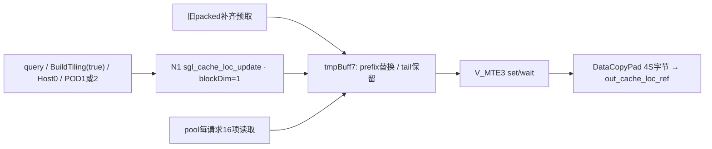
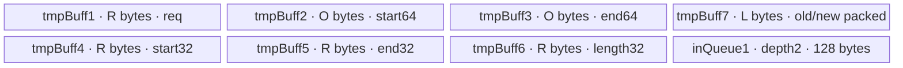
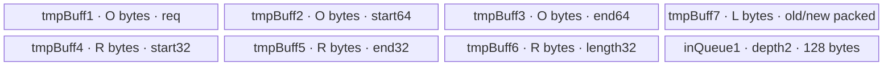

# CacheLocUpdate A2/A3 ACLNN 算子知识

## 算子速览

| 项目 | 内容 |
|---|---|
| 实际入口 | `aclnnSglCacheLocUpdateGetWorkspaceSize` / `aclnnSglCacheLocUpdate`；OpType SglCacheLocUpdate |
| 计算语义 | **从token_pool各请求区间gather读出，打包写out_cache_loc_ref**；pool只读，返回packed目标同存储别名 |
| 输入输出 | req INT32/INT64、pool/packed INT32、start/end INT64；packed支持任意连续shape，按逻辑numel S作一维缓冲 |
| 执行类型 | 单Device节点N1、单核AIV_VECTOR数据路径，DMA/Cast/Sub/Scalar；无Cube/SIMT/NDDMA/通信节点；entry未显式设置KERNEL_TASK_TYPE_DEFAULT |
| Kernel 路线 | Host TilingKey=0；POD.key1→R-001 int32行号，POD.key2→R-002 int64行号 |
| 核心资源 | 单核七VECCALC TBuf、depth2×64B VECIN queue；packed旧值预读、前缀覆盖后按4S字节一次回写；自有workspace0 |
| 来源闭包 | source_closed：SGL完整Update自有链路、128B POD、两Route与固定SDK减法赋值/长度/Sub backend均闭合；生成ACLNN与未展开primitive/codegen是明确边界 |
| 草稿边界 | UB guard不等真实计费；metadata/packed对齐预取需实际padding；空段仍读pool16项；int64 offset降int32及最终4S转uint32未完整保护，不代表可安全复用 |
| 验证状态 | 本次知识提取未执行安装、编译、真机、数值或性能测试，无verified；静态风险不是运行复现 |

## 接口与语义

### 计算语义

公共合同另见[缓存槽位接口](../../../../apis/sgl_kernel_npu/sgl_cache_locations.md)。本卡只分析Update。令pool为`[P,W]`，B个请求，行号r_i，start/end为a_i/e_i，段长d_i=e_i-a_i，`c_i=sum(k<i,d_k)`。在公开有效域、相关整数转换可表示且存储/同步满足时：

```text
for i in [0,B):
  for j in [0,d_i):
    out_cache_loc_flat[c_i+j] = token_pool[r_i,a_i+j]
```

pool不写。packed逻辑长度S至少为段长和；`[sum(d_i),S)`保持调用前位模式。实现为先将整个packed视图补齐读入UB，再替换有效前缀、最后按逻辑4S字节写回，而非只回写sum(d_i)。

公开每段最多16项。Update即使d_i=0也调用CopyIn，从对应pool起点读16个int32，只是Scalar循环零次；因此空段不占packed空间，却不是“不访问pool”。每个请求（包括空段）的行号和实际16项窗口都须可读。B=0则Process的rowNum>0分支不进入，不能把它与非空B里的空段混同。

### 输入、输出与属性

| 参数 | shape/layout | dtype | 约束、默认值与语义 |
|---|---|---|---|
| req_indices | ND稠密[B] | INT32/INT64 | 有效pool行号；公开合同要求互异，原生Host不读内容校验 |
| token_pool | ND稠密[P,W] | INT32 | 只读源；每起点后的16项必须物理可读，非仅d_i项 |
| start_offset/end_offset | 各ND稠密[B] | INT64 | 0<=start<=end，0<=d_i<=16；降int32供长度，原int64用于寻址 |
| out_cache_loc / out_cache_loc_ref | 连续任意shape，numel=S | INT32 | 原地packed目标，同时提供旧尾部；S>=sum(d_i)，不与pool alias |
| workspaceSize/executor | ACLNN query输出 | uint64 / aclOpExecutor* | 框架总容量W；Tiling自有请求0不等于证明query总量恒0 |
| workspace/stream | execute输入 | void* / aclrtStream | 按query提供、覆盖异步执行生命周期 |

无属性。Python门面只显式检查packed连续及五Tensor dtype组合，不完整校验同设备、metadata稠密、值域、补齐存储或段长和。raw ACLNN与直接Torch调用均不能把Python门面检查当作已执行。

### 入口与版本

精确二阶段符号与调用形状来自torch_adapter.cpp::cache_loc_update与Launch(...,true)：

```text
aclnnSglCacheLocUpdateGetWorkspaceSize(req,pool,start,end,packed,&W,&executor)
aclnnSglCacheLocUpdate(workspace,W,executor,stream)
```

SGL固定仓通过OpDef codegen生成aclnn_sgl_cache_loc_update.h/.cpp，没有手写这对实现；sgl_cann_opapi链接生成文件。上述为调用形状，不伪造未读取的生成头逐字声明。OpDef同名out_cache_loc输出产生Ref协议，InferShape<4>/InferDataType<4>继承packed输入；entry将out_cache_loc_ref传入Init。类名仍为CacheLocAssignKernel<T>，不能因Update语义替其改名。

本卡A2/A3由公开API产品表arch22支持、README/architectures.json的2201→ascend910b/ascend910_93，以及SUPPORTED_ARCHS/OpDef config共同证明。950另卡，不混入Frontmatter。

CANN范围9.1.0由固定SGL cache CI矩阵(a3/950、9.1.0)及官方SDK补充来源共同说明，不代表本次CI或A2实测。SDK固定为官方asc-devkit v9.1.0 commit e5451c7feba11f9e259f4fbc19c4bf82f8c0496c，version.cmake声明9.1.0。该源码版本可证明重载契约，不保证任意同名9.1.0二进制SDK逐字相同；没有安装或构建核验。

## Host/Launcher 执行流程

### 参数校验与前处理

SglCacheLocUpdate注册五输入、同名packed输出；TilingUpdate只调用BuildTiling(context,true)。共享Host依次检查req/pool/packed shape、req desc、platform对象；req维数<1、pool维数<2、B/P/W或packed ShapeSize负数失败；raw/data缺失、capacity<128、workspace槽或typed POD缺失失败。

Update的`blockDim=is_update?1:GetCoreNumAiv()`固定为1；共享代码的blockDim==0失败分支对正常true选择不会命中，不应补成Update已检查平台AIV数>0。分核字段因此vcoreNum=1、rowNumNoTail=B、tailNum=0。req dtype INT32写POD.key1与A32(B)对齐计数，INT64写POD.key2与A64(B)，其它失败。

随后生产固定16-token队列、offset/packed对齐长度，查询UB容量U；只用名义G式比较，G>U失败。通过后设置RawDataSize128、Host TilingKey0、blockDim1、workspace[0]=0。没有读取start/end或req值以核验范围、step<=16、sum(step)<=S；InferShape<4>复制packed shape，缺shape失败。

`host_utils::alinInt32Count(n)=8ceil(n/8)`、`alinInt64Count(n)=4ceil(n/4)`来自csrc/utils/common.h；不替换为其它近似helper。适配层Launch(true)以packed为target执行DeviceGuard，req at::kInt选ACL_INT32否则ACL_INT64，其余描述按固定dtype；没有主动contiguous、值域或设备关系校验。

### 参数、Workspace 与生命周期

128B POD由同头16个uint64组成，所有生产/消费见字段表。packed大小取逻辑ShapeSize=S，不取backing allocation或batch*MAX_STEP。业务workspace为0，无自有跨Kernel边；query返回总W，adapter仍分配byte工作区并按W是否0选择指针。

adapter对五Tensor与workspace record_stream，lambda捕获Tensor、shared_ptr描述符、workspace、executor、stream、execute/name；描述符由aclDestroyTensor删除器释放，op_api_symbol长期保留指定vendor库handle。query失败、W>INT64_MAX、execute失败均抛错；成功是提交状态，不等于Device完成。caller保持源pool/metadata、旧packed和目标别名至stream完成，且不得并发写packed或修改被读取的pool。

TPipe持有本核七TBuf和双槽queue，Init一次、各行复用。tmpBuff7既存旧packed又作为新packed积累区，除这个有证据的同物理复用外，不把其它TBuf当alias扣减。executor/生成桥资源安排与编译器自动同步是外部框架边界。

### 启动图与失败传播



| 节点/边 | producer → consumer | 介质、offset/extent | 顺序、owner/lifetime与失败 |
|---|---|---|---|
| Tiling→N1 | BuildTiling(true)→entry | 128B POD，Host key0，POD1/2，单block | 生成executor拥有tiling；Host显式失败终止 |
| metadata/旧packed→UB | caller→PreProcess | req/offset/packed按32B补齐读 | MTE2_V event后Cast/Sub；实际padding存储需可读 |
| pool→tokenQueue→packed UB | CopyIn→ComputeForCacheUpdate | pool窗口64B；每行只用前d_i项 | EnQue/DeQue后Scalar读写；各行单核顺序，无跨coreprefix交接 |
| packed UB→GM | 最后行处理完→DataCopyPad | packed基址起4S字节，不是4sum(d_i) | 显式V_MTE3 event；Scalar相关自动同步未运行验证；无后继自有Kernel |
| 执行失败 | SDK返回status→adapter | query/execute错误 | 抛错；没有Device非法区间或UB不足的自有错误恢复 |

## Route 与参数设计

### 分核与资源计算

Update正常launch C=1，core0的rowNum=B、rowOffset=0；没有Assign的多核数据分配，也没有每核整packed写回冲突。共享Init保留一般q/t分核公式，但true分支使q=B、t=0。Process对i=0..B-1全部调用CopyIn和Compute，没有空段continue。

以下限定B进入uint32成员未截断、对齐/乘加/primitive长度转换无溢出：

```text
A32(n)=8ceil(n/8), A64(n)=4ceil(n/4)
R=4A32(B)=align32(4B), O=8A64(B)=align32(8B), L=4A32(S)=align32(4S)
Rreq=R (R-001 int32行号) 或 O (R-002 int64行号)
Host G=64+3O+12B+L
真实UB D=Rreq+2O+3R+L+128
最终GM提交字节=uint32(4S)，正确表示还需4S<=UINT32_MAX
```

D含七TBuf及深度2×64B queue。R-002 D-G=64+3(R-4B)>=64；R-001 D-G=4R-O-12B+64可正可负。Host没有D<=U后续检查，guard通过不证明实际UB满足；SDK primitive内部资源/系统保留也不能无依据计为0。名义pool DMA请求是每请求64B，包括空段；旧packed预读L、最终写4S，均为请求字节而非实际完成保证。

### Route 选择

| 顺序 | Route | Key/模板 | 精确选择条件与优先级 | 不适用去向 |
|---:|---|---|---|---|
| 1 | R-001 int32行号 | Host0/POD1，CacheLocAssignKernel<int32_t> | Update公共Host检查通过，req dtype INT32，G<=U；entry data.key==1 | INT64走R-002；其它Host失败 |
| 2 | R-002 int64行号 | Host0/POD2，CacheLocAssignKernel<int64_t> | 公共Host通过，req dtype INT64，G<=U；entry先未命中1再==2 | 其它dtype失败；伪造POD key无body、无写 |

```text
TilingUpdate -> BuildTiling(true)
  -> shape/raw128/platform/typed POD检查
  -> C=1，q=B，t=0
  -> INT32? POD1 / req容量R : INT64? POD2 / req容量O : GRAPH_FAILED
  -> G>U? GRAPH_FAILED : Host key0/workspace0/N1
entry data.key1/2 -> Init -> ASCEND_IS_AIV ProcessForCacheUpdate
  -> rowNum==0: 不PreProcess、不CopyOut
  -> 否则PreProcess一次；每行固定读16并Scalar打包；末尾V_MTE3后提交4S
```

### 模板/实现执行矩阵

| Route | key/selector | dtype/shape/platform 完整命中条件 | 执行拓扑与 Kernel 节点 | 实际模板/body | 内存与同步特征 | tail/fallback |
|---|---|---|---|---|---|---|
| R-001 | Host0/POD1 | req INT32、pool/packed INT32、offset INT64；公开有效稠密/行号/0<=step<=16/S足量；A2/A3 | 单N1、blockDim1、AIV_VECTOR | CacheLocAssignKernel<int32_t>::ProcessForCacheUpdate | req R；D=4R+2O+L+128；MTE2_V+queue+V_MTE3 | 整个S范围一次写回，旧tail保留；空段仍读16；无长段fallback |
| R-002 | Host0/POD2 | req INT64，其余同上 | 同N1单核 | CacheLocAssignKernel<int64_t>::ProcessForCacheUpdate | req O；D=3R+3O+L+128 | 同上；Host guard欠计边界保留 |

req容量不同，故两Route分别计费；Host TilingKey始终0，不能把POD.key1/2写成两个Host TilingKey。

### 隐藏性能 Guard

| Guard | Host/Tiling 条件 | Device/资源原因 | 影响 Route | 不满足时去向 | 源码符号 |
|---|---|---|---|---|---|
| 结构检查 | req.dim>=1、pool.dim>=2，B/P/W/S非负，raw>=128 | 分核/metadata读取与POD | 两Route | GRAPH_FAILED | BuildTiling(true) |
| 单核策略 | is_update=true→blockDim1 | 末尾每执行core都会回写整packed，当前唯一writer | 两Route | 没有按B规模改多核的Route | BuildTiling/Process |
| UB guard | G<=U，未改为D<=U | 七TBuf和两个token槽 | 两Route | G>U失败；D>U无单独拒绝 | BuildTiling/Init |
| metadata补齐 | 普通DataCopy使用A32/A64计数 | req/offset/旧packed可超逻辑跨度读取 | 两Route | 没有物理容量检查或metadata Pad替代 | PreProcess |
| 16项窗口 | 每行CopyIn16，Host不检查step | token槽64B | 两Route | step>16可能读越界，空段也不跳过pool读 | CopyIn/ComputeForCacheUpdate |
| 整数表示 | INT64 offset Cast NONE到INT32，B/S/primitive长度转换无guard | prefix一致性、地址/最终4S | 两Route | 无fallback或异常码保证 | PreProcess/GetCacheIdx/CopyOut |
| packed足量 | S取输入逻辑numel，不核验sum(step) | UB SetValue及最终整S输出 | 两Route | 可能非法索引；无截断到S保护 | ComputeForCacheUpdate |

### POD/ABI

共享SglCacheLocTilingData包含16个uint64，sizeof静态assert为128；字段依序8字节，offset如下。常用目标ABI alignof8未独立assert或编译测量。

| 结构 | 字段 | 类型/位宽 | ABI 布局 | 单位 | Host/launcher producer | Device consumer | 边界 |
|---|---|---|---|---|---|---|---|
| SglCacheLocTilingData | key | uint64/64 | 0 | req selector | INT32→1/INT64→2 | entry选择模板 | 与Host key0不同 |
| 同上 | vcoreNum | uint64/64 | 8 | block数 | Update固定1 | Init分核成员 | 不用平台核数替代1 |
| 同上 | poolSize | uint64/64 | 16 | pool行数 | pool.dim0 | Init poolSize*rowSize GM span | 不验证req值 |
| 同上 | batchSize | uint64/64 | 24 | 请求数 | req.dim0 | Init保存到uint32成员、metadata/临时buf | 需避免窄化 |
| 同上 | rowNumNoTail | uint64/64 | 32 | 行/block | B/vcoreNum=B | Init core0 rowNum、rowOffset | 单核q=B |
| 同上 | tailNum | uint64/64 | 40 | 多一行core数 | B%1=0 | Init tail分支 | 不是DMA尾字节 |
| 同上 | rowSize | uint64/64 | 48 | int32元素/行 | pool.dim1 | CopyIn地址req*W+start | 稠密非任意stride |
| 同上 | reqInxBufferCount | uint64/64 | 56 | T元素 | INT32 A32(B)/INT64 A64(B) | PreProcess req count | 超B需padding |
| 同上 | reqInxBufferSize | uint64/64 | 64 | byte | 上字段*sizeof(T) | Init tmpBuff1 | R或O |
| 同上 | tokenCountAlignInt32 | uint64/64 | 72 | int32元素 | A32(MAX_STEP)=16 | 每请求CopyIn count | 空段也读 |
| 同上 | tokenColAlignInt32 | uint64/64 | 80 | byte/slot | 16*4=64 | Init queue depth2；Host G只计一次 | 真实128B |
| 同上 | offsetCountAlignInt64 | uint64/64 | 88 | int64元素 | A64(B) | start/end DMA及Cast count | Sub count另由R/4决定 |
| 同上 | offsetColAlignInt64 | uint64/64 | 96 | byte | 8A64(B)=O | tmpBuff2/3；Host G用3O | 其它int32buf需另计R |
| 同上 | cacheLocSize | uint64/64 | 104 | packed逻辑元素 | locShape.ShapeSize=S | Init GM span；最终4S转uint32提交 | 不取allocation或sum(step) |
| 同上 | cacheLocCountAlignInt32 | uint64/64 | 112 | int32元素 | A32(S) | 旧packed DataCopy count | 补齐区可读 |
| 同上 | cacheLocAlignInt32 | uint64/64 | 120 | byte | 4A32(S)=L | tmpBuff7容量和Host G | 整S驻UB，无分块fallback |

### Route 源码闭包

| Route | Key/selector | Host/Tiling producer | POD/参数 | Kernel entry/router 节点 | Kernel body/直接依赖 | 构建接线 |
|---|---|---|---|---|---|---|
| R-001 | Host0/POD1 | TilingUpdate/BuildTiling(true)，common.h对齐 | 128B POD，req R | sgl_cache_loc_update→CacheLocAssignKernel<int32_t> | Init/PreProcess/CopyIn/ComputeForCacheUpdate/GetCacheIdx/ProcessForCacheUpdate；固定SDK重载与Sub | cache_locations CMake→mem_cache/domain→operators resolve→cann_ops codegen/Tiling/Kernel |
| R-002 | Host0/POD2 | 同Host，req64分支 | 同POD，req O | 同entry→CacheLocAssignKernel<int64_t> | 相同方法，req类型/容量不同 | 相同文件映射，无arch variant |

共享Host同时注册Assign/Update，因此CMake为任一显式选择补齐两OpType源映射；这不是Update runtime会调用Assign。ProcessForTokenPoolAssign不在本入口可达调用图中，不生产或混写其scatter语义。

## Kernel 实现

### 公共执行流程

entry顺序为req_indices、token_pool、start_offset、end_offset、out_cache_loc、out_cache_loc_ref、workspace、tiling。GET_TILING_DATA按POD.key1/2创建CacheLocAssignKernel<T>，Init绑定只读pool和packed_ref，ASCEND_IS_AIV下执行ProcessForCacheUpdate。workspace未寻址，旧out_cache_loc输入形参不直接使用，ref输出承接旧值和新值。

共享Init按q/t分核但Update只一核，申请七TBuf和depth2×64B queue。Process在rowNum>0时一次PreProcess，全部行包括空段都CopyIn16→Compute；最后FetchEventID(V_MTE3)并Set/Wait，再DataCopyPad(cacheLocGM,ubCacheLoc,{1,uint32(4S),0,0,0})。没有pool写回，也没有按行写packed GM。

PreProcess的关键SDK闭包现已读取固定源码：

```text
ubEndOffsetInt32 - ubStartOffsetInt32
 -> LocalTensor<int32>::operator- 返回 SymbolOverrideSub<int32>(两源const引用)
ubCacheLength = 表达式
 -> LocalTensor::operator=(SymbolOverrideSub)
 -> expression.Process(ubCacheLength)
 -> SubImpl(dst.GetPhyAddr(),end.GetPhyAddr(),start.GetPhyAddr(),dst.GetSize())
```

赋值写入tmpBuff6原有地址，既不把ubCacheLength重绑到源也不分配隐藏UB。引用在此完整表达式期间指向仍存活的成员Tensor。固定SDK的TPipe::InitBuffer把4B补齐为R，TBuf::Get<int32>()使用整bufLen，LocalTensor::GetSize返回dataLen/4，所以Sub的真实count为`R/4=A32(B)`。此前两Cast各count为A64(B)，A64(B)<=A32(B)；前B个源lane有效，可能额外未初始化的padding lane不参与GetCacheIdx的有效前缀，不能把它们描述为已清零。

在本卡2201平台，SDK连续SubImpl<int32>进入AIV分支，set_mask_count、set_vector_mask(0,count)，调用vsub(dst,end,start,repeat=1,block stride均1,repeat stride均8)，随后恢复normal mask及全1 mask。这里count=R/4，counter模式而非自行设置逐repeat的业务mask；没有额外UB或隐式目的重绑。

SDK `SymbolOverrideSub::Process`处于`#pragma begin_pipe(V)`，没有添加新的手动event；LocalTensor::GetValue标记`__inout_pipe__(S)`并对普通int32/64直接解引用UB。业务PreProcess只有MTE2_V显式event，Vector→Scalar、Scalar→MTE3等必要编译器调度仍是自动同步/codegen边界，不声称未执行的汇编或运行验证。


### Route R-001：int32请求行号

#### 适用条件

##### 选择证据

| 层级 | 文件 | 符号 | 源码谓词/参数 | 结果/下一跳 |
|---|---|---|---|---|
| Host | csrc/mem_cache/cache_locations/op_host/cache_loc_host.cpp | BuildTiling(true) | req=INT32、公共检查/G guard通过 | Host0/POD1，C=1 |
| entry | csrc/mem_cache/cache_locations/op_kernel/cache_loc_kernel.cpp | sgl_cache_loc_update | data.key==1 | CacheLocAssignKernel<int32_t> |
| body | 同kernel文件 | ProcessForCacheUpdate | rowNum>0，无空段continue | PreProcess→每行CopyIn/Compute→整S回写 |
| SDK | kernel_tensor_impl.h / kernel_operator_symbol_override_impl.h | operator-/operator=/Process | 目的len32已分配R字节，GetSize=R/4 | 原地址写int32 Sub，不重绑 |

#### Device 数据流

##### 函数级调用链

```text
query -> SglCacheLocUpdate / Infer<4> / BuildTiling(true)
execute -> N1 sgl_cache_loc_update [Host0/POD1]
  -> CacheLocAssignKernel<int32_t>::Init
  -> ASCEND_IS_AIV: ProcessForCacheUpdate
    -> if rowNum>0: PreProcess
       -> aligned req/start/end/old-packed DMA
       -> MTE2_V set/wait -> two Cast NONE -> SDK Sub(count=R/4)
    -> for row=0..B-1:
       -> CopyIn: AllocTensor / pool16 DataCopy / EnQue
       -> ComputeForCacheUpdate: DeQue / GetCacheIdx
          / for j<step: token.GetValue(j) -> packedUB.SetValue(prefix+j)
          / FreeTensor
    -> FetchEventID(V_MTE3), SetFlag/WaitFlag
    -> DataCopyPad4S -> packed_ref GM
```

##### 源码等价伪码

```text
T=int32_t; POD.key=1; Rreq=R
Init seven TBufs(req Rreq,start64 O,end64 O,start32 R,end32 R,len32 R,packed L)
Init tokenQueue(depth2,64B/slot); rowOffset=0; rowNum=B
lastRowIdx=0; packedStart=0
if rowNum>0:
  DMA req[A32(B)],start/end[A64(B)],oldPacked[A32(S)]
  MTE2_V set/wait
  Cast(start32,start64,CAST_NONE,A64(B)); Cast(end32,end64,CAST_NONE,A64(B))
  SDK_Sub(existing len32,end32,start32,count=R/4)
  for row=0; row<B; ++row:
    reqIdx=uint64(req.GetValue(row))
    token=tokenQueue.AllocTensor<int32>()
    DMA16 token <- pool[reqIdx*W+start64[row]]  # step==0也执行
    tokenQueue.EnQue(token); token=tokenQueue.DeQue<int32>()
    start=start64.GetValue(row); step=end64.GetValue(row)-start
    for k=lastRowIdx; k<row; ++k: packedStart+=len32.GetValue(k)
    lastRowIdx=row
    for j=0; j<step; ++j:
      packedUB.SetValue(packedStart+j,token.GetValue(j))
    tokenQueue.FreeTensor(token)
  V_MTE3 set/wait
  DataCopyPad(packed_ref,packedUB,{1,uint32(4S),0,0,0})
```

这里保留整S预读/写回和空段固定读，未添加源码没有的跳过、分块或sum(step)裁剪。

#### 内存与数据搬运

##### 资源与搬运表

| 层级/缓冲区 | offset/地址公式 | extent/容量公式 | dtype/layout | producer | consumer | owner/lifetime | 对齐/复用 |
|---|---|---|---|---|---|---|---|
| GM req | base+4row | 逻辑4B，DMA R字节 | int32_t ND | caller | PreProcess/row select | caller至stream完成 | padding覆盖补齐count |
| GM start/end | 各base+8row | 各逻辑8B，DMA各O | int64 ND | caller | Cast/Scalar | 同上 | A64(B)元素读取 |
| GM pool | base+4*(reqIdx*W+start) | 每请求读64B，含step0 | int32稠密 | caller | tokenQueue | caller，只读 | 无pool写回；物理窗口需有效 |
| GM packed_ref | base+4k | 逻辑4S，预读L，最终写4S | int32连续 | caller旧值/新packedUB | PreProcess/最终输出 | caller原地；不能并发改写保留尾部 | 输出不写L-4S补齐字节 |
| UB tmpBuff1 | allocator基址 | R字节 | req T视图 | req DMA | Scalar GetValue | TPipe Init一次，kernel有效 | 不与其它buf alias |
| UB tmpBuff2/3 | 独立基址 | 各O字节 | int64 start/end | DMA | Cast、Scalar | 同上 | 32B补齐 |
| UB tmpBuff4/5 | 独立基址 | 各请求4B、实际R | int32 start/end | Cast A64(B)项 | SDK Sub | 同上 | 多余padding不保证已初始化 |
| UB tmpBuff6 | 独立基址+4k | 请求4B、实际R | int32长度 | SDK Sub R/4项 | Scalar prefix | 同上 | 赋值写现有地址，不重绑 |
| UB tmpBuff7 | 独立基址+4k | L字节 | int32 packed | old-packed DMA、每行Scalar写 | 最终4S DMA | 整个Process | 同物理保留旧tail，无额外整S输出副本 |
| UB inQueue1 | 两个64B slot | depth2×64=128B | VECIN int32 | pool DMA | Compute Scalar | 每行Alloc/EnQue/DeQue/Free | 无证据推断双缓冲交叠收益 |
| SDK寄存器 | Sub backend | count mask/vsub操作数，实际寄存器分配未测 | int32/mask | SDK SubImpl | 同次Sub写回 | Vector调用 | 不计入UB或虚报编译器最终物理寄存器数 |
| workspace | body未寻址 | 自有0；query W属于框架 | byte | caller/adapter | executor | 异步execute全程 | 无跨Kernel业务slice |

普通DataCopy的count是元素：req A32(B)，offset A64(B)，旧packed A32(S)，pool每行16。最终DataCopyExtParams{1,uint32(4S),0,0,0}的blockLen才是字节，不能把16或S误传为字节，也不能将4S写成对齐L。

##### 分层内存布局



SDK InitBuffer按32B补齐并在对应物理pool推进，TBuf Get仅绑定当前allocation。七块与两个queue槽无其它已证alias；tmpBuff7的旧值/新值是同一块、无需再乘2。

##### 字节账与复用顺序

```text
R-001 D=4R+2O+L+128
Host G=64+3O+12B+L
D-G=4R-O-12B+64，可正可负
必要: D及SDK额外资源满足实际可用UB；Host只比较G<=U
目标Sub count=tmpBuff6.GetSize()=R/4
最终有效提交=4S字节，需避免uint32截断
business_workspace=0；dynamic_ub=N/A
```

| 复用子区 | 写入者 | 读取者/消费点 | 下一次覆盖 | 同步或释放依据 | 安全条件 |
|---|---|---|---|---|---|
| metadata TBuf | 首次DMA、两Cast、Sub | Scalar row/prefix | 本次不再覆盖 | MTE2_V及SDK管线注解 | padding可读，int32表示与原offset一致 |
| len32 | SDK Sub | GetCacheIdx | 不再覆盖 | Vector→Scalar依赖由编译器管线模型处理，非新增手动barrier | 仅前B项用于累计 |
| token槽 | 当前pool DMA | Compute GetValue | 后续row复用 | EnQue/DeQue/FreeTensor | 源码逐行消费；step<=16、即便空段窗口也可读 |
| packedUB前缀 | old-packed DMA后逐段Scalar覆盖 | 最终DataCopyPad | 无下次覆盖，随后kernel结束 | 最后V_MTE3 event及Scalar相关自动同步边界 | prefix范围<=S、源目标不alias |
| packedUB尾部 | old-packed DMA | 最终4S范围回写 | 本次不改 | 同上 | 保留范围[sum(d),S)读取有效，caller不能并发改变旧tail |

#### 同步、精度与尾块

##### 同步与数值边界表

| 阶段 | primitive/机制 | producer | consumer/等待点 | 保护对象 | 精度/尾块 |
|---|---|---|---|---|---|
| metadata/old-packed→Cast | MTE2_V FetchEventID+SetFlag/WaitFlag | 四路DMA | Vector Cast/Sub | metadata与packed预取 | 普通DataCopy补齐读不保证padding值0 |
| Cast→Sub | 顺序Vector调用、SDK V管线 | 两INT64→INT32 CAST_NONE | SubImpl count R/4 | start32/end32/len32 | 需有效值及差可表示；额外lane不参与prefix |
| Sub→prefix | SDK GetValue __inout_pipe__(S) | Vector Sub | Scalar GetCacheIdx | len32前B项 | 无业务V_S显式event，自动同步/codegen未运行观察 |
| pool→Scalar | inQueue1 EnQue/DeQue | CopyIn16 | GetValue | 当前64B槽 | 空段仍读，Scalar循环仅step项 |
| Scalar packed写→GM | 显式FetchEventID(V_MTE3)、Set/Wait | 每行SetValue及SDK Vector操作 | 最后DataCopyPad | tmpBuff7及4S输出 | 事件类型是V_MTE3，不应补写S_MTE3；Scalar依赖仍需编译器模型 |
| 跨core | 正常仅1core | 唯一writer | caller | 整个packed输出 | 无跨coreflag/atomic；不能改多核后照搬整S回写 |
| 表示与尾部 | int32 payload无数值转换；int32长度、int64累计 | pool/metadata | packed输出 | 前缀和/保留tail | 最后按S写，不按L或sum(d)；4S窄化需有界 |

#### 关键实现

##### 符号证据表

| 阶段 | 文件 | 符号/模板实例 | 实现事实 |
|---|---|---|---|
| Host/Tiling producer | csrc/mem_cache/cache_locations/op_host/cache_loc_host.cpp | TilingUpdate/BuildTiling(true) | 单核、INT32→POD1、128B/UB guard |
| Kernel entry/router | csrc/mem_cache/cache_locations/op_kernel/cache_loc_kernel.cpp | sgl_cache_loc_update / CacheLocAssignKernel<int32_t> | 绑定只读pool、packed_ref、AIV Process |
| Device body/helper | 同kernel文件 | ProcessForCacheUpdate/PreProcess/CopyIn/ComputeForCacheUpdate/GetCacheIdx | 每行读16、前缀Scalar打包、V_MTE3后整S提交 |
| SDK重载/长度 | SDK kernel_tensor_impl.h / kernel_tbuf_impl.h / kernel_tpipe_impl.h | operator-/operator=/GetSize/Get/InitBuffer | 既有目的写、Sub count=R/4 |
| SDK计算 | SDK kernel_operator_symbol_override_impl.h / impl/basic_api/dav_c220/kernel_operator_vec_binary_impl.h | SymbolOverrideSub::Process/SubImpl<int32> | count mask/vsub repeat1、stride1/8、恢复mask |

### Route R-002：int64请求行号

#### 适用条件

##### 选择证据

| 层级 | 文件 | 符号 | 源码谓词/参数 | 结果/下一跳 |
|---|---|---|---|---|
| Host | csrc/mem_cache/cache_locations/op_host/cache_loc_host.cpp | BuildTiling(true) | req=INT64、公共检查/G guard通过 | Host0/POD2，C=1 |
| entry | csrc/mem_cache/cache_locations/op_kernel/cache_loc_kernel.cpp | sgl_cache_loc_update | data.key==2 | CacheLocAssignKernel<int64_t> |
| body | 同kernel文件 | ProcessForCacheUpdate | rowNum>0，无空段continue | PreProcess→每行CopyIn/Compute→整S回写 |
| SDK | kernel_tensor_impl.h / kernel_operator_symbol_override_impl.h | operator-/operator=/Process | 目的len32已分配R字节，GetSize=R/4 | 原地址写int32 Sub，不重绑 |

#### Device 数据流

##### 函数级调用链

```text
query -> SglCacheLocUpdate / Infer<4> / BuildTiling(true)
execute -> N1 sgl_cache_loc_update [Host0/POD2]
  -> CacheLocAssignKernel<int64_t>::Init
  -> ASCEND_IS_AIV: ProcessForCacheUpdate
    -> if rowNum>0: PreProcess
       -> aligned req/start/end/old-packed DMA
       -> MTE2_V set/wait -> two Cast NONE -> SDK Sub(count=R/4)
    -> for row=0..B-1:
       -> CopyIn: AllocTensor / pool16 DataCopy / EnQue
       -> ComputeForCacheUpdate: DeQue / GetCacheIdx
          / for j<step: token.GetValue(j) -> packedUB.SetValue(prefix+j)
          / FreeTensor
    -> FetchEventID(V_MTE3), SetFlag/WaitFlag
    -> DataCopyPad4S -> packed_ref GM
```

##### 源码等价伪码

```text
T=int64_t; POD.key=2; Rreq=O
Init seven TBufs(req Rreq,start64 O,end64 O,start32 R,end32 R,len32 R,packed L)
Init tokenQueue(depth2,64B/slot); rowOffset=0; rowNum=B
lastRowIdx=0; packedStart=0
if rowNum>0:
  DMA req[A64(B)],start/end[A64(B)],oldPacked[A32(S)]
  MTE2_V set/wait
  Cast(start32,start64,CAST_NONE,A64(B)); Cast(end32,end64,CAST_NONE,A64(B))
  SDK_Sub(existing len32,end32,start32,count=R/4)
  for row=0; row<B; ++row:
    reqIdx=uint64(req.GetValue(row))
    token=tokenQueue.AllocTensor<int32>()
    DMA16 token <- pool[reqIdx*W+start64[row]]  # step==0也执行
    tokenQueue.EnQue(token); token=tokenQueue.DeQue<int32>()
    start=start64.GetValue(row); step=end64.GetValue(row)-start
    for k=lastRowIdx; k<row; ++k: packedStart+=len32.GetValue(k)
    lastRowIdx=row
    for j=0; j<step; ++j:
      packedUB.SetValue(packedStart+j,token.GetValue(j))
    tokenQueue.FreeTensor(token)
  V_MTE3 set/wait
  DataCopyPad(packed_ref,packedUB,{1,uint32(4S),0,0,0})
```

这里保留整S预读/写回和空段固定读，未添加源码没有的跳过、分块或sum(step)裁剪。

#### 内存与数据搬运

##### 资源与搬运表

| 层级/缓冲区 | offset/地址公式 | extent/容量公式 | dtype/layout | producer | consumer | owner/lifetime | 对齐/复用 |
|---|---|---|---|---|---|---|---|
| GM req | base+8row | 逻辑8B，DMA O字节 | int64_t ND | caller | PreProcess/row select | caller至stream完成 | padding覆盖补齐count |
| GM start/end | 各base+8row | 各逻辑8B，DMA各O | int64 ND | caller | Cast/Scalar | 同上 | A64(B)元素读取 |
| GM pool | base+4*(reqIdx*W+start) | 每请求读64B，含step0 | int32稠密 | caller | tokenQueue | caller，只读 | 无pool写回；物理窗口需有效 |
| GM packed_ref | base+4k | 逻辑4S，预读L，最终写4S | int32连续 | caller旧值/新packedUB | PreProcess/最终输出 | caller原地；不能并发改写保留尾部 | 输出不写L-4S补齐字节 |
| UB tmpBuff1 | allocator基址 | O字节 | req T视图 | req DMA | Scalar GetValue | TPipe Init一次，kernel有效 | 不与其它buf alias |
| UB tmpBuff2/3 | 独立基址 | 各O字节 | int64 start/end | DMA | Cast、Scalar | 同上 | 32B补齐 |
| UB tmpBuff4/5 | 独立基址 | 各请求4B、实际R | int32 start/end | Cast A64(B)项 | SDK Sub | 同上 | 多余padding不保证已初始化 |
| UB tmpBuff6 | 独立基址+4k | 请求4B、实际R | int32长度 | SDK Sub R/4项 | Scalar prefix | 同上 | 赋值写现有地址，不重绑 |
| UB tmpBuff7 | 独立基址+4k | L字节 | int32 packed | old-packed DMA、每行Scalar写 | 最终4S DMA | 整个Process | 同物理保留旧tail，无额外整S输出副本 |
| UB inQueue1 | 两个64B slot | depth2×64=128B | VECIN int32 | pool DMA | Compute Scalar | 每行Alloc/EnQue/DeQue/Free | 无证据推断双缓冲交叠收益 |
| SDK寄存器 | Sub backend | count mask/vsub操作数，实际寄存器分配未测 | int32/mask | SDK SubImpl | 同次Sub写回 | Vector调用 | 不计入UB或虚报编译器最终物理寄存器数 |
| workspace | body未寻址 | 自有0；query W属于框架 | byte | caller/adapter | executor | 异步execute全程 | 无跨Kernel业务slice |

普通DataCopy的count是元素：req A64(B)，offset A64(B)，旧packed A32(S)，pool每行16。最终DataCopyExtParams{1,uint32(4S),0,0,0}的blockLen才是字节，不能把16或S误传为字节，也不能将4S写成对齐L。

##### 分层内存布局



SDK InitBuffer按32B补齐并在对应物理pool推进，TBuf Get仅绑定当前allocation。七块与两个queue槽无其它已证alias；tmpBuff7的旧值/新值是同一块、无需再乘2。

##### 字节账与复用顺序

```text
R-002 D=3R+3O+L+128
Host G=64+3O+12B+L
D-G=64+3(R-4B)>=64
必要: D及SDK额外资源满足实际可用UB；Host只比较G<=U
目标Sub count=tmpBuff6.GetSize()=R/4
最终有效提交=4S字节，需避免uint32截断
business_workspace=0；dynamic_ub=N/A
```

| 复用子区 | 写入者 | 读取者/消费点 | 下一次覆盖 | 同步或释放依据 | 安全条件 |
|---|---|---|---|---|---|
| metadata TBuf | 首次DMA、两Cast、Sub | Scalar row/prefix | 本次不再覆盖 | MTE2_V及SDK管线注解 | padding可读，int32表示与原offset一致 |
| len32 | SDK Sub | GetCacheIdx | 不再覆盖 | Vector→Scalar依赖由编译器管线模型处理，非新增手动barrier | 仅前B项用于累计 |
| token槽 | 当前pool DMA | Compute GetValue | 后续row复用 | EnQue/DeQue/FreeTensor | 源码逐行消费；step<=16、即便空段窗口也可读 |
| packedUB前缀 | old-packed DMA后逐段Scalar覆盖 | 最终DataCopyPad | 无下次覆盖，随后kernel结束 | 最后V_MTE3 event及Scalar相关自动同步边界 | prefix范围<=S、源目标不alias |
| packedUB尾部 | old-packed DMA | 最终4S范围回写 | 本次不改 | 同上 | 保留范围[sum(d),S)读取有效，caller不能并发改变旧tail |

#### 同步、精度与尾块

##### 同步与数值边界表

| 阶段 | primitive/机制 | producer | consumer/等待点 | 保护对象 | 精度/尾块 |
|---|---|---|---|---|---|
| metadata/old-packed→Cast | MTE2_V FetchEventID+SetFlag/WaitFlag | 四路DMA | Vector Cast/Sub | metadata与packed预取 | 普通DataCopy补齐读不保证padding值0 |
| Cast→Sub | 顺序Vector调用、SDK V管线 | 两INT64→INT32 CAST_NONE | SubImpl count R/4 | start32/end32/len32 | 需有效值及差可表示；额外lane不参与prefix |
| Sub→prefix | SDK GetValue __inout_pipe__(S) | Vector Sub | Scalar GetCacheIdx | len32前B项 | 无业务V_S显式event，自动同步/codegen未运行观察 |
| pool→Scalar | inQueue1 EnQue/DeQue | CopyIn16 | GetValue | 当前64B槽 | 空段仍读，Scalar循环仅step项 |
| Scalar packed写→GM | 显式FetchEventID(V_MTE3)、Set/Wait | 每行SetValue及SDK Vector操作 | 最后DataCopyPad | tmpBuff7及4S输出 | 事件类型是V_MTE3，不应补写S_MTE3；Scalar依赖仍需编译器模型 |
| 跨core | 正常仅1core | 唯一writer | caller | 整个packed输出 | 无跨coreflag/atomic；不能改多核后照搬整S回写 |
| 表示与尾部 | int32 payload无数值转换；int32长度、int64累计 | pool/metadata | packed输出 | 前缀和/保留tail | 最后按S写，不按L或sum(d)；4S窄化需有界 |

#### 关键实现

##### 符号证据表

| 阶段 | 文件 | 符号/模板实例 | 实现事实 |
|---|---|---|---|
| Host/Tiling producer | csrc/mem_cache/cache_locations/op_host/cache_loc_host.cpp | TilingUpdate/BuildTiling(true) | 单核、INT64→POD2、128B/UB guard |
| Kernel entry/router | csrc/mem_cache/cache_locations/op_kernel/cache_loc_kernel.cpp | sgl_cache_loc_update / CacheLocAssignKernel<int64_t> | 绑定只读pool、packed_ref、AIV Process |
| Device body/helper | 同kernel文件 | ProcessForCacheUpdate/PreProcess/CopyIn/ComputeForCacheUpdate/GetCacheIdx | 每行读16、前缀Scalar打包、V_MTE3后整S提交 |
| SDK重载/长度 | SDK kernel_tensor_impl.h / kernel_tbuf_impl.h / kernel_tpipe_impl.h | operator-/operator=/GetSize/Get/InitBuffer | 既有目的写、Sub count=R/4 |
| SDK计算 | SDK kernel_operator_symbol_override_impl.h / impl/basic_api/dav_c220/kernel_operator_vec_binary_impl.h | SymbolOverrideSub::Process/SubImpl<int32> | count mask/vsub repeat1、stride1/8、恢复mask |

## 算子特定优化

### Trick T-001：单核本地打包后一次提交逻辑输出

#### 触发与源码依据

- 适用 Route：R-001/R-002。
- 触发条件：BuildTiling(true)固定blockDim1，ProcessForCacheUpdate的rowNum>0，所有请求已处理。
- Golden 来源：[固定提交连续105–111行](https://github.com/sgl-project/sgl-kernel-npu/blob/dda6d36b0cdb4081e102d14c0a2fb276fc416e69/csrc/mem_cache/cache_locations/op_kernel/cache_loc_kernel.cpp#L105-L111)。

**官方源码（固定 Commit 连续逐字摘录）**：

```cpp
            int32_t eventIDVTOMTE3 = static_cast<int32_t>(GetTPipePtr()->FetchEventID(AscendC::HardEvent::V_MTE3));
            AscendC::SetFlag<AscendC::HardEvent::V_MTE3>(eventIDVTOMTE3);
            AscendC::WaitFlag<AscendC::HardEvent::V_MTE3>(eventIDVTOMTE3);

            uint32_t cacheBytes = static_cast<uint32_t>(this->cacheLocSize * sizeof(int32_t));
            AscendC::DataCopyExtParams copyParams{1, cacheBytes, 0, 0, 0};
            AscendC::DataCopyPad(this->cacheLocGM, this->ubCacheLoc, copyParams);
```

#### 机制与设计原因

共享PreProcess先预读整个packed旧值，Scalar仅更新有效前缀；末尾用一次4S字节DMA提交，保留tail时无需额外GM逐项写或单独尾部恢复Kernel。单核选择使整S最终提交只有一个writer，避免多个core各带旧tail副本同时回写相同packed范围。这是从Host分发与写回集合推导的机制，不是上游性能动机或收益百分比。代价是整个S驻UB、即使有效前缀较短也预读/写回整个逻辑S。

#### 迁移边界

- 适用：打包输出可完全驻UB、需要保留尾部旧值且可接受单核执行的场景。
- 前提：真实UB预算足够、metadata/旧packed补齐可读、prefix<=S、4S可表示且同步/生命周期成立。
- 失效：若改为多核仍让各core整S写回，不能沿用当前无跨核同步证明；当前源码没有大S分块fallback。
- 未验证：本次知识提取未执行安装、编译、真机、数值或性能测试。

#### 错误做法

把cacheBytes改成sum(step)*4后仍声称原源码会完整提交逻辑S，或改成对齐L并把padding当输出有效数据，都改变实际协议。源码明确取cacheLocSize=S并做uint32转换，不保证超范围4S仍正确。

### Trick T-002：累计保存已处理的打包前缀进度

#### 触发与源码依据

- 适用 Route：R-001/R-002。
- 触发条件：正常单核按row0..B-1递增处理，lastRowIdx/cacheIdxStart初值0。
- Golden 来源：[固定提交连续176–182行](https://github.com/sgl-project/sgl-kernel-npu/blob/dda6d36b0cdb4081e102d14c0a2fb276fc416e69/csrc/mem_cache/cache_locations/op_kernel/cache_loc_kernel.cpp#L176-L182)。

**官方源码（固定 Commit 连续逐字摘录）**：

```cpp
    __aicore__ inline void GetCacheIdx(uint64_t rowIdx, uint64_t &lastRowIdx, int64_t &cacheIdxStart)
    {
        for (int64_t i = lastRowIdx; i < rowIdx; i++) {
            cacheIdxStart += this->ubCacheLength.GetValue(i);
        }
        lastRowIdx = rowIdx;
    }
```

#### 机制与设计原因

本轮不从0重新扫到rowIdx，而从lastRowIdx推进；正常连续行下每次只纳入上一段长度，空段的0长度仍经过同样过程，避免逐请求重复计算全部前缀。状态留在单核Scalar变量，无GM prefix workspace或独立scan Kernel；长度由已核实SDK Sub写入独立len32 TBuf。

#### 迁移边界

- 适用：按请求顺序连续打包，prefix状态只由一个执行者消费。
- 前提：SDK int32差值、源int64 offset与累计地址一致且无溢出；不能将INT64行号类型误当INT64长度运算。
- 失效：乱序请求或错误lastRowIdx更新会改变packed起点；源码没有随机访问回退。
- 未验证：本次知识提取未执行编译、真机、数值或性能测试。

#### 错误做法

不能将lastRowIdx设为rowIdx+1后继续用相同累计区间，那会跳过当前段长度；该结论来自循环边界，不是故障复现实验。也不能把空段不写packed等同空段不读pool，Update的CopyIn在step检查之前且没有empty分支。

## 模板与实现对比

| 对比维度 | R-001 int32行号 | R-002 int64行号 | 设计选择依据 |
|---|---|---|---|
| 命中条件/优先级 | Host0/POD1 | Host0/POD2 | 同一OpDef两req dtype |
| 模板与 dtype | CacheLocAssignKernel<int32_t> | CacheLocAssignKernel<int64_t> | 只影响req类型/容量；payload int32 |
| 循环与分核 | 单核全部B行、空段也CopyIn | 相同 | packed最终单writer |
| Queue/TBuf/寄存器/dynamic UB/通信 window | req R、七TBuf、128B tokenQueue | req O，其它相同 | 无跨核window或dynamic UB |
| 内存总占用与复用 | D=4R+2O+L+128 | D=3R+3O+L+128 | tmpBuff7 old/new同物理复用；不混Host G |
| 搬运/Vector/SIMT/NDDMA/通信 API | req A32(B)、每请求pool16、packed预读A32(S)/提交S | req A64(B)，其余相同 | Cast/Sub count不由req dtype改变 |
| 同步、精度与 tail | MTE2_V、queue、最后V_MTE3；逻辑4S提交 | 相同 | padding读与有效输出分开 |
| fallback/失败边界 | Host部分失败，无长段/大S备用路 | 同左，guard差至少64B（非溢出域） | 不伪造运行通过 |

## 平台差异

| 项目 | A2 | A3 | Ascend 950 |
|---|---|---|---|
| 支持状态 | 公开arch22、2201→ascend910b | 公开arch22、2201→ascend910_93 | 公开arch35、3510→ascend950 |
| Host/Launcher | Update固定1核，不按平台AIV数分核 | 相同 | 相同 |
| Kernel/资源 | 同七TBuf/深度2队列与两req模板 | 同左 | 同左，无业务regbase特化 |
| SDK Sub | 2201 count mask/vsub/恢复mask | 同左 | 3510 RegTensor<int32>、64lane/repeat、ZEROING masked Sub/Store |
| 同步边界 | MTE2_V、queue、最终V_MTE3及自动Scalar依赖 | 同左 | backend不同，未运行观察codegen |

本卡仅A2/A3；[950 Update视图](sgl_cache_loc_update_950.md)独立保留3510 backend。两卡都按Update单核gather，不能混入Assign scatter。

## 限制与失败边界

- draft仅表示源码可复验、运行/安全前提仍有未保护域。Host G与真实D不相等，int64行号路线在非溢出域至少欠计64B；不将guard通过当作成功分配或安全证明。
- metadata和旧packed使用普通DataCopy补齐预读，实际storage需覆盖；packed逻辑长度S与backing allocation长度不同。最终只写4S，不写L补齐区，却会回写未改动的逻辑tail，caller不能并发改写该tail。
- **Update空段仍执行pool16项读取**；start=end只令Scalar拷贝循环为0，不是无访问保护。所有请求都需有效行号和起点后16项物理可读；step>16没有分块fallback。
- 原int64 offset降int32以生成长度，实际Scalar寻址又用原int64；必须保证转换与差值一致。Device batchSize uint32、int32行循环、primitive count、packed4S转uint32和Host对齐乘加均无完整范围guard；数学公式只在无溢出/窄化域使用。
- SDK已闭合LocalTensor减法/赋值，写tmpBuff6原地址、count=R/4；两Cast只写A64(B)项，其余padding不保证初始化，但prefix只读前B项。不是未知重载，也不是已证编译失败。
- 单核避免整S多个writer；若改变核数必须重新定义输出分区/同步，不能把共享Init的一般分核字段误当当前有多核Update Route。
- 最后显式事件为V_MTE3，Scalar SetValue相关依赖仍需编译器管线模型；没有伪造S_MTE3或已执行的汇编/运行验证。生成ACLNN/executor、普通DMA/queue primitive内部为明确框架边界。
- B=0时Process不进入rowNum>0分支，但Init仍可能申请零长buf；不把这一业务空分支当成所有primitive空输入已验证。S=0与非零段和不一致等值域未被Host完整拒绝。
- 本次未安装/编译/测试/运行上游；官方v9.1.0固定SDK源码不证明所有同名二进制相同，未生成verified。

## 源码索引

### 链路索引

| 链路阶段 | 文件 | 关键符号 | 支撑内容 |
|---|---|---|---|
| SGL公开入口 | docs/api/zh/operators/mem_cache/cache_locations.md | cache_loc_update | gather方向、别名、平台、16槽位 |
| SGL门面校验 | python/sgl_kernel_npu/sgl_kernel_npu/operators/mem_cache/cache_locations.py | check_cache_loc_inputs/cache_loc_update | dtype/packed连续检查及Torch分发 |
| SGL调用实例 | csrc/mem_cache/cache_locations/torch_adapter.cpp | cache_loc_update/Launch(true) | ACLNN精确符号、packed目标、W/stream lifetime |
| SGL共享适配 | csrc/aclnn_torch_adapter/aclnn_runtime.h | op_api_symbol/tensor_descriptor | vendor库和描述符 |
| SGL Host | csrc/mem_cache/cache_locations/op_host/cache_loc_host.cpp | SglCacheLocUpdate/TilingUpdate/BuildTiling(true) | 16字段、key两层、Update单核、UB guard |
| SGL POD | csrc/mem_cache/cache_locations/op_kernel/cache_loc_tiling.h | SglCacheLocTilingData/MAX_STEP | 128B ABI、16token常量 |
| SGL Device | csrc/mem_cache/cache_locations/op_kernel/cache_loc_kernel.cpp | CacheLocAssignKernel<T>/sgl_cache_loc_update | 两Route完整gather body、prefix与整S写回 |
| SGL公共对齐 | csrc/utils/common.h | alinInt32Count/alinInt64Count | 8/4元素对齐实际公式 |
| SGL算子构建 | csrc/mem_cache/cache_locations/CMakeLists.txt | sgl_register_operator/paired source mapping | 两OpType源映射耦合、实际Update target |
| SGL domain | csrc/mem_cache/CMakeLists.txt | sgl_discover_operators | 子目录发现 |
| SGL发现入口 | csrc/cmake/domains.cmake | sgl_add_cann_operator_domains | mem_cache domain接线 |
| SGL解析 | csrc/cmake/operators.cmake | sgl_resolve_operator/sgl_select_cann_operators | arch和唯一kernel源校验 |
| SGL生成接线 | csrc/cmake/cann_ops.cmake | codegen/tiling/host/kernel functions | 自动ACLNN与config、Kernel映射 |
| SGL构建入口 | csrc/CMakeLists.txt | SGL_ARCH_VERSION/SGL_CANN_BUILD_STAGE | CANN独立构建、SDK/package |
| SGL产品映射 | csrc/cmake/architectures.json | 2201/3510 | 910b/910_93/950 |
| SGL公开构建说明 | python/sgl_kernel_npu/README.md | REFACTOR builds/architecture mapping | 直接ACLNN用途及产品证据 |
| SGL版本配置 | .github/workflows/pr-test-kernels.yml | test-cache-ops | 9.1.0/a3/950配置 |
| SGL CI消费 | .github/workflows/pr-test-kernel-group.yml | run-kernel-group | 版本容器/runner参数 |
| SDK重载声明 | include/basic_api/kernel_tensor.h | LocalTensor operator-/operator= | 独立SDK primary，声明表达式与赋值 |
| SDK重载实现 | impl/basic_api/kernel_tensor_impl.h | operator-/operator=/GetSize/GetValue | 源引用、原目的写、长度与Scalar读取 |
| SDK表达式计算 | impl/basic_api/kernel_operator_symbol_override_impl.h | SymbolOverrideSub::Process | SubImpl物理地址/目标count，Vector管线 |
| SDK TBuf视图 | impl/basic_api/kernel_tbuf_impl.h | TBuf::Get | 对齐后bufLen决定LocalTensor跨度 |
| SDK物理申请 | impl/basic_api/kernel_tpipe_impl.h | TPipe::InitBuffer | 32B补齐，queue num乘入实际容量 |
| SDK常量 | impl/basic_api/utils/kernel_utils_constants.h | DEFAULT_BLK_STRIDE/DEFAULT_REPEAT_STRIDE/VECTOR_REG_WIDTH | 2201默认stride1/8、3510 VL256B |
| SDK平台Sub | impl/basic_api/dav_c220/kernel_operator_vec_binary_impl.h | SubImpl<int32> | 2201 count mask/vsub/恢复mask |


| SDK版本声明 | version.cmake | set_cann_package(asc-devkit VERSION "9.1.0") | 固定SDK版本身份 |

每行文件均列于Frontmatter sources；两个仓分别固定40位commit、各恰一primary。已有[API卡](../../../../apis/sgl_kernel_npu/sgl_cache_locations.md)继续维护公共合同，本卡承担Update实现视图；SDK补充只证明所列固定源码契约。


### 实现复用检查

| 检查项 | 可复用事实 | 不得改变的约束 | 源码符号 |
|---|---|---|---|
| ABI/POD | 16uint64/128B，Host0/POD1或2 | Update vcoreNum固定1；逻辑S不是allocation | BuildTiling(true)/POD |
| 调用顺序 | query→execute；预读→每行gather→最后整S写 | pool只读，目标packed_ref；空段不能擅自跳过CopyIn | Launch(true)/ProcessForCacheUpdate |
| workspace/内存 | 七TBuf+128Bqueue；packed旧/新同块 | 正确D/guard差、metadata padding、pool16可读 | Init/PreProcess/CopyIn |
| 同步 | MTE2_V/queue/最后V_MTE3与SDK管线 | 不把Vector事件当Scalar已运行验证，不直接改为多核整S提交 | Process/SDK Sub |
| 精度与尾块 | Sub count R/4、前B长度、逻辑4S提交 | int32值域/uint32字节可表示，tail旧值需有效 | SymbolOverrideSub/GetCacheIdx/CopyOut |
| 失败边界 | Host部分GRAPH_FAILED、未知POD.key无写 | 不从成功返回推运行正确，不虚构观测 | BuildTiling/entry/adapter |
