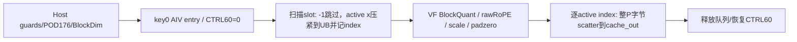
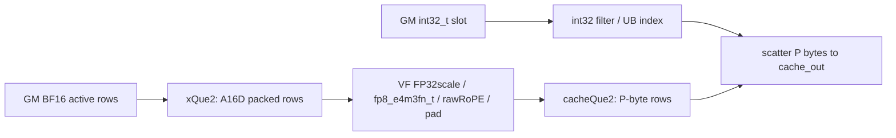

# KvCompressEpilogFP8 950 ACLNN 算子知识

## 算子速览

| 项目 | 内容 |
|---|---|
| 实际入口 | `aclnnSglKvCompressEpilogGetWorkspaceSize/aclnnSglKvCompressEpilog`，冻结quant_mode=1 |
| 计算语义 | BF16 x行前D-64列按128值amax/FP8上限量化，末64列RoPE原始BF16字节保留，FP8值→RoPE→FP32scale→零padding后按slot写原cache |
| 输入输出 | x[N,D]、slot[N] int32/int64、原地FP8 byte carrier cache；slot=-1跳过，返回None |
| 执行类型 | 单AIV_VECTOR/VF，无Cube/MIX或多kernel核心节点 |
| Kernel 路线 | R-001…004为layout1四dtype实例；R-005…008只记录裸ACLNN未拒绝layout其它非2的越合同分支；layout2在Host失败，无成功Device路线 |
| 核心资源 | UB实际=4R A16(D)+2R P+sizeof(U)·A(32/sizeof(U))(R)；Host index预算固定4A8(R)，int64可低估 |
| 来源闭包 | `source_closed`：Host/POD176、key0/dtype、Init/Process/BlockQuant/搬运/SDK pointer和资源/build完整；静态stride/字节位置/窄化限制不等运行复现 |
| 验证状态 | draft，未编译/运行。D非16倍的多有效行UB stride不一致；Q奇数时RoPE字节错位；UnAlign实际读取256B Reg，64BF16仅指针更新步长；slot int64仍窄化int32 |

## 接口与语义

### 计算语义

令Q=D-64、S=ceil(Q/128)、Ccat=Q+128+4S、P=align128(Ccat)。意图合同为每个有效输入行n写cache槽t=slot_mapping[n]：
```text
for each <=128-value group of x[n,0:Q]:
  ordinary finite domain: scale=max(abs(x))/Rmax
  Rmax=448(E4M3FN) or57344(E5M2)
  zero group keeps scale0 and selects original0 if divide result NaN
  q=FP8_CAST_RINT_NO_SAT(x/scale), with actual nonfinite Select sequence
record byte[0:Q] = quantized q
record byte[Q:Q+128] = raw BF16 x[n,Q:D]         #64 BF16 =128B
record byte[Q+128:Q+128+4S] = FP32 scale bytes
record byte[Ccat:P] =0
cache[slot*rowStride : slot*rowStride+P] = record
```

mode1 round_scale_flag和quant_group_size不影响数值；与MX分组/指数算法独立。实际VF使用x*0自比较、masked Abs、两64lane ReduceMax/Max、非零乘1/R、Min(inf)、Div、Select(原值,q,异常mask)，非有限结果不按理想amax公式保证。

此公式是公开意图，当前代码存在限制：CopyIn按A16(D)把有效行压紧，VF却按i*D读行；RoPE输出地址用BF16指针+Q/2，Q奇数时第一行起点为Q-1字节。没有这些必要前提时不能宣称packed字节正确；不自行修源。

### 输入、输出与属性

| 参数 | shape/layout | dtype | 约束、默认值与语义 |
|---|---|---|---|
| cache | layout1按slot分行，可[slots,1,width]；ND byte carrier | FP8 E4M3FN/E5M2 | 同NPU、内层密集、row stride≥P、容量足以所有合法slot |
| x | [N,D]连续ND | BF16 | N/D正；业务RoPE需D≥64，当前Host未检查该下界或D16对齐 |
| slot_mapping | [N]连续 | int32/int64 | 仅-1跳过；Device转换int32，合法槽需非负且可表示；无bounds/重复检查 |
| quant_group_size | int64 | — | mode1忽略，固定128组 |
| quant_mode | int64 | — | 严格1 |
| round_scale_flag | bool | — | mode1忽略 |
| layout | int64 | — | 公开1/2，mode1 layout2失败；raw其它非2未Host拒绝但越合同 |
| block_stride | 原生ACLNN attr | int64字节 | adapter传cache.stride(0)，layout1取正值否则P；raw其它值body忽略stride |
| cache_out | ref输出 | 同cache | adapter/生成ref框架映射原地；Device只写out指针，不读原cache |
| 返回 | None/ACL状态 | — | 未写slot保留旧值，写中slot整P字节覆盖 |

### 入口与版本

已完整阅读并链接[KV写回API](../../../../apis/sgl_kernel_npu/sgl_kv_compress_epilog.md)。固定SGL dda6d36b0cdb4081e102d14c0a2fb276fc416e69，CANN9.1.0为README/CI配置来源；SDK官方v9.1.0固定e5451c7feba11f9e259f4fbc19c4bf82f8c0496c，不保证任意同名二进制等价。公开原生仅950/arch35，与当前mem_cache域CMake3510/生成configs一致，不混旧csrc/kv_compress_epilog。公开“layout2仅MX”在adapter与Host均落实，不能按任务扫描范围构造mode1layout2成功Route。

## Host/Launcher 执行流程

### 参数校验与前处理

adapter检查x二维/正N,D/BF16、slot一维长度N/int32或int64、cache两FP8 dtype；cache四维时要求head维2=1并squeeze(2)视图，不复制。检查mode1/2、layout1/2；mode1 layout2明确TORCH_CHECK失败。算Q/S/Ccat/P，layout1若cache.stride(0)>0要求≥P；DeviceGuard(cache.device)→描述3tensor→query(attrs包括stride0)→Byte workspace≤INT64_MAX→record_stream→RunOpApi。没有实际检查x/slot同NPU、连续或cache内部stride、alias、slot值/容量/唯一性；公开合同不等于代码已查。

原生Host检查context资源、x二维/正维、attrs存在，mode1的layout2直接GRAPH_FAILED。mode1不查quant_group_size，layout其它非2也不拒绝。读取平台AIV核与UB，推R/P/row loops/dtype/POD，memcpy176B，outer key0/blockDim，W库查询+32。InferShape/Type cache_out直接复制input cache形状dtype；generated ref/alias桥接为CANN边界，不补造另一个输出allocation支持。Kernel输入cache pointer不使用，实际写cache_out。

### 参数、Workspace 与生命周期

workspace=WlibQuery+32B，由query真实返回量分配，entry要求非空但Device算法不读。lambda捕获cache视图/x/slot、descriptors/workspace/executor/aclStream；三个tensor/ws record_stream，确保异步owner存活。包内vendor句柄静态保持；描述符shared_ptr销毁和生成executor生命周期是框架边界。无自有GM中间结果或新cache分配；所有写回直接进入cache_out有效storage。

POD176B CANN保活；GET_TILING_DATA为生成SDK tiling本地副本边界，当前共享packed声明/static_assert固定字段与尺寸，不伪造生成后executor/TU或声称编译成功。TPipe分配x/y各两块、index一TBuf，生命周期当前Kernel。index记录压紧行对应slot；同slot多核冲突无atomic/锁，必须由调用方排除或外部串行。

### 启动图与失败传播



blockDim=min(ceil(N/former),AIVcores)，former=ceil(N/AIVcores)。每核连续former行，末核实际tail；无跨核通信。空workspace直接return，unknown key无body并恢复CTRL，dtype非0/1/2默认用int64/E4类。正常Host只产生0…3。同步query/execute失败抛错，异步错误由框架报告，无fallback。全slot=-1时仍走分配/queue/VF调用但validIdx0无有效输出循环。

## Route 与参数设计

### 分核与资源计算

A16(D)为按16元素上取整，A8(R)/A4(R)类似。P由Q/S算起按128字节对齐；mode1 layout1 blockStride=正attr或P，layout其它非2Host仍填该值，但body只有layout1消费它。former/tail由N和实际平台AIV核(至少1)决定。

Host逐R=1…former扫描：`H(R)=4R A16(D)+2R P+4A8(R)`，超过U退1；若R≤0返回失败，无列切分或fallback。随后rowLoop与tailRowFactor分别前/末核推导。实际indexBuf尺寸`I_U(R)=sizeof(U)·A(32/sizeof(U))(R)`：int32为4A8R，int64为8A4R，因此实际Uactual=H+I_U-4A8R，int64 R≥5可能大于Host估算。是否越U需按实际R/U差额验证，不能只由低估宣称部署故障。

xQue每块2R A16(D)B，共2块；yQue每块R P B，共2块；indexBuf一块I_U。没有额外FP32 UB矩阵、L1/L0或GM workspace slice，VF寄存器分配属于compiler primitive边界。函数/数据地址下游int32/uint16转换必须单独看，POD int64不构成全64位保证。

### Route 选择

| 顺序 | Route | Key/模板 | 精确选择条件与优先级 | 不适用去向 |
|---:|---|---|---|---|
| 1 | R-001 | key0/dtype0 | mode1,int32_t/fp8_e5m2_t,layout1 | layout2在Host失败；其它dtype组合对应实例 |
| 2 | R-002 | key0/dtype2 | mode1,int32_t/fp8_e4m3fn_t,layout1 | layout2在Host失败；其它dtype组合对应实例 |
| 3 | R-003 | key0/dtype1 | mode1,int64_t/fp8_e5m2_t,layout1 | layout2在Host失败；其它dtype组合对应实例 |
| 4 | R-004 | key0/dtype3 | mode1,int64_t/fp8_e4m3fn_t,layout1 | layout2在Host失败；其它dtype组合对应实例 |
| 5 | R-005 | key0/dtype0 | mode1,int32_t/fp8_e5m2_t,裸layout!=1且!=2（越公开合同） | layout2在Host失败；其它dtype组合对应实例 |
| 6 | R-006 | key0/dtype2 | mode1,int32_t/fp8_e4m3fn_t,裸layout!=1且!=2（越公开合同） | layout2在Host失败；其它dtype组合对应实例 |
| 7 | R-007 | key0/dtype1 | mode1,int64_t/fp8_e5m2_t,裸layout!=1且!=2（越公开合同） | layout2在Host失败；其它dtype组合对应实例 |
| 8 | R-008 | key0/dtype3 | mode1,int64_t/fp8_e4m3fn_t,裸layout!=1且!=2（越公开合同） | layout2在Host失败；其它dtype组合对应实例 |

```text
mode==1:
  layout==2 -> adapter/Host失败，未启动Device
  layout==1 -> dtype0..3 -> R001..004 -> scatter stride=positive blockStride orP
  raw layout!=1 && !=2 -> dtype0..3 -> R005..008 -> scatter stride=P
  quant_group_size / round_scale inactive
Device each row: int32(slot) == -1 -> skip; else compact -> quant -> scatter
```

### 模板/实现执行矩阵

| Route | key/selector | dtype/shape/platform 完整命中条件 | 执行族与 kernel 节点 | 实际模板/body | 内存与同步特征 | tail/fallback |
|---|---|---|---|---|---|---|
| R-001 | key0/code0/layout1 | 950/mode1,slotint32_t,cachefp8_e5m2_t，公开layout1 | 单AIV_VECTOR | KvCompressEpilogRegBase<BF16,int32_t,fp8_e5m2_t>::Init/Process→VFProcessDynamicBlockQuant | x/y两slot+index4A8R，queue/S_MTE3/VEC_STORE边界 | row/128尾，GM步长blockStride；layout2失败，无算法fallback |
| R-002 | key0/code2/layout1 | 950/mode1,slotint32_t,cachefp8_e4m3fn_t，公开layout1 | 单AIV_VECTOR | KvCompressEpilogRegBase<BF16,int32_t,fp8_e4m3fn_t>::Init/Process→VFProcessDynamicBlockQuant | x/y两slot+index4A8R，queue/S_MTE3/VEC_STORE边界 | row/128尾，GM步长blockStride；layout2失败，无算法fallback |
| R-003 | key0/code1/layout1 | 950/mode1,slotint64_t,cachefp8_e5m2_t，公开layout1 | 单AIV_VECTOR | KvCompressEpilogRegBase<BF16,int64_t,fp8_e5m2_t>::Init/Process→VFProcessDynamicBlockQuant | x/y两slot+index8A4R，queue/S_MTE3/VEC_STORE边界 | row/128尾，GM步长blockStride；layout2失败，无算法fallback |
| R-004 | key0/code3/layout1 | 950/mode1,slotint64_t,cachefp8_e4m3fn_t，公开layout1 | 单AIV_VECTOR | KvCompressEpilogRegBase<BF16,int64_t,fp8_e4m3fn_t>::Init/Process→VFProcessDynamicBlockQuant | x/y两slot+index8A4R，queue/S_MTE3/VEC_STORE边界 | row/128尾，GM步长blockStride；layout2失败，无算法fallback |
| R-005 | key0/code0/layoutother | 950/mode1,slotint32_t,cachefp8_e5m2_t，非法公开layout的raw可达边界 | 单AIV_VECTOR | KvCompressEpilogRegBase<BF16,int32_t,fp8_e5m2_t>::Init/Process→VFProcessDynamicBlockQuant | x/y两slot+index4A8R，queue/S_MTE3/VEC_STORE边界 | row/128尾，GM步长P；layout2失败，无算法fallback |
| R-006 | key0/code2/layoutother | 950/mode1,slotint32_t,cachefp8_e4m3fn_t，非法公开layout的raw可达边界 | 单AIV_VECTOR | KvCompressEpilogRegBase<BF16,int32_t,fp8_e4m3fn_t>::Init/Process→VFProcessDynamicBlockQuant | x/y两slot+index4A8R，queue/S_MTE3/VEC_STORE边界 | row/128尾，GM步长P；layout2失败，无算法fallback |
| R-007 | key0/code1/layoutother | 950/mode1,slotint64_t,cachefp8_e5m2_t，非法公开layout的raw可达边界 | 单AIV_VECTOR | KvCompressEpilogRegBase<BF16,int64_t,fp8_e5m2_t>::Init/Process→VFProcessDynamicBlockQuant | x/y两slot+index8A4R，queue/S_MTE3/VEC_STORE边界 | row/128尾，GM步长P；layout2失败，无算法fallback |
| R-008 | key0/code3/layoutother | 950/mode1,slotint64_t,cachefp8_e4m3fn_t，非法公开layout的raw可达边界 | 单AIV_VECTOR | KvCompressEpilogRegBase<BF16,int64_t,fp8_e4m3fn_t>::Init/Process→VFProcessDynamicBlockQuant | x/y两slot+index8A4R，queue/S_MTE3/VEC_STORE边界 | row/128尾，GM步长P；layout2失败，无算法fallback |

### 隐藏性能 Guard

| Guard | Host/Tiling 条件 | Device/资源原因 | 影响 Route | 不满足时去向 | 源码符号 |
|---|---|---|---|---|---|
| mode1layout2 | layout2且mode!=2 | 分离值/scale仅MX实现 | 全部 | GRAPH_FAILED/TORCH_CHECK，无Device | Host/adapter |
| UB rowfit | H(R)≤U，仅行切分 | 双槽x/y+index预算 | 全部 | 减R/一行不fit失败 | TilingKvCompressEpilog |
| index dtype | Host tmp固定4A8R，实际由U决定 | int64 I=8A4R，预算可低估 | int64 | 无补偿guard | Host/Init(indexBuf) |
| dense D | Host未查D%16 | CopyIn rowstep=A16D，VFrowstep=D | validIdx≥2且D非16倍 | 无fallback，错读静态条件 | Process/VF |
| RoPE byte start | Host未查Q偶数 | BF16输出指针偏移Q/2 | Q奇数 | 起点Q-1字节，不是Q | VF ropeYLocalAddr |
| slot值/alias | 仅int32(slot)==-1跳过 | int64窄化、其它负/超界、重复slot写冲突 | 全部 | 无自有guard/atomic | Process |
| D下界/转换 | 仅D>0，无D≥64 | Q以uint32算、helperint32/loopsuint16 | 全部 | 无统一错误终点保证 | VF/helper |
| rawlayout | Host不拒绝其它非2 | GM忽略blockStride，使用P | R005…008 | 越合同，不作为支持扩域 | Host/CopyOut branch |

### POD/ABI

packed`SglKvCompressEpilogTilingData`有static_assert(sizeof==176)，align1：21个int64 offset0…160，dtype int32 offset168，tilingKey uint32 offset172。字段来自同头Host memcpy与Device GET_TILING_DATA；offsetof为固定声明静态推导，未编译测量。

| 结构 | 字段 | 类型/位宽 | ABI 布局 | 单位 | Host/launcher producer | Device consumer | 边界 |
|---|---|---|---|---|---|---|---|
| SglKvCompressEpilogTilingData | bs | int64 | offset0,size8,structalign1 | 元素/次数 | N | core/row范围 | inactive字段0/原attr仍传递 |
| SglKvCompressEpilogTilingData | d | int64 | offset8,size8,structalign1 | 元素/次数 | D | xDense stride与RoPE位置 | inactive字段0/原attr仍传递 |
| SglKvCompressEpilogTilingData | kvCacheCol | int64 | offset16,size8,structalign1 | 字节 | P=align128(Q+128+4S) | UB输出row/默认GMrowstride | inactive字段0/原attr仍传递 |
| SglKvCompressEpilogTilingData | scaleCol | int64 | offset24,size8,structalign1 | 元素/次数 | S=ceil(Q/128) | FP32scale数量 | inactive字段0/原attr仍传递 |
| SglKvCompressEpilogTilingData | concatCol | int64 | offset32,size8,structalign1 | 字节 | Q+128+4S | pad起点 | inactive字段0/原attr仍传递 |
| SglKvCompressEpilogTilingData | padCol | int64 | offset40,size8,structalign1 | 字节 | P-concatCol | padzero字节 | inactive字段0/原attr仍传递 |
| SglKvCompressEpilogTilingData | quantMode | int64 | offset48,size8,structalign1 | 标志 | 固定1 | 选BlockQuant | inactive字段0/原attr仍传递 |
| SglKvCompressEpilogTilingData | roundScale | int64 | offset56,size8,structalign1 | 标志 | 属性bool转0/1 | mode1 inactive | inactive字段0/原attr仍传递 |
| SglKvCompressEpilogTilingData | perGroupSize | int64 | offset64,size8,structalign1 | 元素/次数 | 任意传入属性 | mode1 inactive，分组固定128 | inactive字段0/原attr仍传递 |
| SglKvCompressEpilogTilingData | rowOfFormerBlock | int64 | offset72,size8,structalign1 | 元素/次数 | ceil(N/AIVcores) | 核起始行 | inactive字段0/原attr仍传递 |
| SglKvCompressEpilogTilingData | rowOfTailBlock | int64 | offset80,size8,structalign1 | 元素/次数 | N-(used-1)former | 末核行 | inactive字段0/原attr仍传递 |
| SglKvCompressEpilogTilingData | rowLoopOfFormerBlock | int64 | offset88,size8,structalign1 | 元素/次数 | ceil(former/R) | 前核循环 | inactive字段0/原attr仍传递 |
| SglKvCompressEpilogTilingData | rowLoopOfTailBlock | int64 | offset96,size8,structalign1 | 元素/次数 | ceil(tail/R) | 末核循环 | inactive字段0/原attr仍传递 |
| SglKvCompressEpilogTilingData | rowFactor | int64 | offset104,size8,structalign1 | 元素/次数 | Host UB预算取R | 队列容量与每轮行数 | inactive字段0/原attr仍传递 |
| SglKvCompressEpilogTilingData | tailRowFactorOfFormerBlock | int64 | offset112,size8,structalign1 | 元素/次数 | former%R或R | 前核末轮行 | inactive字段0/原attr仍传递 |
| SglKvCompressEpilogTilingData | tailRowFactorOfTailBlock | int64 | offset120,size8,structalign1 | 元素/次数 | tail%R或R | 末核末轮行 | inactive字段0/原attr仍传递 |
| SglKvCompressEpilogTilingData | layout | int64 | offset128,size8,structalign1 | 标志 | 属性1或未拒绝的其它非2 | GM rowstride选择；2失败 | inactive字段0/原attr仍传递 |
| SglKvCompressEpilogTilingData | blockSize | int64 | offset136,size8,structalign1 | 元素/次数 | mode1默认0 | inactive | inactive字段0/原attr仍传递 |
| SglKvCompressEpilogTilingData | valuePerToken | int64 | offset144,size8,structalign1 | 字节 | mode1默认0 | inactive | inactive字段0/原attr仍传递 |
| SglKvCompressEpilogTilingData | scalePerToken | int64 | offset152,size8,structalign1 | 字节 | mode1默认0 | inactive | inactive字段0/原attr仍传递 |
| SglKvCompressEpilogTilingData | blockStride | int64 | offset160,size8,structalign1 | 字节 | 正strideAttr否则P | layout1有效，raw其它值不读 | inactive字段0/原attr仍传递 |
| SglKvCompressEpilogTilingData | dtype | int32 | offset168,size4 | bits | bit0 slot64、bit1 E4 | entry四实例 | Host0…3，else默认64/E4 |
| SglKvCompressEpilogTilingData | tilingKey | uint32 | offset172,size4 | key | 固定0 | entry if(key==0) | 非0无body |

Kernel args为cache_in/x/slot/cache_out/workspace/tiling共6 GM_ADDR，cache_in不读，cache_out是实际写指针；generated ref桥接与物理参数ABI为框架边界，不伪填offset。Device curSlotIdx及slot为int32，即使U=int64也强转；validIdx int64传入VF curRowNum uint16，D/P传uint32、helperRoundUp int32，需满足对应可表示域。

### Route 源码闭包

| Route | Key/selector | Host/Tiling producer | POD/参数 | Kernel entry/router | Kernel body/直接依赖 | 构建接线 |
|---|---|---|---|---|---|---|
| R-001 | key0/code0/layout1 | TilingKvCompressEpilog | POD176/Ubytes/rows/P/stride | sgl_kv_compress_epilog | RegBase<BF16,int32_t,fp8_e5m2_t>→BlockQuant/Copy helpers | 当前mem_cache域3510、OpDef/infer/tiling与唯一Kernel源 |
| R-002 | key0/code2/layout1 | TilingKvCompressEpilog | POD176/Ubytes/rows/P/stride | sgl_kv_compress_epilog | RegBase<BF16,int32_t,fp8_e4m3fn_t>→BlockQuant/Copy helpers | 当前mem_cache域3510、OpDef/infer/tiling与唯一Kernel源 |
| R-003 | key0/code1/layout1 | TilingKvCompressEpilog | POD176/Ubytes/rows/P/stride | sgl_kv_compress_epilog | RegBase<BF16,int64_t,fp8_e5m2_t>→BlockQuant/Copy helpers | 当前mem_cache域3510、OpDef/infer/tiling与唯一Kernel源 |
| R-004 | key0/code3/layout1 | TilingKvCompressEpilog | POD176/Ubytes/rows/P/stride | sgl_kv_compress_epilog | RegBase<BF16,int64_t,fp8_e4m3fn_t>→BlockQuant/Copy helpers | 当前mem_cache域3510、OpDef/infer/tiling与唯一Kernel源 |
| R-005 | key0/code0/layoutother | TilingKvCompressEpilog | POD176/Ubytes/rows/P/stride | sgl_kv_compress_epilog | RegBase<BF16,int32_t,fp8_e5m2_t>→BlockQuant/Copy helpers | 当前mem_cache域3510、OpDef/infer/tiling与唯一Kernel源 |
| R-006 | key0/code2/layoutother | TilingKvCompressEpilog | POD176/Ubytes/rows/P/stride | sgl_kv_compress_epilog | RegBase<BF16,int32_t,fp8_e4m3fn_t>→BlockQuant/Copy helpers | 当前mem_cache域3510、OpDef/infer/tiling与唯一Kernel源 |
| R-007 | key0/code1/layoutother | TilingKvCompressEpilog | POD176/Ubytes/rows/P/stride | sgl_kv_compress_epilog | RegBase<BF16,int64_t,fp8_e5m2_t>→BlockQuant/Copy helpers | 当前mem_cache域3510、OpDef/infer/tiling与唯一Kernel源 |
| R-008 | key0/code3/layoutother | TilingKvCompressEpilog | POD176/Ubytes/rows/P/stride | sgl_kv_compress_epilog | RegBase<BF16,int64_t,fp8_e4m3fn_t>→BlockQuant/Copy helpers | 当前mem_cache域3510、OpDef/infer/tiling与唯一Kernel源 |

## Kernel 实现

### 公共执行流程

Init按core*former*D偏移xGM，slotGM从全局0读；xQue双块、cacheQue双块、indexBuf一TBuf。Process取末核与前核rowLoop/tail，row块里validIdx清0，逐原始row读取slot并转int32，恰为-1时跳过不读x；有效时CopyIn 1×D到`xLocal[validIdx*A16(D)]`，SetValue(index[validIdx],slot)，validIdx++，Set/Wait S_MTE3事件。没有把-2或越界slot当skip。x EnQue/DeQue后分配y，mode1进入BlockQuant，无MX分支。

BlockQuant：
两64lane组成128组，前完整左pregMain/rightUpdateMask，loadBF16升FP32、a*0自比较/MaskNot/Abs/ReduceMax→单laneMax→非零乘1/R→Min(inf)；scale通过reinterpretFP8 register的前4字节StoreUnAlign写到每行Q+128位置并flush，连续组每次指针post+4；q=Div，再q*0/Select原值与q，RINT/NO_SAT cast、PACK4_B32写FP8值。若quant列剩不足64，单半reminder分支同样scale/quant逻辑。每行读输入offset为`i*D`，没有用已计算的curColNumAlign=A16D，因此必须说明与压紧stride差异。

LocalMemBar<VEC_STORE,VEC_STORE>之后保留64 BF16 RoPE有效raw bits：ropeX指针+=Q，LoadUnAlign填满256B Reg，其64BF16参数只表示搬运后源指针更新128B，不限制读取长度；ropeY BF16指针+=Q/2，StoreUnAlign实际写64 BF16即128B并flush，随后+=2S+pad/2元素。Q/pad均偶数时每行累计P/2 BF16正确，Q奇数时firststartQ-1，后续步长也少2B。pad byte指针每行+=Ccat，StoreUnAlign zeros pad字节并flush；postupdate后每行累计P。不做Hadamard/旋转、没有激活或FP8量化RoPE。

xFree；y EnQue/DeQue；逐validIdx从index GetValue取int32slot，GM layout1 offset=slot*(blockStride>0?blockStride:P)，raw其他layout offset=slot*P；CopyOut每条P字节，包含量化/原始RoPE/FP32scale/零padding。yFree后下一个row块，无atomic；entry恢复CTRL60。

```text
for each core / rowblock:
  valid=0; xslot=Alloc
  for original row:
    slot32=int32(slotMapping.GetValue(global_row32))
    if slot32==-1: continue
    CopyIn(x[row],xslot[valid*A16(D)],1,D)
    index.SetValue(valid,slot32); valid++; S_MTE3 set/wait
  xqueue enqueue/dequeue; yslot=Alloc
  VFBlockQuant(valid,D):
    for packed row i / group128:
      load x[i*D + columns]           # actual source, not i*A16(D)
      finite scale=amax/Rmax; nonfinite compare/Select; store q/FP32scale
    VEC_STORE barrier
    raw-copy RoPE at output BF16 pointer +Q/2; zero pad bytes
  free x; enqueue/dequeue y
  for i<valid:
    slot32=index.GetValue(i)
    CopyOut(y[i*P],cache_out[slot32*(layout1?stride:P)],1,P)
  free y
```

CopyIn usesDataCopyExtParams(blockCount1,blockLen=2D bytes,srcStride0,dstStride0),DataCopyPadExt isPad=false；UB目的显式A16D stride，不能认为未写gap自动为0。CopyOut blockCount1/blockLenP bytes、stride0 Normal模式。SDK Store/LoadUnAlign pointer参数为引用、默认POST_UPDATE；固定SDK LoadUnAlign合同明确填满256B Reg，postUpdateStride仅更新元素地址，不能将64BF16解释为只读128B。RoPE有效写回128B，而未mask实际读取可触及当前xQue槽之外，对齐缓存还可能读取后续32B边界；不据此推断越整个UB或真机故障。CTRL60=0选择单指令模式，FP8 cast NO_SAT/RINT，不按源码“饱和”注释外推。

### Route R-001：int32_t槽位/fp8_e5m2_t，layout1

#### 适用条件

950/mode1、key0/code0，U=int32_t、cache=fp8_e5m2_t。公开layout1路径，stride≥P、有效slot/容量/alias合同需满足。有效/全skip、前尾核/行、128列尾均由公共body完整覆盖。

##### 选择证据

| 层级 | 文件 | 符号 | 源码谓词/参数 | 结果/下一跳 |
|---|---|---|---|---|
| Host | csrc/mem_cache/kv_compress_epilog/op_host/kv_compress_epilog.cpp | TilingKvCompressEpilog | mode1/layout1，dtype0 | POD176/key0 |
| entry | csrc/mem_cache/kv_compress_epilog/op_kernel/kv_compress_epilog.cpp | dtype分支 | code0 | RegBase<BF16,int32_t,fp8_e5m2_t> |

#### Device 数据流

##### 函数级调用链

```text
SGL pair -> entry(key0/code0)
 -> RegBase<BF16,int32_t,fp8_e5m2_t>::Init/Process
 -> slot32 filter/compact -> VFProcessDynamicBlockQuant<BF16,fp8_e5m2_t>
 -> CopyOut wholeP at slot*rowStride
```

##### 源码等价伪码

使用公共伪码，mapping loadint32_t后仍强转int32，FP8范围57344、RINT/NO_SAT，scale FP32；GM偏移slot*positive blockStride或P。不对非法slot/重复slot补guard，不将Dstride/RoPE奇数缺陷理想化。

#### 内存与数据搬运

##### 资源与搬运表

| 层级/缓冲区 | offset/地址公式 | extent/容量公式 | dtype/layout | producer | consumer | owner/lifetime | 对齐/复用 |
|---|---|---|---|---|---|---|---|
| GM x/slot | x=(core*former+row)*D*2，slot=globalrow*sizeofU | 2ND /4N B | BF16/int32_t连续 | caller | scalar/CopyIn | stream周期 | slot先窄int32，skip不读x |
| GM cache_out | slot*rowStride | 每有效slot P B | fp8_e5m2_t字节carrier | MTE3 | caller | 原cache tensor | 不读取旧cache，未写slot不变 |
| UB xQue | poolbase0，槽步长2R A16D | 双槽4R A16D B | BF16，packed行A16D | MTE2 | VF按iD | 当前row块 | 非D16对齐stride冲突 |
| UB cacheQue | 紧接x双槽，槽步长RP | 双槽2RP B | FP8/RoPE/FP32 bytes | VF | MTE3 | 当前row块 | P128B对齐 |
| UB indexBuf | x+y总extent之后 | 4A8R B | int32_t但实际存slot32值 | Scalar SetValue | Scalar GetValue | 当前row块 | Host预算4A8R |
| Reg/Masks | VF logical | 256B/Reg，真实分配compiler边界 | FP32/rawBF16/FP8 | VF | VF | 单组/行 | 无额外FP32 UB |
| workspace/L1/L0 | ws非空，L1/L0 N/A | W库查询+32B | byte | Host | entry | executor周期 | 算法未读ws，无Cube |

##### 分层内存布局


```block-beta
 columns 1
 X0["xQue: 2 x (2R A16D B)"]
 Y0["cacheQue: 2 x (RP B)"]
 I0["indexBuf: 4A8R B"]
```

##### 字节账与复用顺序

```text
Host H=4R A16D+2RP+4A8R
actual UB=4R A16D+2RP+4A8R
有效GM名义读=4N +2VD；写=VP，V为非-1压紧行总数
无新cache/GM中间结果；W=库查询+32B，算法未读
```

实际内存尺寸与stride不因错误访问而扩大；V应按slot强转后的!= -1判定，合法域内才等原业务active数。名义传输不等实际成功保证。

| 边/复用子区 | producer | offset/extent | dtype/layout | consumer | ordering/sync | owner/lifetime | 安全条件 |
|---|---|---|---|---|---|---|---|
| active压紧 | MTE2 | x[valid*A16D]/2D B | BF16 | VF i*D读取 | xqueue | row块 | D16或只有首行才不触stride差异 |
| slot索引 | Scalar SetValue | index[valid] | int32_t存slot32 | scatter Scalar GetValue | 每有效行S_MTE3 Set/Wait原样保留 | row块 | 不窄化/越slot/重复冲突 |
| packed输出 | VF | y[iP]/P B | q/RoPE/scale/zero | MTE3 | EnQue/DeQue/Free、VEC_STORE barrier | row块 | Q偶数、raw指针poststride、合法capacity |
| cache写回 | MTE3 | slot*rowStride | P bytes | 外部caller | 当前stream/无atomic | caller | 跨核slots唯一或外部序列化 |

#### 同步、精度与尾块

##### 同步与数值边界表

| 阶段 | primitive/机制 | producer | consumer/等待点 | 保护对象 | 精度/尾块 |
|---|---|---|---|---|---|
| slot/x | scalar + S_MTE3 / queue | GetValue/CopyIn | VF/scatter | packed rows/index | -1跳过，int64也转int32 |
| 量化 | Abs/ReduceMax/Div/Select/Cast | BF16→FP32 | packed bytes | 128值组 | scale范围57344、RINT/NO_SAT、非有限不外推 |
| RoPE/pad | LocalMemBar VEC_STORE、UnAlign postupdate/flush | rawBF16/zeros | yCache UB | 同一P行 | 64BF16不变；Q奇数错位 |
| 输出 | queue + DataCopyPad | y UB | cache_out | P B | 前/尾核row实际extent、全skip无store |

#### 关键实现

##### 符号证据表

| 阶段 | 文件 | 符号/模板实例 | 实现事实 |
|---|---|---|---|
| Host/Tiling producer | csrc/mem_cache/kv_compress_epilog/op_host/kv_compress_epilog.cpp | TilingKvCompressEpilog | code0/R/P/stride，layout2失败 |
| Kernel entry/router | csrc/mem_cache/kv_compress_epilog/op_kernel/kv_compress_epilog.cpp | RegBase<BF16,int32_t,fp8_e5m2_t> | key0单AIV |
| Device body/helper | csrc/mem_cache/kv_compress_epilog/op_kernel/kv_compress_epilog_common.h | VFProcessDynamicBlockQuant<BF16,fp8_e5m2_t> | FP32scale/rawRoPE/pad及静态stride边界 |

### Route R-002：int32_t槽位/fp8_e4m3fn_t，layout1

#### 适用条件

950/mode1、key0/code2，U=int32_t、cache=fp8_e4m3fn_t。公开layout1路径，stride≥P、有效slot/容量/alias合同需满足。有效/全skip、前尾核/行、128列尾均由公共body完整覆盖。

##### 选择证据

| 层级 | 文件 | 符号 | 源码谓词/参数 | 结果/下一跳 |
|---|---|---|---|---|
| Host | csrc/mem_cache/kv_compress_epilog/op_host/kv_compress_epilog.cpp | TilingKvCompressEpilog | mode1/layout1，dtype2 | POD176/key0 |
| entry | csrc/mem_cache/kv_compress_epilog/op_kernel/kv_compress_epilog.cpp | dtype分支 | code2 | RegBase<BF16,int32_t,fp8_e4m3fn_t> |

#### Device 数据流

##### 函数级调用链

```text
SGL pair -> entry(key0/code2)
 -> RegBase<BF16,int32_t,fp8_e4m3fn_t>::Init/Process
 -> slot32 filter/compact -> VFProcessDynamicBlockQuant<BF16,fp8_e4m3fn_t>
 -> CopyOut wholeP at slot*rowStride
```

##### 源码等价伪码

使用公共伪码，mapping loadint32_t后仍强转int32，FP8范围448、RINT/NO_SAT，scale FP32；GM偏移slot*positive blockStride或P。不对非法slot/重复slot补guard，不将Dstride/RoPE奇数缺陷理想化。

#### 内存与数据搬运

##### 资源与搬运表

| 层级/缓冲区 | offset/地址公式 | extent/容量公式 | dtype/layout | producer | consumer | owner/lifetime | 对齐/复用 |
|---|---|---|---|---|---|---|---|
| GM x/slot | x=(core*former+row)*D*2，slot=globalrow*sizeofU | 2ND /4N B | BF16/int32_t连续 | caller | scalar/CopyIn | stream周期 | slot先窄int32，skip不读x |
| GM cache_out | slot*rowStride | 每有效slot P B | fp8_e4m3fn_t字节carrier | MTE3 | caller | 原cache tensor | 不读取旧cache，未写slot不变 |
| UB xQue | poolbase0，槽步长2R A16D | 双槽4R A16D B | BF16，packed行A16D | MTE2 | VF按iD | 当前row块 | 非D16对齐stride冲突 |
| UB cacheQue | 紧接x双槽，槽步长RP | 双槽2RP B | FP8/RoPE/FP32 bytes | VF | MTE3 | 当前row块 | P128B对齐 |
| UB indexBuf | x+y总extent之后 | 4A8R B | int32_t但实际存slot32值 | Scalar SetValue | Scalar GetValue | 当前row块 | Host预算4A8R |
| Reg/Masks | VF logical | 256B/Reg，真实分配compiler边界 | FP32/rawBF16/FP8 | VF | VF | 单组/行 | 无额外FP32 UB |
| workspace/L1/L0 | ws非空，L1/L0 N/A | W库查询+32B | byte | Host | entry | executor周期 | 算法未读ws，无Cube |

##### 分层内存布局



```block-beta
 columns 1
 X0["xQue: 2 x (2R A16D B)"]
 Y0["cacheQue: 2 x (RP B)"]
 I0["indexBuf: 4A8R B"]
```

##### 字节账与复用顺序

```text
Host H=4R A16D+2RP+4A8R
actual UB=4R A16D+2RP+4A8R
有效GM名义读=4N +2VD；写=VP，V为非-1压紧行总数
无新cache/GM中间结果；W=库查询+32B，算法未读
```

实际内存尺寸与stride不因错误访问而扩大；V应按slot强转后的!= -1判定，合法域内才等原业务active数。名义传输不等实际成功保证。

| 边/复用子区 | producer | offset/extent | dtype/layout | consumer | ordering/sync | owner/lifetime | 安全条件 |
|---|---|---|---|---|---|---|---|
| active压紧 | MTE2 | x[valid*A16D]/2D B | BF16 | VF i*D读取 | xqueue | row块 | D16或只有首行才不触stride差异 |
| slot索引 | Scalar SetValue | index[valid] | int32_t存slot32 | scatter Scalar GetValue | 每有效行S_MTE3 Set/Wait原样保留 | row块 | 不窄化/越slot/重复冲突 |
| packed输出 | VF | y[iP]/P B | q/RoPE/scale/zero | MTE3 | EnQue/DeQue/Free、VEC_STORE barrier | row块 | Q偶数、raw指针poststride、合法capacity |
| cache写回 | MTE3 | slot*rowStride | P bytes | 外部caller | 当前stream/无atomic | caller | 跨核slots唯一或外部序列化 |

#### 同步、精度与尾块

##### 同步与数值边界表

| 阶段 | primitive/机制 | producer | consumer/等待点 | 保护对象 | 精度/尾块 |
|---|---|---|---|---|---|
| slot/x | scalar + S_MTE3 / queue | GetValue/CopyIn | VF/scatter | packed rows/index | -1跳过，int64也转int32 |
| 量化 | Abs/ReduceMax/Div/Select/Cast | BF16→FP32 | packed bytes | 128值组 | scale范围448、RINT/NO_SAT、非有限不外推 |
| RoPE/pad | LocalMemBar VEC_STORE、UnAlign postupdate/flush | rawBF16/zeros | yCache UB | 同一P行 | 64BF16不变；Q奇数错位 |
| 输出 | queue + DataCopyPad | y UB | cache_out | P B | 前/尾核row实际extent、全skip无store |

#### 关键实现

##### 符号证据表

| 阶段 | 文件 | 符号/模板实例 | 实现事实 |
|---|---|---|---|
| Host/Tiling producer | csrc/mem_cache/kv_compress_epilog/op_host/kv_compress_epilog.cpp | TilingKvCompressEpilog | code2/R/P/stride，layout2失败 |
| Kernel entry/router | csrc/mem_cache/kv_compress_epilog/op_kernel/kv_compress_epilog.cpp | RegBase<BF16,int32_t,fp8_e4m3fn_t> | key0单AIV |
| Device body/helper | csrc/mem_cache/kv_compress_epilog/op_kernel/kv_compress_epilog_common.h | VFProcessDynamicBlockQuant<BF16,fp8_e4m3fn_t> | FP32scale/rawRoPE/pad及静态stride边界 |

### Route R-003：int64_t槽位/fp8_e5m2_t，layout1

#### 适用条件

950/mode1、key0/code1，U=int64_t、cache=fp8_e5m2_t。公开layout1路径，stride≥P、有效slot/容量/alias合同需满足。有效/全skip、前尾核/行、128列尾均由公共body完整覆盖。

##### 选择证据

| 层级 | 文件 | 符号 | 源码谓词/参数 | 结果/下一跳 |
|---|---|---|---|---|
| Host | csrc/mem_cache/kv_compress_epilog/op_host/kv_compress_epilog.cpp | TilingKvCompressEpilog | mode1/layout1，dtype1 | POD176/key0 |
| entry | csrc/mem_cache/kv_compress_epilog/op_kernel/kv_compress_epilog.cpp | dtype分支 | code1 | RegBase<BF16,int64_t,fp8_e5m2_t> |

#### Device 数据流

##### 函数级调用链

```text
SGL pair -> entry(key0/code1)
 -> RegBase<BF16,int64_t,fp8_e5m2_t>::Init/Process
 -> slot32 filter/compact -> VFProcessDynamicBlockQuant<BF16,fp8_e5m2_t>
 -> CopyOut wholeP at slot*rowStride
```

##### 源码等价伪码

使用公共伪码，mapping loadint64_t后仍强转int32，FP8范围57344、RINT/NO_SAT，scale FP32；GM偏移slot*positive blockStride或P。不对非法slot/重复slot补guard，不将Dstride/RoPE奇数缺陷理想化。

#### 内存与数据搬运

##### 资源与搬运表

| 层级/缓冲区 | offset/地址公式 | extent/容量公式 | dtype/layout | producer | consumer | owner/lifetime | 对齐/复用 |
|---|---|---|---|---|---|---|---|
| GM x/slot | x=(core*former+row)*D*2，slot=globalrow*sizeofU | 2ND /8N B | BF16/int64_t连续 | caller | scalar/CopyIn | stream周期 | slot先窄int32，skip不读x |
| GM cache_out | slot*rowStride | 每有效slot P B | fp8_e5m2_t字节carrier | MTE3 | caller | 原cache tensor | 不读取旧cache，未写slot不变 |
| UB xQue | poolbase0，槽步长2R A16D | 双槽4R A16D B | BF16，packed行A16D | MTE2 | VF按iD | 当前row块 | 非D16对齐stride冲突 |
| UB cacheQue | 紧接x双槽，槽步长RP | 双槽2RP B | FP8/RoPE/FP32 bytes | VF | MTE3 | 当前row块 | P128B对齐 |
| UB indexBuf | x+y总extent之后 | 8A4R B | int64_t但实际存slot32值 | Scalar SetValue | Scalar GetValue | 当前row块 | Host预算4A8R可能偏小 |
| Reg/Masks | VF logical | 256B/Reg，真实分配compiler边界 | FP32/rawBF16/FP8 | VF | VF | 单组/行 | 无额外FP32 UB |
| workspace/L1/L0 | ws非空，L1/L0 N/A | W库查询+32B | byte | Host | entry | executor周期 | 算法未读ws，无Cube |

##### 分层内存布局


```block-beta
 columns 1
 X0["xQue: 2 x (2R A16D B)"]
 Y0["cacheQue: 2 x (RP B)"]
 I0["indexBuf: 8A4R B"]
```

##### 字节账与复用顺序

```text
Host H=4R A16D+2RP+4A8R
actual UB=4R A16D+2RP+8A4R
有效GM名义读=8N +2VD；写=VP，V为非-1压紧行总数
无新cache/GM中间结果；W=库查询+32B，算法未读
```

实际内存尺寸与stride不因错误访问而扩大；V应按slot强转后的!= -1判定，合法域内才等原业务active数。名义传输不等实际成功保证。

| 边/复用子区 | producer | offset/extent | dtype/layout | consumer | ordering/sync | owner/lifetime | 安全条件 |
|---|---|---|---|---|---|---|---|
| active压紧 | MTE2 | x[valid*A16D]/2D B | BF16 | VF i*D读取 | xqueue | row块 | D16或只有首行才不触stride差异 |
| slot索引 | Scalar SetValue | index[valid] | int64_t存slot32 | scatter Scalar GetValue | 每有效行S_MTE3 Set/Wait原样保留 | row块 | 不窄化/越slot/重复冲突 |
| packed输出 | VF | y[iP]/P B | q/RoPE/scale/zero | MTE3 | EnQue/DeQue/Free、VEC_STORE barrier | row块 | Q偶数、raw指针poststride、合法capacity |
| cache写回 | MTE3 | slot*rowStride | P bytes | 外部caller | 当前stream/无atomic | caller | 跨核slots唯一或外部序列化 |

#### 同步、精度与尾块

##### 同步与数值边界表

| 阶段 | primitive/机制 | producer | consumer/等待点 | 保护对象 | 精度/尾块 |
|---|---|---|---|---|---|
| slot/x | scalar + S_MTE3 / queue | GetValue/CopyIn | VF/scatter | packed rows/index | -1跳过，int64也转int32 |
| 量化 | Abs/ReduceMax/Div/Select/Cast | BF16→FP32 | packed bytes | 128值组 | scale范围57344、RINT/NO_SAT、非有限不外推 |
| RoPE/pad | LocalMemBar VEC_STORE、UnAlign postupdate/flush | rawBF16/zeros | yCache UB | 同一P行 | 64BF16不变；Q奇数错位 |
| 输出 | queue + DataCopyPad | y UB | cache_out | P B | 前/尾核row实际extent、全skip无store |

#### 关键实现

##### 符号证据表

| 阶段 | 文件 | 符号/模板实例 | 实现事实 |
|---|---|---|---|
| Host/Tiling producer | csrc/mem_cache/kv_compress_epilog/op_host/kv_compress_epilog.cpp | TilingKvCompressEpilog | code1/R/P/stride，layout2失败 |
| Kernel entry/router | csrc/mem_cache/kv_compress_epilog/op_kernel/kv_compress_epilog.cpp | RegBase<BF16,int64_t,fp8_e5m2_t> | key0单AIV |
| Device body/helper | csrc/mem_cache/kv_compress_epilog/op_kernel/kv_compress_epilog_common.h | VFProcessDynamicBlockQuant<BF16,fp8_e5m2_t> | FP32scale/rawRoPE/pad及静态stride边界 |

### Route R-004：int64_t槽位/fp8_e4m3fn_t，layout1

#### 适用条件

950/mode1、key0/code3，U=int64_t、cache=fp8_e4m3fn_t。公开layout1路径，stride≥P、有效slot/容量/alias合同需满足。有效/全skip、前尾核/行、128列尾均由公共body完整覆盖。

##### 选择证据

| 层级 | 文件 | 符号 | 源码谓词/参数 | 结果/下一跳 |
|---|---|---|---|---|
| Host | csrc/mem_cache/kv_compress_epilog/op_host/kv_compress_epilog.cpp | TilingKvCompressEpilog | mode1/layout1，dtype3 | POD176/key0 |
| entry | csrc/mem_cache/kv_compress_epilog/op_kernel/kv_compress_epilog.cpp | dtype分支 | code3 | RegBase<BF16,int64_t,fp8_e4m3fn_t> |

#### Device 数据流

##### 函数级调用链

```text
SGL pair -> entry(key0/code3)
 -> RegBase<BF16,int64_t,fp8_e4m3fn_t>::Init/Process
 -> slot32 filter/compact -> VFProcessDynamicBlockQuant<BF16,fp8_e4m3fn_t>
 -> CopyOut wholeP at slot*rowStride
```

##### 源码等价伪码

使用公共伪码，mapping loadint64_t后仍强转int32，FP8范围448、RINT/NO_SAT，scale FP32；GM偏移slot*positive blockStride或P。不对非法slot/重复slot补guard，不将Dstride/RoPE奇数缺陷理想化。

#### 内存与数据搬运

##### 资源与搬运表

| 层级/缓冲区 | offset/地址公式 | extent/容量公式 | dtype/layout | producer | consumer | owner/lifetime | 对齐/复用 |
|---|---|---|---|---|---|---|---|
| GM x/slot | x=(core*former+row)*D*2，slot=globalrow*sizeofU | 2ND /8N B | BF16/int64_t连续 | caller | scalar/CopyIn | stream周期 | slot先窄int32，skip不读x |
| GM cache_out | slot*rowStride | 每有效slot P B | fp8_e4m3fn_t字节carrier | MTE3 | caller | 原cache tensor | 不读取旧cache，未写slot不变 |
| UB xQue | poolbase0，槽步长2R A16D | 双槽4R A16D B | BF16，packed行A16D | MTE2 | VF按iD | 当前row块 | 非D16对齐stride冲突 |
| UB cacheQue | 紧接x双槽，槽步长RP | 双槽2RP B | FP8/RoPE/FP32 bytes | VF | MTE3 | 当前row块 | P128B对齐 |
| UB indexBuf | x+y总extent之后 | 8A4R B | int64_t但实际存slot32值 | Scalar SetValue | Scalar GetValue | 当前row块 | Host预算4A8R可能偏小 |
| Reg/Masks | VF logical | 256B/Reg，真实分配compiler边界 | FP32/rawBF16/FP8 | VF | VF | 单组/行 | 无额外FP32 UB |
| workspace/L1/L0 | ws非空，L1/L0 N/A | W库查询+32B | byte | Host | entry | executor周期 | 算法未读ws，无Cube |

##### 分层内存布局


```block-beta
 columns 1
 X0["xQue: 2 x (2R A16D B)"]
 Y0["cacheQue: 2 x (RP B)"]
 I0["indexBuf: 8A4R B"]
```

##### 字节账与复用顺序

```text
Host H=4R A16D+2RP+4A8R
actual UB=4R A16D+2RP+8A4R
有效GM名义读=8N +2VD；写=VP，V为非-1压紧行总数
无新cache/GM中间结果；W=库查询+32B，算法未读
```

实际内存尺寸与stride不因错误访问而扩大；V应按slot强转后的!= -1判定，合法域内才等原业务active数。名义传输不等实际成功保证。

| 边/复用子区 | producer | offset/extent | dtype/layout | consumer | ordering/sync | owner/lifetime | 安全条件 |
|---|---|---|---|---|---|---|---|
| active压紧 | MTE2 | x[valid*A16D]/2D B | BF16 | VF i*D读取 | xqueue | row块 | D16或只有首行才不触stride差异 |
| slot索引 | Scalar SetValue | index[valid] | int64_t存slot32 | scatter Scalar GetValue | 每有效行S_MTE3 Set/Wait原样保留 | row块 | 不窄化/越slot/重复冲突 |
| packed输出 | VF | y[iP]/P B | q/RoPE/scale/zero | MTE3 | EnQue/DeQue/Free、VEC_STORE barrier | row块 | Q偶数、raw指针poststride、合法capacity |
| cache写回 | MTE3 | slot*rowStride | P bytes | 外部caller | 当前stream/无atomic | caller | 跨核slots唯一或外部序列化 |

#### 同步、精度与尾块

##### 同步与数值边界表

| 阶段 | primitive/机制 | producer | consumer/等待点 | 保护对象 | 精度/尾块 |
|---|---|---|---|---|---|
| slot/x | scalar + S_MTE3 / queue | GetValue/CopyIn | VF/scatter | packed rows/index | -1跳过，int64也转int32 |
| 量化 | Abs/ReduceMax/Div/Select/Cast | BF16→FP32 | packed bytes | 128值组 | scale范围448、RINT/NO_SAT、非有限不外推 |
| RoPE/pad | LocalMemBar VEC_STORE、UnAlign postupdate/flush | rawBF16/zeros | yCache UB | 同一P行 | 64BF16不变；Q奇数错位 |
| 输出 | queue + DataCopyPad | y UB | cache_out | P B | 前/尾核row实际extent、全skip无store |

#### 关键实现

##### 符号证据表

| 阶段 | 文件 | 符号/模板实例 | 实现事实 |
|---|---|---|---|
| Host/Tiling producer | csrc/mem_cache/kv_compress_epilog/op_host/kv_compress_epilog.cpp | TilingKvCompressEpilog | code3/R/P/stride，layout2失败 |
| Kernel entry/router | csrc/mem_cache/kv_compress_epilog/op_kernel/kv_compress_epilog.cpp | RegBase<BF16,int64_t,fp8_e4m3fn_t> | key0单AIV |
| Device body/helper | csrc/mem_cache/kv_compress_epilog/op_kernel/kv_compress_epilog_common.h | VFProcessDynamicBlockQuant<BF16,fp8_e4m3fn_t> | FP32scale/rawRoPE/pad及静态stride边界 |

### Route R-005：int32_t槽位/fp8_e5m2_t，raw其它layout边界

#### 适用条件

950/mode1、key0/code0，U=int32_t、cache=fp8_e5m2_t。仅裸ACLNN layout!=1且!=2未被Host拒绝的越公开合同路径，不能当支持扩展。有效/全skip、前尾核/行、128列尾均由公共body完整覆盖。

##### 选择证据

| 层级 | 文件 | 符号 | 源码谓词/参数 | 结果/下一跳 |
|---|---|---|---|---|
| Host | csrc/mem_cache/kv_compress_epilog/op_host/kv_compress_epilog.cpp | TilingKvCompressEpilog | mode1/layout!=1&&!=2，dtype0 | POD176/key0 |
| entry | csrc/mem_cache/kv_compress_epilog/op_kernel/kv_compress_epilog.cpp | dtype分支 | code0 | RegBase<BF16,int32_t,fp8_e5m2_t> |

#### Device 数据流

##### 函数级调用链

```text
SGL pair -> entry(key0/code0)
 -> RegBase<BF16,int32_t,fp8_e5m2_t>::Init/Process
 -> slot32 filter/compact -> VFProcessDynamicBlockQuant<BF16,fp8_e5m2_t>
 -> CopyOut wholeP at slot*P
```

##### 源码等价伪码

使用公共伪码，mapping loadint32_t后仍强转int32，FP8范围57344、RINT/NO_SAT，scale FP32；GM偏移固定slot*P，忽略POD正blockStride。不对非法slot/重复slot补guard，不将Dstride/RoPE奇数缺陷理想化。

#### 内存与数据搬运

##### 资源与搬运表

| 层级/缓冲区 | offset/地址公式 | extent/容量公式 | dtype/layout | producer | consumer | owner/lifetime | 对齐/复用 |
|---|---|---|---|---|---|---|---|
| GM x/slot | x=(core*former+row)*D*2，slot=globalrow*sizeofU | 2ND /4N B | BF16/int32_t连续 | caller | scalar/CopyIn | stream周期 | slot先窄int32，skip不读x |
| GM cache_out | slot*P | 每有效slot P B | fp8_e5m2_t字节carrier | MTE3 | caller | 原cache tensor | 不读取旧cache，未写slot不变 |
| UB xQue | poolbase0，槽步长2R A16D | 双槽4R A16D B | BF16，packed行A16D | MTE2 | VF按iD | 当前row块 | 非D16对齐stride冲突 |
| UB cacheQue | 紧接x双槽，槽步长RP | 双槽2RP B | FP8/RoPE/FP32 bytes | VF | MTE3 | 当前row块 | P128B对齐 |
| UB indexBuf | x+y总extent之后 | 4A8R B | int32_t但实际存slot32值 | Scalar SetValue | Scalar GetValue | 当前row块 | Host预算4A8R |
| Reg/Masks | VF logical | 256B/Reg，真实分配compiler边界 | FP32/rawBF16/FP8 | VF | VF | 单组/行 | 无额外FP32 UB |
| workspace/L1/L0 | ws非空，L1/L0 N/A | W库查询+32B | byte | Host | entry | executor周期 | 算法未读ws，无Cube |

##### 分层内存布局


```block-beta
 columns 1
 X0["xQue: 2 x (2R A16D B)"]
 Y0["cacheQue: 2 x (RP B)"]
 I0["indexBuf: 4A8R B"]
```

##### 字节账与复用顺序

```text
Host H=4R A16D+2RP+4A8R
actual UB=4R A16D+2RP+4A8R
有效GM名义读=4N +2VD；写=VP，V为非-1压紧行总数
无新cache/GM中间结果；W=库查询+32B，算法未读
```

实际内存尺寸与stride不因错误访问而扩大；V应按slot强转后的!= -1判定，合法域内才等原业务active数。名义传输不等实际成功保证。

| 边/复用子区 | producer | offset/extent | dtype/layout | consumer | ordering/sync | owner/lifetime | 安全条件 |
|---|---|---|---|---|---|---|---|
| active压紧 | MTE2 | x[valid*A16D]/2D B | BF16 | VF i*D读取 | xqueue | row块 | D16或只有首行才不触stride差异 |
| slot索引 | Scalar SetValue | index[valid] | int32_t存slot32 | scatter Scalar GetValue | 每有效行S_MTE3 Set/Wait原样保留 | row块 | 不窄化/越slot/重复冲突 |
| packed输出 | VF | y[iP]/P B | q/RoPE/scale/zero | MTE3 | EnQue/DeQue/Free、VEC_STORE barrier | row块 | Q偶数、raw指针poststride、合法capacity |
| cache写回 | MTE3 | slot*P | P bytes | 外部caller | 当前stream/无atomic | caller | 跨核slots唯一或外部序列化 |

#### 同步、精度与尾块

##### 同步与数值边界表

| 阶段 | primitive/机制 | producer | consumer/等待点 | 保护对象 | 精度/尾块 |
|---|---|---|---|---|---|
| slot/x | scalar + S_MTE3 / queue | GetValue/CopyIn | VF/scatter | packed rows/index | -1跳过，int64也转int32 |
| 量化 | Abs/ReduceMax/Div/Select/Cast | BF16→FP32 | packed bytes | 128值组 | scale范围57344、RINT/NO_SAT、非有限不外推 |
| RoPE/pad | LocalMemBar VEC_STORE、UnAlign postupdate/flush | rawBF16/zeros | yCache UB | 同一P行 | 64BF16不变；Q奇数错位 |
| 输出 | queue + DataCopyPad | y UB | cache_out | P B | 前/尾核row实际extent、全skip无store |

#### 关键实现

##### 符号证据表

| 阶段 | 文件 | 符号/模板实例 | 实现事实 |
|---|---|---|---|
| Host/Tiling producer | csrc/mem_cache/kv_compress_epilog/op_host/kv_compress_epilog.cpp | TilingKvCompressEpilog | code0/R/P/stride，layout2失败 |
| Kernel entry/router | csrc/mem_cache/kv_compress_epilog/op_kernel/kv_compress_epilog.cpp | RegBase<BF16,int32_t,fp8_e5m2_t> | key0单AIV |
| Device body/helper | csrc/mem_cache/kv_compress_epilog/op_kernel/kv_compress_epilog_common.h | VFProcessDynamicBlockQuant<BF16,fp8_e5m2_t> | FP32scale/rawRoPE/pad及静态stride边界 |

### Route R-006：int32_t槽位/fp8_e4m3fn_t，raw其它layout边界

#### 适用条件

950/mode1、key0/code2，U=int32_t、cache=fp8_e4m3fn_t。仅裸ACLNN layout!=1且!=2未被Host拒绝的越公开合同路径，不能当支持扩展。有效/全skip、前尾核/行、128列尾均由公共body完整覆盖。

##### 选择证据

| 层级 | 文件 | 符号 | 源码谓词/参数 | 结果/下一跳 |
|---|---|---|---|---|
| Host | csrc/mem_cache/kv_compress_epilog/op_host/kv_compress_epilog.cpp | TilingKvCompressEpilog | mode1/layout!=1&&!=2，dtype2 | POD176/key0 |
| entry | csrc/mem_cache/kv_compress_epilog/op_kernel/kv_compress_epilog.cpp | dtype分支 | code2 | RegBase<BF16,int32_t,fp8_e4m3fn_t> |

#### Device 数据流

##### 函数级调用链

```text
SGL pair -> entry(key0/code2)
 -> RegBase<BF16,int32_t,fp8_e4m3fn_t>::Init/Process
 -> slot32 filter/compact -> VFProcessDynamicBlockQuant<BF16,fp8_e4m3fn_t>
 -> CopyOut wholeP at slot*P
```

##### 源码等价伪码

使用公共伪码，mapping loadint32_t后仍强转int32，FP8范围448、RINT/NO_SAT，scale FP32；GM偏移固定slot*P，忽略POD正blockStride。不对非法slot/重复slot补guard，不将Dstride/RoPE奇数缺陷理想化。

#### 内存与数据搬运

##### 资源与搬运表

| 层级/缓冲区 | offset/地址公式 | extent/容量公式 | dtype/layout | producer | consumer | owner/lifetime | 对齐/复用 |
|---|---|---|---|---|---|---|---|
| GM x/slot | x=(core*former+row)*D*2，slot=globalrow*sizeofU | 2ND /4N B | BF16/int32_t连续 | caller | scalar/CopyIn | stream周期 | slot先窄int32，skip不读x |
| GM cache_out | slot*P | 每有效slot P B | fp8_e4m3fn_t字节carrier | MTE3 | caller | 原cache tensor | 不读取旧cache，未写slot不变 |
| UB xQue | poolbase0，槽步长2R A16D | 双槽4R A16D B | BF16，packed行A16D | MTE2 | VF按iD | 当前row块 | 非D16对齐stride冲突 |
| UB cacheQue | 紧接x双槽，槽步长RP | 双槽2RP B | FP8/RoPE/FP32 bytes | VF | MTE3 | 当前row块 | P128B对齐 |
| UB indexBuf | x+y总extent之后 | 4A8R B | int32_t但实际存slot32值 | Scalar SetValue | Scalar GetValue | 当前row块 | Host预算4A8R |
| Reg/Masks | VF logical | 256B/Reg，真实分配compiler边界 | FP32/rawBF16/FP8 | VF | VF | 单组/行 | 无额外FP32 UB |
| workspace/L1/L0 | ws非空，L1/L0 N/A | W库查询+32B | byte | Host | entry | executor周期 | 算法未读ws，无Cube |

##### 分层内存布局


```block-beta
 columns 1
 X0["xQue: 2 x (2R A16D B)"]
 Y0["cacheQue: 2 x (RP B)"]
 I0["indexBuf: 4A8R B"]
```

##### 字节账与复用顺序

```text
Host H=4R A16D+2RP+4A8R
actual UB=4R A16D+2RP+4A8R
有效GM名义读=4N +2VD；写=VP，V为非-1压紧行总数
无新cache/GM中间结果；W=库查询+32B，算法未读
```

实际内存尺寸与stride不因错误访问而扩大；V应按slot强转后的!= -1判定，合法域内才等原业务active数。名义传输不等实际成功保证。

| 边/复用子区 | producer | offset/extent | dtype/layout | consumer | ordering/sync | owner/lifetime | 安全条件 |
|---|---|---|---|---|---|---|---|
| active压紧 | MTE2 | x[valid*A16D]/2D B | BF16 | VF i*D读取 | xqueue | row块 | D16或只有首行才不触stride差异 |
| slot索引 | Scalar SetValue | index[valid] | int32_t存slot32 | scatter Scalar GetValue | 每有效行S_MTE3 Set/Wait原样保留 | row块 | 不窄化/越slot/重复冲突 |
| packed输出 | VF | y[iP]/P B | q/RoPE/scale/zero | MTE3 | EnQue/DeQue/Free、VEC_STORE barrier | row块 | Q偶数、raw指针poststride、合法capacity |
| cache写回 | MTE3 | slot*P | P bytes | 外部caller | 当前stream/无atomic | caller | 跨核slots唯一或外部序列化 |

#### 同步、精度与尾块

##### 同步与数值边界表

| 阶段 | primitive/机制 | producer | consumer/等待点 | 保护对象 | 精度/尾块 |
|---|---|---|---|---|---|
| slot/x | scalar + S_MTE3 / queue | GetValue/CopyIn | VF/scatter | packed rows/index | -1跳过，int64也转int32 |
| 量化 | Abs/ReduceMax/Div/Select/Cast | BF16→FP32 | packed bytes | 128值组 | scale范围448、RINT/NO_SAT、非有限不外推 |
| RoPE/pad | LocalMemBar VEC_STORE、UnAlign postupdate/flush | rawBF16/zeros | yCache UB | 同一P行 | 64BF16不变；Q奇数错位 |
| 输出 | queue + DataCopyPad | y UB | cache_out | P B | 前/尾核row实际extent、全skip无store |

#### 关键实现

##### 符号证据表

| 阶段 | 文件 | 符号/模板实例 | 实现事实 |
|---|---|---|---|
| Host/Tiling producer | csrc/mem_cache/kv_compress_epilog/op_host/kv_compress_epilog.cpp | TilingKvCompressEpilog | code2/R/P/stride，layout2失败 |
| Kernel entry/router | csrc/mem_cache/kv_compress_epilog/op_kernel/kv_compress_epilog.cpp | RegBase<BF16,int32_t,fp8_e4m3fn_t> | key0单AIV |
| Device body/helper | csrc/mem_cache/kv_compress_epilog/op_kernel/kv_compress_epilog_common.h | VFProcessDynamicBlockQuant<BF16,fp8_e4m3fn_t> | FP32scale/rawRoPE/pad及静态stride边界 |

### Route R-007：int64_t槽位/fp8_e5m2_t，raw其它layout边界

#### 适用条件

950/mode1、key0/code1，U=int64_t、cache=fp8_e5m2_t。仅裸ACLNN layout!=1且!=2未被Host拒绝的越公开合同路径，不能当支持扩展。有效/全skip、前尾核/行、128列尾均由公共body完整覆盖。

##### 选择证据

| 层级 | 文件 | 符号 | 源码谓词/参数 | 结果/下一跳 |
|---|---|---|---|---|
| Host | csrc/mem_cache/kv_compress_epilog/op_host/kv_compress_epilog.cpp | TilingKvCompressEpilog | mode1/layout!=1&&!=2，dtype1 | POD176/key0 |
| entry | csrc/mem_cache/kv_compress_epilog/op_kernel/kv_compress_epilog.cpp | dtype分支 | code1 | RegBase<BF16,int64_t,fp8_e5m2_t> |

#### Device 数据流

##### 函数级调用链

```text
SGL pair -> entry(key0/code1)
 -> RegBase<BF16,int64_t,fp8_e5m2_t>::Init/Process
 -> slot32 filter/compact -> VFProcessDynamicBlockQuant<BF16,fp8_e5m2_t>
 -> CopyOut wholeP at slot*P
```

##### 源码等价伪码

使用公共伪码，mapping loadint64_t后仍强转int32，FP8范围57344、RINT/NO_SAT，scale FP32；GM偏移固定slot*P，忽略POD正blockStride。不对非法slot/重复slot补guard，不将Dstride/RoPE奇数缺陷理想化。

#### 内存与数据搬运

##### 资源与搬运表

| 层级/缓冲区 | offset/地址公式 | extent/容量公式 | dtype/layout | producer | consumer | owner/lifetime | 对齐/复用 |
|---|---|---|---|---|---|---|---|
| GM x/slot | x=(core*former+row)*D*2，slot=globalrow*sizeofU | 2ND /8N B | BF16/int64_t连续 | caller | scalar/CopyIn | stream周期 | slot先窄int32，skip不读x |
| GM cache_out | slot*P | 每有效slot P B | fp8_e5m2_t字节carrier | MTE3 | caller | 原cache tensor | 不读取旧cache，未写slot不变 |
| UB xQue | poolbase0，槽步长2R A16D | 双槽4R A16D B | BF16，packed行A16D | MTE2 | VF按iD | 当前row块 | 非D16对齐stride冲突 |
| UB cacheQue | 紧接x双槽，槽步长RP | 双槽2RP B | FP8/RoPE/FP32 bytes | VF | MTE3 | 当前row块 | P128B对齐 |
| UB indexBuf | x+y总extent之后 | 8A4R B | int64_t但实际存slot32值 | Scalar SetValue | Scalar GetValue | 当前row块 | Host预算4A8R可能偏小 |
| Reg/Masks | VF logical | 256B/Reg，真实分配compiler边界 | FP32/rawBF16/FP8 | VF | VF | 单组/行 | 无额外FP32 UB |
| workspace/L1/L0 | ws非空，L1/L0 N/A | W库查询+32B | byte | Host | entry | executor周期 | 算法未读ws，无Cube |

##### 分层内存布局


```block-beta
 columns 1
 X0["xQue: 2 x (2R A16D B)"]
 Y0["cacheQue: 2 x (RP B)"]
 I0["indexBuf: 8A4R B"]
```

##### 字节账与复用顺序

```text
Host H=4R A16D+2RP+4A8R
actual UB=4R A16D+2RP+8A4R
有效GM名义读=8N +2VD；写=VP，V为非-1压紧行总数
无新cache/GM中间结果；W=库查询+32B，算法未读
```

实际内存尺寸与stride不因错误访问而扩大；V应按slot强转后的!= -1判定，合法域内才等原业务active数。名义传输不等实际成功保证。

| 边/复用子区 | producer | offset/extent | dtype/layout | consumer | ordering/sync | owner/lifetime | 安全条件 |
|---|---|---|---|---|---|---|---|
| active压紧 | MTE2 | x[valid*A16D]/2D B | BF16 | VF i*D读取 | xqueue | row块 | D16或只有首行才不触stride差异 |
| slot索引 | Scalar SetValue | index[valid] | int64_t存slot32 | scatter Scalar GetValue | 每有效行S_MTE3 Set/Wait原样保留 | row块 | 不窄化/越slot/重复冲突 |
| packed输出 | VF | y[iP]/P B | q/RoPE/scale/zero | MTE3 | EnQue/DeQue/Free、VEC_STORE barrier | row块 | Q偶数、raw指针poststride、合法capacity |
| cache写回 | MTE3 | slot*P | P bytes | 外部caller | 当前stream/无atomic | caller | 跨核slots唯一或外部序列化 |

#### 同步、精度与尾块

##### 同步与数值边界表

| 阶段 | primitive/机制 | producer | consumer/等待点 | 保护对象 | 精度/尾块 |
|---|---|---|---|---|---|
| slot/x | scalar + S_MTE3 / queue | GetValue/CopyIn | VF/scatter | packed rows/index | -1跳过，int64也转int32 |
| 量化 | Abs/ReduceMax/Div/Select/Cast | BF16→FP32 | packed bytes | 128值组 | scale范围57344、RINT/NO_SAT、非有限不外推 |
| RoPE/pad | LocalMemBar VEC_STORE、UnAlign postupdate/flush | rawBF16/zeros | yCache UB | 同一P行 | 64BF16不变；Q奇数错位 |
| 输出 | queue + DataCopyPad | y UB | cache_out | P B | 前/尾核row实际extent、全skip无store |

#### 关键实现

##### 符号证据表

| 阶段 | 文件 | 符号/模板实例 | 实现事实 |
|---|---|---|---|
| Host/Tiling producer | csrc/mem_cache/kv_compress_epilog/op_host/kv_compress_epilog.cpp | TilingKvCompressEpilog | code1/R/P/stride，layout2失败 |
| Kernel entry/router | csrc/mem_cache/kv_compress_epilog/op_kernel/kv_compress_epilog.cpp | RegBase<BF16,int64_t,fp8_e5m2_t> | key0单AIV |
| Device body/helper | csrc/mem_cache/kv_compress_epilog/op_kernel/kv_compress_epilog_common.h | VFProcessDynamicBlockQuant<BF16,fp8_e5m2_t> | FP32scale/rawRoPE/pad及静态stride边界 |

### Route R-008：int64_t槽位/fp8_e4m3fn_t，raw其它layout边界

#### 适用条件

950/mode1、key0/code3，U=int64_t、cache=fp8_e4m3fn_t。仅裸ACLNN layout!=1且!=2未被Host拒绝的越公开合同路径，不能当支持扩展。有效/全skip、前尾核/行、128列尾均由公共body完整覆盖。

##### 选择证据

| 层级 | 文件 | 符号 | 源码谓词/参数 | 结果/下一跳 |
|---|---|---|---|---|
| Host | csrc/mem_cache/kv_compress_epilog/op_host/kv_compress_epilog.cpp | TilingKvCompressEpilog | mode1/layout!=1&&!=2，dtype3 | POD176/key0 |
| entry | csrc/mem_cache/kv_compress_epilog/op_kernel/kv_compress_epilog.cpp | dtype分支 | code3 | RegBase<BF16,int64_t,fp8_e4m3fn_t> |

#### Device 数据流

##### 函数级调用链

```text
SGL pair -> entry(key0/code3)
 -> RegBase<BF16,int64_t,fp8_e4m3fn_t>::Init/Process
 -> slot32 filter/compact -> VFProcessDynamicBlockQuant<BF16,fp8_e4m3fn_t>
 -> CopyOut wholeP at slot*P
```

##### 源码等价伪码

使用公共伪码，mapping loadint64_t后仍强转int32，FP8范围448、RINT/NO_SAT，scale FP32；GM偏移固定slot*P，忽略POD正blockStride。不对非法slot/重复slot补guard，不将Dstride/RoPE奇数缺陷理想化。

#### 内存与数据搬运

##### 资源与搬运表

| 层级/缓冲区 | offset/地址公式 | extent/容量公式 | dtype/layout | producer | consumer | owner/lifetime | 对齐/复用 |
|---|---|---|---|---|---|---|---|
| GM x/slot | x=(core*former+row)*D*2，slot=globalrow*sizeofU | 2ND /8N B | BF16/int64_t连续 | caller | scalar/CopyIn | stream周期 | slot先窄int32，skip不读x |
| GM cache_out | slot*P | 每有效slot P B | fp8_e4m3fn_t字节carrier | MTE3 | caller | 原cache tensor | 不读取旧cache，未写slot不变 |
| UB xQue | poolbase0，槽步长2R A16D | 双槽4R A16D B | BF16，packed行A16D | MTE2 | VF按iD | 当前row块 | 非D16对齐stride冲突 |
| UB cacheQue | 紧接x双槽，槽步长RP | 双槽2RP B | FP8/RoPE/FP32 bytes | VF | MTE3 | 当前row块 | P128B对齐 |
| UB indexBuf | x+y总extent之后 | 8A4R B | int64_t但实际存slot32值 | Scalar SetValue | Scalar GetValue | 当前row块 | Host预算4A8R可能偏小 |
| Reg/Masks | VF logical | 256B/Reg，真实分配compiler边界 | FP32/rawBF16/FP8 | VF | VF | 单组/行 | 无额外FP32 UB |
| workspace/L1/L0 | ws非空，L1/L0 N/A | W库查询+32B | byte | Host | entry | executor周期 | 算法未读ws，无Cube |

##### 分层内存布局


```block-beta
 columns 1
 X0["xQue: 2 x (2R A16D B)"]
 Y0["cacheQue: 2 x (RP B)"]
 I0["indexBuf: 8A4R B"]
```

##### 字节账与复用顺序

```text
Host H=4R A16D+2RP+4A8R
actual UB=4R A16D+2RP+8A4R
有效GM名义读=8N +2VD；写=VP，V为非-1压紧行总数
无新cache/GM中间结果；W=库查询+32B，算法未读
```

实际内存尺寸与stride不因错误访问而扩大；V应按slot强转后的!= -1判定，合法域内才等原业务active数。名义传输不等实际成功保证。

| 边/复用子区 | producer | offset/extent | dtype/layout | consumer | ordering/sync | owner/lifetime | 安全条件 |
|---|---|---|---|---|---|---|---|
| active压紧 | MTE2 | x[valid*A16D]/2D B | BF16 | VF i*D读取 | xqueue | row块 | D16或只有首行才不触stride差异 |
| slot索引 | Scalar SetValue | index[valid] | int64_t存slot32 | scatter Scalar GetValue | 每有效行S_MTE3 Set/Wait原样保留 | row块 | 不窄化/越slot/重复冲突 |
| packed输出 | VF | y[iP]/P B | q/RoPE/scale/zero | MTE3 | EnQue/DeQue/Free、VEC_STORE barrier | row块 | Q偶数、raw指针poststride、合法capacity |
| cache写回 | MTE3 | slot*P | P bytes | 外部caller | 当前stream/无atomic | caller | 跨核slots唯一或外部序列化 |

#### 同步、精度与尾块

##### 同步与数值边界表

| 阶段 | primitive/机制 | producer | consumer/等待点 | 保护对象 | 精度/尾块 |
|---|---|---|---|---|---|
| slot/x | scalar + S_MTE3 / queue | GetValue/CopyIn | VF/scatter | packed rows/index | -1跳过，int64也转int32 |
| 量化 | Abs/ReduceMax/Div/Select/Cast | BF16→FP32 | packed bytes | 128值组 | scale范围448、RINT/NO_SAT、非有限不外推 |
| RoPE/pad | LocalMemBar VEC_STORE、UnAlign postupdate/flush | rawBF16/zeros | yCache UB | 同一P行 | 64BF16不变；Q奇数错位 |
| 输出 | queue + DataCopyPad | y UB | cache_out | P B | 前/尾核row实际extent、全skip无store |

#### 关键实现

##### 符号证据表

| 阶段 | 文件 | 符号/模板实例 | 实现事实 |
|---|---|---|---|
| Host/Tiling producer | csrc/mem_cache/kv_compress_epilog/op_host/kv_compress_epilog.cpp | TilingKvCompressEpilog | code3/R/P/stride，layout2失败 |
| Kernel entry/router | csrc/mem_cache/kv_compress_epilog/op_kernel/kv_compress_epilog.cpp | RegBase<BF16,int64_t,fp8_e4m3fn_t> | key0单AIV |
| Device body/helper | csrc/mem_cache/kv_compress_epilog/op_kernel/kv_compress_epilog_common.h | VFProcessDynamicBlockQuant<BF16,fp8_e4m3fn_t> | FP32scale/rawRoPE/pad及静态stride边界 |

## 算子特定优化

### Trick T-001：先跳过无效槽位再压紧UB输入

#### 触发与源码依据

全部Route，row块内slot强转int32后为-1时跳过。Golden来源：[固定源码105–114行](https://github.com/sgl-project/sgl-kernel-npu/blob/dda6d36b0cdb4081e102d14c0a2fb276fc416e69/csrc/mem_cache/kv_compress_epilog/op_kernel/kv_compress_epilog.h#L105-L114)。

```cpp
            int32_t curSlotIdx =
                GetBlockIdx() * tilingData->rowOfFormerBlock + rowOuterIdx * tilingData->rowFactor + rowInnerIdx;
            int32_t slot = static_cast<int32_t>(slotMappingGm.GetValue(curSlotIdx));
            if (slot == -1) {
                continue;
            }
            CopyIn(xGm[rowOuterIdx * tilingData->rowFactor * tilingData->d + rowInnerIdx * tilingData->d],
                   xLocal[validIdx * RoundUp<T0>(tilingData->d)], 1, tilingData->d);
            indexLocal.SetValue(validIdx, slot);
            validIdx++;
```

#### 机制与设计原因

每块只为有效行CopyIn并记录slot，VF处理validIdx行、scatter仅遍历该前缀，不为-1行搬输入或量化。全skip仍有队列/调用开销但没有有效读x/写cache。压紧索引使用TBuf保留当前块内目标，不需要GM中间表或原子。

#### 迁移边界

必须同时保留原始row读取与packed validIdx的两种stride、index生命周期及S_MTE3。现源VF使用D而packed stride是A16D，D非16倍时此优化对应布局未闭合到正确数学，不推荐直接安全复用。未执行编译、真机、数值或性能测试。

#### 错误做法

把rowInnerIdx当packed输出位置会让skip产生洞；反过来删掉index记录会失去原始slot对应。固定仓未提供运行反例。

### Trick T-002：在同一UB行中保留RoPE原始字节并补零打包

#### 触发与源码依据

mode1所有有效行；Golden来源：[固定源码245–264行](https://github.com/sgl-project/sgl-kernel-npu/blob/dda6d36b0cdb4081e102d14c0a2fb276fc416e69/csrc/mem_cache/kv_compress_epilog/op_kernel/kv_compress_epilog_common.h#L245-L264)。

```cpp
            }
            LocalMemBar<MemType::VEC_STORE, MemType::VEC_STORE>();
            // cat rope
            ropeXLocalAddr = ropeXLocalAddr + quantColNum;
            ropeYLocalAddr = ropeYLocalAddr + quantColNum / 2;

            LoadUnAlignPre(ureg0, ropeXLocalAddr);
            LoadUnAlign(ropeReg, ureg0, ropeXLocalAddr, 64);
            StoreUnAlign(ropeYLocalAddr, ropeReg, ureg1, 64);
            StoreUnAlignPost(ropeYLocalAddr, ureg1, 0);

            // pad zero
            padLocalAddr = padLocalAddr + concatColNum;
            StoreUnAlign(padLocalAddr, (RegTensor<T1> &)zeros, ureg1, padColNum);
            StoreUnAlignPost(padLocalAddr, ureg1, 0);

            ropeYLocalAddr = ropeYLocalAddr + scaleColNum * 2 + padColNum / 2;
        }
    }
}
```

#### 机制与设计原因

量化值/FP32scale先写入packed行，再通过rawBF16 UnAlign搬运64列RoPE、尾部补0，整P字节一次CopyOut，不创建分开的GM RoPE/scale结果。VEC_STORE barrier与UnAlign flush保留真实写顺序。原源用Q/2的BF16字节映射，只有Q偶数时才等意图Q字节起点。

#### 迁移边界

FP8字节carrier、BF16原始128B、FP32scale各4B、P128B对齐。Q奇数的错位必须保留为静态限制，不能在知识中自行把地址改Q。未执行编译、真机、数值或性能测试。

#### 错误做法

把整个cache按FP8数值解释RoPE/scale会破坏byte contract；mode1顺序也不能换成MX的RoPE在前布局。

## 模板与实现对比

| 对比维度 | int32 mapping Routes | int64 mapping Routes | 设计选择依据 |
|---|---|---|---|
| 命中条件/优先级 | dtype bit0=0 | bit0=1 | 与两FP8目标及layout分支组合 |
| 执行族/节点图 | 单AIV | 同左 | 所有核心own VF |
| M/N/K、tile 与 scheduler | 连续行分核/R行块 | 同左 | Host无列切分 |
| workspace/L1/L0/UB | index4A8R匹配Host | index8A4R可能超Host估算 | 模板U实际sizeof |
| AIC/AIV 或 kernel 交接 | 无 | 无 | 同核queue/Scalar |
| 同步、精度与 tail | 32位slot | load64后仍强转32位slot | -1与范围必须按真实转换判断 |
| fallback/失败边界 | Dstride/Q奇数/slot冲突 | 另有narrow/index预算 | source_closed≠安全正确 |

## 平台差异

| 项目 | A2 | A3 | Ascend 950 |
|---|---|---|---|
| 支持状态 | 公开原生不支持 | 同左 | arch35支持/3510构建 |
| Host/Launcher | 不扩展 | 不扩展 | SGL ACLNN/currentstream |
| Kernel/资源 | 不外推 | 不外推 | AIV Reg、TPipe/U查询 |
| 本次验证 | 未执行 | 未执行 | 未执行，draft |

## 限制与失败边界

- RoPE有效部分128B与LoadUnAlign实际读取范围不同：固定SDK一次填256B Reg，64BF16仅为源指针更新步长，源侧无loadmask，对齐缓存还可能读取后续32B边界。D16对齐且当前块最后有效行为满行时，逻辑RoPE位于xQue槽末128B，256B Reg读取可延伸至少128B到当前槽之外，可能读取邻接或未初始化区域；不宣称越出整个UB、必然污染有效输出或已复现真机故障。
- D非16倍且同一个VF块含至少2个valid行时，CopyIn目的行步长A16D而VF读取iD，第二行起不一致；可读gap未初始化，不能用source_closed宣称正确。Q=D-64奇数时第一行RoPE输出byte起点2floor(Q/2)=Q-1，且pointer累计步长也受pad/2截断影响；没有相应Host guard。
- Host index预算为4A8R，int64实际8A4R。R≥5可低估，只有实际总额>U才是容量冲突；不把存在低估推为每种shape/真实设备必失败。没有补偿guard。
- slot_mapping int64 GetValue仍cast int32，curSlotIdx也是int32，validIdx传uint16VF；合法slot值需在可表示且cache容量内。只有转换后-1跳过，其它负/超界slot没有防护；重复slot跨核写无atomic、同输入cache/x别名无独立检查。
- public layout2仅MX，mode1 adapter/Host均失败；raw其它layout未Host拒绝但越合同，body忽略正blockStride用P，不作为可支持推荐域。
- D仅正，无D≥64/Q有效域与全整数溢出guard。Helperint32/loopsuint16/DMAuint32/LocalTensor[]uint32实际范围不能由int64POD外推；数学字节式均需对应算术未窄化/溢出。
- x/slot同NPU、连续、cache内层dense及slot容量由公开合同要求，adapter没有完整落实。squeeze视图只去head1维，不修复storage或跨设备。
- workspace为空早退、unknown key无写终点保留；输入cache未读，原地/未写槽位保留依赖生成ref框架按合同绑定cache_out，不能假定独立未初始化out也合法。
- CTRL60=0是单指令模式，FP8 cast NO_SAT/RINT；不把源码“饱和”注释当硬件合同。RoPE只保留rawbits，不做旋转/Hadamard。
- 本次未安装、编译、运行或测试；所有越界/错位为有前提的静态推导，不宣称真机复现。draft用于复验事实，不推荐直接安全复用或填写性能收益。

## 源码索引

### 链路索引

| 链路阶段 | 文件 | 关键符号 | 支撑内容 |
|---|---|---|---|
| 公开合同 | [docs/api/zh/operators/mem_cache/kv_compress_epilog.md](https://github.com/sgl-project/sgl-kernel-npu/blob/dda6d36b0cdb4081e102d14c0a2fb276fc416e69/docs/api/zh/operators/mem_cache/kv_compress_epilog.md) | kv_compress_epilog | 950 FP8/RoPE/slot/layout，mode1layout2拒绝 |
| 适配 | [csrc/mem_cache/kv_compress_epilog/torch_adapter.cpp](https://github.com/sgl-project/sgl-kernel-npu/blob/dda6d36b0cdb4081e102d14c0a2fb276fc416e69/csrc/mem_cache/kv_compress_epilog/torch_adapter.cpp) | kv_compress_epilog | N/dtype/stride与layout guard、ref缓存、recordstream |
| Host/Infer/OpDef | [csrc/mem_cache/kv_compress_epilog/op_host/kv_compress_epilog.cpp](https://github.com/sgl-project/sgl-kernel-npu/blob/dda6d36b0cdb4081e102d14c0a2fb276fc416e69/csrc/mem_cache/kv_compress_epilog/op_host/kv_compress_epilog.cpp) | TilingKvCompressEpilog/InferShape/InferDataType | R/UB预算、176B、stride、dtypekey |
| POD | [csrc/mem_cache/kv_compress_epilog/op_kernel/kv_compress_epilog_tiling_data.h](https://github.com/sgl-project/sgl-kernel-npu/blob/dda6d36b0cdb4081e102d14c0a2fb276fc416e69/csrc/mem_cache/kv_compress_epilog/op_kernel/kv_compress_epilog_tiling_data.h) | SglKvCompressEpilogTilingData | 176B packed，21int64+int32+u32 |
| entry | [csrc/mem_cache/kv_compress_epilog/op_kernel/kv_compress_epilog.cpp](https://github.com/sgl-project/sgl-kernel-npu/blob/dda6d36b0cdb4081e102d14c0a2fb276fc416e69/csrc/mem_cache/kv_compress_epilog/op_kernel/kv_compress_epilog.cpp) | sgl_kv_compress_epilog | AIV_ONLY/key0/四dtype、CTRL60 |
| Device body | [csrc/mem_cache/kv_compress_epilog/op_kernel/kv_compress_epilog.h](https://github.com/sgl-project/sgl-kernel-npu/blob/dda6d36b0cdb4081e102d14c0a2fb276fc416e69/csrc/mem_cache/kv_compress_epilog/op_kernel/kv_compress_epilog.h) | KvCompressEpilogRegBase::Init/Process/SetMaxValue | slot压紧、缓冲、skip、FP8VF、scatter写回 |
| VF/搬运 | [csrc/mem_cache/kv_compress_epilog/op_kernel/kv_compress_epilog_common.h](https://github.com/sgl-project/sgl-kernel-npu/blob/dda6d36b0cdb4081e102d14c0a2fb276fc416e69/csrc/mem_cache/kv_compress_epilog/op_kernel/kv_compress_epilog_common.h) | VFProcessDynamicBlockQuant/LoadInputData/StoreOutputData/CopyIn/CopyOut | 128值amax/R、RoPErawbits、padzero、stride边界 |
| 构建 | [csrc/mem_cache/kv_compress_epilog/CMakeLists.txt](https://github.com/sgl-project/sgl-kernel-npu/blob/dda6d36b0cdb4081e102d14c0a2fb276fc416e69/csrc/mem_cache/kv_compress_epilog/CMakeLists.txt) | sgl_register_operator | 3510only、当前实际Host/Kernel |
| 共享适配 | [csrc/aclnn_torch_adapter/aclnn_runtime.h](https://github.com/sgl-project/sgl-kernel-npu/blob/dda6d36b0cdb4081e102d14c0a2fb276fc416e69/csrc/aclnn_torch_adapter/aclnn_runtime.h) | op_api_symbol/tensor_descriptor | vendor动态库与描述符生命周期 |
| domain入口 | [csrc/cmake/domains.cmake](https://github.com/sgl-project/sgl-kernel-npu/blob/dda6d36b0cdb4081e102d14c0a2fb276fc416e69/csrc/cmake/domains.cmake) | sgl_add_cann_operator_domains | 域接线 |
| 算子解析 | [csrc/cmake/operators.cmake](https://github.com/sgl-project/sgl-kernel-npu/blob/dda6d36b0cdb4081e102d14c0a2fb276fc416e69/csrc/cmake/operators.cmake) | sgl_resolve_operator/sgl_select_cann_operators | 架构过滤、源角色与唯一Kernel |
| 生成接线 | [csrc/cmake/cann_ops.cmake](https://github.com/sgl-project/sgl-kernel-npu/blob/dda6d36b0cdb4081e102d14c0a2fb276fc416e69/csrc/cmake/cann_ops.cmake) | sgl_generate_cann_interfaces/sgl_add_cann_tiling/sgl_add_cann_host_libraries/sgl_add_cann_kernels | OpDef生成ACLNN、tiling/host/kernel库 |
| 构建入口 | [csrc/CMakeLists.txt](https://github.com/sgl-project/sgl-kernel-npu/blob/dda6d36b0cdb4081e102d14c0a2fb276fc416e69/csrc/CMakeLists.txt) | SGL_ARCH_VERSION/SGL_CANN_BUILD_STAGE | 独立CANN构建阶段与vendor包 |
| 平台映射 | [csrc/cmake/architectures.json](https://github.com/sgl-project/sgl-kernel-npu/blob/dda6d36b0cdb4081e102d14c0a2fb276fc416e69/csrc/cmake/architectures.json) | 2201/3510 | 910b/910_93/950 |
| 公开构建说明 | [python/sgl_kernel_npu/README.md](https://github.com/sgl-project/sgl-kernel-npu/blob/dda6d36b0cdb4081e102d14c0a2fb276fc416e69/python/sgl_kernel_npu/README.md) | architecture mapping/REFACTOR | arch22/35与直接ACLNN用途 |
| 版本配置 | [.github/workflows/pr-test-kernels.yml](https://github.com/sgl-project/sgl-kernel-npu/blob/dda6d36b0cdb4081e102d14c0a2fb276fc416e69/.github/workflows/pr-test-kernels.yml) | test-fused-ops等版本矩阵 | CANN9.1.0、a3/950配置，非本次执行 |
| CI消费 | [.github/workflows/pr-test-kernel-group.yml](https://github.com/sgl-project/sgl-kernel-npu/blob/dda6d36b0cdb4081e102d14c0a2fb276fc416e69/.github/workflows/pr-test-kernel-group.yml) | run-kernel-group | 复用版本容器参数 |
| SDK资源声明 | [include/basic_api/kernel_tpipe.h](https://gitcode.com/cann/asc-devkit/blob/e5451c7feba11f9e259f4fbc19c4bf82f8c0496c/include/basic_api/kernel_tpipe.h) | TBufPool/TQue/TPipe | 3510选择ExtImpl |
| SDK pool基类 | [impl/basic_api/kernel_tpipe_base.h](https://gitcode.com/cann/asc-devkit/blob/e5451c7feba11f9e259f4fbc19c4bf82f8c0496c/impl/basic_api/kernel_tpipe_base.h) | TBufPoolExtImpl | 字段/资源位置 |
| SDK编译分流 | [impl/basic_api/kernel_tpipe_impl.h](https://gitcode.com/cann/asc-devkit/blob/e5451c7feba11f9e259f4fbc19c4bf82f8c0496c/impl/basic_api/kernel_tpipe_impl.h) | __NPU_ARCH__==3510 | 实际两个c310实现 |
| SDK pool资源 | [impl/basic_api/dav_3510/kernel_tpipe_impl_c310.h](https://gitcode.com/cann/asc-devkit/blob/e5451c7feba11f9e259f4fbc19c4bf82f8c0496c/impl/basic_api/dav_3510/kernel_tpipe_impl_c310.h) | TPipe::InitBufPool | 字节对齐/MutexID池 |
| SDK3510资源/队列 | [impl/basic_api/dav_3510/kernel_tpipe_impl_c310_vec.h](https://gitcode.com/cann/asc-devkit/blob/e5451c7feba11f9e259f4fbc19c4bf82f8c0496c/impl/basic_api/dav_3510/kernel_tpipe_impl_c310_vec.h) | TBufPoolExtImpl::Reset/InitBuffer/TQueBind | 三pipebarrier、offset回绕、双块/队列同步 |
| SDK兼容命名 | [impl/basic_api/kernel_macros.h](https://gitcode.com/cann/asc-devkit/blob/e5451c7feba11f9e259f4fbc19c4bf82f8c0496c/impl/basic_api/kernel_macros.h) | namespace MicroAPI=Reg | 实际Reg API别名 |
| SDK选择入口 | [impl/basic_api/reg_compute/kernel_reg_compute_vec_cmpsel_intf_impl.h](https://gitcode.com/cann/asc-devkit/blob/e5451c7feba11f9e259f4fbc19c4bf82f8c0496c/impl/basic_api/reg_compute/kernel_reg_compute_vec_cmpsel_intf_impl.h) | Select | 对应SelectImpl |
| SDK选择实现 | [impl/basic_api/reg_compute/dav_3510/kernel_reg_compute_vec_cmpsel_impl.h](https://gitcode.com/cann/asc-devkit/blob/e5451c7feba11f9e259f4fbc19c4bf82f8c0496c/impl/basic_api/reg_compute/dav_3510/kernel_reg_compute_vec_cmpsel_impl.h) | SelectImpl/vsel | 真mask取src0 |
| SDK Select合同 | [docs/api/SIMD-API/基础API/Reg矢量计算/比较与选择/Select-43.md](https://gitcode.com/cann/asc-devkit/blob/e5451c7feba11f9e259f4fbc19c4bf82f8c0496c/docs/api/SIMD-API/基础API/Reg矢量计算/比较与选择/Select-43.md) | Select | mask1选src0、0选src1 |
| SDK CTRL合同 | [docs/api/SIMD-API/基础API/特殊寄存器访问/SetCtrlSpr_ISASI.md](https://gitcode.com/cann/asc-devkit/blob/e5451c7feba11f9e259f4fbc19c4bf82f8c0496c/docs/api/SIMD-API/基础API/特殊寄存器访问/SetCtrlSpr_ISASI.md) | CTRL[60]/Cast SatMode | 0单指令，NO_SAT非饱和 |
| SDK寄存器契约 | [impl/basic_api/reg_compute/kernel_reg_compute_datacopy_intf_impl.h](https://gitcode.com/cann/asc-devkit/blob/e5451c7feba11f9e259f4fbc19c4bf82f8c0496c/impl/basic_api/reg_compute/kernel_reg_compute_datacopy_intf_impl.h) | DataCopy | dual load与masked poststore转发 |
| SDK寄存器契约 | [impl/basic_api/reg_compute/dav_3510/kernel_reg_compute_datacopy_load_impl.h](https://gitcode.com/cann/asc-devkit/blob/e5451c7feba11f9e259f4fbc19c4bf82f8c0496c/impl/basic_api/reg_compute/dav_3510/kernel_reg_compute_datacopy_load_impl.h) | DataCopyImpl dual/postupdate | DINTLV_B16→无mask vlds双Reg |
| SDK寄存器契约 | [impl/basic_api/reg_compute/dav_3510/kernel_reg_compute_datacopy_store_impl.h](https://gitcode.com/cann/asc-devkit/blob/e5451c7feba11f9e259f4fbc19c4bf82f8c0496c/impl/basic_api/reg_compute/dav_3510/kernel_reg_compute_datacopy_store_impl.h) | DataCopyImpl postupdate | PACK4_B32→vsts及pointer stride |
| SDK寄存器契约 | [include/basic_api/reg_compute/kernel_reg_compute_maskreg_intf.h](https://gitcode.com/cann/asc-devkit/blob/e5451c7feba11f9e259f4fbc19c4bf82f8c0496c/include/basic_api/reg_compute/kernel_reg_compute_maskreg_intf.h) | UpdateMask | uint32引用/default1Reg |
| SDK寄存器契约 | [impl/basic_api/reg_compute/kernel_reg_compute_maskreg_intf_impl.h](https://gitcode.com/cann/asc-devkit/blob/e5451c7feba11f9e259f4fbc19c4bf82f8c0496c/impl/basic_api/reg_compute/kernel_reg_compute_maskreg_intf_impl.h) | UpdateMask | 实际UpdateMaskImpl转发 |
| SDK寄存器契约 | [impl/basic_api/reg_compute/dav_3510/kernel_reg_compute_maskreg_impl.h](https://gitcode.com/cann/asc-devkit/blob/e5451c7feba11f9e259f4fbc19c4bf82f8c0496c/impl/basic_api/reg_compute/dav_3510/kernel_reg_compute_maskreg_impl.h) | UpdateMaskImpl | plt_b32 POST_UPDATE |
| SDK基类 | [impl/basic_api/kernel_tensor_base.h](https://gitcode.com/cann/asc-devkit/blob/e5451c7feba11f9e259f4fbc19c4bf82f8c0496c/impl/basic_api/kernel_tensor_base.h) | TBuffAddr/BaseLocalTensor | 未初始化address_、InitBuffer |
| SDK tensor实现 | [impl/basic_api/kernel_tensor_impl.h](https://gitcode.com/cann/asc-devkit/blob/e5451c7feba11f9e259f4fbc19c4bf82f8c0496c/impl/basic_api/kernel_tensor_impl.h) | operator[]/GetPhyAddr | 元素偏移转字节、物理地址读取 |
| SDK非对齐读合同 | [docs/api/SIMD-API/基础API/Reg矢量计算/Reg数据搬入/LoadUnAlign_continuous.md](https://gitcode.com/cann/asc-devkit/blob/e5451c7feba11f9e259f4fbc19c4bf82f8c0496c/docs/api/SIMD-API/基础API/Reg矢量计算/Reg数据搬入/LoadUnAlign_continuous.md) | LoadUnAlign | 256B Reg读取；poststride按元素更新，不是读取长度 |

### 实现复用检查

| 检查项 | 可复用事实 | 不得改变的约束 | 源码符号 |
|---|---|---|---|
| ABI/POD | 176B/23字段、key0/code0…3 | 同头packed、Ref out实际写指针、下游窄化 | POD/entry |
| 调用顺序 | slotfilter→compact→VF→scatter | skip不读x、index对应关系、stream owner | Process/adapter |
| workspace/内存 | x/y double2、index dtype容量、W库量+32 | D stride/Q字节位置与index预算缺陷保留 | Init/Host/VF |
| 同步 | queue/S_MTE3/VEC_STORE/UnAlign flush | 不增不存在的核间通信/atomic | Process/SDK |
| 精度与尾块 | 128组/Rmax/FP32scale、RoPEraw128B、pad0 | E4/E5范围不同、mode1非MX | BlockQuant |
| 失败边界 | layout2拒绝、rawlayout越合同、slot约束 | 静态推导未运行，source_closed≠安全稳定 | Host/Device |
