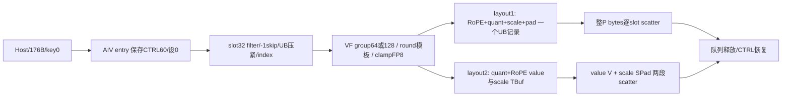
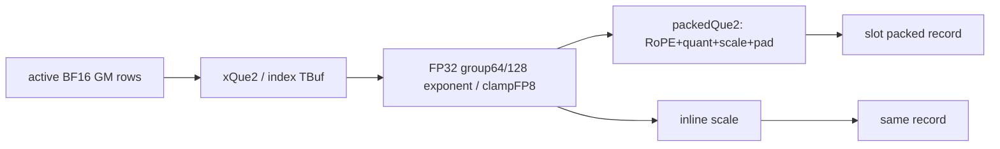
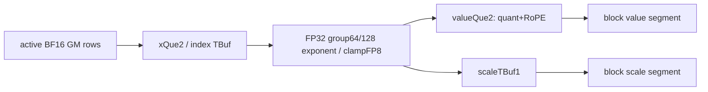

# KvCompressEpilogMXFP8 950 ACLNN 算子知识

## 算子速览

| 项目 | 内容 |
|---|---|
| 实际入口 | `aclnnSglKvCompressEpilogGetWorkspaceSize/aclnnSglKvCompressEpilog`，本卡固定quant_mode=2 |
| 计算语义 | BF16行前D-64列每64/128值amax≥1e-4、按目标FP8上限缩放并构造E8M0指数字节，量化值显式clamp后FP8 cast，末64列RoPE rawbits保留 |
| 输入输出 | x[N,D]、int32/int64 slot[N]、原地FP8 byte carrier cache；-1跳过；layout1 RoPE→quant→scale，layout2 value为quant→RoPE |
| 执行类型 | 单AIV_VECTOR/VF，无Cube/MIX或其它核心算子 |
| Kernel 路线 | R001…012为layout1/2/越合同raw其它layout×slot2dtype×cache2dtype，各含G64/G128×round0/1四子路线，共48精确实例 |
| 核心资源 | layout1 UB=4R A16D+2RP+I_U；layout2=4R A16D+2R A32V+R A32SPad+I_U；Host I估算4A8R，int64实际8A4R |
| 来源闭包 | `source_closed`：Host/POD176/key0、RegBase/两完整MXVF/group/round/Copy helpers、固定SDKUnAlign/mask/资源及当前build闭合 |
| 验证状态 | draft，未编译/运行。int64预算/slot窄化、RoPE多行D与A16D stride差异、256B UnAlign读跨当前slot可能性、layout2 scale padding未定义均保留 |

## 接口与语义

### 计算语义

令Q=D-64，G∈{64,128}，S=ceil(Q/G)，V=Q+128，SPad=A8(S)，P=A128(Q+128+S)。对普通有限合法输入：
```text
amax = max(max(abs(BF16_to_FP32(x[group]))),1e-4)
s0=amax/Rmax                         # Rmax448(E4)或57344(E5)
b=(FP32_bits(s0)>>23)&0xff          # biased exponent
if round_scale_flag: b += (b!=0)    # 源码检查的是b，不是s0的mantissa
scale = FP32_bits_to_float(b<<23)
q = clamp(x/scale, -Rmax,+Rmax)
y = FP8_CAST_RINT_NO_SAT(q)
stored_scale_byte = uint8(FP32_bits(scale)>>23)
RoPE = raw 64 BF16 =128B
```

roundFalse在正常finite域相当于舍掉scale尾数到2幂，roundTrue对非零biased exponent直接+1；即便s0本来正好2幂也+1，不能误写为通常ceil(log2(s0))。实际代码`And(vreg2,vreg1,0x7fffff)`时vreg1已经是8bit exponent，因此测试b!=0；与公开API描述一致。浮点Exp/MX SwiGLU不在此算子，输入已是BF16 KV；不是SwiGLU mode2的32值BF16指数算法。

layout1记录byte[0:128]=RoPE，byte[128:128+Q]=quant，byte[128+Q:128+Q+S]=E8字节，之后到P补0。layout2每block的value区每slot V字节：byte[0:Q]=quant、byte[Q:Q+128]=RoPE；所有B个value之后是B个SPad宽scale槽，每槽前S字节为指数，后SPad-S字节未初始化却会随CopyOut搬出。未写slot保留旧cache；实际重复slot/越界写不受保护。

### 输入、输出与属性

| 参数 | shape/layout | dtype | 约束、默认值与语义 |
|---|---|---|---|
| cache | layout1按slot分行；layout2[blocks,B,width]或[blocks,B,1,width] | FP8 E4M3FN/E5M2 byte carrier | caller分配，同NPU、内层dense，实际容量与stride须匹配 |
| x | [N,D]连续ND | BF16 | N/D正；业务D≥64，源无该下界/16对齐guard |
| slot_mapping | [N]连续 | int32/int64 | 仅转换后int32 -1跳过，合法非负slot可表示且不冲突 |
| quant_group_size | scalar int64 | — | mode2仅64或128，Host/adapter均检查 |
| quant_mode | scalar int64 | — | 本卡严格2 |
| round_scale_flag | bool | — | 非零biased exponent加1，明确source公式 |
| layout | scalar int64 | — | 公开1/2；裸其它值Host未拒绝、越合同 |
| block_stride | 原生attr，adapter cache.stride0 | int64字节 | layout1 row stride、layout2 block stride；正值否则自动 |
| cache_out | ref输出 | 同cache | Device只写out指针，不读取输入cache；返回None |

### 入口与版本

已全文阅读并复用[KV cache字节布局API](../../../../apis/sgl_kernel_npu/sgl_kv_compress_epilog.md)。固定SGL dda6d36b0cdb4081e102d14c0a2fb276fc416e69；CANN9.1.0是README/CI基线配置，非本次运行。SDK官方v9.1.0固定e5451c7feba11f9e259f4fbc19c4bf82f8c0496c，不保证所有同名二进制相同。公开原生950/arch35支持、arch22不支持，与mem_cache域CMake3510/OpDef configs一致；只读旧legacy重复不替换实际build源。FP8 mode1是另一独立数学卡，不混入本卡。

## Host/Launcher 执行流程

### 参数校验与前处理

adapter检查x二维/正N,D/BF16、slot维度/长度N/int32或int64、cache两FP8类型；四维cache要求head维2=1再squeeze视图。mode2检查G64/128、layout1/2；layout2要求cache rank≥2且B=shape1>0，cache.stride0正时≥B(V+SPad)，layout1正stride0≥P。DeviceGuard cache.device→3个ND descriptors→query attrs(G,2,round,layout,stride0)→workspace≤INT64MAX分配→3tensor/ws record_stream→RunOpApi。不复制输入、不做Contiguous修复，未完整检查同device/内层stride/alias/slot bounds或重复。

Host要求x二维N/D正、资源/attrs齐全，mode2 G检查，layout2要求cache rank≥2/B>0，但不单独拒绝其它layout；查平台AIV/UB→Q/S/P/V/SPad/stride→R分块→POD176→outerkey0/blockdim/W。InferShape/Type cache_out复制输入cache；生成refalias桥接为框架边界，Device输入cache pointer未读、只写cache_out，不把独立未初始化输出假装合法。

### 参数、Workspace 与生命周期

W=GetLibApiWorkSpaceSize()+32B，query真实返回量为分配依据，entry只检查非空、body不读。lambda捕获tensor/descriptors/ws/executor/current aclStream；tensor/ws record_stream延长异步storage生命，静态包内动态库句柄保活。输出cache由caller持有，未分配新GM中间；generated executor/GET_TILING_DATA本地副本与ABI为CANN框架边界，POD字段/size从当前共享头固定。

TPipe xQue/cacheQue各2slot，index TBuf单块；layout2再有单scale TBuf，不是scale TQue。每个row块validIdx压紧，index映射供同块scatter。没有核间协议、atomic或冲突检测；原cache未读，selected槽位按相应有效段覆盖，unselected槽位不写。

### 启动图与失败传播



每核连续former行，末核tail，rowFactor循环；所有skip时仍queue/VF但无有效读x/输出store。workspace null早return，unknownkey无body，dtype正常0…3，else默认int64/E4。查询/同步execute错误抛出，异步错误由框架暴露；无Torch/其它后端fallback。CTRL60=0是单指令模式，FP8 cast NO_SAT/RINT，算法另有显式clamp，不照注释宣称全局饱和。

## Route 与参数设计

### 分核与资源计算

Pcore=max(AIV查询,1)，former=ceil(N/Pcore)，used=min(ceil(N/former),Pcore)，tail=N-(used-1)former。G决定S；layout1/raw计算P，layout2计算B、V、SPad、blockStride=正attr或B(V+SPad)。Host从R1逐增直到下一个不fit退1，R≤0失败，无列切分。
```text
I_host=4A8(R)
I_actual=int32?4A8(R):8A4(R)
layout1/raw:
  X=4R A16D            # BF16 xQue2
  Y=2R P               # FP8 packed record queue2
  Uactual=X+Y+I_actual; H=X+Y+I_host
layout2:
  X=4R A16D
  Y=2R A32(V)          # value queue2
  E=R A32(SPad)        # scale单TBuf
  Uactual=X+Y+E+I_actual; H=X+Y+E+I_host
```

R仅按H≤UB查询选择，int64 I差额可能未预算，需看实际Uactual≤U而不能由Hostfit推安全。rowLoop/tailRowFactor前/尾核分别计算，validIdx可能小于实际row块因skip。下游int32 curSlotIdx/slot、int32 helpers、uint16 VF行/loop、uint32 DMA等位宽需分别约束，int64POD不是全部地址64位保证。

### Route 选择

| 顺序 | Route | Key/模板 | 精确选择条件与优先级 | 不适用去向 |
|---:|---|---|---|---|
| 1 | R-001 | key0/code0/layout1 | 950/mode2、U=int32_t,Y=fp8_e5m2_t，公开layout1；子路线四组合全可达 | 非法G失败；其它类型/布局按表，rawlayout不推荐 |
| 2 | R-002 | key0/code2/layout1 | 950/mode2、U=int32_t,Y=fp8_e4m3fn_t，公开layout1；子路线四组合全可达 | 非法G失败；其它类型/布局按表，rawlayout不推荐 |
| 3 | R-003 | key0/code1/layout1 | 950/mode2、U=int64_t,Y=fp8_e5m2_t，公开layout1；子路线四组合全可达 | 非法G失败；其它类型/布局按表，rawlayout不推荐 |
| 4 | R-004 | key0/code3/layout1 | 950/mode2、U=int64_t,Y=fp8_e4m3fn_t，公开layout1；子路线四组合全可达 | 非法G失败；其它类型/布局按表，rawlayout不推荐 |
| 5 | R-005 | key0/code0/layout2 | 950/mode2、U=int32_t,Y=fp8_e5m2_t，公开layout2；子路线四组合全可达 | 非法G失败；其它类型/布局按表，rawlayout不推荐 |
| 6 | R-006 | key0/code2/layout2 | 950/mode2、U=int32_t,Y=fp8_e4m3fn_t，公开layout2；子路线四组合全可达 | 非法G失败；其它类型/布局按表，rawlayout不推荐 |
| 7 | R-007 | key0/code1/layout2 | 950/mode2、U=int64_t,Y=fp8_e5m2_t，公开layout2；子路线四组合全可达 | 非法G失败；其它类型/布局按表，rawlayout不推荐 |
| 8 | R-008 | key0/code3/layout2 | 950/mode2、U=int64_t,Y=fp8_e4m3fn_t，公开layout2；子路线四组合全可达 | 非法G失败；其它类型/布局按表，rawlayout不推荐 |
| 9 | R-009 | key0/code0/layoutother | 950/mode2、U=int32_t,Y=fp8_e5m2_t，裸layout!=1&&!=2越合同；子路线四组合全可达 | 非法G失败；其它类型/布局按表，rawlayout不推荐 |
| 10 | R-010 | key0/code2/layoutother | 950/mode2、U=int32_t,Y=fp8_e4m3fn_t，裸layout!=1&&!=2越合同；子路线四组合全可达 | 非法G失败；其它类型/布局按表，rawlayout不推荐 |
| 11 | R-011 | key0/code1/layoutother | 950/mode2、U=int64_t,Y=fp8_e5m2_t，裸layout!=1&&!=2越合同；子路线四组合全可达 | 非法G失败；其它类型/布局按表，rawlayout不推荐 |
| 12 | R-012 | key0/code3/layoutother | 950/mode2、U=int64_t,Y=fp8_e4m3fn_t，裸layout!=1&&!=2越合同；子路线四组合全可达 | 非法G失败；其它类型/布局按表，rawlayout不推荐 |

| 子路线 | G | round模板 | group实现与scale公式 |
|---|---:|---|---|
| G64R0 | 64 | false | 单64循环，biasedExponent不加1 |
| G64R1 | 64 | true | 单64循环，biasedExponent非0加1 |
| G128R0 | 128 | false | fold两64 + ≤64reminder，biasedExponent不加1 |
| G128R1 | 128 | true | fold两64 + ≤64reminder，biasedExponent非0加1 |

```text
mode2 -> require G64/128 -> layout2 requireB>0, else layout1/raw
dtype0..3 -> 12typed layout Routes
round==1 -> VF<true>, else VF<false>
G128 -> foldtwo + remainder; G64 -> per64 loop
slot32==-1 skip; else compact -> layout-specific VF -> layout-specific scatter
```

### 模板/实现执行矩阵

| Route | key/selector | dtype/shape/platform 完整命中条件 | 执行族与 kernel 节点 | 实际模板/body | 内存与同步特征 | tail/fallback |
|---|---|---|---|---|---|---|
| R-001.G64R0 | key0/code0/layout1/G64/round0 | 950、mode2、BF16/int32_t/fp8_e5m2_t，公开layout1 | 单AIV_VECTOR | RegBase<BF16,int32_t,fp8_e5m2_t>→VFProcessDynamicMxFP8Quant<BF16,fp8_e5m2_t,false>，G64分支 | packedQueue2+xQueue2/index；queue/S_MTE3/VEC_STORE | row尾/G尾/skip；无fallback，RoPEinputstride/readspan限制 |
| R-001.G64R1 | key0/code0/layout1/G64/round1 | 950、mode2、BF16/int32_t/fp8_e5m2_t，公开layout1 | 单AIV_VECTOR | RegBase<BF16,int32_t,fp8_e5m2_t>→VFProcessDynamicMxFP8Quant<BF16,fp8_e5m2_t,true>，G64分支 | packedQueue2+xQueue2/index；queue/S_MTE3/VEC_STORE | row尾/G尾/skip；无fallback，RoPEinputstride/readspan限制 |
| R-001.G128R0 | key0/code0/layout1/G128/round0 | 950、mode2、BF16/int32_t/fp8_e5m2_t，公开layout1 | 单AIV_VECTOR | RegBase<BF16,int32_t,fp8_e5m2_t>→VFProcessDynamicMxFP8Quant<BF16,fp8_e5m2_t,false>，G128分支 | packedQueue2+xQueue2/index；queue/S_MTE3/VEC_STORE | row尾/G尾/skip；无fallback，RoPEinputstride/readspan限制 |
| R-001.G128R1 | key0/code0/layout1/G128/round1 | 950、mode2、BF16/int32_t/fp8_e5m2_t，公开layout1 | 单AIV_VECTOR | RegBase<BF16,int32_t,fp8_e5m2_t>→VFProcessDynamicMxFP8Quant<BF16,fp8_e5m2_t,true>，G128分支 | packedQueue2+xQueue2/index；queue/S_MTE3/VEC_STORE | row尾/G尾/skip；无fallback，RoPEinputstride/readspan限制 |
| R-002.G64R0 | key0/code2/layout1/G64/round0 | 950、mode2、BF16/int32_t/fp8_e4m3fn_t，公开layout1 | 单AIV_VECTOR | RegBase<BF16,int32_t,fp8_e4m3fn_t>→VFProcessDynamicMxFP8Quant<BF16,fp8_e4m3fn_t,false>，G64分支 | packedQueue2+xQueue2/index；queue/S_MTE3/VEC_STORE | row尾/G尾/skip；无fallback，RoPEinputstride/readspan限制 |
| R-002.G64R1 | key0/code2/layout1/G64/round1 | 950、mode2、BF16/int32_t/fp8_e4m3fn_t，公开layout1 | 单AIV_VECTOR | RegBase<BF16,int32_t,fp8_e4m3fn_t>→VFProcessDynamicMxFP8Quant<BF16,fp8_e4m3fn_t,true>，G64分支 | packedQueue2+xQueue2/index；queue/S_MTE3/VEC_STORE | row尾/G尾/skip；无fallback，RoPEinputstride/readspan限制 |
| R-002.G128R0 | key0/code2/layout1/G128/round0 | 950、mode2、BF16/int32_t/fp8_e4m3fn_t，公开layout1 | 单AIV_VECTOR | RegBase<BF16,int32_t,fp8_e4m3fn_t>→VFProcessDynamicMxFP8Quant<BF16,fp8_e4m3fn_t,false>，G128分支 | packedQueue2+xQueue2/index；queue/S_MTE3/VEC_STORE | row尾/G尾/skip；无fallback，RoPEinputstride/readspan限制 |
| R-002.G128R1 | key0/code2/layout1/G128/round1 | 950、mode2、BF16/int32_t/fp8_e4m3fn_t，公开layout1 | 单AIV_VECTOR | RegBase<BF16,int32_t,fp8_e4m3fn_t>→VFProcessDynamicMxFP8Quant<BF16,fp8_e4m3fn_t,true>，G128分支 | packedQueue2+xQueue2/index；queue/S_MTE3/VEC_STORE | row尾/G尾/skip；无fallback，RoPEinputstride/readspan限制 |
| R-003.G64R0 | key0/code1/layout1/G64/round0 | 950、mode2、BF16/int64_t/fp8_e5m2_t，公开layout1 | 单AIV_VECTOR | RegBase<BF16,int64_t,fp8_e5m2_t>→VFProcessDynamicMxFP8Quant<BF16,fp8_e5m2_t,false>，G64分支 | packedQueue2+xQueue2/index；queue/S_MTE3/VEC_STORE | row尾/G尾/skip；无fallback，RoPEinputstride/readspan限制 |
| R-003.G64R1 | key0/code1/layout1/G64/round1 | 950、mode2、BF16/int64_t/fp8_e5m2_t，公开layout1 | 单AIV_VECTOR | RegBase<BF16,int64_t,fp8_e5m2_t>→VFProcessDynamicMxFP8Quant<BF16,fp8_e5m2_t,true>，G64分支 | packedQueue2+xQueue2/index；queue/S_MTE3/VEC_STORE | row尾/G尾/skip；无fallback，RoPEinputstride/readspan限制 |
| R-003.G128R0 | key0/code1/layout1/G128/round0 | 950、mode2、BF16/int64_t/fp8_e5m2_t，公开layout1 | 单AIV_VECTOR | RegBase<BF16,int64_t,fp8_e5m2_t>→VFProcessDynamicMxFP8Quant<BF16,fp8_e5m2_t,false>，G128分支 | packedQueue2+xQueue2/index；queue/S_MTE3/VEC_STORE | row尾/G尾/skip；无fallback，RoPEinputstride/readspan限制 |
| R-003.G128R1 | key0/code1/layout1/G128/round1 | 950、mode2、BF16/int64_t/fp8_e5m2_t，公开layout1 | 单AIV_VECTOR | RegBase<BF16,int64_t,fp8_e5m2_t>→VFProcessDynamicMxFP8Quant<BF16,fp8_e5m2_t,true>，G128分支 | packedQueue2+xQueue2/index；queue/S_MTE3/VEC_STORE | row尾/G尾/skip；无fallback，RoPEinputstride/readspan限制 |
| R-004.G64R0 | key0/code3/layout1/G64/round0 | 950、mode2、BF16/int64_t/fp8_e4m3fn_t，公开layout1 | 单AIV_VECTOR | RegBase<BF16,int64_t,fp8_e4m3fn_t>→VFProcessDynamicMxFP8Quant<BF16,fp8_e4m3fn_t,false>，G64分支 | packedQueue2+xQueue2/index；queue/S_MTE3/VEC_STORE | row尾/G尾/skip；无fallback，RoPEinputstride/readspan限制 |
| R-004.G64R1 | key0/code3/layout1/G64/round1 | 950、mode2、BF16/int64_t/fp8_e4m3fn_t，公开layout1 | 单AIV_VECTOR | RegBase<BF16,int64_t,fp8_e4m3fn_t>→VFProcessDynamicMxFP8Quant<BF16,fp8_e4m3fn_t,true>，G64分支 | packedQueue2+xQueue2/index；queue/S_MTE3/VEC_STORE | row尾/G尾/skip；无fallback，RoPEinputstride/readspan限制 |
| R-004.G128R0 | key0/code3/layout1/G128/round0 | 950、mode2、BF16/int64_t/fp8_e4m3fn_t，公开layout1 | 单AIV_VECTOR | RegBase<BF16,int64_t,fp8_e4m3fn_t>→VFProcessDynamicMxFP8Quant<BF16,fp8_e4m3fn_t,false>，G128分支 | packedQueue2+xQueue2/index；queue/S_MTE3/VEC_STORE | row尾/G尾/skip；无fallback，RoPEinputstride/readspan限制 |
| R-004.G128R1 | key0/code3/layout1/G128/round1 | 950、mode2、BF16/int64_t/fp8_e4m3fn_t，公开layout1 | 单AIV_VECTOR | RegBase<BF16,int64_t,fp8_e4m3fn_t>→VFProcessDynamicMxFP8Quant<BF16,fp8_e4m3fn_t,true>，G128分支 | packedQueue2+xQueue2/index；queue/S_MTE3/VEC_STORE | row尾/G尾/skip；无fallback，RoPEinputstride/readspan限制 |
| R-005.G64R0 | key0/code0/layout2/G64/round0 | 950、mode2、BF16/int32_t/fp8_e5m2_t，公开layout2 | 单AIV_VECTOR | RegBase<BF16,int32_t,fp8_e5m2_t>→VFProcessDynamicMxFP8QuantLayout2<BF16,fp8_e5m2_t,false>，G64分支 | valueQueue2+scaleBuf1+xQueue2/index；queue/S_MTE3/VEC_STORE | row尾/G尾/skip；无fallback，RoPEinputstride/readspan限制 |
| R-005.G64R1 | key0/code0/layout2/G64/round1 | 950、mode2、BF16/int32_t/fp8_e5m2_t，公开layout2 | 单AIV_VECTOR | RegBase<BF16,int32_t,fp8_e5m2_t>→VFProcessDynamicMxFP8QuantLayout2<BF16,fp8_e5m2_t,true>，G64分支 | valueQueue2+scaleBuf1+xQueue2/index；queue/S_MTE3/VEC_STORE | row尾/G尾/skip；无fallback，RoPEinputstride/readspan限制 |
| R-005.G128R0 | key0/code0/layout2/G128/round0 | 950、mode2、BF16/int32_t/fp8_e5m2_t，公开layout2 | 单AIV_VECTOR | RegBase<BF16,int32_t,fp8_e5m2_t>→VFProcessDynamicMxFP8QuantLayout2<BF16,fp8_e5m2_t,false>，G128分支 | valueQueue2+scaleBuf1+xQueue2/index；queue/S_MTE3/VEC_STORE | row尾/G尾/skip；无fallback，RoPEinputstride/readspan限制 |
| R-005.G128R1 | key0/code0/layout2/G128/round1 | 950、mode2、BF16/int32_t/fp8_e5m2_t，公开layout2 | 单AIV_VECTOR | RegBase<BF16,int32_t,fp8_e5m2_t>→VFProcessDynamicMxFP8QuantLayout2<BF16,fp8_e5m2_t,true>，G128分支 | valueQueue2+scaleBuf1+xQueue2/index；queue/S_MTE3/VEC_STORE | row尾/G尾/skip；无fallback，RoPEinputstride/readspan限制 |
| R-006.G64R0 | key0/code2/layout2/G64/round0 | 950、mode2、BF16/int32_t/fp8_e4m3fn_t，公开layout2 | 单AIV_VECTOR | RegBase<BF16,int32_t,fp8_e4m3fn_t>→VFProcessDynamicMxFP8QuantLayout2<BF16,fp8_e4m3fn_t,false>，G64分支 | valueQueue2+scaleBuf1+xQueue2/index；queue/S_MTE3/VEC_STORE | row尾/G尾/skip；无fallback，RoPEinputstride/readspan限制 |
| R-006.G64R1 | key0/code2/layout2/G64/round1 | 950、mode2、BF16/int32_t/fp8_e4m3fn_t，公开layout2 | 单AIV_VECTOR | RegBase<BF16,int32_t,fp8_e4m3fn_t>→VFProcessDynamicMxFP8QuantLayout2<BF16,fp8_e4m3fn_t,true>，G64分支 | valueQueue2+scaleBuf1+xQueue2/index；queue/S_MTE3/VEC_STORE | row尾/G尾/skip；无fallback，RoPEinputstride/readspan限制 |
| R-006.G128R0 | key0/code2/layout2/G128/round0 | 950、mode2、BF16/int32_t/fp8_e4m3fn_t，公开layout2 | 单AIV_VECTOR | RegBase<BF16,int32_t,fp8_e4m3fn_t>→VFProcessDynamicMxFP8QuantLayout2<BF16,fp8_e4m3fn_t,false>，G128分支 | valueQueue2+scaleBuf1+xQueue2/index；queue/S_MTE3/VEC_STORE | row尾/G尾/skip；无fallback，RoPEinputstride/readspan限制 |
| R-006.G128R1 | key0/code2/layout2/G128/round1 | 950、mode2、BF16/int32_t/fp8_e4m3fn_t，公开layout2 | 单AIV_VECTOR | RegBase<BF16,int32_t,fp8_e4m3fn_t>→VFProcessDynamicMxFP8QuantLayout2<BF16,fp8_e4m3fn_t,true>，G128分支 | valueQueue2+scaleBuf1+xQueue2/index；queue/S_MTE3/VEC_STORE | row尾/G尾/skip；无fallback，RoPEinputstride/readspan限制 |
| R-007.G64R0 | key0/code1/layout2/G64/round0 | 950、mode2、BF16/int64_t/fp8_e5m2_t，公开layout2 | 单AIV_VECTOR | RegBase<BF16,int64_t,fp8_e5m2_t>→VFProcessDynamicMxFP8QuantLayout2<BF16,fp8_e5m2_t,false>，G64分支 | valueQueue2+scaleBuf1+xQueue2/index；queue/S_MTE3/VEC_STORE | row尾/G尾/skip；无fallback，RoPEinputstride/readspan限制 |
| R-007.G64R1 | key0/code1/layout2/G64/round1 | 950、mode2、BF16/int64_t/fp8_e5m2_t，公开layout2 | 单AIV_VECTOR | RegBase<BF16,int64_t,fp8_e5m2_t>→VFProcessDynamicMxFP8QuantLayout2<BF16,fp8_e5m2_t,true>，G64分支 | valueQueue2+scaleBuf1+xQueue2/index；queue/S_MTE3/VEC_STORE | row尾/G尾/skip；无fallback，RoPEinputstride/readspan限制 |
| R-007.G128R0 | key0/code1/layout2/G128/round0 | 950、mode2、BF16/int64_t/fp8_e5m2_t，公开layout2 | 单AIV_VECTOR | RegBase<BF16,int64_t,fp8_e5m2_t>→VFProcessDynamicMxFP8QuantLayout2<BF16,fp8_e5m2_t,false>，G128分支 | valueQueue2+scaleBuf1+xQueue2/index；queue/S_MTE3/VEC_STORE | row尾/G尾/skip；无fallback，RoPEinputstride/readspan限制 |
| R-007.G128R1 | key0/code1/layout2/G128/round1 | 950、mode2、BF16/int64_t/fp8_e5m2_t，公开layout2 | 单AIV_VECTOR | RegBase<BF16,int64_t,fp8_e5m2_t>→VFProcessDynamicMxFP8QuantLayout2<BF16,fp8_e5m2_t,true>，G128分支 | valueQueue2+scaleBuf1+xQueue2/index；queue/S_MTE3/VEC_STORE | row尾/G尾/skip；无fallback，RoPEinputstride/readspan限制 |
| R-008.G64R0 | key0/code3/layout2/G64/round0 | 950、mode2、BF16/int64_t/fp8_e4m3fn_t，公开layout2 | 单AIV_VECTOR | RegBase<BF16,int64_t,fp8_e4m3fn_t>→VFProcessDynamicMxFP8QuantLayout2<BF16,fp8_e4m3fn_t,false>，G64分支 | valueQueue2+scaleBuf1+xQueue2/index；queue/S_MTE3/VEC_STORE | row尾/G尾/skip；无fallback，RoPEinputstride/readspan限制 |
| R-008.G64R1 | key0/code3/layout2/G64/round1 | 950、mode2、BF16/int64_t/fp8_e4m3fn_t，公开layout2 | 单AIV_VECTOR | RegBase<BF16,int64_t,fp8_e4m3fn_t>→VFProcessDynamicMxFP8QuantLayout2<BF16,fp8_e4m3fn_t,true>，G64分支 | valueQueue2+scaleBuf1+xQueue2/index；queue/S_MTE3/VEC_STORE | row尾/G尾/skip；无fallback，RoPEinputstride/readspan限制 |
| R-008.G128R0 | key0/code3/layout2/G128/round0 | 950、mode2、BF16/int64_t/fp8_e4m3fn_t，公开layout2 | 单AIV_VECTOR | RegBase<BF16,int64_t,fp8_e4m3fn_t>→VFProcessDynamicMxFP8QuantLayout2<BF16,fp8_e4m3fn_t,false>，G128分支 | valueQueue2+scaleBuf1+xQueue2/index；queue/S_MTE3/VEC_STORE | row尾/G尾/skip；无fallback，RoPEinputstride/readspan限制 |
| R-008.G128R1 | key0/code3/layout2/G128/round1 | 950、mode2、BF16/int64_t/fp8_e4m3fn_t，公开layout2 | 单AIV_VECTOR | RegBase<BF16,int64_t,fp8_e4m3fn_t>→VFProcessDynamicMxFP8QuantLayout2<BF16,fp8_e4m3fn_t,true>，G128分支 | valueQueue2+scaleBuf1+xQueue2/index；queue/S_MTE3/VEC_STORE | row尾/G尾/skip；无fallback，RoPEinputstride/readspan限制 |
| R-009.G64R0 | key0/code0/layoutother/G64/round0 | 950、mode2、BF16/int32_t/fp8_e5m2_t，越合同rawlayout | 单AIV_VECTOR | RegBase<BF16,int32_t,fp8_e5m2_t>→VFProcessDynamicMxFP8Quant<BF16,fp8_e5m2_t,false>，G64分支 | packedQueue2+xQueue2/index；queue/S_MTE3/VEC_STORE | row尾/G尾/skip；无fallback，RoPEinputstride/readspan限制 |
| R-009.G64R1 | key0/code0/layoutother/G64/round1 | 950、mode2、BF16/int32_t/fp8_e5m2_t，越合同rawlayout | 单AIV_VECTOR | RegBase<BF16,int32_t,fp8_e5m2_t>→VFProcessDynamicMxFP8Quant<BF16,fp8_e5m2_t,true>，G64分支 | packedQueue2+xQueue2/index；queue/S_MTE3/VEC_STORE | row尾/G尾/skip；无fallback，RoPEinputstride/readspan限制 |
| R-009.G128R0 | key0/code0/layoutother/G128/round0 | 950、mode2、BF16/int32_t/fp8_e5m2_t，越合同rawlayout | 单AIV_VECTOR | RegBase<BF16,int32_t,fp8_e5m2_t>→VFProcessDynamicMxFP8Quant<BF16,fp8_e5m2_t,false>，G128分支 | packedQueue2+xQueue2/index；queue/S_MTE3/VEC_STORE | row尾/G尾/skip；无fallback，RoPEinputstride/readspan限制 |
| R-009.G128R1 | key0/code0/layoutother/G128/round1 | 950、mode2、BF16/int32_t/fp8_e5m2_t，越合同rawlayout | 单AIV_VECTOR | RegBase<BF16,int32_t,fp8_e5m2_t>→VFProcessDynamicMxFP8Quant<BF16,fp8_e5m2_t,true>，G128分支 | packedQueue2+xQueue2/index；queue/S_MTE3/VEC_STORE | row尾/G尾/skip；无fallback，RoPEinputstride/readspan限制 |
| R-010.G64R0 | key0/code2/layoutother/G64/round0 | 950、mode2、BF16/int32_t/fp8_e4m3fn_t，越合同rawlayout | 单AIV_VECTOR | RegBase<BF16,int32_t,fp8_e4m3fn_t>→VFProcessDynamicMxFP8Quant<BF16,fp8_e4m3fn_t,false>，G64分支 | packedQueue2+xQueue2/index；queue/S_MTE3/VEC_STORE | row尾/G尾/skip；无fallback，RoPEinputstride/readspan限制 |
| R-010.G64R1 | key0/code2/layoutother/G64/round1 | 950、mode2、BF16/int32_t/fp8_e4m3fn_t，越合同rawlayout | 单AIV_VECTOR | RegBase<BF16,int32_t,fp8_e4m3fn_t>→VFProcessDynamicMxFP8Quant<BF16,fp8_e4m3fn_t,true>，G64分支 | packedQueue2+xQueue2/index；queue/S_MTE3/VEC_STORE | row尾/G尾/skip；无fallback，RoPEinputstride/readspan限制 |
| R-010.G128R0 | key0/code2/layoutother/G128/round0 | 950、mode2、BF16/int32_t/fp8_e4m3fn_t，越合同rawlayout | 单AIV_VECTOR | RegBase<BF16,int32_t,fp8_e4m3fn_t>→VFProcessDynamicMxFP8Quant<BF16,fp8_e4m3fn_t,false>，G128分支 | packedQueue2+xQueue2/index；queue/S_MTE3/VEC_STORE | row尾/G尾/skip；无fallback，RoPEinputstride/readspan限制 |
| R-010.G128R1 | key0/code2/layoutother/G128/round1 | 950、mode2、BF16/int32_t/fp8_e4m3fn_t，越合同rawlayout | 单AIV_VECTOR | RegBase<BF16,int32_t,fp8_e4m3fn_t>→VFProcessDynamicMxFP8Quant<BF16,fp8_e4m3fn_t,true>，G128分支 | packedQueue2+xQueue2/index；queue/S_MTE3/VEC_STORE | row尾/G尾/skip；无fallback，RoPEinputstride/readspan限制 |
| R-011.G64R0 | key0/code1/layoutother/G64/round0 | 950、mode2、BF16/int64_t/fp8_e5m2_t，越合同rawlayout | 单AIV_VECTOR | RegBase<BF16,int64_t,fp8_e5m2_t>→VFProcessDynamicMxFP8Quant<BF16,fp8_e5m2_t,false>，G64分支 | packedQueue2+xQueue2/index；queue/S_MTE3/VEC_STORE | row尾/G尾/skip；无fallback，RoPEinputstride/readspan限制 |
| R-011.G64R1 | key0/code1/layoutother/G64/round1 | 950、mode2、BF16/int64_t/fp8_e5m2_t，越合同rawlayout | 单AIV_VECTOR | RegBase<BF16,int64_t,fp8_e5m2_t>→VFProcessDynamicMxFP8Quant<BF16,fp8_e5m2_t,true>，G64分支 | packedQueue2+xQueue2/index；queue/S_MTE3/VEC_STORE | row尾/G尾/skip；无fallback，RoPEinputstride/readspan限制 |
| R-011.G128R0 | key0/code1/layoutother/G128/round0 | 950、mode2、BF16/int64_t/fp8_e5m2_t，越合同rawlayout | 单AIV_VECTOR | RegBase<BF16,int64_t,fp8_e5m2_t>→VFProcessDynamicMxFP8Quant<BF16,fp8_e5m2_t,false>，G128分支 | packedQueue2+xQueue2/index；queue/S_MTE3/VEC_STORE | row尾/G尾/skip；无fallback，RoPEinputstride/readspan限制 |
| R-011.G128R1 | key0/code1/layoutother/G128/round1 | 950、mode2、BF16/int64_t/fp8_e5m2_t，越合同rawlayout | 单AIV_VECTOR | RegBase<BF16,int64_t,fp8_e5m2_t>→VFProcessDynamicMxFP8Quant<BF16,fp8_e5m2_t,true>，G128分支 | packedQueue2+xQueue2/index；queue/S_MTE3/VEC_STORE | row尾/G尾/skip；无fallback，RoPEinputstride/readspan限制 |
| R-012.G64R0 | key0/code3/layoutother/G64/round0 | 950、mode2、BF16/int64_t/fp8_e4m3fn_t，越合同rawlayout | 单AIV_VECTOR | RegBase<BF16,int64_t,fp8_e4m3fn_t>→VFProcessDynamicMxFP8Quant<BF16,fp8_e4m3fn_t,false>，G64分支 | packedQueue2+xQueue2/index；queue/S_MTE3/VEC_STORE | row尾/G尾/skip；无fallback，RoPEinputstride/readspan限制 |
| R-012.G64R1 | key0/code3/layoutother/G64/round1 | 950、mode2、BF16/int64_t/fp8_e4m3fn_t，越合同rawlayout | 单AIV_VECTOR | RegBase<BF16,int64_t,fp8_e4m3fn_t>→VFProcessDynamicMxFP8Quant<BF16,fp8_e4m3fn_t,true>，G64分支 | packedQueue2+xQueue2/index；queue/S_MTE3/VEC_STORE | row尾/G尾/skip；无fallback，RoPEinputstride/readspan限制 |
| R-012.G128R0 | key0/code3/layoutother/G128/round0 | 950、mode2、BF16/int64_t/fp8_e4m3fn_t，越合同rawlayout | 单AIV_VECTOR | RegBase<BF16,int64_t,fp8_e4m3fn_t>→VFProcessDynamicMxFP8Quant<BF16,fp8_e4m3fn_t,false>，G128分支 | packedQueue2+xQueue2/index；queue/S_MTE3/VEC_STORE | row尾/G尾/skip；无fallback，RoPEinputstride/readspan限制 |
| R-012.G128R1 | key0/code3/layoutother/G128/round1 | 950、mode2、BF16/int64_t/fp8_e4m3fn_t，越合同rawlayout | 单AIV_VECTOR | RegBase<BF16,int64_t,fp8_e4m3fn_t>→VFProcessDynamicMxFP8Quant<BF16,fp8_e4m3fn_t,true>，G128分支 | packedQueue2+xQueue2/index；queue/S_MTE3/VEC_STORE | row尾/G尾/skip；无fallback，RoPEinputstride/readspan限制 |

### 隐藏性能 Guard

| Guard | Host/Tiling 条件 | Device/资源原因 | 影响 Route | 不满足时去向 | 源码符号 |
|---|---|---|---|---|---|
| G范围 | mode2 G64/128 | 两个真实group算法 | 全部 | Host/adapter失败 | Tiling/adapter |
| layout2 shape/stride | B>0；adapter正stride≥B(V+SPad) | block内值/scale区域 | layout2 | guard失败；裸stride容量检查不完整 | Host/adapter |
| UB | H≤U、仅行切分 | 双x/y+可选scaleTBuf/index | 全部 | 减R/失败；int64差额未计 | Host |
| Rope输入rowstride | 无D%16 guard | rope指针每行累计D，CopyIn按A16D | ≥2valid且D非16倍 | 无fallback，RoPE错读静态条件 | 两MXVF |
| UnAlign load跨度 | 无额外RoPE256B读padding | LoadUnAlign填256B Reg，64仅poststride | 所有有效row | 可跨当前xslot读相邻/未初始化区域，不推整UB越界 | SDK LoadUnAlign合同 |
| scale padding | S≤SPad=A8S，VF只写S | layout2 CopyOut仍拷SPad | layout2 | 余字节未定义，不应作零padding比较 | VF/CopyOut |
| slot/alias/narrow | 仅int32(slot)==-1跳过 | 下游slot/curSlotIdx32，重复写无atomic | 全部 | 无safe guard | Process |
| rawlayout/D下界 | 未拒绝其它layout，未查D≥64 | default strideP/Q无效域 | 相应子路径 | 越合同或无保证，不扩支持 | Host/VF |

### POD/ABI

packed SglKvCompressEpilogTilingData static_assert176，align1；21int64偏移0…160，int32dtype168，uint32key172。Host memcpy和GET_TILING_DATA共享头，偏移为静态声明推导，未编译测量。outerkey0与PODkey0本算子恰相同，均明确记录。

| 结构 | 字段 | 类型/位宽 | ABI 布局 | 单位 | Host/launcher producer | Device consumer | 边界 |
|---|---|---|---|---|---|---|---|
| SglKvCompressEpilogTilingData | bs | int64 | offset0,size8,structalign1 | 元素/次数 | N | row范围 | layout inactive字段0/未使用仍传递 |
| SglKvCompressEpilogTilingData | d | int64 | offset8,size8,structalign1 | 元素/次数 | D | 输入压紧stride/量化宽/rope指针 | layout inactive字段0/未使用仍传递 |
| SglKvCompressEpilogTilingData | kvCacheCol | int64 | offset16,size8,structalign1 | 字节 | P=align128(Q+128+S) | layout1/raw输出row；layout2 inactive | layout inactive字段0/未使用仍传递 |
| SglKvCompressEpilogTilingData | scaleCol | int64 | offset24,size8,structalign1 | 元素/次数 | S=ceil(Q/G) | 指数数目 | layout inactive字段0/未使用仍传递 |
| SglKvCompressEpilogTilingData | concatCol | int64 | offset32,size8,structalign1 | 字节 | Q+128+S | layout1/raw pad起点，layout2 inactive | layout inactive字段0/未使用仍传递 |
| SglKvCompressEpilogTilingData | padCol | int64 | offset40,size8,structalign1 | 字节 | P-concatCol | layout1/raw零pad，layout2 inactive | layout inactive字段0/未使用仍传递 |
| SglKvCompressEpilogTilingData | quantMode | int64 | offset48,size8,structalign1 | 标志 | 固定2 | 选择MXFP8 | layout inactive字段0/未使用仍传递 |
| SglKvCompressEpilogTilingData | roundScale | int64 | offset56,size8,structalign1 | 标志 | bool→0/1 | 模板round true iff1 | layout inactive字段0/未使用仍传递 |
| SglKvCompressEpilogTilingData | perGroupSize | int64 | offset64,size8,structalign1 | 元素/次数 | G=64或128 | 每64单组/每128两64合并 | layout inactive字段0/未使用仍传递 |
| SglKvCompressEpilogTilingData | rowOfFormerBlock | int64 | offset72,size8,structalign1 | 元素/次数 | ceil(N/Pcore) | 核起始行 | layout inactive字段0/未使用仍传递 |
| SglKvCompressEpilogTilingData | rowOfTailBlock | int64 | offset80,size8,structalign1 | 元素/次数 | N-(used-1)former | 末核行数 | layout inactive字段0/未使用仍传递 |
| SglKvCompressEpilogTilingData | rowLoopOfFormerBlock | int64 | offset88,size8,structalign1 | 元素/次数 | ceil(former/R) | 前核循环 | layout inactive字段0/未使用仍传递 |
| SglKvCompressEpilogTilingData | rowLoopOfTailBlock | int64 | offset96,size8,structalign1 | 元素/次数 | ceil(tail/R) | 末核循环 | layout inactive字段0/未使用仍传递 |
| SglKvCompressEpilogTilingData | rowFactor | int64 | offset104,size8,structalign1 | 元素/次数 | Host预算逐增R | 每块行数/queues容量 | layout inactive字段0/未使用仍传递 |
| SglKvCompressEpilogTilingData | tailRowFactorOfFormerBlock | int64 | offset112,size8,structalign1 | 元素/次数 | former%R或R | 前核末loop | layout inactive字段0/未使用仍传递 |
| SglKvCompressEpilogTilingData | tailRowFactorOfTailBlock | int64 | offset120,size8,structalign1 | 元素/次数 | tail%R或R | 尾核末loop | layout inactive字段0/未使用仍传递 |
| SglKvCompressEpilogTilingData | layout | int64 | offset128,size8,structalign1 | 标志 | 1/2，raw其它未拒绝 | 布局/CopyOut选择 | layout inactive字段0/未使用仍传递 |
| SglKvCompressEpilogTilingData | blockSize | int64 | offset136,size8,structalign1 | 元素/次数 | layout2 cache.dim1=B；否则0 | slot到blockIdx/slotInBlock | layout inactive字段0/未使用仍传递 |
| SglKvCompressEpilogTilingData | valuePerToken | int64 | offset144,size8,structalign1 | 字节 | layout2 V=Q+128；否则0 | valueGM步长/UB容量 | layout inactive字段0/未使用仍传递 |
| SglKvCompressEpilogTilingData | scalePerToken | int64 | offset152,size8,structalign1 | 字节 | layout2 SPad=A8(S)；否则0 | GM每slot scale区宽/实际拷贝 | layout inactive字段0/未使用仍传递 |
| SglKvCompressEpilogTilingData | blockStride | int64 | offset160,size8,structalign1 | 字节 | 正attr；否则layout2 B(V+SPad)、其他P | layout1 rowstride / layout2 blockstride；raw其它忽略 | layout inactive字段0/未使用仍传递 |
| SglKvCompressEpilogTilingData | dtype | int32 | offset168,size4 | code | bit0 slot64、bit1 E4 | 四entry模板 | Host0…3 |
| SglKvCompressEpilogTilingData | tilingKey | uint32 | offset172,size4 | key | 固定0 | entry if0 | 非0无body |

GM args cache_in/x/slot/cache_out/workspace/tiling：输入cache不读，out是实际写地址。ref输出/生成executor及物理指针ABI为框架边界，不补造offset；pointer backing保活到stream完成。Process load64slot仍强转int32，并存入U类型indexBuf，后续GetValue再赋int32。

### Route 源码闭包

| Route | Key/selector | Host/Tiling producer | POD/参数 | Kernel entry/router | Kernel body/直接依赖 | 构建接线 |
|---|---|---|---|---|---|---|
| R-001.G64R0/G64R1/G128R0/G128R1 | key0/code0/layout1，四子行完整矩阵 | TilingKvCompressEpilog | POD176/rows/P/V/SPad/stride/G/round | sgl_kv_compress_epilog | RegBase<BF16,int32_t,fp8_e5m2_t>→MXLayout1 true/false及G两分支 | 当前mem_cache3510 OpDef/infer/tiling/Kernel唯一源 |
| R-002.G64R0/G64R1/G128R0/G128R1 | key0/code2/layout1，四子行完整矩阵 | TilingKvCompressEpilog | POD176/rows/P/V/SPad/stride/G/round | sgl_kv_compress_epilog | RegBase<BF16,int32_t,fp8_e4m3fn_t>→MXLayout1 true/false及G两分支 | 当前mem_cache3510 OpDef/infer/tiling/Kernel唯一源 |
| R-003.G64R0/G64R1/G128R0/G128R1 | key0/code1/layout1，四子行完整矩阵 | TilingKvCompressEpilog | POD176/rows/P/V/SPad/stride/G/round | sgl_kv_compress_epilog | RegBase<BF16,int64_t,fp8_e5m2_t>→MXLayout1 true/false及G两分支 | 当前mem_cache3510 OpDef/infer/tiling/Kernel唯一源 |
| R-004.G64R0/G64R1/G128R0/G128R1 | key0/code3/layout1，四子行完整矩阵 | TilingKvCompressEpilog | POD176/rows/P/V/SPad/stride/G/round | sgl_kv_compress_epilog | RegBase<BF16,int64_t,fp8_e4m3fn_t>→MXLayout1 true/false及G两分支 | 当前mem_cache3510 OpDef/infer/tiling/Kernel唯一源 |
| R-005.G64R0/G64R1/G128R0/G128R1 | key0/code0/layout2，四子行完整矩阵 | TilingKvCompressEpilog | POD176/rows/P/V/SPad/stride/G/round | sgl_kv_compress_epilog | RegBase<BF16,int32_t,fp8_e5m2_t>→MXLayout2 true/false及G两分支 | 当前mem_cache3510 OpDef/infer/tiling/Kernel唯一源 |
| R-006.G64R0/G64R1/G128R0/G128R1 | key0/code2/layout2，四子行完整矩阵 | TilingKvCompressEpilog | POD176/rows/P/V/SPad/stride/G/round | sgl_kv_compress_epilog | RegBase<BF16,int32_t,fp8_e4m3fn_t>→MXLayout2 true/false及G两分支 | 当前mem_cache3510 OpDef/infer/tiling/Kernel唯一源 |
| R-007.G64R0/G64R1/G128R0/G128R1 | key0/code1/layout2，四子行完整矩阵 | TilingKvCompressEpilog | POD176/rows/P/V/SPad/stride/G/round | sgl_kv_compress_epilog | RegBase<BF16,int64_t,fp8_e5m2_t>→MXLayout2 true/false及G两分支 | 当前mem_cache3510 OpDef/infer/tiling/Kernel唯一源 |
| R-008.G64R0/G64R1/G128R0/G128R1 | key0/code3/layout2，四子行完整矩阵 | TilingKvCompressEpilog | POD176/rows/P/V/SPad/stride/G/round | sgl_kv_compress_epilog | RegBase<BF16,int64_t,fp8_e4m3fn_t>→MXLayout2 true/false及G两分支 | 当前mem_cache3510 OpDef/infer/tiling/Kernel唯一源 |
| R-009.G64R0/G64R1/G128R0/G128R1 | key0/code0/layoutother，四子行完整矩阵 | TilingKvCompressEpilog | POD176/rows/P/V/SPad/stride/G/round | sgl_kv_compress_epilog | RegBase<BF16,int32_t,fp8_e5m2_t>→MXLayout1 true/false及G两分支 | 当前mem_cache3510 OpDef/infer/tiling/Kernel唯一源 |
| R-010.G64R0/G64R1/G128R0/G128R1 | key0/code2/layoutother，四子行完整矩阵 | TilingKvCompressEpilog | POD176/rows/P/V/SPad/stride/G/round | sgl_kv_compress_epilog | RegBase<BF16,int32_t,fp8_e4m3fn_t>→MXLayout1 true/false及G两分支 | 当前mem_cache3510 OpDef/infer/tiling/Kernel唯一源 |
| R-011.G64R0/G64R1/G128R0/G128R1 | key0/code1/layoutother，四子行完整矩阵 | TilingKvCompressEpilog | POD176/rows/P/V/SPad/stride/G/round | sgl_kv_compress_epilog | RegBase<BF16,int64_t,fp8_e5m2_t>→MXLayout1 true/false及G两分支 | 当前mem_cache3510 OpDef/infer/tiling/Kernel唯一源 |
| R-012.G64R0/G64R1/G128R0/G128R1 | key0/code3/layoutother，四子行完整矩阵 | TilingKvCompressEpilog | POD176/rows/P/V/SPad/stride/G/round | sgl_kv_compress_epilog | RegBase<BF16,int64_t,fp8_e4m3fn_t>→MXLayout1 true/false及G两分支 | 当前mem_cache3510 OpDef/infer/tiling/Kernel唯一源 |

## Kernel 实现

### 公共执行流程

Init根据core*former*D偏移xGM，分配xQue2、cacheQue2；layout2按A32V分配cacheQue并另alloc R A32SPad scaleTBuf，其他布局按P；index TBuf按U dtype对齐32B。Process扫描row块：slot GetValue转int32，-1跳过；有效x CopyIn到validIdx*A16D、index.SetValue(validIdx,slot32)、validIdx++、S_MTE3 Set/Wait。x EnQue/DeQue后选MXVF layout与round模板。没有核间sync或slot排序。

每64组loadBF16升FP32(源offset i*A16D)，Abs/ReduceMax→amax floor1e-4→乘1/Rmax。G128把两个64lane结果Max再floor；最后≤64组reminder单独归约，mask保持有效tail。round分支将floatbits右移23、&0xff得到biased exponent b，再对**已经是b**的vreg1 &0x7fffff并比较非0，故加的是(b!=0)，不是mantissa非0；roundFalse仅保留b。把所得b<<23解释FP32 scale，广播Div，显式Maxs/Mins到±FP8max，StoreOutputData最终NO_SAT/RINT、PACK4_B32。E8指数字节从scale bits>>23转uint8后以FIRST_ELEMENT_B8原样存入carrier。

layout1：每row先RoPE source pointer+=Q，LoadUnAlign64为poststride，实际填256B Reg；输出BF16 pointer在i*P/2处以VL64 mask DataCopy保留前128B raw。量化值写128+column+iP，scale字节写128+Q+scaleIdx+iP，末尾Ccat…P以StoreUnAlign zeros并Post flush。rope source每row累计Q+64=D，未使用A16D，因此与packed CopyIn stride在D非16倍时不一致。

layout2：RoPE source同样累计D，目的用uint8 pointer y+i*A32V+Q、StoreUnAlign128 bytes/Post，支持Q非32对齐甚至奇数byte位置；量化值从0写到Q，scale写单独TBuf[row*A32SPad+group]。值区UBpadding[A32V-V]不拷GM；scale只写S，而CopyOut SPad会搬出SPad-S未定义字节，没有zero初始化。每row末LocalMemBar VEC_STORE保留写顺序。

xFree→cacheQue EnQue/DeQue，随后scatter。layout2 slot32→blockIdx=slot/B、inBlock=slot%B，valueOff=blockIdx*blockStride+inBlock*V，scaleOff=blockIdx*blockStride+B*V+inBlock*SPad，分别CopyOut V/SPad字节；scaleTBuf没有独立EnQue，依赖此前VF完成与yqueue到MTE3的同步，连续同MTE3段完成两次输出后Free cacheQue。layout1按slot*positive rowStride或P整P CopyOut，raw其它layout直接slot*P。未写槽位不变，重复槽位无atomic。entry恢复原CTRL60。

```text
compact valid rows to xUB at valid*A16D; save slot32 index
for each valid packed row:
  rawRopeSource += Q; LoadUnAlign(full256B Reg,poststride64 BF16)
  layout1: maskedStore64BF16 at row*P; quantDst=row*P+128
  layout2: UnAlignStore128 rawbytes at row*A32V+Q; quantDst=row*A32V
  for groupsG:
    s0=max(abs(validGroup),1e-4)/Rmax
    b=(bits(s0)>>23)&255; if round: b+=(b!=0)
    scale=float_bits(b<<23)
    q=clamp(FP32(x)/scale,-Rmax,+Rmax); castFP8RINT_NO_SAT
    scaleByte=uint8(bits(scale)>>23)
    store scaleByte inline(layout1) or scaleTBuf(layout2)
  layout1 zero pad; layout2 no zero scale padding
scatter selected segments by saved slot32; free queues
```

CopyIn/DataCopyExtParams blockCount1/blockLen2D bytes/stride0/isPadfalse，UB行起点A16D。CopyOut Normal blockCount1，layout1lenP、layout2lenV与SPad，未因mask缩减真实拷贝len。UnAlign SDK合同poststride只更新指针，不限制读长度；256B Reg逻辑读取加对齐缓存可能触到其后的32B边界。对D16对齐且当前块最后有效行，RoPE逻辑需求128B位于xslot行尾，而256B load可延伸至少128B到当前slot以外；不据此推断越出整个UB或已发生运行故障。

### Route R-001：layout1，int32_t/fp8_e5m2_t

#### 适用条件

950/mode2、code0，U=int32_t/cache=fp8_e5m2_t，layout1。G64R0/G64R1/G128R0/G128R1四子路线分别完整展开于矩阵；所有row/G尾、skip及former/tailcore都由公共body覆盖。

##### 选择证据

| 层级 | 文件 | 符号 | 源码谓词/参数 | 结果/下一跳 |
|---|---|---|---|---|
| Host/entry | csrc/mem_cache/kv_compress_epilog/op_host/kv_compress_epilog.cpp | Tiling/dtype | mode2/G64或128/code0/layout1 | POD176→RegBase<BF16,int32_t,fp8_e5m2_t> |
| Process/VF | csrc/mem_cache/kv_compress_epilog/op_kernel/kv_compress_epilog.h | quantMode/layout/round ifs | layout!=2，round1/0，G128/64 | MXLayout1<BF16,fp8_e5m2_t,round> |

#### Device 数据流

##### 函数级调用链

```text
SGL pair -> entry -> RegBase<BF16,int32_t,fp8_e5m2_t>::Init/Process
 -> slot32 compact -> VFProcessDynamicMxFP8Quant<BF16,fp8_e5m2_t,round>
 -> G64 or G128+tail -> clampFP8/cast/scaleByte/rawRoPE -> layout-specific CopyOut
```

##### 源码等价伪码

执行公共完整伪码，Rmax=57344，slot加载int32_t后仍窄int32；G64单64循环，G128左右Max+reminder；round两模板分别b保持/非0加1。value顺序RoPE→quant→inline scale→zero pad，GM按正rowStride寻址。不省略未定义padding、RoPE源stride/Reg读范围与index预算条件。

#### 内存与数据搬运

##### 资源与搬运表

| 层级/缓冲区 | offset/地址公式 | extent/容量公式 | dtype/layout | producer | consumer | owner/lifetime | 对齐/复用 |
|---|---|---|---|---|---|---|---|
| GM x/slot | row*2D /row*sizeofU | 2ND /4N B | BF16/int32_tdense | caller | CopyIn/Scalar | stream周期 | -1不读x，slot32范围guard缺 |
| GM cache value | slot*rowStride | 有效行P B | fp8_e5m2_tbyte carrier | MTE3 | caller | 原cache ref | RoPE→quant→scale→pad0 |
| GM cache scale | 包含在P行128+Q位置 | S字节且剩余pad0 | uint8 E8 rawbits | VF/MTE3 | caller | 原cache | 整P覆盖 |
| UB xQue | base0，槽步长2R A16D | 4R A16D B，双槽 | BF16 packed | MTE2 | VF | row块 | 量化按A16D，RoPE按D累计 |
| UB cacheQue | x总extent之后，每slotRP | 2RP B | packed fp8_e5m2_t/rawBF16 | VF | MTE3 | row块 | layout1 P128对齐，layout2值仅拷V |
| UB scaleTBuf/index | y后index，无scaleBuf | 4A8R B | uint8/int32_t | VF/Scalar | MTE3/Scalar | row块 | indexHost预算4A8R |
| Reg/Unalign | VFscope | Reg256B、Unalign32B逻辑；物理寄存器compiler边界 | FP32/BF16/uint8 | VF | VF | 组/行 | 不计额外UB分配 |
| workspace/L1/L0 | ws非空check，L1/L0 N/A | W库查询+32B | byte | Host | entry | executor周期 | 无GM中间或Cube |

##### 分层内存布局



```block-beta
 columns 1
 X0["xQue2: 4R A16D B"]
 Y0["cacheQue2: 2RP B"]
 S0["无独立scale TBuf"]
 I0["index: 4A8R B"]
```

##### 字节账与复用顺序

```text
Uactual=4R A16D+2RP+4A8R
Host同式但index固定4A8R；需另核actual<=U
GM有效名义读=4N+2*Vactive*D；写=Vactive*P  #Vactive为转换后slot!=-1的有效行数，V仍为每槽值区字节
W库查询+32B，算法未读；无新cache/GM中间结果
```

G64与G128分别S=ceil(Q/64)/ceil(Q/128)，对应P/SPad随之改变，代入同式而非复用错误scale数。RoPE有效字节128不等UnAlign实际256B Reg读跨度。

| 边/复用子区 | producer | offset/extent | dtype/layout | consumer | ordering/sync | owner/lifetime | 安全条件 |
|---|---|---|---|---|---|---|---|
| compact x/index | CopyIn/ScalarSet | x[valid*A16D]、indexvalid | BF16/int32_t存slot32 | VF/scatter | queue/S_MTE3 | row块 | no slot narrow/bounds/alias conflict |
| rawRoPE | LoadUnAlign | 源累计D到Q，实际Reg256B | BF16 raw | VL64 BF16store128 | VEC_STORE/flush | VF行 | Dstride与读slot范围必须审查 |
| scale→GM | VF | rowP+Q+128 | E8 byte | MTE3 | inline yqueue同步 | row块 | pad0单独初始化 |
| scatter | MTE3 | 整P字节 | byte carrier | external | 当前stream/无atomic | cache caller | slots唯一或外部序列化，容量足够 |

#### 同步、精度与尾块

##### 同步与数值边界表

| 阶段 | primitive/机制 | producer | consumer/等待点 | 保护对象 | 精度/尾块 |
|---|---|---|---|---|---|
| 输入/slot | queue/S_MTE3 | CopyIn/Scalar | VF/index | packedrows | int64也castint32 |
| 归约 | Abs/ReduceMax/Maxs1e-4 | BF16→FP32 | scale | G64/G128 | partial64mask，G128左右合并或reminder |
| 指数/quant | biased b±offset/Div/clamp/Cast | FP32s0 | FP8/uint8 | 当前组 | fp8_e5m2_t范围57344，roundTrue非0b加1，NO_SAT_RINT |
| RoPE/输出 | UnAlign256B读/128B有效store、queue/LocalMemBar | VF | MTE3 | byte sections | RoPEinput非对齐多行风险；layout2pad未定义 |

#### 关键实现

##### 符号证据表

| 阶段 | 文件 | 符号/模板实例 | 实现事实 |
|---|---|---|---|
| Host/Tiling producer | csrc/mem_cache/kv_compress_epilog/op_host/kv_compress_epilog.cpp | TilingKvCompressEpilog | layout1 rows/UB/G/round/stride |
| Kernel entry/router | csrc/mem_cache/kv_compress_epilog/op_kernel/kv_compress_epilog.cpp | RegBase<BF16,int32_t,fp8_e5m2_t> | key0/code0 |
| Device body/helper | csrc/mem_cache/kv_compress_epilog/op_kernel/kv_compress_epilog_common.h | VFProcessDynamicMxFP8Quant<BF16,fp8_e5m2_t,round> | 四子路线G/round完整、数据排列明确 |

### Route R-002：layout1，int32_t/fp8_e4m3fn_t

#### 适用条件

950/mode2、code2，U=int32_t/cache=fp8_e4m3fn_t，layout1。G64R0/G64R1/G128R0/G128R1四子路线分别完整展开于矩阵；所有row/G尾、skip及former/tailcore都由公共body覆盖。

##### 选择证据

| 层级 | 文件 | 符号 | 源码谓词/参数 | 结果/下一跳 |
|---|---|---|---|---|
| Host/entry | csrc/mem_cache/kv_compress_epilog/op_host/kv_compress_epilog.cpp | Tiling/dtype | mode2/G64或128/code2/layout1 | POD176→RegBase<BF16,int32_t,fp8_e4m3fn_t> |
| Process/VF | csrc/mem_cache/kv_compress_epilog/op_kernel/kv_compress_epilog.h | quantMode/layout/round ifs | layout!=2，round1/0，G128/64 | MXLayout1<BF16,fp8_e4m3fn_t,round> |

#### Device 数据流

##### 函数级调用链

```text
SGL pair -> entry -> RegBase<BF16,int32_t,fp8_e4m3fn_t>::Init/Process
 -> slot32 compact -> VFProcessDynamicMxFP8Quant<BF16,fp8_e4m3fn_t,round>
 -> G64 or G128+tail -> clampFP8/cast/scaleByte/rawRoPE -> layout-specific CopyOut
```

##### 源码等价伪码

执行公共完整伪码，Rmax=448，slot加载int32_t后仍窄int32；G64单64循环，G128左右Max+reminder；round两模板分别b保持/非0加1。value顺序RoPE→quant→inline scale→zero pad，GM按正rowStride寻址。不省略未定义padding、RoPE源stride/Reg读范围与index预算条件。

#### 内存与数据搬运

##### 资源与搬运表

| 层级/缓冲区 | offset/地址公式 | extent/容量公式 | dtype/layout | producer | consumer | owner/lifetime | 对齐/复用 |
|---|---|---|---|---|---|---|---|
| GM x/slot | row*2D /row*sizeofU | 2ND /4N B | BF16/int32_tdense | caller | CopyIn/Scalar | stream周期 | -1不读x，slot32范围guard缺 |
| GM cache value | slot*rowStride | 有效行P B | fp8_e4m3fn_tbyte carrier | MTE3 | caller | 原cache ref | RoPE→quant→scale→pad0 |
| GM cache scale | 包含在P行128+Q位置 | S字节且剩余pad0 | uint8 E8 rawbits | VF/MTE3 | caller | 原cache | 整P覆盖 |
| UB xQue | base0，槽步长2R A16D | 4R A16D B，双槽 | BF16 packed | MTE2 | VF | row块 | 量化按A16D，RoPE按D累计 |
| UB cacheQue | x总extent之后，每slotRP | 2RP B | packed fp8_e4m3fn_t/rawBF16 | VF | MTE3 | row块 | layout1 P128对齐，layout2值仅拷V |
| UB scaleTBuf/index | y后index，无scaleBuf | 4A8R B | uint8/int32_t | VF/Scalar | MTE3/Scalar | row块 | indexHost预算4A8R |
| Reg/Unalign | VFscope | Reg256B、Unalign32B逻辑；物理寄存器compiler边界 | FP32/BF16/uint8 | VF | VF | 组/行 | 不计额外UB分配 |
| workspace/L1/L0 | ws非空check，L1/L0 N/A | W库查询+32B | byte | Host | entry | executor周期 | 无GM中间或Cube |

##### 分层内存布局


```block-beta
 columns 1
 X0["xQue2: 4R A16D B"]
 Y0["cacheQue2: 2RP B"]
 S0["无独立scale TBuf"]
 I0["index: 4A8R B"]
```

##### 字节账与复用顺序

```text
Uactual=4R A16D+2RP+4A8R
Host同式但index固定4A8R；需另核actual<=U
GM有效名义读=4N+2*Vactive*D；写=Vactive*P  #Vactive为转换后slot!=-1的有效行数，V仍为每槽值区字节
W库查询+32B，算法未读；无新cache/GM中间结果
```

G64与G128分别S=ceil(Q/64)/ceil(Q/128)，对应P/SPad随之改变，代入同式而非复用错误scale数。RoPE有效字节128不等UnAlign实际256B Reg读跨度。

| 边/复用子区 | producer | offset/extent | dtype/layout | consumer | ordering/sync | owner/lifetime | 安全条件 |
|---|---|---|---|---|---|---|---|
| compact x/index | CopyIn/ScalarSet | x[valid*A16D]、indexvalid | BF16/int32_t存slot32 | VF/scatter | queue/S_MTE3 | row块 | no slot narrow/bounds/alias conflict |
| rawRoPE | LoadUnAlign | 源累计D到Q，实际Reg256B | BF16 raw | VL64 BF16store128 | VEC_STORE/flush | VF行 | Dstride与读slot范围必须审查 |
| scale→GM | VF | rowP+Q+128 | E8 byte | MTE3 | inline yqueue同步 | row块 | pad0单独初始化 |
| scatter | MTE3 | 整P字节 | byte carrier | external | 当前stream/无atomic | cache caller | slots唯一或外部序列化，容量足够 |

#### 同步、精度与尾块

##### 同步与数值边界表

| 阶段 | primitive/机制 | producer | consumer/等待点 | 保护对象 | 精度/尾块 |
|---|---|---|---|---|---|
| 输入/slot | queue/S_MTE3 | CopyIn/Scalar | VF/index | packedrows | int64也castint32 |
| 归约 | Abs/ReduceMax/Maxs1e-4 | BF16→FP32 | scale | G64/G128 | partial64mask，G128左右合并或reminder |
| 指数/quant | biased b±offset/Div/clamp/Cast | FP32s0 | FP8/uint8 | 当前组 | fp8_e4m3fn_t范围448，roundTrue非0b加1，NO_SAT_RINT |
| RoPE/输出 | UnAlign256B读/128B有效store、queue/LocalMemBar | VF | MTE3 | byte sections | RoPEinput非对齐多行风险；layout2pad未定义 |

#### 关键实现

##### 符号证据表

| 阶段 | 文件 | 符号/模板实例 | 实现事实 |
|---|---|---|---|
| Host/Tiling producer | csrc/mem_cache/kv_compress_epilog/op_host/kv_compress_epilog.cpp | TilingKvCompressEpilog | layout1 rows/UB/G/round/stride |
| Kernel entry/router | csrc/mem_cache/kv_compress_epilog/op_kernel/kv_compress_epilog.cpp | RegBase<BF16,int32_t,fp8_e4m3fn_t> | key0/code2 |
| Device body/helper | csrc/mem_cache/kv_compress_epilog/op_kernel/kv_compress_epilog_common.h | VFProcessDynamicMxFP8Quant<BF16,fp8_e4m3fn_t,round> | 四子路线G/round完整、数据排列明确 |

### Route R-003：layout1，int64_t/fp8_e5m2_t

#### 适用条件

950/mode2、code1，U=int64_t/cache=fp8_e5m2_t，layout1。G64R0/G64R1/G128R0/G128R1四子路线分别完整展开于矩阵；所有row/G尾、skip及former/tailcore都由公共body覆盖。

##### 选择证据

| 层级 | 文件 | 符号 | 源码谓词/参数 | 结果/下一跳 |
|---|---|---|---|---|
| Host/entry | csrc/mem_cache/kv_compress_epilog/op_host/kv_compress_epilog.cpp | Tiling/dtype | mode2/G64或128/code1/layout1 | POD176→RegBase<BF16,int64_t,fp8_e5m2_t> |
| Process/VF | csrc/mem_cache/kv_compress_epilog/op_kernel/kv_compress_epilog.h | quantMode/layout/round ifs | layout!=2，round1/0，G128/64 | MXLayout1<BF16,fp8_e5m2_t,round> |

#### Device 数据流

##### 函数级调用链

```text
SGL pair -> entry -> RegBase<BF16,int64_t,fp8_e5m2_t>::Init/Process
 -> slot32 compact -> VFProcessDynamicMxFP8Quant<BF16,fp8_e5m2_t,round>
 -> G64 or G128+tail -> clampFP8/cast/scaleByte/rawRoPE -> layout-specific CopyOut
```

##### 源码等价伪码

执行公共完整伪码，Rmax=57344，slot加载int64_t后仍窄int32；G64单64循环，G128左右Max+reminder；round两模板分别b保持/非0加1。value顺序RoPE→quant→inline scale→zero pad，GM按正rowStride寻址。不省略未定义padding、RoPE源stride/Reg读范围与index预算条件。

#### 内存与数据搬运

##### 资源与搬运表

| 层级/缓冲区 | offset/地址公式 | extent/容量公式 | dtype/layout | producer | consumer | owner/lifetime | 对齐/复用 |
|---|---|---|---|---|---|---|---|
| GM x/slot | row*2D /row*sizeofU | 2ND /8N B | BF16/int64_tdense | caller | CopyIn/Scalar | stream周期 | -1不读x，slot32范围guard缺 |
| GM cache value | slot*rowStride | 有效行P B | fp8_e5m2_tbyte carrier | MTE3 | caller | 原cache ref | RoPE→quant→scale→pad0 |
| GM cache scale | 包含在P行128+Q位置 | S字节且剩余pad0 | uint8 E8 rawbits | VF/MTE3 | caller | 原cache | 整P覆盖 |
| UB xQue | base0，槽步长2R A16D | 4R A16D B，双槽 | BF16 packed | MTE2 | VF | row块 | 量化按A16D，RoPE按D累计 |
| UB cacheQue | x总extent之后，每slotRP | 2RP B | packed fp8_e5m2_t/rawBF16 | VF | MTE3 | row块 | layout1 P128对齐，layout2值仅拷V |
| UB scaleTBuf/index | y后index，无scaleBuf | 8A4R B | uint8/int64_t | VF/Scalar | MTE3/Scalar | row块 | indexHost预算4A8R可能低估 |
| Reg/Unalign | VFscope | Reg256B、Unalign32B逻辑；物理寄存器compiler边界 | FP32/BF16/uint8 | VF | VF | 组/行 | 不计额外UB分配 |
| workspace/L1/L0 | ws非空check，L1/L0 N/A | W库查询+32B | byte | Host | entry | executor周期 | 无GM中间或Cube |

##### 分层内存布局


```block-beta
 columns 1
 X0["xQue2: 4R A16D B"]
 Y0["cacheQue2: 2RP B"]
 S0["无独立scale TBuf"]
 I0["index: 8A4R B"]
```

##### 字节账与复用顺序

```text
Uactual=4R A16D+2RP+8A4R
Host同式但index固定4A8R；需另核actual<=U
GM有效名义读=8N+2*Vactive*D；写=Vactive*P  #Vactive为转换后slot!=-1的有效行数，V仍为每槽值区字节
W库查询+32B，算法未读；无新cache/GM中间结果
```

G64与G128分别S=ceil(Q/64)/ceil(Q/128)，对应P/SPad随之改变，代入同式而非复用错误scale数。RoPE有效字节128不等UnAlign实际256B Reg读跨度。

| 边/复用子区 | producer | offset/extent | dtype/layout | consumer | ordering/sync | owner/lifetime | 安全条件 |
|---|---|---|---|---|---|---|---|
| compact x/index | CopyIn/ScalarSet | x[valid*A16D]、indexvalid | BF16/int64_t存slot32 | VF/scatter | queue/S_MTE3 | row块 | no slot narrow/bounds/alias conflict |
| rawRoPE | LoadUnAlign | 源累计D到Q，实际Reg256B | BF16 raw | VL64 BF16store128 | VEC_STORE/flush | VF行 | Dstride与读slot范围必须审查 |
| scale→GM | VF | rowP+Q+128 | E8 byte | MTE3 | inline yqueue同步 | row块 | pad0单独初始化 |
| scatter | MTE3 | 整P字节 | byte carrier | external | 当前stream/无atomic | cache caller | slots唯一或外部序列化，容量足够 |

#### 同步、精度与尾块

##### 同步与数值边界表

| 阶段 | primitive/机制 | producer | consumer/等待点 | 保护对象 | 精度/尾块 |
|---|---|---|---|---|---|
| 输入/slot | queue/S_MTE3 | CopyIn/Scalar | VF/index | packedrows | int64也castint32 |
| 归约 | Abs/ReduceMax/Maxs1e-4 | BF16→FP32 | scale | G64/G128 | partial64mask，G128左右合并或reminder |
| 指数/quant | biased b±offset/Div/clamp/Cast | FP32s0 | FP8/uint8 | 当前组 | fp8_e5m2_t范围57344，roundTrue非0b加1，NO_SAT_RINT |
| RoPE/输出 | UnAlign256B读/128B有效store、queue/LocalMemBar | VF | MTE3 | byte sections | RoPEinput非对齐多行风险；layout2pad未定义 |

#### 关键实现

##### 符号证据表

| 阶段 | 文件 | 符号/模板实例 | 实现事实 |
|---|---|---|---|
| Host/Tiling producer | csrc/mem_cache/kv_compress_epilog/op_host/kv_compress_epilog.cpp | TilingKvCompressEpilog | layout1 rows/UB/G/round/stride |
| Kernel entry/router | csrc/mem_cache/kv_compress_epilog/op_kernel/kv_compress_epilog.cpp | RegBase<BF16,int64_t,fp8_e5m2_t> | key0/code1 |
| Device body/helper | csrc/mem_cache/kv_compress_epilog/op_kernel/kv_compress_epilog_common.h | VFProcessDynamicMxFP8Quant<BF16,fp8_e5m2_t,round> | 四子路线G/round完整、数据排列明确 |

### Route R-004：layout1，int64_t/fp8_e4m3fn_t

#### 适用条件

950/mode2、code3，U=int64_t/cache=fp8_e4m3fn_t，layout1。G64R0/G64R1/G128R0/G128R1四子路线分别完整展开于矩阵；所有row/G尾、skip及former/tailcore都由公共body覆盖。

##### 选择证据

| 层级 | 文件 | 符号 | 源码谓词/参数 | 结果/下一跳 |
|---|---|---|---|---|
| Host/entry | csrc/mem_cache/kv_compress_epilog/op_host/kv_compress_epilog.cpp | Tiling/dtype | mode2/G64或128/code3/layout1 | POD176→RegBase<BF16,int64_t,fp8_e4m3fn_t> |
| Process/VF | csrc/mem_cache/kv_compress_epilog/op_kernel/kv_compress_epilog.h | quantMode/layout/round ifs | layout!=2，round1/0，G128/64 | MXLayout1<BF16,fp8_e4m3fn_t,round> |

#### Device 数据流

##### 函数级调用链

```text
SGL pair -> entry -> RegBase<BF16,int64_t,fp8_e4m3fn_t>::Init/Process
 -> slot32 compact -> VFProcessDynamicMxFP8Quant<BF16,fp8_e4m3fn_t,round>
 -> G64 or G128+tail -> clampFP8/cast/scaleByte/rawRoPE -> layout-specific CopyOut
```

##### 源码等价伪码

执行公共完整伪码，Rmax=448，slot加载int64_t后仍窄int32；G64单64循环，G128左右Max+reminder；round两模板分别b保持/非0加1。value顺序RoPE→quant→inline scale→zero pad，GM按正rowStride寻址。不省略未定义padding、RoPE源stride/Reg读范围与index预算条件。

#### 内存与数据搬运

##### 资源与搬运表

| 层级/缓冲区 | offset/地址公式 | extent/容量公式 | dtype/layout | producer | consumer | owner/lifetime | 对齐/复用 |
|---|---|---|---|---|---|---|---|
| GM x/slot | row*2D /row*sizeofU | 2ND /8N B | BF16/int64_tdense | caller | CopyIn/Scalar | stream周期 | -1不读x，slot32范围guard缺 |
| GM cache value | slot*rowStride | 有效行P B | fp8_e4m3fn_tbyte carrier | MTE3 | caller | 原cache ref | RoPE→quant→scale→pad0 |
| GM cache scale | 包含在P行128+Q位置 | S字节且剩余pad0 | uint8 E8 rawbits | VF/MTE3 | caller | 原cache | 整P覆盖 |
| UB xQue | base0，槽步长2R A16D | 4R A16D B，双槽 | BF16 packed | MTE2 | VF | row块 | 量化按A16D，RoPE按D累计 |
| UB cacheQue | x总extent之后，每slotRP | 2RP B | packed fp8_e4m3fn_t/rawBF16 | VF | MTE3 | row块 | layout1 P128对齐，layout2值仅拷V |
| UB scaleTBuf/index | y后index，无scaleBuf | 8A4R B | uint8/int64_t | VF/Scalar | MTE3/Scalar | row块 | indexHost预算4A8R可能低估 |
| Reg/Unalign | VFscope | Reg256B、Unalign32B逻辑；物理寄存器compiler边界 | FP32/BF16/uint8 | VF | VF | 组/行 | 不计额外UB分配 |
| workspace/L1/L0 | ws非空check，L1/L0 N/A | W库查询+32B | byte | Host | entry | executor周期 | 无GM中间或Cube |

##### 分层内存布局


```block-beta
 columns 1
 X0["xQue2: 4R A16D B"]
 Y0["cacheQue2: 2RP B"]
 S0["无独立scale TBuf"]
 I0["index: 8A4R B"]
```

##### 字节账与复用顺序

```text
Uactual=4R A16D+2RP+8A4R
Host同式但index固定4A8R；需另核actual<=U
GM有效名义读=8N+2*Vactive*D；写=Vactive*P  #Vactive为转换后slot!=-1的有效行数，V仍为每槽值区字节
W库查询+32B，算法未读；无新cache/GM中间结果
```

G64与G128分别S=ceil(Q/64)/ceil(Q/128)，对应P/SPad随之改变，代入同式而非复用错误scale数。RoPE有效字节128不等UnAlign实际256B Reg读跨度。

| 边/复用子区 | producer | offset/extent | dtype/layout | consumer | ordering/sync | owner/lifetime | 安全条件 |
|---|---|---|---|---|---|---|---|
| compact x/index | CopyIn/ScalarSet | x[valid*A16D]、indexvalid | BF16/int64_t存slot32 | VF/scatter | queue/S_MTE3 | row块 | no slot narrow/bounds/alias conflict |
| rawRoPE | LoadUnAlign | 源累计D到Q，实际Reg256B | BF16 raw | VL64 BF16store128 | VEC_STORE/flush | VF行 | Dstride与读slot范围必须审查 |
| scale→GM | VF | rowP+Q+128 | E8 byte | MTE3 | inline yqueue同步 | row块 | pad0单独初始化 |
| scatter | MTE3 | 整P字节 | byte carrier | external | 当前stream/无atomic | cache caller | slots唯一或外部序列化，容量足够 |

#### 同步、精度与尾块

##### 同步与数值边界表

| 阶段 | primitive/机制 | producer | consumer/等待点 | 保护对象 | 精度/尾块 |
|---|---|---|---|---|---|
| 输入/slot | queue/S_MTE3 | CopyIn/Scalar | VF/index | packedrows | int64也castint32 |
| 归约 | Abs/ReduceMax/Maxs1e-4 | BF16→FP32 | scale | G64/G128 | partial64mask，G128左右合并或reminder |
| 指数/quant | biased b±offset/Div/clamp/Cast | FP32s0 | FP8/uint8 | 当前组 | fp8_e4m3fn_t范围448，roundTrue非0b加1，NO_SAT_RINT |
| RoPE/输出 | UnAlign256B读/128B有效store、queue/LocalMemBar | VF | MTE3 | byte sections | RoPEinput非对齐多行风险；layout2pad未定义 |

#### 关键实现

##### 符号证据表

| 阶段 | 文件 | 符号/模板实例 | 实现事实 |
|---|---|---|---|
| Host/Tiling producer | csrc/mem_cache/kv_compress_epilog/op_host/kv_compress_epilog.cpp | TilingKvCompressEpilog | layout1 rows/UB/G/round/stride |
| Kernel entry/router | csrc/mem_cache/kv_compress_epilog/op_kernel/kv_compress_epilog.cpp | RegBase<BF16,int64_t,fp8_e4m3fn_t> | key0/code3 |
| Device body/helper | csrc/mem_cache/kv_compress_epilog/op_kernel/kv_compress_epilog_common.h | VFProcessDynamicMxFP8Quant<BF16,fp8_e4m3fn_t,round> | 四子路线G/round完整、数据排列明确 |

### Route R-005：layout2，int32_t/fp8_e5m2_t

#### 适用条件

950/mode2、code0，U=int32_t/cache=fp8_e5m2_t，layout2。G64R0/G64R1/G128R0/G128R1四子路线分别完整展开于矩阵；所有row/G尾、skip及former/tailcore都由公共body覆盖。

##### 选择证据

| 层级 | 文件 | 符号 | 源码谓词/参数 | 结果/下一跳 |
|---|---|---|---|---|
| Host/entry | csrc/mem_cache/kv_compress_epilog/op_host/kv_compress_epilog.cpp | Tiling/dtype | mode2/G64或128/code0/layout2 | POD176→RegBase<BF16,int32_t,fp8_e5m2_t> |
| Process/VF | csrc/mem_cache/kv_compress_epilog/op_kernel/kv_compress_epilog.h | quantMode/layout/round ifs | layout==2，round1/0，G128/64 | MXLayout2<BF16,fp8_e5m2_t,round> |

#### Device 数据流

##### 函数级调用链

```text
SGL pair -> entry -> RegBase<BF16,int32_t,fp8_e5m2_t>::Init/Process
 -> slot32 compact -> VFProcessDynamicMxFP8QuantLayout2<BF16,fp8_e5m2_t,round>
 -> G64 or G128+tail -> clampFP8/cast/scaleByte/rawRoPE -> layout-specific CopyOut
```

##### 源码等价伪码

执行公共完整伪码，Rmax=57344，slot加载int32_t后仍窄int32；G64单64循环，G128左右Max+reminder；round两模板分别b保持/非0加1。value顺序quant→RoPE，GM按block拆值区与scale区。不省略未定义padding、RoPE源stride/Reg读范围与index预算条件。

#### 内存与数据搬运

##### 资源与搬运表

| 层级/缓冲区 | offset/地址公式 | extent/容量公式 | dtype/layout | producer | consumer | owner/lifetime | 对齐/复用 |
|---|---|---|---|---|---|---|---|
| GM x/slot | row*2D /row*sizeofU | 2ND /4N B | BF16/int32_tdense | caller | CopyIn/Scalar | stream周期 | -1不读x，slot32范围guard缺 |
| GM cache value | block*stride+inBlock*V | 有效行V B | fp8_e5m2_tbyte carrier | MTE3 | caller | 原cache ref | quant→RoPE |
| GM cache scale | block*stride+B*V+inBlock*SPad | SPad B，只S字节定义 | uint8 E8 rawbits | VF/MTE3 | caller | 原cache | SPad-S未初始化也拷出 |
| UB xQue | base0，槽步长2R A16D | 4R A16D B，双槽 | BF16 packed | MTE2 | VF | row块 | 量化按A16D，RoPE按D累计 |
| UB cacheQue | x总extent之后，每slotR A32V | 2R A32V B | packed fp8_e5m2_t/rawBF16 | VF | MTE3 | row块 | layout1 P128对齐，layout2值仅拷V |
| UB scaleTBuf/index | y总extent后单scaleBuf，再index | R A32SPad + 4A8R B | uint8/int32_t | VF/Scalar | MTE3/Scalar | row块 | indexHost预算4A8R |
| Reg/Unalign | VFscope | Reg256B、Unalign32B逻辑；物理寄存器compiler边界 | FP32/BF16/uint8 | VF | VF | 组/行 | 不计额外UB分配 |
| workspace/L1/L0 | ws非空check，L1/L0 N/A | W库查询+32B | byte | Host | entry | executor周期 | 无GM中间或Cube |

##### 分层内存布局



```block-beta
 columns 1
 X0["xQue2: 4R A16D B"]
 Y0["cacheQue2: 2R A32V B"]
 S0["scaleTBuf1: R A32SPad B"]
 I0["index: 4A8R B"]
```

##### 字节账与复用顺序

```text
Uactual=4R A16D+2R A32V+R A32SPad+4A8R
Host同式但index固定4A8R；需另核actual<=U
GM有效名义读=4N+2*Vactive*D；写=Vactive*(Vbytes+SPad)
W库查询+32B，算法未读；无新cache/GM中间结果
```

G64与G128分别S=ceil(Q/64)/ceil(Q/128)，对应P/SPad随之改变，代入同式而非复用错误scale数。RoPE有效字节128不等UnAlign实际256B Reg读跨度。

| 边/复用子区 | producer | offset/extent | dtype/layout | consumer | ordering/sync | owner/lifetime | 安全条件 |
|---|---|---|---|---|---|---|---|
| compact x/index | CopyIn/ScalarSet | x[valid*A16D]、indexvalid | BF16/int32_t存slot32 | VF/scatter | queue/S_MTE3 | row块 | no slot narrow/bounds/alias conflict |
| rawRoPE | LoadUnAlign | 源累计D到Q，实际Reg256B | BF16 raw | uint8 UnAlignStore128 | VEC_STORE/flush | VF行 | Dstride与读slot范围必须审查 |
| scale→GM | VF | scaleBuf[row*A32SPad] | E8 byte | MTE3 | yqueue同步后同MTE3搬scale | row块 | SPad-S不定义 |
| scatter | MTE3 | value/scale两不重叠段 | byte carrier | external | 当前stream/无atomic | cache caller | slots唯一或外部序列化，容量足够 |

#### 同步、精度与尾块

##### 同步与数值边界表

| 阶段 | primitive/机制 | producer | consumer/等待点 | 保护对象 | 精度/尾块 |
|---|---|---|---|---|---|
| 输入/slot | queue/S_MTE3 | CopyIn/Scalar | VF/index | packedrows | int64也castint32 |
| 归约 | Abs/ReduceMax/Maxs1e-4 | BF16→FP32 | scale | G64/G128 | partial64mask，G128左右合并或reminder |
| 指数/quant | biased b±offset/Div/clamp/Cast | FP32s0 | FP8/uint8 | 当前组 | fp8_e5m2_t范围57344，roundTrue非0b加1，NO_SAT_RINT |
| RoPE/输出 | UnAlign256B读/128B有效store、queue/LocalMemBar | VF | MTE3 | byte sections | RoPEinput非对齐多行风险；layout2pad未定义 |

#### 关键实现

##### 符号证据表

| 阶段 | 文件 | 符号/模板实例 | 实现事实 |
|---|---|---|---|
| Host/Tiling producer | csrc/mem_cache/kv_compress_epilog/op_host/kv_compress_epilog.cpp | TilingKvCompressEpilog | layout2 rows/UB/G/round/stride |
| Kernel entry/router | csrc/mem_cache/kv_compress_epilog/op_kernel/kv_compress_epilog.cpp | RegBase<BF16,int32_t,fp8_e5m2_t> | key0/code0 |
| Device body/helper | csrc/mem_cache/kv_compress_epilog/op_kernel/kv_compress_epilog_common.h | VFProcessDynamicMxFP8QuantLayout2<BF16,fp8_e5m2_t,round> | 四子路线G/round完整、数据排列明确 |

### Route R-006：layout2，int32_t/fp8_e4m3fn_t

#### 适用条件

950/mode2、code2，U=int32_t/cache=fp8_e4m3fn_t，layout2。G64R0/G64R1/G128R0/G128R1四子路线分别完整展开于矩阵；所有row/G尾、skip及former/tailcore都由公共body覆盖。

##### 选择证据

| 层级 | 文件 | 符号 | 源码谓词/参数 | 结果/下一跳 |
|---|---|---|---|---|
| Host/entry | csrc/mem_cache/kv_compress_epilog/op_host/kv_compress_epilog.cpp | Tiling/dtype | mode2/G64或128/code2/layout2 | POD176→RegBase<BF16,int32_t,fp8_e4m3fn_t> |
| Process/VF | csrc/mem_cache/kv_compress_epilog/op_kernel/kv_compress_epilog.h | quantMode/layout/round ifs | layout==2，round1/0，G128/64 | MXLayout2<BF16,fp8_e4m3fn_t,round> |

#### Device 数据流

##### 函数级调用链

```text
SGL pair -> entry -> RegBase<BF16,int32_t,fp8_e4m3fn_t>::Init/Process
 -> slot32 compact -> VFProcessDynamicMxFP8QuantLayout2<BF16,fp8_e4m3fn_t,round>
 -> G64 or G128+tail -> clampFP8/cast/scaleByte/rawRoPE -> layout-specific CopyOut
```

##### 源码等价伪码

执行公共完整伪码，Rmax=448，slot加载int32_t后仍窄int32；G64单64循环，G128左右Max+reminder；round两模板分别b保持/非0加1。value顺序quant→RoPE，GM按block拆值区与scale区。不省略未定义padding、RoPE源stride/Reg读范围与index预算条件。

#### 内存与数据搬运

##### 资源与搬运表

| 层级/缓冲区 | offset/地址公式 | extent/容量公式 | dtype/layout | producer | consumer | owner/lifetime | 对齐/复用 |
|---|---|---|---|---|---|---|---|
| GM x/slot | row*2D /row*sizeofU | 2ND /4N B | BF16/int32_tdense | caller | CopyIn/Scalar | stream周期 | -1不读x，slot32范围guard缺 |
| GM cache value | block*stride+inBlock*V | 有效行V B | fp8_e4m3fn_tbyte carrier | MTE3 | caller | 原cache ref | quant→RoPE |
| GM cache scale | block*stride+B*V+inBlock*SPad | SPad B，只S字节定义 | uint8 E8 rawbits | VF/MTE3 | caller | 原cache | SPad-S未初始化也拷出 |
| UB xQue | base0，槽步长2R A16D | 4R A16D B，双槽 | BF16 packed | MTE2 | VF | row块 | 量化按A16D，RoPE按D累计 |
| UB cacheQue | x总extent之后，每slotR A32V | 2R A32V B | packed fp8_e4m3fn_t/rawBF16 | VF | MTE3 | row块 | layout1 P128对齐，layout2值仅拷V |
| UB scaleTBuf/index | y总extent后单scaleBuf，再index | R A32SPad + 4A8R B | uint8/int32_t | VF/Scalar | MTE3/Scalar | row块 | indexHost预算4A8R |
| Reg/Unalign | VFscope | Reg256B、Unalign32B逻辑；物理寄存器compiler边界 | FP32/BF16/uint8 | VF | VF | 组/行 | 不计额外UB分配 |
| workspace/L1/L0 | ws非空check，L1/L0 N/A | W库查询+32B | byte | Host | entry | executor周期 | 无GM中间或Cube |

##### 分层内存布局


```block-beta
 columns 1
 X0["xQue2: 4R A16D B"]
 Y0["cacheQue2: 2R A32V B"]
 S0["scaleTBuf1: R A32SPad B"]
 I0["index: 4A8R B"]
```

##### 字节账与复用顺序

```text
Uactual=4R A16D+2R A32V+R A32SPad+4A8R
Host同式但index固定4A8R；需另核actual<=U
GM有效名义读=4N+2*Vactive*D；写=Vactive*(Vbytes+SPad)
W库查询+32B，算法未读；无新cache/GM中间结果
```

G64与G128分别S=ceil(Q/64)/ceil(Q/128)，对应P/SPad随之改变，代入同式而非复用错误scale数。RoPE有效字节128不等UnAlign实际256B Reg读跨度。

| 边/复用子区 | producer | offset/extent | dtype/layout | consumer | ordering/sync | owner/lifetime | 安全条件 |
|---|---|---|---|---|---|---|---|
| compact x/index | CopyIn/ScalarSet | x[valid*A16D]、indexvalid | BF16/int32_t存slot32 | VF/scatter | queue/S_MTE3 | row块 | no slot narrow/bounds/alias conflict |
| rawRoPE | LoadUnAlign | 源累计D到Q，实际Reg256B | BF16 raw | uint8 UnAlignStore128 | VEC_STORE/flush | VF行 | Dstride与读slot范围必须审查 |
| scale→GM | VF | scaleBuf[row*A32SPad] | E8 byte | MTE3 | yqueue同步后同MTE3搬scale | row块 | SPad-S不定义 |
| scatter | MTE3 | value/scale两不重叠段 | byte carrier | external | 当前stream/无atomic | cache caller | slots唯一或外部序列化，容量足够 |

#### 同步、精度与尾块

##### 同步与数值边界表

| 阶段 | primitive/机制 | producer | consumer/等待点 | 保护对象 | 精度/尾块 |
|---|---|---|---|---|---|
| 输入/slot | queue/S_MTE3 | CopyIn/Scalar | VF/index | packedrows | int64也castint32 |
| 归约 | Abs/ReduceMax/Maxs1e-4 | BF16→FP32 | scale | G64/G128 | partial64mask，G128左右合并或reminder |
| 指数/quant | biased b±offset/Div/clamp/Cast | FP32s0 | FP8/uint8 | 当前组 | fp8_e4m3fn_t范围448，roundTrue非0b加1，NO_SAT_RINT |
| RoPE/输出 | UnAlign256B读/128B有效store、queue/LocalMemBar | VF | MTE3 | byte sections | RoPEinput非对齐多行风险；layout2pad未定义 |

#### 关键实现

##### 符号证据表

| 阶段 | 文件 | 符号/模板实例 | 实现事实 |
|---|---|---|---|
| Host/Tiling producer | csrc/mem_cache/kv_compress_epilog/op_host/kv_compress_epilog.cpp | TilingKvCompressEpilog | layout2 rows/UB/G/round/stride |
| Kernel entry/router | csrc/mem_cache/kv_compress_epilog/op_kernel/kv_compress_epilog.cpp | RegBase<BF16,int32_t,fp8_e4m3fn_t> | key0/code2 |
| Device body/helper | csrc/mem_cache/kv_compress_epilog/op_kernel/kv_compress_epilog_common.h | VFProcessDynamicMxFP8QuantLayout2<BF16,fp8_e4m3fn_t,round> | 四子路线G/round完整、数据排列明确 |

### Route R-007：layout2，int64_t/fp8_e5m2_t

#### 适用条件

950/mode2、code1，U=int64_t/cache=fp8_e5m2_t，layout2。G64R0/G64R1/G128R0/G128R1四子路线分别完整展开于矩阵；所有row/G尾、skip及former/tailcore都由公共body覆盖。

##### 选择证据

| 层级 | 文件 | 符号 | 源码谓词/参数 | 结果/下一跳 |
|---|---|---|---|---|
| Host/entry | csrc/mem_cache/kv_compress_epilog/op_host/kv_compress_epilog.cpp | Tiling/dtype | mode2/G64或128/code1/layout2 | POD176→RegBase<BF16,int64_t,fp8_e5m2_t> |
| Process/VF | csrc/mem_cache/kv_compress_epilog/op_kernel/kv_compress_epilog.h | quantMode/layout/round ifs | layout==2，round1/0，G128/64 | MXLayout2<BF16,fp8_e5m2_t,round> |

#### Device 数据流

##### 函数级调用链

```text
SGL pair -> entry -> RegBase<BF16,int64_t,fp8_e5m2_t>::Init/Process
 -> slot32 compact -> VFProcessDynamicMxFP8QuantLayout2<BF16,fp8_e5m2_t,round>
 -> G64 or G128+tail -> clampFP8/cast/scaleByte/rawRoPE -> layout-specific CopyOut
```

##### 源码等价伪码

执行公共完整伪码，Rmax=57344，slot加载int64_t后仍窄int32；G64单64循环，G128左右Max+reminder；round两模板分别b保持/非0加1。value顺序quant→RoPE，GM按block拆值区与scale区。不省略未定义padding、RoPE源stride/Reg读范围与index预算条件。

#### 内存与数据搬运

##### 资源与搬运表

| 层级/缓冲区 | offset/地址公式 | extent/容量公式 | dtype/layout | producer | consumer | owner/lifetime | 对齐/复用 |
|---|---|---|---|---|---|---|---|
| GM x/slot | row*2D /row*sizeofU | 2ND /8N B | BF16/int64_tdense | caller | CopyIn/Scalar | stream周期 | -1不读x，slot32范围guard缺 |
| GM cache value | block*stride+inBlock*V | 有效行V B | fp8_e5m2_tbyte carrier | MTE3 | caller | 原cache ref | quant→RoPE |
| GM cache scale | block*stride+B*V+inBlock*SPad | SPad B，只S字节定义 | uint8 E8 rawbits | VF/MTE3 | caller | 原cache | SPad-S未初始化也拷出 |
| UB xQue | base0，槽步长2R A16D | 4R A16D B，双槽 | BF16 packed | MTE2 | VF | row块 | 量化按A16D，RoPE按D累计 |
| UB cacheQue | x总extent之后，每slotR A32V | 2R A32V B | packed fp8_e5m2_t/rawBF16 | VF | MTE3 | row块 | layout1 P128对齐，layout2值仅拷V |
| UB scaleTBuf/index | y总extent后单scaleBuf，再index | R A32SPad + 8A4R B | uint8/int64_t | VF/Scalar | MTE3/Scalar | row块 | indexHost预算4A8R可能低估 |
| Reg/Unalign | VFscope | Reg256B、Unalign32B逻辑；物理寄存器compiler边界 | FP32/BF16/uint8 | VF | VF | 组/行 | 不计额外UB分配 |
| workspace/L1/L0 | ws非空check，L1/L0 N/A | W库查询+32B | byte | Host | entry | executor周期 | 无GM中间或Cube |

##### 分层内存布局


```block-beta
 columns 1
 X0["xQue2: 4R A16D B"]
 Y0["cacheQue2: 2R A32V B"]
 S0["scaleTBuf1: R A32SPad B"]
 I0["index: 8A4R B"]
```

##### 字节账与复用顺序

```text
Uactual=4R A16D+2R A32V+R A32SPad+8A4R
Host同式但index固定4A8R；需另核actual<=U
GM有效名义读=8N+2*Vactive*D；写=Vactive*(Vbytes+SPad)
W库查询+32B，算法未读；无新cache/GM中间结果
```

G64与G128分别S=ceil(Q/64)/ceil(Q/128)，对应P/SPad随之改变，代入同式而非复用错误scale数。RoPE有效字节128不等UnAlign实际256B Reg读跨度。

| 边/复用子区 | producer | offset/extent | dtype/layout | consumer | ordering/sync | owner/lifetime | 安全条件 |
|---|---|---|---|---|---|---|---|
| compact x/index | CopyIn/ScalarSet | x[valid*A16D]、indexvalid | BF16/int64_t存slot32 | VF/scatter | queue/S_MTE3 | row块 | no slot narrow/bounds/alias conflict |
| rawRoPE | LoadUnAlign | 源累计D到Q，实际Reg256B | BF16 raw | uint8 UnAlignStore128 | VEC_STORE/flush | VF行 | Dstride与读slot范围必须审查 |
| scale→GM | VF | scaleBuf[row*A32SPad] | E8 byte | MTE3 | yqueue同步后同MTE3搬scale | row块 | SPad-S不定义 |
| scatter | MTE3 | value/scale两不重叠段 | byte carrier | external | 当前stream/无atomic | cache caller | slots唯一或外部序列化，容量足够 |

#### 同步、精度与尾块

##### 同步与数值边界表

| 阶段 | primitive/机制 | producer | consumer/等待点 | 保护对象 | 精度/尾块 |
|---|---|---|---|---|---|
| 输入/slot | queue/S_MTE3 | CopyIn/Scalar | VF/index | packedrows | int64也castint32 |
| 归约 | Abs/ReduceMax/Maxs1e-4 | BF16→FP32 | scale | G64/G128 | partial64mask，G128左右合并或reminder |
| 指数/quant | biased b±offset/Div/clamp/Cast | FP32s0 | FP8/uint8 | 当前组 | fp8_e5m2_t范围57344，roundTrue非0b加1，NO_SAT_RINT |
| RoPE/输出 | UnAlign256B读/128B有效store、queue/LocalMemBar | VF | MTE3 | byte sections | RoPEinput非对齐多行风险；layout2pad未定义 |

#### 关键实现

##### 符号证据表

| 阶段 | 文件 | 符号/模板实例 | 实现事实 |
|---|---|---|---|
| Host/Tiling producer | csrc/mem_cache/kv_compress_epilog/op_host/kv_compress_epilog.cpp | TilingKvCompressEpilog | layout2 rows/UB/G/round/stride |
| Kernel entry/router | csrc/mem_cache/kv_compress_epilog/op_kernel/kv_compress_epilog.cpp | RegBase<BF16,int64_t,fp8_e5m2_t> | key0/code1 |
| Device body/helper | csrc/mem_cache/kv_compress_epilog/op_kernel/kv_compress_epilog_common.h | VFProcessDynamicMxFP8QuantLayout2<BF16,fp8_e5m2_t,round> | 四子路线G/round完整、数据排列明确 |

### Route R-008：layout2，int64_t/fp8_e4m3fn_t

#### 适用条件

950/mode2、code3，U=int64_t/cache=fp8_e4m3fn_t，layout2。G64R0/G64R1/G128R0/G128R1四子路线分别完整展开于矩阵；所有row/G尾、skip及former/tailcore都由公共body覆盖。

##### 选择证据

| 层级 | 文件 | 符号 | 源码谓词/参数 | 结果/下一跳 |
|---|---|---|---|---|
| Host/entry | csrc/mem_cache/kv_compress_epilog/op_host/kv_compress_epilog.cpp | Tiling/dtype | mode2/G64或128/code3/layout2 | POD176→RegBase<BF16,int64_t,fp8_e4m3fn_t> |
| Process/VF | csrc/mem_cache/kv_compress_epilog/op_kernel/kv_compress_epilog.h | quantMode/layout/round ifs | layout==2，round1/0，G128/64 | MXLayout2<BF16,fp8_e4m3fn_t,round> |

#### Device 数据流

##### 函数级调用链

```text
SGL pair -> entry -> RegBase<BF16,int64_t,fp8_e4m3fn_t>::Init/Process
 -> slot32 compact -> VFProcessDynamicMxFP8QuantLayout2<BF16,fp8_e4m3fn_t,round>
 -> G64 or G128+tail -> clampFP8/cast/scaleByte/rawRoPE -> layout-specific CopyOut
```

##### 源码等价伪码

执行公共完整伪码，Rmax=448，slot加载int64_t后仍窄int32；G64单64循环，G128左右Max+reminder；round两模板分别b保持/非0加1。value顺序quant→RoPE，GM按block拆值区与scale区。不省略未定义padding、RoPE源stride/Reg读范围与index预算条件。

#### 内存与数据搬运

##### 资源与搬运表

| 层级/缓冲区 | offset/地址公式 | extent/容量公式 | dtype/layout | producer | consumer | owner/lifetime | 对齐/复用 |
|---|---|---|---|---|---|---|---|
| GM x/slot | row*2D /row*sizeofU | 2ND /8N B | BF16/int64_tdense | caller | CopyIn/Scalar | stream周期 | -1不读x，slot32范围guard缺 |
| GM cache value | block*stride+inBlock*V | 有效行V B | fp8_e4m3fn_tbyte carrier | MTE3 | caller | 原cache ref | quant→RoPE |
| GM cache scale | block*stride+B*V+inBlock*SPad | SPad B，只S字节定义 | uint8 E8 rawbits | VF/MTE3 | caller | 原cache | SPad-S未初始化也拷出 |
| UB xQue | base0，槽步长2R A16D | 4R A16D B，双槽 | BF16 packed | MTE2 | VF | row块 | 量化按A16D，RoPE按D累计 |
| UB cacheQue | x总extent之后，每slotR A32V | 2R A32V B | packed fp8_e4m3fn_t/rawBF16 | VF | MTE3 | row块 | layout1 P128对齐，layout2值仅拷V |
| UB scaleTBuf/index | y总extent后单scaleBuf，再index | R A32SPad + 8A4R B | uint8/int64_t | VF/Scalar | MTE3/Scalar | row块 | indexHost预算4A8R可能低估 |
| Reg/Unalign | VFscope | Reg256B、Unalign32B逻辑；物理寄存器compiler边界 | FP32/BF16/uint8 | VF | VF | 组/行 | 不计额外UB分配 |
| workspace/L1/L0 | ws非空check，L1/L0 N/A | W库查询+32B | byte | Host | entry | executor周期 | 无GM中间或Cube |

##### 分层内存布局


```block-beta
 columns 1
 X0["xQue2: 4R A16D B"]
 Y0["cacheQue2: 2R A32V B"]
 S0["scaleTBuf1: R A32SPad B"]
 I0["index: 8A4R B"]
```

##### 字节账与复用顺序

```text
Uactual=4R A16D+2R A32V+R A32SPad+8A4R
Host同式但index固定4A8R；需另核actual<=U
GM有效名义读=8N+2*Vactive*D；写=Vactive*(Vbytes+SPad)
W库查询+32B，算法未读；无新cache/GM中间结果
```

G64与G128分别S=ceil(Q/64)/ceil(Q/128)，对应P/SPad随之改变，代入同式而非复用错误scale数。RoPE有效字节128不等UnAlign实际256B Reg读跨度。

| 边/复用子区 | producer | offset/extent | dtype/layout | consumer | ordering/sync | owner/lifetime | 安全条件 |
|---|---|---|---|---|---|---|---|
| compact x/index | CopyIn/ScalarSet | x[valid*A16D]、indexvalid | BF16/int64_t存slot32 | VF/scatter | queue/S_MTE3 | row块 | no slot narrow/bounds/alias conflict |
| rawRoPE | LoadUnAlign | 源累计D到Q，实际Reg256B | BF16 raw | uint8 UnAlignStore128 | VEC_STORE/flush | VF行 | Dstride与读slot范围必须审查 |
| scale→GM | VF | scaleBuf[row*A32SPad] | E8 byte | MTE3 | yqueue同步后同MTE3搬scale | row块 | SPad-S不定义 |
| scatter | MTE3 | value/scale两不重叠段 | byte carrier | external | 当前stream/无atomic | cache caller | slots唯一或外部序列化，容量足够 |

#### 同步、精度与尾块

##### 同步与数值边界表

| 阶段 | primitive/机制 | producer | consumer/等待点 | 保护对象 | 精度/尾块 |
|---|---|---|---|---|---|
| 输入/slot | queue/S_MTE3 | CopyIn/Scalar | VF/index | packedrows | int64也castint32 |
| 归约 | Abs/ReduceMax/Maxs1e-4 | BF16→FP32 | scale | G64/G128 | partial64mask，G128左右合并或reminder |
| 指数/quant | biased b±offset/Div/clamp/Cast | FP32s0 | FP8/uint8 | 当前组 | fp8_e4m3fn_t范围448，roundTrue非0b加1，NO_SAT_RINT |
| RoPE/输出 | UnAlign256B读/128B有效store、queue/LocalMemBar | VF | MTE3 | byte sections | RoPEinput非对齐多行风险；layout2pad未定义 |

#### 关键实现

##### 符号证据表

| 阶段 | 文件 | 符号/模板实例 | 实现事实 |
|---|---|---|---|
| Host/Tiling producer | csrc/mem_cache/kv_compress_epilog/op_host/kv_compress_epilog.cpp | TilingKvCompressEpilog | layout2 rows/UB/G/round/stride |
| Kernel entry/router | csrc/mem_cache/kv_compress_epilog/op_kernel/kv_compress_epilog.cpp | RegBase<BF16,int64_t,fp8_e4m3fn_t> | key0/code3 |
| Device body/helper | csrc/mem_cache/kv_compress_epilog/op_kernel/kv_compress_epilog_common.h | VFProcessDynamicMxFP8QuantLayout2<BF16,fp8_e4m3fn_t,round> | 四子路线G/round完整、数据排列明确 |

### Route R-009：layoutraw其它，int32_t/fp8_e5m2_t

#### 适用条件

950/mode2、code0，U=int32_t/cache=fp8_e5m2_t，裸layout!=1&&!=2越公开合同。G64R0/G64R1/G128R0/G128R1四子路线分别完整展开于矩阵；所有row/G尾、skip及former/tailcore都由公共body覆盖。

##### 选择证据

| 层级 | 文件 | 符号 | 源码谓词/参数 | 结果/下一跳 |
|---|---|---|---|---|
| Host/entry | csrc/mem_cache/kv_compress_epilog/op_host/kv_compress_epilog.cpp | Tiling/dtype | mode2/G64或128/code0/layoutother | POD176→RegBase<BF16,int32_t,fp8_e5m2_t> |
| Process/VF | csrc/mem_cache/kv_compress_epilog/op_kernel/kv_compress_epilog.h | quantMode/layout/round ifs | layout!=2，round1/0，G128/64 | MXLayout1<BF16,fp8_e5m2_t,round> |

#### Device 数据流

##### 函数级调用链

```text
SGL pair -> entry -> RegBase<BF16,int32_t,fp8_e5m2_t>::Init/Process
 -> slot32 compact -> VFProcessDynamicMxFP8Quant<BF16,fp8_e5m2_t,round>
 -> G64 or G128+tail -> clampFP8/cast/scaleByte/rawRoPE -> layout-specific CopyOut
```

##### 源码等价伪码

执行公共完整伪码，Rmax=57344，slot加载int32_t后仍窄int32；G64单64循环，G128左右Max+reminder；round两模板分别b保持/非0加1。value顺序RoPE→quant→inline scale→zero pad，GM按P寻址。不省略未定义padding、RoPE源stride/Reg读范围与index预算条件。

#### 内存与数据搬运

##### 资源与搬运表

| 层级/缓冲区 | offset/地址公式 | extent/容量公式 | dtype/layout | producer | consumer | owner/lifetime | 对齐/复用 |
|---|---|---|---|---|---|---|---|
| GM x/slot | row*2D /row*sizeofU | 2ND /4N B | BF16/int32_tdense | caller | CopyIn/Scalar | stream周期 | -1不读x，slot32范围guard缺 |
| GM cache value | slot*P | 有效行P B | fp8_e5m2_tbyte carrier | MTE3 | caller | 原cache ref | RoPE→quant→scale→pad0 |
| GM cache scale | 包含在P行128+Q位置 | S字节且剩余pad0 | uint8 E8 rawbits | VF/MTE3 | caller | 原cache | 整P覆盖 |
| UB xQue | base0，槽步长2R A16D | 4R A16D B，双槽 | BF16 packed | MTE2 | VF | row块 | 量化按A16D，RoPE按D累计 |
| UB cacheQue | x总extent之后，每slotRP | 2RP B | packed fp8_e5m2_t/rawBF16 | VF | MTE3 | row块 | layout1 P128对齐，layout2值仅拷V |
| UB scaleTBuf/index | y后index，无scaleBuf | 4A8R B | uint8/int32_t | VF/Scalar | MTE3/Scalar | row块 | indexHost预算4A8R |
| Reg/Unalign | VFscope | Reg256B、Unalign32B逻辑；物理寄存器compiler边界 | FP32/BF16/uint8 | VF | VF | 组/行 | 不计额外UB分配 |
| workspace/L1/L0 | ws非空check，L1/L0 N/A | W库查询+32B | byte | Host | entry | executor周期 | 无GM中间或Cube |

##### 分层内存布局


```block-beta
 columns 1
 X0["xQue2: 4R A16D B"]
 Y0["cacheQue2: 2RP B"]
 S0["无独立scale TBuf"]
 I0["index: 4A8R B"]
```

##### 字节账与复用顺序

```text
Uactual=4R A16D+2RP+4A8R
Host同式但index固定4A8R；需另核actual<=U
GM有效名义读=4N+2*Vactive*D；写=Vactive*P  #Vactive为转换后slot!=-1的有效行数，V仍为每槽值区字节
W库查询+32B，算法未读；无新cache/GM中间结果
```

G64与G128分别S=ceil(Q/64)/ceil(Q/128)，对应P/SPad随之改变，代入同式而非复用错误scale数。RoPE有效字节128不等UnAlign实际256B Reg读跨度。

| 边/复用子区 | producer | offset/extent | dtype/layout | consumer | ordering/sync | owner/lifetime | 安全条件 |
|---|---|---|---|---|---|---|---|
| compact x/index | CopyIn/ScalarSet | x[valid*A16D]、indexvalid | BF16/int32_t存slot32 | VF/scatter | queue/S_MTE3 | row块 | no slot narrow/bounds/alias conflict |
| rawRoPE | LoadUnAlign | 源累计D到Q，实际Reg256B | BF16 raw | VL64 BF16store128 | VEC_STORE/flush | VF行 | Dstride与读slot范围必须审查 |
| scale→GM | VF | rowP+Q+128 | E8 byte | MTE3 | inline yqueue同步 | row块 | pad0单独初始化 |
| scatter | MTE3 | 整P字节 | byte carrier | external | 当前stream/无atomic | cache caller | slots唯一或外部序列化，容量足够 |

#### 同步、精度与尾块

##### 同步与数值边界表

| 阶段 | primitive/机制 | producer | consumer/等待点 | 保护对象 | 精度/尾块 |
|---|---|---|---|---|---|
| 输入/slot | queue/S_MTE3 | CopyIn/Scalar | VF/index | packedrows | int64也castint32 |
| 归约 | Abs/ReduceMax/Maxs1e-4 | BF16→FP32 | scale | G64/G128 | partial64mask，G128左右合并或reminder |
| 指数/quant | biased b±offset/Div/clamp/Cast | FP32s0 | FP8/uint8 | 当前组 | fp8_e5m2_t范围57344，roundTrue非0b加1，NO_SAT_RINT |
| RoPE/输出 | UnAlign256B读/128B有效store、queue/LocalMemBar | VF | MTE3 | byte sections | RoPEinput非对齐多行风险；layout2pad未定义 |

#### 关键实现

##### 符号证据表

| 阶段 | 文件 | 符号/模板实例 | 实现事实 |
|---|---|---|---|
| Host/Tiling producer | csrc/mem_cache/kv_compress_epilog/op_host/kv_compress_epilog.cpp | TilingKvCompressEpilog | layoutother rows/UB/G/round/stride |
| Kernel entry/router | csrc/mem_cache/kv_compress_epilog/op_kernel/kv_compress_epilog.cpp | RegBase<BF16,int32_t,fp8_e5m2_t> | key0/code0 |
| Device body/helper | csrc/mem_cache/kv_compress_epilog/op_kernel/kv_compress_epilog_common.h | VFProcessDynamicMxFP8Quant<BF16,fp8_e5m2_t,round> | 四子路线G/round完整、数据排列明确 |

### Route R-010：layoutraw其它，int32_t/fp8_e4m3fn_t

#### 适用条件

950/mode2、code2，U=int32_t/cache=fp8_e4m3fn_t，裸layout!=1&&!=2越公开合同。G64R0/G64R1/G128R0/G128R1四子路线分别完整展开于矩阵；所有row/G尾、skip及former/tailcore都由公共body覆盖。

##### 选择证据

| 层级 | 文件 | 符号 | 源码谓词/参数 | 结果/下一跳 |
|---|---|---|---|---|
| Host/entry | csrc/mem_cache/kv_compress_epilog/op_host/kv_compress_epilog.cpp | Tiling/dtype | mode2/G64或128/code2/layoutother | POD176→RegBase<BF16,int32_t,fp8_e4m3fn_t> |
| Process/VF | csrc/mem_cache/kv_compress_epilog/op_kernel/kv_compress_epilog.h | quantMode/layout/round ifs | layout!=2，round1/0，G128/64 | MXLayout1<BF16,fp8_e4m3fn_t,round> |

#### Device 数据流

##### 函数级调用链

```text
SGL pair -> entry -> RegBase<BF16,int32_t,fp8_e4m3fn_t>::Init/Process
 -> slot32 compact -> VFProcessDynamicMxFP8Quant<BF16,fp8_e4m3fn_t,round>
 -> G64 or G128+tail -> clampFP8/cast/scaleByte/rawRoPE -> layout-specific CopyOut
```

##### 源码等价伪码

执行公共完整伪码，Rmax=448，slot加载int32_t后仍窄int32；G64单64循环，G128左右Max+reminder；round两模板分别b保持/非0加1。value顺序RoPE→quant→inline scale→zero pad，GM按P寻址。不省略未定义padding、RoPE源stride/Reg读范围与index预算条件。

#### 内存与数据搬运

##### 资源与搬运表

| 层级/缓冲区 | offset/地址公式 | extent/容量公式 | dtype/layout | producer | consumer | owner/lifetime | 对齐/复用 |
|---|---|---|---|---|---|---|---|
| GM x/slot | row*2D /row*sizeofU | 2ND /4N B | BF16/int32_tdense | caller | CopyIn/Scalar | stream周期 | -1不读x，slot32范围guard缺 |
| GM cache value | slot*P | 有效行P B | fp8_e4m3fn_tbyte carrier | MTE3 | caller | 原cache ref | RoPE→quant→scale→pad0 |
| GM cache scale | 包含在P行128+Q位置 | S字节且剩余pad0 | uint8 E8 rawbits | VF/MTE3 | caller | 原cache | 整P覆盖 |
| UB xQue | base0，槽步长2R A16D | 4R A16D B，双槽 | BF16 packed | MTE2 | VF | row块 | 量化按A16D，RoPE按D累计 |
| UB cacheQue | x总extent之后，每slotRP | 2RP B | packed fp8_e4m3fn_t/rawBF16 | VF | MTE3 | row块 | layout1 P128对齐，layout2值仅拷V |
| UB scaleTBuf/index | y后index，无scaleBuf | 4A8R B | uint8/int32_t | VF/Scalar | MTE3/Scalar | row块 | indexHost预算4A8R |
| Reg/Unalign | VFscope | Reg256B、Unalign32B逻辑；物理寄存器compiler边界 | FP32/BF16/uint8 | VF | VF | 组/行 | 不计额外UB分配 |
| workspace/L1/L0 | ws非空check，L1/L0 N/A | W库查询+32B | byte | Host | entry | executor周期 | 无GM中间或Cube |

##### 分层内存布局


```block-beta
 columns 1
 X0["xQue2: 4R A16D B"]
 Y0["cacheQue2: 2RP B"]
 S0["无独立scale TBuf"]
 I0["index: 4A8R B"]
```

##### 字节账与复用顺序

```text
Uactual=4R A16D+2RP+4A8R
Host同式但index固定4A8R；需另核actual<=U
GM有效名义读=4N+2*Vactive*D；写=Vactive*P  #Vactive为转换后slot!=-1的有效行数，V仍为每槽值区字节
W库查询+32B，算法未读；无新cache/GM中间结果
```

G64与G128分别S=ceil(Q/64)/ceil(Q/128)，对应P/SPad随之改变，代入同式而非复用错误scale数。RoPE有效字节128不等UnAlign实际256B Reg读跨度。

| 边/复用子区 | producer | offset/extent | dtype/layout | consumer | ordering/sync | owner/lifetime | 安全条件 |
|---|---|---|---|---|---|---|---|
| compact x/index | CopyIn/ScalarSet | x[valid*A16D]、indexvalid | BF16/int32_t存slot32 | VF/scatter | queue/S_MTE3 | row块 | no slot narrow/bounds/alias conflict |
| rawRoPE | LoadUnAlign | 源累计D到Q，实际Reg256B | BF16 raw | VL64 BF16store128 | VEC_STORE/flush | VF行 | Dstride与读slot范围必须审查 |
| scale→GM | VF | rowP+Q+128 | E8 byte | MTE3 | inline yqueue同步 | row块 | pad0单独初始化 |
| scatter | MTE3 | 整P字节 | byte carrier | external | 当前stream/无atomic | cache caller | slots唯一或外部序列化，容量足够 |

#### 同步、精度与尾块

##### 同步与数值边界表

| 阶段 | primitive/机制 | producer | consumer/等待点 | 保护对象 | 精度/尾块 |
|---|---|---|---|---|---|
| 输入/slot | queue/S_MTE3 | CopyIn/Scalar | VF/index | packedrows | int64也castint32 |
| 归约 | Abs/ReduceMax/Maxs1e-4 | BF16→FP32 | scale | G64/G128 | partial64mask，G128左右合并或reminder |
| 指数/quant | biased b±offset/Div/clamp/Cast | FP32s0 | FP8/uint8 | 当前组 | fp8_e4m3fn_t范围448，roundTrue非0b加1，NO_SAT_RINT |
| RoPE/输出 | UnAlign256B读/128B有效store、queue/LocalMemBar | VF | MTE3 | byte sections | RoPEinput非对齐多行风险；layout2pad未定义 |

#### 关键实现

##### 符号证据表

| 阶段 | 文件 | 符号/模板实例 | 实现事实 |
|---|---|---|---|
| Host/Tiling producer | csrc/mem_cache/kv_compress_epilog/op_host/kv_compress_epilog.cpp | TilingKvCompressEpilog | layoutother rows/UB/G/round/stride |
| Kernel entry/router | csrc/mem_cache/kv_compress_epilog/op_kernel/kv_compress_epilog.cpp | RegBase<BF16,int32_t,fp8_e4m3fn_t> | key0/code2 |
| Device body/helper | csrc/mem_cache/kv_compress_epilog/op_kernel/kv_compress_epilog_common.h | VFProcessDynamicMxFP8Quant<BF16,fp8_e4m3fn_t,round> | 四子路线G/round完整、数据排列明确 |

### Route R-011：layoutraw其它，int64_t/fp8_e5m2_t

#### 适用条件

950/mode2、code1，U=int64_t/cache=fp8_e5m2_t，裸layout!=1&&!=2越公开合同。G64R0/G64R1/G128R0/G128R1四子路线分别完整展开于矩阵；所有row/G尾、skip及former/tailcore都由公共body覆盖。

##### 选择证据

| 层级 | 文件 | 符号 | 源码谓词/参数 | 结果/下一跳 |
|---|---|---|---|---|
| Host/entry | csrc/mem_cache/kv_compress_epilog/op_host/kv_compress_epilog.cpp | Tiling/dtype | mode2/G64或128/code1/layoutother | POD176→RegBase<BF16,int64_t,fp8_e5m2_t> |
| Process/VF | csrc/mem_cache/kv_compress_epilog/op_kernel/kv_compress_epilog.h | quantMode/layout/round ifs | layout!=2，round1/0，G128/64 | MXLayout1<BF16,fp8_e5m2_t,round> |

#### Device 数据流

##### 函数级调用链

```text
SGL pair -> entry -> RegBase<BF16,int64_t,fp8_e5m2_t>::Init/Process
 -> slot32 compact -> VFProcessDynamicMxFP8Quant<BF16,fp8_e5m2_t,round>
 -> G64 or G128+tail -> clampFP8/cast/scaleByte/rawRoPE -> layout-specific CopyOut
```

##### 源码等价伪码

执行公共完整伪码，Rmax=57344，slot加载int64_t后仍窄int32；G64单64循环，G128左右Max+reminder；round两模板分别b保持/非0加1。value顺序RoPE→quant→inline scale→zero pad，GM按P寻址。不省略未定义padding、RoPE源stride/Reg读范围与index预算条件。

#### 内存与数据搬运

##### 资源与搬运表

| 层级/缓冲区 | offset/地址公式 | extent/容量公式 | dtype/layout | producer | consumer | owner/lifetime | 对齐/复用 |
|---|---|---|---|---|---|---|---|
| GM x/slot | row*2D /row*sizeofU | 2ND /8N B | BF16/int64_tdense | caller | CopyIn/Scalar | stream周期 | -1不读x，slot32范围guard缺 |
| GM cache value | slot*P | 有效行P B | fp8_e5m2_tbyte carrier | MTE3 | caller | 原cache ref | RoPE→quant→scale→pad0 |
| GM cache scale | 包含在P行128+Q位置 | S字节且剩余pad0 | uint8 E8 rawbits | VF/MTE3 | caller | 原cache | 整P覆盖 |
| UB xQue | base0，槽步长2R A16D | 4R A16D B，双槽 | BF16 packed | MTE2 | VF | row块 | 量化按A16D，RoPE按D累计 |
| UB cacheQue | x总extent之后，每slotRP | 2RP B | packed fp8_e5m2_t/rawBF16 | VF | MTE3 | row块 | layout1 P128对齐，layout2值仅拷V |
| UB scaleTBuf/index | y后index，无scaleBuf | 8A4R B | uint8/int64_t | VF/Scalar | MTE3/Scalar | row块 | indexHost预算4A8R可能低估 |
| Reg/Unalign | VFscope | Reg256B、Unalign32B逻辑；物理寄存器compiler边界 | FP32/BF16/uint8 | VF | VF | 组/行 | 不计额外UB分配 |
| workspace/L1/L0 | ws非空check，L1/L0 N/A | W库查询+32B | byte | Host | entry | executor周期 | 无GM中间或Cube |

##### 分层内存布局


```block-beta
 columns 1
 X0["xQue2: 4R A16D B"]
 Y0["cacheQue2: 2RP B"]
 S0["无独立scale TBuf"]
 I0["index: 8A4R B"]
```

##### 字节账与复用顺序

```text
Uactual=4R A16D+2RP+8A4R
Host同式但index固定4A8R；需另核actual<=U
GM有效名义读=8N+2*Vactive*D；写=Vactive*P  #Vactive为转换后slot!=-1的有效行数，V仍为每槽值区字节
W库查询+32B，算法未读；无新cache/GM中间结果
```

G64与G128分别S=ceil(Q/64)/ceil(Q/128)，对应P/SPad随之改变，代入同式而非复用错误scale数。RoPE有效字节128不等UnAlign实际256B Reg读跨度。

| 边/复用子区 | producer | offset/extent | dtype/layout | consumer | ordering/sync | owner/lifetime | 安全条件 |
|---|---|---|---|---|---|---|---|
| compact x/index | CopyIn/ScalarSet | x[valid*A16D]、indexvalid | BF16/int64_t存slot32 | VF/scatter | queue/S_MTE3 | row块 | no slot narrow/bounds/alias conflict |
| rawRoPE | LoadUnAlign | 源累计D到Q，实际Reg256B | BF16 raw | VL64 BF16store128 | VEC_STORE/flush | VF行 | Dstride与读slot范围必须审查 |
| scale→GM | VF | rowP+Q+128 | E8 byte | MTE3 | inline yqueue同步 | row块 | pad0单独初始化 |
| scatter | MTE3 | 整P字节 | byte carrier | external | 当前stream/无atomic | cache caller | slots唯一或外部序列化，容量足够 |

#### 同步、精度与尾块

##### 同步与数值边界表

| 阶段 | primitive/机制 | producer | consumer/等待点 | 保护对象 | 精度/尾块 |
|---|---|---|---|---|---|
| 输入/slot | queue/S_MTE3 | CopyIn/Scalar | VF/index | packedrows | int64也castint32 |
| 归约 | Abs/ReduceMax/Maxs1e-4 | BF16→FP32 | scale | G64/G128 | partial64mask，G128左右合并或reminder |
| 指数/quant | biased b±offset/Div/clamp/Cast | FP32s0 | FP8/uint8 | 当前组 | fp8_e5m2_t范围57344，roundTrue非0b加1，NO_SAT_RINT |
| RoPE/输出 | UnAlign256B读/128B有效store、queue/LocalMemBar | VF | MTE3 | byte sections | RoPEinput非对齐多行风险；layout2pad未定义 |

#### 关键实现

##### 符号证据表

| 阶段 | 文件 | 符号/模板实例 | 实现事实 |
|---|---|---|---|
| Host/Tiling producer | csrc/mem_cache/kv_compress_epilog/op_host/kv_compress_epilog.cpp | TilingKvCompressEpilog | layoutother rows/UB/G/round/stride |
| Kernel entry/router | csrc/mem_cache/kv_compress_epilog/op_kernel/kv_compress_epilog.cpp | RegBase<BF16,int64_t,fp8_e5m2_t> | key0/code1 |
| Device body/helper | csrc/mem_cache/kv_compress_epilog/op_kernel/kv_compress_epilog_common.h | VFProcessDynamicMxFP8Quant<BF16,fp8_e5m2_t,round> | 四子路线G/round完整、数据排列明确 |

### Route R-012：layoutraw其它，int64_t/fp8_e4m3fn_t

#### 适用条件

950/mode2、code3，U=int64_t/cache=fp8_e4m3fn_t，裸layout!=1&&!=2越公开合同。G64R0/G64R1/G128R0/G128R1四子路线分别完整展开于矩阵；所有row/G尾、skip及former/tailcore都由公共body覆盖。

##### 选择证据

| 层级 | 文件 | 符号 | 源码谓词/参数 | 结果/下一跳 |
|---|---|---|---|---|
| Host/entry | csrc/mem_cache/kv_compress_epilog/op_host/kv_compress_epilog.cpp | Tiling/dtype | mode2/G64或128/code3/layoutother | POD176→RegBase<BF16,int64_t,fp8_e4m3fn_t> |
| Process/VF | csrc/mem_cache/kv_compress_epilog/op_kernel/kv_compress_epilog.h | quantMode/layout/round ifs | layout!=2，round1/0，G128/64 | MXLayout1<BF16,fp8_e4m3fn_t,round> |

#### Device 数据流

##### 函数级调用链

```text
SGL pair -> entry -> RegBase<BF16,int64_t,fp8_e4m3fn_t>::Init/Process
 -> slot32 compact -> VFProcessDynamicMxFP8Quant<BF16,fp8_e4m3fn_t,round>
 -> G64 or G128+tail -> clampFP8/cast/scaleByte/rawRoPE -> layout-specific CopyOut
```

##### 源码等价伪码

执行公共完整伪码，Rmax=448，slot加载int64_t后仍窄int32；G64单64循环，G128左右Max+reminder；round两模板分别b保持/非0加1。value顺序RoPE→quant→inline scale→zero pad，GM按P寻址。不省略未定义padding、RoPE源stride/Reg读范围与index预算条件。

#### 内存与数据搬运

##### 资源与搬运表

| 层级/缓冲区 | offset/地址公式 | extent/容量公式 | dtype/layout | producer | consumer | owner/lifetime | 对齐/复用 |
|---|---|---|---|---|---|---|---|
| GM x/slot | row*2D /row*sizeofU | 2ND /8N B | BF16/int64_tdense | caller | CopyIn/Scalar | stream周期 | -1不读x，slot32范围guard缺 |
| GM cache value | slot*P | 有效行P B | fp8_e4m3fn_tbyte carrier | MTE3 | caller | 原cache ref | RoPE→quant→scale→pad0 |
| GM cache scale | 包含在P行128+Q位置 | S字节且剩余pad0 | uint8 E8 rawbits | VF/MTE3 | caller | 原cache | 整P覆盖 |
| UB xQue | base0，槽步长2R A16D | 4R A16D B，双槽 | BF16 packed | MTE2 | VF | row块 | 量化按A16D，RoPE按D累计 |
| UB cacheQue | x总extent之后，每slotRP | 2RP B | packed fp8_e4m3fn_t/rawBF16 | VF | MTE3 | row块 | layout1 P128对齐，layout2值仅拷V |
| UB scaleTBuf/index | y后index，无scaleBuf | 8A4R B | uint8/int64_t | VF/Scalar | MTE3/Scalar | row块 | indexHost预算4A8R可能低估 |
| Reg/Unalign | VFscope | Reg256B、Unalign32B逻辑；物理寄存器compiler边界 | FP32/BF16/uint8 | VF | VF | 组/行 | 不计额外UB分配 |
| workspace/L1/L0 | ws非空check，L1/L0 N/A | W库查询+32B | byte | Host | entry | executor周期 | 无GM中间或Cube |

##### 分层内存布局


```block-beta
 columns 1
 X0["xQue2: 4R A16D B"]
 Y0["cacheQue2: 2RP B"]
 S0["无独立scale TBuf"]
 I0["index: 8A4R B"]
```

##### 字节账与复用顺序

```text
Uactual=4R A16D+2RP+8A4R
Host同式但index固定4A8R；需另核actual<=U
GM有效名义读=8N+2*Vactive*D；写=Vactive*P  #Vactive为转换后slot!=-1的有效行数，V仍为每槽值区字节
W库查询+32B，算法未读；无新cache/GM中间结果
```

G64与G128分别S=ceil(Q/64)/ceil(Q/128)，对应P/SPad随之改变，代入同式而非复用错误scale数。RoPE有效字节128不等UnAlign实际256B Reg读跨度。

| 边/复用子区 | producer | offset/extent | dtype/layout | consumer | ordering/sync | owner/lifetime | 安全条件 |
|---|---|---|---|---|---|---|---|
| compact x/index | CopyIn/ScalarSet | x[valid*A16D]、indexvalid | BF16/int64_t存slot32 | VF/scatter | queue/S_MTE3 | row块 | no slot narrow/bounds/alias conflict |
| rawRoPE | LoadUnAlign | 源累计D到Q，实际Reg256B | BF16 raw | VL64 BF16store128 | VEC_STORE/flush | VF行 | Dstride与读slot范围必须审查 |
| scale→GM | VF | rowP+Q+128 | E8 byte | MTE3 | inline yqueue同步 | row块 | pad0单独初始化 |
| scatter | MTE3 | 整P字节 | byte carrier | external | 当前stream/无atomic | cache caller | slots唯一或外部序列化，容量足够 |

#### 同步、精度与尾块

##### 同步与数值边界表

| 阶段 | primitive/机制 | producer | consumer/等待点 | 保护对象 | 精度/尾块 |
|---|---|---|---|---|---|
| 输入/slot | queue/S_MTE3 | CopyIn/Scalar | VF/index | packedrows | int64也castint32 |
| 归约 | Abs/ReduceMax/Maxs1e-4 | BF16→FP32 | scale | G64/G128 | partial64mask，G128左右合并或reminder |
| 指数/quant | biased b±offset/Div/clamp/Cast | FP32s0 | FP8/uint8 | 当前组 | fp8_e4m3fn_t范围448，roundTrue非0b加1，NO_SAT_RINT |
| RoPE/输出 | UnAlign256B读/128B有效store、queue/LocalMemBar | VF | MTE3 | byte sections | RoPEinput非对齐多行风险；layout2pad未定义 |

#### 关键实现

##### 符号证据表

| 阶段 | 文件 | 符号/模板实例 | 实现事实 |
|---|---|---|---|
| Host/Tiling producer | csrc/mem_cache/kv_compress_epilog/op_host/kv_compress_epilog.cpp | TilingKvCompressEpilog | layoutother rows/UB/G/round/stride |
| Kernel entry/router | csrc/mem_cache/kv_compress_epilog/op_kernel/kv_compress_epilog.cpp | RegBase<BF16,int64_t,fp8_e4m3fn_t> | key0/code3 |
| Device body/helper | csrc/mem_cache/kv_compress_epilog/op_kernel/kv_compress_epilog_common.h | VFProcessDynamicMxFP8Quant<BF16,fp8_e4m3fn_t,round> | 四子路线G/round完整、数据排列明确 |

## 算子特定优化

### Trick T-001：寄存器内构造二进制scale并显式clamp输出

#### 触发与源码依据

全部typed Route及其四子路线；Golden来源：[固定源码359–371行](https://github.com/sgl-project/sgl-kernel-npu/blob/dda6d36b0cdb4081e102d14c0a2fb276fc416e69/csrc/mem_cache/kv_compress_epilog/op_kernel/kv_compress_epilog_common.h#L359-L371)。

```cpp
                    Maxs(max2, max2, static_cast<float>(1e-4), pregMerge);
                    Muls(max2, max2, coeff, pregMerge);
                    if constexpr (roundScale) {
                        ShiftRights(vreg0, (RegTensor<uint32_t> &)max2, static_cast<int16_t>(FAST_LOG_SHIFT_BITS),
                                    pregMerge);
                        And(vreg1, vreg0, tmp0, pregMerge);
                        And(vreg2, vreg1, tmp1, pregMerge);
                        Compare<uint32_t, AscendC::CMPMODE::NE>(cmpMask, vreg2, zero, pregMerge);
                        Select(vreg4, one, zero, cmpMask);
                        Sub(vreg1, vreg1, tmp3, pregMerge);
                        Add(vreg1, vreg1, vreg4, pregMerge);
                        Adds(vreg5, (RegTensor<int32_t> &)vreg1, static_cast<int32_t>(127), pregMerge);
                        ShiftLefts((RegTensor<int32_t> &)max2, vreg5, static_cast<int16_t>(23), pregMerge);
```

#### 机制与设计原因

归约结果乘目标格式1/Rmax后，直接取FP32 exponent构造2幂scale并以一个uint8记录，无FP32scale GM物化。源码round分支检查的vreg1已是exponent，故非0 exponent统一加1；这是当前版本真实数学，不能改成理想mantissa判断。量化随后Div并clamp到目标max/min再cast。

#### 迁移边界

G64/G128、BF16输入、FP8范围448/57344及round语义需保持。非有限bit模式与Cast特殊值未运行验证。与SwiGLU32值MX算法无替换关系；本次未编译、真机、数值或性能测试。

#### 错误做法

把`And(vreg2,vreg1,tmp1)`改写成对原scale mantissa判断会改变精确2幂输入的round结果；不得在知识中修源码。

### Trick T-002：layout2分离block值区与scale区两段写回

#### 触发与源码依据

layout2四typed Route、G/round四子路线；Golden来源：[固定源码158–172行](https://github.com/sgl-project/sgl-kernel-npu/blob/dda6d36b0cdb4081e102d14c0a2fb276fc416e69/csrc/mem_cache/kv_compress_epilog/op_kernel/kv_compress_epilog.h#L158-L172)。

```cpp
                int32_t slot = indexLocal.GetValue(curValidIdx);
                int64_t blockIdx = static_cast<int64_t>(slot) / tilingData->blockSize;
                int64_t slotInBlock = static_cast<int64_t>(slot) % tilingData->blockSize;

                // CopyOut value (FP8 quant + BF16 rope)
                int64_t valueGmOff = blockIdx * tilingData->blockStride + slotInBlock * tilingData->valuePerToken;
                CopyOut(kvCacheLocal[curValidIdx * RoundUp<T1>(tilingData->valuePerToken)], kvCacheGm[valueGmOff], 1,
                        tilingData->valuePerToken);

                // CopyOut scale (uint8)
                int64_t scaleGmOff = blockIdx * tilingData->blockStride +
                                     tilingData->blockSize * tilingData->valuePerToken +
                                     slotInBlock * tilingData->scalePerToken;
                CopyOut(kvCacheScaleLocal[curValidIdx * RoundUp<T1>(tilingData->scalePerToken)], kvCacheGm[scaleGmOff],
                        1, tilingData->scalePerToken);
```

#### 机制与设计原因

slot分解blockIdx/inBlock，value与scale分别寻址到每block两段，value按V字节、scale按SPad字节拷贝，避免对每token整个128B对齐record写回。scale单TBuf与value双queue分离，所需byte布局不同于layout1。有效scale仅S字节，SPad额外字节当前不初始化，不能宣称省去padding后仍全零。

#### 迁移边界

B>0、blockStride足够容纳B(V+SPad)、slots合法且不冲突，value顺序quant→RoPE，scale在全部value后。GM/TBuf stride使用各自V/A32V/SPad/A32SPad，不能混用。本次未编译或运行。

#### 错误做法

按layout1 RoPE前置顺序解释layout2 value会错误解码；将SPad-S字节作为规定0值进行比对也超出源码合同。

## 模板与实现对比

| 对比维度 | layout1 Routes | layout2 Routes | 设计选择依据 |
|---|---|---|---|
| 命中条件/优先级 | layout1 | layout2，B>0 | 显式属性 |
| 执行族/节点图 | 单AIV | 单AIV | 无Cube |
| M/N/K、tile 与 scheduler | rowFactor，仅切行 | 同左 | UB预算 |
| workspace/L1/L0/UB | packedQueue2，inline scale | valueQueue2+scaleBuf1 | memory不同不混并 |
| AIC/AIV 或 kernel 交接 | 无 | 无 | 单核VF依赖/queue |
| 同步、精度与 tail | RoPE→quant→scale→pad0，wholeP | quant→RoPE value，分离SPad，padding未定义 | 真实packed布局 |
| fallback/失败边界 | rowstride>=P | blockstride>=B(V+SPad) | 两者都有slotnarrow/index/rope读span限制 |

## 平台差异

| 项目 | A2 | A3 | Ascend 950 |
|---|---|---|---|
| 支持状态 | 公开原生不支持 | 同左 | arch35支持/3510构建 |
| Host/Launcher | 不扩展 | 不扩展 | SGL pair/currentstream |
| Kernel/资源 | 不外推 | 不外推 | AIV Reg/TPipe与U查询 |
| 本次验证 | 未执行 | 未执行 | 未执行，draft |

## 限制与失败边界

- int64index实际8A4R，Host预算4A8R，R≥5可低估；需按真实R/U差额判断是否超UB，不把存在差额当所有部署必失败。slot/int64与curSlotIdx仍窄int32，无bounds/重复slot/alias guard，无atomic。
- 两MXVF量化data正确按A16D读，但RoPE source pointer每行累计D；D非16倍且同VF块≥2valid行时与CopyIn A16D压紧行stride不一致，RoPE错读静态条件成立。
- 固定SDK LoadUnAlign填满256B Reg，64BF16仅postUpdateStride，不是128B load限长。对齐缓存还可能读取后续32B边界；RoPE有效部分只128B，最后有效行可从当前xQue slot读到邻接/未初始化区域。不得声称越出整个UB、必然影响有效输出或已复现真机故障。
- layout2 scaleTBuf只初始化每行S字节，CopyOut长度却SPad=A8S；SPad-S为未规定字节，会覆盖cache保留scale槽padding。value区域UB A32V-V不拷GM。layout1末尾pad显式0，不能混同。
- layout1 RoPE前置，layout2 quant前置。roundTrue的“非0biased exponent加1”是源码实际语义，非通常ceil(log2)；最终CastNO_SAT、算法显式clamp有限值。NaNInf结果不按理想finite式保证。
- 仅D>0，未检查D≥64；D<64导致Q无效域。D64→S0/SPad0时layout2会请求零len scaleTBuf，违反固定SDK InitBuffer len>0合同，不宣称所有仅RoPE/空scale域稳定可用。N0在adapter/Host均拒绝。
- 裸其它layout未Host拒绝，走layout1VF与slot*P默认写回，正blockStride被忽略，属越公开合同路径。内层dense、同NPU和容量仍为调用方合同，adapter未完整落实。
- 下游helperint32、VF/loopsuint16/DMAuint32、LocalTensor[]uint32可能窄化；所有字节/地址推导以相关算术未溢出窄化为前提。workspace null/unknownkey无写终点保留；ref框架须绑定原cache_out。
- 本次未安装、编译、运行或测试；draft仅固定源码与SDK可复验事实，source_closed不代表数值正确/安全复用/性能收益。

## 源码索引

### 链路索引

| 链路阶段 | 文件 | 关键符号 | 支撑内容 |
|---|---|---|---|
| 公开合同 | [docs/api/zh/operators/mem_cache/kv_compress_epilog.md](https://github.com/sgl-project/sgl-kernel-npu/blob/dda6d36b0cdb4081e102d14c0a2fb276fc416e69/docs/api/zh/operators/mem_cache/kv_compress_epilog.md) | kv_compress_epilog | 950 MXFP8 mode2/layout1/2/group64/128/biased指数加一 |
| 适配 | [csrc/mem_cache/kv_compress_epilog/torch_adapter.cpp](https://github.com/sgl-project/sgl-kernel-npu/blob/dda6d36b0cdb4081e102d14c0a2fb276fc416e69/csrc/mem_cache/kv_compress_epilog/torch_adapter.cpp) | kv_compress_epilog | N/dtype/stride与layout guard、ref缓存、recordstream |
| Host/Infer/OpDef | [csrc/mem_cache/kv_compress_epilog/op_host/kv_compress_epilog.cpp](https://github.com/sgl-project/sgl-kernel-npu/blob/dda6d36b0cdb4081e102d14c0a2fb276fc416e69/csrc/mem_cache/kv_compress_epilog/op_host/kv_compress_epilog.cpp) | TilingKvCompressEpilog/InferShape/InferDataType | R/UB预算、176B、stride、dtypekey |
| POD | [csrc/mem_cache/kv_compress_epilog/op_kernel/kv_compress_epilog_tiling_data.h](https://github.com/sgl-project/sgl-kernel-npu/blob/dda6d36b0cdb4081e102d14c0a2fb276fc416e69/csrc/mem_cache/kv_compress_epilog/op_kernel/kv_compress_epilog_tiling_data.h) | SglKvCompressEpilogTilingData | 176B packed，21int64+int32+u32 |
| entry | [csrc/mem_cache/kv_compress_epilog/op_kernel/kv_compress_epilog.cpp](https://github.com/sgl-project/sgl-kernel-npu/blob/dda6d36b0cdb4081e102d14c0a2fb276fc416e69/csrc/mem_cache/kv_compress_epilog/op_kernel/kv_compress_epilog.cpp) | sgl_kv_compress_epilog | AIV_ONLY/key0/四dtype、CTRL60 |
| Device body | [csrc/mem_cache/kv_compress_epilog/op_kernel/kv_compress_epilog.h](https://github.com/sgl-project/sgl-kernel-npu/blob/dda6d36b0cdb4081e102d14c0a2fb276fc416e69/csrc/mem_cache/kv_compress_epilog/op_kernel/kv_compress_epilog.h) | KvCompressEpilogRegBase::Init/Process/SetMaxValue | slot压紧、缓冲、skip、FP8VF、scatter写回 |
| VF/搬运 | [csrc/mem_cache/kv_compress_epilog/op_kernel/kv_compress_epilog_common.h](https://github.com/sgl-project/sgl-kernel-npu/blob/dda6d36b0cdb4081e102d14c0a2fb276fc416e69/csrc/mem_cache/kv_compress_epilog/op_kernel/kv_compress_epilog_common.h) | VFProcessDynamicMxFP8Quant/VFProcessDynamicMxFP8QuantLayout2/CopyIn/CopyOut | 两种value顺序/E8指数/64或128归约/round模板/字节布局/scale未初始化padding |
| 构建 | [csrc/mem_cache/kv_compress_epilog/CMakeLists.txt](https://github.com/sgl-project/sgl-kernel-npu/blob/dda6d36b0cdb4081e102d14c0a2fb276fc416e69/csrc/mem_cache/kv_compress_epilog/CMakeLists.txt) | sgl_register_operator | 3510only、当前实际Host/Kernel |
| 共享适配 | [csrc/aclnn_torch_adapter/aclnn_runtime.h](https://github.com/sgl-project/sgl-kernel-npu/blob/dda6d36b0cdb4081e102d14c0a2fb276fc416e69/csrc/aclnn_torch_adapter/aclnn_runtime.h) | op_api_symbol/tensor_descriptor | vendor动态库与描述符生命周期 |
| domain入口 | [csrc/cmake/domains.cmake](https://github.com/sgl-project/sgl-kernel-npu/blob/dda6d36b0cdb4081e102d14c0a2fb276fc416e69/csrc/cmake/domains.cmake) | sgl_add_cann_operator_domains | 域接线 |
| 算子解析 | [csrc/cmake/operators.cmake](https://github.com/sgl-project/sgl-kernel-npu/blob/dda6d36b0cdb4081e102d14c0a2fb276fc416e69/csrc/cmake/operators.cmake) | sgl_resolve_operator/sgl_select_cann_operators | 架构过滤、源角色与唯一Kernel |
| 生成接线 | [csrc/cmake/cann_ops.cmake](https://github.com/sgl-project/sgl-kernel-npu/blob/dda6d36b0cdb4081e102d14c0a2fb276fc416e69/csrc/cmake/cann_ops.cmake) | sgl_generate_cann_interfaces/sgl_add_cann_tiling/sgl_add_cann_host_libraries/sgl_add_cann_kernels | OpDef生成ACLNN、tiling/host/kernel库 |
| 构建入口 | [csrc/CMakeLists.txt](https://github.com/sgl-project/sgl-kernel-npu/blob/dda6d36b0cdb4081e102d14c0a2fb276fc416e69/csrc/CMakeLists.txt) | SGL_ARCH_VERSION/SGL_CANN_BUILD_STAGE | 独立CANN构建阶段与vendor包 |
| 平台映射 | [csrc/cmake/architectures.json](https://github.com/sgl-project/sgl-kernel-npu/blob/dda6d36b0cdb4081e102d14c0a2fb276fc416e69/csrc/cmake/architectures.json) | 2201/3510 | 910b/910_93/950 |
| 公开构建说明 | [python/sgl_kernel_npu/README.md](https://github.com/sgl-project/sgl-kernel-npu/blob/dda6d36b0cdb4081e102d14c0a2fb276fc416e69/python/sgl_kernel_npu/README.md) | architecture mapping/REFACTOR | arch22/35与直接ACLNN用途 |
| 版本配置 | [.github/workflows/pr-test-kernels.yml](https://github.com/sgl-project/sgl-kernel-npu/blob/dda6d36b0cdb4081e102d14c0a2fb276fc416e69/.github/workflows/pr-test-kernels.yml) | test-fused-ops等版本矩阵 | CANN9.1.0、a3/950配置，非本次执行 |
| CI消费 | [.github/workflows/pr-test-kernel-group.yml](https://github.com/sgl-project/sgl-kernel-npu/blob/dda6d36b0cdb4081e102d14c0a2fb276fc416e69/.github/workflows/pr-test-kernel-group.yml) | run-kernel-group | 复用版本容器参数 |
| SDK资源声明 | [include/basic_api/kernel_tpipe.h](https://gitcode.com/cann/asc-devkit/blob/e5451c7feba11f9e259f4fbc19c4bf82f8c0496c/include/basic_api/kernel_tpipe.h) | TBufPool/TQue/TPipe | 3510选择ExtImpl |
| SDK pool基类 | [impl/basic_api/kernel_tpipe_base.h](https://gitcode.com/cann/asc-devkit/blob/e5451c7feba11f9e259f4fbc19c4bf82f8c0496c/impl/basic_api/kernel_tpipe_base.h) | TBufPoolExtImpl | 字段/资源位置 |
| SDK编译分流 | [impl/basic_api/kernel_tpipe_impl.h](https://gitcode.com/cann/asc-devkit/blob/e5451c7feba11f9e259f4fbc19c4bf82f8c0496c/impl/basic_api/kernel_tpipe_impl.h) | __NPU_ARCH__==3510 | 实际两个c310实现 |
| SDK pool资源 | [impl/basic_api/dav_3510/kernel_tpipe_impl_c310.h](https://gitcode.com/cann/asc-devkit/blob/e5451c7feba11f9e259f4fbc19c4bf82f8c0496c/impl/basic_api/dav_3510/kernel_tpipe_impl_c310.h) | TPipe::InitBufPool | 字节对齐/MutexID池 |
| SDK3510资源/队列 | [impl/basic_api/dav_3510/kernel_tpipe_impl_c310_vec.h](https://gitcode.com/cann/asc-devkit/blob/e5451c7feba11f9e259f4fbc19c4bf82f8c0496c/impl/basic_api/dav_3510/kernel_tpipe_impl_c310_vec.h) | TBufPoolExtImpl::Reset/InitBuffer/TQueBind | 三pipebarrier、offset回绕、双块/队列同步 |
| SDK兼容命名 | [impl/basic_api/kernel_macros.h](https://gitcode.com/cann/asc-devkit/blob/e5451c7feba11f9e259f4fbc19c4bf82f8c0496c/impl/basic_api/kernel_macros.h) | namespace MicroAPI=Reg | 实际Reg API别名 |
| SDK选择入口 | [impl/basic_api/reg_compute/kernel_reg_compute_vec_cmpsel_intf_impl.h](https://gitcode.com/cann/asc-devkit/blob/e5451c7feba11f9e259f4fbc19c4bf82f8c0496c/impl/basic_api/reg_compute/kernel_reg_compute_vec_cmpsel_intf_impl.h) | Select | 对应SelectImpl |
| SDK选择实现 | [impl/basic_api/reg_compute/dav_3510/kernel_reg_compute_vec_cmpsel_impl.h](https://gitcode.com/cann/asc-devkit/blob/e5451c7feba11f9e259f4fbc19c4bf82f8c0496c/impl/basic_api/reg_compute/dav_3510/kernel_reg_compute_vec_cmpsel_impl.h) | SelectImpl/vsel | 真mask取src0 |
| SDK Select合同 | [docs/api/SIMD-API/基础API/Reg矢量计算/比较与选择/Select-43.md](https://gitcode.com/cann/asc-devkit/blob/e5451c7feba11f9e259f4fbc19c4bf82f8c0496c/docs/api/SIMD-API/基础API/Reg矢量计算/比较与选择/Select-43.md) | Select | mask1选src0、0选src1 |
| SDK CTRL合同 | [docs/api/SIMD-API/基础API/特殊寄存器访问/SetCtrlSpr_ISASI.md](https://gitcode.com/cann/asc-devkit/blob/e5451c7feba11f9e259f4fbc19c4bf82f8c0496c/docs/api/SIMD-API/基础API/特殊寄存器访问/SetCtrlSpr_ISASI.md) | CTRL[60]/Cast SatMode | 0单指令，NO_SAT非饱和 |
| SDK寄存器契约 | [impl/basic_api/reg_compute/kernel_reg_compute_datacopy_intf_impl.h](https://gitcode.com/cann/asc-devkit/blob/e5451c7feba11f9e259f4fbc19c4bf82f8c0496c/impl/basic_api/reg_compute/kernel_reg_compute_datacopy_intf_impl.h) | DataCopy | dual load与masked poststore转发 |
| SDK寄存器契约 | [impl/basic_api/reg_compute/dav_3510/kernel_reg_compute_datacopy_load_impl.h](https://gitcode.com/cann/asc-devkit/blob/e5451c7feba11f9e259f4fbc19c4bf82f8c0496c/impl/basic_api/reg_compute/dav_3510/kernel_reg_compute_datacopy_load_impl.h) | DataCopyImpl dual/postupdate | DINTLV_B16→无mask vlds双Reg |
| SDK寄存器契约 | [impl/basic_api/reg_compute/dav_3510/kernel_reg_compute_datacopy_store_impl.h](https://gitcode.com/cann/asc-devkit/blob/e5451c7feba11f9e259f4fbc19c4bf82f8c0496c/impl/basic_api/reg_compute/dav_3510/kernel_reg_compute_datacopy_store_impl.h) | DataCopyImpl postupdate | PACK4_B32→vsts及pointer stride |
| SDK寄存器契约 | [include/basic_api/reg_compute/kernel_reg_compute_maskreg_intf.h](https://gitcode.com/cann/asc-devkit/blob/e5451c7feba11f9e259f4fbc19c4bf82f8c0496c/include/basic_api/reg_compute/kernel_reg_compute_maskreg_intf.h) | UpdateMask | uint32引用/default1Reg |
| SDK寄存器契约 | [impl/basic_api/reg_compute/kernel_reg_compute_maskreg_intf_impl.h](https://gitcode.com/cann/asc-devkit/blob/e5451c7feba11f9e259f4fbc19c4bf82f8c0496c/impl/basic_api/reg_compute/kernel_reg_compute_maskreg_intf_impl.h) | UpdateMask | 实际UpdateMaskImpl转发 |
| SDK寄存器契约 | [impl/basic_api/reg_compute/dav_3510/kernel_reg_compute_maskreg_impl.h](https://gitcode.com/cann/asc-devkit/blob/e5451c7feba11f9e259f4fbc19c4bf82f8c0496c/impl/basic_api/reg_compute/dav_3510/kernel_reg_compute_maskreg_impl.h) | UpdateMaskImpl | plt_b32 POST_UPDATE |
| SDK基类 | [impl/basic_api/kernel_tensor_base.h](https://gitcode.com/cann/asc-devkit/blob/e5451c7feba11f9e259f4fbc19c4bf82f8c0496c/impl/basic_api/kernel_tensor_base.h) | TBuffAddr/BaseLocalTensor | 未初始化address_、InitBuffer |
| SDK tensor实现 | [impl/basic_api/kernel_tensor_impl.h](https://gitcode.com/cann/asc-devkit/blob/e5451c7feba11f9e259f4fbc19c4bf82f8c0496c/impl/basic_api/kernel_tensor_impl.h) | operator[]/GetPhyAddr | 元素偏移转字节、物理地址读取 |
| SDK非对齐读合同 | [docs/api/SIMD-API/基础API/Reg矢量计算/Reg数据搬入/LoadUnAlign_continuous.md](https://gitcode.com/cann/asc-devkit/blob/e5451c7feba11f9e259f4fbc19c4bf82f8c0496c/docs/api/SIMD-API/基础API/Reg矢量计算/Reg数据搬入/LoadUnAlign_continuous.md) | LoadUnAlign | 256B Reg读、poststride元素更新，不是读长度 |

### 实现复用检查

| 检查项 | 可复用事实 | 不得改变的约束 | 源码符号 |
|---|---|---|---|
| ABI/POD | 176B/23字段、key0/code0…3 | layout字段active范围、slot32转换、G/round子路线 | POD/Host/entry |
| 调用顺序 | compact→VF→value/scale CopyOut | index对应关系，scaleTBuf依赖yqueue同步，owner保活 | Process |
| workspace/内存 | 两layout字节式、index差额、W库查询+32 | UnAlign实际读span、scale padding未定义 | Init/SDK |
| 同步 | S_MTE3/queue/VEC_STORE/flush/CTRL恢复 | 无核间sum/atomic或外部核心算子 | Device/SDK |
| 精度与尾块 | G64/128、amaxfloor、biased exponent round、clamp | 两布局不同value顺序；RoPE不量化 | 两MXVF |
| 失败边界 | rawlayout/slot/D下界/窄化可复验 | 静态条件不伪装运行复现 | Host/Device |
