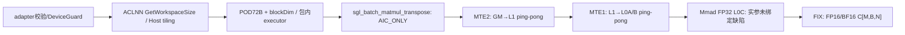

# BatchMatmulTranspose A2/A3 ACLNN 算子知识

## 算子速览

| 项目 | 内容 |
|---|---|
| 实际入口 | `aclnnSglBatchMatmulTransposeGetWorkspaceSize / aclnnSglBatchMatmulTranspose`，公开ACLNN；Torch adapter转发 |
| 计算语义 | `C[m,b,n]=Σk A[m,b,k]·W[b,k,n]`，调用方C原地覆盖；FP16/BF16输入、FP32累加后Fixpipe回原dtype |
| 输入输出 | A[M,B,K]、C[M,B,N] ND；权重ND[B,K,N]或显式ND承载NZ[B,N/16,K,16]；连续、同NPU/dtype、C不重叠A/B |
| 执行类型 | 单Kernel AIC_CUBE，非MIX、无AIV节点 |
| Kernel 路线 | 8个Host可达实例：swizzle0/1×FP16/BF16×ND/NZ，TA/TB固定false。quant_mode仅metadata别名 |
| 核心资源 | 自有workspace0；L1两半各262144B，L0A/B两半各32768B；L0C需要4·m_round·n_round B，但成员l0c_buf没有实际绑定 |
| 来源闭包 | `source_closed`：精确Host/POD/router与自有搬运、Mmad、Fixpipe已追到固定SDK primitive；存在确定的静态未初始化L0C参数，闭包不代表可安全复用 |
| 验证状态 | draft；本次未执行安装、编译、真机、数值或性能测试。m_actual=1的A搬运按32B上取整，需真实可读padding，不由连续性保证 |

## 接口与语义

### 计算语义

令Wnz[b,j,k,r]=W[b,k,16j+r]，NZ是显式四维物理排列，ACL descriptor仍为ND。C的物理地址为`(m*B+b)*N+n`；不是普通[B,M,N]输出。A地址为`(m*B+b)*K+k`。A/B不修改，C覆盖而非累加。无bias、激活、数值量化或反量化；三个quant_mode值被转为POD quantMode=0/1/2，但Device不读该字段。

数学合同与可复用实现必须区分：本版本`PpMatmulEinSum::Init`只取得L1/L0A/L0B，未给成员`l0c_buf`赋值，随后把它传给Mad/Fixpipe。固定SDK的LocalTensor默认构造为空体，基类TBuffAddr address_没有默认初始化，MmadImpl会读取dst.GetPhyAddr；因此不能假设L0C地址0或容量有效，也不能宣称以上公式已真机实现正确。

### 输入、输出与属性

| 参数 | shape/layout | dtype | 约束、默认值与语义 |
|---|---|---|---|
| tensor_a | [M,B,K]连续ND | FP16/BF16 | 1≤M≤1024、各维正、numel≤UINT32_MAX |
| tensor_b | ND[B,K,N]；NZ[B,N/16,K,16]连续ND descriptor | 与A同 | NZ K/N整除16；显式打包 |
| tensor_c | [M,B,N]连续ND | 与A同 | 同device、numel正且≤UINT32_MAX；不可与A/B重叠 |
| format_mode | string | — | 默认ND；仅ND/NZ |
| quant_mode | string | — | 默认per_channel_symm；per_channel_asymm/per_token_symm仍执行同一浮点语义 |
| workspace / size | byte span / uint64 | uint8 | GetWorkspaceSize返回量，adapter按真实返回分配；自有Tiling请求0 |
| executor / stream | ACLNN opaque/current NPU stream | — | generated bridge/运行时owner边界 |
| 返回 | None/Torch；ACL状态码 | — | Torch函数写C返回None，launch错误TORCH_CHECK |

### 入口与版本

固定SGL commit `dda6d36b0cdb4081e102d14c0a2fb276fc416e69`，基线CANN9.1.0为README/CI配置事实。额外SDK源码固定官方asc-devkit v9.1.0提交`e5451c7feba11f9e259f4fbc19c4bf82f8c0496c`；不保证任意同版本二进制SDK完全相同。公开产品表、CMake SUPPORTED_ARCHS2201、OpDef ascend910b/ascend910_93一致支持A2/A3；公开明确950原生不支持，本卡不扩到950。

已完整读取并复用[交错矩阵乘与NZ打包API](../../../../apis/sgl_kernel_npu/sgl_batch_matmul_transpose.md)。其合同作为调用面知识保留；本卡补完整源码与静态限制。新native域`csrc/matmul/batch_matmul_transpose`为实际构建入口；旧`csrc/batch_matmul_transpose`仅有公共tiling include命中其类型声明，不把旧Host/Device当当前实现。

## Host/Launcher 执行流程

### 参数校验与前处理

Torch adapter顺序：format/quant合法值→A NPU→3tensor同device→dtype组合→rank→连续及numel正/上限→M上限→B/K匹配及NZ约束→C shape→assert_no_overlap(C,A/B)→DeviceGuard→解析两个包内ACLNN符号→构造ND descriptors→query→分配byte workspace→record_stream→RunOpApi执行。不做Contiguous/ViewCopy或NZ隐式转换。

原生Tiling callback另检查context、A/B shape/desc、attrs、rank、各维正且乘积≤UINT32_MAX、M≤1024、batch/K匹配、NZ最后维16且K%16==0、C数学元素数上限、A/B dtype一致。它不独立完整验证调用方实际C shape/alias；不能把Torch guard泛化到裸ACLNN。失败返回GRAPH_FAILED；成功memcpy72B POD、SetDataSize72、SetBlockDim、外层SetTilingKey(0)，自有workspace[0]=0。外层key0与POD内部tilingKey不是同一selector。

### 参数、Workspace 与生命周期

sgl_cann::op_api_symbol从当前extension旁的包内vendor libcust_opapi.so解析，RTLD_NOW|LOCAL，handle静态保持。query失败中止；workspace size要求≤INT64_MAX，再at::empty(byte)；query实际可能包括框架开销，不能仅凭自有ws0假设wrapper无分配。shared_ptr descriptors持有ACL tensor，lambda捕获3tensor/descriptors/workspace/executor/current aclStream；3tensor与workspace均record_stream以保护异步Device使用。execute失败TORCH_CHECK；executor的底层销毁/复用由生成ACLNN框架负责，固定SGL无手工释放实现。

Tiling raw GM数据由CANN管理并保活到Kernel消费；Device只读。C不得与A或B重叠为公开合同；A/B只读，公开合同未禁止两者互相别名，C每个输出tile独占，无atomic。UB及寄存器无自有缓冲；不是KFC/Matmul库通信，本卡不套用其系统16MiB workspace或MIX核映射。

### 启动图与失败传播



单kernel grid=Host blockDim=min(B*mLoop*nLoop,coreNumAic)，Device读GetBlockNum/GetBlockIdx，按loop_idx+=num_core轮转tile，无AIV SubBlock。entry先SetPadding0、SetNdpara(1,0,0)、SetAtomicnone，再按POD内部key>>2分发。unknown masked_key的default直接break且不写C/不报错；正常Host只产生后述8个key。无空tensor成功Route，Torch/Host都拒绝正数合同外形状。

## Route 与参数设计

### 分核与资源计算

1. info=`B,M,K,N`、dtype三项同、formatA/C=ND、formatB由属性、mmType=EIN_SUM、transA/B=false、bias/isInt8=false、in/outDtype=2.0。HardwareInfo从PlatformInfo singleton读AIC核数、L2/L1/L0A/B/C容量，uint64平台容量保存到uint32字段；HBM/L2带宽成本常数1/5，socType硬编码ASCEND_910C，不能当运行时产品识别。
2. M<N选`TilingFunc<false>`，否则true。优先轴/另一轴从16按×2枚举，最大`512/inDtype=256`，受round后的shape边界与`4*m0*n0≤hw.l0cSize`约束。源码roundBase为`pow(2,ceil(log(ceil(axis/16))))*16`，使用自然log，不能改写为log2。
3. CostFunc计算mLoop/nLoop、coreNeed、blockDim=min(coreNeed,cores)，按L2工作集调整aCoef/bCoef到5，再cost=1/(aCoef*n0)+1/(bCoef*m0)，只在cost<当前最小值时SetBaseOp。SetBaseOp令coreLoop=B*mLoop*nLoop；transB优化因false不达。
4. Swizzl遍历i=1…blockDim，c=ceil(blockDim/i)，比较`i*n0+M < m0*c+N`决定当前方向并更新成本/条带计数。swizzlDirect每轮都会赋值，返回末轮方向；swizzlCount按最佳成本保存，不能误写成“方向与count始终一起保存最优组合”。
5. End非int8路径`k0Max=floor_float(262144/((m0+n0)*2))`；若<256向下对齐16，否则向下对齐256；结果>512再向下对齐512。kLoop=CeilDiv(K,k0)。Host最后要求m0/k0/n0/三loop/blockDim非0，但无统一乘积/加法溢出guard。
6. 每输出tile mr=align16(m_actual)、nr=align16(n_actual)；内层`kp=floor(16384/max(mr,nr)/16)*16`元素，将每个L1 K tile拆成ceil(k_actual/kp)个L0片。L0A/B每半32768B，`2*mr*kp≤32768、2*nr*kp≤32768`；L0C理论需求4mrnr，实际l0c_buf未绑定。

### Route 选择

| 顺序 | Route | Key/模板 | 精确选择条件与优先级 | 不适用去向 |
|---:|---|---|---|---|
| 1 | R-001 | POD key=1168, masked=292 | dtype=half,format=ND,Swizzl返回0，其余公共合同 | 其他合法组合→对应实例；不合法Host失败 |
| 2 | R-002 | POD key=1172, masked=293 | dtype=half,format=NZ,Swizzl返回0，其余公共合同 | 其他合法组合→对应实例；不合法Host失败 |
| 3 | R-003 | POD key=2336, masked=584 | dtype=__bf16,format=ND,Swizzl返回0，其余公共合同 | 其他合法组合→对应实例；不合法Host失败 |
| 4 | R-004 | POD key=2340, masked=585 | dtype=__bf16,format=NZ,Swizzl返回0，其余公共合同 | 其他合法组合→对应实例；不合法Host失败 |
| 5 | R-005 | POD key=33936, masked=8484 | dtype=half,format=ND,Swizzl返回1，其余公共合同 | 其他合法组合→对应实例；不合法Host失败 |
| 6 | R-006 | POD key=33940, masked=8485 | dtype=half,format=NZ,Swizzl返回1，其余公共合同 | 其他合法组合→对应实例；不合法Host失败 |
| 7 | R-007 | POD key=35104, masked=8776 | dtype=__bf16,format=ND,Swizzl返回1，其余公共合同 | 其他合法组合→对应实例；不合法Host失败 |
| 8 | R-008 | POD key=35108, masked=8777 | dtype=__bf16,format=NZ,Swizzl返回1，其余公共合同 | 其他合法组合→对应实例；不合法Host失败 |

```text
公开ACLNN/adapter校验 -> dtype FP16/BF16, format ND/NZ, quant metadata0/1/2
TilingFunc(M<N ? false:true) -> baseM/baseN -> Swizzl direct0/1/count
End -> baseK -> POD72B -> kernel entry(POD.key>>2)
8个Host生成key -> 对应PpMatmulEinSum<dir,false,false,T,T,format>
其余raw key -> switch default break，无输出/无自有错误
```

### 模板/实现执行矩阵

| Route | key/selector | dtype/shape/platform 完整命中条件 | 执行族与 kernel 节点 | 实际模板/body | 内存与同步特征 | tail/fallback |
|---|---|---|---|---|---|---|
| R-001 | 1168>>2=292 | A2/A3、公共shape、half、ND、direct0 | 单AIC_CUBE | PpMatmulEinSum<0,false,false,half,half,DataFormat::ND>::Init/Process | L1/L0 ping-pong、MTE/FIX flags；l0c未绑定 | m/n/k actual/align16；m_actual1特殊A搬运；无算法fallback |
| R-002 | 1172>>2=293 | A2/A3、公共shape、half、NZ、direct0 | 单AIC_CUBE | PpMatmulEinSum<0,false,false,half,half,DataFormat::NZ>::Init/Process | L1/L0 ping-pong、MTE/FIX flags；l0c未绑定 | m/n/k actual/align16；m_actual1特殊A搬运；无算法fallback |
| R-003 | 2336>>2=584 | A2/A3、公共shape、__bf16、ND、direct0 | 单AIC_CUBE | PpMatmulEinSum<0,false,false,__bf16,__bf16,DataFormat::ND>::Init/Process | L1/L0 ping-pong、MTE/FIX flags；l0c未绑定 | m/n/k actual/align16；m_actual1特殊A搬运；无算法fallback |
| R-004 | 2340>>2=585 | A2/A3、公共shape、__bf16、NZ、direct0 | 单AIC_CUBE | PpMatmulEinSum<0,false,false,__bf16,__bf16,DataFormat::NZ>::Init/Process | L1/L0 ping-pong、MTE/FIX flags；l0c未绑定 | m/n/k actual/align16；m_actual1特殊A搬运；无算法fallback |
| R-005 | 33936>>2=8484 | A2/A3、公共shape、half、ND、direct1 | 单AIC_CUBE | PpMatmulEinSum<1,false,false,half,half,DataFormat::ND>::Init/Process | L1/L0 ping-pong、MTE/FIX flags；l0c未绑定 | m/n/k actual/align16；m_actual1特殊A搬运；无算法fallback |
| R-006 | 33940>>2=8485 | A2/A3、公共shape、half、NZ、direct1 | 单AIC_CUBE | PpMatmulEinSum<1,false,false,half,half,DataFormat::NZ>::Init/Process | L1/L0 ping-pong、MTE/FIX flags；l0c未绑定 | m/n/k actual/align16；m_actual1特殊A搬运；无算法fallback |
| R-007 | 35104>>2=8776 | A2/A3、公共shape、__bf16、ND、direct1 | 单AIC_CUBE | PpMatmulEinSum<1,false,false,__bf16,__bf16,DataFormat::ND>::Init/Process | L1/L0 ping-pong、MTE/FIX flags；l0c未绑定 | m/n/k actual/align16；m_actual1特殊A搬运；无算法fallback |
| R-008 | 35108>>2=8777 | A2/A3、公共shape、__bf16、NZ、direct1 | 单AIC_CUBE | PpMatmulEinSum<1,false,false,__bf16,__bf16,DataFormat::NZ>::Init/Process | L1/L0 ping-pong、MTE/FIX flags；l0c未绑定 | m/n/k actual/align16；m_actual1特殊A搬运；无算法fallback |

switch中TA/TB为true的实例与部分key别名没有本公开Host producer；Host transA/transB固定false，不将它们写成可达Route。quantMode三值每个key均可达，但不改变key/body/memory/precision，故逐值登记而非拆成量化算子。

### 隐藏性能 Guard

| Guard | Host/Tiling 条件 | Device/资源原因 | 影响 Route | 不满足时去向 | 源码符号 |
|---|---|---|---|---|---|
| 非空/正维/上限 | 每tensor≤UINT32_MAX；M≤1024 | POD uint32与DMA/index范围 | 全部 | TORCH_CHECK/GRAPH_FAILED | adapter/Host callback |
| L0C候选 | 4*m0*n0≤hw.l0cSize | FP32 tile容量候选 | 全部 | 跳过candidate；最终零base失败 | TilingFunc |
| L1预算 | End分配(m0+n0)*2*k0≤262144名义单半预算 | 双半L1总512KiB | 全部 | k0对齐后若0最终失败 | End |
| L0片长 | kp由mr/nr推导，Host无额外guard | 每半L0A/B32768B | 全部 | 无显式fallback，依赖候选有效/算术无溢出 | Process144 |
| stride65536 | ND2NZ dVal<65536走整体，否则逐行；NZ srcStride<65536否则逐burst | 2201 Nd2NzParams uint16 stride | ND/NZ对应搬运 | 自有逐行/逐burst分支 | gm_to_l1 |
| 单行A padding | m_actual==1走ND→ND，DMA按ceil(Kactual/16)*32B | source真实可读span可能超过逻辑尾 | 全部单行子路径 | 无storage padding guard | gm_to_l1 ND/ND |
| L0C绑定 | 没有l0c_buf=GetBuffer等赋值 | Mmad/Fixpipe读取未初始化descriptor | 全部 | 无自有修复/fallback，draft静态缺陷 | Init / l0c_buf成员 |
| 核数/整数 | coreNumAic与内层乘积未全检查 | modulo、CeilDiv、loop/core数的窄化溢出 | 全部 | 某些最终0字段失败，不保证覆盖全部异常 | PlatformInfo/CostFunc/SetBaseOp |

### POD/ABI

结构`BatchMatmulTransposeTilingData`在`#pragma pack(1)`内，静态布局sizeof72、alignof1；OpShape为7个uint32、sizeof28/align4。以下偏移按固定字段顺序与标准uint32布局静态推导，未编译测量；raw memcpy与Device reinterpret_cast共享同一头。MatMulInfo为Host结构，不跨GM传递，常规ABI sizeof60/align4；bool连续4字节、float32及enum uint32。HardwareInfo常规sizeof32/align4。若工具链改变基础ABI需复核。

| 结构 | 字段 | 类型/位宽 | ABI 布局 | 单位 | Host/launcher producer | Device consumer | 边界 |
|---|---|---|---|---|---|---|---|
| BatchMatmulTransposeTilingData | opShape.batchSize | uint32 | offset0,size4,结构align1 | 元素/循环/core，依字段 | B | Init::batch_size | inactive字段仍按默认初始化 |
| BatchMatmulTransposeTilingData | opShape.m | uint32 | offset4,size4,结构align1 | 元素/循环/core，依字段 | M | Init::m | inactive字段仍按默认初始化 |
| BatchMatmulTransposeTilingData | opShape.k | uint32 | offset8,size4,结构align1 | 元素/循环/core，依字段 | K | Init::k | inactive字段仍按默认初始化 |
| BatchMatmulTransposeTilingData | opShape.n | uint32 | offset12,size4,结构align1 | 元素/循环/core，依字段 | N | Init::n | inactive字段仍按默认初始化 |
| BatchMatmulTransposeTilingData | opShape.m0 | uint32 | offset16,size4,结构align1 | 元素/循环/core，依字段 | TilingFunc→SetBaseOp选mBase | Init::m0 | inactive字段仍按默认初始化 |
| BatchMatmulTransposeTilingData | opShape.k0 | uint32 | offset20,size4,结构align1 | 元素/循环/core，依字段 | End的L1预算与向下对齐 | Init::k0 | inactive字段仍按默认初始化 |
| BatchMatmulTransposeTilingData | opShape.n0 | uint32 | offset24,size4,结构align1 | 元素/循环/core，依字段 | TilingFunc→SetBaseOp选nBase | Init::n0 | inactive字段仍按默认初始化 |
| BatchMatmulTransposeTilingData | mLoop | uint32 | offset28,size4,结构align1 | 元素/循环/core，依字段 | ceil(M/m0) | tdim.m | inactive字段仍按默认初始化 |
| BatchMatmulTransposeTilingData | kLoop | uint32 | offset32,size4,结构align1 | 元素/循环/core，依字段 | ceil(K/k0) | tdim.k | inactive字段仍按默认初始化 |
| BatchMatmulTransposeTilingData | nLoop | uint32 | offset36,size4,结构align1 | 元素/循环/core，依字段 | ceil(N/n0) | tdim.n | inactive字段仍按默认初始化 |
| BatchMatmulTransposeTilingData | coreLoop | uint32 | offset40,size4,结构align1 | 元素/循环/core，依字段 | B*mLoop*nLoop | loop_idx终点 | inactive字段仍按默认初始化 |
| BatchMatmulTransposeTilingData | swizzlCount | uint32 | offset44,size4,结构align1 | 元素/循环/core，依字段 | Swizzl成本循环保存i | GetBlockIdx条带宽 | inactive字段仍按默认初始化 |
| BatchMatmulTransposeTilingData | tilingKey | uint32 | offset48,size4,结构align1 | key/标志 | SetTilingKey精确编码 | entry >>2 switch | inactive字段仍按默认初始化 |
| BatchMatmulTransposeTilingData | blockDim | uint32 | offset52,size4,结构align1 | 元素/循环/core，依字段 | min(coreLoop,coreNumAic) | Host SetBlockDim；Device以GetBlockNum取实际值 | inactive字段仍按默认初始化 |
| BatchMatmulTransposeTilingData | swizzlDirect | uint32 | offset56,size4,结构align1 | key/标志 | Swizzl返回方向0/1 | 保存在POD；Device不直接读，仅key承载 | inactive字段仍按默认初始化 |
| BatchMatmulTransposeTilingData | splitk | uint32 | offset60,size4,结构align1 | key/标志 | 默认0 | 当前Device不读 | inactive字段仍按默认初始化 |
| BatchMatmulTransposeTilingData | enShuffleK | uint32 | offset64,size4,结构align1 | key/标志 | 默认0 | Init读后控制K轮转；公开Host恒0 | inactive字段仍按默认初始化 |
| BatchMatmulTransposeTilingData | quantMode | uint32 | offset68,size4,结构align1 | key/标志 | 属性0/1/2 | Device不读 | inactive字段仍按默认初始化 |
| MatMulInfo(Host) | batchSize | uint32 | 常规offset0，非GM POD | Host属性 | B，A.shape[1] | 调度batch | key相关默认值不得遗漏 |
| MatMulInfo(Host) | m | uint32 | 常规offset4，非GM POD | Host属性 | M，A.shape[0] | mLoop/地址 | key相关默认值不得遗漏 |
| MatMulInfo(Host) | k | uint32 | 常规offset8，非GM POD | Host属性 | K，A.shape[2] | kLoop/归约 | key相关默认值不得遗漏 |
| MatMulInfo(Host) | n | uint32 | 常规offset12，非GM POD | Host属性 | N，B末维或NZ第二维*16 | nLoop/地址 | key相关默认值不得遗漏 |
| MatMulInfo(Host) | dtypeA | enum:uint32 | 常规offset16，非GM POD | Host属性 | FP16→0、BF16→1 | G_DTYPE_MAP编码1/2 | key相关默认值不得遗漏 |
| MatMulInfo(Host) | dtypeB | enum:uint32 | 常规offset20，非GM POD | Host属性 | 与dtypeA相同 | key | key相关默认值不得遗漏 |
| MatMulInfo(Host) | dtypeC | enum:uint32 | 常规offset24，非GM POD | Host属性 | 与dtypeA相同 | key | key相关默认值不得遗漏 |
| MatMulInfo(Host) | formatA | enum:uint32 | 常规offset28，非GM POD | Host属性 | 默认ND=0 | key | key相关默认值不得遗漏 |
| MatMulInfo(Host) | formatB | enum:uint32 | 常规offset32，非GM POD | Host属性 | ND0/NZ1由format_mode | key/搬运 | key相关默认值不得遗漏 |
| MatMulInfo(Host) | formatC | enum:uint32 | 常规offset36，非GM POD | Host属性 | 默认ND0 | key | key相关默认值不得遗漏 |
| MatMulInfo(Host) | mmType | enum:uint32 | 常规offset40，非GM POD | Host属性 | Host固定MATMUL_EIN_SUM=4 | 选择完整key编码 | key相关默认值不得遗漏 |
| MatMulInfo(Host) | transA | bool8 | 常规offset44，非GM POD | Host属性 | 默认false | 固定TAfalse | key相关默认值不得遗漏 |
| MatMulInfo(Host) | transB | bool8 | 常规offset45，非GM POD | Host属性 | 默认false | 固定TBfalse，SetBaseOp的transB优化不达 | key相关默认值不得遗漏 |
| MatMulInfo(Host) | biasFlag | bool8 | 常规offset46，非GM POD | Host属性 | 默认false | key，无bias | key相关默认值不得遗漏 |
| MatMulInfo(Host) | isInt8 | bool8 | 常规offset47，非GM POD | Host属性 | 默认false | 量化资源分支不达 | key相关默认值不得遗漏 |
| MatMulInfo(Host) | inDtype | float32 | 常规offset48，非GM POD | Host属性 | Host赋2.0f | tile字节预算 | key相关默认值不得遗漏 |
| MatMulInfo(Host) | outDtype | float32 | 常规offset52，非GM POD | Host属性 | Host赋2.0f | 当前实现不读 | key相关默认值不得遗漏 |
| MatMulInfo(Host) | quantMode | enum:uint32 | 常规offset56，非GM POD | Host属性 | 属性0/1/2 | POD保存，不参与数值 | key相关默认值不得遗漏 |
| HardwareInfo(Host) | coreNum | uint32 | offset0,size4 | AIC核 | PlatformInfo对应查询，coreNum取AIC | TilingFunc/CostFunc/End相应预算；部分容量仅保存 | uint64查询值保存uint32，无显式窄化检查 |
| HardwareInfo(Host) | l2Size | uint32 | offset4,size4 | 字节 | PlatformInfo对应查询，coreNum取AIC | TilingFunc/CostFunc/End相应预算；部分容量仅保存 | uint64查询值保存uint32，无显式窄化检查 |
| HardwareInfo(Host) | l1Size | uint32 | offset8,size4 | 字节 | PlatformInfo对应查询，coreNum取AIC | TilingFunc/CostFunc/End相应预算；部分容量仅保存 | uint64查询值保存uint32，无显式窄化检查 |
| HardwareInfo(Host) | l0aSize | uint32 | offset12,size4 | 字节 | PlatformInfo对应查询，coreNum取AIC | TilingFunc/CostFunc/End相应预算；部分容量仅保存 | uint64查询值保存uint32，无显式窄化检查 |
| HardwareInfo(Host) | l0bSize | uint32 | offset16,size4 | 字节 | PlatformInfo对应查询，coreNum取AIC | TilingFunc/CostFunc/End相应预算；部分容量仅保存 | uint64查询值保存uint32，无显式窄化检查 |
| HardwareInfo(Host) | l0cSize | uint32 | offset20,size4 | 字节 | PlatformInfo对应查询，coreNum取AIC | TilingFunc/CostFunc/End相应预算；部分容量仅保存 | uint64查询值保存uint32，无显式窄化检查 |
| HardwareInfo(Host) | hbmBandWidth | uint32 | offset24,size4 | 成本常数 | 构造常数1 | TilingFunc/CostFunc/End相应预算；部分容量仅保存 | uint64查询值保存uint32，无显式窄化检查 |
| HardwareInfo(Host) | l2BandWidth | uint32 | offset28,size4 | 成本常数 | 构造常数5 | TilingFunc/CostFunc/End相应预算；部分容量仅保存 | uint64查询值保存uint32，无显式窄化检查 |

Kernel ABI为5个GM_ADDR：gm_a/gm_b/gm_c/workspace/gm_tiling_data；依次由generated launcher提供，workspace当前body完全不读，最后指针读72B POD。GM_ADDR物理参数ABI/生成executor内部布局属于CANN generated bridge边界，不补造其offset。MatCoord为Device局部三个uint64(m,k,n)，通常sizeof24/align8，不跨Host传递。

### Route 源码闭包

| Route | Key/selector | Host/Tiling producer | POD/参数 | Kernel entry/router | Kernel body/直接依赖 | 构建接线 |
|---|---|---|---|---|---|---|
| R-001 | key1168 | callback→TilingFunc→Swizzl→End | 同一72B POD | sgl_batch_matmul_transpose case292 | PpMatmulEinSum<0,false,false,half,half,ND>；gm_to_l1/l1_to_l0/mmad/l0c_to_gm | 当前域CMake ID/SglBatchMatmulTranspose，CANN codegen/tiling/kernel，2201 |
| R-002 | key1172 | callback→TilingFunc→Swizzl→End | 同一72B POD | sgl_batch_matmul_transpose case293 | PpMatmulEinSum<0,false,false,half,half,NZ>；gm_to_l1/l1_to_l0/mmad/l0c_to_gm | 当前域CMake ID/SglBatchMatmulTranspose，CANN codegen/tiling/kernel，2201 |
| R-003 | key2336 | callback→TilingFunc→Swizzl→End | 同一72B POD | sgl_batch_matmul_transpose case584 | PpMatmulEinSum<0,false,false,__bf16,__bf16,ND>；gm_to_l1/l1_to_l0/mmad/l0c_to_gm | 当前域CMake ID/SglBatchMatmulTranspose，CANN codegen/tiling/kernel，2201 |
| R-004 | key2340 | callback→TilingFunc→Swizzl→End | 同一72B POD | sgl_batch_matmul_transpose case585 | PpMatmulEinSum<0,false,false,__bf16,__bf16,NZ>；gm_to_l1/l1_to_l0/mmad/l0c_to_gm | 当前域CMake ID/SglBatchMatmulTranspose，CANN codegen/tiling/kernel，2201 |
| R-005 | key33936 | callback→TilingFunc→Swizzl→End | 同一72B POD | sgl_batch_matmul_transpose case8484 | PpMatmulEinSum<1,false,false,half,half,ND>；gm_to_l1/l1_to_l0/mmad/l0c_to_gm | 当前域CMake ID/SglBatchMatmulTranspose，CANN codegen/tiling/kernel，2201 |
| R-006 | key33940 | callback→TilingFunc→Swizzl→End | 同一72B POD | sgl_batch_matmul_transpose case8485 | PpMatmulEinSum<1,false,false,half,half,NZ>；gm_to_l1/l1_to_l0/mmad/l0c_to_gm | 当前域CMake ID/SglBatchMatmulTranspose，CANN codegen/tiling/kernel，2201 |
| R-007 | key35104 | callback→TilingFunc→Swizzl→End | 同一72B POD | sgl_batch_matmul_transpose case8776 | PpMatmulEinSum<1,false,false,__bf16,__bf16,ND>；gm_to_l1/l1_to_l0/mmad/l0c_to_gm | 当前域CMake ID/SglBatchMatmulTranspose，CANN codegen/tiling/kernel，2201 |
| R-008 | key35108 | callback→TilingFunc→Swizzl→End | 同一72B POD | sgl_batch_matmul_transpose case8777 | PpMatmulEinSum<1,false,false,__bf16,__bf16,NZ>；gm_to_l1/l1_to_l0/mmad/l0c_to_gm | 当前域CMake ID/SglBatchMatmulTranspose，CANN codegen/tiling/kernel，2201 |

## Kernel 实现

### 公共执行流程

Init读B/M/K/N/base/loop/coreLoop/swizzlCount/enShuffleK；AsdopsBuffer把L1/L0A/B/C各物理池绑定到地址0及对应logicPos，但当前对象仅提取L1 A/B、L0A/B，未提取其L0C到l0c_buf。不能把另一个buf对象内部有效L0C descriptor视为已赋给成员。

Process预置MTE1→MTE2事件0…3、FIX→M事件0、M→MTE1事件0/1。每核loop_idx=core_idx;loop_idx<coreLoop;loop_idx+=num_core，batch_idx=loop_idx/(mLoop*nLoop)，GetBlockIdx在该batch内蛇形映射m/n tile：
direct0按m条带swizzlCount分组，条带内m先变、n后变，奇条带反向n；direct1按n条带分组，n先变、m后变，奇条带反向m；最后不足条带使用实际n_row/n_col。

TA/TB=false时A基础元素offset=tm*m0*B*K+b*K+tk*k0；B_ND=b*K*N+tk*k0*N+tn*n0；B_NZ=b*align16(K)*align16(N)+tk*k0*16+tn*n0*align16(K)；C=tm*m0*B*N+b*N+tn*n0。公开NZ K/N整除16，正好对应[B,N/16,K,16]物理排列。enShuffleK由默认0保证K顺序0…kLoop-1。

首个输出tile先load当前K；循环内预取下一K，最后K则预取本核下一个输出tile的首K。两个L1 half轮换，A/B分别使用事件0/1与2/3。L0内每个K片按fidx%2轮换，M→MTE1等待后才能覆盖，LoadData后MTE1→M通知，Mmad首次initC=true清累加，其他片沿用C；每次PIPE_BARRIER(M)再归还L0槽。最终M→FIX→Fixpipe→FIX→M，阻止后继tile覆盖未搬出的C；退出前耗尽所有预置flag并PipeBarrier(ALL)。

```text
# 源码等价伪码，仅TA=TB=false的公开可达路径
Init(POD); bind L1A/B,L0A/B; l0c_buf remains unassigned
for output_tile = core_idx; output_tile < coreLoop; output_tile += num_core:
  (batch,tm,tn)=swizzle(output_tile); derive ma/na,mr/nr,kp
  if first tile on this core: load current A/B to current L1 half
  for tk in [0,kLoop):
    prefetch next K, or next output tile first K, into alternate L1 half
    for f in [0,ceil(ka/kp)):
      wait MTE2 first fragment; wait M->MTE1 free slot
      LoadData current L1 to L0A/B at (f%2)*32768 bytes
      release L1 on last fragment; MTE1->M wait
      Mmad(l0c_buf,A0,B0,ma,na,ka_fragment,initC=(tk==0 && f==0))
      barrier M; release M->MTE1 L0 slot
    ping_flag ^= 1
  wait M->FIX; Fixpipe(l0c_buf -> C, ma,na,srcStride=mr,dstStride=B*N)
  release FIX->M
drain flags; barrier ALL
```

A若ma=1走ND→ND DataCopy，burstCount1、blockLen=ceil(ka/16)，每块32B，源stride0；L1→L0A为VECTOR load2d，repeat=ceil(align16(ka_fragment)/256)，srcStride1、dstGap0。其余A走ND2NZ，nValue=ma,dValue=ka,srcDValue=B*K,dstNzC0Stride=mr,dstNzNStride1；B_ND走ND2NZ nValue=ka,dValue=na,srcDValue=N,dstNzC0Stride=kr；B_NZ走DataCopy nBurst=nr/16,blockLen=kr,srcGap=align16(K)-kr,dstGap0，单位32B。stride≥65536采用同语义逐行/逐burst搬运。

L1→L0A矩阵分支mTileCeil=mr,kPartCeil=kfr,mSrcStride1,kSrcStride=mr/16,mDstStride=kfr/16,kDstStride1；helper每16行执行LoadData repeat=kfr/16、不转置。L1→L0B nTileCeil=nr,kPartCeil=kfr,nSrcStride=kr/16,kSrcStride1,nDstStride1,kDstStride=nr/16；helper沿K每16片LoadData repeat=nr/16、transpose=true。Mad当前为`mmad<V220,T,T,float,false>`，MmadParams(ma,na,kfa,unitFlag0,cmatrixSource=false,cmatrixInitVal=initC)。Fixpipe V220 row-major，nSize=na,mSize=ma,srcStride=mr,dstStride=B*N,enRelu=false,quantPre=F322F16或F322BF16，非数值量化。

### Route R-001：half、ND、swizzle0

#### 适用条件

公共合同成立，dtype=half、format=ND、Host Swizzl返回0；POD key=1168，masked=292。quantMode0/1/2都可达且不改变Device数值。ma=1/ma>1、K多tile/尾片、stride短/长均由公共完整body覆盖。

##### 选择证据

| 层级 | 文件 | 符号 | 源码谓词/参数 | 结果/下一跳 |
|---|---|---|---|---|
| Host | csrc/matmul/batch_matmul_transpose/op_host/tiling/tiling_data.cpp | SetTilingKey | dir0,TA0,TB0,dtype码1,formatB0 | key1168 |
| router | csrc/matmul/batch_matmul_transpose/op_kernel/batch_matmul_transpose_kernel.cpp | switch(masked_key) | key>>2=292 | PpMatmulEinSum<0,false,false,half,half,DataFormat::ND> |

#### Device 数据流

##### 函数级调用链

```text
aclnnSglBatchMatmulTranspose
 -> sgl_batch_matmul_transpose(POD.key=1168)
 -> PpMatmulEinSum<0,false,false,half,half,ND>::Init/Process
 -> gm_to_l1 -> l1_to_l0_a/b -> Mmad -> l0c_to_gm/Fixpipe
```

##### 源码等价伪码

使用公共伪码，GetBlockIdx取direct0，B地址与GM→L1搬运取ND。T=half为2B，acc FP32；无AIV epilogue。首Mmad的initC只清累加数值，不修复未初始化l0c_buf descriptor。

#### 内存与数据搬运

##### 资源与搬运表

| 层级/缓冲区 | offset/地址公式 | extent/容量公式 | dtype/layout | producer | consumer | owner/lifetime | 对齐/复用 |
|---|---|---|---|---|---|---|---|
| GM A/B/C | 见公共元素offset，乘2为字节 | 2MBK / 2BKN / 2MBN B | half；B=ND | caller / FIX输出 | MTE2 / 外部消费者 | caller+record_stream | C不alias；A单行DMA可能读padding |
| L1 A0/A1 | 0 /262144 B | 每半2mrkr B，base预算2m0k0 | half NZ或单行ND | MTE2 | MTE1 | 当前/预取tile | A基址0，半间距262144 |
| L1 B0/B1 | Aalign /262144+Aalign，Aalign=align256(2m0k0) | 每半2krnr B，base预算2k0n0 | half NZ | MTE2 | MTE1 | 当前/预取tile | 与A同半顺序不重叠需Aalign+2k0n0≤262144 |
| L0A | (f%2)*32768 B | 池65536B，半32768B；有效2mrkfr | half ZZ/VECTOR | MTE1 | Mmad | 当前/后续K片 | M→MTE1保护覆盖 |
| L0B | (f%2)*32768 B | 池65536B，半32768B；有效2kfrnr | half NZ | MTE1 | Mmad | 当前/后续K片 | 同上，LoadData transpose |
| L0C | 未绑定，地址/容量不可认定 | 理论4mrnr B，平台查询约束候选 | FP32 NZ | Mmad | FIX | 成员l0c_buf未初始化 | 不得把物理128KiB池存在当成员已绑定 |
| workspace / UB / 寄存器缓冲 | 无自有显式切片/分配 | workspace自有0；UB N/A AIC-only | — | 无 | 无 | — | 普通标量寄存器由compiler管理 |

##### 分层内存布局


无AIV/TQue/TBuf，因此无Vector独立UB布局；这是实际AIC-only路径。

##### 字节账、交接边与复用顺序

```text
workspace_custom = 0
L1 pool = 524288 B; ping0 [0,262144), ping1 [262144,524288)
Aalign = align256(2*m0*k0); 每半需 Aalign+2*k0*n0 <= 262144
L0A pool = L0B pool = 65536 B，双半32768B，不能再将65536乘2
L0C理论 = 4*mr*nr B，但实际l0c_buf未绑定，不填有效offset/capacity
常规有效元素GM名义读A=2*B*M*K*nLoop，B=2*B*K*N*mLoop；写C=2*B*M*N
单行A实际DMA名义请求 = 32*ceil(ka/16) 每次，可能大于2*ka；不等实际成功传输保证
```

L1预算证明以算术不溢出、base均16对齐为前提；此时2m0k0为256倍数，Aalign不增加gap。片上池由AsdopsBuffer地址映射而非动态malloc/Tpipe分配，member view引用硬件memory；局部buf对象离开Init不释放物理池。

| 边/复用子区 | producer | offset/extent | dtype/layout | consumer | ordering/sync | owner/lifetime | 安全条件 |
|---|---|---|---|---|---|---|---|
| L1 A半 | MTE2 | ping*262144 /2mrkr | 2B NZ/单行ND | MTE1 | MTE1→MTE2 free事件0/1；MTE2→MTE1 ready0/1 | 硬件池至最后LoadData | 预取使用另一半，最后片才归还 |
| L1 B半 | MTE2 | ping*262144+Aalign /2krnr | 2B NZ | MTE1 | 同协议事件2/3 | 同上 | A/B半区不重叠 |
| L0A/B半 | MTE1 | (f%2)*32768 /有效tile | 2B矩阵 | Mmad | M→MTE1 free0/1，MTE1→M ready0/1 | 每K片 | 计算完成才覆写 |
| L0C | Mmad | 未绑定 | FP32 | FIX | M→FIX0→Fixpipe→FIX→M0 | 每输出tile | 同步不修复无效descriptor |

#### 同步、精度与尾块

##### 同步与数值边界表

| 阶段 | primitive/机制 | producer | consumer/等待点 | 保护对象 | 精度/尾块 |
|---|---|---|---|---|---|
| GM→L1 | DataCopy / Nd2NzParams | GM | MTE1等MTE2事件 | 两半A/B | ma/na/ka真实extent；单行A32B向上请求 |
| L1→L0 | LoadData2d | MTE2 | Mmad等MTE1事件 | L0 ping-pong | mr/nr/kfr对齐16，Mmad只消费实际ka片 |
| Mmad | float acc、initC首次true | L0A/B | 后续K片/FIX | 未绑定L0C成员 | half乘法→FP32累加，非量化 |
| FIX | row-major,quantPre=F322F16 | M | GM C | srcStride=mr,dstStride=B*N | ma/na真实尾，enRelu=false |
| 结束 | wait所有预置事件+PipeBarrier(ALL) | 所有pipe | kernel返回 | 片上池再用 | 不等于Host已同步等待返回结果 |

#### 关键实现

##### 符号证据表

| 阶段 | 文件 | 符号/模板实例 | 实现事实 |
|---|---|---|---|
| Host/Tiling producer | csrc/matmul/batch_matmul_transpose/op_host/tiling/tiling_data.cpp | SetTilingKey/End | key1168、浮点tile预算 |
| Kernel entry/router | csrc/matmul/batch_matmul_transpose/op_kernel/batch_matmul_transpose_kernel.cpp | case 292 | half/ND/direct0 |
| Device body/helper | csrc/utils/kernel/device_prims/iterator.h | 当前gm_to_l1/l1_to_l0/mmad/l0c_to_gm实例 | 公共章节逐项给出真实DMA/LoadData/Mmad/Fixpipe参数 |

### Route R-002：half、NZ、swizzle0

#### 适用条件

公共合同成立，dtype=half、format=NZ、Host Swizzl返回0；POD key=1172，masked=293。quantMode0/1/2都可达且不改变Device数值。ma=1/ma>1、K多tile/尾片、stride短/长均由公共完整body覆盖。

##### 选择证据

| 层级 | 文件 | 符号 | 源码谓词/参数 | 结果/下一跳 |
|---|---|---|---|---|
| Host | csrc/matmul/batch_matmul_transpose/op_host/tiling/tiling_data.cpp | SetTilingKey | dir0,TA0,TB0,dtype码1,formatB1 | key1172 |
| router | csrc/matmul/batch_matmul_transpose/op_kernel/batch_matmul_transpose_kernel.cpp | switch(masked_key) | key>>2=293 | PpMatmulEinSum<0,false,false,half,half,DataFormat::NZ> |

#### Device 数据流

##### 函数级调用链

```text
aclnnSglBatchMatmulTranspose
 -> sgl_batch_matmul_transpose(POD.key=1172)
 -> PpMatmulEinSum<0,false,false,half,half,NZ>::Init/Process
 -> gm_to_l1 -> l1_to_l0_a/b -> Mmad -> l0c_to_gm/Fixpipe
```

##### 源码等价伪码

使用公共伪码，GetBlockIdx取direct0，B地址与GM→L1搬运取NZ。T=half为2B，acc FP32；无AIV epilogue。首Mmad的initC只清累加数值，不修复未初始化l0c_buf descriptor。

#### 内存与数据搬运

##### 资源与搬运表

| 层级/缓冲区 | offset/地址公式 | extent/容量公式 | dtype/layout | producer | consumer | owner/lifetime | 对齐/复用 |
|---|---|---|---|---|---|---|---|
| GM A/B/C | 见公共元素offset，乘2为字节 | 2MBK / 2BKN / 2MBN B | half；B=NZ | caller / FIX输出 | MTE2 / 外部消费者 | caller+record_stream | C不alias；A单行DMA可能读padding |
| L1 A0/A1 | 0 /262144 B | 每半2mrkr B，base预算2m0k0 | half NZ或单行ND | MTE2 | MTE1 | 当前/预取tile | A基址0，半间距262144 |
| L1 B0/B1 | Aalign /262144+Aalign，Aalign=align256(2m0k0) | 每半2krnr B，base预算2k0n0 | half NZ | MTE2 | MTE1 | 当前/预取tile | 与A同半顺序不重叠需Aalign+2k0n0≤262144 |
| L0A | (f%2)*32768 B | 池65536B，半32768B；有效2mrkfr | half ZZ/VECTOR | MTE1 | Mmad | 当前/后续K片 | M→MTE1保护覆盖 |
| L0B | (f%2)*32768 B | 池65536B，半32768B；有效2kfrnr | half NZ | MTE1 | Mmad | 当前/后续K片 | 同上，LoadData transpose |
| L0C | 未绑定，地址/容量不可认定 | 理论4mrnr B，平台查询约束候选 | FP32 NZ | Mmad | FIX | 成员l0c_buf未初始化 | 不得把物理128KiB池存在当成员已绑定 |
| workspace / UB / 寄存器缓冲 | 无自有显式切片/分配 | workspace自有0；UB N/A AIC-only | — | 无 | 无 | — | 普通标量寄存器由compiler管理 |

##### 分层内存布局


无AIV/TQue/TBuf，因此无Vector独立UB布局；这是实际AIC-only路径。

##### 字节账、交接边与复用顺序

```text
workspace_custom = 0
L1 pool = 524288 B; ping0 [0,262144), ping1 [262144,524288)
Aalign = align256(2*m0*k0); 每半需 Aalign+2*k0*n0 <= 262144
L0A pool = L0B pool = 65536 B，双半32768B，不能再将65536乘2
L0C理论 = 4*mr*nr B，但实际l0c_buf未绑定，不填有效offset/capacity
常规有效元素GM名义读A=2*B*M*K*nLoop，B=2*B*K*N*mLoop；写C=2*B*M*N
单行A实际DMA名义请求 = 32*ceil(ka/16) 每次，可能大于2*ka；不等实际成功传输保证
```

L1预算证明以算术不溢出、base均16对齐为前提；此时2m0k0为256倍数，Aalign不增加gap。片上池由AsdopsBuffer地址映射而非动态malloc/Tpipe分配，member view引用硬件memory；局部buf对象离开Init不释放物理池。

| 边/复用子区 | producer | offset/extent | dtype/layout | consumer | ordering/sync | owner/lifetime | 安全条件 |
|---|---|---|---|---|---|---|---|
| L1 A半 | MTE2 | ping*262144 /2mrkr | 2B NZ/单行ND | MTE1 | MTE1→MTE2 free事件0/1；MTE2→MTE1 ready0/1 | 硬件池至最后LoadData | 预取使用另一半，最后片才归还 |
| L1 B半 | MTE2 | ping*262144+Aalign /2krnr | 2B NZ | MTE1 | 同协议事件2/3 | 同上 | A/B半区不重叠 |
| L0A/B半 | MTE1 | (f%2)*32768 /有效tile | 2B矩阵 | Mmad | M→MTE1 free0/1，MTE1→M ready0/1 | 每K片 | 计算完成才覆写 |
| L0C | Mmad | 未绑定 | FP32 | FIX | M→FIX0→Fixpipe→FIX→M0 | 每输出tile | 同步不修复无效descriptor |

#### 同步、精度与尾块

##### 同步与数值边界表

| 阶段 | primitive/机制 | producer | consumer/等待点 | 保护对象 | 精度/尾块 |
|---|---|---|---|---|---|
| GM→L1 | DataCopy / Nd2NzParams | GM | MTE1等MTE2事件 | 两半A/B | ma/na/ka真实extent；单行A32B向上请求 |
| L1→L0 | LoadData2d | MTE2 | Mmad等MTE1事件 | L0 ping-pong | mr/nr/kfr对齐16，Mmad只消费实际ka片 |
| Mmad | float acc、initC首次true | L0A/B | 后续K片/FIX | 未绑定L0C成员 | half乘法→FP32累加，非量化 |
| FIX | row-major,quantPre=F322F16 | M | GM C | srcStride=mr,dstStride=B*N | ma/na真实尾，enRelu=false |
| 结束 | wait所有预置事件+PipeBarrier(ALL) | 所有pipe | kernel返回 | 片上池再用 | 不等于Host已同步等待返回结果 |

#### 关键实现

##### 符号证据表

| 阶段 | 文件 | 符号/模板实例 | 实现事实 |
|---|---|---|---|
| Host/Tiling producer | csrc/matmul/batch_matmul_transpose/op_host/tiling/tiling_data.cpp | SetTilingKey/End | key1172、浮点tile预算 |
| Kernel entry/router | csrc/matmul/batch_matmul_transpose/op_kernel/batch_matmul_transpose_kernel.cpp | case 293 | half/NZ/direct0 |
| Device body/helper | csrc/utils/kernel/device_prims/iterator.h | 当前gm_to_l1/l1_to_l0/mmad/l0c_to_gm实例 | 公共章节逐项给出真实DMA/LoadData/Mmad/Fixpipe参数 |

### Route R-003：__bf16、ND、swizzle0

#### 适用条件

公共合同成立，dtype=__bf16、format=ND、Host Swizzl返回0；POD key=2336，masked=584。quantMode0/1/2都可达且不改变Device数值。ma=1/ma>1、K多tile/尾片、stride短/长均由公共完整body覆盖。

##### 选择证据

| 层级 | 文件 | 符号 | 源码谓词/参数 | 结果/下一跳 |
|---|---|---|---|---|
| Host | csrc/matmul/batch_matmul_transpose/op_host/tiling/tiling_data.cpp | SetTilingKey | dir0,TA0,TB0,dtype码2,formatB0 | key2336 |
| router | csrc/matmul/batch_matmul_transpose/op_kernel/batch_matmul_transpose_kernel.cpp | switch(masked_key) | key>>2=584 | PpMatmulEinSum<0,false,false,__bf16,__bf16,DataFormat::ND> |

#### Device 数据流

##### 函数级调用链

```text
aclnnSglBatchMatmulTranspose
 -> sgl_batch_matmul_transpose(POD.key=2336)
 -> PpMatmulEinSum<0,false,false,__bf16,__bf16,ND>::Init/Process
 -> gm_to_l1 -> l1_to_l0_a/b -> Mmad -> l0c_to_gm/Fixpipe
```

##### 源码等价伪码

使用公共伪码，GetBlockIdx取direct0，B地址与GM→L1搬运取ND。T=__bf16为2B，acc FP32；无AIV epilogue。首Mmad的initC只清累加数值，不修复未初始化l0c_buf descriptor。

#### 内存与数据搬运

##### 资源与搬运表

| 层级/缓冲区 | offset/地址公式 | extent/容量公式 | dtype/layout | producer | consumer | owner/lifetime | 对齐/复用 |
|---|---|---|---|---|---|---|---|
| GM A/B/C | 见公共元素offset，乘2为字节 | 2MBK / 2BKN / 2MBN B | __bf16；B=ND | caller / FIX输出 | MTE2 / 外部消费者 | caller+record_stream | C不alias；A单行DMA可能读padding |
| L1 A0/A1 | 0 /262144 B | 每半2mrkr B，base预算2m0k0 | __bf16 NZ或单行ND | MTE2 | MTE1 | 当前/预取tile | A基址0，半间距262144 |
| L1 B0/B1 | Aalign /262144+Aalign，Aalign=align256(2m0k0) | 每半2krnr B，base预算2k0n0 | __bf16 NZ | MTE2 | MTE1 | 当前/预取tile | 与A同半顺序不重叠需Aalign+2k0n0≤262144 |
| L0A | (f%2)*32768 B | 池65536B，半32768B；有效2mrkfr | __bf16 ZZ/VECTOR | MTE1 | Mmad | 当前/后续K片 | M→MTE1保护覆盖 |
| L0B | (f%2)*32768 B | 池65536B，半32768B；有效2kfrnr | __bf16 NZ | MTE1 | Mmad | 当前/后续K片 | 同上，LoadData transpose |
| L0C | 未绑定，地址/容量不可认定 | 理论4mrnr B，平台查询约束候选 | FP32 NZ | Mmad | FIX | 成员l0c_buf未初始化 | 不得把物理128KiB池存在当成员已绑定 |
| workspace / UB / 寄存器缓冲 | 无自有显式切片/分配 | workspace自有0；UB N/A AIC-only | — | 无 | 无 | — | 普通标量寄存器由compiler管理 |

##### 分层内存布局


无AIV/TQue/TBuf，因此无Vector独立UB布局；这是实际AIC-only路径。

##### 字节账、交接边与复用顺序

```text
workspace_custom = 0
L1 pool = 524288 B; ping0 [0,262144), ping1 [262144,524288)
Aalign = align256(2*m0*k0); 每半需 Aalign+2*k0*n0 <= 262144
L0A pool = L0B pool = 65536 B，双半32768B，不能再将65536乘2
L0C理论 = 4*mr*nr B，但实际l0c_buf未绑定，不填有效offset/capacity
常规有效元素GM名义读A=2*B*M*K*nLoop，B=2*B*K*N*mLoop；写C=2*B*M*N
单行A实际DMA名义请求 = 32*ceil(ka/16) 每次，可能大于2*ka；不等实际成功传输保证
```

L1预算证明以算术不溢出、base均16对齐为前提；此时2m0k0为256倍数，Aalign不增加gap。片上池由AsdopsBuffer地址映射而非动态malloc/Tpipe分配，member view引用硬件memory；局部buf对象离开Init不释放物理池。

| 边/复用子区 | producer | offset/extent | dtype/layout | consumer | ordering/sync | owner/lifetime | 安全条件 |
|---|---|---|---|---|---|---|---|
| L1 A半 | MTE2 | ping*262144 /2mrkr | 2B NZ/单行ND | MTE1 | MTE1→MTE2 free事件0/1；MTE2→MTE1 ready0/1 | 硬件池至最后LoadData | 预取使用另一半，最后片才归还 |
| L1 B半 | MTE2 | ping*262144+Aalign /2krnr | 2B NZ | MTE1 | 同协议事件2/3 | 同上 | A/B半区不重叠 |
| L0A/B半 | MTE1 | (f%2)*32768 /有效tile | 2B矩阵 | Mmad | M→MTE1 free0/1，MTE1→M ready0/1 | 每K片 | 计算完成才覆写 |
| L0C | Mmad | 未绑定 | FP32 | FIX | M→FIX0→Fixpipe→FIX→M0 | 每输出tile | 同步不修复无效descriptor |

#### 同步、精度与尾块

##### 同步与数值边界表

| 阶段 | primitive/机制 | producer | consumer/等待点 | 保护对象 | 精度/尾块 |
|---|---|---|---|---|---|
| GM→L1 | DataCopy / Nd2NzParams | GM | MTE1等MTE2事件 | 两半A/B | ma/na/ka真实extent；单行A32B向上请求 |
| L1→L0 | LoadData2d | MTE2 | Mmad等MTE1事件 | L0 ping-pong | mr/nr/kfr对齐16，Mmad只消费实际ka片 |
| Mmad | float acc、initC首次true | L0A/B | 后续K片/FIX | 未绑定L0C成员 | __bf16乘法→FP32累加，非量化 |
| FIX | row-major,quantPre=F322BF16 | M | GM C | srcStride=mr,dstStride=B*N | ma/na真实尾，enRelu=false |
| 结束 | wait所有预置事件+PipeBarrier(ALL) | 所有pipe | kernel返回 | 片上池再用 | 不等于Host已同步等待返回结果 |

#### 关键实现

##### 符号证据表

| 阶段 | 文件 | 符号/模板实例 | 实现事实 |
|---|---|---|---|
| Host/Tiling producer | csrc/matmul/batch_matmul_transpose/op_host/tiling/tiling_data.cpp | SetTilingKey/End | key2336、浮点tile预算 |
| Kernel entry/router | csrc/matmul/batch_matmul_transpose/op_kernel/batch_matmul_transpose_kernel.cpp | case 584 | __bf16/ND/direct0 |
| Device body/helper | csrc/utils/kernel/device_prims/iterator.h | 当前gm_to_l1/l1_to_l0/mmad/l0c_to_gm实例 | 公共章节逐项给出真实DMA/LoadData/Mmad/Fixpipe参数 |

### Route R-004：__bf16、NZ、swizzle0

#### 适用条件

公共合同成立，dtype=__bf16、format=NZ、Host Swizzl返回0；POD key=2340，masked=585。quantMode0/1/2都可达且不改变Device数值。ma=1/ma>1、K多tile/尾片、stride短/长均由公共完整body覆盖。

##### 选择证据

| 层级 | 文件 | 符号 | 源码谓词/参数 | 结果/下一跳 |
|---|---|---|---|---|
| Host | csrc/matmul/batch_matmul_transpose/op_host/tiling/tiling_data.cpp | SetTilingKey | dir0,TA0,TB0,dtype码2,formatB1 | key2340 |
| router | csrc/matmul/batch_matmul_transpose/op_kernel/batch_matmul_transpose_kernel.cpp | switch(masked_key) | key>>2=585 | PpMatmulEinSum<0,false,false,__bf16,__bf16,DataFormat::NZ> |

#### Device 数据流

##### 函数级调用链

```text
aclnnSglBatchMatmulTranspose
 -> sgl_batch_matmul_transpose(POD.key=2340)
 -> PpMatmulEinSum<0,false,false,__bf16,__bf16,NZ>::Init/Process
 -> gm_to_l1 -> l1_to_l0_a/b -> Mmad -> l0c_to_gm/Fixpipe
```

##### 源码等价伪码

使用公共伪码，GetBlockIdx取direct0，B地址与GM→L1搬运取NZ。T=__bf16为2B，acc FP32；无AIV epilogue。首Mmad的initC只清累加数值，不修复未初始化l0c_buf descriptor。

#### 内存与数据搬运

##### 资源与搬运表

| 层级/缓冲区 | offset/地址公式 | extent/容量公式 | dtype/layout | producer | consumer | owner/lifetime | 对齐/复用 |
|---|---|---|---|---|---|---|---|
| GM A/B/C | 见公共元素offset，乘2为字节 | 2MBK / 2BKN / 2MBN B | __bf16；B=NZ | caller / FIX输出 | MTE2 / 外部消费者 | caller+record_stream | C不alias；A单行DMA可能读padding |
| L1 A0/A1 | 0 /262144 B | 每半2mrkr B，base预算2m0k0 | __bf16 NZ或单行ND | MTE2 | MTE1 | 当前/预取tile | A基址0，半间距262144 |
| L1 B0/B1 | Aalign /262144+Aalign，Aalign=align256(2m0k0) | 每半2krnr B，base预算2k0n0 | __bf16 NZ | MTE2 | MTE1 | 当前/预取tile | 与A同半顺序不重叠需Aalign+2k0n0≤262144 |
| L0A | (f%2)*32768 B | 池65536B，半32768B；有效2mrkfr | __bf16 ZZ/VECTOR | MTE1 | Mmad | 当前/后续K片 | M→MTE1保护覆盖 |
| L0B | (f%2)*32768 B | 池65536B，半32768B；有效2kfrnr | __bf16 NZ | MTE1 | Mmad | 当前/后续K片 | 同上，LoadData transpose |
| L0C | 未绑定，地址/容量不可认定 | 理论4mrnr B，平台查询约束候选 | FP32 NZ | Mmad | FIX | 成员l0c_buf未初始化 | 不得把物理128KiB池存在当成员已绑定 |
| workspace / UB / 寄存器缓冲 | 无自有显式切片/分配 | workspace自有0；UB N/A AIC-only | — | 无 | 无 | — | 普通标量寄存器由compiler管理 |

##### 分层内存布局


无AIV/TQue/TBuf，因此无Vector独立UB布局；这是实际AIC-only路径。

##### 字节账、交接边与复用顺序

```text
workspace_custom = 0
L1 pool = 524288 B; ping0 [0,262144), ping1 [262144,524288)
Aalign = align256(2*m0*k0); 每半需 Aalign+2*k0*n0 <= 262144
L0A pool = L0B pool = 65536 B，双半32768B，不能再将65536乘2
L0C理论 = 4*mr*nr B，但实际l0c_buf未绑定，不填有效offset/capacity
常规有效元素GM名义读A=2*B*M*K*nLoop，B=2*B*K*N*mLoop；写C=2*B*M*N
单行A实际DMA名义请求 = 32*ceil(ka/16) 每次，可能大于2*ka；不等实际成功传输保证
```

L1预算证明以算术不溢出、base均16对齐为前提；此时2m0k0为256倍数，Aalign不增加gap。片上池由AsdopsBuffer地址映射而非动态malloc/Tpipe分配，member view引用硬件memory；局部buf对象离开Init不释放物理池。

| 边/复用子区 | producer | offset/extent | dtype/layout | consumer | ordering/sync | owner/lifetime | 安全条件 |
|---|---|---|---|---|---|---|---|
| L1 A半 | MTE2 | ping*262144 /2mrkr | 2B NZ/单行ND | MTE1 | MTE1→MTE2 free事件0/1；MTE2→MTE1 ready0/1 | 硬件池至最后LoadData | 预取使用另一半，最后片才归还 |
| L1 B半 | MTE2 | ping*262144+Aalign /2krnr | 2B NZ | MTE1 | 同协议事件2/3 | 同上 | A/B半区不重叠 |
| L0A/B半 | MTE1 | (f%2)*32768 /有效tile | 2B矩阵 | Mmad | M→MTE1 free0/1，MTE1→M ready0/1 | 每K片 | 计算完成才覆写 |
| L0C | Mmad | 未绑定 | FP32 | FIX | M→FIX0→Fixpipe→FIX→M0 | 每输出tile | 同步不修复无效descriptor |

#### 同步、精度与尾块

##### 同步与数值边界表

| 阶段 | primitive/机制 | producer | consumer/等待点 | 保护对象 | 精度/尾块 |
|---|---|---|---|---|---|
| GM→L1 | DataCopy / Nd2NzParams | GM | MTE1等MTE2事件 | 两半A/B | ma/na/ka真实extent；单行A32B向上请求 |
| L1→L0 | LoadData2d | MTE2 | Mmad等MTE1事件 | L0 ping-pong | mr/nr/kfr对齐16，Mmad只消费实际ka片 |
| Mmad | float acc、initC首次true | L0A/B | 后续K片/FIX | 未绑定L0C成员 | __bf16乘法→FP32累加，非量化 |
| FIX | row-major,quantPre=F322BF16 | M | GM C | srcStride=mr,dstStride=B*N | ma/na真实尾，enRelu=false |
| 结束 | wait所有预置事件+PipeBarrier(ALL) | 所有pipe | kernel返回 | 片上池再用 | 不等于Host已同步等待返回结果 |

#### 关键实现

##### 符号证据表

| 阶段 | 文件 | 符号/模板实例 | 实现事实 |
|---|---|---|---|
| Host/Tiling producer | csrc/matmul/batch_matmul_transpose/op_host/tiling/tiling_data.cpp | SetTilingKey/End | key2340、浮点tile预算 |
| Kernel entry/router | csrc/matmul/batch_matmul_transpose/op_kernel/batch_matmul_transpose_kernel.cpp | case 585 | __bf16/NZ/direct0 |
| Device body/helper | csrc/utils/kernel/device_prims/iterator.h | 当前gm_to_l1/l1_to_l0/mmad/l0c_to_gm实例 | 公共章节逐项给出真实DMA/LoadData/Mmad/Fixpipe参数 |

### Route R-005：half、ND、swizzle1

#### 适用条件

公共合同成立，dtype=half、format=ND、Host Swizzl返回1；POD key=33936，masked=8484。quantMode0/1/2都可达且不改变Device数值。ma=1/ma>1、K多tile/尾片、stride短/长均由公共完整body覆盖。

##### 选择证据

| 层级 | 文件 | 符号 | 源码谓词/参数 | 结果/下一跳 |
|---|---|---|---|---|
| Host | csrc/matmul/batch_matmul_transpose/op_host/tiling/tiling_data.cpp | SetTilingKey | dir1,TA0,TB0,dtype码1,formatB0 | key33936 |
| router | csrc/matmul/batch_matmul_transpose/op_kernel/batch_matmul_transpose_kernel.cpp | switch(masked_key) | key>>2=8484 | PpMatmulEinSum<1,false,false,half,half,DataFormat::ND> |

#### Device 数据流

##### 函数级调用链

```text
aclnnSglBatchMatmulTranspose
 -> sgl_batch_matmul_transpose(POD.key=33936)
 -> PpMatmulEinSum<1,false,false,half,half,ND>::Init/Process
 -> gm_to_l1 -> l1_to_l0_a/b -> Mmad -> l0c_to_gm/Fixpipe
```

##### 源码等价伪码

使用公共伪码，GetBlockIdx取direct1，B地址与GM→L1搬运取ND。T=half为2B，acc FP32；无AIV epilogue。首Mmad的initC只清累加数值，不修复未初始化l0c_buf descriptor。

#### 内存与数据搬运

##### 资源与搬运表

| 层级/缓冲区 | offset/地址公式 | extent/容量公式 | dtype/layout | producer | consumer | owner/lifetime | 对齐/复用 |
|---|---|---|---|---|---|---|---|
| GM A/B/C | 见公共元素offset，乘2为字节 | 2MBK / 2BKN / 2MBN B | half；B=ND | caller / FIX输出 | MTE2 / 外部消费者 | caller+record_stream | C不alias；A单行DMA可能读padding |
| L1 A0/A1 | 0 /262144 B | 每半2mrkr B，base预算2m0k0 | half NZ或单行ND | MTE2 | MTE1 | 当前/预取tile | A基址0，半间距262144 |
| L1 B0/B1 | Aalign /262144+Aalign，Aalign=align256(2m0k0) | 每半2krnr B，base预算2k0n0 | half NZ | MTE2 | MTE1 | 当前/预取tile | 与A同半顺序不重叠需Aalign+2k0n0≤262144 |
| L0A | (f%2)*32768 B | 池65536B，半32768B；有效2mrkfr | half ZZ/VECTOR | MTE1 | Mmad | 当前/后续K片 | M→MTE1保护覆盖 |
| L0B | (f%2)*32768 B | 池65536B，半32768B；有效2kfrnr | half NZ | MTE1 | Mmad | 当前/后续K片 | 同上，LoadData transpose |
| L0C | 未绑定，地址/容量不可认定 | 理论4mrnr B，平台查询约束候选 | FP32 NZ | Mmad | FIX | 成员l0c_buf未初始化 | 不得把物理128KiB池存在当成员已绑定 |
| workspace / UB / 寄存器缓冲 | 无自有显式切片/分配 | workspace自有0；UB N/A AIC-only | — | 无 | 无 | — | 普通标量寄存器由compiler管理 |

##### 分层内存布局


无AIV/TQue/TBuf，因此无Vector独立UB布局；这是实际AIC-only路径。

##### 字节账、交接边与复用顺序

```text
workspace_custom = 0
L1 pool = 524288 B; ping0 [0,262144), ping1 [262144,524288)
Aalign = align256(2*m0*k0); 每半需 Aalign+2*k0*n0 <= 262144
L0A pool = L0B pool = 65536 B，双半32768B，不能再将65536乘2
L0C理论 = 4*mr*nr B，但实际l0c_buf未绑定，不填有效offset/capacity
常规有效元素GM名义读A=2*B*M*K*nLoop，B=2*B*K*N*mLoop；写C=2*B*M*N
单行A实际DMA名义请求 = 32*ceil(ka/16) 每次，可能大于2*ka；不等实际成功传输保证
```

L1预算证明以算术不溢出、base均16对齐为前提；此时2m0k0为256倍数，Aalign不增加gap。片上池由AsdopsBuffer地址映射而非动态malloc/Tpipe分配，member view引用硬件memory；局部buf对象离开Init不释放物理池。

| 边/复用子区 | producer | offset/extent | dtype/layout | consumer | ordering/sync | owner/lifetime | 安全条件 |
|---|---|---|---|---|---|---|---|
| L1 A半 | MTE2 | ping*262144 /2mrkr | 2B NZ/单行ND | MTE1 | MTE1→MTE2 free事件0/1；MTE2→MTE1 ready0/1 | 硬件池至最后LoadData | 预取使用另一半，最后片才归还 |
| L1 B半 | MTE2 | ping*262144+Aalign /2krnr | 2B NZ | MTE1 | 同协议事件2/3 | 同上 | A/B半区不重叠 |
| L0A/B半 | MTE1 | (f%2)*32768 /有效tile | 2B矩阵 | Mmad | M→MTE1 free0/1，MTE1→M ready0/1 | 每K片 | 计算完成才覆写 |
| L0C | Mmad | 未绑定 | FP32 | FIX | M→FIX0→Fixpipe→FIX→M0 | 每输出tile | 同步不修复无效descriptor |

#### 同步、精度与尾块

##### 同步与数值边界表

| 阶段 | primitive/机制 | producer | consumer/等待点 | 保护对象 | 精度/尾块 |
|---|---|---|---|---|---|
| GM→L1 | DataCopy / Nd2NzParams | GM | MTE1等MTE2事件 | 两半A/B | ma/na/ka真实extent；单行A32B向上请求 |
| L1→L0 | LoadData2d | MTE2 | Mmad等MTE1事件 | L0 ping-pong | mr/nr/kfr对齐16，Mmad只消费实际ka片 |
| Mmad | float acc、initC首次true | L0A/B | 后续K片/FIX | 未绑定L0C成员 | half乘法→FP32累加，非量化 |
| FIX | row-major,quantPre=F322F16 | M | GM C | srcStride=mr,dstStride=B*N | ma/na真实尾，enRelu=false |
| 结束 | wait所有预置事件+PipeBarrier(ALL) | 所有pipe | kernel返回 | 片上池再用 | 不等于Host已同步等待返回结果 |

#### 关键实现

##### 符号证据表

| 阶段 | 文件 | 符号/模板实例 | 实现事实 |
|---|---|---|---|
| Host/Tiling producer | csrc/matmul/batch_matmul_transpose/op_host/tiling/tiling_data.cpp | SetTilingKey/End | key33936、浮点tile预算 |
| Kernel entry/router | csrc/matmul/batch_matmul_transpose/op_kernel/batch_matmul_transpose_kernel.cpp | case 8484 | half/ND/direct1 |
| Device body/helper | csrc/utils/kernel/device_prims/iterator.h | 当前gm_to_l1/l1_to_l0/mmad/l0c_to_gm实例 | 公共章节逐项给出真实DMA/LoadData/Mmad/Fixpipe参数 |

### Route R-006：half、NZ、swizzle1

#### 适用条件

公共合同成立，dtype=half、format=NZ、Host Swizzl返回1；POD key=33940，masked=8485。quantMode0/1/2都可达且不改变Device数值。ma=1/ma>1、K多tile/尾片、stride短/长均由公共完整body覆盖。

##### 选择证据

| 层级 | 文件 | 符号 | 源码谓词/参数 | 结果/下一跳 |
|---|---|---|---|---|
| Host | csrc/matmul/batch_matmul_transpose/op_host/tiling/tiling_data.cpp | SetTilingKey | dir1,TA0,TB0,dtype码1,formatB1 | key33940 |
| router | csrc/matmul/batch_matmul_transpose/op_kernel/batch_matmul_transpose_kernel.cpp | switch(masked_key) | key>>2=8485 | PpMatmulEinSum<1,false,false,half,half,DataFormat::NZ> |

#### Device 数据流

##### 函数级调用链

```text
aclnnSglBatchMatmulTranspose
 -> sgl_batch_matmul_transpose(POD.key=33940)
 -> PpMatmulEinSum<1,false,false,half,half,NZ>::Init/Process
 -> gm_to_l1 -> l1_to_l0_a/b -> Mmad -> l0c_to_gm/Fixpipe
```

##### 源码等价伪码

使用公共伪码，GetBlockIdx取direct1，B地址与GM→L1搬运取NZ。T=half为2B，acc FP32；无AIV epilogue。首Mmad的initC只清累加数值，不修复未初始化l0c_buf descriptor。

#### 内存与数据搬运

##### 资源与搬运表

| 层级/缓冲区 | offset/地址公式 | extent/容量公式 | dtype/layout | producer | consumer | owner/lifetime | 对齐/复用 |
|---|---|---|---|---|---|---|---|
| GM A/B/C | 见公共元素offset，乘2为字节 | 2MBK / 2BKN / 2MBN B | half；B=NZ | caller / FIX输出 | MTE2 / 外部消费者 | caller+record_stream | C不alias；A单行DMA可能读padding |
| L1 A0/A1 | 0 /262144 B | 每半2mrkr B，base预算2m0k0 | half NZ或单行ND | MTE2 | MTE1 | 当前/预取tile | A基址0，半间距262144 |
| L1 B0/B1 | Aalign /262144+Aalign，Aalign=align256(2m0k0) | 每半2krnr B，base预算2k0n0 | half NZ | MTE2 | MTE1 | 当前/预取tile | 与A同半顺序不重叠需Aalign+2k0n0≤262144 |
| L0A | (f%2)*32768 B | 池65536B，半32768B；有效2mrkfr | half ZZ/VECTOR | MTE1 | Mmad | 当前/后续K片 | M→MTE1保护覆盖 |
| L0B | (f%2)*32768 B | 池65536B，半32768B；有效2kfrnr | half NZ | MTE1 | Mmad | 当前/后续K片 | 同上，LoadData transpose |
| L0C | 未绑定，地址/容量不可认定 | 理论4mrnr B，平台查询约束候选 | FP32 NZ | Mmad | FIX | 成员l0c_buf未初始化 | 不得把物理128KiB池存在当成员已绑定 |
| workspace / UB / 寄存器缓冲 | 无自有显式切片/分配 | workspace自有0；UB N/A AIC-only | — | 无 | 无 | — | 普通标量寄存器由compiler管理 |

##### 分层内存布局


无AIV/TQue/TBuf，因此无Vector独立UB布局；这是实际AIC-only路径。

##### 字节账、交接边与复用顺序

```text
workspace_custom = 0
L1 pool = 524288 B; ping0 [0,262144), ping1 [262144,524288)
Aalign = align256(2*m0*k0); 每半需 Aalign+2*k0*n0 <= 262144
L0A pool = L0B pool = 65536 B，双半32768B，不能再将65536乘2
L0C理论 = 4*mr*nr B，但实际l0c_buf未绑定，不填有效offset/capacity
常规有效元素GM名义读A=2*B*M*K*nLoop，B=2*B*K*N*mLoop；写C=2*B*M*N
单行A实际DMA名义请求 = 32*ceil(ka/16) 每次，可能大于2*ka；不等实际成功传输保证
```

L1预算证明以算术不溢出、base均16对齐为前提；此时2m0k0为256倍数，Aalign不增加gap。片上池由AsdopsBuffer地址映射而非动态malloc/Tpipe分配，member view引用硬件memory；局部buf对象离开Init不释放物理池。

| 边/复用子区 | producer | offset/extent | dtype/layout | consumer | ordering/sync | owner/lifetime | 安全条件 |
|---|---|---|---|---|---|---|---|
| L1 A半 | MTE2 | ping*262144 /2mrkr | 2B NZ/单行ND | MTE1 | MTE1→MTE2 free事件0/1；MTE2→MTE1 ready0/1 | 硬件池至最后LoadData | 预取使用另一半，最后片才归还 |
| L1 B半 | MTE2 | ping*262144+Aalign /2krnr | 2B NZ | MTE1 | 同协议事件2/3 | 同上 | A/B半区不重叠 |
| L0A/B半 | MTE1 | (f%2)*32768 /有效tile | 2B矩阵 | Mmad | M→MTE1 free0/1，MTE1→M ready0/1 | 每K片 | 计算完成才覆写 |
| L0C | Mmad | 未绑定 | FP32 | FIX | M→FIX0→Fixpipe→FIX→M0 | 每输出tile | 同步不修复无效descriptor |

#### 同步、精度与尾块

##### 同步与数值边界表

| 阶段 | primitive/机制 | producer | consumer/等待点 | 保护对象 | 精度/尾块 |
|---|---|---|---|---|---|
| GM→L1 | DataCopy / Nd2NzParams | GM | MTE1等MTE2事件 | 两半A/B | ma/na/ka真实extent；单行A32B向上请求 |
| L1→L0 | LoadData2d | MTE2 | Mmad等MTE1事件 | L0 ping-pong | mr/nr/kfr对齐16，Mmad只消费实际ka片 |
| Mmad | float acc、initC首次true | L0A/B | 后续K片/FIX | 未绑定L0C成员 | half乘法→FP32累加，非量化 |
| FIX | row-major,quantPre=F322F16 | M | GM C | srcStride=mr,dstStride=B*N | ma/na真实尾，enRelu=false |
| 结束 | wait所有预置事件+PipeBarrier(ALL) | 所有pipe | kernel返回 | 片上池再用 | 不等于Host已同步等待返回结果 |

#### 关键实现

##### 符号证据表

| 阶段 | 文件 | 符号/模板实例 | 实现事实 |
|---|---|---|---|
| Host/Tiling producer | csrc/matmul/batch_matmul_transpose/op_host/tiling/tiling_data.cpp | SetTilingKey/End | key33940、浮点tile预算 |
| Kernel entry/router | csrc/matmul/batch_matmul_transpose/op_kernel/batch_matmul_transpose_kernel.cpp | case 8485 | half/NZ/direct1 |
| Device body/helper | csrc/utils/kernel/device_prims/iterator.h | 当前gm_to_l1/l1_to_l0/mmad/l0c_to_gm实例 | 公共章节逐项给出真实DMA/LoadData/Mmad/Fixpipe参数 |

### Route R-007：__bf16、ND、swizzle1

#### 适用条件

公共合同成立，dtype=__bf16、format=ND、Host Swizzl返回1；POD key=35104，masked=8776。quantMode0/1/2都可达且不改变Device数值。ma=1/ma>1、K多tile/尾片、stride短/长均由公共完整body覆盖。

##### 选择证据

| 层级 | 文件 | 符号 | 源码谓词/参数 | 结果/下一跳 |
|---|---|---|---|---|
| Host | csrc/matmul/batch_matmul_transpose/op_host/tiling/tiling_data.cpp | SetTilingKey | dir1,TA0,TB0,dtype码2,formatB0 | key35104 |
| router | csrc/matmul/batch_matmul_transpose/op_kernel/batch_matmul_transpose_kernel.cpp | switch(masked_key) | key>>2=8776 | PpMatmulEinSum<1,false,false,__bf16,__bf16,DataFormat::ND> |

#### Device 数据流

##### 函数级调用链

```text
aclnnSglBatchMatmulTranspose
 -> sgl_batch_matmul_transpose(POD.key=35104)
 -> PpMatmulEinSum<1,false,false,__bf16,__bf16,ND>::Init/Process
 -> gm_to_l1 -> l1_to_l0_a/b -> Mmad -> l0c_to_gm/Fixpipe
```

##### 源码等价伪码

使用公共伪码，GetBlockIdx取direct1，B地址与GM→L1搬运取ND。T=__bf16为2B，acc FP32；无AIV epilogue。首Mmad的initC只清累加数值，不修复未初始化l0c_buf descriptor。

#### 内存与数据搬运

##### 资源与搬运表

| 层级/缓冲区 | offset/地址公式 | extent/容量公式 | dtype/layout | producer | consumer | owner/lifetime | 对齐/复用 |
|---|---|---|---|---|---|---|---|
| GM A/B/C | 见公共元素offset，乘2为字节 | 2MBK / 2BKN / 2MBN B | __bf16；B=ND | caller / FIX输出 | MTE2 / 外部消费者 | caller+record_stream | C不alias；A单行DMA可能读padding |
| L1 A0/A1 | 0 /262144 B | 每半2mrkr B，base预算2m0k0 | __bf16 NZ或单行ND | MTE2 | MTE1 | 当前/预取tile | A基址0，半间距262144 |
| L1 B0/B1 | Aalign /262144+Aalign，Aalign=align256(2m0k0) | 每半2krnr B，base预算2k0n0 | __bf16 NZ | MTE2 | MTE1 | 当前/预取tile | 与A同半顺序不重叠需Aalign+2k0n0≤262144 |
| L0A | (f%2)*32768 B | 池65536B，半32768B；有效2mrkfr | __bf16 ZZ/VECTOR | MTE1 | Mmad | 当前/后续K片 | M→MTE1保护覆盖 |
| L0B | (f%2)*32768 B | 池65536B，半32768B；有效2kfrnr | __bf16 NZ | MTE1 | Mmad | 当前/后续K片 | 同上，LoadData transpose |
| L0C | 未绑定，地址/容量不可认定 | 理论4mrnr B，平台查询约束候选 | FP32 NZ | Mmad | FIX | 成员l0c_buf未初始化 | 不得把物理128KiB池存在当成员已绑定 |
| workspace / UB / 寄存器缓冲 | 无自有显式切片/分配 | workspace自有0；UB N/A AIC-only | — | 无 | 无 | — | 普通标量寄存器由compiler管理 |

##### 分层内存布局


无AIV/TQue/TBuf，因此无Vector独立UB布局；这是实际AIC-only路径。

##### 字节账、交接边与复用顺序

```text
workspace_custom = 0
L1 pool = 524288 B; ping0 [0,262144), ping1 [262144,524288)
Aalign = align256(2*m0*k0); 每半需 Aalign+2*k0*n0 <= 262144
L0A pool = L0B pool = 65536 B，双半32768B，不能再将65536乘2
L0C理论 = 4*mr*nr B，但实际l0c_buf未绑定，不填有效offset/capacity
常规有效元素GM名义读A=2*B*M*K*nLoop，B=2*B*K*N*mLoop；写C=2*B*M*N
单行A实际DMA名义请求 = 32*ceil(ka/16) 每次，可能大于2*ka；不等实际成功传输保证
```

L1预算证明以算术不溢出、base均16对齐为前提；此时2m0k0为256倍数，Aalign不增加gap。片上池由AsdopsBuffer地址映射而非动态malloc/Tpipe分配，member view引用硬件memory；局部buf对象离开Init不释放物理池。

| 边/复用子区 | producer | offset/extent | dtype/layout | consumer | ordering/sync | owner/lifetime | 安全条件 |
|---|---|---|---|---|---|---|---|
| L1 A半 | MTE2 | ping*262144 /2mrkr | 2B NZ/单行ND | MTE1 | MTE1→MTE2 free事件0/1；MTE2→MTE1 ready0/1 | 硬件池至最后LoadData | 预取使用另一半，最后片才归还 |
| L1 B半 | MTE2 | ping*262144+Aalign /2krnr | 2B NZ | MTE1 | 同协议事件2/3 | 同上 | A/B半区不重叠 |
| L0A/B半 | MTE1 | (f%2)*32768 /有效tile | 2B矩阵 | Mmad | M→MTE1 free0/1，MTE1→M ready0/1 | 每K片 | 计算完成才覆写 |
| L0C | Mmad | 未绑定 | FP32 | FIX | M→FIX0→Fixpipe→FIX→M0 | 每输出tile | 同步不修复无效descriptor |

#### 同步、精度与尾块

##### 同步与数值边界表

| 阶段 | primitive/机制 | producer | consumer/等待点 | 保护对象 | 精度/尾块 |
|---|---|---|---|---|---|
| GM→L1 | DataCopy / Nd2NzParams | GM | MTE1等MTE2事件 | 两半A/B | ma/na/ka真实extent；单行A32B向上请求 |
| L1→L0 | LoadData2d | MTE2 | Mmad等MTE1事件 | L0 ping-pong | mr/nr/kfr对齐16，Mmad只消费实际ka片 |
| Mmad | float acc、initC首次true | L0A/B | 后续K片/FIX | 未绑定L0C成员 | __bf16乘法→FP32累加，非量化 |
| FIX | row-major,quantPre=F322BF16 | M | GM C | srcStride=mr,dstStride=B*N | ma/na真实尾，enRelu=false |
| 结束 | wait所有预置事件+PipeBarrier(ALL) | 所有pipe | kernel返回 | 片上池再用 | 不等于Host已同步等待返回结果 |

#### 关键实现

##### 符号证据表

| 阶段 | 文件 | 符号/模板实例 | 实现事实 |
|---|---|---|---|
| Host/Tiling producer | csrc/matmul/batch_matmul_transpose/op_host/tiling/tiling_data.cpp | SetTilingKey/End | key35104、浮点tile预算 |
| Kernel entry/router | csrc/matmul/batch_matmul_transpose/op_kernel/batch_matmul_transpose_kernel.cpp | case 8776 | __bf16/ND/direct1 |
| Device body/helper | csrc/utils/kernel/device_prims/iterator.h | 当前gm_to_l1/l1_to_l0/mmad/l0c_to_gm实例 | 公共章节逐项给出真实DMA/LoadData/Mmad/Fixpipe参数 |

### Route R-008：__bf16、NZ、swizzle1

#### 适用条件

公共合同成立，dtype=__bf16、format=NZ、Host Swizzl返回1；POD key=35108，masked=8777。quantMode0/1/2都可达且不改变Device数值。ma=1/ma>1、K多tile/尾片、stride短/长均由公共完整body覆盖。

##### 选择证据

| 层级 | 文件 | 符号 | 源码谓词/参数 | 结果/下一跳 |
|---|---|---|---|---|
| Host | csrc/matmul/batch_matmul_transpose/op_host/tiling/tiling_data.cpp | SetTilingKey | dir1,TA0,TB0,dtype码2,formatB1 | key35108 |
| router | csrc/matmul/batch_matmul_transpose/op_kernel/batch_matmul_transpose_kernel.cpp | switch(masked_key) | key>>2=8777 | PpMatmulEinSum<1,false,false,__bf16,__bf16,DataFormat::NZ> |

#### Device 数据流

##### 函数级调用链

```text
aclnnSglBatchMatmulTranspose
 -> sgl_batch_matmul_transpose(POD.key=35108)
 -> PpMatmulEinSum<1,false,false,__bf16,__bf16,NZ>::Init/Process
 -> gm_to_l1 -> l1_to_l0_a/b -> Mmad -> l0c_to_gm/Fixpipe
```

##### 源码等价伪码

使用公共伪码，GetBlockIdx取direct1，B地址与GM→L1搬运取NZ。T=__bf16为2B，acc FP32；无AIV epilogue。首Mmad的initC只清累加数值，不修复未初始化l0c_buf descriptor。

#### 内存与数据搬运

##### 资源与搬运表

| 层级/缓冲区 | offset/地址公式 | extent/容量公式 | dtype/layout | producer | consumer | owner/lifetime | 对齐/复用 |
|---|---|---|---|---|---|---|---|
| GM A/B/C | 见公共元素offset，乘2为字节 | 2MBK / 2BKN / 2MBN B | __bf16；B=NZ | caller / FIX输出 | MTE2 / 外部消费者 | caller+record_stream | C不alias；A单行DMA可能读padding |
| L1 A0/A1 | 0 /262144 B | 每半2mrkr B，base预算2m0k0 | __bf16 NZ或单行ND | MTE2 | MTE1 | 当前/预取tile | A基址0，半间距262144 |
| L1 B0/B1 | Aalign /262144+Aalign，Aalign=align256(2m0k0) | 每半2krnr B，base预算2k0n0 | __bf16 NZ | MTE2 | MTE1 | 当前/预取tile | 与A同半顺序不重叠需Aalign+2k0n0≤262144 |
| L0A | (f%2)*32768 B | 池65536B，半32768B；有效2mrkfr | __bf16 ZZ/VECTOR | MTE1 | Mmad | 当前/后续K片 | M→MTE1保护覆盖 |
| L0B | (f%2)*32768 B | 池65536B，半32768B；有效2kfrnr | __bf16 NZ | MTE1 | Mmad | 当前/后续K片 | 同上，LoadData transpose |
| L0C | 未绑定，地址/容量不可认定 | 理论4mrnr B，平台查询约束候选 | FP32 NZ | Mmad | FIX | 成员l0c_buf未初始化 | 不得把物理128KiB池存在当成员已绑定 |
| workspace / UB / 寄存器缓冲 | 无自有显式切片/分配 | workspace自有0；UB N/A AIC-only | — | 无 | 无 | — | 普通标量寄存器由compiler管理 |

##### 分层内存布局


无AIV/TQue/TBuf，因此无Vector独立UB布局；这是实际AIC-only路径。

##### 字节账、交接边与复用顺序

```text
workspace_custom = 0
L1 pool = 524288 B; ping0 [0,262144), ping1 [262144,524288)
Aalign = align256(2*m0*k0); 每半需 Aalign+2*k0*n0 <= 262144
L0A pool = L0B pool = 65536 B，双半32768B，不能再将65536乘2
L0C理论 = 4*mr*nr B，但实际l0c_buf未绑定，不填有效offset/capacity
常规有效元素GM名义读A=2*B*M*K*nLoop，B=2*B*K*N*mLoop；写C=2*B*M*N
单行A实际DMA名义请求 = 32*ceil(ka/16) 每次，可能大于2*ka；不等实际成功传输保证
```

L1预算证明以算术不溢出、base均16对齐为前提；此时2m0k0为256倍数，Aalign不增加gap。片上池由AsdopsBuffer地址映射而非动态malloc/Tpipe分配，member view引用硬件memory；局部buf对象离开Init不释放物理池。

| 边/复用子区 | producer | offset/extent | dtype/layout | consumer | ordering/sync | owner/lifetime | 安全条件 |
|---|---|---|---|---|---|---|---|
| L1 A半 | MTE2 | ping*262144 /2mrkr | 2B NZ/单行ND | MTE1 | MTE1→MTE2 free事件0/1；MTE2→MTE1 ready0/1 | 硬件池至最后LoadData | 预取使用另一半，最后片才归还 |
| L1 B半 | MTE2 | ping*262144+Aalign /2krnr | 2B NZ | MTE1 | 同协议事件2/3 | 同上 | A/B半区不重叠 |
| L0A/B半 | MTE1 | (f%2)*32768 /有效tile | 2B矩阵 | Mmad | M→MTE1 free0/1，MTE1→M ready0/1 | 每K片 | 计算完成才覆写 |
| L0C | Mmad | 未绑定 | FP32 | FIX | M→FIX0→Fixpipe→FIX→M0 | 每输出tile | 同步不修复无效descriptor |

#### 同步、精度与尾块

##### 同步与数值边界表

| 阶段 | primitive/机制 | producer | consumer/等待点 | 保护对象 | 精度/尾块 |
|---|---|---|---|---|---|
| GM→L1 | DataCopy / Nd2NzParams | GM | MTE1等MTE2事件 | 两半A/B | ma/na/ka真实extent；单行A32B向上请求 |
| L1→L0 | LoadData2d | MTE2 | Mmad等MTE1事件 | L0 ping-pong | mr/nr/kfr对齐16，Mmad只消费实际ka片 |
| Mmad | float acc、initC首次true | L0A/B | 后续K片/FIX | 未绑定L0C成员 | __bf16乘法→FP32累加，非量化 |
| FIX | row-major,quantPre=F322BF16 | M | GM C | srcStride=mr,dstStride=B*N | ma/na真实尾，enRelu=false |
| 结束 | wait所有预置事件+PipeBarrier(ALL) | 所有pipe | kernel返回 | 片上池再用 | 不等于Host已同步等待返回结果 |

#### 关键实现

##### 符号证据表

| 阶段 | 文件 | 符号/模板实例 | 实现事实 |
|---|---|---|---|
| Host/Tiling producer | csrc/matmul/batch_matmul_transpose/op_host/tiling/tiling_data.cpp | SetTilingKey/End | key35108、浮点tile预算 |
| Kernel entry/router | csrc/matmul/batch_matmul_transpose/op_kernel/batch_matmul_transpose_kernel.cpp | case 8777 | __bf16/NZ/direct1 |
| Device body/helper | csrc/utils/kernel/device_prims/iterator.h | 当前gm_to_l1/l1_to_l0/mmad/l0c_to_gm实例 | 公共章节逐项给出真实DMA/LoadData/Mmad/Fixpipe参数 |

## 算子特定优化

### Trick T-001：L1跨K与跨输出tile预取共用两半

#### 触发与源码依据

全部Route，K多tile时预取下一K；最后K且本核仍有下一输出tile时预取其首K。Golden来源：[固定源码263–266行](https://github.com/sgl-project/sgl-kernel-npu/blob/dda6d36b0cdb4081e102d14c0a2fb276fc416e69/csrc/matmul/batch_matmul_transpose/op_kernel/batch_matmul_transpose_kernel.cpp#L263-L266)。

```cpp
                LocalTensor l1_buf_a = ping_flag ? l1_base_a : l1_base_a[L1_PINGPONG_BUFFER_LEN];
                LocalTensor l1_buf_b = ping_flag ? l1_base_b : l1_base_b[L1_PINGPONG_BUFFER_LEN];
                auto event_id = ping_flag ? EVENT_ID0 : EVENT_ID1;

```

#### 机制与设计原因

L1 half由ping_flag选择，另一半在MTE1→MTE2 free事件后装入下一数据。A/B分用0/1、2/3事件，最后L0片搬完才归还L1。K末尾仍可预取下一输出tile，消除每tile重新冷启动的源码结构；实际收益未测试。half间距131072个2B元素即262144字节，不能误读为字节或把A/B分别占满半区。

#### 迁移边界

需要当前16对齐base、L1总512KiB及容量不等式、events完整耗尽。M/N尾和长stride fallback保持同一预取地址与有效extent；未绑定L0C缺陷使整体不能直接推荐安全复用。本次知识提取未执行编译、真机、数值或性能测试。

#### 错误做法

在最后一个LoadData前归还L1半区会允许MTE2覆盖仍被MTE1使用的数据；当前源码把free放在最后f片，迁移不得提前。固定仓未提供运行反例。

### Trick T-002：L0分K双槽容量由最大M/N尾tile决定

#### 触发与源码依据

全部Route，每个L1 K tile拆成kp元素片；Golden来源：[固定源码504–508行](https://github.com/sgl-project/sgl-kernel-npu/blob/dda6d36b0cdb4081e102d14c0a2fb276fc416e69/csrc/matmul/batch_matmul_transpose/op_kernel/batch_matmul_transpose_kernel.cpp#L504-L508)。

```cpp
                    auto mte1_mad_ping_flag = 1 - fidx.k % 2;
                    auto mte1_mad_event_id = mte1_mad_ping_flag ? EVENT_ID0 : EVENT_ID1;
                    auto l0a_buf = l0a_base[(fidx.k % 2) * L0_PINGPONG_BUFFER_LEN];
                    auto l0b_buf = l0b_base[(fidx.k % 2) * L0_PINGPONG_BUFFER_LEN];

```

#### 机制与设计原因

kp=16384/max(mr,nr)/16*16将两个操作数都约束到每半16384元素，L0A/B的f偶奇槽分别占32768B。M→MTE1事件归还槽，MTE1→M事件声明就绪，permit编号与f奇偶一致。每片Mmad后Barrier(M)再归还；不能只保留ping-pong地址而删除同步。

#### 迁移边界

2B操作数、FP32累加、A/B池各64KiB与当前LoadData布局。其他dtype、tile范围需重算kp及Mmad uint16参数；物理总池64KiB已经包含双槽，不再乘2。本次知识提取未执行编译、真机、数值或性能测试。

#### 错误做法

把L0_PINGPONG_BUFFER_LEN=16384解释为字节，会把槽间距缩半造成覆盖；固定SDKoperator[]按元素偏移，当前2B类型需要乘2。

## 模板与实现对比

| 对比维度 | ND权重实例 | NZ权重实例 | 设计选择依据 |
|---|---|---|---|
| 命中条件/优先级 | formatND，dtype与direct各自成Route | formatNZ，K/N%16=0 | 显式属性，不做隐式格式转换 |
| 执行族/节点图 | 单AIC_CUBE | 同左 | 无MIX/KFC/AIV节点 |
| M/N/K、tile 与 scheduler | 自有候选base+蛇形direct0/1 | 共用base/蛇形 | Host TilingFunc/CostFunc/Swizzl |
| workspace/L1/L0/UB | 自有workspace0、双L1/L0；L0C成员未绑定 | 同左 | 自有buffer与static缺陷 |
| AIC/AIV 或 kernel 交接 | 无 | 无 | 单kernel只有pipe事件 |
| 同步、精度与 tail | B ND2NZ，FP32累加回原dtype | B NZ2NZ，FP32累加回原dtype | Fixpipe F322F16/BF16非数值量化 |
| fallback/失败边界 | 长stride逐行；单行A需padding | 长stride逐burst；同单行A风险 | 不存在后端失败回退 |

## 平台差异

| 项目 | A2 | A3 | Ascend 950 |
|---|---|---|---|
| 支持状态 | 公开支持，2201/ascend910b | 公开支持，2201/ascend910_93 | 公开ascendc不支持，不纳入本卡 |
| Host/Launcher | 当前native域ACLNN链 | 同左 | 无本任务可用入口 |
| Kernel/资源 | AscendV220 AIC-only，自有primitive | 同左；容量/核数查询当前平台 | 不外推dav_c220实例 |
| 本次验证 | 未执行，draft | 未执行，draft | 未执行 |

## 限制与失败边界

- l0c_buf成员未赋值，SDK默认构造不初始化address_，Mad/GetPhyAddr会读未初始化状态。不存在可凭源码确认的有效L0C offset/capacity；不自行修源、不把此卡当正确稳定实现。
- m_actual=1的A GM→L1普通DataCopy按32B上取整；Kactual非16倍时需要从真实地址起可读2align16(Kactual)字节。最后batch/最后M行可能越过逻辑storage末端，连续性和numel≤UINT32_MAX不提供padding保证。名义DMA请求不等于实际成功传输结果。
- 原生Host检查A/B及数学C范围，但Torch adapter额外C shape/device/alias约束不能自动当成裸ACLNN检查。错误raw key静默不写C；无输出初始化补救。
- Host CeilDiv加法、成本/loop乘积、平台uint64容量保存uint32、Device视图offset接口uint32等缺少统一溢出guard；只在相应运算未溢出/窄化的域使用数学预算推导。维度numel上限不能证明每个中间表达式安全。
- Tiling自然log公式与Swizzl末轮方向保存按原源记录，不改写为理想log2或最佳配对策略。coreNumAic必须正但当前helper未单独保护所有除法/modulo。
- AscendC Mmad/DataCopy/LoadData/Fixpipe为固定SDK primitive边界；当前实例、布局、参数与owner/events已记录，intrinsic硬件执行结果没有本次运行证据。SDK tag匹配不保证其他二进制完全相同。
- 本次知识提取未执行安装、编译、真机、数值或性能测试；draft用于可复查源码事实，不推荐直接安全复用或宣称性能收益。

## 源码索引

### 链路索引

| 链路阶段 | 文件 | 关键符号 | 支撑内容 |
|---|---|---|---|
| 公开合同 | [docs/api/zh/operators/matmul/batch_matmul_transpose.md](https://github.com/sgl-project/sgl-kernel-npu/blob/dda6d36b0cdb4081e102d14c0a2fb276fc416e69/docs/api/zh/operators/matmul/batch_matmul_transpose.md) | batch_matmul_transpose | MBK/BNZ/语义/arch22支持、950不支持 |
| Torch adapter | [csrc/matmul/batch_matmul_transpose/torch_adapter.cpp](https://github.com/sgl-project/sgl-kernel-npu/blob/dda6d36b0cdb4081e102d14c0a2fb276fc416e69/csrc/matmul/batch_matmul_transpose/torch_adapter.cpp) | batch_matmul_transpose | 同NPU/shape/overlap/query/stream owner |
| Host/OpDef | [csrc/matmul/batch_matmul_transpose/op_host/batch_matmul_transpose.cpp](https://github.com/sgl-project/sgl-kernel-npu/blob/dda6d36b0cdb4081e102d14c0a2fb276fc416e69/csrc/matmul/batch_matmul_transpose/op_host/batch_matmul_transpose.cpp) | TilingBatchMatmulTranspose/SglBatchMatmulTranspose | 维度检查、tiling写回、ws0、产品注册 |
| 参数定义 | [csrc/matmul/batch_matmul_transpose/op_host/tiling/tiling_data.h](https://github.com/sgl-project/sgl-kernel-npu/blob/dda6d36b0cdb4081e102d14c0a2fb276fc416e69/csrc/matmul/batch_matmul_transpose/op_host/tiling/tiling_data.h) | MatMulInfo/HardwareInfo/BatchMatmulTransposeTilingData | 逐字段Host/POD72字节 |
| Tiling | [csrc/matmul/batch_matmul_transpose/op_host/tiling/tiling_data.cpp](https://github.com/sgl-project/sgl-kernel-npu/blob/dda6d36b0cdb4081e102d14c0a2fb276fc416e69/csrc/matmul/batch_matmul_transpose/op_host/tiling/tiling_data.cpp) | SetBaseOp/SetTilingKey/End/TilingBatchMatmulTranspose | base/loop/key/k0 |
| Device | [csrc/matmul/batch_matmul_transpose/op_kernel/batch_matmul_transpose_kernel.cpp](https://github.com/sgl-project/sgl-kernel-npu/blob/dda6d36b0cdb4081e102d14c0a2fb276fc416e69/csrc/matmul/batch_matmul_transpose/op_kernel/batch_matmul_transpose_kernel.cpp) | PpMatmulEinSum/sgl_batch_matmul_transpose | 8可达实例、完整搬运/计算/同步、未绑定l0c |
| 算子声明 | [csrc/matmul/batch_matmul_transpose/CMakeLists.txt](https://github.com/sgl-project/sgl-kernel-npu/blob/dda6d36b0cdb4081e102d14c0a2fb276fc416e69/csrc/matmul/batch_matmul_transpose/CMakeLists.txt) | sgl_register_operator | 2201 only、Host及Kernel实际源 |
| 公共tiling | [csrc/utils/common_tiling.h](https://github.com/sgl-project/sgl-kernel-npu/blob/dda6d36b0cdb4081e102d14c0a2fb276fc416e69/csrc/utils/common_tiling.h) | PlatformInfo/TilingFunc/CostFunc/Swizzl | 资源查询/候选枚举/访存成本/蛇形顺序 |
| Host数学 | [csrc/utils/common.h](https://github.com/sgl-project/sgl-kernel-npu/blob/dda6d36b0cdb4081e102d14c0a2fb276fc416e69/csrc/utils/common.h) | CeilDiv/RoundUp/RoundDown | 除0/窄化/对齐行为 |
| 可达legacy类型依赖 | [csrc/batch_matmul_transpose/op_host/tiling/tiling_data.h](https://github.com/sgl-project/sgl-kernel-npu/blob/dda6d36b0cdb4081e102d14c0a2fb276fc416e69/csrc/batch_matmul_transpose/op_host/tiling/tiling_data.h) | pp_matmul::PpMatmulTilingData | common_tiling include，仅类型依赖；不是实际Host/Device替换 |
| 公共Device依赖 | [csrc/utils/kernel/device_prims/common.h](https://github.com/sgl-project/sgl-kernel-npu/blob/dda6d36b0cdb4081e102d14c0a2fb276fc416e69/csrc/utils/kernel/device_prims/common.h) | common.h | 当前AscendV220绑定/事件/类型/primitive参数 |
| 公共Device依赖 | [csrc/utils/kernel/device_prims/hardware.h](https://github.com/sgl-project/sgl-kernel-npu/blob/dda6d36b0cdb4081e102d14c0a2fb276fc416e69/csrc/utils/kernel/device_prims/hardware.h) | hardware.h | 当前AscendV220绑定/事件/类型/primitive参数 |
| 公共Device依赖 | [csrc/utils/kernel/device_prims/mma.h](https://github.com/sgl-project/sgl-kernel-npu/blob/dda6d36b0cdb4081e102d14c0a2fb276fc416e69/csrc/utils/kernel/device_prims/mma.h) | mma.h | 当前AscendV220绑定/事件/类型/primitive参数 |
| 公共Device依赖 | [csrc/utils/kernel/device_prims/mem.h](https://github.com/sgl-project/sgl-kernel-npu/blob/dda6d36b0cdb4081e102d14c0a2fb276fc416e69/csrc/utils/kernel/device_prims/mem.h) | mem.h | 当前AscendV220绑定/事件/类型/primitive参数 |
| 公共Device依赖 | [csrc/utils/kernel/device_prims/iterator.h](https://github.com/sgl-project/sgl-kernel-npu/blob/dda6d36b0cdb4081e102d14c0a2fb276fc416e69/csrc/utils/kernel/device_prims/iterator.h) | iterator.h | 当前AscendV220绑定/事件/类型/primitive参数 |
| 公共Device依赖 | [csrc/utils/kernel/device_prims/common_func.h](https://github.com/sgl-project/sgl-kernel-npu/blob/dda6d36b0cdb4081e102d14c0a2fb276fc416e69/csrc/utils/kernel/device_prims/common_func.h) | common_func.h | 当前AscendV220绑定/事件/类型/primitive参数 |
| 公共Device依赖 | [csrc/utils/kernel/device_prims/layout.h](https://github.com/sgl-project/sgl-kernel-npu/blob/dda6d36b0cdb4081e102d14c0a2fb276fc416e69/csrc/utils/kernel/device_prims/layout.h) | layout.h | 当前AscendV220绑定/事件/类型/primitive参数 |
| 搬运实例 | [csrc/utils/kernel/device_prims/iterators/gm_to_l1_iterator.inc](https://github.com/sgl-project/sgl-kernel-npu/blob/dda6d36b0cdb4081e102d14c0a2fb276fc416e69/csrc/utils/kernel/device_prims/iterators/gm_to_l1_iterator.inc) | gm_to_l1_iterator.inc | ND/ND2NZ/NZ→L1、L1→L0、Fixpipe |
| 搬运实例 | [csrc/utils/kernel/device_prims/iterators/l1_to_l0_iterator.inc](https://github.com/sgl-project/sgl-kernel-npu/blob/dda6d36b0cdb4081e102d14c0a2fb276fc416e69/csrc/utils/kernel/device_prims/iterators/l1_to_l0_iterator.inc) | l1_to_l0_iterator.inc | ND/ND2NZ/NZ→L1、L1→L0、Fixpipe |
| 搬运实例 | [csrc/utils/kernel/device_prims/iterators/l0c_to_gm_iterator.inc](https://github.com/sgl-project/sgl-kernel-npu/blob/dda6d36b0cdb4081e102d14c0a2fb276fc416e69/csrc/utils/kernel/device_prims/iterators/l0c_to_gm_iterator.inc) | l0c_to_gm_iterator.inc | ND/ND2NZ/NZ→L1、L1→L0、Fixpipe |
| Device对齐 | [csrc/utils/kernel/math_utils.h](https://github.com/sgl-project/sgl-kernel-npu/blob/dda6d36b0cdb4081e102d14c0a2fb276fc416e69/csrc/utils/kernel/math_utils.h) | device_utils::RoundUp | uint64 round16 |
| 共享适配 | [csrc/aclnn_torch_adapter/aclnn_runtime.h](https://github.com/sgl-project/sgl-kernel-npu/blob/dda6d36b0cdb4081e102d14c0a2fb276fc416e69/csrc/aclnn_torch_adapter/aclnn_runtime.h) | op_api_symbol/tensor_descriptor | vendor动态库与描述符生命周期 |
| domain入口 | [csrc/cmake/domains.cmake](https://github.com/sgl-project/sgl-kernel-npu/blob/dda6d36b0cdb4081e102d14c0a2fb276fc416e69/csrc/cmake/domains.cmake) | sgl_add_cann_operator_domains | 域接线 |
| 算子解析 | [csrc/cmake/operators.cmake](https://github.com/sgl-project/sgl-kernel-npu/blob/dda6d36b0cdb4081e102d14c0a2fb276fc416e69/csrc/cmake/operators.cmake) | sgl_resolve_operator/sgl_select_cann_operators | 架构过滤、源角色与唯一Kernel |
| 生成接线 | [csrc/cmake/cann_ops.cmake](https://github.com/sgl-project/sgl-kernel-npu/blob/dda6d36b0cdb4081e102d14c0a2fb276fc416e69/csrc/cmake/cann_ops.cmake) | sgl_generate_cann_interfaces/sgl_add_cann_tiling/sgl_add_cann_host_libraries/sgl_add_cann_kernels | OpDef生成ACLNN、tiling/host/kernel库 |
| 构建入口 | [csrc/CMakeLists.txt](https://github.com/sgl-project/sgl-kernel-npu/blob/dda6d36b0cdb4081e102d14c0a2fb276fc416e69/csrc/CMakeLists.txt) | SGL_ARCH_VERSION/SGL_CANN_BUILD_STAGE | 独立CANN构建阶段与vendor包 |
| 平台映射 | [csrc/cmake/architectures.json](https://github.com/sgl-project/sgl-kernel-npu/blob/dda6d36b0cdb4081e102d14c0a2fb276fc416e69/csrc/cmake/architectures.json) | 2201/3510 | 910b/910_93/950 |
| 公开构建说明 | [python/sgl_kernel_npu/README.md](https://github.com/sgl-project/sgl-kernel-npu/blob/dda6d36b0cdb4081e102d14c0a2fb276fc416e69/python/sgl_kernel_npu/README.md) | architecture mapping/REFACTOR | arch22/35与直接ACLNN用途 |
| 版本配置 | [.github/workflows/pr-test-kernels.yml](https://github.com/sgl-project/sgl-kernel-npu/blob/dda6d36b0cdb4081e102d14c0a2fb276fc416e69/.github/workflows/pr-test-kernels.yml) | test-fused-ops等版本矩阵 | CANN9.1.0、a3/950配置，非本次执行 |
| CI消费 | [.github/workflows/pr-test-kernel-group.yml](https://github.com/sgl-project/sgl-kernel-npu/blob/dda6d36b0cdb4081e102d14c0a2fb276fc416e69/.github/workflows/pr-test-kernel-group.yml) | run-kernel-group | 复用版本容器参数 |
| SDK LocalTensor声明 | [include/basic_api/kernel_tensor.h](https://gitcode.com/cann/asc-devkit/blob/e5451c7feba11f9e259f4fbc19c4bf82f8c0496c/include/basic_api/kernel_tensor.h) | LocalTensor默认构造 | 空构造；无默认L0C绑定 |
| SDK基类 | [impl/basic_api/kernel_tensor_base.h](https://gitcode.com/cann/asc-devkit/blob/e5451c7feba11f9e259f4fbc19c4bf82f8c0496c/impl/basic_api/kernel_tensor_base.h) | TBuffAddr/BaseLocalTensor | 未初始化address_、InitBuffer |
| SDK tensor实现 | [impl/basic_api/kernel_tensor_impl.h](https://gitcode.com/cann/asc-devkit/blob/e5451c7feba11f9e259f4fbc19c4bf82f8c0496c/impl/basic_api/kernel_tensor_impl.h) | operator[]/GetPhyAddr | 元素偏移转字节、物理地址读取 |
| SDK Mmad入口 | [impl/basic_api/kernel_operator_mm_intf_impl.h](https://gitcode.com/cann/asc-devkit/blob/e5451c7feba11f9e259f4fbc19c4bf82f8c0496c/impl/basic_api/kernel_operator_mm_intf_impl.h) | Mmad | 当前六参数MmadParams转发 |
| SDK Mmad绑定 | [impl/basic_api/kernel_operator_mm_base_impl.h](https://gitcode.com/cann/asc-devkit/blob/e5451c7feba11f9e259f4fbc19c4bf82f8c0496c/impl/basic_api/kernel_operator_mm_base_impl.h) | MmadImpl | dst.GetPhyAddr转换__cc__ |
| SDK arch2201后端 | [impl/basic_api/dav_c220/kernel_operator_mm_impl.h](https://gitcode.com/cann/asc-devkit/blob/e5451c7feba11f9e259f4fbc19c4bf82f8c0496c/impl/basic_api/dav_c220/kernel_operator_mm_impl.h) | MmadCal/LoadData2DL12L0A/BCal | 实际mad/load_cbuf intrinsic |
| SDK参数 | [include/basic_api/kernel_struct_mm.h](https://gitcode.com/cann/asc-devkit/blob/e5451c7feba11f9e259f4fbc19c4bf82f8c0496c/include/basic_api/kernel_struct_mm.h) | MmadParams/LoadData2DParams | uint16维度、cmatrixInitVal |
| SDK DMA参数 | [include/basic_api/kernel_struct_data_copy.h](https://gitcode.com/cann/asc-devkit/blob/e5451c7feba11f9e259f4fbc19c4bf82f8c0496c/include/basic_api/kernel_struct_data_copy.h) | Nd2NzParams/DataCopyParams | 2201 uint16字段/32B block计费 |

### 实现复用检查

| 检查项 | 可复用事实 | 不得改变的约束 | 源码符号 |
|---|---|---|---|
| ABI/POD | 72B packed共享结构、18字段与8个可达key | 外层CANN key0不同于内部key；quantMode不用数值 | tiling_data.h/SetTilingKey |
| 调用顺序 | query→allocate→record_stream→execute | descriptors与GM owner保持到异步执行完成 | torch_adapter.cpp |
| workspace/内存 | 自有ws0、L1/L0字节与offset | l0c未绑定，不能假设地址0；vectorA需真实padding | Init/Process/AsdopsBuffer |
| 同步 | L1/L0事件与M/FIX归还 | 尾片完成后归还，退出耗尽flags | Process |
| 精度与尾块 | FP16/BF16→FP32累加→Fixpipe回原dtype | 无数值量化；actual/round16分开 | mma.h/l0c_to_gm |
| 失败边界 | Host guard与default无输出终点 | 静态缺陷不等于已运行故障或可安全复用 | Host/router/SDK LocalTensor |
