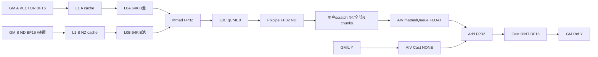

# SgemmcExpand A2/A3 ACLNN 算子知识

## 算子速览

| 项目 | 内容 |
|---|---|
| 实际入口 | `aclnnSglSgemmcExpandGetWorkspaceSize` / `aclnnSglSgemmcExpand`；SglSgemmcExpand |
| 计算语义 | 低精度LoRA h与B转置乘积由Cube累加FP32，AIV再加旧y的FP32值，CAST_RINT回原dtype；scale已折叠，不在此重复乘 |
| 输入输出 | x/weight/y同FP16或BF16；四metadata INT32；x[B,S*R]，weight[L,F,R]，y[B,F]原地Ref |
| 执行类型 | 单Kernel MIX_CV，显式KERNEL_TYPE_MIX_AIC_1_1；AIC Matmul service→GM scratch→AIV queue与Vector epilogue；不是两个独立Kernel |
| Kernel 路线 | R-001 Half、R-002 BF16；均CFG_MDL默认policy、GM VECTOR A/GM ND转置B/FP32 VECIN C；skip负ID/rank0/未覆盖sequence |
| 核心资源 | SDK L1输入cache、64KiB L0A+64KiB L0B池、dbL0C*4baseMbaseN；AIV四buf UB；Host W=LibApiSize+B*S*4baseM*N |
| 来源闭包 | source_closed：公开ACLNN、Host/POD、MIX双侧当前Matmul实例、workspace/SDK GM KFC同步及全部自有epilogue闭合；通用auto-tiler数值选择、DMA/LoadData/Mmad/Fixpipe ISA与Runtime为标明的库边界 |
| 草稿边界 | SGL末tile不缩小elements/写回块；须slice%有效bN=0等条件；Host不完整检查UB/整数/metadata/SDK KFC索引域。固定SDK静态边界不等于运行故障 |
| 验证状态 | 本次未安装/构建/编译/真机/数值/性能测试，无verified；未声称全部二进制CANN9.1.0实现相同 |

## 接口与语义

### 计算语义

合同复用[LoRA expand API](../../../../apis/sgl_kernel_npu/sgl_lora_expand.md)。S=offsets.numel()-1，R=x.width/S，F=y.width，seq_len前缀确定token t所属block，a=indices[block]，r=ranks[a]，slice s=[o_s,o_next)，宽n_s：

```text
delta[t,j] = Cube_FP32_sum(k=0..r-1, x[t,s*r+k]*weight[a,j,k])
y_after[t,j] = cast_RINT_to_dtype(float(y_before[t,j])+delta[t,j])
j in [o_s,o_next)
```

x和weight为Half/BF16，不能用SgemmvExpand的FP32 x替代。负adapter、r0或sequence未覆盖token不更新；slice外保留原y。每adapter容量F*R，slice输入按实际s*r紧凑排列，输入物理row跨度S*R。无bias、activation、scale乘或量化；BIAS_MAT_TYPE虽声明float，DisableBias使其inactive。完整公式要求metadata/布局有效、tile写回不跨slice、启动与资源范围均成立；源码未为任意尾slice自动修正。

### 输入、输出与属性

| 参数 | shape/layout | dtype | 约束、默认值与语义 |
|---|---|---|---|
| x | [B,S*R]连续 | 与y同FP16/BF16 | B>0、R>0；Torch检查x.width%S=0且R%16=0，raw Host只floor除法 |
| weight | [L,F,R]或[L,1,F,R]连续 | 与x/y同型 | 物理row步长R；有效rank r>=16，公开已验证16/32/64，r0跳过；值由caller保证 |
| indices/seq_len | [numBlocks]连续 | INT32 | 非负seq_len和有效前缀/adapter；负adapter跳过；raw Host未分别检查两个向量维数 |
| ranks | [L]连续 | INT32 | 元数据r必须合法且<=R；无rank8补齐，Host不读值 |
| slice_offsets | [S+1]连续 | INT32 | S>=1、递增、不重叠、0<=offset<=F；宽度与bN/16对齐由caller保证 |
| y / yOut | [B,F]连续 | 与x/weight同型 | 旧值输入与Ref输出同存储；向量相加后RINT写回，无atomic |
| workspace | Host实际LibApiSize+scratch | BYTE | 系统区与用户scratch分开，详后文；query最终W由Runtime返回 |
| tiling | 7uint32+SDK TCubeTiling | 静态推导228B/align4 | 生成式SDK50int32嵌套200B；以同固定SDK普通布局为前提，未运行ABI probe |

### 入口与版本

精确pair在torch_adapter.cpp中动态解析，7个Tensor、y Ref只传一次；Python auto/ascendc调用torch.ops.npu.sgemmc_expand，reference显式另选，无fallback。SGL固定`dda6d36b0cdb4081e102d14c0a2fb276fc416e69`；官方SDK固定v9.1.0 `e5451c7feba11f9e259f4fbc19c4bf82f8c0496c`。CANN9.1.0还由CI其它组矩阵/复用容器配置支持，不当作本次LoRA运行；arch22/2201与arch35/3510注册/文档/产品表分别支持A2/A3、950。

## Host/Launcher 执行流程

### 参数校验与前处理

适配检查全部七Tensor同NPU/DeviceGuard；y Half/BF16、x/y二维、weight三/四维、offsets一维且>1项、ranks一维、B>0；再查三payload同dtype、四metadataINT32且indices/seq_len一维、全部连续；最后x.width%S=0与R%16=0。不重排、不做rank8 padding，不在Host读取metadata值。

raw Tiling检查shape/yDesc/platform指针；x/y二维、weight三/四维、offsets/ranks一维；y Half/BF16；metadata长度非负、B/hiddenIn/F>0、offsetCount>=2、R=floor(hiddenIn/S)>0；长度/B/R/F<=U32，Klaunch=B*S为uint64且在[1,U32]。indices/seq_len一维、整除/R%16、weight具体维度、y.rows、metadata值及全跨度未在raw Host完整校验。raw/typed POD、容量及workspace指针有效；BuildCubeTiling失败返回GRAPH_FAILED。InferShape/DataType从input6 y复制；prepare空成功，无备用路线。

BuildCubeTiling准确输入：EnableBias(false)；A=(GM,VECTOR,Half/BF16,transpose=false)，B=(GM,ND,同dtype,true)，C=(VECIN,ND,FLOAT)，BiasType声明(GM,ND,payload dtype)但无bias；SetOrgShape和SetShape均(1,F,R)，SetBufferSpace(-1,-1,-1)自动资源分配；GetTiling返回-1失败。内部auto-tiler CheckSetParam→MatmulTilingAlgorithm::Process的PreprocessL0DB/CheckBaseMN/FillParam→核/单核L0/L1因素→UpdateTiling/CheckFinalParams→SetFinalTiling；本卡保留返回的base/step/depth符号，不虚构平台/shape无关常数，未执行求解器。

### 参数、Workspace 与生命周期

SGL Host请求：
```text
G=B*S (launch blocks)
P=4*cube.baseM*cube.N bytes/block
W_host=platform.GetLibApiWorkSpaceSize()+G*P
```

固定SDK平台查询2201/3510均返回16MiB；这与SGL“调用平台查询”的事实分开，不声称所有二进制值恒定。SDK生成wrapper先SetSysWorkspaceForce(base)，再传usrWorkspace=GetUserWorkspace(base)或base+RESERVED_WORKSPACE给业务entry；此固定SDK两架构RESERVED_WORKSPACE=16MiB。REGIST_MATMUL_OBJ使用GetSysWorkSpacePtr的系统base；业务workspace形参是用户base，不与系统base混同。在固定SDK一致配置/正常框架生成契约下，系统[0,16MiB)、用户[16MiB,16MiB+G*P)。

query返回executor/实际W，W<=INT64_MAX分配BYTE Tensor；七Tensor/workspace都record_stream当前NPU stream，lambda捕获Tensor/描述符/executor覆盖Host排队，record_stream覆盖异步设备。描述符shared_ptr析构aclDestroyTensor，vendor handle静态保持。y Ref直接返回无需copy-back；不能用Host RunOpApi返回推设备完成。所有输入/旧y/系统及用户scratch在stream结束前有效，caller不得并发写入；executor生成内部管理为框架边界。

### 启动图与失败传播

| 节点/边 | producer→consumer | offset/extent、dtype/layout | ordering、owner/lifetime | 失败 |
|---|---|---|---|---|
| N1 MIX_CV单launch | query/Host→execute→sgl_sgemmc_expand | G=B*S，KERNEL_TYPE_MIX_AIC_1_1；同POD | SDK双pass AIC service/AIV client，当前stream | query/execute失败抛错，Host失败不启动；无fallback |
| A/B GM→AIC | caller→Matmul | A=t*S*R+s*r；B=a*F*R+o_s*R，Half/BF16 | client发shape/address消息，server执行 | 非法metadata/输入存储不是可靠失败返回 |
| E1 AIC→用户scratch | Mmad/Fixpipe→GetTensorC | block f用户offset=4*f*baseM*N；chunk i offset=4*i*baseM*baseN，FP32 ND顺序块 | SDK GM KFC FIX通知/WaitEvent后MTE2，完整区块在同launch生存 | 需所有chunk读写跨度在P内，见tail guard |
| E2 scratch→AIV | GetTensorC<false>→matmulQueue | 每次copy完整LocalTensor槽Ecopy=align32(4E0)/4个float（E0=baseM*baseN） | SDK MTE2_V（CopyToUB内部及WaitGetTensorC），EnQue/DeQue | 不以有效elements代替实际槽copy范围 |
| E3 oldY+delta→Ref | oldY DMA/Cast→Add→RINT→CopyOut | token*F+o_s+i*bN，固定elements=bM*bN | Vector V barrier、queue；不同token/slice须互斥 | 最后slice不整tile可跨界，未自动修复 |

AIC/AIV都先执行相同metadata skip判断，再注册Matmul；AIC注册后进入KFC服务循环并在quit后return，AIV执行epilogue。输入metadata在两侧必须一致且不可并发变更；没有另一个SGL Kernel或外部ACLNN核心节点。

## Route 与参数设计

### 分核与资源计算

每(token,slice)一逻辑block，G=B*S。业务AIV仅subBlockIdx0继续，sub1return，再把AscendC::GetBlockIdx除GetSubBlockNum；SDK2201 GetBlockIdxImpl=raw*taskRatio+sub，3510=raw*get_subblockdim()+sub，GetSubBlockNum为同subblock维。在框架匹配MIX1:1/metadata契约下，继续的sub0业务f=raw get_block_idx，t=f/S、s=f%S。Host未按AIC核数夹G；Runtime实际允许的grid域未运行确认，不能将任意f示例说成所有平台可达。

令aM=cube.baseM、aN=baseN、aK=baseK；bM=min(aM,singleCoreM)，bN=min(aN,singleCoreN,n_s)，E=bM*bN，E0=aM*aN，Ecopy=align32(4E0)/4；I=ceil(singleCoreM/bM)*ceil(n_s/bN)。业务alloc用E0，旧y/Vector计算每步固定E，输出copyParams固定bM行、blockLen=bN*2/32、srcGap0、dstGap=(cube.N-bN)*2/32，均转uint16；offset=token*cube.N+beginSlice+i*bN。末步没有min(remaining,bN)。

TPipe将queue长度按32B补齐，AllocTensor继承补齐dataLen，LocalTensor<float>::GetSize=dataLen/4。因此GetTensorC实际读取Ecopy个float、cOffset仍每次增4E0；下文简写“E0 chunk”限定E0%8=0（Ecopy=E0）的对齐tiler域。一般末次GM请求边界为4(I-1)E0+align32(4E0)<=4aM*N，不能无条件用I*E0代替。SGL未显式验证此组合，未运行auto-tiler证明所有shape必落对齐域。

当前完整Matmul实例：
```text
A = MatmulType<GM,VECTOR,scalar_t,false>
B = MatmulType<GM,ND,scalar_t,true>
C = MatmulType<VECIN,ND,float>
Bias = MatmulType<GM,ND,float> (DisableBias)
Matmul<A,B,C,Bias,CFG_MDL,default-null-callbacks,default MatmulPolicy>
CFG_MDL: doMultiDataLoad=true, INNER_PRODUCT, iterateOrder=UNDEF,
static bases/steps=0, enableReuse/UBReuse=true, batchMode=NONE,
unitFlag=false, full-load static=false, no bias/quant/MX/Relu/dualMaster
```

SDK默认scheduler是MatmulScheduler的MDL非partial、非静态full-load分支；运行时K cache是否足够由KLoop判定，分ReduceKOneIter/ReduceKMultiIter，按返回iterateOrder选择M/N外层顺序。非量化GM输入用CopyCubeInMDLBase和DOUBLE_BUFFER L1模块；A VECTOR的基础buffer元素aK，B ND基础aN*aK。qA=1+((depthA1/(stepM*stepKa)-1)&1)，qB类似stepN*stepKb；实际L1 A=2*aK*stepM*stepKa*qA B，B=2*aK*aN*stepN*stepKb*qB B。其深度由solver结果决定，不能统一写死2；bank优化false、VecND2NZfalse无相应额外bank/UB项。

L0池完整申请A2=65536B、B2=65536B；是否二分ping-pong由(dbL0A-1)&(dbL0B-1)控制。L0C queue深度qC=(dbL0C==2?2:1)，当前INNER_PRODUCT lenFactor1，容量4E0*qC；非unitFlag普通队列。AIV自有UB=2*align32(4E0)+2*align32(2E0)；另SDK KFC消息固定128B位置及系统map见下文，不能当自有queue再扣/重复。Host tiler的shareUb/L1/L0C是SDK共享参数，不等于业务epilogue申请总量；Host未额外证明联合容量。

### Route 选择

| 顺序 | Route | Key/模板 | 精确选择条件与优先级 | 不适用去向 |
|---:|---|---|---|---|
| 0 | S0 skip | key0同entry | sequence无token映射、adapter<0、r0依序return；AIV sub1先return | 不进入业务Matmul，y保持 |
| 1 | R-001 Half | Host0，DTYPE_X=half | OpDef x/weight/y全Half，metadataINT32，公共guard/BuildCubeTiling成功 | BF16进R-002，其它失败 |
| 2 | R-002 BF16 | Host0，DTYPE_X=bfloat16_t | 同payload全BF16，其它相同 | 无rank8或大资源fallback |

```text
raw shape/dtype/range guards -> BuildCubeTiling(1,F,R) -> key0/G=B*S
DTYPE_X half -> KernelSgemmcExpand<half,float> -> R-001
DTYPE_X bfloat16_t -> KernelSgemmcExpand<bfloat16_t,float> -> R-002
MIX1:1 compile -> AIC registration service / AIV client
metadata skip -> return; otherwise SetSingleShape(singleCoreM,n_s,r)
Iterate<false> -> each GetTensorC<false>/WaitGetTensorC -> oldY Add/RINT -> End
```

### 模板/实现执行矩阵

| Route | key/selector | dtype/shape/platform 完整命中条件 | 执行族与 kernel 节点 | 实际模板/body | 内存与同步特征 | tail/fallback |
|---|---|---|---|---|---|---|
| R-001 | 0/Half | 三Half+INT32 metadata，2201/3510、Host成功及caller合法域 | 单MIX_CV N1，AIC→GM→AIV | KernelSgemmcExpand<half,float>+完整CFG_MDL实例 | qA/qB L1、64KiB双L0池、qC L0C；scratch4f*aM*N；KFC event0与MTE2_V | 固定E/bN尾，需整tile；无fallback |
| R-002 | 0/BF16 | 三BF16，其余同左 | 同N1 | KernelSgemmcExpand<bfloat16_t,float>+对应BFloat16 tiler类型 | 字节/同步同左，输入值精度不同 | 同左，不假设数值位同Half |

### 隐藏性能 Guard

| Guard | Host/Tiling 条件 | Device/资源原因 | 影响 Route | 不满足时去向 | 源码符号 |
|---|---|---|---|---|---|
| BuildCubeTiling | GetTiling!=-1 | 自动base/step/depth、资源限制 | 两条 | GRAPH_FAILED | BuildCubeTiling |
| 整除/16宽 | raw未查；适配width%S==0,R%16==0 | x物理row与权重K步长、无rank8补齐 | 两条 | 适配抛错；raw caller负责 | adapter/SetOrgShape |
| metadata | 未读值校验 | r>=16且<=R、有效sequence/adapter、offset递增/F范围 | 两条 | skip仅负ID/r0/未映射；非法值无可靠fallback | Process |
| epilogue tail | 无n_s%bN guard | I向上取整但elements/CopyOut块恒定 | 两条 | 最后tile可能跨slice/行；无缩尾fallback | Process i循环 |
| workspace chunk | Host分P=4aM*N，未验证4(I-1)E0+align32(4E0)<=P | SDK每GetTensorC搬补齐Ecopy、cOffset仍按E0 | 两条 | scratch分区可能超名义块；不声称发生 | GetTensorC/SetWorkspace |
| UB联合预算 | SGL未检查4buffer+SDK保留 | 2align32(4E0)+2align32(2E0)，KFC独立位置 | 两条 | 未运行分配验证 | InitBuffer/KfcCommClient |
| KFC索引域 | 仅G<=U32，未按SDK数组/系统区夹f | SDK flat=2*raw+sub，系统map有固定范围 | 两条 | Runtime可能拒绝grid或若接纳则需额外边界证明；不推定部署故障 | GetMsgHead/GetUBMapAddr |
| 乘积/窄化 | 单维U32不足 | aM*N/U32 scratchStride、E0、F*R、DMA uint16、signed slice差 | 两条 | 可能截断/错寻址，无完整guard | Host/Init/Process |

### POD/ABI

固定SDK matmul_tilingdata.h声明50个int32，生成脚本按相同顺序输出pack(push,8)普通struct与0成员初始化；所有成员4B，故TCubeTiling静态推导sizeof200/align4。SGL外层七uint32后嵌套在offset28，外层sizeof228/align4；源码自身只assert总size为4倍数，**未执行生成器或ABI probe**。这些精确offset以所列固定SDK生成式及普通int32/uint32布局为前提，不代表其它安装二进制。

Host GetTiling通过SetFinalTiling逐一setter再SaveToBuffer填写全部50字段；本次不将未执行的solver结果填成固定数值。下表嵌套字段每行独立，producer中set_x指SDK同名setter；字段无指针payload。

| 结构 | 字段 | 类型/位宽 | ABI 布局 | 单位 | Host/launcher producer | Device consumer | 边界 |
|---|---|---|---|---|---|---|---|
| SglSgemmcExpandTilingData | loraIndicesSize | uint32/32 | offset0,size4；外层228/align4 | 元素/计数 | TilingSglSgemmcExpand: indices.shape[0] | indices GM视图 | 部分U32维度guard |
| SglSgemmcExpandTilingData | seqLenSize | uint32/32 | offset4,size4；外层228/align4 | 元素/计数 | TilingSglSgemmcExpand: seq_len.shape[0] | BlockIterator范围 | 部分U32维度guard |
| SglSgemmcExpandTilingData | loraRanksSize | uint32/32 | offset8,size4；外层228/align4 | 元素/计数 | TilingSglSgemmcExpand: ranks.shape[0] | rank GM视图 | 部分U32维度guard |
| SglSgemmcExpandTilingData | sliceOffsetsSize | uint32/32 | offset12,size4；外层228/align4 | 元素/计数 | TilingSglSgemmcExpand: offsets.shape[0] | S=count-1/offsets视图 | 部分U32维度guard |
| SglSgemmcExpandTilingData | batchSize | uint32/32 | offset16,size4；外层228/align4 | 元素/计数 | TilingSglSgemmcExpand: B=x.rows | Init保存；Process未用作token界限 | 部分U32维度guard |
| SglSgemmcExpandTilingData | maxLoRARank | uint32/32 | offset20,size4；外层228/align4 | 元素/计数 | TilingSglSgemmcExpand: R=floor(x.width/S) | x行步长、weight行与adapter跨度 | 部分U32维度guard |
| SglSgemmcExpandTilingData | outputFullDim | uint32/32 | offset24,size4；外层228/align4 | 元素/计数 | TilingSglSgemmcExpand: F=y.width | Init保存/adapter跨度；输出步长实际用cubeTiling.N | 部分U32维度guard |
| SglSgemmcExpandTilingData | cubeTiling | 嵌套50int32 | offset28,size200；外层228/align4 | 混合，逐字段如下 | BuildCubeTiling/GetTiling | Init复制、Matmul/Process | SDK生成式相同布局前提 |
| TCubeTiling | usedCoreNum | int32/32 | 内offset0，外offset28,size4 | 元素/计数/枚举依字段 | SetFinalTiling: set_usedCoreNum(tiling_.get_usedCoreNum()) | SDK tiler核参数；SGL外层B*S不以其分核 | solver返回/完整保存；inactive不等于未初始化 |
| TCubeTiling | M | int32/32 | 内offset4，外offset32,size4 | 元素/计数/枚举依字段 | SetFinalTiling: set_M(tiling_.get_M()) | SetOrgShape M；Build输入1 | solver返回/完整保存；inactive不等于未初始化 |
| TCubeTiling | N | int32/32 | 内offset8，外offset36,size4 | 元素/计数/枚举依字段 | SetFinalTiling: set_N(tiling_.get_N()) | SetOrgShape/输出row stride/系统外scratch跨度；Build输入F | solver返回/完整保存；inactive不等于未初始化 |
| TCubeTiling | Ka | int32/32 | 内offset12，外offset40,size4 | 元素/计数/枚举依字段 | SetFinalTiling: set_Ka(tiling_.get_Ka()) | SetOrgShape A物理K；Build输入R | solver返回/完整保存；inactive不等于未初始化 |
| TCubeTiling | Kb | int32/32 | 内offset16，外offset44,size4 | 元素/计数/枚举依字段 | SetFinalTiling: set_Kb(tiling_.get_Kb()) | SetOrgShape B物理K；Build输入R | solver返回/完整保存；inactive不等于未初始化 |
| TCubeTiling | singleCoreM | int32/32 | 内offset20，外offset48,size4 | 元素/计数/枚举依字段 | SetFinalTiling: set_singleCoreM(tiling_.get_singleCoreM()) | SetSingleShape第一参、bM=min(baseM,singleCoreM)、I的M次数 | solver返回/完整保存；inactive不等于未初始化 |
| TCubeTiling | singleCoreN | int32/32 | 内offset24，外offset52,size4 | 元素/计数/枚举依字段 | SetFinalTiling: set_singleCoreN(tiling_.get_singleCoreN()) | bN=min(baseN,singleCoreN,slice)；SDK Init/SetTail计算tile | solver返回/完整保存；inactive不等于未初始化 |
| TCubeTiling | singleCoreK | int32/32 | 内offset28，外offset56,size4 | 元素/计数/枚举依字段 | SetFinalTiling: set_singleCoreK(tiling_.get_singleCoreK()) | SDK KLoop初始shape；SetSingleShape改成实际r | solver返回/完整保存；inactive不等于未初始化 |
| TCubeTiling | baseM | int32/32 | 内offset32，外offset60,size4 | 元素/计数/枚举依字段 | SetFinalTiling: set_baseM(tiling_.get_baseM()) | E0=bM0*bN0、scratch stride=bM0*N、SDK MLoop/L0 | solver返回/完整保存；inactive不等于未初始化 |
| TCubeTiling | baseN | int32/32 | 内offset36，外offset64,size4 | 元素/计数/枚举依字段 | SetFinalTiling: set_baseN(tiling_.get_baseN()) | E0、GetTensorC cOffset步进、bN、NLoop/Fixpipe | solver返回/完整保存；inactive不等于未初始化 |
| TCubeTiling | baseK | int32/32 | 内offset40，外offset68,size4 | 元素/计数/枚举依字段 | SetFinalTiling: set_baseK(tiling_.get_baseK()) | KLoop/L1各base、L0 LoadData/Mmad | solver返回/完整保存；inactive不等于未初始化 |
| TCubeTiling | depthA1 | int32/32 | 内offset44，外offset72,size4 | 元素/计数/枚举依字段 | SetFinalTiling: set_depthA1(tiling_.get_depthA1()) | L1 A队列cacheFactor/qA | solver返回/完整保存；inactive不等于未初始化 |
| TCubeTiling | depthB1 | int32/32 | 内offset48，外offset76,size4 | 元素/计数/枚举依字段 | SetFinalTiling: set_depthB1(tiling_.get_depthB1()) | L1 B队列cacheFactor/qB | solver返回/完整保存；inactive不等于未初始化 |
| TCubeTiling | stepM | int32/32 | 内offset52，外offset80,size4 | 元素/计数/枚举依字段 | SetFinalTiling: set_stepM(tiling_.get_stepM()) | L1 A step槽尺寸与MLoop | solver返回/完整保存；inactive不等于未初始化 |
| TCubeTiling | stepN | int32/32 | 内offset56，外offset84,size4 | 元素/计数/枚举依字段 | SetFinalTiling: set_stepN(tiling_.get_stepN()) | L1 B step槽尺寸与NLoop | solver返回/完整保存；inactive不等于未初始化 |
| TCubeTiling | isBias | int32/32 | 内offset60，外offset88,size4 | 元素/计数/枚举依字段 | SetFinalTiling: set_isBias(tiling_.get_isBias()) | EnableBias(false)后0；Device DisableBias，不读bias值 | solver返回/完整保存；inactive不等于未初始化 |
| TCubeTiling | transLength | int32/32 | 内offset64，外offset92,size4 | 字节（shareMode为枚举，transLength为SDK转换容量字段） | SetFinalTiling: set_transLength(tiling_.get_transLength()) | SDK临时格式转换容量字段；2201/3510 ifNeedUB=false且无VecND2NZ，不新增业务UB | solver返回/完整保存；inactive不等于未初始化 |
| TCubeTiling | iterateOrder | int32/32 | 内offset68，外offset96,size4 | 元素/计数/枚举依字段 | SetFinalTiling: set_iterateOrder(tiling_.get_iterateOrder()) | CFG iterateOrder UNDEF时SDK按返回ORDER_M/N调度 | solver返回/完整保存；inactive不等于未初始化 |
| TCubeTiling | shareMode | int32/32 | 内offset72，外offset100,size4 | 字节（shareMode为枚举，transLength为SDK转换容量字段） | SetFinalTiling: set_shareMode(tiling_.get_shareMode()) | SDK InitShareBufStart共享模式 | solver返回/完整保存；inactive不等于未初始化 |
| TCubeTiling | shareL1Size | int32/32 | 内offset76，外offset104,size4 | 字节（shareMode为枚举，transLength为SDK转换容量字段） | SetFinalTiling: set_shareL1Size(tiling_.get_shareL1Size()) | SDK共享L1容量/reservation | solver返回/完整保存；inactive不等于未初始化 |
| TCubeTiling | shareL0CSize | int32/32 | 内offset80，外offset108,size4 | 字节（shareMode为枚举，transLength为SDK转换容量字段） | SetFinalTiling: set_shareL0CSize(tiling_.get_shareL0CSize()) | SDK共享L0C容量/reservation | solver返回/完整保存；inactive不等于未初始化 |
| TCubeTiling | shareUbSize | int32/32 | 内offset84，外offset112,size4 | 字节（shareMode为枚举，transLength为SDK转换容量字段） | SetFinalTiling: set_shareUbSize(tiling_.get_shareUbSize()) | SDK共享UB容量/reservation；当前业务另申请四buf，不能直接当其UB | solver返回/完整保存；inactive不等于未初始化 |
| TCubeTiling | batchM | int32/32 | 内offset88，外offset116,size4 | 元素/计数/枚举依字段 | SetFinalTiling: set_batchM(tiling_.get_batchM()) | SDK LayoutNONE、BatchModeNONE；当前非batch分支inactive，不由SGL读；仍完整保存 | solver返回/完整保存；inactive不等于未初始化 |
| TCubeTiling | batchN | int32/32 | 内offset92，外offset120,size4 | 元素/计数/枚举依字段 | SetFinalTiling: set_batchN(tiling_.get_batchN()) | SDK LayoutNONE、BatchModeNONE；当前非batch分支inactive，不由SGL读；仍完整保存 | solver返回/完整保存；inactive不等于未初始化 |
| TCubeTiling | singleBatchM | int32/32 | 内offset96，外offset124,size4 | 元素/计数/枚举依字段 | SetFinalTiling: set_singleBatchM(tiling_.get_singleBatchM()) | SDK LayoutNONE、BatchModeNONE；当前非batch分支inactive，不由SGL读；仍完整保存 | solver返回/完整保存；inactive不等于未初始化 |
| TCubeTiling | singleBatchN | int32/32 | 内offset100，外offset128,size4 | 元素/计数/枚举依字段 | SetFinalTiling: set_singleBatchN(tiling_.get_singleBatchN()) | SDK LayoutNONE、BatchModeNONE；当前非batch分支inactive，不由SGL读；仍完整保存 | solver返回/完整保存；inactive不等于未初始化 |
| TCubeTiling | stepKa | int32/32 | 内offset104，外offset132,size4 | 元素/计数/枚举依字段 | SetFinalTiling: set_stepKa(tiling_.get_stepKa()) | L1 A每槽缓存stepM*stepKa、K outer/inner | solver返回/完整保存；inactive不等于未初始化 |
| TCubeTiling | stepKb | int32/32 | 内offset108，外offset136,size4 | 元素/计数/枚举依字段 | SetFinalTiling: set_stepKb(tiling_.get_stepKb()) | L1 B每槽缓存stepN*stepKb、K outer/inner | solver返回/完整保存；inactive不等于未初始化 |
| TCubeTiling | depthAL1CacheUB | int32/32 | 内offset112，外offset140,size4 | 元素/计数/枚举依字段 | SetFinalTiling: set_depthAL1CacheUB(tiling_.get_depthAL1CacheUB()) | SDK A cacheUB字段；CFG enableL1CacheUB=false，不作业务申请 | solver返回/完整保存；inactive不等于未初始化 |
| TCubeTiling | depthBL1CacheUB | int32/32 | 内offset116，外offset144,size4 | 元素/计数/枚举依字段 | SetFinalTiling: set_depthBL1CacheUB(tiling_.get_depthBL1CacheUB()) | SDK B cacheUB字段；同前 | solver返回/完整保存；inactive不等于未初始化 |
| TCubeTiling | dbL0A | int32/32 | 内offset120，外offset148,size4 | 元素/计数/枚举依字段 | SetFinalTiling: set_dbL0A(tiling_.get_dbL0A()) | L0池usePingPong=(dbA-1)&(dbB-1) | solver返回/完整保存；inactive不等于未初始化 |
| TCubeTiling | dbL0B | int32/32 | 内offset124，外offset152,size4 | 元素/计数/枚举依字段 | SetFinalTiling: set_dbL0B(tiling_.get_dbL0B()) | 同L0池DB选择 | solver返回/完整保存；inactive不等于未初始化 |
| TCubeTiling | dbL0C | int32/32 | 内offset128，外offset156,size4 | 元素/计数/枚举依字段 | SetFinalTiling: set_dbL0C(tiling_.get_dbL0C()) | L0C queue depth2仅值2，否则1 | solver返回/完整保存；inactive不等于未初始化 |
| TCubeTiling | ALayoutInfoB | int32/32 | 内offset132，外offset160,size4 | 元素/计数/枚举依字段 | SetFinalTiling: set_ALayoutInfoB(tiling_.get_ALayoutInfoB()) | SDK LayoutNONE、BatchModeNONE；当前非batch分支inactive，不由SGL读；仍完整保存 | solver返回/完整保存；inactive不等于未初始化 |
| TCubeTiling | ALayoutInfoS | int32/32 | 内offset136，外offset164,size4 | 元素/计数/枚举依字段 | SetFinalTiling: set_ALayoutInfoS(tiling_.get_ALayoutInfoS()) | SDK LayoutNONE、BatchModeNONE；当前非batch分支inactive，不由SGL读；仍完整保存 | solver返回/完整保存；inactive不等于未初始化 |
| TCubeTiling | ALayoutInfoN | int32/32 | 内offset140，外offset168,size4 | 元素/计数/枚举依字段 | SetFinalTiling: set_ALayoutInfoN(tiling_.get_ALayoutInfoN()) | SDK LayoutNONE、BatchModeNONE；当前非batch分支inactive，不由SGL读；仍完整保存 | solver返回/完整保存；inactive不等于未初始化 |
| TCubeTiling | ALayoutInfoG | int32/32 | 内offset144，外offset172,size4 | 元素/计数/枚举依字段 | SetFinalTiling: set_ALayoutInfoG(tiling_.get_ALayoutInfoG()) | SDK LayoutNONE、BatchModeNONE；当前非batch分支inactive，不由SGL读；仍完整保存 | solver返回/完整保存；inactive不等于未初始化 |
| TCubeTiling | ALayoutInfoD | int32/32 | 内offset148，外offset176,size4 | 元素/计数/枚举依字段 | SetFinalTiling: set_ALayoutInfoD(tiling_.get_ALayoutInfoD()) | SDK LayoutNONE、BatchModeNONE；当前非batch分支inactive，不由SGL读；仍完整保存 | solver返回/完整保存；inactive不等于未初始化 |
| TCubeTiling | BLayoutInfoB | int32/32 | 内offset152，外offset180,size4 | 元素/计数/枚举依字段 | SetFinalTiling: set_BLayoutInfoB(tiling_.get_BLayoutInfoB()) | SDK LayoutNONE、BatchModeNONE；当前非batch分支inactive，不由SGL读；仍完整保存 | solver返回/完整保存；inactive不等于未初始化 |
| TCubeTiling | BLayoutInfoS | int32/32 | 内offset156，外offset184,size4 | 元素/计数/枚举依字段 | SetFinalTiling: set_BLayoutInfoS(tiling_.get_BLayoutInfoS()) | SDK LayoutNONE、BatchModeNONE；当前非batch分支inactive，不由SGL读；仍完整保存 | solver返回/完整保存；inactive不等于未初始化 |
| TCubeTiling | BLayoutInfoN | int32/32 | 内offset160，外offset188,size4 | 元素/计数/枚举依字段 | SetFinalTiling: set_BLayoutInfoN(tiling_.get_BLayoutInfoN()) | SDK LayoutNONE、BatchModeNONE；当前非batch分支inactive，不由SGL读；仍完整保存 | solver返回/完整保存；inactive不等于未初始化 |
| TCubeTiling | BLayoutInfoG | int32/32 | 内offset164，外offset192,size4 | 元素/计数/枚举依字段 | SetFinalTiling: set_BLayoutInfoG(tiling_.get_BLayoutInfoG()) | SDK LayoutNONE、BatchModeNONE；当前非batch分支inactive，不由SGL读；仍完整保存 | solver返回/完整保存；inactive不等于未初始化 |
| TCubeTiling | BLayoutInfoD | int32/32 | 内offset168，外offset196,size4 | 元素/计数/枚举依字段 | SetFinalTiling: set_BLayoutInfoD(tiling_.get_BLayoutInfoD()) | SDK LayoutNONE、BatchModeNONE；当前非batch分支inactive，不由SGL读；仍完整保存 | solver返回/完整保存；inactive不等于未初始化 |
| TCubeTiling | CLayoutInfoB | int32/32 | 内offset172，外offset200,size4 | 元素/计数/枚举依字段 | SetFinalTiling: set_CLayoutInfoB(tiling_.get_CLayoutInfoB()) | SDK LayoutNONE、BatchModeNONE；当前非batch分支inactive，不由SGL读；仍完整保存 | solver返回/完整保存；inactive不等于未初始化 |
| TCubeTiling | CLayoutInfoS1 | int32/32 | 内offset176，外offset204,size4 | 元素/计数/枚举依字段 | SetFinalTiling: set_CLayoutInfoS1(tiling_.get_CLayoutInfoS1()) | SDK LayoutNONE、BatchModeNONE；当前非batch分支inactive，不由SGL读；仍完整保存 | solver返回/完整保存；inactive不等于未初始化 |
| TCubeTiling | CLayoutInfoN | int32/32 | 内offset180，外offset208,size4 | 元素/计数/枚举依字段 | SetFinalTiling: set_CLayoutInfoN(tiling_.get_CLayoutInfoN()) | SDK LayoutNONE、BatchModeNONE；当前非batch分支inactive，不由SGL读；仍完整保存 | solver返回/完整保存；inactive不等于未初始化 |
| TCubeTiling | CLayoutInfoG | int32/32 | 内offset184，外offset212,size4 | 元素/计数/枚举依字段 | SetFinalTiling: set_CLayoutInfoG(tiling_.get_CLayoutInfoG()) | SDK LayoutNONE、BatchModeNONE；当前非batch分支inactive，不由SGL读；仍完整保存 | solver返回/完整保存；inactive不等于未初始化 |
| TCubeTiling | CLayoutInfoS2 | int32/32 | 内offset188，外offset216,size4 | 元素/计数/枚举依字段 | SetFinalTiling: set_CLayoutInfoS2(tiling_.get_CLayoutInfoS2()) | SDK LayoutNONE、BatchModeNONE；当前非batch分支inactive，不由SGL读；仍完整保存 | solver返回/完整保存；inactive不等于未初始化 |
| TCubeTiling | BatchNum | int32/32 | 内offset192，外offset220,size4 | 元素/计数/枚举依字段 | SetFinalTiling: set_BatchNum(tiling_.get_BatchNum()) | SDK非batch LayoutNONE/BatchModeNONE不消费batch路径 | solver返回/完整保存；inactive不等于未初始化 |
| TCubeTiling | mxTypePara | int32/32 | 内offset196，外offset224,size4 | 元素/计数/枚举依字段 | SetFinalTiling: set_mxTypePara(tiling_.get_mxTypePara()) | 无scale/mx types，不进入MX路径 | solver返回/完整保存；inactive不等于未初始化 |

### Route 源码闭包

| Route | Key/selector | Host/Tiling producer | POD/参数 | Kernel entry/router | Kernel body/直接依赖 | 构建接线 |
|---|---|---|---|---|---|---|
| R-001 | 0/Half | 独立def/infer/tiling，BuildCubeTiling Half | 七uint32+50int32嵌套，G/用户scratch | sgl_sgemmc_expand，MIX_AIC_1_1，<half,float> | Process/BlockIterator、当前MDL/KFC/Vector epilogue，SDK文件见索引 | 单算子→lora/root/operators/cann_ops，2201/3510；SDKMIX ratio1/wrapper |
| R-002 | 0/BF16 | 相同Host，ToMatmulDtype→BFLOAT16 | 相同布局，solver值由BF16平台输入求得 | 同entry，<bfloat16_t,float> | 同模块/同步，低精度表示不同 | 同构建，无另一自有Kernel |

## Kernel 实现

### 公共执行流程

Init绑定三payload与四metadata GM、复制cubeTiling，F*R保存uint32 adapter跨度；workspaceGlobal为用户base FP32视图，无显式GM size。Process取f/token/slice，单调BlockIterator求sequence（每block此处仅一个token，缓存并不跨block共享），skip后读r与slice起止。取bM/bN/E/E0/P，workspaceGlobal偏至f*aM*N元素。

REGIST_MATMUL_OBJ(pipe,GetSysWorkSpacePtr(),matmulObj,&tiling)展开：AIC清系统消息并构造KfcServer、初始化对象0，循环处理AIV消息，收到quit后return；AIV构造client/SetMatrixKfc对象0，配置地址shape后发Iterate<false>。SDKMIX1_1编译明确ratio1，所以kernel_utils将KFC_C310_SSBUF设0；两平台都USE_WORKSPACE，950不是SSBUF直达UB。AIC使用MDL默认policy，A为GM VECTOR、B为GM转置ND、L0C FP32；把全部N chunks顺序Fixpipe到此block用户scratch。

AIV依次申请四buffer：calcBuf FLOAT E0、matmulQueue FLOAT E0 depth1、oldY queue scalar_t E0 depth1、out queue同型depth1。循环I次，GetTensorC<false>从GM scratch按LocalTensor.GetSize拷满Ecopy float槽并WaitGetTensorC；旧y搬E元素，Cast NONE至calc、V barrier/释放旧Y；DeQue float delta、Add E、V barrier；Cast RINT至out、V barrier、EnQue，calcBuf.FreeTensor实际SDKno-op，释放delta槽；按copyParams写回并释放out。End在异步client不另发同步End，AIC处理完整Iterate后自行mul.End，client析构发quit；库寿命不能简写为自有End立刻释放workspace。

SDK通知协议：对象0/sub0 client devEvtID=0，AIC每tile完成Fixpipe后cnt<14时NotifyEvent<PIPE_FIX>(0)；完整计算后若cnt>=14再通知一次0。client前14次GetTensorC各WaitEvent(0)，其后已由第14次等待覆盖全部剩余scratch，可无需逐tile重复跨核wait。CopyToUB内部及显式WaitGetTensorC都执行Fetch/Set/Wait MTE2_V；GM消息PostMessage使用KFC UB消息槽/MTE3_S与cache clean/invalidate，初始化还使用WORKSPACE_SYNC_ID15。L0 ping-pong实际MTE1_M/M_MTE1事件ID0/1，L1由queue EnQue/DeQue/Free排序，L0C queue交Fixpipe。无自有CrossCore flag编号或独立Host event，不把CPU返回当AIC→AIV可见性证明。


### Route R-001：Half的MIX低秩累加

#### 适用条件

三payload均FP16、四metadataINT32、公开合法元数据与连续存储，Host公共guard及auto-tiler成功；SGL业务为M1向量乘、实际r>=16且<=R，输出slice不跨固定bN尾。所有资源/乘积/窄化与KFC实际grid域需满足后述条件；draft不意味着已通过这些运行前提。

##### 选择证据

| 层级 | 文件 | 符号 | 源码谓词/参数 | 结果/下一跳 |
|---|---|---|---|---|
| OpDef | csrc/lora/sgemmc_expand/op_host/sgemmc_expand_def.cpp | SglSgemmcExpand | x/weight/y DT_FLOAT16组合 | DTYPE_X=half |
| Host | csrc/lora/sgemmc_expand/op_host/sgemmc_expand_tiling.cpp | BuildCubeTiling/TilingSglSgemmcExpand | A VECTOR/B ND转置/C FLOAT，(M,N,K)=(1,F,R) | key0、G=B*S、TCube返回值 |
| Device | csrc/lora/sgemmc_expand/op_kernel/sgemmc_expand.cpp | sgl_sgemmc_expand/Process | MIX_AIC_1_1、非skip | KernelSgemmcExpand<half,float> |
| SDK当前specialization | SDK tiling.h/policy/scheduler_mdl.h | CFG_MDL/MatmulPolicy/MDL scheduler | 非batch/量化、INNER_PRODUCT、staticFullLoad=false、partial=false | GM KFC→AIC MDL→FP32 scratch→AIV |

#### Device 数据流

##### 函数级调用链

```text
aclnnSglSgemmcExpand -> generated wrapper(sysBase,usrBase=sysBase+16MiB)
 -> sgl_sgemmc_expand [MIX_AIC_1_1]
 -> KernelSgemmcExpand<half,float>::Init/Process
  -> BlockIterator.GetBlockIdx -> metadata skip -> f/t/s/r/slice
  -> REGIST_MATMUL_OBJ(systemBase,object0,tiling)
     AIC: KfcServer.Run -> MatmulService::Iterate/StartIterate
       -> MatmulImpl current CFG_MDL / MatmulPolicy
       -> MDL MoveNext/ReduceKOneIter or MultiIter
       -> CopyVector2A1(A)/CopyND2NZ(B) -> L1 queues
       -> LoadToL0A VECTOR/LoadToL0B transpose -> L0 pools
       -> MmadCompute -> L0C -> Fixpipe FP32 ND to usrScratch[f,i]
       -> NotifyEvent FIX event0; mul.End; eventual client quit ends service
     AIV: SetWorkspace/SetOrgShape/SetSingleShape/SetTensorA/B/Iterate<false>
       -> loop I: GetTensorC<false>(full E0)->WaitGetTensorC->matmulQueue
          oldY DMA E -> Cast NONE -> V barrier
          Add E -> V barrier -> Cast RINT half -> V barrier
          DataCopy Ref fixed bM/bN -> Free queues
       -> End (async no extra end message), destructor quit
```

##### 源码等价伪码

```text
# 伪码；source真实的固定tile行为未自行修复
AIV: if subIdx==1 return; f=AscendC.GetBlockIdx()/GetSubBlockNum()
AIC: f=AscendC.GetBlockIdx()
t=f/S; s=f%S; block=BlockIterator(seq_len).GetBlockIdx(t)
if block<0: return
a=indices[block]; if a<0: return
r=ranks[a]; if r==0: return
begin=offsets[s]; end=offsets[s+1]; n=end-begin
bM=min(aM,singleCoreM); bN=min(aN,singleCoreN,n)
E=bM*bN; E0=aM*aN; scratch=usrBase + f*(aM*N)*4
register current Matmul # AIC服务循环；以下client路径在AIV执行
DisableBias; SetWorkspace(scratch)
SetOrgShape(M,N,Ka,Kb)
SetSingleShape(singleCoreM,n,r)
SetTensorA(x[t*S*R+s*r],false)
SetTensorB(weight[a*F*R+R*begin],true)
Iterate<false>() # AIC异步产生全部chunks
allocate calc[float,E0], mmQueue[float,E0], oldQ/outQ[half,E0]
copyParams={bM, bN*2/32, 0, (N-bN)*2/32}
I=ceil(singleCoreM/bM)*ceil(n/bN)
for i=0..I:
 delta=GetTensorC<false>(E0 floats); WaitGetTensorC()
 offset=t*N+begin+i*bN
 old=DMA y[offset : +E] # 最后迭代E仍固定
 tmp=Cast_NONE(old,E); Vbarrier
 tmp=Add(tmp,delta,E); Vbarrier
 out=Cast_RINT(tmp,E); Vbarrier
 DataCopy(yRef[offset],out,copyParams)
 Free queue tensors; calc.FreeTensor is no-op
End
```

#### 内存与数据搬运

##### 资源与搬运表

| 层级/缓冲区 | offset/地址公式 | extent/容量公式 | dtype/layout | producer | consumer | owner/lifetime | 对齐/复用 |
|---|---|---|---|---|---|---|---|
| GM x A | 2*(t*S*R+s*r+kOffset)B | 有效r个half，库按K tile/32B块搬运 | VECTOR/FP16 | caller | A CopyVector2A1 | caller，stream期 | 物理Kstride R；r/最后K primitive对齐契约 |
| GM weight B | 2*(a*F*R+begin*R+row*R+k)B | slice×r有效域，ND2NZ按tile extent | ND转置/FP16 | caller | B CopyND2NZ | caller只读 | srcDValue=R，row/col/height/width由N/K loops |
| GM yIn/Ref | 2*(t*N+begin+i*bN)B | 旧读2E B；输出bM行、每行2bN B | ND/FP16 | caller/CopyOut | Cast/caller | caller，Ref同存储 | output row gap(N-bN)*2B，最后不缩tail |
| GM indices | 4*blockB | indicesSize*4，单读4B | INT32 | caller | Process | caller只读 | block有效 |
| GM seq_len | 4*bB | seqLenSize*4，prefix逐项4B | INT32 | caller | BlockIterator | caller只读 | prefix非负/无溢出 |
| GM ranks | 4*aB | ranksSize*4，单读4B | INT32 | caller | Process/Matmul SetSingleShape | caller只读 | r合法且<=R |
| GM offsets | 4*s/4*(s+1)B | offsetSize*4，两项 | INT32 | caller | Process | caller只读 | end-begin正值/有界/对齐 |
| GM系统workspace | sysBase+[0,LibApiSize) | Host查询返回；固定SDK16MiB | KFC消息、tiling暂存、GM map | SDK client/server | SDK对端 | workspace Tensor，整个launch/stream期 | 与用户base分开；raw grid索引条件见字节账 |
| GM用户scratch | usrBase+4*f*aM*N+4*i*E0 | 分配P=4aM*N/block，名义整G*P | FP32 ND顺序chunk | AIC Fixpipe | AIV GetTensorC | workspace Tensor，跨族直到消费结束 | 不同f区间独立前提I*E0<=aM*N；非ping-pong，只保留全部chunks |
| L1 A1 queue | 库qid A，base缓存槽 | qA×2aK*stepM*stepKa B | FP16 VECTOR | GM→L1 DataCopy Vector | LoadToL0A | SDK Matmul service；K/N/M cache hit或释放 | qA按depth/step得1或2，非全局共享 |
| L1 B1 queue | 库qid B | qB×2aK*aN*stepN*stepKb B | FP16 NZ转换后 | ND2NZ | LoadToL0B | SDK service，按outer K/M/N复用 | qB按返回值；bankConflict配置false |
| L0A A2池 | SDK l0aBuf base，flag1时+32768B | 总65536B | FP16 Cube输入 | LoadData | Mmad | SDK service，Allocate/Free ping-pong | dbA/dbB共同控制是否二分复用 |
| L0B B2池 | SDK l0bBuf，同二分偏移 | 总65536B | FP16 Cube输入 | 转置LoadData | Mmad | 同上 | 2201 Load2d/3510 V2，MTE1_M/M_MTE1 |
| L0C CO1 queue | SDK CO1，非unitFlag | qC×4E0 B，qC=dbC==2?2:1 | FP32累加 | Mmad | Fixpipe | 当前M/N块→GetResult→释放 | INNER_PRODUCT lenFactor1，无bias/quant |
| UB calcBuf VECCALC | 独立TBuf base | align32(4E0)B | FLOAT | Cast oldY/Add | Cast RINT | 当前block/I循环全程分配；FreeTensor不实际释放 | 与mmQueue非alias |
| UB matmulQueue VECIN | 独立queue槽 | depth1×align32(4E0)B | FLOAT | scratch GM DMA | Add | 每i Alloc→EnQue/DeQue→Free | CopyToUB传LocalTensor.GetSize，按E0槽实际count |
| UB oldY queue VECIN | 独立槽 | depth1×align32(2E0)B | half | 旧y DMA | Cast NONE | 每i Alloc→Free | 仅前E有效，槽容量E0 |
| UB out queue VECOUT | 独立槽 | depth1×align32(2E0)B | half | Cast RINT | CopyOut | 每i Alloc→Free | 与旧y/float槽独立 |
| SDK UB消息/Scalar | 非自有queue地址 | KfcMsg名义128B；2201 at TOTAL_UB_SIZE-128，3510 at TOTAL_UB_SIZE+2048-128 | SDK消息/标量地址/metadata | client PostMessage | SDK对端 | KfcCommClient，析构发quit、刷新缓存并按条件等待，不显式释放事件ID；不据此推断Kernel结束后泄漏 | 3510使用额外2KiB保留区末端，不重复计入业务4buf |
| 寄存器/dynamic UB/通信window | 无自有register buffer、dynamic UB或跨卡window | Matmul/Vector primitive内部寄存器边界 | 标量/ISA | SDK/业务 | SDK/业务 | 当前方法/管线 | KFC为同芯片AIC/AIV，非跨卡通信 |

##### 分层内存布局


##### 字节账、交接边与复用顺序

```text
E0=aM*aN; qC=(dbL0C==2?2:1)
workspace_host=LibApiSize+G*(4*aM*N)
fixed SDK: LibApiSize=RESERVED_WORKSPACE=16777216B (两个不同来源变量一致)
usrScratch_f=[4*f*aM*N,4*(f+1)*aM*N)
chunk_i=[4*i*E0,4*(i+1)*E0) relative to f
=> 读/写全部chunks范围前提 I*E0<=aM*N；Host未单独检查。

qA=1+((depthA1/(stepM*stepKa)-1)&1)
qB=1+((depthB1/(stepN*stepKb)-1)&1)
L1_A=2*aK*stepM*stepKa*qA
L1_B=2*aK*aN*stepN*stepKb*qB
L0A_pool=65536B; L0B_pool=65536B
L0C=qC*4E0B
AIV_UB_self=2*A32(4E0)+2*A32(2E0)B
UB_self须在平台/TPipe可用用户区与SDK消息保留位置之下；
Host auto-tiler的shareUb不自动覆盖这四个后续业务申请。
dynamic_ub=N/A; no cross-card window.
```

系统区的SDK默认宏/普通ABI静态账单独列出，不能拿用户scratch相加后宣称彼此互不干扰：MAX_MSG_COUNT=64、KfcMsg按120B union+8B头的常规8B布局为128B，MsgMatmulCnt/MsgUBAvailable各64B。令Amax=SDK MAX_AIV_NUM，Umap=WORKSPACE_UB_SIZE，系统ubMap首地址偏移
`Omap=Amax*2*64*128+Amax*8*64+Amax*64`；raw硬件block号h、sub0对应flat=2h，首次TCube临时GM分配为256B（200B向64B cache line补齐，head0）。

| SDK GM域 | 2201 | 3510 MIX1:1 GM兼容模式 |
|---|---|---|
| Amax/Umap | 50 /196608B | 72 /262144B |
| Omap（上述静态ABI） | 848000B | 1221120B |
| 必要索引/系统分区条件 | 0<=2h<Amax；Omap+2h*Umap+256<=LibApiSize，后续ring实际最高head也要在系统区 | 同公式，不从Host G<=U32推出 |
| 条件示例 | h24的flat48落数组内；并不证明Runtime一定接纳这grid | **若**当前Runtime/launch接纳raw h30，则Omap+60*Umap=16949760B>固定SDK16MiB；这只证明该条件下系统/用户分区静态不隔离，非所有950可达、非总allocation必定OOB |

真实Runtime可对blockDim另有限制，本次未运行/提取其完整接纳域。SGL Host没有显式针对上述SDK数组/分区公式的guard，这一“缺少guard”是可直接复验事实；不得把静态h示例改成部署故障。更换宏、SDK ABI或LibApiSize应重算Omap而非机械沿用数字。TCube/POD的临时GM map只是此实例实际需要的256B；不把整Umap条目都当成已访问数据。

| 边/复用子区 | producer | offset/extent | dtype/layout | consumer | ordering/sync | owner/lifetime | 安全条件 |
|---|---|---|---|---|---|---|---|
| L1 cache→L0池 | CopyCubeIn/LoadData | 当前base/tile、上述qA/qB与pool偏移 | FP16 Vector/NZ→Cube | Mmad | L1 queue；L0 MTE1_M0/1、消费后M_MTE1 | SDK service till last K | K/M/N tail由当前SDKloops，不能直接改格式/stride |
| L0C→scratch | Mmad/Fixpipe | fP+4iE0 | FP32 ND顺序 | client GetTensorC | FIX Notify0与WaitEvent0，前13逐块+第14全余下 | 工作区到全部消费完 | I*E0<=aM*N且不同f分区不重叠 |
| scratch→mm槽 | CopyToUB | cOffset每次增4E0，槽完整size | FLOAT | Add | MTE2_V+queue | 每i槽Alloc→Free | padding字节实际可读，不能仅看E有效count；GetSize继承TPipe补齐dataLen |
| oldY/calc | DMA/Cast | old读2E，calc前4E | FP16→FLOAT | Add/Cast out | inputqueue与V barrier | calc整个loop复用 | 未copy部分槽不当有效输入 |
| output槽→GM | Cast RINT | bM行*2bN、GM行gap | FP16 ND | caller | V barrier/outputqueue/Free | 每i输出有效后才复用 | tail不越slice，不与别block写重叠 |
| KFC消息/tiling map | client/object0 | 系统区Omap+flat*Umap，初始256B临时tiling、环状后续 | GM消息、临时POD | server Init/Run | cache clean/invalidate、MTE3_S、workspace15，server FreeUB推进tail | client/server整launch，quit收尾 | raw h域/LibApiSize/ABI/消息ring前提成立 |

#### 同步、精度与尾块

##### 同步与数值边界表

| 阶段 | primitive/机制 | producer | consumer/等待点 | 保护对象 | 精度/尾块 |
|---|---|---|---|---|---|
| 双侧注册 | KFC系统workspace/15，server循环、client消息 | AIV SetTail/address/Iterate | AIC服务 | 对象0/POD/GM输入 | 元数据双方一致，skip发生在注册前 |
| A/B→L1 | Vector DataCopy、ND2NZ、queue | GM输入 | LoadToL0 | L1 A/B缓存 | FP16，r实际K由SetSingleShape，物理R stride |
| L1→L0→Mmad | MTE1_M0/1、M_MTE1复用 | LoadData | Mmad | 两64KiB池、CO1 | FP32 C，首K初始化/后K累计，Mmad小M/N后PIPE_M |
| Fixpipe→GM→UB | FIX事件0→WaitEvent0→MTE2_V | AIC chunks | AIV mmQueue | 完整E0 chunk | 先FP32 staging，无低精度中途舍入；末chunk可含padding |
| oldY/增量→输出 | Cast NONE/V barrier/Add/V barrier/CAST_RINT/V barrier | oldY与delta | out queue/CopyOut | calc/out槽 | 最后一次FP16转换，不量化/不再乘scale |
| slice尾 | 没有逐i缩E/bN | I向上取整 | CopyIn/Add/CopyOut | y/scratch边界 | 若n_s%bN!=0且大于一tile，最后可能超slice；要求精确覆盖或另行实现 |
| 空/skip/终止 | B0Host拒绝；负ID/r0/未映射return；client析构quit | metadata/client | AIC server终止 | y保持/系统队列 | 不补写旧y；不得让一侧并发改变metadata后独自return |

#### 关键实现

##### 符号证据表

| 阶段 | 文件 | 符号/模板实例 | 实现事实 |
|---|---|---|---|
| Host/Tiling producer | csrc/lora/sgemmc_expand/op_host/sgemmc_expand_tiling.cpp | BuildCubeTiling/TilingSglSgemmcExpand | FP16 solver，G=B*S，Lib+全N scratch |
| Kernel entry/router | csrc/lora/sgemmc_expand/op_kernel/sgemmc_expand.cpp | sgl_sgemmc_expand/KernelSgemmcExpand<half,float> | MIX1:1；AIV sub0，完整types/CFG_MDL |
| Device body/helper | 同kernel文件/lora_common_kernel.h | Process/BlockIterator | SetSingleShape、I固定E、oldY Add/RINT/Ref |
| SDK选择/资源 | matmul_intf.h/tiling.h/MDL scheduler/resource文件 | MatmulPolicy/MatmulScheduler/CopyCubeIn/LoadToL0/MmadCompute | 当前specialization与L1/L0字节、K循环 |
| SDK交接 | matmul_client.h/matmul_server_impl_c220.h/KFC文件 | Iterate/GetTensorC/WaitGetTensorC/StartIterate | 两平台GM模式、E0 chunk、事件0/14通知、消息map边界 |

### Route R-002：BF16的MIX低秩累加

#### 适用条件

三payload均BF16、四metadataINT32、公开合法元数据与连续存储，Host公共guard及auto-tiler成功；SGL业务为M1向量乘、实际r>=16且<=R，输出slice不跨固定bN尾。所有资源/乘积/窄化与KFC实际grid域需满足后述条件；draft不意味着已通过这些运行前提。

##### 选择证据

| 层级 | 文件 | 符号 | 源码谓词/参数 | 结果/下一跳 |
|---|---|---|---|---|
| OpDef | csrc/lora/sgemmc_expand/op_host/sgemmc_expand_def.cpp | SglSgemmcExpand | x/weight/y DT_BF16组合 | DTYPE_X=bfloat16_t |
| Host | csrc/lora/sgemmc_expand/op_host/sgemmc_expand_tiling.cpp | BuildCubeTiling/TilingSglSgemmcExpand | A VECTOR/B ND转置/C FLOAT，(M,N,K)=(1,F,R) | key0、G=B*S、TCube返回值 |
| Device | csrc/lora/sgemmc_expand/op_kernel/sgemmc_expand.cpp | sgl_sgemmc_expand/Process | MIX_AIC_1_1、非skip | KernelSgemmcExpand<bfloat16_t,float> |
| SDK当前specialization | SDK tiling.h/policy/scheduler_mdl.h | CFG_MDL/MatmulPolicy/MDL scheduler | 非batch/量化、INNER_PRODUCT、staticFullLoad=false、partial=false | GM KFC→AIC MDL→FP32 scratch→AIV |

#### Device 数据流

##### 函数级调用链

```text
aclnnSglSgemmcExpand -> generated wrapper(sysBase,usrBase=sysBase+16MiB)
 -> sgl_sgemmc_expand [MIX_AIC_1_1]
 -> KernelSgemmcExpand<bfloat16_t,float>::Init/Process
  -> BlockIterator.GetBlockIdx -> metadata skip -> f/t/s/r/slice
  -> REGIST_MATMUL_OBJ(systemBase,object0,tiling)
     AIC: KfcServer.Run -> MatmulService::Iterate/StartIterate
       -> MatmulImpl current CFG_MDL / MatmulPolicy
       -> MDL MoveNext/ReduceKOneIter or MultiIter
       -> CopyVector2A1(A)/CopyND2NZ(B) -> L1 queues
       -> LoadToL0A VECTOR/LoadToL0B transpose -> L0 pools
       -> MmadCompute -> L0C -> Fixpipe FP32 ND to usrScratch[f,i]
       -> NotifyEvent FIX event0; mul.End; eventual client quit ends service
     AIV: SetWorkspace/SetOrgShape/SetSingleShape/SetTensorA/B/Iterate<false>
       -> loop I: GetTensorC<false>(full E0)->WaitGetTensorC->matmulQueue
          oldY DMA E -> Cast NONE -> V barrier
          Add E -> V barrier -> Cast RINT bfloat16_t -> V barrier
          DataCopy Ref fixed bM/bN -> Free queues
       -> End (async no extra end message), destructor quit
```

##### 源码等价伪码

```text
# 伪码；source真实的固定tile行为未自行修复
AIV: if subIdx==1 return; f=AscendC.GetBlockIdx()/GetSubBlockNum()
AIC: f=AscendC.GetBlockIdx()
t=f/S; s=f%S; block=BlockIterator(seq_len).GetBlockIdx(t)
if block<0: return
a=indices[block]; if a<0: return
r=ranks[a]; if r==0: return
begin=offsets[s]; end=offsets[s+1]; n=end-begin
bM=min(aM,singleCoreM); bN=min(aN,singleCoreN,n)
E=bM*bN; E0=aM*aN; scratch=usrBase + f*(aM*N)*4
register current Matmul # AIC服务循环；以下client路径在AIV执行
DisableBias; SetWorkspace(scratch)
SetOrgShape(M,N,Ka,Kb)
SetSingleShape(singleCoreM,n,r)
SetTensorA(x[t*S*R+s*r],false)
SetTensorB(weight[a*F*R+R*begin],true)
Iterate<false>() # AIC异步产生全部chunks
allocate calc[float,E0], mmQueue[float,E0], oldQ/outQ[bfloat16_t,E0]
copyParams={bM, bN*2/32, 0, (N-bN)*2/32}
I=ceil(singleCoreM/bM)*ceil(n/bN)
for i=0..I:
 delta=GetTensorC<false>(E0 floats); WaitGetTensorC()
 offset=t*N+begin+i*bN
 old=DMA y[offset : +E] # 最后迭代E仍固定
 tmp=Cast_NONE(old,E); Vbarrier
 tmp=Add(tmp,delta,E); Vbarrier
 out=Cast_RINT(tmp,E); Vbarrier
 DataCopy(yRef[offset],out,copyParams)
 Free queue tensors; calc.FreeTensor is no-op
End
```

#### 内存与数据搬运

##### 资源与搬运表

| 层级/缓冲区 | offset/地址公式 | extent/容量公式 | dtype/layout | producer | consumer | owner/lifetime | 对齐/复用 |
|---|---|---|---|---|---|---|---|
| GM x A | 2*(t*S*R+s*r+kOffset)B | 有效r个bfloat16_t，库按K tile/32B块搬运 | VECTOR/BF16 | caller | A CopyVector2A1 | caller，stream期 | 物理Kstride R；r/最后K primitive对齐契约 |
| GM weight B | 2*(a*F*R+begin*R+row*R+k)B | slice×r有效域，ND2NZ按tile extent | ND转置/BF16 | caller | B CopyND2NZ | caller只读 | srcDValue=R，row/col/height/width由N/K loops |
| GM yIn/Ref | 2*(t*N+begin+i*bN)B | 旧读2E B；输出bM行、每行2bN B | ND/BF16 | caller/CopyOut | Cast/caller | caller，Ref同存储 | output row gap(N-bN)*2B，最后不缩tail |
| GM indices | 4*blockB | indicesSize*4，单读4B | INT32 | caller | Process | caller只读 | block有效 |
| GM seq_len | 4*bB | seqLenSize*4，prefix逐项4B | INT32 | caller | BlockIterator | caller只读 | prefix非负/无溢出 |
| GM ranks | 4*aB | ranksSize*4，单读4B | INT32 | caller | Process/Matmul SetSingleShape | caller只读 | r合法且<=R |
| GM offsets | 4*s/4*(s+1)B | offsetSize*4，两项 | INT32 | caller | Process | caller只读 | end-begin正值/有界/对齐 |
| GM系统workspace | sysBase+[0,LibApiSize) | Host查询返回；固定SDK16MiB | KFC消息、tiling暂存、GM map | SDK client/server | SDK对端 | workspace Tensor，整个launch/stream期 | 与用户base分开；raw grid索引条件见字节账 |
| GM用户scratch | usrBase+4*f*aM*N+4*i*E0 | 分配P=4aM*N/block，名义整G*P | FP32 ND顺序chunk | AIC Fixpipe | AIV GetTensorC | workspace Tensor，跨族直到消费结束 | 不同f区间独立前提I*E0<=aM*N；非ping-pong，只保留全部chunks |
| L1 A1 queue | 库qid A，base缓存槽 | qA×2aK*stepM*stepKa B | BF16 VECTOR | GM→L1 DataCopy Vector | LoadToL0A | SDK Matmul service；K/N/M cache hit或释放 | qA按depth/step得1或2，非全局共享 |
| L1 B1 queue | 库qid B | qB×2aK*aN*stepN*stepKb B | BF16 NZ转换后 | ND2NZ | LoadToL0B | SDK service，按outer K/M/N复用 | qB按返回值；bankConflict配置false |
| L0A A2池 | SDK l0aBuf base，flag1时+32768B | 总65536B | BF16 Cube输入 | LoadData | Mmad | SDK service，Allocate/Free ping-pong | dbA/dbB共同控制是否二分复用 |
| L0B B2池 | SDK l0bBuf，同二分偏移 | 总65536B | BF16 Cube输入 | 转置LoadData | Mmad | 同上 | 2201 Load2d/3510 V2，MTE1_M/M_MTE1 |
| L0C CO1 queue | SDK CO1，非unitFlag | qC×4E0 B，qC=dbC==2?2:1 | FP32累加 | Mmad | Fixpipe | 当前M/N块→GetResult→释放 | INNER_PRODUCT lenFactor1，无bias/quant |
| UB calcBuf VECCALC | 独立TBuf base | align32(4E0)B | FLOAT | Cast oldY/Add | Cast RINT | 当前block/I循环全程分配；FreeTensor不实际释放 | 与mmQueue非alias |
| UB matmulQueue VECIN | 独立queue槽 | depth1×align32(4E0)B | FLOAT | scratch GM DMA | Add | 每i Alloc→EnQue/DeQue→Free | CopyToUB传LocalTensor.GetSize，按E0槽实际count |
| UB oldY queue VECIN | 独立槽 | depth1×align32(2E0)B | bfloat16_t | 旧y DMA | Cast NONE | 每i Alloc→Free | 仅前E有效，槽容量E0 |
| UB out queue VECOUT | 独立槽 | depth1×align32(2E0)B | bfloat16_t | Cast RINT | CopyOut | 每i Alloc→Free | 与旧y/float槽独立 |
| SDK UB消息/Scalar | 非自有queue地址 | KfcMsg名义128B；2201 at TOTAL_UB_SIZE-128，3510 at TOTAL_UB_SIZE+2048-128 | SDK消息/标量地址/metadata | client PostMessage | SDK对端 | KfcCommClient，析构发quit、刷新缓存并按条件等待，不显式释放事件ID；不据此推断Kernel结束后泄漏 | 3510使用额外2KiB保留区末端，不重复计入业务4buf |
| 寄存器/dynamic UB/通信window | 无自有register buffer、dynamic UB或跨卡window | Matmul/Vector primitive内部寄存器边界 | 标量/ISA | SDK/业务 | SDK/业务 | 当前方法/管线 | KFC为同芯片AIC/AIV，非跨卡通信 |

##### 分层内存布局




##### 字节账、交接边与复用顺序

```text
E0=aM*aN; qC=(dbL0C==2?2:1)
workspace_host=LibApiSize+G*(4*aM*N)
fixed SDK: LibApiSize=RESERVED_WORKSPACE=16777216B (两个不同来源变量一致)
usrScratch_f=[4*f*aM*N,4*(f+1)*aM*N)
chunk_i=[4*i*E0,4*(i+1)*E0) relative to f
=> 读/写全部chunks范围前提 I*E0<=aM*N；Host未单独检查。

qA=1+((depthA1/(stepM*stepKa)-1)&1)
qB=1+((depthB1/(stepN*stepKb)-1)&1)
L1_A=2*aK*stepM*stepKa*qA
L1_B=2*aK*aN*stepN*stepKb*qB
L0A_pool=65536B; L0B_pool=65536B
L0C=qC*4E0B
AIV_UB_self=2*A32(4E0)+2*A32(2E0)B
UB_self须在平台/TPipe可用用户区与SDK消息保留位置之下；
Host auto-tiler的shareUb不自动覆盖这四个后续业务申请。
dynamic_ub=N/A; no cross-card window.
```

系统区的SDK默认宏/普通ABI静态账单独列出，不能拿用户scratch相加后宣称彼此互不干扰：MAX_MSG_COUNT=64、KfcMsg按120B union+8B头的常规8B布局为128B，MsgMatmulCnt/MsgUBAvailable各64B。令Amax=SDK MAX_AIV_NUM，Umap=WORKSPACE_UB_SIZE，系统ubMap首地址偏移
`Omap=Amax*2*64*128+Amax*8*64+Amax*64`；raw硬件block号h、sub0对应flat=2h，首次TCube临时GM分配为256B（200B向64B cache line补齐，head0）。

| SDK GM域 | 2201 | 3510 MIX1:1 GM兼容模式 |
|---|---|---|
| Amax/Umap | 50 /196608B | 72 /262144B |
| Omap（上述静态ABI） | 848000B | 1221120B |
| 必要索引/系统分区条件 | 0<=2h<Amax；Omap+2h*Umap+256<=LibApiSize，后续ring实际最高head也要在系统区 | 同公式，不从Host G<=U32推出 |
| 条件示例 | h24的flat48落数组内；并不证明Runtime一定接纳这grid | **若**当前Runtime/launch接纳raw h30，则Omap+60*Umap=16949760B>固定SDK16MiB；这只证明该条件下系统/用户分区静态不隔离，非所有950可达、非总allocation必定OOB |

真实Runtime可对blockDim另有限制，本次未运行/提取其完整接纳域。SGL Host没有显式针对上述SDK数组/分区公式的guard，这一“缺少guard”是可直接复验事实；不得把静态h示例改成部署故障。更换宏、SDK ABI或LibApiSize应重算Omap而非机械沿用数字。

| 边/复用子区 | producer | offset/extent | dtype/layout | consumer | ordering/sync | owner/lifetime | 安全条件 |
|---|---|---|---|---|---|---|---|
| L1 cache→L0池 | CopyCubeIn/LoadData | 当前base/tile、上述qA/qB与pool偏移 | BF16 Vector/NZ→Cube | Mmad | L1 queue；L0 MTE1_M0/1、消费后M_MTE1 | SDK service till last K | K/M/N tail由当前SDKloops，不能直接改格式/stride |
| L0C→scratch | Mmad/Fixpipe | fP+4iE0 | FP32 ND顺序 | client GetTensorC | FIX Notify0与WaitEvent0，前13逐块+第14全余下 | 工作区到全部消费完 | I*E0<=aM*N且不同f分区不重叠 |
| scratch→mm槽 | CopyToUB | cOffset每次增4E0，槽完整size | FLOAT | Add | MTE2_V+queue | 每i槽Alloc→Free | padding字节实际可读，不能仅看E有效count |
| oldY/calc | DMA/Cast | old读2E，calc前4E | BF16→FLOAT | Add/Cast out | inputqueue与V barrier | calc整个loop复用 | 未copy部分槽不当有效输入 |
| output槽→GM | Cast RINT | bM行*2bN、GM行gap | BF16 ND | caller | V barrier/outputqueue/Free | 每i输出有效后才复用 | tail不越slice，不与别block写重叠 |
| KFC消息/tiling map | client/object0 | 系统区Omap+flat*Umap，初始256B临时tiling、环状后续 | GM消息、临时POD | server Init/Run | cache clean/invalidate、MTE3_S、workspace15，server FreeUB推进tail | client/server整launch，quit收尾 | raw h域/LibApiSize/ABI/消息ring前提成立 |

#### 同步、精度与尾块

##### 同步与数值边界表

| 阶段 | primitive/机制 | producer | consumer/等待点 | 保护对象 | 精度/尾块 |
|---|---|---|---|---|---|
| 双侧注册 | KFC系统workspace/15，server循环、client消息 | AIV SetTail/address/Iterate | AIC服务 | 对象0/POD/GM输入 | 元数据双方一致，skip发生在注册前 |
| A/B→L1 | Vector DataCopy、ND2NZ、queue | GM输入 | LoadToL0 | L1 A/B缓存 | BF16，r实际K由SetSingleShape，物理R stride |
| L1→L0→Mmad | MTE1_M0/1、M_MTE1复用 | LoadData | Mmad | 两64KiB池、CO1 | FP32 C，首K初始化/后K累计，Mmad小M/N后PIPE_M |
| Fixpipe→GM→UB | FIX事件0→WaitEvent0→MTE2_V | AIC chunks | AIV mmQueue | 完整E0 chunk | 先FP32 staging，无低精度中途舍入；末chunk可含padding |
| oldY/增量→输出 | Cast NONE/V barrier/Add/V barrier/CAST_RINT/V barrier | oldY与delta | out queue/CopyOut | calc/out槽 | 最后一次BF16转换，不量化/不再乘scale |
| slice尾 | 没有逐i缩E/bN | I向上取整 | CopyIn/Add/CopyOut | y/scratch边界 | 若n_s%bN!=0且大于一tile，最后可能超slice；要求精确覆盖或另行实现 |
| 空/skip/终止 | B0Host拒绝；负ID/r0/未映射return；client析构quit | metadata/client | AIC server终止 | y保持/系统队列 | 不补写旧y；不得让一侧并发改变metadata后独自return |

#### 关键实现

##### 符号证据表

| 阶段 | 文件 | 符号/模板实例 | 实现事实 |
|---|---|---|---|
| Host/Tiling producer | csrc/lora/sgemmc_expand/op_host/sgemmc_expand_tiling.cpp | BuildCubeTiling/TilingSglSgemmcExpand | BF16 solver，G=B*S，Lib+全N scratch |
| Kernel entry/router | csrc/lora/sgemmc_expand/op_kernel/sgemmc_expand.cpp | sgl_sgemmc_expand/KernelSgemmcExpand<bfloat16_t,float> | MIX1:1；AIV sub0，完整types/CFG_MDL |
| Device body/helper | 同kernel文件/lora_common_kernel.h | Process/BlockIterator | SetSingleShape、I固定E、oldY Add/RINT/Ref |
| SDK选择/资源 | matmul_intf.h/tiling.h/MDL scheduler/resource文件 | MatmulPolicy/MatmulScheduler/CopyCubeIn/LoadToL0/MmadCompute | 当前specialization与L1/L0字节、K循环 |
| SDK交接 | matmul_client.h/matmul_server_impl_c220.h/KFC文件 | Iterate/GetTensorC/WaitGetTensorC/StartIterate | 两平台GM模式、E0 chunk、事件0/14通知、消息map边界 |

## 算子特定优化

### Trick T-001：异步Cube全N分块用每block独立scratch隔离

#### 触发与源码依据

- 适用 Route：R-001/R-002。
- 触发条件：当前CFG_MDL、GM KFC模式，SetWorkspace后Iterate<false>异步产生该slice所有N chunks。
- Golden 来源：[固定提交连续102–109行](https://github.com/sgl-project/sgl-kernel-npu/blob/dda6d36b0cdb4081e102d14c0a2fb276fc416e69/csrc/lora/sgemmc_expand/op_kernel/sgemmc_expand.cpp#L102-L109)。

**官方源码（固定 Commit 连续逐字摘录）**：

```cpp
        uint32_t scratchStride = tiling.baseM * tiling.N;

        workspaceGlobal = workspaceGlobal[blockIdx * scratchStride];

        REGIST_MATMUL_OBJ(pipe_, GetSysWorkSpacePtr(), matmulObj, &tiling);

        matmulObj.DisableBias();
        matmulObj.SetWorkspace(workspaceGlobal);
```

#### 机制与设计原因

当前SDK异步Iterate在AIC连续计算并将每chunk按E0float顺序写到GM，AIV GetTensorC随后按同偏移取回。因此f的stride取aM*N，而不是单个aM*aN；Host也同步请求G*4aM*N。不同block的全部N暂存按各自区间隔离，可在生命周期上让AIC先生产多个chunks，而AIV依通知消费；这不是scratch ping-pong，不能在首chunk后覆盖同地址。源注释明确旧的单chunk stride会让后续chunk落到下一个block base，此处是固定提交的实际隔离设计，不是本次修复或性能测量。

#### 迁移边界

- 适用：异步Matmul输出UB但当前MIX兼容后端借GM staging、各block有完整scratch。
- 前提：Host/Device stride一致且所有chunk实际请求落P内；Ecopy补齐、I、N与整数域满足；系统区不与用户区冲突。
- 失效：只按baseM*baseN分配/步进却仍产生多chunk会破坏分区；本源没有大scratch回退，也没有最后chunk补齐容量验证。
- 未验证：本次未安装、编译、真机、数值或性能测试。

#### 错误做法

把workspace当系统base直接加f*P会覆盖KFC系统数据；固定SDKwrapper传入的是usrWorkspace，业务GetSysWorkSpacePtr另外取系统base。也不能将分P=4aM*N当“任何tail都安全”：实际最后copy跨度需单独检查。

### Trick T-002：保留FP32 Cube结果，在AIV中与旧输出相加后一次舍入

#### 触发与源码依据

- 适用 Route：R-001/R-002。
- 触发条件：每次GetTensorC/WaitGetTensorC完成，旧y输入槽已有E个有效元素。
- Golden 来源：[固定提交连续137–149行](https://github.com/sgl-project/sgl-kernel-npu/blob/dda6d36b0cdb4081e102d14c0a2fb276fc416e69/csrc/lora/sgemmc_expand/op_kernel/sgemmc_expand.cpp#L137-L149)。

**官方源码（固定 Commit 连续逐字摘录）**：

```cpp
            AscendC::LocalTensor<INNER_T> tmpTensor = calcBuf.Get<INNER_T>();
            AscendC::LocalTensor<Y_T> yInLocal = vectorYInQueue.DeQue<Y_T>();
            AscendC::Cast(tmpTensor, yInLocal, AscendC::RoundMode::CAST_NONE, elements);
            AscendC::PipeBarrier<PIPE_V>();
            vectorYInQueue.FreeTensor(yInLocal);

            AscendC::LocalTensor<INNER_T> yLocal = matmulQueue.DeQue<INNER_T>();
            AscendC::Add(tmpTensor, tmpTensor, yLocal, elements);
            AscendC::PipeBarrier<PIPE_V>();

            AscendC::LocalTensor<Y_T> yOutLocal = vectorOutQueue.AllocTensor<Y_T>();
            AscendC::Cast(yOutLocal, tmpTensor, AscendC::RoundMode::CAST_RINT, elements);
            AscendC::PipeBarrier<PIPE_V>();
```

#### 机制与设计原因

INNER_T固定float，Cube/Fixpipe/用户scratch/mmQueue均保持FP32增量。旧低精度y先转float，calcBuf原位Add后只在输出处RINT一次。该MIX launch内完成后处理，不需要额外公开Add算子；但真实源码仍有GM scratch staging，不能宣传消除了所有中间GM物化。calcBuf与mmQueue是两块独立FLOAT buffer，旧Y Cast完成后其queue槽可释放；calcBuf.FreeTensor在SDK是no-op，下一i覆盖前仍保留同物理分配。没有测得融合收益或误差改善幅度。

#### 迁移边界

- 适用：低精度Ref输出需加FP32增量、允许单次最终类型转换的场景。
- 前提：E范围准确、旧y已搬入、Cube结果完整可见、每Vector步barrier/queue生命周期保留。
- 失效：提前把delta Cast到Half/BF16或删旧y Cast会改变算术顺序；非法tail不能因融合而得到保护。
- 未验证：本次未编译、真机、数值或性能测试。

#### 错误做法

用旧y原位覆盖加法的低精度等价表达替换当前FP32 Add会引入额外类型舍入，不能再称源码等价；固定仓未提供这些变体的运行反例，不编造精度结果。

### Trick T-003：VECTOR型A按低秩向量保留L1容量与Gemv加载

#### 触发与源码依据

- 适用 Route：R-001/R-002。
- 触发条件：M=1，A确为当前token/slice的低秩向量，scalar_t为Half/BF16、无MX/量化scale。
- Golden 来源：[固定提交连续23–28行](https://github.com/sgl-project/sgl-kernel-npu/blob/dda6d36b0cdb4081e102d14c0a2fb276fc416e69/csrc/lora/sgemmc_expand/op_kernel/sgemmc_expand.cpp#L23-L28)。

**官方源码（固定 Commit 连续逐字摘录）**：

```cpp
    using X_MAT_TYPE = AscendC::MatmulType<AscendC::TPosition::GM, CubeFormat::VECTOR, X_T, false>;
    using W_MAT_TYPE = AscendC::MatmulType<AscendC::TPosition::GM, CubeFormat::ND, W_T, true>;
    using Y_MAT_TYPE = AscendC::MatmulType<AscendC::TPosition::VECIN, CubeFormat::ND, INNER_T>;
    using BIAS_MAT_TYPE = AscendC::MatmulType<AscendC::TPosition::GM, CubeFormat::ND, float>;

    using MAT_TYPE = AscendC::Matmul<X_MAT_TYPE, W_MAT_TYPE, Y_MAT_TYPE, BIAS_MAT_TYPE, CFG_MDL>;
```

#### 机制与设计原因

A VECTOR、B ND转置和C VECIN共同决定当前库specialization。固定SDK的Half/BF16非B8/B4路径对A GetBaseSize取aK而非baseM*aK；CopyVector2A1搬ceil(tileK/16)个32B块，L0A选VECTOR Gemv LoadData。B仍按ND2NZ和转置L0B路径处理。该节只说明实际type traits如何改变搬运/容量，不把M1改成通用大M GEMM，不声称Measured最优。

#### 迁移边界

- 适用：真正M1、紧凑低秩输入、权重物理K步长R的乘积。
- 前提：Host AType与Device trait一致、R/r对齐和地址合法、当前SDKGetGemvMode/LoadData支持该表示。
- 失效：多token合并成M>1需要重新选择A format、tiler、L1/L0与调度，不能只增block内M而沿用VECTOR容量式。
- 未验证：本次未编译、真机、数值或性能测试。

#### 错误做法

将Host SetAType改为ND却保持Device VECTOR trait，会使tiler布局与实际搬运选择不一致；固定仓未提供运行反例，但两端type contract不能拆开修改。不要把BIAS_MAT_TYPE存在解释成启用了bias，实际DisableBias。

## 模板与实现对比

| 对比维度 | R-001 Half | R-002 BF16 | 设计选择依据 |
|---|---|---|---|
| 命中条件/优先级 | 三payload全FLOAT16，Host成功 | 三payload全BF16，Host成功 | OpDef两组合，Host key均0 |
| 执行族/节点图 | 单MIX AIC1:1，Cube→GM scratch→AIV | 同左 | 无另一个SGL Kernel，无纯Vector fallback |
| M/N/K、tile 与 scheduler | Host1/F/R，Device singleCoreM/slice/r；CFG_MDL INNER_PRODUCT | 相同结构、BFLOAT16 tiler输入 | base/step/depth由平台/shape solver返回，不虚构固定tile |
| workspace/L1/L0/UB | Lib+G*4aM*N、qA/qB L1、64KiB两L0池、qC4E0 CO1、业务四UB | 字节式相同 | 数据类型都是2B，输出临时float4B |
| AIC/AIV 或 kernel 交接 | 两平台均GM KFC，完整Ecopy取回、4E0步进 | 同左 | MIX1:1使950 SSBUF0，系统/用户base不同 |
| 同步、精度与 tail | FIX事件0/前14wait、MTE2_V、V barriers、最终RINT Half | 同左，RINT BF16 | 不许诺位相同；末步不缩E/bN |
| fallback/失败边界 | Host部分失败/metadata skip，其它未保护域draft | 相同 | 无rank8补齐或scratch/UB安全fallback |

## 平台差异

| 项目 | A2 | A3 | Ascend 950 |
|---|---|---|---|
| 支持状态 | 公开arch22/2201→ascend910b | 公开arch22/2201→ascend910_93 | 公开arch35/3510→ascend950 |
| Host/Launcher | 相同BuildCubeTiling/1 F R与B*S，查询本平台LibApiSize | 相同 | 相同 |
| MIX/KFC选择 | 默认GM消息/scratch，object0 | 同左 | 本算子MIX1:1强制ratio1→KFC_C310_SSBUF0→GM兼容，同server_impl_c220；不是SSBUF路径 |
| L1/L0 | SDK2201 VECTOR A LoadData2d、B转置Load2d；两64KiB池 | 同左 | A/B LoadData2DV2；仍两64KiB池；Fixpipe V310参数后端 |
| SDK普通UB/消息位置 | TOTAL_UB_SIZE192KiB，消息在末128B；可用用户区仍受TPipe/平台限制 | 同左 | SDK TOTAL_UB_SIZE248KiB，KFC消息在+2KiB区域末128B，固定保留而非业务申请 |
| 系统内存条件 | SDK Amax50、Umap192KiB；LibApi与reserved固定源各16MiB | 同左 | SDK Amax72、Umap256KiB；LibApi/reserved固定源各16MiB；须按实际raw grid/宏/ABI核分区条件 |
| 版本与运行证据 | 官方SDK9.1.0固定源码，CI配置非本次运行 | CI含a3配置 | CI含950配置，非本次运行 |

本卡限定A2/A3，配套见[950视图](sgl_sgemmc_expand_950.md)。表中SDK常量来自所列固定commit，Host实际二进制平台查询值、Runtime接纳grid和编译产物均未运行观察，不能以支持声明覆盖静态边界。

## 限制与失败边界

- **Epilogue尾块**：bN取min(aN,singleCoreN,slice)，I向上取整但每步E、copyParams不变。slice不是bN整数倍时最后可跨slice/行；CopyOut的2bN/32及gap转uint16还要求16元素整块。源码无有效尾mask/DataCopyPad，公开文档“2的幂或baseN整倍数”是调用边界，不能按任意slice安全复用。
- **GM scratch长度**：Host用4aM*N/block，而SDK步进4E0、GetTensorC实际读取align32(4E0)。一般必要条件4(I-1)E0+align32(4E0)<=4aM*N；E0%8=0时才简为I*E0<=aM*N。Solver/用户合法域需同时满足，源无组合guard，不伪造分配/传输成功。
- **KFC系统域**：默认GM消息与map按flat=2*rawBlock+sub、SDK固定数组布局索引。SGL仅检B*S<=U32，无库数组/16MiB分区guard；Runtime可能另行拒绝大grid，本次未确认实际接纳域。任何h30示例都仅是匹配MIX、默认宏/静态ABI、无溢出/窄化且该raw h被接纳的条件推导，不是A2/A3/950普遍可达或真机故障。总allocation可能包含user区，因此系统越界分区不等同总allocation OOB。
- SDKv9.1.0固定源的GetLibApiWorkSpaceSize与RESERVED_WORKSPACE均16MiB，SGL实际使用的是前者查询值；其它二进制/宏更改须重新证明系统/用户偏移一致，不能机械套SDK数字。
- **UB/L1/L0计费**：当前type/config、base/step/depth、queue深度/补齐已明确；Host auto-tiler使用SetBufferSpace(-1,-1,-1)不自动证明后申请的四业务UB与SDK保留消息不重叠，未执行分配/编译验证。L0池64KiB各一是总申请，ping-pong是内部切片而非再乘2；CO1 depth已单独乘qC。
- metadata合法性由caller保证：offset严格递增、有界、无重叠，r>=16且<=R；负ID/r0/无sequence映射才跳过。没有rank8补齐、值校验fallback，不能把全部非法rank解释成稳定返回失败。
- raw Host未查x.width%S、R%16、indices/seq_len一维、y.rows/weight具体形状；Torch适配有部分额外guard，不得反推raw Host已全保护。M/N/K送入SDKSetShape/SetOrgShape的接口为int32，SGL U32单维guard也不足以保证不窄化。
- 数学公式/字节账限定全部相关整数计算与转换可表示：F*R、E0、aM*N先于uint32赋值的signed SDK字段乘积、f*scratchStride、输出offsetuint32、slice int32差及DMAuint16。未将数学对齐式当截断后实际成员值，也未把名义DMA请求当成功传输。
- 同launch双方metadata必须一致且stream期间不变；在注册前skip两侧保持同谓词，若caller并发修改造成一侧进入service另一侧return，当前源码没有修复协议。不同block y区互斥、Ref与旧y同存储且只读输入无有害alias，无atomic。
- 当前CFG_MDL的通用auto-tiler具体数值选择、CANN生成桥接及LoadData/Mmad/Fixpipe/queue/消息primitive内部是明确库/编译框架边界；当前type traits、资源、实际GM交接/协议已展开，不以调用名替代实例。TCube SaveToBuffer序列化来自通用框架，实际调用/生成式字段顺序已记录，未执行生成器或ABI probe。
- draft是可复验源码知识，不推荐直接安全复用、不宣称真机正确/性能；本次未运行上游、测试、构建、编译、安装或验证脚本，无verified。

## 源码索引

### 链路索引

| 链路阶段 | 文件 | 关键符号 | 支撑内容 |
|---|---|---|---|
| SGL 公开合同 | docs/api/zh/operators/lora/sgemmc_expand.md | sgemmc_expand | 原地累加、dtype/rank/tail边界、arch22/35 |
| SGL OpDef | csrc/lora/sgemmc_expand/op_host/sgemmc_expand_def.cpp | SglSgemmcExpand | 同型Half/BF16三payload、四INT32、Ref |
| SGL 推导 | csrc/lora/sgemmc_expand/op_host/sgemmc_expand_infer.cpp | InferShape/InferDataType | 从input6 y推导 |
| SGL Host | csrc/lora/sgemmc_expand/op_host/sgemmc_expand_tiling.cpp | TilingSglSgemmcExpand/BuildCubeTiling | M1/NF/KR、B*S与workspace |
| SGL POD | csrc/lora/sgemmc_expand/op_kernel/sgemmc_expand_tiling.h | SglSgemmcExpandTilingData | 七uint32加TCubeTiling |
| SGL MIX Device | csrc/lora/sgemmc_expand/op_kernel/sgemmc_expand.cpp | sgl_sgemmc_expand/KernelSgemmcExpand | AIC1:1、当前Matmul实例、AIV累加与静态tail风险 |
| SGL 调用实例 | csrc/lora/sgemmc_expand/torch_adapter.cpp | sgemmc_expand | 精确ACLNN/整除及R%16/stream/lifetime |
| SGL Python门面 | python/sgl_kernel_npu/sgl_kernel_npu/operators/lora/sgemmc_expand.py | sgemmc_expand/_ascendc_impl | 无自动fallback、返回y |
| SGL 算子构建 | csrc/lora/sgemmc_expand/CMakeLists.txt | sgl_register_operator | 2201/3510、split source与单MIX kernel |
| SGL 共享Device | csrc/lora/common/kernel/lora_common_kernel.h | BlockIterator::GetBlockIdx | 递增token到sequence的有状态映射 |
| SGL 共享Host | csrc/lora/common/torch/lora_common_torch.h | IsLoraWeightDtype/IsLoraActivationDtype | Half/BF16与float合同 |
| SGL domain | csrc/lora/CMakeLists.txt | sgl_discover_operators | 仅注册新目录，不把legacy同名Kernel加入当前图 |
| SGL 共享适配 | csrc/aclnn_torch_adapter/aclnn_runtime.h | op_api_symbol/tensor_descriptor | vendor动态库与描述符生命周期 |
| SGL domain入口 | csrc/cmake/domains.cmake | sgl_add_cann_operator_domains | 域接线 |
| SGL 算子解析 | csrc/cmake/operators.cmake | sgl_resolve_operator/sgl_select_cann_operators | 架构过滤、源角色与唯一Kernel |
| SGL 生成接线 | csrc/cmake/cann_ops.cmake | sgl_generate_cann_interfaces/sgl_add_cann_tiling/sgl_add_cann_host_libraries/sgl_add_cann_kernels | OpDef生成ACLNN、tiling/host/kernel库 |
| SGL 构建入口 | csrc/CMakeLists.txt | SGL_ARCH_VERSION/SGL_CANN_BUILD_STAGE | 独立CANN构建阶段与vendor包 |
| SGL 平台映射 | csrc/cmake/architectures.json | 2201/3510 | 910b/910_93/950 |
| SGL 公开构建说明 | python/sgl_kernel_npu/README.md | architecture mapping/REFACTOR | arch22/35与直接ACLNN用途 |
| SGL 版本配置 | .github/workflows/pr-test-kernels.yml | test-fused-ops等版本矩阵 | CANN9.1.0、a3/950配置，非本次执行 |
| SGL CI消费 | .github/workflows/pr-test-kernel-group.yml | run-kernel-group | 复用版本容器参数 |
| SDK Matmul公开实例 | include/adv_api/matmul/matmul_intf.h | Matmul别名/REGIST_MATMUL_OBJ | 按AIC/AIV pass连接service/client |
| SDK 当前配置 | include/adv_api/matmul/tiling.h | CFG_MDL/GetMDLConfig | MDL、INNER_PRODUCT、无bias/量化/dual-master |
| SDK 嵌套POD | include/adv_api/matmul/matmul_tilingdata.h | TCubeTiling | 50个int32字段 |
| SDK POD生成式 | impl/adv_api/cmake/scripts/gen_kernel_tiling_data_def.py | gen_tiling | pack8普通结构体与zero成员初始化；只读未运行 |
| SDK POD接线 | impl/adv_api/gen_kernel_tiling.cmake | gen_kernel_tiling | 公开header生成入口 |
| SDK Host API | include/adv_api/matmul/matmul_tiling.h | MatmulApiTiling | GetTiling接口 |
| SDK Host tiler | impl/adv_api/tiling/matmul/matmul_tiling.cpp | GetTiling/Compute | CheckSetParam→算法Process→SetFinalTiling |
| SDK POD producer | impl/adv_api/tiling/matmul/matmul_tiling_base.cpp | SetFinalTiling | 50字段逐一保存 |
| SDK 自动参数 | impl/adv_api/tiling/matmul/matmul_tiling_algorithm.cpp | MatmulTilingAlgorithm::Process | 资源/单核base、step、depth生成与检查 |
| SDK 平台接口 | include/utils/tiling/platform/platform_ascendc.h | GetLibApiWorkSpaceSize | Host系统workspace查询 |
| SDK 系统区容量 | impl/utils/tiling/platform/platform_ascendc.cpp | GetLibApiWorkSpaceSize | 2201/3510均16MiB |
| SDK 编译分发 | tools/build/asc_op_compile_base/adapter/compile_op.py | MIX_AIC_1_1/_gen_set_workspace_codes | ratio1宏、用户workspace偏移；未执行 |
| SDK wrapper生成 | tools/build/asc_op_compile_base/adapter/ascendc_compile_gen_code.py | gen_init_dump_code/gen_usr_origin_kernel_function_call | 系统base与传usrWorkspace；未执行 |
| SDK 950通信selector | impl/basic_api/kernel_utils.h | KFC_C310_SSBUF | ratio1令SSBUF0 |
| SDK Matmul selector | impl/adv_api/detail/matmul/utils/matmul_utils.h | USE_WORKSPACE/InitKfcClient | GM模式、实例0事件0 |
| SDK AIV client | include/adv_api/matmul/matmul_client.h | SetWorkspace/Iterate/GetTensorC/WaitGetTensorC/CopyToUB/SetTail | 异步所有chunk scratch、14轮通知与MTE2_V |
| SDK 跨核注册 | impl/adv_api/detail/kfc/kfc_register_obj.h | REGIST_CUBE_OBJ | AIC service循环、AIV client、终止 |
| SDK KFC调度 | impl/adv_api/detail/kfc/kernel_kfc.h | KfcServer/SetMatrixKfc | 实例0与service生命周期 |
| SDK 实际server选择 | impl/adv_api/detail/matmul/kfc/matmul_server_aux.h | USE_WORKSPACE | 两平台均c220 GM server |
| SDK AIC→scratch | impl/adv_api/detail/matmul/kfc/matmul_server_impl_c220.h | StartIterate/GetOffsetSize/Iterate | 顺序baseM*baseN块、FIX通知事件 |
| SDK 当前policy | impl/adv_api/detail/matmul/policy/matmul_policy.h | MatmulPolicy | 默认MDL模块组合 |
| SDK scheduler | impl/adv_api/detail/matmul/scheduler/base/scheduler_mdl.h | MatmulScheduler MDL | 非full-load、非partial默认policy |
| SDK scheduler基类 | impl/adv_api/detail/matmul/scheduler/base/scheduler_mdl_base.h | CubeCompute/MoveNext | iterateOrder与Mmad参数 |
| SDK mainloop | impl/adv_api/detail/matmul/scheduler/base/scheduler_mdl_common.h | ReduceKOneIter/ReduceKMultiIter/ComputeKDB | L1加载、L0 ping-pong、K累计 |
| SDK 资源初始化 | impl/adv_api/detail/matmul/scheduler/base/scheduler_base.h | Init/GetResult | shared资源、CO1与Fixpipe |
| SDK 输入buffer选择 | impl/adv_api/detail/matmul/resource/cube_in_buffer/cube_in_buffer_utils.h | GetCubeInBufferType | CFG_MDL→DOUBLE_BUFFER |
| SDK L1容量 | impl/adv_api/detail/matmul/resource/cube_in_buffer/cube_in_buffer_double_buffer.h | Init/GetTotalCacheNum | step缓存块与queue深度 |
| SDK L0池 | impl/adv_api/detail/matmul/resource/l0_buffer/tbuf_pool_l0_base.h | Init/GetBuffer/Allocate/EnQue/DeQue/Free | 两64KiB与MTE1_M/M_MTE1 |
| SDK L0实例 | impl/adv_api/detail/matmul/resource/l0_buffer/tbuf_pool_l0_common.h | TBufPoolL0 | MDL默认非共享池 |
| SDK L0C容量 | impl/adv_api/detail/matmul/resource/cube_out_buffer/cube_out_buffer_no_unit_flag.h | CubeOutBuffer::Init | dbL0C×4baseMbaseN |
| SDK L1字节producer | impl/adv_api/detail/matmul/stage/copy_cube_in/base/copy_cube_in_params_base.h | GetBaseSize/GetDepth/GetBufferSize | Vector-A baseK、B baseNbaseK |
| SDK GM→L1阶段 | impl/adv_api/detail/matmul/stage/copy_cube_in/base/copy_cube_in_mdl_base.h | LoadData/AsyncLoadData/ClearLoadData | queue与cache生命周期 |
| SDK 输入format | impl/adv_api/detail/matmul/stage/copy_cube_in/copy_tile_to_cube/copy_tile_to_cube_common.h | CopyTileToCubeFromGM | A VECTOR/B ND分发 |
| SDK A搬运 | impl/adv_api/detail/matmul/stage/copy_cube_in/copy_tile_to_cube/data_copy_wrapper_vec.h | CopyVector2A1 | count1、ceilK/16个32B块 |
| SDK B搬运 | impl/adv_api/detail/matmul/stage/copy_cube_in/copy_tile_to_cube/data_copy_wrapper_nd.h | CopyND2NZ | gCol=R、ND2NZ参数 |
| SDK A L0 | impl/adv_api/detail/matmul/stage/split/load_to_l0a/load_to_l0a_gemv.h | LoadToL0A VECTOR | 2201 LoadData2d、3510 V2 |
| SDK 2201 B L0 | impl/adv_api/detail/matmul/stage/split/load_to_l0b/load_to_l0b_loadInstr.h | TransLoadDataToL0 | K/N循环、LoadData2d参数 |
| SDK 3510 B L0 | impl/adv_api/detail/matmul/stage/split/load_to_l0b/load_to_l0b_load2dV2.h | TransLoadDataToL0 | V2 step/start/stride |
| SDK Cube primitive调用 | impl/adv_api/detail/matmul/stage/compute/mmad_compute.h | MmadCompute::Compute | FP32 C、M/K/N、init/acc、PIPE_M |
| SDK L0C→scratch | impl/adv_api/detail/matmul/stage/copy_cube_out/copy_cube_out_fixpipe.h | CopyOutNZ2ND/CopyTensor | FP32 ND Fixpipe |
| SDK 平台能力 | impl/adv_api/detail/matmul/feature_trait/matmul_feature_trait.h | IsNeedUB/IsSupportL0CToUB | USE_WORKSPACE禁3510直达UB |
| SDK 能力表 | impl/adv_api/detail/matmul/feature_trait/matmul_chip_cap.h | CHIP220/310 | Load2d与Fixpipe差别 |
| SDK 资源常量 | impl/adv_api/detail/matmul/utils/matmul_config_utils.h | L0AUF_SIZE/L0BUF_SIZE/IsAFullLoad/IsBFullLoad | 64KiB池、当前配置非静态full-load |
| SDK 非量化判定 | impl/adv_api/detail/matmul/utils/mx_matmul_utils.h | IsNeedC0Align | Half/BF16不触发B8/B4对齐特化 |
| SDK KFC宏 | impl/basic_api/kernel_macros.h | MAX_MSG_COUNT | 默认64 |
| SDK 平台常量 | impl/basic_api/utils/kernel_utils_constants.h | RESERVED_WORKSPACE/TOTAL_UB_SIZE | 16MiB、UB/KFC消息位置 |
| SDK 系统base | include/basic_api/kernel_operator_swap_mem_intf.h | GetSysWorkSpacePtr | 框架workspace与KFCbase |
| SDK 2201 workspace | impl/basic_api/dav_c220/kernel_operator_common_impl.h | SetSysWorkspaceForce/GetUserWorkspace | 系统与用户16MiB隔离 |
| SDK 3510 workspace | impl/basic_api/dav_3510/kernel_operator_common_impl.h | SetSysWorkspaceForce/GetUserWorkspace | 相同用户偏移 |
| SDK 2201 KFC内存 | impl/basic_api/dav_c220/kfc/kfc_comm.h | SysWorkspaceDesc/GetMsgHead/GetUBMapAddr | flat2f、50槽/192KiB map |
| SDK 2201 KFC寿命 | impl/basic_api/dav_c220/kfc/kfc_comm_client.h | KfcCommClient/AllocUB/~KfcCommClient | 128B UB消息、256B tiling map/quit |
| SDK 3510 GM KFC内存 | impl/basic_api/dav_3510/kfc/kfc_comm_gm.h | SysWorkspaceDesc/GetMsgHead/GetUBMapAddr | flat2f、72槽/256KiB map |
| SDK 3510 GM KFC寿命 | impl/basic_api/dav_3510/kfc/kfc_comm_client_gm.h | KfcCommClient/AllocUB/~KfcCommClient | 额外2KiB区消息、tiling map/quit |
| SDK UB申请 | impl/basic_api/kernel_tpipe_impl.h | InitBuffer | 按32B长度补齐 |
| SDK TBuf生命周期 | impl/basic_api/kernel_tbuf_impl.h | Get/FreeTensor | FreeTensor为no-op |
| SDK SDK版本 | version.cmake | set_cann_package | 官方9.1.0 |
| SDK Queue视图 | impl/basic_api/kernel_tquebind_impl.h | AllocTensor/GetBufferAddr | 目的GetSize继承32B补齐后dataLen |
| SDK LocalTensor长度 | impl/basic_api/kernel_tensor_impl.h | GetSize | float按dataLen/4计数 |
| SDK Host形状参数 | include/adv_api/matmul/matmul_tiling_base.h | SetShape/SetOrgShape | 接口int32，U32维度guard不足以保证形状不窄化 |
| SDK 2201 block编号 | impl/basic_api/dav_c220/kernel_operator_sys_var_impl.h | GetBlockIdxImpl/GetSubBlockNumImpl | raw*ratio+sub、同sub维归一化 |
| SDK 3510 block编号 | impl/basic_api/dav_3510/kernel_operator_sys_var_impl.h | GetBlockIdxImpl/GetSubBlockNumImpl | raw*subDim+sub、GetSubBlockNum |

每行一个文件并列于sources；两仓各恰一primary。已有[expand API](../../../../apis/sgl_kernel_npu/sgl_lora_expand.md)保留公共合同，本卡只SgemmcExpand，不合并不同精度/执行族的SgemmvExpand。

### 实现复用检查

| 检查项 | 可复用事实 | 不得改变的约束 | 源码符号 |
|---|---|---|---|
| ABI/POD | 七uint32+50int32生成式，静态228/align4 | 固定SDK生成顺序/序列化契约，未假定任意版本ABI | outer POD/matmul_tilingdata/gen_tiling |
| 调用顺序 | 单MIX1:1，AIC服务与AIV客户端 | skip在注册前、对象0/CFG_MDL、用户scratch与系统base分开 | Process/REGIST/KFC |
| workspace/内存 | Lib+全N分P、L1/L0/UB精确公式 | Ecopy实际copy、4E0步进、q深度、整数域/系统map边界 | Host/SetWorkspace/GetTensorC/resources |
| 同步 | FIX0前13+第14全后续、MTE2_V、L0 0/1、V barriers | 不换成无GM直达路径或假造Host event；保持生命周期/quit | StartIterate/client/TPipe |
| 精度与尾块 | Cube FP32、旧y转float加、一次RINT | no scale/bias/quant、固定bN尾真实风险、slice互斥 | traits/SetSingleShape/epilogue |
| 失败边界 | 部分Host失败/metadata skip，无全域安全fallback | 不从支持/闭包推运行正确；Runtime接纳域未知条件准确保留 | Tiling/Process/SDK内存公式 |
