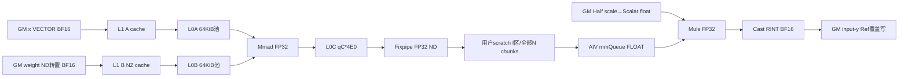

# SgemmcShrink 950 ACLNN 算子知识

## 算子速览

| 项目 | 内容 |
|---|---|
| 实际入口 | `aclnnSglSgemmcShrinkGetWorkspaceSize` / `aclnnSglSgemmcShrink`；OpType SglSgemmcShrink |
| 计算语义 | LoRA第一阶段：Cube FP32点积后乘half scale读转的float，在AIV CAST_RINT写回低精度packed有效rank列；旧y不参与计算 |
| 输入输出 | x/weight/y同FP16/BF16，indices/seq_len/ranks INT32，scales必须FP16；slice_count必填；y Ref同存储 |
| 执行类型 | 单Kernel MIX_CV，显式KERNEL_TYPE_MIX_AIC_1_1；AIC CFG_MDL→GM scratch→AIV Muls/RINT |
| Kernel 路线 | R-001 Half、R-002 BF16；同GM VECTOR A/GM ND转置B/FLOAT VECIN C、默认MDL policy；无rank8补齐 |
| 核心资源 | L1输入cache、64KiB L0A+64KiB L0B池、CO1 qC*4E0；AIV三buffer；Host LibApiSize+G*4aM*N；无旧y queue |
| 来源闭包 | source_closed：分离Host/属性、8字段+SDK嵌套POD、MIX双侧当前实例/GM KFC、全部自有缩放输出与构建闭合；通用auto-tiler/Runtime/ISA primitive边界明确 |
| 草稿边界 | 固定rank尾片、实际GetSize补齐拷贝、UB/整数/metadata与SDK系统索引域均需有限条件；来源闭包不推荐直接安全复用 |
| 验证状态 | 本次未安装、编译、构建、真机、数值或性能测试，无verified；全部风险为静态推导 |

## 接口与语义

### 计算语义

公共合同见[LoRA shrink API](../../../../apis/sgl_kernel_npu/sgl_lora_shrink.md)。B为token数，H=x.width，S=slice_count，R=y.width/S；通过seq_len前缀和indices选adapter a，r=ranks[a]，lambda=float(scales_half[a])。合法元数据、完整实际K、资源/尾片条件满足时：

```text
z[t,s,k] = Cube_FP32_sum(j=0..H-1, x[t,j]*weight[a,s*r+k,j])
y_after[t,s*r+k] = Cast_RINT_to_Y(lambda*z[t,s,k]), 0<=k<r
```

每adapter容量S*R*H元素，实际slice按s*r行紧接；输出物理行跨度S*R，有效列为S*r前缀。旧y不读取，有效列覆盖写，余列保留原值。负adapter、未映射sequence、rank0不写；**rank0在读取scales[a]之后才return**，因此rank0仍要求scale索引/存储有效。系统workspace指针空也直接return，无Device错误返回。x/weight为低精度，与SgemmvShrink的FP32输出不是可互换实现；本卡最终有一次低精度类型转换。

实际Device SetSingleShape(SCM,r,SCK)，K用auto-tiler返回singleCoreK原值，不在Device强行改成H；对应Host输入(1,R,H)与所选单core配置必须覆盖完整H，不能把不同配置的SCK忽略。没有bias、activation、quant、旧y相加或第二次alpha/r处理。

### 输入、输出与属性

| 参数 | shape/layout | dtype | 约束、默认值与语义 |
|---|---|---|---|
| x | [B,H]连续ND | FP16/BF16 | B>0、H>y.width；Torch适配H%16=0，raw Host未查 |
| weight | [L,S*R,H]或[L,1,S*R,H]连续 | 与x/y同型 | slice s第s*r..(s+1)r行；实际K物理stride H，r<=R |
| indices | [numBlocks]连续 | INT32 | 负值跳过，其它adapter有效 |
| seq_len | [numBlocks]连续 | INT32 | 非负有效前缀，期望token应被覆盖；不足返回-1跳过 |
| ranks | [L]连续 | INT32 | 公开已验证16/32/64，r0跳过；无rank8补齐、实际r由Device读取且未校验 |
| scales | [L]连续 | FP16 | Device固定GlobalTensor<half>，即使xBF16也非BF16 scale；读入INNER_T=float |
| y / yRef | [B,S*R]连续 | 与x/weight同型 | Ref同址；entry忽略yRef而写input y指针，只覆盖有效列 |
| slice_count | 标量属性 | int64 Host→uint32 POD | Python/C++签名必填；OpDef REQUIRED.Int(1)，raw缺属性回1不等公开optional |
| workspace | 系统+用户scratch | BYTE | query实际W，Host LibApiSize+G*4aM*N；entry依赖GetSysWorkSpacePtr非空 |
| tiling | 八uint32+SDK TCubeTiling | 固定生成式232B/align4 | TCube50int32、200B，嵌套offset32；条件化静态ABI，无probe |

### 入口与版本

精确pair在torch_adapter.cpp解析，query顺序为7Tensor、slice_count，再W/executor；y Ref只传一次。C++ torch.ops函数返回void，Python调用后return y；auto/ascendc无自动reference回退。SGL固定`dda6d36b0cdb4081e102d14c0a2fb276fc416e69`，官方SDK v9.1.0固定`e5451c7feba11f9e259f4fbc19c4bf82f8c0496c`。CANN9.1.0还有上游其它CI组矩阵/复用容器配置证据，非本次运行。公开arch22/35、2201/3510注册/产品映射支持A2/A3与950；同名二进制版本不保证等于此固定SDK源码。

## Host/Launcher 执行流程

### 参数校验与前处理

适配全部七Tensor同NPU后DeviceGuard，检查x Half/BF16、x/y二维、weight三/四维、H>y.width、B>0；三payload同dtype，scalesFP16，三索引INT32，四metadata一维，全连续；再查S>0、H%16=0、y.width%S=0及R%16=0。无copy或rank padding，值域由caller保证。

raw Host检查shape/xDesc/platform指针、x/y二维/weight三或四维、xHalf/BF16；读S属性，缺失退1；直接GetDim(0)读四metadata长度，未逐一检查一维。要求S>=1、metadata长度非负、B>0、H>y.width>=S；R=floor(width/S)，未查整除/16对齐；各长度/B/H/R/S<=U32，G=B*S在[1,U32]。raw/typed POD、容量/workspace有效，BuildCubeTiling成功才填字段/key0。dtype组合由OpDef定义，不等于Tiling自行检查所有desc。y行数/weight具体维度、值/完整跨度、UB及SDKgrid域无完整guard；没有fallback。

BuildCubeTiling：EnableBias(false)，A=(GM,VECTOR,payload dtype,false)，B=(GM,ND,同型,true)，C=(VECIN,ND,FLOAT)，BiasType仍声明payload dtype但disabled；SetOrgShape/SetShape均(1,R,H)，SetBufferSpace(-1,-1,-1)；GetTiling返回-1→GRAPH_FAILED。SDK执行CheckSetParam→自动资源算法Process→SetFinalTiling，具体base/step/depth是平台/shape动态返回值，本次未执行求解器，不伪造固定tile。SetShape/SetOrgShape接口是int32，单维U32 guard不充分防止入口隐式窄化。

### 参数、Workspace 与生命周期

```text
G=B*S; P=4*cube.baseM*cube.N B/block
W_host=platform.GetLibApiWorkSpaceSize()+G*P
```

此处N来自Host R，K来自H。固定SDK查询2201/3510 LibApiSize均16MiB，RESERVED_WORKSPACE也均16MiB；Host实际是平台查询而非代码常量。生成wrapper SetSysWorkspaceForce(sysBase)，业务entry接收usrWorkspace=GetUserWorkspace或sysBase+RESERVED_WORKSPACE；REGIST_MATMUL_OBJ仍用GetSysWorkSpacePtr(sysBase)，用户f区在usrBase+4f*aM*N。不得把业务workspace形参当系统base。

query返回实际W/executor，W<=INT64_MAX分配BYTE Tensor；七Tensor/workspace record_stream当前NPU stream。lambda捕获Tensor/描述符/workspace/executor及stream保护排队期，record_stream保护异步Device存储；描述符shared_ptr析构aclDestroyTensor，vendor handle静态保存。无copy-back，C++void但Python返回y。workspace系统/用户区、输入及y直到stream完成有效，不可并发修改；生成executor内部生命周期为框架边界。

### 启动图与失败传播

| 节点/边 | producer→consumer | offset/extent、dtype/layout | ordering、owner/lifetime | 失败 |
|---|---|---|---|---|
| N1单MIX | query/Host→execute→sgl_sgemmc_shrink | G=B*S、MIX_AIC_1_1、同POD双侧 | 当前stream，SDK拆AIC service/AIV client | Host失败不启动，query/execute失败抛错；Device空系统指针直接return |
| 输入GM→AIC | caller→A VECTOR/B转置ND | A=t*H；B=a*(S*R*H)+s*H*r，payload2B | client地址/shape消息→MDL scheduler | 非法metadata不是可控错误返回 |
| E1 Cube→用户scratch | Mmad/Fixpipe→AIV | fP+4iE0，FP32 ND顺序块 | SDK FIX事件0/WaitEvent及MTE2_V | 请求必须在P内；Ecopy与tail条件见下文 |
| E2 AIV缩放→Ref | GetTensorC→Muls→RINT→DataCopy | y元素起点=t*S*R+s*r+i*bN，bM行×bN元素 | V barrier与output queue；单writer | 固定尾块可能越有效r，旧y未读作修复 |

双方先做相同metadata/空系统skip，再注册Matmul。AIC进入service循环、AIV依次读scratch/缩放写回；不存在另一个SGL公开算子或额外Kernel。Root CMake→lora discovery→分离def/infer/tiling/唯一Kernel→operators解析arch→cann_ops生成ACLNN/config与库；SDK生成/ISA primitive是标明边界。

## Route 与参数设计

### 分核与资源计算

G=B*S，每token/slice一个逻辑block。AIV sub1先return，sub0将AscendC::GetBlockIdx除GetSubBlockNum；2201 GetBlockIdxImpl=raw*taskRatio+sub，3510=raw*subDim+sub，GetSubBlockNum是同subDim；匹配MIX1:1时继续的业务f=raw get_block_idx。t=f/S、s=f%S。Host不按AIC核数夹G；Runtime真实接纳grid未运行确认，不声称任意f例子实际可达。

aM/aN/aK为返回base，bM=min(aM,SCM)，bN=min(aN,SCN,r)，E=bM*bN，E0=aM*aN，Ecopy=align32(4E0)/4，I=ceil(SCM/bM)*ceil(r/bN)。SetSingleShape(SCM,r,SCK)保留当前K，SetOrgShape(M,N,Ka,Kb)的物理N=R、Ka/Kb=H。输出copyParams=(uint16 bM,uint16(2bN/32),0,uint16(2*(S*N-bN)/32))；源一行紧密，目标row gap对应S*N。末i未缩小E/bN，必须合法值使写回不跨有效r。

当前Matmul实例完整为Matmul<MatmulType<GM,VECTOR,scalar_t,false>,MatmulType<GM,ND,scalar_t,true>,MatmulType<VECIN,ND,float>,MatmulType<GM,ND,float>,CFG_MDL,default-null-callbacks,default MatmulPolicy>。CFG_MDL doMultiDataLoad=true、INNER_PRODUCT、iterateOrder UNDEF、静态base/step0、enableReuse/UBReuse=true、非batch/无MX/量化/Relu/bias/dualMaster、unitFlag=false。当前scheduler选MDL非partial/非静态full-load，运行KLoop cache可走ReduceKOneIter或MultiIter，按返回iterateOrder调M/N。MIX1_1编译固定ratio1→SDK KFC_C310_SSBUF0，950也走USE_WORKSPACE、GM消息与同server_impl_c220，不能套SSBUF直达UB路径。

A/B输入L1选DOUBLE_BUFFER模块，但实际qA=1+((depthA1/(stepM*stepKa)-1)&1)，qB同stepN*stepKb；Half/BF16 VECTOR A基础aK，ND B基础aN*aK。L1A=2aK*stepM*stepKa*qA，L1B=2aK*aN*stepN*stepKb*qB；L0A/B池各65536B，是否二分由(dbA-1)&(dbB-1)；L0C qC=(dbC==2?2:1)，qC*4E0B。当前bank/VecND2NZ开关false，不编造额外临时块。

业务UB三块：calc A32(4E0)、mmQueue depth1 A32(4E0)、outQueue depth1 A32(2E0)，合2A32(4E0)+A32(2E0)。没有旧y输入queue。SDK KFC消息在固定保留位置，不与业务三buf机械重复计费；Host未证明后申请业务buf与库共享预算/消息位置的联合上界。GetTensorC实际按GetSize拷Ecopy float，cOffset仍4E0递增；一般末次scratch请求4(I-1)E0+A32(4E0)<=P，E0%8=0时才简为I*E0<=aM*N。

### Route 选择

| 顺序 | Route | Key/模板 | 精确选择条件与优先级 | 不适用去向 |
|---:|---|---|---|---|
| 0 | S0 skip | key0同entry | GetSysWorkSpacePtr空先return；AIV sub1先return；sequence<0/adapter<0 return；读rank和scale后r0 return | 不写y，不把r0当“不读scale” |
| 1 | R-001 Half | Host0/DTYPE_X=half | x/weight/y全Half，scalesHalf、indicesINT32，公共Host/solver成功 | BF16进R-002；其它失败 |
| 2 | R-002 BF16 | Host0/DTYPE_X=bfloat16_t | x/weight/y全BF16，scales仍Half，其余同左 | 无rank8/资源fallback |

```text
Host shape/type/attr/range -> BuildCubeTiling(1,R,H) -> key0/G=B*S
DTYPE_X half / bfloat16_t -> KernelSgemmcShrink<DTYPE_X,float>
MIX1:1 -> AIC service / AIV client；空系统/metadata skip保持双侧一致
SetSingleShape(SCM,r,SCK) -> Iterate<false>
loop I GetTensorC/Wait -> FP32 Muls(scale_half->float) -> RINT -> fixed CopyOut
```

### 模板/实现执行矩阵

| Route | key/selector | dtype/shape/platform 完整命中条件 | 执行族与 kernel 节点 | 实际模板/body | 内存与同步特征 | tail/fallback |
|---|---|---|---|---|---|---|
| R-001 | 0/Half | x/weight/yHalf、scaleHalf、indicesINT32、2201/3510、Host成功与caller域 | 单MIX_CV N1，AIC→GM→AIV | KernelSgemmcShrink<half,float>+当前CFG_MDL实例 | qA/qB L1、两64KiB L0池/CO1、三UB；GM KFC0/14轮、MTE2_V | 末步固定E/bN，需整rank tile；无fallback |
| R-002 | 0/BF16 | x/weight/yBF16、scaleHalf，其余同左 | 同N1 | KernelSgemmcShrink<bfloat16_t,float> | 同字节/同步，输入及最终表示不同 | 同左，不假设位相同 |

### 隐藏性能 Guard

| Guard | Host/Tiling 条件 | Device/资源原因 | 影响 Route | 不满足时去向 | 源码符号 |
|---|---|---|---|---|---|
| Tiling可用 | GetTiling!=-1 | 平台自动base/step/depth/内存选择 | 两条 | GRAPH_FAILED | BuildCubeTiling |
| S/H/R对齐 | raw仅S>=1；适配S>0,H%16,width%S,R%16 | 输出row S*R、输入16对齐、无r8 padding | 两条 | 部分适配抛错，raw无完整保护 | adapter/Tiling |
| 实际rank/scale | Host不读值；r0也先读scale | r合法>=16且<=R，scale索引实际可读 | 两条 | 非法值无稳定fallback | Process :90–94 |
| rank tail | 未查r%bN | I向上取整，Muls/Cast/CopyOut E恒定 | 两条 | 可写r外/邻slice；未修尾 | i循环/copyParams |
| scratch | P=4aM*N但无copy组合guard | Ecopy请求、4E0步进 | 两条 | 分区外请求风险，非成功传输保证 | SetWorkspace/GetTensorC |
| UB联合上界 | 不查三业务buf+SDK保留 | 2A32(4E0)+A32(2E0) | 两条 | 未执行分配/运行验证 | InitBuffer |
| KFC真实f域 | Host仅G<=U32 | SDK flat=2raw+sub、固定数组/系统map域 | 两条 | Runtime可能先拒绝；若接纳还需公式证明 | GetMsgHead/GetUBMapAddr |
| 整数/ABI | 单维U32有限guard | H*R*S、adapter乘积、E0、scratchStride、offset、int32 SDKshape/uint16 DMA | 两条 | 超域可能先窄化/溢出，非安全fallback | Init/Host/Process |

### POD/ABI

固定SDK声明50int32，生成脚本按相同顺序输出pack8普通TCubeTiling；普通4B成员下sizeof200/align4。外层八uint32后嵌套offset32，sizeof232/align4；SGL自身只assert总size为4倍数。本次未执行生成器/ABI probe；精确offset仅适用于所列SDK生成式/普通整数ABI，不能泛化全部二进制版本。GetTiling通过SetFinalTiling逐setter保存50字段，再SaveToBuffer；下表每字段独立，solver返回值不臆填常数。

| 结构 | 字段 | 类型/位宽 | ABI 布局 | 单位 | Host/launcher producer | Device consumer | 边界 |
|---|---|---|---|---|---|---|---|
| SglSgemmcShrinkTilingData | loraIndicesSize | uint32/32 | offset0,size4；总232/align4 | 元素/计数 | TilingSglSgemmcShrink: indices.shape[0] | indices GM视图 | 部分U32 guard不保护后续乘积 |
| SglSgemmcShrinkTilingData | seqLenSize | uint32/32 | offset4,size4；总232/align4 | 元素/计数 | TilingSglSgemmcShrink: seq_len.shape[0] | BlockIterator范围 | 部分U32 guard不保护后续乘积 |
| SglSgemmcShrinkTilingData | loraRanksSize | uint32/32 | offset8,size4；总232/align4 | 元素/计数 | TilingSglSgemmcShrink: ranks.shape[0] | rank GM视图 | 部分U32 guard不保护后续乘积 |
| SglSgemmcShrinkTilingData | loraScalesSize | uint32/32 | offset12,size4；总232/align4 | 元素/计数 | TilingSglSgemmcShrink: scales.shape[0] | GlobalTensor<half> scale视图 | 部分U32 guard不保护后续乘积 |
| SglSgemmcShrinkTilingData | batchSize | uint32/32 | offset16,size4；总232/align4 | 元素/计数 | TilingSglSgemmcShrink: B=x.rows | Init保存，Process未用作token界限 | 部分U32 guard不保护后续乘积 |
| SglSgemmcShrinkTilingData | inputHiddenDim | uint32/32 | offset20,size4；总232/align4 | 元素/计数 | TilingSglSgemmcShrink: H=x.width | X/weight物理K行步长与adapter跨度 | 部分U32 guard不保护后续乘积 |
| SglSgemmcShrinkTilingData | maxLoRARank | uint32/32 | offset24,size4；总232/align4 | 元素/计数 | TilingSglSgemmcShrink: R=floor(y.width/S) | 输出row跨度与adapter容量 | 部分U32 guard不保护后续乘积 |
| SglSgemmcShrinkTilingData | slicesCount | uint32/32 | offset28,size4；总232/align4 | 元素/计数 | TilingSglSgemmcShrink: 属性S；raw缺属性回1 | flat block解码slice、packed输出与weight布局 | 部分U32 guard不保护后续乘积 |
| SglSgemmcShrinkTilingData | cubeTiling | 50int32嵌套 | offset32,size200；外232/align4 | 混合、逐字段如下 | BuildCubeTiling/GetTiling | Init/Matmul/Process | 生成式ABI前提 |
| TCubeTiling | usedCoreNum | int32/32 | 内offset0,外offset32,size4 | 字段原始元素/计数/模式；share*Size为字节 | SetFinalTiling: set_usedCoreNum(tiling_.get_usedCoreNum()) | SDK solver核信息；SGL外层G=B*S独立设置 | 完整保存；inactive不等于未初始化 |
| TCubeTiling | M | int32/32 | 内offset4,外offset36,size4 | 字段原始元素/计数/模式；share*Size为字节 | SetFinalTiling: set_M(tiling_.get_M()) | Host设置1；SetOrgShape M | 完整保存；inactive不等于未初始化 |
| TCubeTiling | N | int32/32 | 内offset8,外offset40,size4 | 字段原始元素/计数/模式；share*Size为字节 | SetFinalTiling: set_N(tiling_.get_N()) | Host设置R；输出GM row gap S*N、scratch stride aM*N | 完整保存；inactive不等于未初始化 |
| TCubeTiling | Ka | int32/32 | 内offset12,外offset44,size4 | 字段原始元素/计数/模式；share*Size为字节 | SetFinalTiling: set_Ka(tiling_.get_Ka()) | Host设置H；SetOrgShape A物理K | 完整保存；inactive不等于未初始化 |
| TCubeTiling | Kb | int32/32 | 内offset16,外offset48,size4 | 字段原始元素/计数/模式；share*Size为字节 | SetFinalTiling: set_Kb(tiling_.get_Kb()) | Host设置H；SetOrgShape B物理K | 完整保存；inactive不等于未初始化 |
| TCubeTiling | singleCoreM | int32/32 | 内offset20,外offset52,size4 | 字段原始元素/计数/模式；share*Size为字节 | SetFinalTiling: set_singleCoreM(tiling_.get_singleCoreM()) | SetSingleShape第一参、bM、I的M次数 | 完整保存；inactive不等于未初始化 |
| TCubeTiling | singleCoreN | int32/32 | 内offset24,外offset56,size4 | 字段原始元素/计数/模式；share*Size为字节 | SetFinalTiling: set_singleCoreN(tiling_.get_singleCoreN()) | bN=min(aN,SCN,r)，SDK Init/SetTail tile信息 | 完整保存；inactive不等于未初始化 |
| TCubeTiling | singleCoreK | int32/32 | 内offset28,外offset60,size4 | 字段原始元素/计数/模式；share*Size为字节 | SetFinalTiling: set_singleCoreK(tiling_.get_singleCoreK()) | SetSingleShape第三参原样传SCK，SDK KLoop实际K | 完整保存；inactive不等于未初始化 |
| TCubeTiling | baseM | int32/32 | 内offset32,外offset64,size4 | 字段原始元素/计数/模式；share*Size为字节 | SetFinalTiling: set_baseM(tiling_.get_baseM()) | E0/scratchStride/bM与MLoop | 完整保存；inactive不等于未初始化 |
| TCubeTiling | baseN | int32/32 | 内offset36,外offset68,size4 | 字段原始元素/计数/模式；share*Size为字节 | SetFinalTiling: set_baseN(tiling_.get_baseN()) | E0/bN/I，client cOffset按E0 | 完整保存；inactive不等于未初始化 |
| TCubeTiling | baseK | int32/32 | 内offset40,外offset72,size4 | 字段原始元素/计数/模式；share*Size为字节 | SetFinalTiling: set_baseK(tiling_.get_baseK()) | L1基础块/KLoop、L0 LoadData/Mmad | 完整保存；inactive不等于未初始化 |
| TCubeTiling | depthA1 | int32/32 | 内offset44,外offset76,size4 | 字段原始元素/计数/模式；share*Size为字节 | SetFinalTiling: set_depthA1(tiling_.get_depthA1()) | L1 A qA/cacheFactor | 完整保存；inactive不等于未初始化 |
| TCubeTiling | depthB1 | int32/32 | 内offset48,外offset80,size4 | 字段原始元素/计数/模式；share*Size为字节 | SetFinalTiling: set_depthB1(tiling_.get_depthB1()) | L1 B qB/cacheFactor | 完整保存；inactive不等于未初始化 |
| TCubeTiling | stepM | int32/32 | 内offset52,外offset84,size4 | 字段原始元素/计数/模式；share*Size为字节 | SetFinalTiling: set_stepM(tiling_.get_stepM()) | L1 A stepM*stepKa与MLoop | 完整保存；inactive不等于未初始化 |
| TCubeTiling | stepN | int32/32 | 内offset56,外offset88,size4 | 字段原始元素/计数/模式；share*Size为字节 | SetFinalTiling: set_stepN(tiling_.get_stepN()) | L1 B stepN*stepKb与NLoop | 完整保存；inactive不等于未初始化 |
| TCubeTiling | isBias | int32/32 | 内offset60,外offset92,size4 | 字段原始元素/计数/模式；share*Size为字节 | SetFinalTiling: set_isBias(tiling_.get_isBias()) | Host EnableBias(false)；Device DisableBias，bias inactive | 完整保存；inactive不等于未初始化 |
| TCubeTiling | transLength | int32/32 | 内offset64,外offset96,size4 | 字段原始元素/计数/模式；share*Size为字节 | SetFinalTiling: set_transLength(tiling_.get_transLength()) | SDK转换容量；当前ifNeedUB=false、无VecND2NZ，不形成业务申请 | 完整保存；inactive不等于未初始化 |
| TCubeTiling | iterateOrder | int32/32 | 内offset68,外offset100,size4 | 字段原始元素/计数/模式；share*Size为字节 | SetFinalTiling: set_iterateOrder(tiling_.get_iterateOrder()) | CFG UNDEF时SDK按返回ORDER_M/N调度 | 完整保存；inactive不等于未初始化 |
| TCubeTiling | shareMode | int32/32 | 内offset72,外offset104,size4 | 字段原始元素/计数/模式；share*Size为字节 | SetFinalTiling: set_shareMode(tiling_.get_shareMode()) | InitShareBufStart模式 | 完整保存；inactive不等于未初始化 |
| TCubeTiling | shareL1Size | int32/32 | 内offset76,外offset108,size4 | 字段原始元素/计数/模式；share*Size为字节 | SetFinalTiling: set_shareL1Size(tiling_.get_shareL1Size()) | 共享L1容量参数 | 完整保存；inactive不等于未初始化 |
| TCubeTiling | shareL0CSize | int32/32 | 内offset80,外offset112,size4 | 字段原始元素/计数/模式；share*Size为字节 | SetFinalTiling: set_shareL0CSize(tiling_.get_shareL0CSize()) | 共享CO1容量参数 | 完整保存；inactive不等于未初始化 |
| TCubeTiling | shareUbSize | int32/32 | 内offset84,外offset116,size4 | 字段原始元素/计数/模式；share*Size为字节 | SetFinalTiling: set_shareUbSize(tiling_.get_shareUbSize()) | SDK共享UB参数，不代替后申请三业务buf预算 | 完整保存；inactive不等于未初始化 |
| TCubeTiling | batchM | int32/32 | 内offset88,外offset120,size4 | 字段原始元素/计数/模式；share*Size为字节 | SetFinalTiling: set_batchM(tiling_.get_batchM()) | SDK LayoutNONE/BatchModeNONE，当前非batch布局分支inactive；仍完整保存，不由SGL直接读 | 完整保存；inactive不等于未初始化 |
| TCubeTiling | batchN | int32/32 | 内offset92,外offset124,size4 | 字段原始元素/计数/模式；share*Size为字节 | SetFinalTiling: set_batchN(tiling_.get_batchN()) | SDK LayoutNONE/BatchModeNONE，当前非batch布局分支inactive；仍完整保存，不由SGL直接读 | 完整保存；inactive不等于未初始化 |
| TCubeTiling | singleBatchM | int32/32 | 内offset96,外offset128,size4 | 字段原始元素/计数/模式；share*Size为字节 | SetFinalTiling: set_singleBatchM(tiling_.get_singleBatchM()) | SDK LayoutNONE/BatchModeNONE，当前非batch布局分支inactive；仍完整保存，不由SGL直接读 | 完整保存；inactive不等于未初始化 |
| TCubeTiling | singleBatchN | int32/32 | 内offset100,外offset132,size4 | 字段原始元素/计数/模式；share*Size为字节 | SetFinalTiling: set_singleBatchN(tiling_.get_singleBatchN()) | SDK LayoutNONE/BatchModeNONE，当前非batch布局分支inactive；仍完整保存，不由SGL直接读 | 完整保存；inactive不等于未初始化 |
| TCubeTiling | stepKa | int32/32 | 内offset104,外offset136,size4 | 字段原始元素/计数/模式；share*Size为字节 | SetFinalTiling: set_stepKa(tiling_.get_stepKa()) | A K缓存步数/outer loop | 完整保存；inactive不等于未初始化 |
| TCubeTiling | stepKb | int32/32 | 内offset108,外offset140,size4 | 字段原始元素/计数/模式；share*Size为字节 | SetFinalTiling: set_stepKb(tiling_.get_stepKb()) | B K缓存步数/outer loop | 完整保存；inactive不等于未初始化 |
| TCubeTiling | depthAL1CacheUB | int32/32 | 内offset112,外offset144,size4 | 字段原始元素/计数/模式；share*Size为字节 | SetFinalTiling: set_depthAL1CacheUB(tiling_.get_depthAL1CacheUB()) | CFG enableL1CacheUB=false，当前cacheUB分支inactive | 完整保存；inactive不等于未初始化 |
| TCubeTiling | depthBL1CacheUB | int32/32 | 内offset116,外offset148,size4 | 字段原始元素/计数/模式；share*Size为字节 | SetFinalTiling: set_depthBL1CacheUB(tiling_.get_depthBL1CacheUB()) | 同前B cacheUB inactive | 完整保存；inactive不等于未初始化 |
| TCubeTiling | dbL0A | int32/32 | 内offset120,外offset152,size4 | 字段原始元素/计数/模式；share*Size为字节 | SetFinalTiling: set_dbL0A(tiling_.get_dbL0A()) | L0 usePingPong=(dbA-1)&(dbB-1) | 完整保存；inactive不等于未初始化 |
| TCubeTiling | dbL0B | int32/32 | 内offset124,外offset156,size4 | 字段原始元素/计数/模式；share*Size为字节 | SetFinalTiling: set_dbL0B(tiling_.get_dbL0B()) | 同L0池DB选择 | 完整保存；inactive不等于未初始化 |
| TCubeTiling | dbL0C | int32/32 | 内offset128,外offset160,size4 | 字段原始元素/计数/模式；share*Size为字节 | SetFinalTiling: set_dbL0C(tiling_.get_dbL0C()) | CO1 depth：值2时2，否则1 | 完整保存；inactive不等于未初始化 |
| TCubeTiling | ALayoutInfoB | int32/32 | 内offset132,外offset164,size4 | 字段原始元素/计数/模式；share*Size为字节 | SetFinalTiling: set_ALayoutInfoB(tiling_.get_ALayoutInfoB()) | SDK LayoutNONE/BatchModeNONE，当前非batch布局分支inactive；仍完整保存，不由SGL直接读 | 完整保存；inactive不等于未初始化 |
| TCubeTiling | ALayoutInfoS | int32/32 | 内offset136,外offset168,size4 | 字段原始元素/计数/模式；share*Size为字节 | SetFinalTiling: set_ALayoutInfoS(tiling_.get_ALayoutInfoS()) | SDK LayoutNONE/BatchModeNONE，当前非batch布局分支inactive；仍完整保存，不由SGL直接读 | 完整保存；inactive不等于未初始化 |
| TCubeTiling | ALayoutInfoN | int32/32 | 内offset140,外offset172,size4 | 字段原始元素/计数/模式；share*Size为字节 | SetFinalTiling: set_ALayoutInfoN(tiling_.get_ALayoutInfoN()) | SDK LayoutNONE/BatchModeNONE，当前非batch布局分支inactive；仍完整保存，不由SGL直接读 | 完整保存；inactive不等于未初始化 |
| TCubeTiling | ALayoutInfoG | int32/32 | 内offset144,外offset176,size4 | 字段原始元素/计数/模式；share*Size为字节 | SetFinalTiling: set_ALayoutInfoG(tiling_.get_ALayoutInfoG()) | SDK LayoutNONE/BatchModeNONE，当前非batch布局分支inactive；仍完整保存，不由SGL直接读 | 完整保存；inactive不等于未初始化 |
| TCubeTiling | ALayoutInfoD | int32/32 | 内offset148,外offset180,size4 | 字段原始元素/计数/模式；share*Size为字节 | SetFinalTiling: set_ALayoutInfoD(tiling_.get_ALayoutInfoD()) | SDK LayoutNONE/BatchModeNONE，当前非batch布局分支inactive；仍完整保存，不由SGL直接读 | 完整保存；inactive不等于未初始化 |
| TCubeTiling | BLayoutInfoB | int32/32 | 内offset152,外offset184,size4 | 字段原始元素/计数/模式；share*Size为字节 | SetFinalTiling: set_BLayoutInfoB(tiling_.get_BLayoutInfoB()) | SDK LayoutNONE/BatchModeNONE，当前非batch布局分支inactive；仍完整保存，不由SGL直接读 | 完整保存；inactive不等于未初始化 |
| TCubeTiling | BLayoutInfoS | int32/32 | 内offset156,外offset188,size4 | 字段原始元素/计数/模式；share*Size为字节 | SetFinalTiling: set_BLayoutInfoS(tiling_.get_BLayoutInfoS()) | SDK LayoutNONE/BatchModeNONE，当前非batch布局分支inactive；仍完整保存，不由SGL直接读 | 完整保存；inactive不等于未初始化 |
| TCubeTiling | BLayoutInfoN | int32/32 | 内offset160,外offset192,size4 | 字段原始元素/计数/模式；share*Size为字节 | SetFinalTiling: set_BLayoutInfoN(tiling_.get_BLayoutInfoN()) | SDK LayoutNONE/BatchModeNONE，当前非batch布局分支inactive；仍完整保存，不由SGL直接读 | 完整保存；inactive不等于未初始化 |
| TCubeTiling | BLayoutInfoG | int32/32 | 内offset164,外offset196,size4 | 字段原始元素/计数/模式；share*Size为字节 | SetFinalTiling: set_BLayoutInfoG(tiling_.get_BLayoutInfoG()) | SDK LayoutNONE/BatchModeNONE，当前非batch布局分支inactive；仍完整保存，不由SGL直接读 | 完整保存；inactive不等于未初始化 |
| TCubeTiling | BLayoutInfoD | int32/32 | 内offset168,外offset200,size4 | 字段原始元素/计数/模式；share*Size为字节 | SetFinalTiling: set_BLayoutInfoD(tiling_.get_BLayoutInfoD()) | SDK LayoutNONE/BatchModeNONE，当前非batch布局分支inactive；仍完整保存，不由SGL直接读 | 完整保存；inactive不等于未初始化 |
| TCubeTiling | CLayoutInfoB | int32/32 | 内offset172,外offset204,size4 | 字段原始元素/计数/模式；share*Size为字节 | SetFinalTiling: set_CLayoutInfoB(tiling_.get_CLayoutInfoB()) | SDK LayoutNONE/BatchModeNONE，当前非batch布局分支inactive；仍完整保存，不由SGL直接读 | 完整保存；inactive不等于未初始化 |
| TCubeTiling | CLayoutInfoS1 | int32/32 | 内offset176,外offset208,size4 | 字段原始元素/计数/模式；share*Size为字节 | SetFinalTiling: set_CLayoutInfoS1(tiling_.get_CLayoutInfoS1()) | SDK LayoutNONE/BatchModeNONE，当前非batch布局分支inactive；仍完整保存，不由SGL直接读 | 完整保存；inactive不等于未初始化 |
| TCubeTiling | CLayoutInfoN | int32/32 | 内offset180,外offset212,size4 | 字段原始元素/计数/模式；share*Size为字节 | SetFinalTiling: set_CLayoutInfoN(tiling_.get_CLayoutInfoN()) | SDK LayoutNONE/BatchModeNONE，当前非batch布局分支inactive；仍完整保存，不由SGL直接读 | 完整保存；inactive不等于未初始化 |
| TCubeTiling | CLayoutInfoG | int32/32 | 内offset184,外offset216,size4 | 字段原始元素/计数/模式；share*Size为字节 | SetFinalTiling: set_CLayoutInfoG(tiling_.get_CLayoutInfoG()) | SDK LayoutNONE/BatchModeNONE，当前非batch布局分支inactive；仍完整保存，不由SGL直接读 | 完整保存；inactive不等于未初始化 |
| TCubeTiling | CLayoutInfoS2 | int32/32 | 内offset188,外offset220,size4 | 字段原始元素/计数/模式；share*Size为字节 | SetFinalTiling: set_CLayoutInfoS2(tiling_.get_CLayoutInfoS2()) | SDK LayoutNONE/BatchModeNONE，当前非batch布局分支inactive；仍完整保存，不由SGL直接读 | 完整保存；inactive不等于未初始化 |
| TCubeTiling | BatchNum | int32/32 | 内offset192,外offset224,size4 | 字段原始元素/计数/模式；share*Size为字节 | SetFinalTiling: set_BatchNum(tiling_.get_BatchNum()) | LayoutNONE/BatchModeNONE，当前非batch路径inactive | 完整保存；inactive不等于未初始化 |
| TCubeTiling | mxTypePara | int32/32 | 内offset196,外offset228,size4 | 字段原始元素/计数/模式；share*Size为字节 | SetFinalTiling: set_mxTypePara(tiling_.get_mxTypePara()) | 无MX/量化scale字段，当前inactive | 完整保存；inactive不等于未初始化 |

### Route 源码闭包

| Route | Key/selector | Host/Tiling producer | POD/参数 | Kernel entry/router | Kernel body/直接依赖 | 构建接线 |
|---|---|---|---|---|---|---|
| R-001 | 0/Half | 独立def/infer/tiling、BuildCubeTiling Half | 8uint32+50int32、S/G/用户scratch | sgl_sgemmc_shrink，MIX1:1，<half,float> | Process/BlockIterator，当前MDL/KFC，Muls/RINT | 单算子→lora/root/operators/cann_ops，2201/3510；SDKratio1/wrapper |
| R-002 | 0/BF16 | 同Host，ToMatmulDtype BFLOAT16 | 同POD，solver值依BF16平台输入 | 同entry，<bfloat16_t,float> | 同模块与同步，scale固定half | 同接线，无另一自有Kernel |

## Kernel 实现

### 公共执行流程

Init复制TCube与8字段，singleLoRAWeightLen=H*R*S保存uint32；绑定x/weight/y及四metadata GM，scales始终GlobalTensor<half>。Process系统base空先return，再标准f/token/slice映射；BlockIterator顺序扫seq_len求该单token block，负ID/未映射return；读r和half scale→float，再r0 return。不同于Vector Shrink的先r0后scale，不能混写两入口。

正常分支取bM/bN/E/E0与scratchStride=aM*N，将workspaceGlobal切到f区；REGIST使用systemBase、对象0。AIC初始化当前MDL Matmul service，AIV DisableBias/SetWorkspace、SetOrgShape(M,N,Ka,Kb)、SetSingleShape(SCM,r,SCK)、SetTensorA(x[t*H],false)、SetTensorB(weight[a*H*R*S+s*H*r],true)，Iterate<false>。

AIC当前type/config：GM VECTOR A以CopyVector2A1的ceil(tileK/16)个32B块进L1，GM ND转置B以ND2NZ源行stride H进L1；L1 q/cache与MDL KLoop复用，A LoadToL0A VECTOR、B转置LoadToL0B，L0 Allocate→MTE1_M0/1→Mmad→M_MTE1复用。Mmad FP32 C首K初始化/后K累计，小M/N后PIPE_M；CO1→Fixpipe FP32 ND写全部顺序GM chunks；L0C queue释放。SDK2201 A/B LoadData2d，3510 A/B V2、Fixpipe参数后端不同，但本MIX1:1禁SSBUF，所以交接都走GM。

SDK对象0/sub0事件0，INC_PROCESS_CHECK14：完成前13chunk逐个FIX Notify0，第14次通知发生在剩余chunks全部计算完后；client前14个GetTensorC逐次WaitEvent0，其后直接读已完成scratch。CopyToUB按LocalTensor.GetSize=补齐dataLen/4搬Ecopy float，cOffset每次+4E0；CopyToUB内部及WaitGetTensorC使用MTE2_V Fetch/Set/Wait。系统消息cache clean/invalidate、KFC128B本地消息与MTE3_S/系统初始化15保证协议；它不是Host同步推论。

AIV只申请calc FLOAT、matmulQueue FLOAT depth1、outQueue payload depth1。每i取完整delta槽并Wait，Muls(calc,mmRes,lambda,E)→V barrier，Cast RINT(out,calc,E)→V barrier，EnQue out、Free delta、calc.FreeTensor（SDK no-op），DataCopy写y[t*S*R+s*r+i*bN]后Free out。没有旧y DMA、Add或scale重复，End的async client不另发同步End；AIC完整Iterate后mul.End，client析构quit收尾。所有cross族workspace到消费完/stream完成前有效。


### Route R-001：Half低秩缩放输出

#### 适用条件

x/weight/y全部FP16，scale固定FP16、三metadataINT32；B>0、S>0、H>y.width、合法维度/连续存储，r0以外的实际rank>=16且<=R。实际K须覆盖H、rank尾片不跨有效域，联合资源、primitive对齐及整数/Runtime grid前提满足；draft不代表这些前提已运行验收。

##### 选择证据

| 层级 | 文件 | 符号 | 源码谓词/参数 | 结果/下一跳 |
|---|---|---|---|---|
| OpDef/Host | csrc/lora/sgemmc_shrink/op_host/sgemmc_shrink_def.cpp及tiling.cpp | SglSgemmcShrink/BuildCubeTiling | DT_FLOAT16组合，scaleHalf、(1,R,H)solver | key0，DTYPE_X=half |
| entry/Device | csrc/lora/sgemmc_shrink/op_kernel/sgemmc_shrink.cpp | sgl_sgemmc_shrink/Process | MIX_AIC_1_1，非系统空/metadata skip | KernelSgemmcShrink<half,float> |
| SDK实例 | SDK matmul_intf/tiling/policy/MDL文件 | CFG_MDL/MatmulPolicy/MDL scheduler | INNER_PRODUCT、非batch/MX/partial/staticFullLoad，MIXratio1 | GM KFC AIC→scratch→AIV |

#### Device 数据流

##### 函数级调用链

```text
aclnnSglSgemmcShrink -> wrapper(sysBase,usrBase=sysBase+reserved)
 -> sgl_sgemmc_shrink [MIX_AIC_1_1]
 -> KernelSgemmcShrink<half,float>::Init/Process
 -> null-system check -> f/token/slice -> BlockIterator -> adapter/rank/scale -> r0 check
 -> REGIST_MATMUL_OBJ(sysBase,object0,tiling)
    AIC: KfcServer -> MatmulService.Iterate/StartIterate -> MatmulImpl current MDL policy
     -> MDL scheduler MoveNext/ReduceK One/Multi
     -> GM A VECTOR/GM B ND2NZ -> L1 q buffers
     -> L0A/B LoadData -> Mmad FP32 L0C -> Fixpipe to userScratch[f,i]
     -> FIX event0 (13 individual+14th all remainder), mul.End/quit
    AIV: SetWorkspace/OrgShape/SingleShape(SCM,r,SCK)/A/B/Iterate<false>
     -> I loops GetTensorC<false>(Ecopy floats)/WaitGetTensorC
     -> Muls FLOAT by half-read float scale -> V barrier
     -> Cast RINT half -> V barrier -> fixed CopyOut -> Free queues
     -> async End/destructor quit
```

##### 源码等价伪码

```text
# 伪码；保持source scale先读和固定tail，不修源码
if GetSysWorkSpacePtr()==null: return
if AIV: if subIdx==1: return; f=AscendC.GetBlockIdx()/GetSubBlockNum()
else: f=AscendC.GetBlockIdx()
t=f/S; s=f%S; seqBlock=BlockIterator(seq_len).GetBlockIdx(t)
if seqBlock<0: return
a=indices[seqBlock]; if a<0: return
adapterBase=a*(H*R*S) # source中间U32需有界
r=ranks[a]; lambda=float(scales_half[a])
if r==0: return
bM=min(aM,SCM); bN=min(aN,SCN,r); E=bM*bN; E0=aM*aN
scratch=usrBase+4*f*aM*N
register current Matmul; DisableBias; SetWorkspace(scratch)
SetOrgShape(M,N,Ka,Kb); SetSingleShape(SCM,r,SCK)
SetTensorA(x[t*H],false); SetTensorB(weight[adapterBase+s*H*r],true)
Iterate<false>
allocate calc[float,E0], mmQueue[float,E0], outQueue[half,E0]
copyParams={bM,2*bN/32,0,2*(S*N-bN)/32}
I=ceil(SCM/bM)*ceil(r/bN); outBase=t*S*R+s*r
for i=0..I:
 mm=GetTensorC<false>(full aligned local size Ecopy); WaitGetTensorC
 tmp=Muls(mm,lambda,E); Vbarrier
 out=Cast_RINT(tmp,half,E); Vbarrier
 DMA y[outBase+i*bN] using fixed copyParams # 最后i未缩E/bN
 Free mm/out; calc.FreeTensor no-op
End
```

#### 内存与数据搬运

##### 资源与搬运表

| 层级/缓冲区 | offset/地址公式 | extent/容量公式 | dtype/layout | producer | consumer | owner/lifetime | 对齐/复用 |
|---|---|---|---|---|---|---|---|
| GM A x | 2*(t*H+kOffset)B | 有效H，实际SDK按Ktile/ceil16块搬运 | VECTOR/FP16 | caller | CopyVector2A1 | caller、stream期 | physicalK H、实际SCK由SDK配置 |
| GM B weight | 2*(a*H*R*S+s*H*r+row*H+k)B | 每slice有效r×H，分N/K tiles | ND转置/FP16 | caller | CopyND2NZ | caller只读 | 源gCol=H，值域/分片紧凑 |
| GM y output | 2*(t*S*R+s*r+i*bN)B | bM行、每行2bN B，row gap2*(S*N-bN)B | FP16 ND | CopyOut | caller | input y/Ref同址、stream期 | 不读旧y，尾不缩可能越有效r |
| GM indices | 4*seqBlockB | indicesSize*4，单读4B | INT32 | caller | Process | caller只读 | seqBlock有效 |
| GM seq_len | 4*bB | seqLenSize*4，prefix单项读 | INT32 | caller | BlockIterator | caller只读 | prefix非负、无溢出 |
| GM ranks | 4*aB | ranksSize*4，单读4B | INT32 | caller | Process/SetSingleShape | caller只读 | r合法，r0也读取scale |
| GM scales | 2*aB | scalesSize*2，单读2B | Half→Scalar float | caller | Muls | caller只读 | 与xBF16无关，scale始终half |
| GM系统workspace | sysBase+[0,LibApiSize) | Host平台查询；固定SDK16MiB | KFC消息/临时TCube/map | client/server | 对端 | workspace Tensor，整launch | lib查询与reserved分开证明，grid域条件如下 |
| GM用户scratch | usrBase+4*f*aM*N+4*i*E0 | 每f P=4aM*N，实际读A32(4E0)B/chunk | FP32 ND顺序 | AIC Fixpipe | AIV GetTensorC | 同workspace，跨族到消费结束 | 不同f隔离需要末请求<=P；不是ping-pong |
| L1 A1 queue | SDK A cache槽 | qA*2aK*stepM*stepKa B | FP16 VECTOR | GM→L1 | LoadToL0A | SDK service，cache/queue释放 | qA由depthA1/step得1或2 |
| L1 B1 queue | SDK B cache槽 | qB*2aK*aN*stepN*stepKb B | FP16 NZ | ND2NZ | LoadToL0B | SDK service，按K/M/N复用 | 无VecND2NZ/bank额外UB |
| L0A pool | base或+32768B | 总65536B | FP16 Cube | LoadData VECTOR | Mmad | SDKservice | 是否二分由dbA/dbB共同控制 |
| L0B pool | base或+32768B | 总65536B | FP16 Cube | 转置LoadData | Mmad | SDKservice | 2201 2d/3510 V2，MTE1_M/M_MTE1 |
| L0C CO1 | queue槽 | qC*4E0 B | FLOAT | Mmad | Fixpipe | 当前N块→GetResult→释放 | qC值2才depth2，INNER_PRODUCT lenFactor1 |
| UB calcBuf VECCALC | 独立TBuf | A32(4E0)B | FLOAT缩放结果 | Muls | Cast RINT | 整I循环分配，FreeTensor no-op | 不与mmQueue alias |
| UB matmulQueue VECIN | 独立depth1槽 | A32(4E0)B | FLOAT | scratch GM DataCopy | Muls | 每i Alloc/EnQue/DeQue/Free | GetSize=Ecopy，非仅E有效count |
| UB outQueue VECOUT | 独立depth1槽 | A32(2E0)B | half | Cast RINT | CopyOut | 每i Alloc→Free | 无oldY queue，未Cast部分不提交 |
| SDK UB消息/Scalar | 固定库地址/Scalar状态 | KFC名义128B；2201 Utotal-128；3510 Utotal+2048-128 | SDK消息/float lambda等 | client/Process | server/Vector | client析构quit/释放事件 | 不重复当业务queue；primitive内部寄存器边界 |
| dynamic UB/跨卡window | N/A | 无自有申请 | N/A | N/A | N/A | N/A | KFC同芯片AIC/AIV，无跨卡通信 |

##### 分层内存布局


##### 字节账、交接边与复用顺序

```text
workspace_host=LibApiSize+G*(4*aM*N)
固定SDK两独立来源 LibApiSize=reserved=16777216B
scratch_f=[4*f*aM*N,4*(f+1)*aM*N) relative userBase
chunk_i first=4*i*E0, client actual request=A32(4E0)
必要末范围 4*(I-1)*E0+A32(4E0)<=4*aM*N
E0%8=0时 Ecopy=E0，才可简化I*E0<=aM*N

L1_A=qA*2*aK*stepM*stepKa
L1_B=qB*2*aK*aN*stepN*stepKb
L0A_pool=65536B; L0B_pool=65536B; L0C=qC*4*E0
UB_self=2*A32(4E0)+A32(2E0)B
UB联合上界还需平台/TPipe可用域及SDK保留消息位置成立；Host未单独验证。
无old-y DMA；scale单读Half 2B，输出每i有效bM*2bN B。
dynamic_ub=N/A；无跨卡window。
```

SDK系统map不是业务scratch：默认MAX_MSG_COUNT64、常规SDK消息ABI KfcMsg128B、cnt/avail各64B，Amax=MAX_AIV_NUM，Umap=WORKSPACE_UB_SIZE，
`Omap=Amax*2*64*128+Amax*8*64+Amax*64`。当前MIX1:1 sub0的SDK flat=2h，h为真实raw get_block_idx；初次TCube临时map从head0申请A64(200)=256B。2201 Amax50/Umap196608/Omap848000；3510 GM Amax72/Umap262144/Omap1221120。

必要条件0<=2h<Amax、Omap+2h*Umap+256<=实际LibApiSize（后续ring最高head也须在域内）。SGL Host只检查G<=U32，未查这些式子；Runtime可能先拒绝大grid，真实可达h域本次未知。**条件例**：若匹配默认宏/ABI、无溢出且950 Runtime接纳h30，map起点16949760B>此固定SDK16MiB，系统/用户分区不能据默认加法证明隔离；不等同总allocation OOB、不代表所有平台实际可达或故障。更换SDK ABI/宏或平台返回值必须重算，不能套此数字。

| 边/复用子区 | producer | offset/extent | dtype/layout | consumer | ordering/sync | owner/lifetime | 安全条件 |
|---|---|---|---|---|---|---|---|
| GM→L1→L0 | input Copy/LoadData | 当前N/K tile、上述cache/pool范围 | FP16 VECTOR/NZ→Cube | Mmad | L1 queue、L0 MTE1_M0/1/消费后M_MTE1 | SDKservice当前K循环 | 输入stride/布局/tail合法；不把总pool再乘2 |
| L0C→scratch | Mmad/Fixpipe | fP+4iE0 | FP32 ND | client CopyToUB | FIX事件0、前14wait覆盖全部后续 | workspace till all consumed | f区和最后补齐copy范围有效 |
| scratch→mm槽 | SDK GetTensorC | cOffset步进4E0，request A32(4E0) | FLOAT | Muls | MTE2_V/queue | 每i消费后Free | 不把逻辑E与物理copy跨度混淆 |
| mm/calc/output | delta/Muls/Cast | 前E有效，三独立槽/TBuf | FLOAT→FP16 | DataCopy | V barriers/outputqueue | calc常驻、mm/out逐i复用 | E覆盖准确；scalar scale已有效读取 |
| output→GM y | Cast RINT | outBase+i*bN，bM行/bN固定 | FP16 | caller | queue/Free、stream外部顺序 | input y Ref生命周期 | rank尾无重叠/越有效域 |
| KFC消息/map | client/server | systemBase+Omap+flat*Umap+head，首256B | GM消息/POD | 对端 | cache clean、MTE3_S、初始化15、quit | 整个MIX launch | raw grid、ABI、LibApiSize与ring域条件成立 |

#### 同步、精度与尾块

##### 同步与数值边界表

| 阶段 | primitive/机制 | producer | consumer/等待点 | 保护对象 | 精度/尾块 |
|---|---|---|---|---|---|
| 注册/系统 | KFC15、GM消息/缓存维护 | client SetShape/address/Iterate | AICservice | object0/POD/输入地址 | sys空先return，双方metadata一致 |
| Cube主循环 | L1 queue、L0 MTE1_M/M_MTE1、Mmad后小M/N PIPE_M | LoadData | Mmad/Fixpipe | L1/L0池/CO1 | FP16输入，FLOAT C，实际K=SCK由当前配置覆盖H |
| 跨族 | FIX Notify0/WaitEvent0→MTE2_V | AIC scratch | AIV mmQueue | 完整Ecopy槽 | 前13逐chunk，第14全余下；无SSBUF直达 |
| scale | Half GetValue→float reqLoRAScale | metadata | Muls | Scalar lambda | 即使rank0也先读；不是BF16 scale |
| 后处理 | Muls→V barrier→CAST_RINT→V barrier | FP32 delta/lambda | outputqueue | calc/out | 只在最后舍入为FP16，无旧y加法 |
| rank尾 | I向上取整、E/copyParams恒定 | Process i循环 | GM输出 | 有效r前缀 | 若r%bN不满足完整覆盖，末步可能写r外；无自动clip |
| 生命周期 | delta/out Free，calc FreeTensor no-op；End/quit | AIV | SDKservice/caller | UB/GM | scratch持续到最后消费、stream完成，不能提前释放 |

#### 关键实现

##### 符号证据表

| 阶段 | 文件 | 符号/模板实例 | 实现事实 |
|---|---|---|---|
| Host/Tiling producer | csrc/lora/sgemmc_shrink/op_host/sgemmc_shrink_tiling.cpp | TilingSglSgemmcShrink/BuildCubeTiling | (1,R,H)、G、Lib+全N scratch、八字段 |
| Kernel entry/router | csrc/lora/sgemmc_shrink/op_kernel/sgemmc_shrink.cpp | sgl_sgemmc_shrink/KernelSgemmcShrink<half,float> | MIX1:1、写input y忽略yRef、sys空return |
| Device body/helper | 同kernel/lora_common_kernel.h | Process/BlockIterator | 先rank/scale再r0；SetSingleShape(SCM,r,SCK)、Muls/RINT/固定tail |
| SDK当前实例 | SDK matmul_intf/CFG_MDL/MDL resource与stage文件 | MatmulPolicy/MDL scheduler/Copy/Load/Mmad/Fixpipe | L1/L0计费、K循环、低精度乘FLOAT累加 |
| SDK交接/计数 | matmul_client.h/server_impl_c220/KFC文件 | Iterate/GetTensorC/Wait/StartIterate | Ecopy、4E0步进、object0事件0/14轮/系统map |

### Route R-002：BF16低秩缩放输出

#### 适用条件

x/weight/y全部BF16，scale固定FP16、三metadataINT32；B>0、S>0、H>y.width、合法维度/连续存储，r0以外的实际rank>=16且<=R。实际K须覆盖H、rank尾片不跨有效域，联合资源、primitive对齐及整数/Runtime grid前提满足；draft不代表这些前提已运行验收。

##### 选择证据

| 层级 | 文件 | 符号 | 源码谓词/参数 | 结果/下一跳 |
|---|---|---|---|---|
| OpDef/Host | csrc/lora/sgemmc_shrink/op_host/sgemmc_shrink_def.cpp及tiling.cpp | SglSgemmcShrink/BuildCubeTiling | DT_BF16组合，scaleHalf、(1,R,H)solver | key0，DTYPE_X=bfloat16_t |
| entry/Device | csrc/lora/sgemmc_shrink/op_kernel/sgemmc_shrink.cpp | sgl_sgemmc_shrink/Process | MIX_AIC_1_1，非系统空/metadata skip | KernelSgemmcShrink<bfloat16_t,float> |
| SDK实例 | SDK matmul_intf/tiling/policy/MDL文件 | CFG_MDL/MatmulPolicy/MDL scheduler | INNER_PRODUCT、非batch/MX/partial/staticFullLoad，MIXratio1 | GM KFC AIC→scratch→AIV |

#### Device 数据流

##### 函数级调用链

```text
aclnnSglSgemmcShrink -> wrapper(sysBase,usrBase=sysBase+reserved)
 -> sgl_sgemmc_shrink [MIX_AIC_1_1]
 -> KernelSgemmcShrink<bfloat16_t,float>::Init/Process
 -> null-system check -> f/token/slice -> BlockIterator -> adapter/rank/scale -> r0 check
 -> REGIST_MATMUL_OBJ(sysBase,object0,tiling)
    AIC: KfcServer -> MatmulService.Iterate/StartIterate -> MatmulImpl current MDL policy
     -> MDL scheduler MoveNext/ReduceK One/Multi
     -> GM A VECTOR/GM B ND2NZ -> L1 q buffers
     -> L0A/B LoadData -> Mmad FP32 L0C -> Fixpipe to userScratch[f,i]
     -> FIX event0 (13 individual+14th all remainder), mul.End/quit
    AIV: SetWorkspace/OrgShape/SingleShape(SCM,r,SCK)/A/B/Iterate<false>
     -> I loops GetTensorC<false>(Ecopy floats)/WaitGetTensorC
     -> Muls FLOAT by half-read float scale -> V barrier
     -> Cast RINT bfloat16_t -> V barrier -> fixed CopyOut -> Free queues
     -> async End/destructor quit
```

##### 源码等价伪码

```text
# 伪码；保持source scale先读和固定tail，不修源码
if GetSysWorkSpacePtr()==null: return
if AIV: if subIdx==1: return; f=AscendC.GetBlockIdx()/GetSubBlockNum()
else: f=AscendC.GetBlockIdx()
t=f/S; s=f%S; seqBlock=BlockIterator(seq_len).GetBlockIdx(t)
if seqBlock<0: return
a=indices[seqBlock]; if a<0: return
adapterBase=a*(H*R*S) # source中间U32需有界
r=ranks[a]; lambda=float(scales_half[a])
if r==0: return
bM=min(aM,SCM); bN=min(aN,SCN,r); E=bM*bN; E0=aM*aN
scratch=usrBase+4*f*aM*N
register current Matmul; DisableBias; SetWorkspace(scratch)
SetOrgShape(M,N,Ka,Kb); SetSingleShape(SCM,r,SCK)
SetTensorA(x[t*H],false); SetTensorB(weight[adapterBase+s*H*r],true)
Iterate<false>
allocate calc[float,E0], mmQueue[float,E0], outQueue[bfloat16_t,E0]
copyParams={bM,2*bN/32,0,2*(S*N-bN)/32}
I=ceil(SCM/bM)*ceil(r/bN); outBase=t*S*R+s*r
for i=0..I:
 mm=GetTensorC<false>(full aligned local size Ecopy); WaitGetTensorC
 tmp=Muls(mm,lambda,E); Vbarrier
 out=Cast_RINT(tmp,bfloat16_t,E); Vbarrier
 DMA y[outBase+i*bN] using fixed copyParams # 最后i未缩E/bN
 Free mm/out; calc.FreeTensor no-op
End
```

#### 内存与数据搬运

##### 资源与搬运表

| 层级/缓冲区 | offset/地址公式 | extent/容量公式 | dtype/layout | producer | consumer | owner/lifetime | 对齐/复用 |
|---|---|---|---|---|---|---|---|
| GM A x | 2*(t*H+kOffset)B | 有效H，实际SDK按Ktile/ceil16块搬运 | VECTOR/BF16 | caller | CopyVector2A1 | caller、stream期 | physicalK H、实际SCK由SDK配置 |
| GM B weight | 2*(a*H*R*S+s*H*r+row*H+k)B | 每slice有效r×H，分N/K tiles | ND转置/BF16 | caller | CopyND2NZ | caller只读 | 源gCol=H，值域/分片紧凑 |
| GM y output | 2*(t*S*R+s*r+i*bN)B | bM行、每行2bN B，row gap2*(S*N-bN)B | BF16 ND | CopyOut | caller | input y/Ref同址、stream期 | 不读旧y，尾不缩可能越有效r |
| GM indices | 4*seqBlockB | indicesSize*4，单读4B | INT32 | caller | Process | caller只读 | seqBlock有效 |
| GM seq_len | 4*bB | seqLenSize*4，prefix单项读 | INT32 | caller | BlockIterator | caller只读 | prefix非负、无溢出 |
| GM ranks | 4*aB | ranksSize*4，单读4B | INT32 | caller | Process/SetSingleShape | caller只读 | r合法，r0也读取scale |
| GM scales | 2*aB | scalesSize*2，单读2B | Half→Scalar float | caller | Muls | caller只读 | 与xBF16无关，scale始终half |
| GM系统workspace | sysBase+[0,LibApiSize) | Host平台查询；固定SDK16MiB | KFC消息/临时TCube/map | client/server | 对端 | workspace Tensor，整launch | lib查询与reserved分开证明，grid域条件如下 |
| GM用户scratch | usrBase+4*f*aM*N+4*i*E0 | 每f P=4aM*N，实际读A32(4E0)B/chunk | FP32 ND顺序 | AIC Fixpipe | AIV GetTensorC | 同workspace，跨族到消费结束 | 不同f隔离需要末请求<=P；不是ping-pong |
| L1 A1 queue | SDK A cache槽 | qA*2aK*stepM*stepKa B | BF16 VECTOR | GM→L1 | LoadToL0A | SDK service，cache/queue释放 | qA由depthA1/step得1或2 |
| L1 B1 queue | SDK B cache槽 | qB*2aK*aN*stepN*stepKb B | BF16 NZ | ND2NZ | LoadToL0B | SDK service，按K/M/N复用 | 无VecND2NZ/bank额外UB |
| L0A pool | base或+32768B | 总65536B | BF16 Cube | LoadData VECTOR | Mmad | SDKservice | 是否二分由dbA/dbB共同控制 |
| L0B pool | base或+32768B | 总65536B | BF16 Cube | 转置LoadData | Mmad | SDKservice | 2201 2d/3510 V2，MTE1_M/M_MTE1 |
| L0C CO1 | queue槽 | qC*4E0 B | FLOAT | Mmad | Fixpipe | 当前N块→GetResult→释放 | qC值2才depth2，INNER_PRODUCT lenFactor1 |
| UB calcBuf VECCALC | 独立TBuf | A32(4E0)B | FLOAT缩放结果 | Muls | Cast RINT | 整I循环分配，FreeTensor no-op | 不与mmQueue alias |
| UB matmulQueue VECIN | 独立depth1槽 | A32(4E0)B | FLOAT | scratch GM DataCopy | Muls | 每i Alloc/EnQue/DeQue/Free | GetSize=Ecopy，非仅E有效count |
| UB outQueue VECOUT | 独立depth1槽 | A32(2E0)B | bfloat16_t | Cast RINT | CopyOut | 每i Alloc→Free | 无oldY queue，未Cast部分不提交 |
| SDK UB消息/Scalar | 固定库地址/Scalar状态 | KFC名义128B；2201 Utotal-128；3510 Utotal+2048-128 | SDK消息/float lambda等 | client/Process | server/Vector | client析构quit/释放事件 | 不重复当业务queue；primitive内部寄存器边界 |
| dynamic UB/跨卡window | N/A | 无自有申请 | N/A | N/A | N/A | N/A | KFC同芯片AIC/AIV，无跨卡通信 |

##### 分层内存布局




##### 字节账、交接边与复用顺序

```text
workspace_host=LibApiSize+G*(4*aM*N)
固定SDK两独立来源 LibApiSize=reserved=16777216B
scratch_f=[4*f*aM*N,4*(f+1)*aM*N) relative userBase
chunk_i first=4*i*E0, client actual request=A32(4E0)
必要末范围 4*(I-1)*E0+A32(4E0)<=4*aM*N
E0%8=0时 Ecopy=E0，才可简化I*E0<=aM*N

L1_A=qA*2*aK*stepM*stepKa
L1_B=qB*2*aK*aN*stepN*stepKb
L0A_pool=65536B; L0B_pool=65536B; L0C=qC*4*E0
UB_self=2*A32(4E0)+A32(2E0)B
UB联合上界还需平台/TPipe可用域及SDK保留消息位置成立；Host未单独验证。
无old-y DMA；scale单读Half 2B，输出每i有效bM*2bN B。
dynamic_ub=N/A；无跨卡window。
```

SDK系统map不是业务scratch：默认MAX_MSG_COUNT64、常规SDK消息ABI KfcMsg128B、cnt/avail各64B，Amax=MAX_AIV_NUM，Umap=WORKSPACE_UB_SIZE，
`Omap=Amax*2*64*128+Amax*8*64+Amax*64`。当前MIX1:1 sub0的SDK flat=2h，h为真实raw get_block_idx；初次TCube临时map从head0申请A64(200)=256B。2201 Amax50/Umap196608/Omap848000；3510 GM Amax72/Umap262144/Omap1221120。

必要条件0<=2h<Amax、Omap+2h*Umap+256<=实际LibApiSize（后续ring最高head也须在域内）。SGL Host只检查G<=U32，未查这些式子；Runtime可能先拒绝大grid，真实可达h域本次未知。**条件例**：若匹配默认宏/ABI、无溢出且950 Runtime接纳h30，map起点16949760B>此固定SDK16MiB，系统/用户分区不能据默认加法证明隔离；不等同总allocation OOB、不代表所有平台实际可达或故障。更换SDK ABI/宏或平台返回值必须重算，不能套此数字。

| 边/复用子区 | producer | offset/extent | dtype/layout | consumer | ordering/sync | owner/lifetime | 安全条件 |
|---|---|---|---|---|---|---|---|
| GM→L1→L0 | input Copy/LoadData | 当前N/K tile、上述cache/pool范围 | BF16 VECTOR/NZ→Cube | Mmad | L1 queue、L0 MTE1_M0/1/消费后M_MTE1 | SDKservice当前K循环 | 输入stride/布局/tail合法；不把总pool再乘2 |
| L0C→scratch | Mmad/Fixpipe | fP+4iE0 | FP32 ND | client CopyToUB | FIX事件0、前14wait覆盖全部后续 | workspace till all consumed | f区和最后补齐copy范围有效 |
| scratch→mm槽 | SDK GetTensorC | cOffset步进4E0，request A32(4E0) | FLOAT | Muls | MTE2_V/queue | 每i消费后Free | 不把逻辑E与物理copy跨度混淆 |
| mm/calc/output | delta/Muls/Cast | 前E有效，三独立槽/TBuf | FLOAT→BF16 | DataCopy | V barriers/outputqueue | calc常驻、mm/out逐i复用 | E覆盖准确；scalar scale已有效读取 |
| output→GM y | Cast RINT | outBase+i*bN，bM行/bN固定 | BF16 | caller | queue/Free、stream外部顺序 | input y Ref生命周期 | rank尾无重叠/越有效域 |
| KFC消息/map | client/server | systemBase+Omap+flat*Umap+head，首256B | GM消息/POD | 对端 | cache clean、MTE3_S、初始化15、quit | 整个MIX launch | raw grid、ABI、LibApiSize与ring域条件成立 |

#### 同步、精度与尾块

##### 同步与数值边界表

| 阶段 | primitive/机制 | producer | consumer/等待点 | 保护对象 | 精度/尾块 |
|---|---|---|---|---|---|
| 注册/系统 | KFC15、GM消息/缓存维护 | client SetShape/address/Iterate | AICservice | object0/POD/输入地址 | sys空先return，双方metadata一致 |
| Cube主循环 | L1 queue、L0 MTE1_M/M_MTE1、Mmad后小M/N PIPE_M | LoadData | Mmad/Fixpipe | L1/L0池/CO1 | BF16输入，FLOAT C，实际K=SCK由当前配置覆盖H |
| 跨族 | FIX Notify0/WaitEvent0→MTE2_V | AIC scratch | AIV mmQueue | 完整Ecopy槽 | 前13逐chunk，第14全余下；无SSBUF直达 |
| scale | Half GetValue→float reqLoRAScale | metadata | Muls | Scalar lambda | 即使rank0也先读；不是BF16 scale |
| 后处理 | Muls→V barrier→CAST_RINT→V barrier | FP32 delta/lambda | outputqueue | calc/out | 只在最后舍入为BF16，无旧y加法 |
| rank尾 | I向上取整、E/copyParams恒定 | Process i循环 | GM输出 | 有效r前缀 | 若r%bN不满足完整覆盖，末步可能写r外；无自动clip |
| 生命周期 | delta/out Free，calc FreeTensor no-op；End/quit | AIV | SDKservice/caller | UB/GM | scratch持续到最后消费、stream完成，不能提前释放 |

#### 关键实现

##### 符号证据表

| 阶段 | 文件 | 符号/模板实例 | 实现事实 |
|---|---|---|---|
| Host/Tiling producer | csrc/lora/sgemmc_shrink/op_host/sgemmc_shrink_tiling.cpp | TilingSglSgemmcShrink/BuildCubeTiling | (1,R,H)、G、Lib+全N scratch、八字段 |
| Kernel entry/router | csrc/lora/sgemmc_shrink/op_kernel/sgemmc_shrink.cpp | sgl_sgemmc_shrink/KernelSgemmcShrink<bfloat16_t,float> | MIX1:1、写input y忽略yRef、sys空return |
| Device body/helper | 同kernel/lora_common_kernel.h | Process/BlockIterator | 先rank/scale再r0；SetSingleShape(SCM,r,SCK)、Muls/RINT/固定tail |
| SDK当前实例 | SDK matmul_intf/CFG_MDL/MDL resource与stage文件 | MatmulPolicy/MDL scheduler/Copy/Load/Mmad/Fixpipe | L1/L0计费、K循环、低精度乘FLOAT累加 |
| SDK交接/计数 | matmul_client.h/server_impl_c220/KFC文件 | Iterate/GetTensorC/Wait/StartIterate | Ecopy、4E0步进、object0事件0/14轮/系统map |

## 算子特定优化

### Trick T-001：按整个N隔离每token/slice异步Cube暂存

#### 触发与源码依据

- 适用 Route：R-001/R-002。
- 触发条件：非skip分支，当前CFG_MDL的GM KFC异步Iterate<false>，N为Host每slice容量R。
- Golden 来源：[固定提交连续103–110行](https://github.com/sgl-project/sgl-kernel-npu/blob/dda6d36b0cdb4081e102d14c0a2fb276fc416e69/csrc/lora/sgemmc_shrink/op_kernel/sgemmc_shrink.cpp#L103-L110)。

**官方源码（固定 Commit 连续逐字摘录）**：

```cpp
        uint32_t scratchStride = tiling.baseM * tiling.N;

        workspaceGlobal = workspaceGlobal[blockIdx * scratchStride];

        REGIST_MATMUL_OBJ(pipe_, GetSysWorkSpacePtr(), matmulObj, &tiling);

        matmulObj.DisableBias();
        matmulObj.SetWorkspace(workspaceGlobal);
```

#### 机制与设计原因

SDK异步AIC将当前r输出的各N chunk顺序Fixpipe到GM，AIV按同cOffset逐块读取。f的stride覆盖aM*N元素，Host同步分G*4aM*N，不用仅容单个aM*aN的stride隔开block。这样同一block的多个chunks可在各自完整f区保留到AIV消费，系统消息区则由不同GetSysWorkSpacePtr维护。它不等于ping-pong，也不证明任意r/Ecopy尾片都落区内；仍须按真实补齐copy检查最后范围。

#### 迁移边界

- 适用：当前低精度Cube→FP32用户GM staging→AIV缩放的异步调用图。
- 前提：Host/Device stride一致、用户base与系统base分开、末copy<=P、跨block输出互斥。
- 失效：单chunk stride用于多chunk会混入下一block区；本源没有容量不满足时的备用执行图。
- 未验证：本次未安装、编译、真机、数值或性能测试。

#### 错误做法

把系统base当作业务workspace形参重用会覆盖消息/临时map；固定SDKwrapper明确传usrWorkspace。也不能借“Host多分整N”省略Ecopy补齐与实际Runtime f域证明；固定仓未提供这些变体的运行反例。

### Trick T-002：FP32缩放后一次CAST_RINT写回，不引入旧输出依赖

#### 触发与源码依据

- 适用 Route：R-001/R-002。
- 触发条件：GetTensorC/WaitGetTensorC完成，scale已从Half读入float，当前E范围有效。
- Golden 来源：[固定提交连续136–139行](https://github.com/sgl-project/sgl-kernel-npu/blob/dda6d36b0cdb4081e102d14c0a2fb276fc416e69/csrc/lora/sgemmc_shrink/op_kernel/sgemmc_shrink.cpp#L136-L139)。

**官方源码（固定 Commit 连续逐字摘录）**：

```cpp
            AscendC::Muls(tmpTensor, mmResTensor, reqLoRAScale_, elements);
            AscendC::PipeBarrier<PIPE_V>();
            AscendC::Cast(output, tmpTensor, AscendC::RoundMode::CAST_RINT, elements);
            AscendC::PipeBarrier<PIPE_V>();
```

#### 机制与设计原因

INNER_T=float，Cube/Fixpipe/scratch/mmQueue都保留FP32点积。Muls把Half存储的scale读成float后用于FP32缩放，calc独立存结果，最后一次转为Half/BF16；scale并非BF16随x变化。此数学算子是覆盖有效低秩列，不读取旧y，因此自有UB只有calc/mm/out三块、没有oldY队列或Add阶段。上述事实来自实际申请与调用次序，不是推测性能收益。

#### 迁移边界

- 适用：LoRA第一阶段的scale已折叠alpha/r，需要低精度输出供对应Cube expand消费。
- 前提：lambda有效、E/tail准确、FP32暂存和两个V barriers/queue生命周期保留。
- 失效：先转低精度再缩放改变舍入顺序；加旧y或重复scale改变数学语义，不能塞为同一路线。
- 未验证：本次未编译、真机、数值或性能测试。

#### 错误做法

把scales按x的BF16重解释会读取错误表示；代码GlobalTensor<half>与OpDef FP16组合明确不随payload改变。把r0 skip移成“没有读取scale”的既有事实也不正确，当前读scale先于r0检查；本卡不自行修源。

### Trick T-003：实际rank紧凑切片保持权重和低秩输出配对

#### 触发与源码依据

- 适用 Route：R-001/R-002。
- 触发条件：同adapter的多个slice按实际r紧接，行物理容量仍为S*R。
- Golden 来源：[固定提交连续111–115行](https://github.com/sgl-project/sgl-kernel-npu/blob/dda6d36b0cdb4081e102d14c0a2fb276fc416e69/csrc/lora/sgemmc_shrink/op_kernel/sgemmc_shrink.cpp#L111-L115)。

**官方源码（固定 Commit 连续逐字摘录）**：

```cpp
        matmulObj.SetOrgShape(tiling.M, tiling.N, tiling.Ka, tiling.Kb);
        matmulObj.SetSingleShape(tiling.singleCoreM, reqLoRARank_, tiling.singleCoreK);
        matmulObj.SetTensorA(xInGm_[tokenIdx * inputHiddenDim_], false);
        matmulObj.SetTensorB(wInGm_[reqLoRAWeightOffset_ + sliceIdx * inputHiddenDim_ * reqLoRARank_], true);
        matmulObj.template Iterate<false>();
```

#### 机制与设计原因

物理OrgShape由H/R容量给出，实际SingleShape的N是r、K是当前SCK；每slice的B基址跳s*H*r，而非s*H*R，输出基址也跳s*r。相同adapter的真实rank行和输出低秩分片因此紧接，保留行尾S*(R-r)未用容量。A从整token x同起点复用，无需每slice额外复制出低秩输入。该机制要求上下游使用同实际-r紧凑布局，不能把容量R误作每slice有效间隔。

#### 迁移边界

- 适用：adapter实际rank不同、共享统一最大容量R、consumer按同紧凑rank布局取数的LoRA链。
- 前提：r<=R、权重各slice确按s*r排列、实际K覆盖H、tail写回不越r。
- 失效：改成max-rank分片布局须同步权重地址、输出地址与consumer，不能只改一个SetTensorB偏移。
- 未验证：本次未编译、真机、数值或性能测试。

#### 错误做法

仅把B偏移的r改R、输出仍写s*r，会将另一组权重行映射到当前紧凑输出。固定仓未提供这种变体运行反例，不编造验证；字段容量和有效rank的区别必须保留。

## 模板与实现对比

| 对比维度 | R-001 Half | R-002 BF16 | 设计选择依据 |
|---|---|---|---|
| 命中条件/优先级 | 三payloadHalf、scaleHalf、INT32 metadata | 三payloadBF16，scale仍Half | OpDef两组合，Host key0 |
| 执行族/节点图 | 单MIX1:1，AIC→GM scratch→AIV | 同左 | 无第二Kernel、无纯Vector回退 |
| M/N/K、tile 与 scheduler | Host1/R/H、Device SCM/r/SCK；CFG_MDL默认policy | 同结构，BFLOAT16 solver输入 | base/step/depth依平台/shape动态返回，非固定数字 |
| workspace/L1/L0/UB | Lib+G*4aM*N、qA/qB L1、64KiB双池/CO1、三UB | 同字节式 | payload2B，delta/calc4B，scale2B |
| AIC/AIV 或 kernel 交接 | GM KFC Ecopy读取/4E0步进、对象0事件0 | 同左 | MIXratio1使950也是GM兼容 |
| 同步、精度与 tail | FIX0/14轮、MTE2_V、V barrier；最终RINT Half | 同左、RINT BF16 | FP32 scale；tail固定E，未承诺数值位等价 |
| fallback/失败边界 | 系统null/metadata skip、部分Host失败，其余有限域draft | 相同 | 无rank8补齐/资源安全fallback |

## 平台差异

| 项目 | A2 | A3 | Ascend 950 |
|---|---|---|---|
| 支持状态 | 公开arch22/2201→ascend910b | arch22/2201→ascend910_93 | arch35/3510→ascend950 |
| Host/Launcher | 相同(1,R,H)solver/B*S与平台Lib查询 | 相同 | 相同 |
| Kernel/资源 | GM VECTOR A/转置ND B，SDK LoadData2d，双64KiB池 | 同左 | LoadData2DV2/Fixpipe V310，当前GM兼容server |
| KFC选择 | 默认USE_WORKSPACE | 同左 | MIX_AIC_1_1编译ratio1→KFC_C310_SSBUF0→USE_WORKSPACE；非SSBUF直接UB |
| SDK普通UB/消息 | TOTAL_UB_SIZE192KiB，消息末128B；用户可用还受TPipe限制 | 同左 | TOTAL_UB_SIZE248KiB，消息在+2KiB保留区末128B |
| SDK系统map有限域 | Amax50/Umap192KiB，固定Lib/reserved各16MiB | 同左 | Amax72/Umap256KiB，固定Lib/reserved各16MiB；必须按实际raw f/ABI/宏检查 |
| 版本/运行 | 官方SDK9.1.0固定源码与CI配置，非本次运行 | CI含a3配置 | CI含950配置，非本次运行 |

本卡只950，另见[A2/A3视图](sgl_sgemmc_shrink.md)。平台支持声明、CANN配置和固定SDK来源都不能替代Runtime真实接纳grid、编译产物、数值或性能验证。

## 限制与失败边界

- **rank尾片**：bN=min(aN,SCN,r)，I向上取整但最后i的E和copyParams仍固定；r非bN整数倍且大于一tile时可能写r外，破坏紧凑邻slice或未用尾部。2bN/32和2(S*N-bN)/32转uint16还需整块/范围前提；没有DataCopyPad/有效clip fallback。
- **scratch实际跨度**：Host P=4aM*N，client GetTensorC按补齐槽Ecopy读取而每次cOffset增4E0；必要末范围4(I-1)E0+A32(4E0)<=P，E0%8=0才可简写I*E0<=aM*N。名义请求不保证成功传输；源缺此组合guard。
- **KFC系统域**：仅在正常非skip、匹配MIXratio、默认MAX_MSG64/静态ABI、无溢出且真实Runtime接纳对应raw h时才分析map。SDK flat=2h+sub、数组与map起点有固定域；Host只G<=U32，没有对数组/实际LibApiSize的显式guard。条件h30的950系统分区算式不代表所有平台可达，更非部署故障/总allocation OOB；Runtime可另拒绝grid。
- Host实际LibApiSize来自平台查询，固定SDK16MiB与reserved16MiB是两份来源；其它二进制/编译宏须重新证明偏移和容量一致。SDK内部系统UB map环最高head与256B临时TCube均需落系统区，不能把用户scratch混入可用系统空间。
- **UB/L1/L0**：三自有buf真实计费为2A32(4E0)+A32(2E0)，无oldY；Matmul共享资源预算不能代替后申请的联合UB上界。L0A/B 64KiB各一，ping-pong是内部切片；CO1已乘qC。未运行分配/编译证明。
- raw Host不查四metadata一维、H%16、y.width%S/R%16、y.rows/weight具体维度和值；适配检查其中部分而不读Device值。r>=16且<=R、有效adapter/seq_len/scales由caller保证；r0也先读scale，负ID/未映射才不读scale。
- 实际SetSingleShape(SCM,r,SCK)不能擅自改叙述成K=H；完整数学式要求所选auto-tiler/SCK配置覆盖H。库通用数值选择未执行，不虚构base/step/depth常数或splitK协议。
- 输出entry忽略yRef而写input y，Ref须同存储；旧y不被读入，只由未写区域自然保留。系统指针空直接return不写也不报Device错误，不将API成功返回推完成语义。
- 所有公式/ABI/static defect限定相应整数/转换可表示：H*R*S先为uint32，reqLoRAIndex_为int32与uint32 singleLen相乘可能在32位中间计算；E0/aM*N的signed SDK乘积、f*stride、outputOffsetuint32、SDK int32 Shape入参、DMAuint16皆未全guard。不得把数学align或宽类型最终赋值当作中间运算无溢出证明。
- scale始终Half读转float，Cube/缩放FP32，最后CAST_RINT低精度一次；不能当Vector Shrink的FP32输出、不能重复alpha/r、不能加入旧y累加。不同平台Mmad/Fixpipe后端可不同，未许诺位相同。
- 双方metadata需同stream寿命且不可并发修改，以保持注册前skip一致；y写区互斥、只读输入无有害alias，无atomic。SDK service/async End/quit与全部scratch直到消费结束有效，Host排队返回不等Device结束。
- source_closed表示当前自有链路和所选库实例/资源/同步可复验；auto-tiler数值选择、序列化框架、ISA primitive/Runtime真实接纳域为明确边界。draft不建议直接安全复用；本次未执行安装、上游、构建、编译、测试、真机或校验脚本，无verified。

## 源码索引

### 链路索引

| 链路阶段 | 文件 | 关键符号 | 支撑内容 |
|---|---|---|---|
| SGL 公开合同 | docs/api/zh/operators/lora/sgemmc_shrink.md | sgemmc_shrink | 有效列原地覆盖写、dtype/rank/tail边界、arch22/35 |
| SGL OpDef | csrc/lora/sgemmc_shrink/op_host/sgemmc_shrink_def.cpp | SglSgemmcShrink | 同型Half/BF16三payload、三个INT32元数据向量（lora_indices/seq_len/lora_ranks），lora_scales固定FP16、Ref |
| SGL 推导 | csrc/lora/sgemmc_shrink/op_host/sgemmc_shrink_infer.cpp | InferShape/InferDataType | 从input6 y推导 |
| SGL Host | csrc/lora/sgemmc_shrink/op_host/sgemmc_shrink_tiling.cpp | TilingSglSgemmcShrink/BuildCubeTiling | M1/NR/KH、B*S、全N scratch与8字段 |
| SGL POD | csrc/lora/sgemmc_shrink/op_kernel/sgemmc_shrink_tiling.h | SglSgemmcShrinkTilingData | 八uint32加50int32 TCube生成式 |
| SGL MIX Device | csrc/lora/sgemmc_shrink/op_kernel/sgemmc_shrink.cpp | sgl_sgemmc_shrink/KernelSgemmcShrink | MIX1:1、rank输出/FP32缩放RINT、null系统与rank0次序 |
| SGL 调用实例 | csrc/lora/sgemmc_shrink/torch_adapter.cpp | sgemmc_shrink | 精确ACLNN、必填S/H%16/整除/R%16、stream/lifetime |
| SGL Python门面 | python/sgl_kernel_npu/sgl_kernel_npu/operators/lora/sgemmc_shrink.py | sgemmc_shrink/_ascendc_impl | 无自动fallback、返回y |
| SGL 算子构建 | csrc/lora/sgemmc_shrink/CMakeLists.txt | sgl_register_operator | 2201/3510、split source与单MIX kernel |
| SGL 共享Device | csrc/lora/common/kernel/lora_common_kernel.h | BlockIterator::GetBlockIdx | 递增token到sequence的有状态映射 |
| SGL 共享Host | csrc/lora/common/torch/lora_common_torch.h | IsLoraWeightDtype/IsLoraActivationDtype | Half/BF16与float合同 |
| SGL domain | csrc/lora/CMakeLists.txt | sgl_discover_operators | 仅注册新目录，不把legacy同名Kernel加入当前图 |
| SGL 共享适配 | csrc/aclnn_torch_adapter/aclnn_runtime.h | op_api_symbol/tensor_descriptor | vendor动态库与描述符生命周期 |
| SGL domain入口 | csrc/cmake/domains.cmake | sgl_add_cann_operator_domains | 域接线 |
| SGL 算子解析 | csrc/cmake/operators.cmake | sgl_resolve_operator/sgl_select_cann_operators | 架构过滤、源角色与唯一Kernel |
| SGL 生成接线 | csrc/cmake/cann_ops.cmake | sgl_generate_cann_interfaces/sgl_add_cann_tiling/sgl_add_cann_host_libraries/sgl_add_cann_kernels | OpDef生成ACLNN、tiling/host/kernel库 |
| SGL 构建入口 | csrc/CMakeLists.txt | SGL_ARCH_VERSION/SGL_CANN_BUILD_STAGE | 独立CANN构建阶段与vendor包 |
| SGL 平台映射 | csrc/cmake/architectures.json | 2201/3510 | 910b/910_93/950 |
| SGL 公开构建说明 | python/sgl_kernel_npu/README.md | architecture mapping/REFACTOR | arch22/35与直接ACLNN用途 |
| SGL 版本配置 | .github/workflows/pr-test-kernels.yml | test-fused-ops等版本矩阵 | CANN9.1.0、a3/950配置，非本次执行 |
| SGL CI消费 | .github/workflows/pr-test-kernel-group.yml | run-kernel-group | 复用版本容器参数 |
| SDK Matmul公开实例 | include/adv_api/matmul/matmul_intf.h | Matmul别名/REGIST_MATMUL_OBJ | 按AIC/AIV pass连接service/client |
| SDK 当前配置 | include/adv_api/matmul/tiling.h | CFG_MDL/GetMDLConfig | MDL、INNER_PRODUCT、无bias/量化/dual-master |
| SDK 嵌套POD | include/adv_api/matmul/matmul_tilingdata.h | TCubeTiling | 50个int32字段 |
| SDK POD生成式 | impl/adv_api/cmake/scripts/gen_kernel_tiling_data_def.py | gen_tiling | pack8普通结构体与zero成员初始化；只读未运行 |
| SDK POD接线 | impl/adv_api/gen_kernel_tiling.cmake | gen_kernel_tiling | 公开header生成入口 |
| SDK Host API | include/adv_api/matmul/matmul_tiling.h | MatmulApiTiling | GetTiling接口 |
| SDK Host tiler | impl/adv_api/tiling/matmul/matmul_tiling.cpp | GetTiling/Compute | CheckSetParam→算法Process→SetFinalTiling |
| SDK POD producer | impl/adv_api/tiling/matmul/matmul_tiling_base.cpp | SetFinalTiling | 50字段逐一保存 |
| SDK 自动参数 | impl/adv_api/tiling/matmul/matmul_tiling_algorithm.cpp | MatmulTilingAlgorithm::Process | 资源/单核base、step、depth生成与检查 |
| SDK 平台接口 | include/utils/tiling/platform/platform_ascendc.h | GetLibApiWorkSpaceSize | Host系统workspace查询 |
| SDK 系统区容量 | impl/utils/tiling/platform/platform_ascendc.cpp | GetLibApiWorkSpaceSize | 2201/3510均16MiB |
| SDK 编译分发 | tools/build/asc_op_compile_base/adapter/compile_op.py | MIX_AIC_1_1/_gen_set_workspace_codes | ratio1宏、用户workspace偏移；未执行 |
| SDK wrapper生成 | tools/build/asc_op_compile_base/adapter/ascendc_compile_gen_code.py | gen_init_dump_code/gen_usr_origin_kernel_function_call | 系统base与传usrWorkspace；未执行 |
| SDK 950通信selector | impl/basic_api/kernel_utils.h | KFC_C310_SSBUF | ratio1令SSBUF0 |
| SDK Matmul selector | impl/adv_api/detail/matmul/utils/matmul_utils.h | USE_WORKSPACE/InitKfcClient | GM模式、实例0事件0 |
| SDK AIV client | include/adv_api/matmul/matmul_client.h | SetWorkspace/Iterate/GetTensorC/WaitGetTensorC/CopyToUB/SetTail | 异步所有chunk scratch、14轮通知与MTE2_V |
| SDK 跨核注册 | impl/adv_api/detail/kfc/kfc_register_obj.h | REGIST_CUBE_OBJ | AIC service循环、AIV client、终止 |
| SDK KFC调度 | impl/adv_api/detail/kfc/kernel_kfc.h | KfcServer/SetMatrixKfc | 实例0与service生命周期 |
| SDK 实际server选择 | impl/adv_api/detail/matmul/kfc/matmul_server_aux.h | USE_WORKSPACE | 两平台均c220 GM server |
| SDK AIC→scratch | impl/adv_api/detail/matmul/kfc/matmul_server_impl_c220.h | StartIterate/GetOffsetSize/Iterate | 顺序baseM*baseN块、FIX通知事件 |
| SDK 当前policy | impl/adv_api/detail/matmul/policy/matmul_policy.h | MatmulPolicy | 默认MDL模块组合 |
| SDK scheduler | impl/adv_api/detail/matmul/scheduler/base/scheduler_mdl.h | MatmulScheduler MDL | 非full-load、非partial默认policy |
| SDK scheduler基类 | impl/adv_api/detail/matmul/scheduler/base/scheduler_mdl_base.h | CubeCompute/MoveNext | iterateOrder与Mmad参数 |
| SDK mainloop | impl/adv_api/detail/matmul/scheduler/base/scheduler_mdl_common.h | ReduceKOneIter/ReduceKMultiIter/ComputeKDB | L1加载、L0 ping-pong、K累计 |
| SDK 资源初始化 | impl/adv_api/detail/matmul/scheduler/base/scheduler_base.h | Init/GetResult | shared资源、CO1与Fixpipe |
| SDK 输入buffer选择 | impl/adv_api/detail/matmul/resource/cube_in_buffer/cube_in_buffer_utils.h | GetCubeInBufferType | CFG_MDL→DOUBLE_BUFFER |
| SDK L1容量 | impl/adv_api/detail/matmul/resource/cube_in_buffer/cube_in_buffer_double_buffer.h | Init/GetTotalCacheNum | step缓存块与queue深度 |
| SDK L0池 | impl/adv_api/detail/matmul/resource/l0_buffer/tbuf_pool_l0_base.h | Init/GetBuffer/Allocate/EnQue/DeQue/Free | 两64KiB与MTE1_M/M_MTE1 |
| SDK L0实例 | impl/adv_api/detail/matmul/resource/l0_buffer/tbuf_pool_l0_common.h | TBufPoolL0 | MDL默认非共享池 |
| SDK L0C容量 | impl/adv_api/detail/matmul/resource/cube_out_buffer/cube_out_buffer_no_unit_flag.h | CubeOutBuffer::Init | dbL0C×4baseMbaseN |
| SDK L1字节producer | impl/adv_api/detail/matmul/stage/copy_cube_in/base/copy_cube_in_params_base.h | GetBaseSize/GetDepth/GetBufferSize | Vector-A baseK、B baseNbaseK |
| SDK GM→L1阶段 | impl/adv_api/detail/matmul/stage/copy_cube_in/base/copy_cube_in_mdl_base.h | LoadData/AsyncLoadData/ClearLoadData | queue与cache生命周期 |
| SDK 输入format | impl/adv_api/detail/matmul/stage/copy_cube_in/copy_tile_to_cube/copy_tile_to_cube_common.h | CopyTileToCubeFromGM | A VECTOR/B ND分发 |
| SDK A搬运 | impl/adv_api/detail/matmul/stage/copy_cube_in/copy_tile_to_cube/data_copy_wrapper_vec.h | CopyVector2A1 | count1、ceilK/16个32B块 |
| SDK B搬运 | impl/adv_api/detail/matmul/stage/copy_cube_in/copy_tile_to_cube/data_copy_wrapper_nd.h | CopyND2NZ | gCol=H、ND2NZ参数 |
| SDK A L0 | impl/adv_api/detail/matmul/stage/split/load_to_l0a/load_to_l0a_gemv.h | LoadToL0A VECTOR | 2201 LoadData2d、3510 V2 |
| SDK 2201 B L0 | impl/adv_api/detail/matmul/stage/split/load_to_l0b/load_to_l0b_loadInstr.h | TransLoadDataToL0 | K/N循环、LoadData2d参数 |
| SDK 3510 B L0 | impl/adv_api/detail/matmul/stage/split/load_to_l0b/load_to_l0b_load2dV2.h | TransLoadDataToL0 | V2 step/start/stride |
| SDK Cube primitive调用 | impl/adv_api/detail/matmul/stage/compute/mmad_compute.h | MmadCompute::Compute | FP32 C、M/K/N、init/acc、PIPE_M |
| SDK L0C→scratch | impl/adv_api/detail/matmul/stage/copy_cube_out/copy_cube_out_fixpipe.h | CopyOutNZ2ND/CopyTensor | FP32 ND Fixpipe |
| SDK 平台能力 | impl/adv_api/detail/matmul/feature_trait/matmul_feature_trait.h | IsNeedUB/IsSupportL0CToUB | USE_WORKSPACE禁3510直达UB |
| SDK 能力表 | impl/adv_api/detail/matmul/feature_trait/matmul_chip_cap.h | CHIP220/310 | Load2d与Fixpipe差别 |
| SDK 资源常量 | impl/adv_api/detail/matmul/utils/matmul_config_utils.h | L0AUF_SIZE/L0BUF_SIZE/IsAFullLoad/IsBFullLoad | 64KiB池、当前配置非静态full-load |
| SDK 非量化判定 | impl/adv_api/detail/matmul/utils/mx_matmul_utils.h | IsNeedC0Align | Half/BF16不触发B8/B4对齐特化 |
| SDK KFC宏 | impl/basic_api/kernel_macros.h | MAX_MSG_COUNT | 默认64 |
| SDK 平台常量 | impl/basic_api/utils/kernel_utils_constants.h | RESERVED_WORKSPACE/TOTAL_UB_SIZE | 16MiB、UB/KFC消息位置 |
| SDK 系统base | include/basic_api/kernel_operator_swap_mem_intf.h | GetSysWorkSpacePtr | 框架workspace与KFCbase |
| SDK 2201 workspace | impl/basic_api/dav_c220/kernel_operator_common_impl.h | SetSysWorkspaceForce/GetUserWorkspace | 系统与用户16MiB隔离 |
| SDK 3510 workspace | impl/basic_api/dav_3510/kernel_operator_common_impl.h | SetSysWorkspaceForce/GetUserWorkspace | 相同用户偏移 |
| SDK 2201 KFC内存 | impl/basic_api/dav_c220/kfc/kfc_comm.h | SysWorkspaceDesc/GetMsgHead/GetUBMapAddr | flat2f、50槽/192KiB map |
| SDK 2201 KFC寿命 | impl/basic_api/dav_c220/kfc/kfc_comm_client.h | KfcCommClient/AllocUB/~KfcCommClient | 128B UB消息、256B tiling map/quit |
| SDK 3510 GM KFC内存 | impl/basic_api/dav_3510/kfc/kfc_comm_gm.h | SysWorkspaceDesc/GetMsgHead/GetUBMapAddr | flat2f、72槽/256KiB map |
| SDK 3510 GM KFC寿命 | impl/basic_api/dav_3510/kfc/kfc_comm_client_gm.h | KfcCommClient/AllocUB/~KfcCommClient | 额外2KiB区消息、tiling map/quit |
| SDK UB申请 | impl/basic_api/kernel_tpipe_impl.h | InitBuffer | 按32B长度补齐 |
| SDK TBuf生命周期 | impl/basic_api/kernel_tbuf_impl.h | Get/FreeTensor | FreeTensor为no-op |
| SDK SDK版本 | version.cmake | set_cann_package | 官方9.1.0 |
| SDK Queue视图 | impl/basic_api/kernel_tquebind_impl.h | AllocTensor/GetBufferAddr | 目的GetSize继承32B补齐后dataLen |
| SDK LocalTensor长度 | impl/basic_api/kernel_tensor_impl.h | GetSize | float按dataLen/4计数 |
| SDK Host形状参数 | include/adv_api/matmul/matmul_tiling_base.h | SetShape/SetOrgShape | 接口int32，U32维度guard不足以保证形状不窄化 |
| SDK 2201 block编号 | impl/basic_api/dav_c220/kernel_operator_sys_var_impl.h | GetBlockIdxImpl/GetSubBlockNumImpl | raw*ratio+sub、同sub维归一化 |
| SDK 3510 block编号 | impl/basic_api/dav_3510/kernel_operator_sys_var_impl.h | GetBlockIdxImpl/GetSubBlockNumImpl | raw*subDim+sub、GetSubBlockNum |

每行一个文件，均列sources；SGL与官方SDK各恰一primary、分别固定40位commit。已读[LoRA shrink API](../../../../apis/sgl_kernel_npu/sgl_lora_shrink.md)继续维护公共合同，本卡不混入Vector SgemmvShrink或不同数学语义。

### 实现复用检查

| 检查项 | 可复用事实 | 不得改变的约束 | 源码符号 |
|---|---|---|---|
| ABI/POD | 8uint32+50int32生成式、232/align4静态推导 | 字段顺序、S required与raw fallback区别、固定SDK ABI前提 | outer/matmul_tilingdata/gen_tiling |
| 调用顺序 | single MIX1:1、对象0；先sys/metadata、scale读后r0 | 写input y、yRef同址；SetSingleShape的SCK原值 | entry/Process/adapter |
| workspace/内存 | Lib+整N f区、三UB、L1/L0/CO1式 | Ecopy vs 4E0、库系统索引/分区、无oldY虚构buf | Host/resources/GetTensorC |
| 同步 | GM KFC FIX0/14轮、MTE2_V、L0 0/1、V barriers | 当前GM兼容分发、service/quit生存期 | SDKclient/server/Process |
| 精度与尾块 | FP32点积/scale后一次RINT、actual-r packed布局 | scaleHalf非BF16、尾无clip、不重复scale或加旧y | SetTensorB/Muls/Cast/CopyOut |
| 失败边界 | Host部分拒绝/Device null或metadata skip，无安全fallback | Runtime f域未知条件、整数/UB/尾片有限前提、无运行声明 | Tiling/Process/SDK公式 |
