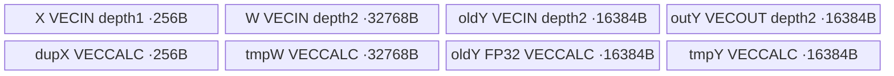

# SgemmvExpand 950 ACLNN 算子知识

## 算子速览

| 项目 | 内容 |
|---|---|
| 实际入口 | `aclnnSglSgemmvExpandGetWorkspaceSize` / `aclnnSglSgemmvExpand`；SglSgemmvExpand |
| 计算语义 | 按sequence选择LoRA与rank，每输出slice将FP32低秩x与低精度B权重点积，再加旧y并CAST_RINT写回；scale已在shrink折叠 |
| 输入输出 | x FP32[B,S*R]；weight/y同FP16或BF16；四metadata INT32连续同NPU；y为Ref别名 |
| 执行类型 | 单AIV_VECTOR节点，DMA/Scalar/Vector Mul与Block/Pair归约；无Cube、SIMT、通信或NDDMA；entry未声明KERNEL_TASK_TYPE_DEFAULT |
| Kernel 路线 | R-001 rank8/R8、R-002 rank8补16、R-003 rank16、R-004 rank32、R-005 rank64；每条有Half/BF16实例；负ID/rank0跳过 |
| 核心资源 | 4组queue+4个TBuf，固定UB=131584B；Host未查询UB；自有workspace0 |
| 来源闭包 | source_closed：公开ACLNN→完整Host/32B POD→单entry→五rank路线/BlockIterator/构建；生成框架、AscendC primitive/codegen为边界 |
| 静态缺陷 | blockDim=ceil(B*S/q)可能漏最后token chunk的slice；rank8且R8的W名义DMA为单槽容量2倍。安全/完整计算须额外满足有限域条件；draft不建议直接安全复用 |
| 验证状态 | 本次未编译、真机、数值或性能测试；风险为固定源码静态推导，不是运行复现，无verified |

## 接口与语义

### 计算语义

公共合同复用[LoRA expand API](../../../../apis/sgl_kernel_npu/sgl_lora_expand.md)。S=offsets.numel()-1，R=x.width/S，F=y.width。sequence b通过seq_len前缀包含token t，adapter a=lora_indices[b]，r=lora_ranks[a]，输出slice [o_s,o_next)。在合法元数据、全部目标block被启动、实际搬运/算术/存储满足下：

```text
y_after[t,o_s+j] =
 round_to_Y( float(y_before[t,o_s+j])
             + sum(k=0..r-1, x[t,s*r+k] * float(weight[a,o_s+j,k])) )
```

r0或负adapter ID不产生增量；seq_len未覆盖token时BlockIterator返回-1，该token所有已启动slice也跳过。x每行物理跨度S*R，但本slice输入起点是s*r（不是s*R），故可变rank数据按实际r紧凑放在行前部；scale不在本Kernel重复乘。切片外、跳过位置保留原y。

上述数学式不是所有Host接受形状都成立：K=ceil(B*S/q)可能漏掉最后chunk的部分slice；rank8/R8的DMA槽越界见后文。在这些输入上不能承诺完整增量。

公开文档及既有API“rank之后列不读取”是数学有效列说明，实际rank8补16路径按32B块搬运16个Half/BF16值，再以零填充和mask使后8列不贡献。rank8/R8还多读/多写搬运跨度，不能将数学无贡献当成物理不访问。

### 输入、输出与属性

| 参数 | shape/layout | dtype | 约束、默认值与语义 |
|---|---|---|---|
| x | [B,S*R]连续ND | FP32 | B>0；低秩结果已含scale，实际row和slice寻址如上；需width%S=0 |
| weight | [L,F,R]或[L,1,F,R]连续 | FP16/BF16 | 与y同dtype；调用方保证对应维度及R>=r、32B行搬运步长合法 |
| lora_indices | [numBlocks] | INT32 | 与seq_len对应；负值跳过，非负必须<L |
| seq_len | [numBlocks] | INT32 | 非负block长度、有效前缀无溢出；应覆盖B个token |
| lora_ranks | [L] | INT32 | 公共合同0/8/16/32/64；SUPPORTED_RANKS常量不构成实际校验 |
| slice_offsets | [S+1] | INT32 | S>=1，递增不重叠，0<=offset<=F；每项为16元素倍数以满足y的32B搬运 |
| y / yRef | [B,F]连续ND | 与weight同FP16/BF16 | 旧值参与FP32累加，Ref同存储返回；不同slice不得重叠 |
| workspace/tiling | 自有0/32B | BYTE/八uint32 | 实际ACLNN W由query返回，Device workspace未消费 |

### 入口与版本

精确pair由torch_adapter.cpp解析，7个输入描述符（y以Ref只传一次）进入query；Python auto/ascendc→torch.ops.npu.sgemmv_expand，无reference自动回退。legacy同名实现不是本冻结ACLNN额外可达节点，新entry文件保留迁移body。

SGL commit `dda6d36b0cdb4081e102d14c0a2fb276fc416e69`，CANN9.1.0来源是上游norm/cache/fused等CI配置及复用容器消费，并不证明LoRA专项或本次执行；arch22/2201对应A2/A3，arch35/3510对应950，算子注册两个架构。未安装SDK、未编译/运行。

## Host/Launcher 执行流程

### 参数校验与前处理

适配先验证全部七Tensor同NPU，再DeviceGuard，验证y Half/BF16、x/y二维、weight三或四维、B>0、xFLOAT、weight与y同dtype、四metadata INT32一维、全部连续。它不复制/重排输入，不检查Device读取的metadata值。

raw Host检查所有shape/yDesc/platform指针，x/y维数和weight维数、y dtype；直接GetDim(0)读取四metadata长度，没有单独一维检查。检查offset长度>=2，其余长度/B/hiddenIn/F非负；R=hiddenIn/S整除取下界，**没有**hiddenIn%S检查。相关POD维度<=UINT32_MAX、C>0、q>0（B0失败）；blockDim非零且<=UINT32_MAX；raw/typed tiling、容量>=32B、workspace指针有效。Host不核验metadata值、weight具体维度、y行数与B关系、UB容量、所有寻址乘积及DMA字段范围；OpDef dtype组合提供xFLOAT、metadataINT32及weight/y同型约束，不能把适配附加检查说成raw Host全已实现。

### 参数、Workspace 与生命周期

query返回executor/W，W<=INT64_MAX才按BYTE分配；当前NPU stream上七Tensor和workspace全部record_stream，lambda捕获七Tensor/描述符/workspace/executor/stream保护Host排队期；record_stream保护异步存储寿命。返回y本身，不copy-back。描述符shared_ptr调用aclDestroyTensor，vendor动态库handle静态保存；生成executor内部生命周期为Runtime边界，不编造手工销毁。

自有Host workspace[0]=0，entry不使用workspace；没有GM中间slice或多Kernel边。全部输入与旧y直到stream消费结束有效，caller不可并发改写。x/weight/metadata与写y不能发生有害别名；yIn/yOut本身相同存储是有意设计。

### 启动图与失败传播

| 节点/边 | producer→consumer | offset/extent/dtype/layout | ordering、owner/lifetime | 失败 |
|---|---|---|---|---|
| N1单Kernel | query/Host→execute→sgl_sgemmv_expand | K=ceil(B*S/q) blocks，32B POD，7inputs/yOut/workspace/tiling | 当前stream，生成ACLNN桥接是框架边界 | query/execute非ACL_SUCCESS抛TORCH_CHECK；Host无fallback |
| 只读GM | caller→N1 | x/weight、4metadata；地址详Kernel | Tensor捕获+record_stream，metadata由Scalar按需读取 | metadata无设备值检查，非法值非可靠失败返回 |
| y旧→y新 | caller→CopyInY→FP32Add→CopyOut | 每token、slice、4096或tail元素 | 同tile先读旧后写Ref；不同block需独占token/slice | 漏block保留旧值，不能当成功完成增量 |

构建为csrc根/域发现→lora单算子注册→operators架构解析→cann_ops OpDef生成ACLNN/配置→tiling/host库与单Kernel库。CMake注明legacy目录不作为新算子发现对象；无可达Cube节点，使用VV。

## Route 与参数设计

### 分核与资源计算

B=x.rows，S=offsetCount-1，C=查询AIV数，q=ceil(B/C)>0；Host K=ceil(B*S/q)。Device flat block f解码g=f/S、s=f%S，负责token [gq,min((g+1)q,B))的slice s。完整覆盖需K=ceil(B/q)*S。令J=ceil(B/q)、t=B-(J-1)q，1<=t<=q，则实际K=(J-1)S+ceil(t*S/q)；只有ceil(t*S/q)=S时最后chunk所有slice齐全。否则s>=ceil(t*S/q)未启动。例B5/C2/S3→q3/K5，f5缺失，token3..4的slice2不更新。示例C只是静态变量取值，不声称实际硬件C=2；缺陷公式适用于查询得到的C。所有推导限定乘加、ceil和POD无溢出/窄化域。

UB固定：X queue1*64*4=256；W queue2*8192*2=32768；旧Y queue2*4096*2=16384；输出Y queue2*4096*2=16384；dupX256；tmpW32768；oldY-FP3216384；tmpY16384；合131584B，均32B整块。Host没有GetCoreMemSize或UB guard，无自适应tile。Wtile8192内部元素，Ytile4096；每Wtile有效输出P=8192/internalRank，流入次数4096/P。full Compute blockRepeat128、pair16Repeat16、pair32Repeat8，mask64float；尾重复取向上整除，只有有效Y前缀输出。

### Route 选择

| 顺序 | Route | Key/模板 | 精确选择条件与优先级 | 不适用去向 |
|---:|---|---|---|---|
| 0 | S0跳过 | Host key0，同模板 | BlockIterator<0，或adapter<0，或rank==0；按此顺序 | 不搬该token的X/W/Y，不写y；其余继续 |
| 1 | R-001 原生rank8 | key0，KernelSgemmvExpand<DTYPE_WEIGHT> | rank==8 && maxRank==8；dtype Half/BF16、公共合同 | 当前行未命中时继续选择其它支持路线；仅不属于8/16/32/64的非零internalRank无归约分支，不是fallback |
| 2 | R-002 rank8补16 | key0，KernelSgemmvExpand<DTYPE_WEIGHT> | rank==8 && maxRank!=8；dtype Half/BF16、公共合同 | 当前行未命中时继续选择其它支持路线；仅不属于8/16/32/64的非零internalRank无归约分支，不是fallback |
| 3 | R-003 rank16 | key0，KernelSgemmvExpand<DTYPE_WEIGHT> | rank==16；dtype Half/BF16、公共合同 | 当前行未命中时继续选择其它支持路线；仅不属于8/16/32/64的非零internalRank无归约分支，不是fallback |
| 4 | R-004 rank32 | key0，KernelSgemmvExpand<DTYPE_WEIGHT> | rank==32；dtype Half/BF16、公共合同 | 当前行未命中时继续选择其它支持路线；仅不属于8/16/32/64的非零internalRank无归约分支，不是fallback |
| 5 | R-005 rank64 | key0，KernelSgemmvExpand<DTYPE_WEIGHT> | rank==64；dtype Half/BF16、公共合同 | 当前行未命中时继续选择其它支持路线；仅不属于8/16/32/64的非零internalRank无归约分支，不是fallback |

```text
Host key0; OpDef selects scalar_t = half or bfloat16_t
f -> chunk/slice; token -> BlockIterator -> adapter
requestBlock<0 / adapter<0 / rank0 : continue
internalRank=rank; if rank8 && R!=8: internalRank=16
CopyInX; each 4096-Y tile: CopyInY, each 8192-W stream CopyInW/Compute
Compute internal8 / 16 / 32 / 64 -> five logical routes above
ScaleOutput -> CopyOut; ComputeLastIteration handles residual
Unsupported nonzero rank: no safety fallback; caller violates contract
```

### 模板/实现执行矩阵

| Route | key/selector | dtype/shape/platform 完整命中条件 | 执行拓扑与 Kernel 节点 | 实际模板/body | 内存与同步特征 | tail/fallback |
|---|---|---|---|---|---|---|
| R-001 | 0 / rank==8 && maxRank==8 | half,xFLOAT,2201/3510；合法元数据/公共guard | 单N1 AIV | KernelSgemmvExpand<half>::全部方法；BlockReduceSum直写yTmp[progress] | 固定131584B；internal8；1024块×32B=32768B，超过单W槽16384B；PipeBarrier V | 4096-Y tail重复参数；无非法rank fallback |
| R-001 | 0 / rank==8 && maxRank==8 | bfloat16_t,xFLOAT,2201/3510；合法元数据/公共guard | 单N1 AIV | KernelSgemmvExpand<bfloat16_t>::全部方法；BlockReduceSum直写yTmp[progress] | 固定131584B；internal8；1024块×32B=32768B，超过单W槽16384B；PipeBarrier V | 4096-Y tail重复参数；无非法rank fallback |
| R-002 | 0 / rank==8 && maxRank!=8 | half,xFLOAT,2201/3510；合法元数据/公共guard | 单N1 AIV | KernelSgemmvExpand<half>::全部方法；BlockReduceSum原位→PairReduceSum写yTmp | 固定131584B；internal16；512块×32B=16384B；PipeBarrier V | 4096-Y tail重复参数；无非法rank fallback |
| R-002 | 0 / rank==8 && maxRank!=8 | bfloat16_t,xFLOAT,2201/3510；合法元数据/公共guard | 单N1 AIV | KernelSgemmvExpand<bfloat16_t>::全部方法；BlockReduceSum原位→PairReduceSum写yTmp | 固定131584B；internal16；512块×32B=16384B；PipeBarrier V | 4096-Y tail重复参数；无非法rank fallback |
| R-003 | 0 / rank==16 | half,xFLOAT,2201/3510；合法元数据/公共guard | 单N1 AIV | KernelSgemmvExpand<half>::全部方法；BlockReduceSum原位→PairReduceSum写yTmp | 固定131584B；internal16；512块×32B=16384B；PipeBarrier V | 4096-Y tail重复参数；无非法rank fallback |
| R-003 | 0 / rank==16 | bfloat16_t,xFLOAT,2201/3510；合法元数据/公共guard | 单N1 AIV | KernelSgemmvExpand<bfloat16_t>::全部方法；BlockReduceSum原位→PairReduceSum写yTmp | 固定131584B；internal16；512块×32B=16384B；PipeBarrier V | 4096-Y tail重复参数；无非法rank fallback |
| R-004 | 0 / rank==32 | half,xFLOAT,2201/3510；合法元数据/公共guard | 单N1 AIV | KernelSgemmvExpand<half>::全部方法；BlockReduceSum原位→PairReduceSum原位→PairReduceSum写yTmp | 固定131584B；internal32；256块×64B=16384B；PipeBarrier V | 4096-Y tail重复参数；无非法rank fallback |
| R-004 | 0 / rank==32 | bfloat16_t,xFLOAT,2201/3510；合法元数据/公共guard | 单N1 AIV | KernelSgemmvExpand<bfloat16_t>::全部方法；BlockReduceSum原位→PairReduceSum原位→PairReduceSum写yTmp | 固定131584B；internal32；256块×64B=16384B；PipeBarrier V | 4096-Y tail重复参数；无非法rank fallback |
| R-005 | 0 / rank==64 | half,xFLOAT,2201/3510；合法元数据/公共guard | 单N1 AIV | KernelSgemmvExpand<half>::全部方法；BlockReduceSum原位→BlockReduceSum写yTmp | 固定131584B；internal64；128块×128B=16384B；PipeBarrier V | 4096-Y tail重复参数；无非法rank fallback |
| R-005 | 0 / rank==64 | bfloat16_t,xFLOAT,2201/3510；合法元数据/公共guard | 单N1 AIV | KernelSgemmvExpand<bfloat16_t>::全部方法；BlockReduceSum原位→BlockReduceSum写yTmp | 固定131584B；internal64；128块×128B=16384B；PipeBarrier V | 4096-Y tail重复参数；无非法rank fallback |

### 隐藏性能 Guard

| Guard | Host/Tiling 条件 | Device/资源原因 | 影响 Route | 不满足时去向 | 源码符号 |
|---|---|---|---|---|---|
| tokens>0 | q=ceil(B/C)>0，C>0 | 无空token启动语义 | 全部 | Host失败/适配抛错 | TilingSglSgemmvExpand |
| 覆盖条件 | Host未检查ceil(B*S/q)==ceil(B/q)*S | flat f按S个slice分组 | 全部 | 缺后缀slice，无fallback；静态缺陷 | blockDim/Process |
| 实际UB | Host无容量guard | 固定131584B | 全部 | 分配结果未运行验证 | InitBuffer |
| y搬运对齐 | Host不查值；合同offset为16倍数 | Half/BF16每行分片32B，tail需同条件 | 全部 | primitive边界，无DataCopyPad备用 | CopyInY/CopyOut |
| W搬运 | Host不查R/r；req rank8/R8仍命中 | blockLen ceil(r*2/32)、srcStride floor((R-r)*2/32) uint16 | 全部，尤其R-001 | 单槽跨度/行步长错误；非安全fallback | CopyInW |
| rank约束 | 仅数组SUPPORTED_RANKS，无实际成员校验 | xDup64与归约8/16/32/64专用 | 全部 | unsupported非零rank可除零/超跨度/读旧tmp，不宣称可用 | Process/Compute |
| 乘积范围 | 仅维度<=U32 | S*R、R*F等U32中间乘积，DMA uint16、slice int32 | 全部 | 值截断可能先于宽类型赋值；无完整保护 | Init/CopyInX/CopyInW |

### POD/ABI

八uint32标准布局声明，offset0..28、align4、sizeof32；源码static_assert sizeof32，无pack/指针。offset为声明顺序静态推导，未运行ABI probe。

| 结构 | 字段 | 类型/位宽 | ABI 布局 | 单位 | Host/launcher producer | Device consumer | 边界 |
|---|---|---|---|---|---|---|---|
| SglSgemmvExpandTilingData | loraIndicesSize | uint32/32 | offset0,size4；总32/align4 | 元素/计数 | TilingSglSgemmvExpand: lora_indices.shape[0] | loraIndicesGm SetGlobalBuffer元素数 | 各字段<=U32不保护所有后续乘积 |
| SglSgemmvExpandTilingData | seqLenSize | uint32/32 | offset4,size4；总32/align4 | 元素/计数 | TilingSglSgemmvExpand: seq_len.shape[0] | BlockIterator blocks.GetSize | 各字段<=U32不保护所有后续乘积 |
| SglSgemmvExpandTilingData | loraRanksSize | uint32/32 | offset8,size4；总32/align4 | 元素/计数 | TilingSglSgemmvExpand: lora_ranks.shape[0] | loraRanksGm SetGlobalBuffer元素数 | 各字段<=U32不保护所有后续乘积 |
| SglSgemmvExpandTilingData | sliceOffsetsSize | uint32/32 | offset12,size4；总32/align4 | 元素/计数 | TilingSglSgemmvExpand: slice_offsets.shape[0] | sliceCount=size-1及offsets GM视图 | 各字段<=U32不保护所有后续乘积 |
| SglSgemmvExpandTilingData | batchSize | uint32/32 | offset16,size4；总32/align4 | 元素/计数 | TilingSglSgemmvExpand: B=x.shape[0] | Process endIdx夹至B | 各字段<=U32不保护所有后续乘积 |
| SglSgemmvExpandTilingData | numTokensPerCore | uint32/32 | offset20,size4；总32/align4 | 元素/计数 | TilingSglSgemmvExpand: q=ceil(B/C) | Process chunk token范围 | 各字段<=U32不保护所有后续乘积 |
| SglSgemmvExpandTilingData | maxLoRARank | uint32/32 | offset24,size4；总32/align4 | 元素/计数 | TilingSglSgemmvExpand: R=floor(x.shape[1]/S) | 权重行步长、x row步长、rank8内部选择 | 各字段<=U32不保护所有后续乘积 |
| SglSgemmvExpandTilingData | outputFullDim | uint32/32 | offset28,size4；总32/align4 | 元素/计数 | TilingSglSgemmvExpand: F=y.shape[1] | y行步长、singleLoRAWeightLen | 各字段<=U32不保护所有后续乘积 |

### Route 源码闭包

| Route | Key/selector | Host/Tiling producer | POD/参数 | Kernel entry/router 节点 | Kernel body/直接依赖 | 构建接线 |
|---|---|---|---|---|---|---|
| R-001 | key0 / rank==8 && maxRank==8 | op_host/sgemmv_expand.cpp::TilingSglSgemmvExpand | 32B，R/q/S/F与metadata长度 | sgl_sgemmv_expand→KernelSgemmvExpand<half/bfloat16_t>::Process | 同kernel全部方法；lora_common_kernel.h::BlockIterator；BlockReduceSum直写yTmp[progress] | 单算子CMake→lora→root/operators/cann_ops，2201/3510 |
| R-002 | key0 / rank==8 && maxRank!=8 | op_host/sgemmv_expand.cpp::TilingSglSgemmvExpand | 32B，R/q/S/F与metadata长度 | sgl_sgemmv_expand→KernelSgemmvExpand<half/bfloat16_t>::Process | 同kernel全部方法；lora_common_kernel.h::BlockIterator；BlockReduceSum原位→PairReduceSum写yTmp | 单算子CMake→lora→root/operators/cann_ops，2201/3510 |
| R-003 | key0 / rank==16 | op_host/sgemmv_expand.cpp::TilingSglSgemmvExpand | 32B，R/q/S/F与metadata长度 | sgl_sgemmv_expand→KernelSgemmvExpand<half/bfloat16_t>::Process | 同kernel全部方法；lora_common_kernel.h::BlockIterator；BlockReduceSum原位→PairReduceSum写yTmp | 单算子CMake→lora→root/operators/cann_ops，2201/3510 |
| R-004 | key0 / rank==32 | op_host/sgemmv_expand.cpp::TilingSglSgemmvExpand | 32B，R/q/S/F与metadata长度 | sgl_sgemmv_expand→KernelSgemmvExpand<half/bfloat16_t>::Process | 同kernel全部方法；lora_common_kernel.h::BlockIterator；BlockReduceSum原位→PairReduceSum原位→PairReduceSum写yTmp | 单算子CMake→lora→root/operators/cann_ops，2201/3510 |
| R-005 | key0 / rank==64 | op_host/sgemmv_expand.cpp::TilingSglSgemmvExpand | 32B，R/q/S/F与metadata长度 | sgl_sgemmv_expand→KernelSgemmvExpand<half/bfloat16_t>::Process | 同kernel全部方法；lora_common_kernel.h::BlockIterator；BlockReduceSum原位→BlockReduceSum写yTmp | 单算子CMake→lora→root/operators/cann_ops，2201/3510 |

## Kernel 实现

### 公共执行流程

Init绑定xFLOAT、weight/y scalar_t与四INT32元数据GM视图，申请上述八buffer。每flatblock读两个slice offset，再对chunk内token递增调用BlockIterator。该helper从previous_block/previous_offset开始扫描seq_len，index>=prefix+length则前进，否则缓存命中；到末尾返回-1。它无GM prefix workspace，合法非负seq_len和递增token是其复用前提。负adapter或rank0在X/W/Y搬运前continue。

CopyInX每token只搬r个float到256B单槽，Scalar把该r值循环重复到64float dupX；X_T固定float，文件if constexpr的非float分支不可达，不列为Route。每4096输出tile先搬旧Y，再连续处理Wtile，tmpY收集每Wtile归约结果；ScaleOutput将旧Y Cast NONE至FP32、Add增量、Cast RINT至输出类型，最后回写。ComputeLastIteration计算remainingY与remainingW，将残留W分完整8192和最后partial，blockRepeat=ceil(lastW/64)，pair16=ceil(blockRepeat*8/64)，pair32=ceil(pair16/2)，只输出remainingY个。

DataCopyParams四位置实参沿用[高维搬运参数](../../../../../../ops/ascendc/apis/simd_api/basic_api/aux_data_structures/data_copy_params.md)与[GM/UB高维搬运](../../../../../../ops/ascendc/apis/simd_api/basic_api/memory_vector_compute/data_move/data_copy_gm_and_ub_highdim_split.md)所述32B块/间隔契约；已完整读取这两张API。下面DMA字节推导按此契约，未安装/运行固定SDK验证。

Vector参数：castParams={dstBlk1,srcBlk1,dstRep8,srcRep4}，float目标每repeat64=256B、Half/BF16源64=128B；dotProductParams={dstBlk1,src0Blk1,src1Blk1,dstRep8,src0Rep0,src1Rep8}，dupX在每repeat固定重读；reduceSumParams={dstBlk1,srcBlk1,dstRep1,srcRep8}，两归约API实际传后三个字段(dstRep1,srcBlk1,srcRep8)，不把结构首字段也编成实参。每Vector阶段后明确PipeBarrier<PIPE_V>；queue联接DMA阶段，Scalar设置dupX相关依赖留给编译器管线模型，不捏造手工event。


### Route R-001：原生rank8

#### 适用条件

rank==8 && maxRank==8，合法Half/BF16两模板、xFLOAT与公共元数据合同。internalRank=8，每8192内部元素产生1024个有效输出，每4096-Y tile读4个Wtile。此路线确有单W槽请求跨度翻倍，保留源码知识但不能声称可安全直接复用。

##### 选择证据

| 层级 | 文件 | 符号 | 源码谓词/参数 | 结果/下一跳 |
|---|---|---|---|---|
| Host | csrc/lora/sgemmv_expand/op_host/sgemmv_expand.cpp | TilingSglSgemmvExpand | Half/BF16注册，key0，八字段 | 同一entry；rank内容未校验 |
| Device selector | csrc/lora/sgemmv_expand/op_kernel/sgemmv_expand.cpp | Process | rank==8 && maxRank==8，内部值8 | R-001，没有独立Host key |
| 归约 | 同Device文件 | Compute | internalRank==8 | BlockReduceSum直写yTmp[progress]；mask64 Cast；不做零填充 |

#### Device 数据流

##### 函数级调用链

```text
aclnnSglSgemmvExpand -> generated N1 -> sgl_sgemmv_expand
 -> KernelSgemmvExpand<half / bfloat16_t>::Init
 -> Process -> lora_common::BlockIterator<int32_t>::GetBlockIdx
 -> CopyInX -> {CopyInY -> [CopyInW -> Compute]*4
                 -> ScaleOutput -> CopyOut} per full4096
 -> ComputeLastIteration -> same CopyInY/W/Compute/ScaleOutput/CopyOut with tail counts
Compute: mask64 Cast；不做零填充 -> Mul broadcast dupX -> BlockReduceSum直写yTmp[progress]
```

##### 源码等价伪码

```text
# 伪码；LHS输出只在已启动flat block的token/slice范围有效
g=f/S; s=f%S; start=g*q; end=min(start+q,B)
o=offsets[s]; width=offsets[s+1]-o
for t=start..end:
 b=BlockIterator.GetBlockIdx(t); if b<0: continue
 a=indices[b]; if a<0: continue
 r=ranks[a]; if r==0: continue
 # R-001: r=8, internal=8
 xBase=S*R*t+r*s; weightBase=a*(R*F)+o*R; yBase=t*F+o
 copy r floats; repeat these r values to dupX[0:64]
 for each full4096 Y tile and optional final tail:
  CopyInY(tile validY)
  for W chunks covering validY*8 internal elements:
   n=min(8192,remainingInternalElements); p=Wprogress
   DMA W from weightBase+p*(8192/8)*R
       countBlocks=n/8, blockLen=ceil(8*2/32),
       srcStride=floor((R-8)*2/32), dstStride=0
   mask64 Cast；不做零填充
   Mul(tmpW,dupX,tmpW,mask64,repeats, {1,1,1,8,0,8}); PipeBarrier V
   BlockReduceSum直写yTmp[progress]; PipeBarrier V after every primitive
  oldYFP32=Cast_NONE(oldY); PipeBarrier V
  tmpY=Add(tmpY,oldYFP32,validY); PipeBarrier V
  output=Cast_RINT(tmpY,Ydtype,validY); PipeBarrier V
  DMA output validY back to Ref; release slots
```

#### 内存与数据搬运

##### 资源与搬运表

| 层级/缓冲区 | offset/地址公式 | extent/容量公式 | dtype/layout | producer | consumer | owner/lifetime | 对齐/复用 |
|---|---|---|---|---|---|---|---|
| GM x | 4*(S*R*t+r*s)B | r*4=32B/token | FP32 | caller | CopyInX | caller、stream期 | S*R中间U32需可表示，源有效 |
| GM weight | 2*(a*R*F+o*R+p*(8192/8)*R)B | full请求1024块×32B=32768B，超过单W槽16384B；tail n/8块 | Half/BF16行R | caller | CopyInW | caller、stream期 | srcStride/blockLen为32B单位且uint16；rank后padding可能实际读 |
| GM yIn/yOut | 2*(t*F+o+tile*4096)B | validY*2B，full8192B | Half/BF16 | caller/CopyOut | CopyInY/caller | Ref同存储、stream期 | offset及width16倍数；其他slice不重叠 |
| GM indices | 4*bB | loraIndicesSize*4B视图，单项读4B | INT32 | caller | Process | caller只读 | b必须在视图内 |
| GM seq_len | 4*sequence_index B | seqLenSize*4B视图，逐项读4B | INT32 | caller | BlockIterator | caller只读 | 非负有效prefix，无工作区 |
| GM ranks | 4*aB | loraRanksSize*4B视图，单项4B | INT32 | caller | Process | caller只读 | a有效，当前8 |
| GM offsets | 4*sB/4*(s+1)B | sliceOffsetsSize*4B视图 | INT32 | caller | Process | caller只读 | s+1有效，递增、F范围 |
| UB inQueueX | queue独立槽 | depth1×256B | FP32[64] | CopyInX | Scalar填dupX | TPipe；每tokenAlloc/DeQue/Free | 只搬r；未搬部分不消费 |
| UB inQueueW | queue独立槽 | depth2×16384B=32768B | Half/BF16[8192]/槽 | CopyInW | Compute Cast | 每WtileAlloc→Free | full单槽DMA请求32768B，超槽16384B；depth2不消除此span问题 |
| UB inQueueY | queue独立槽 | depth2×8192B=16384B | Half/BF16[4096]/槽 | CopyInY | ScaleOutput Cast | 每YtileAlloc→Free | validY16倍数 |
| UB outQueueY | queue独立槽 | depth2×8192B=16384B | Half/BF16[4096]/槽 | ScaleOutput | CopyOut | 每YtileAlloc→Free | 与旧Y队列不同存储 |
| UB dupBufferX | 独立TBuf base | 256B，float[64] | r值重复 | CopyInX Scalar SetValue | 所有Wtile Mul | 当前token，下一token覆盖 | 本route重复8次 |
| UB tmpBufferW | 独立TBuf base | 32768B，float[8192] | Cast/Mul/部分归约原位 | Compute | BlockReduceSum直写yTmp[progress] | 每Wtile覆盖/复用 | 每Vector步骤PipeBarrier V |
| UB inBufferY | 独立TBuf base | 16384B，float[4096] | oldY FP32 | ScaleOutput Cast | Add | 每Ytile覆盖 | oldY输入槽Cast后释放 |
| UB tmpBufferY | 独立TBuf base+progress*4B | 16384B，float[4096] | 归约结果→与oldY Add | Compute/ScaleOutput | ScaleOutput Cast | 每Ytile有效前缀写满才读 | 不清整Buf；非法rank不能假设已初始化 |
| workspace/寄存器 | 无自有slice | 自有0；metadata/rank/address/iterator状态Scalar | 标量 | Process/helper | 方法内消费 | core局部；无通信window | 无GM reduction暂存 |

##### 分层内存布局



##### 字节账与复用顺序

```text
UB_total=256+32768+16384+16384+256+32768+16384+16384=131584B
UB_total<=U 是复用前提；Host没有查询U或检查此不等式。
dynamic_ub=N/A; workspace_total(自有)=0。
full W DMA: (8192/8)*ceil(8*2/32)*32 = 32768B；
tail W DMA: (n/8)*ceil(8*2/32)*32B；n=validY*internal或最后partial。
X读32B一次/token/slice；每Ytile旧Y读/新Y写各2*validYB；
metadata按helper实际单项标量读；没有额外GM prefix buffer。
```

| 复用子区 | 写入者 | 读取者/消费点 | 下一次覆盖 | 同步或释放依据 | 安全条件 |
|---|---|---|---|---|---|
| X输入槽/dupX | CopyInX DMA/Scalar | dup填充/Mul | 下token | queue及编译器Scalar依赖；X槽填完dup后Free | dupX保留到当前token所有W streams结束 |
| W输入槽/tmpW | DMA/Cast/Mul | Cast/归约 | 下一Wtile | EnQue/DeQue，Cast后PipeBarrier V再Free W；每Vector后V barrier | 不超槽、mask输入合法；tmpW原位步骤顺序不能颠倒 |
| 旧Y槽/inBufferY | CopyInY/Cast | ScaleOutput Add | 下一Ytile | Cast后V barrier/Free旧Y槽 | oldY实际validY初始化 |
| tmpY/output槽 | 各Wtile归约/Add/Cast | ScaleOutput/CopyOut | 下一Ytile | 每Vector后V barrier，输出queue后Free | 各progress覆盖有效前缀；tail多算的UB后缀不提交 |

#### 同步、精度与尾块

##### 同步与数值边界表

| 阶段 | primitive/机制 | producer | consumer/等待点 | 保护对象 | 精度/尾块 |
|---|---|---|---|---|---|
| X/W/Y DMA | input queue EnQue/DeQue | CopyInX/W/Y | Scalar dup/Cast/ScaleOutput | 对应槽 | XFLOAT，W/Y低精度；非float X if constexpr不可达 |
| Cast→Mul→归约 | 每步PipeBarrier<PIPE_V> | mask64 Cast；不做零填充与Mul | BlockReduceSum直写yTmp[progress] | tmpW/dupX/tmpY | mask64float，full重复128；R-001有效输出1024 |
| 归约 | BlockReduce/PairReduce显式stride | tmpW | tmpY[progress] | tmpW原位或独立tmpY | dstRep1/srcBlk1/srcRep8；FP32、无Cube accumulation |
| 累加/舍入 | Cast NONE→V barrier→Add→V barrier→Cast RINT→V barrier | oldY与tmpY | output queue | inBufferY/tmpY/output槽 | oldY转FP32、一次最终低精度舍入；不再乘scale |
| 输出 | out EnQue/DeQue/FreeTensor | Cast | CopyOut DataCopy | Ref与output槽 | full4096；tail validY，需16倍数 |
| partial W | ceil lastW/64、pair16/32向上整除 | ComputeLastIteration | Compute | tmpW/tmpY有效前缀 | 最后重复可能多算UB padding lane，只有validY提交；不能把padding读当有效数学输入 |
| core间 | 无flag/atomic | token/slice独占writer | caller | y子区 | offset不重叠且Host启动完整；漏block没有同步补偿 |
| Scalar依赖 | 编译器/AscendC管线模型 | GetValue/SetValue dupX、metadata | 后续Vector/控制流 | core局部 | 不虚构V_S/S_V手动event，无codegen观测 |

#### 关键实现

##### 符号证据表

| 阶段 | 文件 | 符号/模板实例 | 实现事实 |
|---|---|---|---|
| Host/Tiling producer | csrc/lora/sgemmv_expand/op_host/sgemmv_expand.cpp | TilingSglSgemmvExpand | q/K、无UB查询、32B key0 |
| Kernel entry/router | csrc/lora/sgemmv_expand/op_kernel/sgemmv_expand.cpp | sgl_sgemmv_expand/KernelSgemmvExpand<half/bfloat16_t>::Process | rank==8 && maxRank==8→internal8、P1024 |
| Device body/helper | 同kernel文件 | Init/CopyInX/CopyInW/CopyInY/Compute/ScaleOutput/CopyOut/ComputeLastIteration | mask64 Cast；不做零填充；BlockReduceSum直写yTmp[progress]；1024块×32B=32768B，超过单W槽16384B |
| 共享helper | csrc/lora/common/kernel/lora_common_kernel.h | BlockIterator<int32_t>::GetBlockIdx | 递增扫描seq_len，缓存previous block/prefix，未覆盖返回-1 |

### Route R-002：rank8补16

#### 适用条件

rank==8 && maxRank!=8，合法Half/BF16两模板、xFLOAT与公共元数据合同。internalRank=16，每8192内部元素产生512个有效输出，每4096-Y tile读8个Wtile。还需真实UB足够、覆盖完整、32B行步长/有效GM范围与整数可表示条件。

##### 选择证据

| 层级 | 文件 | 符号 | 源码谓词/参数 | 结果/下一跳 |
|---|---|---|---|---|
| Host | csrc/lora/sgemmv_expand/op_host/sgemmv_expand.cpp | TilingSglSgemmvExpand | Half/BF16注册，key0，八字段 | 同一entry；rank内容未校验 |
| Device selector | csrc/lora/sgemmv_expand/op_kernel/sgemmv_expand.cpp | Process | rank==8 && maxRank!=8，内部值16 | R-002，没有独立Host key |
| 归约 | 同Device文件 | Compute | internalRank==16 | BlockReduceSum原位→PairReduceSum写yTmp；Duplicate清零→MASK_FILTER=0x00FF00FF00FF00FF Cast |

#### Device 数据流

##### 函数级调用链

```text
aclnnSglSgemmvExpand -> generated N1 -> sgl_sgemmv_expand
 -> KernelSgemmvExpand<half / bfloat16_t>::Init
 -> Process -> lora_common::BlockIterator<int32_t>::GetBlockIdx
 -> CopyInX -> {CopyInY -> [CopyInW -> Compute]*8
                 -> ScaleOutput -> CopyOut} per full4096
 -> ComputeLastIteration -> same CopyInY/W/Compute/ScaleOutput/CopyOut with tail counts
Compute: Duplicate清零→MASK_FILTER=0x00FF00FF00FF00FF Cast -> Mul broadcast dupX -> BlockReduceSum原位→PairReduceSum写yTmp
```

##### 源码等价伪码

```text
# 伪码；LHS输出只在已启动flat block的token/slice范围有效
g=f/S; s=f%S; start=g*q; end=min(start+q,B)
o=offsets[s]; width=offsets[s+1]-o
for t=start..end:
 b=BlockIterator.GetBlockIdx(t); if b<0: continue
 a=indices[b]; if a<0: continue
 r=ranks[a]; if r==0: continue
 # R-002: r=8, internal=16
 xBase=S*R*t+r*s; weightBase=a*(R*F)+o*R; yBase=t*F+o
 copy r floats; repeat these r values to dupX[0:64]
 for each full4096 Y tile and optional final tail:
  CopyInY(tile validY)
  for W chunks covering validY*16 internal elements:
   n=min(8192,remainingInternalElements); p=Wprogress
   DMA W from weightBase+p*(8192/16)*R
       countBlocks=n/16, blockLen=ceil(8*2/32),
       srcStride=floor((R-8)*2/32), dstStride=0
   Duplicate清零→MASK_FILTER=0x00FF00FF00FF00FF Cast
   Mul(tmpW,dupX,tmpW,mask64,repeats, {1,1,1,8,0,8}); PipeBarrier V
   BlockReduceSum原位→PairReduceSum写yTmp; PipeBarrier V after every primitive
  oldYFP32=Cast_NONE(oldY); PipeBarrier V
  tmpY=Add(tmpY,oldYFP32,validY); PipeBarrier V
  output=Cast_RINT(tmpY,Ydtype,validY); PipeBarrier V
  DMA output validY back to Ref; release slots
```

#### 内存与数据搬运

##### 资源与搬运表

| 层级/缓冲区 | offset/地址公式 | extent/容量公式 | dtype/layout | producer | consumer | owner/lifetime | 对齐/复用 |
|---|---|---|---|---|---|---|---|
| GM x | 4*(S*R*t+r*s)B | r*4=32B/token | FP32 | caller | CopyInX | caller、stream期 | S*R中间U32需可表示，源有效 |
| GM weight | 2*(a*R*F+o*R+p*(8192/16)*R)B | full请求512块×32B=16384B；tail n/16块 | Half/BF16行R | caller | CopyInW | caller、stream期 | srcStride/blockLen为32B单位且uint16；rank后padding可能实际读 |
| GM yIn/yOut | 2*(t*F+o+tile*4096)B | validY*2B，full8192B | Half/BF16 | caller/CopyOut | CopyInY/caller | Ref同存储、stream期 | offset及width16倍数；其他slice不重叠 |
| GM indices | 4*bB | loraIndicesSize*4B视图，单项读4B | INT32 | caller | Process | caller只读 | b必须在视图内 |
| GM seq_len | 4*sequence_index B | seqLenSize*4B视图，逐项读4B | INT32 | caller | BlockIterator | caller只读 | 非负有效prefix，无工作区 |
| GM ranks | 4*aB | loraRanksSize*4B视图，单项4B | INT32 | caller | Process | caller只读 | a有效，当前8 |
| GM offsets | 4*sB/4*(s+1)B | sliceOffsetsSize*4B视图 | INT32 | caller | Process | caller只读 | s+1有效，递增、F范围 |
| UB inQueueX | queue独立槽 | depth1×256B | FP32[64] | CopyInX | Scalar填dupX | TPipe；每tokenAlloc/DeQue/Free | 只搬r；未搬部分不消费 |
| UB inQueueW | queue独立槽 | depth2×16384B=32768B | Half/BF16[8192]/槽 | CopyInW | Compute Cast | 每WtileAlloc→Free | full请求16384B，tail按n比例；slot消费后释放 |
| UB inQueueY | queue独立槽 | depth2×8192B=16384B | Half/BF16[4096]/槽 | CopyInY | ScaleOutput Cast | 每YtileAlloc→Free | validY16倍数 |
| UB outQueueY | queue独立槽 | depth2×8192B=16384B | Half/BF16[4096]/槽 | ScaleOutput | CopyOut | 每YtileAlloc→Free | 与旧Y队列不同存储 |
| UB dupBufferX | 独立TBuf base | 256B，float[64] | r值重复 | CopyInX Scalar SetValue | 所有Wtile Mul | 当前token，下一token覆盖 | 本route重复8次 |
| UB tmpBufferW | 独立TBuf base | 32768B，float[8192] | Cast/Mul/部分归约原位 | Compute | BlockReduceSum原位→PairReduceSum写yTmp | 每Wtile覆盖/复用 | 每Vector步骤PipeBarrier V |
| UB inBufferY | 独立TBuf base | 16384B，float[4096] | oldY FP32 | ScaleOutput Cast | Add | 每Ytile覆盖 | oldY输入槽Cast后释放 |
| UB tmpBufferY | 独立TBuf base+progress*4B | 16384B，float[4096] | 归约结果→与oldY Add | Compute/ScaleOutput | ScaleOutput Cast | 每Ytile有效前缀写满才读 | 不清整Buf；非法rank不能假设已初始化 |
| workspace/寄存器 | 无自有slice | 自有0；metadata/rank/address/iterator状态Scalar | 标量 | Process/helper | 方法内消费 | core局部；无通信window | 无GM reduction暂存 |

##### 分层内存布局


##### 字节账与复用顺序

```text
UB_total=256+32768+16384+16384+256+32768+16384+16384=131584B
UB_total<=U 是复用前提；Host没有查询U或检查此不等式。
dynamic_ub=N/A; workspace_total(自有)=0。
full W DMA: (8192/16)*ceil(8*2/32)*32 = 16384B；
tail W DMA: (n/16)*ceil(8*2/32)*32B；n=validY*internal或最后partial。
X读32B一次/token/slice；每Ytile旧Y读/新Y写各2*validYB；
metadata按helper实际单项标量读；没有额外GM prefix buffer。
```

| 复用子区 | 写入者 | 读取者/消费点 | 下一次覆盖 | 同步或释放依据 | 安全条件 |
|---|---|---|---|---|---|
| X输入槽/dupX | CopyInX DMA/Scalar | dup填充/Mul | 下token | queue及编译器Scalar依赖；X槽填完dup后Free | dupX保留到当前token所有W streams结束 |
| W输入槽/tmpW | DMA/Cast/Mul | Cast/归约 | 下一Wtile | EnQue/DeQue，Cast后PipeBarrier V再Free W；每Vector后V barrier | 不超槽、mask输入合法；tmpW原位步骤顺序不能颠倒 |
| 旧Y槽/inBufferY | CopyInY/Cast | ScaleOutput Add | 下一Ytile | Cast后V barrier/Free旧Y槽 | oldY实际validY初始化 |
| tmpY/output槽 | 各Wtile归约/Add/Cast | ScaleOutput/CopyOut | 下一Ytile | 每Vector后V barrier，输出queue后Free | 各progress覆盖有效前缀；tail多算的UB后缀不提交 |

#### 同步、精度与尾块

##### 同步与数值边界表

| 阶段 | primitive/机制 | producer | consumer/等待点 | 保护对象 | 精度/尾块 |
|---|---|---|---|---|---|
| X/W/Y DMA | input queue EnQue/DeQue | CopyInX/W/Y | Scalar dup/Cast/ScaleOutput | 对应槽 | XFLOAT，W/Y低精度；非float X if constexpr不可达 |
| Cast→Mul→归约 | 每步PipeBarrier<PIPE_V> | Duplicate清零→MASK_FILTER=0x00FF00FF00FF00FF Cast与Mul | BlockReduceSum原位→PairReduceSum写yTmp | tmpW/dupX/tmpY | mask64float，full重复128；R-002有效输出512 |
| 归约 | BlockReduce/PairReduce显式stride | tmpW | tmpY[progress] | tmpW原位或独立tmpY | dstRep1/srcBlk1/srcRep8；FP32、无Cube accumulation |
| 累加/舍入 | Cast NONE→V barrier→Add→V barrier→Cast RINT→V barrier | oldY与tmpY | output queue | inBufferY/tmpY/output槽 | oldY转FP32、一次最终低精度舍入；不再乘scale |
| 输出 | out EnQue/DeQue/FreeTensor | Cast | CopyOut DataCopy | Ref与output槽 | full4096；tail validY，需16倍数 |
| partial W | ceil lastW/64、pair16/32向上整除 | ComputeLastIteration | Compute | tmpW/tmpY有效前缀 | 最后重复可能多算UB padding lane，只有validY提交；不能把padding读当有效数学输入 |
| core间 | 无flag/atomic | token/slice独占writer | caller | y子区 | offset不重叠且Host启动完整；漏block没有同步补偿 |
| Scalar依赖 | 编译器/AscendC管线模型 | GetValue/SetValue dupX、metadata | 后续Vector/控制流 | core局部 | 不虚构V_S/S_V手动event，无codegen观测 |

#### 关键实现

##### 符号证据表

| 阶段 | 文件 | 符号/模板实例 | 实现事实 |
|---|---|---|---|
| Host/Tiling producer | csrc/lora/sgemmv_expand/op_host/sgemmv_expand.cpp | TilingSglSgemmvExpand | q/K、无UB查询、32B key0 |
| Kernel entry/router | csrc/lora/sgemmv_expand/op_kernel/sgemmv_expand.cpp | sgl_sgemmv_expand/KernelSgemmvExpand<half/bfloat16_t>::Process | rank==8 && maxRank!=8→internal16、P512 |
| Device body/helper | 同kernel文件 | Init/CopyInX/CopyInW/CopyInY/Compute/ScaleOutput/CopyOut/ComputeLastIteration | Duplicate清零→MASK_FILTER=0x00FF00FF00FF00FF Cast；BlockReduceSum原位→PairReduceSum写yTmp；512块×32B=16384B |
| 共享helper | csrc/lora/common/kernel/lora_common_kernel.h | BlockIterator<int32_t>::GetBlockIdx | 递增扫描seq_len，缓存previous block/prefix，未覆盖返回-1 |

### Route R-003：rank16

#### 适用条件

rank==16，合法Half/BF16两模板、xFLOAT与公共元数据合同。internalRank=16，每8192内部元素产生512个有效输出，每4096-Y tile读8个Wtile。还需真实UB足够、覆盖完整、32B行步长/有效GM范围与整数可表示条件。

##### 选择证据

| 层级 | 文件 | 符号 | 源码谓词/参数 | 结果/下一跳 |
|---|---|---|---|---|
| Host | csrc/lora/sgemmv_expand/op_host/sgemmv_expand.cpp | TilingSglSgemmvExpand | Half/BF16注册，key0，八字段 | 同一entry；rank内容未校验 |
| Device selector | csrc/lora/sgemmv_expand/op_kernel/sgemmv_expand.cpp | Process | rank==16，内部值16 | R-003，没有独立Host key |
| 归约 | 同Device文件 | Compute | internalRank==16 | BlockReduceSum原位→PairReduceSum写yTmp；mask64 Cast |

#### Device 数据流

##### 函数级调用链

```text
aclnnSglSgemmvExpand -> generated N1 -> sgl_sgemmv_expand
 -> KernelSgemmvExpand<half / bfloat16_t>::Init
 -> Process -> lora_common::BlockIterator<int32_t>::GetBlockIdx
 -> CopyInX -> {CopyInY -> [CopyInW -> Compute]*8
                 -> ScaleOutput -> CopyOut} per full4096
 -> ComputeLastIteration -> same CopyInY/W/Compute/ScaleOutput/CopyOut with tail counts
Compute: mask64 Cast -> Mul broadcast dupX -> BlockReduceSum原位→PairReduceSum写yTmp
```

##### 源码等价伪码

```text
# 伪码；LHS输出只在已启动flat block的token/slice范围有效
g=f/S; s=f%S; start=g*q; end=min(start+q,B)
o=offsets[s]; width=offsets[s+1]-o
for t=start..end:
 b=BlockIterator.GetBlockIdx(t); if b<0: continue
 a=indices[b]; if a<0: continue
 r=ranks[a]; if r==0: continue
 # R-003: r=16, internal=16
 xBase=S*R*t+r*s; weightBase=a*(R*F)+o*R; yBase=t*F+o
 copy r floats; repeat these r values to dupX[0:64]
 for each full4096 Y tile and optional final tail:
  CopyInY(tile validY)
  for W chunks covering validY*16 internal elements:
   n=min(8192,remainingInternalElements); p=Wprogress
   DMA W from weightBase+p*(8192/16)*R
       countBlocks=n/16, blockLen=ceil(16*2/32),
       srcStride=floor((R-16)*2/32), dstStride=0
   mask64 Cast
   Mul(tmpW,dupX,tmpW,mask64,repeats, {1,1,1,8,0,8}); PipeBarrier V
   BlockReduceSum原位→PairReduceSum写yTmp; PipeBarrier V after every primitive
  oldYFP32=Cast_NONE(oldY); PipeBarrier V
  tmpY=Add(tmpY,oldYFP32,validY); PipeBarrier V
  output=Cast_RINT(tmpY,Ydtype,validY); PipeBarrier V
  DMA output validY back to Ref; release slots
```

#### 内存与数据搬运

##### 资源与搬运表

| 层级/缓冲区 | offset/地址公式 | extent/容量公式 | dtype/layout | producer | consumer | owner/lifetime | 对齐/复用 |
|---|---|---|---|---|---|---|---|
| GM x | 4*(S*R*t+r*s)B | r*4=64B/token | FP32 | caller | CopyInX | caller、stream期 | S*R中间U32需可表示，源有效 |
| GM weight | 2*(a*R*F+o*R+p*(8192/16)*R)B | full请求512块×32B=16384B；tail n/16块 | Half/BF16行R | caller | CopyInW | caller、stream期 | srcStride/blockLen为32B单位且uint16；rank后padding可能实际读 |
| GM yIn/yOut | 2*(t*F+o+tile*4096)B | validY*2B，full8192B | Half/BF16 | caller/CopyOut | CopyInY/caller | Ref同存储、stream期 | offset及width16倍数；其他slice不重叠 |
| GM indices | 4*bB | loraIndicesSize*4B视图，单项读4B | INT32 | caller | Process | caller只读 | b必须在视图内 |
| GM seq_len | 4*sequence_index B | seqLenSize*4B视图，逐项读4B | INT32 | caller | BlockIterator | caller只读 | 非负有效prefix，无工作区 |
| GM ranks | 4*aB | loraRanksSize*4B视图，单项4B | INT32 | caller | Process | caller只读 | a有效，当前16 |
| GM offsets | 4*sB/4*(s+1)B | sliceOffsetsSize*4B视图 | INT32 | caller | Process | caller只读 | s+1有效，递增、F范围 |
| UB inQueueX | queue独立槽 | depth1×256B | FP32[64] | CopyInX | Scalar填dupX | TPipe；每tokenAlloc/DeQue/Free | 只搬r；未搬部分不消费 |
| UB inQueueW | queue独立槽 | depth2×16384B=32768B | Half/BF16[8192]/槽 | CopyInW | Compute Cast | 每WtileAlloc→Free | full请求16384B，tail按n比例；slot消费后释放 |
| UB inQueueY | queue独立槽 | depth2×8192B=16384B | Half/BF16[4096]/槽 | CopyInY | ScaleOutput Cast | 每YtileAlloc→Free | validY16倍数 |
| UB outQueueY | queue独立槽 | depth2×8192B=16384B | Half/BF16[4096]/槽 | ScaleOutput | CopyOut | 每YtileAlloc→Free | 与旧Y队列不同存储 |
| UB dupBufferX | 独立TBuf base | 256B，float[64] | r值重复 | CopyInX Scalar SetValue | 所有Wtile Mul | 当前token，下一token覆盖 | 本route重复4次 |
| UB tmpBufferW | 独立TBuf base | 32768B，float[8192] | Cast/Mul/部分归约原位 | Compute | BlockReduceSum原位→PairReduceSum写yTmp | 每Wtile覆盖/复用 | 每Vector步骤PipeBarrier V |
| UB inBufferY | 独立TBuf base | 16384B，float[4096] | oldY FP32 | ScaleOutput Cast | Add | 每Ytile覆盖 | oldY输入槽Cast后释放 |
| UB tmpBufferY | 独立TBuf base+progress*4B | 16384B，float[4096] | 归约结果→与oldY Add | Compute/ScaleOutput | ScaleOutput Cast | 每Ytile有效前缀写满才读 | 不清整Buf；非法rank不能假设已初始化 |
| workspace/寄存器 | 无自有slice | 自有0；metadata/rank/address/iterator状态Scalar | 标量 | Process/helper | 方法内消费 | core局部；无通信window | 无GM reduction暂存 |

##### 分层内存布局


##### 字节账与复用顺序

```text
UB_total=256+32768+16384+16384+256+32768+16384+16384=131584B
UB_total<=U 是复用前提；Host没有查询U或检查此不等式。
dynamic_ub=N/A; workspace_total(自有)=0。
full W DMA: (8192/16)*ceil(16*2/32)*32 = 16384B；
tail W DMA: (n/16)*ceil(16*2/32)*32B；n=validY*internal或最后partial。
X读64B一次/token/slice；每Ytile旧Y读/新Y写各2*validYB；
metadata按helper实际单项标量读；没有额外GM prefix buffer。
```

| 复用子区 | 写入者 | 读取者/消费点 | 下一次覆盖 | 同步或释放依据 | 安全条件 |
|---|---|---|---|---|---|
| X输入槽/dupX | CopyInX DMA/Scalar | dup填充/Mul | 下token | queue及编译器Scalar依赖；X槽填完dup后Free | dupX保留到当前token所有W streams结束 |
| W输入槽/tmpW | DMA/Cast/Mul | Cast/归约 | 下一Wtile | EnQue/DeQue，Cast后PipeBarrier V再Free W；每Vector后V barrier | 不超槽、mask输入合法；tmpW原位步骤顺序不能颠倒 |
| 旧Y槽/inBufferY | CopyInY/Cast | ScaleOutput Add | 下一Ytile | Cast后V barrier/Free旧Y槽 | oldY实际validY初始化 |
| tmpY/output槽 | 各Wtile归约/Add/Cast | ScaleOutput/CopyOut | 下一Ytile | 每Vector后V barrier，输出queue后Free | 各progress覆盖有效前缀；tail多算的UB后缀不提交 |

#### 同步、精度与尾块

##### 同步与数值边界表

| 阶段 | primitive/机制 | producer | consumer/等待点 | 保护对象 | 精度/尾块 |
|---|---|---|---|---|---|
| X/W/Y DMA | input queue EnQue/DeQue | CopyInX/W/Y | Scalar dup/Cast/ScaleOutput | 对应槽 | XFLOAT，W/Y低精度；非float X if constexpr不可达 |
| Cast→Mul→归约 | 每步PipeBarrier<PIPE_V> | mask64 Cast与Mul | BlockReduceSum原位→PairReduceSum写yTmp | tmpW/dupX/tmpY | mask64float，full重复128；R-003有效输出512 |
| 归约 | BlockReduce/PairReduce显式stride | tmpW | tmpY[progress] | tmpW原位或独立tmpY | dstRep1/srcBlk1/srcRep8；FP32、无Cube accumulation |
| 累加/舍入 | Cast NONE→V barrier→Add→V barrier→Cast RINT→V barrier | oldY与tmpY | output queue | inBufferY/tmpY/output槽 | oldY转FP32、一次最终低精度舍入；不再乘scale |
| 输出 | out EnQue/DeQue/FreeTensor | Cast | CopyOut DataCopy | Ref与output槽 | full4096；tail validY，需16倍数 |
| partial W | ceil lastW/64、pair16/32向上整除 | ComputeLastIteration | Compute | tmpW/tmpY有效前缀 | 最后重复可能多算UB padding lane，只有validY提交；不能把padding读当有效数学输入 |
| core间 | 无flag/atomic | token/slice独占writer | caller | y子区 | offset不重叠且Host启动完整；漏block没有同步补偿 |
| Scalar依赖 | 编译器/AscendC管线模型 | GetValue/SetValue dupX、metadata | 后续Vector/控制流 | core局部 | 不虚构V_S/S_V手动event，无codegen观测 |

#### 关键实现

##### 符号证据表

| 阶段 | 文件 | 符号/模板实例 | 实现事实 |
|---|---|---|---|
| Host/Tiling producer | csrc/lora/sgemmv_expand/op_host/sgemmv_expand.cpp | TilingSglSgemmvExpand | q/K、无UB查询、32B key0 |
| Kernel entry/router | csrc/lora/sgemmv_expand/op_kernel/sgemmv_expand.cpp | sgl_sgemmv_expand/KernelSgemmvExpand<half/bfloat16_t>::Process | rank==16→internal16、P512 |
| Device body/helper | 同kernel文件 | Init/CopyInX/CopyInW/CopyInY/Compute/ScaleOutput/CopyOut/ComputeLastIteration | mask64 Cast；BlockReduceSum原位→PairReduceSum写yTmp；512块×32B=16384B |
| 共享helper | csrc/lora/common/kernel/lora_common_kernel.h | BlockIterator<int32_t>::GetBlockIdx | 递增扫描seq_len，缓存previous block/prefix，未覆盖返回-1 |

### Route R-004：rank32

#### 适用条件

rank==32，合法Half/BF16两模板、xFLOAT与公共元数据合同。internalRank=32，每8192内部元素产生256个有效输出，每4096-Y tile读16个Wtile。还需真实UB足够、覆盖完整、32B行步长/有效GM范围与整数可表示条件。

##### 选择证据

| 层级 | 文件 | 符号 | 源码谓词/参数 | 结果/下一跳 |
|---|---|---|---|---|
| Host | csrc/lora/sgemmv_expand/op_host/sgemmv_expand.cpp | TilingSglSgemmvExpand | Half/BF16注册，key0，八字段 | 同一entry；rank内容未校验 |
| Device selector | csrc/lora/sgemmv_expand/op_kernel/sgemmv_expand.cpp | Process | rank==32，内部值32 | R-004，没有独立Host key |
| 归约 | 同Device文件 | Compute | internalRank==32 | BlockReduceSum原位→PairReduceSum原位→PairReduceSum写yTmp；mask64 Cast |

#### Device 数据流

##### 函数级调用链

```text
aclnnSglSgemmvExpand -> generated N1 -> sgl_sgemmv_expand
 -> KernelSgemmvExpand<half / bfloat16_t>::Init
 -> Process -> lora_common::BlockIterator<int32_t>::GetBlockIdx
 -> CopyInX -> {CopyInY -> [CopyInW -> Compute]*16
                 -> ScaleOutput -> CopyOut} per full4096
 -> ComputeLastIteration -> same CopyInY/W/Compute/ScaleOutput/CopyOut with tail counts
Compute: mask64 Cast -> Mul broadcast dupX -> BlockReduceSum原位→PairReduceSum原位→PairReduceSum写yTmp
```

##### 源码等价伪码

```text
# 伪码；LHS输出只在已启动flat block的token/slice范围有效
g=f/S; s=f%S; start=g*q; end=min(start+q,B)
o=offsets[s]; width=offsets[s+1]-o
for t=start..end:
 b=BlockIterator.GetBlockIdx(t); if b<0: continue
 a=indices[b]; if a<0: continue
 r=ranks[a]; if r==0: continue
 # R-004: r=32, internal=32
 xBase=S*R*t+r*s; weightBase=a*(R*F)+o*R; yBase=t*F+o
 copy r floats; repeat these r values to dupX[0:64]
 for each full4096 Y tile and optional final tail:
  CopyInY(tile validY)
  for W chunks covering validY*32 internal elements:
   n=min(8192,remainingInternalElements); p=Wprogress
   DMA W from weightBase+p*(8192/32)*R
       countBlocks=n/32, blockLen=ceil(32*2/32),
       srcStride=floor((R-32)*2/32), dstStride=0
   mask64 Cast
   Mul(tmpW,dupX,tmpW,mask64,repeats, {1,1,1,8,0,8}); PipeBarrier V
   BlockReduceSum原位→PairReduceSum原位→PairReduceSum写yTmp; PipeBarrier V after every primitive
  oldYFP32=Cast_NONE(oldY); PipeBarrier V
  tmpY=Add(tmpY,oldYFP32,validY); PipeBarrier V
  output=Cast_RINT(tmpY,Ydtype,validY); PipeBarrier V
  DMA output validY back to Ref; release slots
```

#### 内存与数据搬运

##### 资源与搬运表

| 层级/缓冲区 | offset/地址公式 | extent/容量公式 | dtype/layout | producer | consumer | owner/lifetime | 对齐/复用 |
|---|---|---|---|---|---|---|---|
| GM x | 4*(S*R*t+r*s)B | r*4=128B/token | FP32 | caller | CopyInX | caller、stream期 | S*R中间U32需可表示，源有效 |
| GM weight | 2*(a*R*F+o*R+p*(8192/32)*R)B | full请求256块×64B=16384B；tail n/32块 | Half/BF16行R | caller | CopyInW | caller、stream期 | srcStride/blockLen为32B单位且uint16；rank后padding可能实际读 |
| GM yIn/yOut | 2*(t*F+o+tile*4096)B | validY*2B，full8192B | Half/BF16 | caller/CopyOut | CopyInY/caller | Ref同存储、stream期 | offset及width16倍数；其他slice不重叠 |
| GM indices | 4*bB | loraIndicesSize*4B视图，单项读4B | INT32 | caller | Process | caller只读 | b必须在视图内 |
| GM seq_len | 4*sequence_index B | seqLenSize*4B视图，逐项读4B | INT32 | caller | BlockIterator | caller只读 | 非负有效prefix，无工作区 |
| GM ranks | 4*aB | loraRanksSize*4B视图，单项4B | INT32 | caller | Process | caller只读 | a有效，当前32 |
| GM offsets | 4*sB/4*(s+1)B | sliceOffsetsSize*4B视图 | INT32 | caller | Process | caller只读 | s+1有效，递增、F范围 |
| UB inQueueX | queue独立槽 | depth1×256B | FP32[64] | CopyInX | Scalar填dupX | TPipe；每tokenAlloc/DeQue/Free | 只搬r；未搬部分不消费 |
| UB inQueueW | queue独立槽 | depth2×16384B=32768B | Half/BF16[8192]/槽 | CopyInW | Compute Cast | 每WtileAlloc→Free | full请求16384B，tail按n比例；slot消费后释放 |
| UB inQueueY | queue独立槽 | depth2×8192B=16384B | Half/BF16[4096]/槽 | CopyInY | ScaleOutput Cast | 每YtileAlloc→Free | validY16倍数 |
| UB outQueueY | queue独立槽 | depth2×8192B=16384B | Half/BF16[4096]/槽 | ScaleOutput | CopyOut | 每YtileAlloc→Free | 与旧Y队列不同存储 |
| UB dupBufferX | 独立TBuf base | 256B，float[64] | r值重复 | CopyInX Scalar SetValue | 所有Wtile Mul | 当前token，下一token覆盖 | 本route重复2次 |
| UB tmpBufferW | 独立TBuf base | 32768B，float[8192] | Cast/Mul/部分归约原位 | Compute | BlockReduceSum原位→PairReduceSum原位→PairReduceSum写yTmp | 每Wtile覆盖/复用 | 每Vector步骤PipeBarrier V |
| UB inBufferY | 独立TBuf base | 16384B，float[4096] | oldY FP32 | ScaleOutput Cast | Add | 每Ytile覆盖 | oldY输入槽Cast后释放 |
| UB tmpBufferY | 独立TBuf base+progress*4B | 16384B，float[4096] | 归约结果→与oldY Add | Compute/ScaleOutput | ScaleOutput Cast | 每Ytile有效前缀写满才读 | 不清整Buf；非法rank不能假设已初始化 |
| workspace/寄存器 | 无自有slice | 自有0；metadata/rank/address/iterator状态Scalar | 标量 | Process/helper | 方法内消费 | core局部；无通信window | 无GM reduction暂存 |

##### 分层内存布局


##### 字节账与复用顺序

```text
UB_total=256+32768+16384+16384+256+32768+16384+16384=131584B
UB_total<=U 是复用前提；Host没有查询U或检查此不等式。
dynamic_ub=N/A; workspace_total(自有)=0。
full W DMA: (8192/32)*ceil(32*2/32)*32 = 16384B；
tail W DMA: (n/32)*ceil(32*2/32)*32B；n=validY*internal或最后partial。
X读128B一次/token/slice；每Ytile旧Y读/新Y写各2*validYB；
metadata按helper实际单项标量读；没有额外GM prefix buffer。
```

| 复用子区 | 写入者 | 读取者/消费点 | 下一次覆盖 | 同步或释放依据 | 安全条件 |
|---|---|---|---|---|---|
| X输入槽/dupX | CopyInX DMA/Scalar | dup填充/Mul | 下token | queue及编译器Scalar依赖；X槽填完dup后Free | dupX保留到当前token所有W streams结束 |
| W输入槽/tmpW | DMA/Cast/Mul | Cast/归约 | 下一Wtile | EnQue/DeQue，Cast后PipeBarrier V再Free W；每Vector后V barrier | 不超槽、mask输入合法；tmpW原位步骤顺序不能颠倒 |
| 旧Y槽/inBufferY | CopyInY/Cast | ScaleOutput Add | 下一Ytile | Cast后V barrier/Free旧Y槽 | oldY实际validY初始化 |
| tmpY/output槽 | 各Wtile归约/Add/Cast | ScaleOutput/CopyOut | 下一Ytile | 每Vector后V barrier，输出queue后Free | 各progress覆盖有效前缀；tail多算的UB后缀不提交 |

#### 同步、精度与尾块

##### 同步与数值边界表

| 阶段 | primitive/机制 | producer | consumer/等待点 | 保护对象 | 精度/尾块 |
|---|---|---|---|---|---|
| X/W/Y DMA | input queue EnQue/DeQue | CopyInX/W/Y | Scalar dup/Cast/ScaleOutput | 对应槽 | XFLOAT，W/Y低精度；非float X if constexpr不可达 |
| Cast→Mul→归约 | 每步PipeBarrier<PIPE_V> | mask64 Cast与Mul | BlockReduceSum原位→PairReduceSum原位→PairReduceSum写yTmp | tmpW/dupX/tmpY | mask64float，full重复128；R-004有效输出256 |
| 归约 | BlockReduce/PairReduce显式stride | tmpW | tmpY[progress] | tmpW原位或独立tmpY | dstRep1/srcBlk1/srcRep8；FP32、无Cube accumulation |
| 累加/舍入 | Cast NONE→V barrier→Add→V barrier→Cast RINT→V barrier | oldY与tmpY | output queue | inBufferY/tmpY/output槽 | oldY转FP32、一次最终低精度舍入；不再乘scale |
| 输出 | out EnQue/DeQue/FreeTensor | Cast | CopyOut DataCopy | Ref与output槽 | full4096；tail validY，需16倍数 |
| partial W | ceil lastW/64、pair16/32向上整除 | ComputeLastIteration | Compute | tmpW/tmpY有效前缀 | 最后重复可能多算UB padding lane，只有validY提交；不能把padding读当有效数学输入 |
| core间 | 无flag/atomic | token/slice独占writer | caller | y子区 | offset不重叠且Host启动完整；漏block没有同步补偿 |
| Scalar依赖 | 编译器/AscendC管线模型 | GetValue/SetValue dupX、metadata | 后续Vector/控制流 | core局部 | 不虚构V_S/S_V手动event，无codegen观测 |

#### 关键实现

##### 符号证据表

| 阶段 | 文件 | 符号/模板实例 | 实现事实 |
|---|---|---|---|
| Host/Tiling producer | csrc/lora/sgemmv_expand/op_host/sgemmv_expand.cpp | TilingSglSgemmvExpand | q/K、无UB查询、32B key0 |
| Kernel entry/router | csrc/lora/sgemmv_expand/op_kernel/sgemmv_expand.cpp | sgl_sgemmv_expand/KernelSgemmvExpand<half/bfloat16_t>::Process | rank==32→internal32、P256 |
| Device body/helper | 同kernel文件 | Init/CopyInX/CopyInW/CopyInY/Compute/ScaleOutput/CopyOut/ComputeLastIteration | mask64 Cast；BlockReduceSum原位→PairReduceSum原位→PairReduceSum写yTmp；256块×64B=16384B |
| 共享helper | csrc/lora/common/kernel/lora_common_kernel.h | BlockIterator<int32_t>::GetBlockIdx | 递增扫描seq_len，缓存previous block/prefix，未覆盖返回-1 |

### Route R-005：rank64

#### 适用条件

rank==64，合法Half/BF16两模板、xFLOAT与公共元数据合同。internalRank=64，每8192内部元素产生128个有效输出，每4096-Y tile读32个Wtile。还需真实UB足够、覆盖完整、32B行步长/有效GM范围与整数可表示条件。

##### 选择证据

| 层级 | 文件 | 符号 | 源码谓词/参数 | 结果/下一跳 |
|---|---|---|---|---|
| Host | csrc/lora/sgemmv_expand/op_host/sgemmv_expand.cpp | TilingSglSgemmvExpand | Half/BF16注册，key0，八字段 | 同一entry；rank内容未校验 |
| Device selector | csrc/lora/sgemmv_expand/op_kernel/sgemmv_expand.cpp | Process | rank==64，内部值64 | R-005，没有独立Host key |
| 归约 | 同Device文件 | Compute | internalRank==64 | BlockReduceSum原位→BlockReduceSum写yTmp；mask64 Cast |

#### Device 数据流

##### 函数级调用链

```text
aclnnSglSgemmvExpand -> generated N1 -> sgl_sgemmv_expand
 -> KernelSgemmvExpand<half / bfloat16_t>::Init
 -> Process -> lora_common::BlockIterator<int32_t>::GetBlockIdx
 -> CopyInX -> {CopyInY -> [CopyInW -> Compute]*32
                 -> ScaleOutput -> CopyOut} per full4096
 -> ComputeLastIteration -> same CopyInY/W/Compute/ScaleOutput/CopyOut with tail counts
Compute: mask64 Cast -> Mul broadcast dupX -> BlockReduceSum原位→BlockReduceSum写yTmp
```

##### 源码等价伪码

```text
# 伪码；LHS输出只在已启动flat block的token/slice范围有效
g=f/S; s=f%S; start=g*q; end=min(start+q,B)
o=offsets[s]; width=offsets[s+1]-o
for t=start..end:
 b=BlockIterator.GetBlockIdx(t); if b<0: continue
 a=indices[b]; if a<0: continue
 r=ranks[a]; if r==0: continue
 # R-005: r=64, internal=64
 xBase=S*R*t+r*s; weightBase=a*(R*F)+o*R; yBase=t*F+o
 copy r floats; repeat these r values to dupX[0:64]
 for each full4096 Y tile and optional final tail:
  CopyInY(tile validY)
  for W chunks covering validY*64 internal elements:
   n=min(8192,remainingInternalElements); p=Wprogress
   DMA W from weightBase+p*(8192/64)*R
       countBlocks=n/64, blockLen=ceil(64*2/32),
       srcStride=floor((R-64)*2/32), dstStride=0
   mask64 Cast
   Mul(tmpW,dupX,tmpW,mask64,repeats, {1,1,1,8,0,8}); PipeBarrier V
   BlockReduceSum原位→BlockReduceSum写yTmp; PipeBarrier V after every primitive
  oldYFP32=Cast_NONE(oldY); PipeBarrier V
  tmpY=Add(tmpY,oldYFP32,validY); PipeBarrier V
  output=Cast_RINT(tmpY,Ydtype,validY); PipeBarrier V
  DMA output validY back to Ref; release slots
```

#### 内存与数据搬运

##### 资源与搬运表

| 层级/缓冲区 | offset/地址公式 | extent/容量公式 | dtype/layout | producer | consumer | owner/lifetime | 对齐/复用 |
|---|---|---|---|---|---|---|---|
| GM x | 4*(S*R*t+r*s)B | r*4=256B/token | FP32 | caller | CopyInX | caller、stream期 | S*R中间U32需可表示，源有效 |
| GM weight | 2*(a*R*F+o*R+p*(8192/64)*R)B | full请求128块×128B=16384B；tail n/64块 | Half/BF16行R | caller | CopyInW | caller、stream期 | srcStride/blockLen为32B单位且uint16；rank后padding可能实际读 |
| GM yIn/yOut | 2*(t*F+o+tile*4096)B | validY*2B，full8192B | Half/BF16 | caller/CopyOut | CopyInY/caller | Ref同存储、stream期 | offset及width16倍数；其他slice不重叠 |
| GM indices | 4*bB | loraIndicesSize*4B视图，单项读4B | INT32 | caller | Process | caller只读 | b必须在视图内 |
| GM seq_len | 4*sequence_index B | seqLenSize*4B视图，逐项读4B | INT32 | caller | BlockIterator | caller只读 | 非负有效prefix，无工作区 |
| GM ranks | 4*aB | loraRanksSize*4B视图，单项4B | INT32 | caller | Process | caller只读 | a有效，当前64 |
| GM offsets | 4*sB/4*(s+1)B | sliceOffsetsSize*4B视图 | INT32 | caller | Process | caller只读 | s+1有效，递增、F范围 |
| UB inQueueX | queue独立槽 | depth1×256B | FP32[64] | CopyInX | Scalar填dupX | TPipe；每tokenAlloc/DeQue/Free | 只搬r；未搬部分不消费 |
| UB inQueueW | queue独立槽 | depth2×16384B=32768B | Half/BF16[8192]/槽 | CopyInW | Compute Cast | 每WtileAlloc→Free | full请求16384B，tail按n比例；slot消费后释放 |
| UB inQueueY | queue独立槽 | depth2×8192B=16384B | Half/BF16[4096]/槽 | CopyInY | ScaleOutput Cast | 每YtileAlloc→Free | validY16倍数 |
| UB outQueueY | queue独立槽 | depth2×8192B=16384B | Half/BF16[4096]/槽 | ScaleOutput | CopyOut | 每YtileAlloc→Free | 与旧Y队列不同存储 |
| UB dupBufferX | 独立TBuf base | 256B，float[64] | r值重复 | CopyInX Scalar SetValue | 所有Wtile Mul | 当前token，下一token覆盖 | 本route重复1次 |
| UB tmpBufferW | 独立TBuf base | 32768B，float[8192] | Cast/Mul/部分归约原位 | Compute | BlockReduceSum原位→BlockReduceSum写yTmp | 每Wtile覆盖/复用 | 每Vector步骤PipeBarrier V |
| UB inBufferY | 独立TBuf base | 16384B，float[4096] | oldY FP32 | ScaleOutput Cast | Add | 每Ytile覆盖 | oldY输入槽Cast后释放 |
| UB tmpBufferY | 独立TBuf base+progress*4B | 16384B，float[4096] | 归约结果→与oldY Add | Compute/ScaleOutput | ScaleOutput Cast | 每Ytile有效前缀写满才读 | 不清整Buf；非法rank不能假设已初始化 |
| workspace/寄存器 | 无自有slice | 自有0；metadata/rank/address/iterator状态Scalar | 标量 | Process/helper | 方法内消费 | core局部；无通信window | 无GM reduction暂存 |

##### 分层内存布局


##### 字节账与复用顺序

```text
UB_total=256+32768+16384+16384+256+32768+16384+16384=131584B
UB_total<=U 是复用前提；Host没有查询U或检查此不等式。
dynamic_ub=N/A; workspace_total(自有)=0。
full W DMA: (8192/64)*ceil(64*2/32)*32 = 16384B；
tail W DMA: (n/64)*ceil(64*2/32)*32B；n=validY*internal或最后partial。
X读256B一次/token/slice；每Ytile旧Y读/新Y写各2*validYB；
metadata按helper实际单项标量读；没有额外GM prefix buffer。
```

| 复用子区 | 写入者 | 读取者/消费点 | 下一次覆盖 | 同步或释放依据 | 安全条件 |
|---|---|---|---|---|---|
| X输入槽/dupX | CopyInX DMA/Scalar | dup填充/Mul | 下token | queue及编译器Scalar依赖；X槽填完dup后Free | dupX保留到当前token所有W streams结束 |
| W输入槽/tmpW | DMA/Cast/Mul | Cast/归约 | 下一Wtile | EnQue/DeQue，Cast后PipeBarrier V再Free W；每Vector后V barrier | 不超槽、mask输入合法；tmpW原位步骤顺序不能颠倒 |
| 旧Y槽/inBufferY | CopyInY/Cast | ScaleOutput Add | 下一Ytile | Cast后V barrier/Free旧Y槽 | oldY实际validY初始化 |
| tmpY/output槽 | 各Wtile归约/Add/Cast | ScaleOutput/CopyOut | 下一Ytile | 每Vector后V barrier，输出queue后Free | 各progress覆盖有效前缀；tail多算的UB后缀不提交 |

#### 同步、精度与尾块

##### 同步与数值边界表

| 阶段 | primitive/机制 | producer | consumer/等待点 | 保护对象 | 精度/尾块 |
|---|---|---|---|---|---|
| X/W/Y DMA | input queue EnQue/DeQue | CopyInX/W/Y | Scalar dup/Cast/ScaleOutput | 对应槽 | XFLOAT，W/Y低精度；非float X if constexpr不可达 |
| Cast→Mul→归约 | 每步PipeBarrier<PIPE_V> | mask64 Cast与Mul | BlockReduceSum原位→BlockReduceSum写yTmp | tmpW/dupX/tmpY | mask64float，full重复128；R-005有效输出128 |
| 归约 | BlockReduce/PairReduce显式stride | tmpW | tmpY[progress] | tmpW原位或独立tmpY | dstRep1/srcBlk1/srcRep8；FP32、无Cube accumulation |
| 累加/舍入 | Cast NONE→V barrier→Add→V barrier→Cast RINT→V barrier | oldY与tmpY | output queue | inBufferY/tmpY/output槽 | oldY转FP32、一次最终低精度舍入；不再乘scale |
| 输出 | out EnQue/DeQue/FreeTensor | Cast | CopyOut DataCopy | Ref与output槽 | full4096；tail validY，需16倍数 |
| partial W | ceil lastW/64、pair16/32向上整除 | ComputeLastIteration | Compute | tmpW/tmpY有效前缀 | 最后重复可能多算UB padding lane，只有validY提交；不能把padding读当有效数学输入 |
| core间 | 无flag/atomic | token/slice独占writer | caller | y子区 | offset不重叠且Host启动完整；漏block没有同步补偿 |
| Scalar依赖 | 编译器/AscendC管线模型 | GetValue/SetValue dupX、metadata | 后续Vector/控制流 | core局部 | 不虚构V_S/S_V手动event，无codegen观测 |

#### 关键实现

##### 符号证据表

| 阶段 | 文件 | 符号/模板实例 | 实现事实 |
|---|---|---|---|
| Host/Tiling producer | csrc/lora/sgemmv_expand/op_host/sgemmv_expand.cpp | TilingSglSgemmvExpand | q/K、无UB查询、32B key0 |
| Kernel entry/router | csrc/lora/sgemmv_expand/op_kernel/sgemmv_expand.cpp | sgl_sgemmv_expand/KernelSgemmvExpand<half/bfloat16_t>::Process | rank==64→internal64、P128 |
| Device body/helper | 同kernel文件 | Init/CopyInX/CopyInW/CopyInY/Compute/ScaleOutput/CopyOut/ComputeLastIteration | mask64 Cast；BlockReduceSum原位→BlockReduceSum写yTmp；128块×128B=16384B |
| 共享helper | csrc/lora/common/kernel/lora_common_kernel.h | BlockIterator<int32_t>::GetBlockIdx | 递增扫描seq_len，缓存previous block/prefix，未覆盖返回-1 |

## 算子特定优化

### Trick T-001：rank8在宽权重行中用零填充与掩码转换进入rank16归约

#### 触发与源码依据

- 适用 Route：R-002。
- 触发条件：rank==8且maxLoRARank!=8，Process把internalRank设为16。
- Golden 来源：[固定提交连续269–276行](https://github.com/sgl-project/sgl-kernel-npu/blob/dda6d36b0cdb4081e102d14c0a2fb276fc416e69/csrc/lora/sgemmv_expand/op_kernel/sgemmv_expand.cpp#L269-L276)。

**官方源码（固定 Commit 连续逐字摘录）**：

```cpp
        if (reqInternalLoRARank_ != reqLoRARank_) {
            Duplicate<float>(wTmpTensor, ZERO_VALUE, MASK_COUNT * blockReduceRepeatCount);
            AscendC::PipeBarrier<PIPE_V>();

            Cast(wTmpTensor, wLocal, AscendC::RoundMode::CAST_NONE, MASK_FILTER, blockReduceRepeatCount, castParams_);
        } else {
            Cast(wTmpTensor, wLocal, AscendC::RoundMode::CAST_NONE, MASK_COUNT, blockReduceRepeatCount, castParams_);
        }
```

#### 机制与设计原因

低精度rank8只有16B，不足一个32B搬运块；该分支每行搬16个低精度元素，内部行宽16。mask `0x00FF00FF00FF00FF`在每16个float目的位置只转换前8，先清零使后8不贡献。dupX仍按实际rank8重复，其每16位置的后8即便非零也乘零。然后复用rank16的BlockReduce+PairReduce链与512输出/Wtile。没有另开Kernel或GM padding工作区，代价包含实际读取rank后padding列。

#### 迁移边界

- 适用：rank8数据位于足够宽、DMA行步长可精确表达的权重行；32B物理可读。
- 前提：R>=16且32B源stride正确，零填充在mask Cast前完成；重复数与partial有效前缀成立。
- 失效：R8走R-001，不进入本补齐；其DMA请求跨度翻倍是已指出的静态缺陷，不能把本分支证明套过去。
- 未验证：本次未编译、真机、数值或性能测试。

#### 错误做法

只保留masked Cast而删Duplicate，会使未写的8个目的float取旧tmpW内容并参与rank16归约；这是依赖关系推导，非运行复现。不能将数学只用8列写成实际只读8列。

### Trick T-002：64float重复向量通过零repeat stride复用所有W流

#### 触发与源码依据

- 适用 Route：R-001至R-005（不解除各自安全限制）。
- 触发条件：CopyInX每token/slice将实际rank值重复填满64float，后续Wtile全部使用同dupX。
- Golden 来源：[固定提交连续362–364行](https://github.com/sgl-project/sgl-kernel-npu/blob/dda6d36b0cdb4081e102d14c0a2fb276fc416e69/csrc/lora/sgemmv_expand/op_kernel/sgemmv_expand.cpp#L362-L364)。

**官方源码（固定 Commit 连续逐字摘录）**：

```cpp
    // When the repeat stride is 0, the vector unit repeatedly reads and computes the first 8 consecutive blocks.
    // For xDup we repeatedly use it, so we set src0RepStride = 0
    AscendC::BinaryRepeatParams dotProductParams_ = {1, 1, 1, 8, 0, 8};
```

#### 机制与设计原因

Mul(dst=tmpW,src0=dupX,src1=tmpW,mask64,repeats,params)的三个block stride均1；dst/src1 repeat stride8依次前进256B，src0 repeat stride0反复读dupX的256B。结合CopyInX的Scalar复制，一次r*4B GM输入服务该token/slice所有输出Wtile，无需把每一输出行的x复制到8192float大buffer；dupX物理仅256B。没有测得带宽或加速比例。

#### 迁移边界

- 适用：r整除64、同一token/slice的x在W流中不变。
- 前提：r为8/16/32/64，64float都已由Scalar填好，不能提前被下一token覆盖。
- 失效：任意非整除rank会使CopyInX内层越过64位置或未填满；常量SUPPORTED_RANKS没有自动检查保护。
- 未验证：本次未编译、真机、数值或性能测试。

#### 错误做法

把src0 repeat stride改成8而仍只申请256B dupX，会使后续repeat读向其跨度外；固定源的零stride是容量证明组成部分。该陈述限定正常AscendC stride单位与元素寻址契约，不假称有上机结果。

### Trick T-003：单调token扫描复用sequence前缀状态

#### 触发与源码依据

- 适用 Route：R-001至R-005及跳过检查。
- 触发条件：每core在同一slice内按token递增处理；seq_len非负有效。
- Golden 来源：[固定提交连续26–40行](https://github.com/sgl-project/sgl-kernel-npu/blob/dda6d36b0cdb4081e102d14c0a2fb276fc416e69/csrc/lora/common/kernel/lora_common_kernel.h#L26-L40)。

**官方源码（固定 Commit 连续逐字摘录）**：

```cpp
    __aicore__ inline int64_t GetBlockIdx(int64_t index)
    {
        int64_t current_offset = previous_offset;
        uint64_t blockIdx = previous_block;

        for (; blockIdx < blocks.GetSize(); ++blockIdx) {
            int64_t blockOffset = blocks.GetValue(blockIdx);
            if (index >= current_offset + blockOffset) {
                current_offset += blockOffset;
            } else {
                previous_offset = current_offset;
                previous_block = blockIdx;
                return blockIdx;
            }
        }
```

#### 机制与设计原因

从上次命中的block/prefix继续扫描，不为每token从seq_len[0]重算；状态为core局部Scalar，无prefix GM工作区和额外scan Kernel。首token可能从0扫描到本core区间起点，同slice后续token复用状态；不同core/slice仍各自扫描，不能说全局只读一次。越界到seq_len末尾返回-1，当前token跳过，不是自动补齐元数据。

#### 迁移边界

- 适用：递增token索引、非负seq_len前缀与INT64累计可表示。
- 前提：indices至少覆盖返回block，其他元数据有效。
- 失效：乱序或回退token不可沿用该缓存起点；负长度不满足合法sequence划分。
- 未验证：本次未编译、真机、数值或性能测试。

#### 错误做法

将BlockIterator对象移进每token循环重新构造会丢失复用状态；改变seq_len却保留旧prefix也不成立。固定仓未提供这些变体的运行反例，不编造收益。

## 模板与实现对比

| 对比维度 | R-001原生8 | R-002补16 | R-003 16 | R-004 32 | R-005 64 | 设计选择依据 |
|---|---|---|---|---|---|---|
| 命中条件/优先级 | r8/R8 | r8/R!=8 | r16 | r32 | r64 | rank8特殊分支先改内部rank；r0/负ID先跳过 |
| 模板与 dtype | half/BF16两实例 | 同左 | 同左 | 同左 | 同左 | X始终float，W/Y同标量类型 |
| 循环与分核 | internal8/P1024/流4 | internal16/P512/流8 | internal16/P512/流8 | internal32/P256/流16 | internal64/P128/流32 | P=8192/internal；共同Host覆盖缺陷 |
| Queue/TBuf/寄存器/dynamic UB/通信 window | 四queue四TBuf | 相同 | 相同 | 相同 | 相同 | 固定131584B，无dynamic/window |
| 内存总占用与复用 | W请求32768/槽16384B | 请求16384B | 16384B | 16384B | 16384B | depth2总容量不能替代单槽范围 |
| 搬运/Vector/SIMT/NDDMA/通信 API | Cast64/Mul/Block | Duplicate/MaskedCast/Mul/Block+Pair | Cast64/Mul/Block+Pair | Cast64/Mul/Block+Pair+Pair | Cast64/Mul/Block+Block | 8float块归约后按rank再合并 |
| 同步、精度与 tail | V barrier、旧YFP32加、RINT | 相同 | 相同 | 相同 | 相同 | tail向上重复只提交validY |
| fallback/失败边界 | 静态DMA槽问题 | padding可读/stride合法 | R/stride合法 | R/stride合法 | R/stride合法 | 非法rank无回退、UB/metadata值未完整校验 |

## 平台差异

| 项目 | A2 | A3 | Ascend 950 |
|---|---|---|---|
| 支持状态 | 2201→ascend910b，公开arch22 | 2201→ascend910_93，公开arch22 | 3510→ascend950，公开arch35 |
| Host/Launcher | 查询本平台AIV数C，相同q/K公式；不查UB | 相同 | 相同 |
| Kernel/资源 | 同Vector body/131584B固定UB | 相同 | 相同自有body，无regbase业务特化 |
| backend/验证 | AscendC primitive/compiler为边界；未运行 | 同左 | primitive后端可不同，不推断二进制或数值路径完全相同 |

本卡只覆盖950，另一平台视图见[A2/A3视图](sgl_sgemmv_expand.md)。两卡均保留相同自有缺陷，不能借另一平台支持声明掩盖覆盖/容量问题。CANN9.1.0为固定来源配置，不是本次验证。

## 限制与失败边界

- **Host漏block**：非溢出/窄化域令J=ceil(B/q)、t=B-(J-1)q。若ceil(t*S/q)<S，最后token chunk的后缀slice根本未启动，旧y保留；只在等号成立或其它等价完整覆盖条件下可用完整数学公式。非数值精度误差，无额外Kernel补算。
- **rank8/R8 W槽跨度**：blockCount=8192/8=1024，blockLen1×32B，单槽名义DMA请求32768B而申请16384B；tail请求同样为有效权重元素字节量2倍。depth2总32768B不能保证每次AllocTensor有如此合法跨度；不推断具体物理邻居/破坏对象或上机故障。R-002补16不具有同一跨度问题但仍须满足所有其它条件。
- 固定UB131584B，Host未查询/检查UB，不能当作任意平台都足够；无大维度降tile fallback。depth2是容量，源码依次CopyIn/Compute/CopyOut，不宣称已实现/测得跨tile流水重叠。
- metadata值在Device读取，非法adapter/seq_len/rank/offset没有完整guard。rank0/负ID跳过，未覆盖token返回-1也跳过；不支持的非零rank不是稳定fallback，可能计算分母0、xDup越界或读未写tmpY，不构造精确运行结果。
- raw Host不查metadata一维、hiddenIn%S、weight具体维度/单例维、y.rows与B一致；合法公开合同不能从Host成功反推。offset单调/范围/16元素对齐、weight R>=r及DMA行步长表达正确由caller保证。
- R8补16确实读取rank后的padding列再mask清零；公共合同中的“不读取”不得解释成物理DMA保证。R非16倍数时CopyInW的ceil blockLen与floor srcStride可能不等真实行步长，必须逐实参复核。
- 所有数学/资源推导限定相关中间运算、primitive参数和POD可表示：S*R、R*F、sliceOffset*R先按uint32计算；reqSlice为int32，DMA blockCount/blockLen/srcStride转uint16，tail计数用int32；Host只有部分单维U32 guard，无全跨度保护。
- FP32归约/旧y加后CAST_RINT一次写回；并非Cube低精度输入点积，也不重复scale。最后部分重复可能消费UB padding lane，只保证合法路线有效输出前缀的符号分析，未提供编译产物/数值测试。
- 只读输入与写y需无有害alias、各slice不重叠、stream完成前生命周期有效；无跨core同步/atomic，不能照搬至重叠输出。
- source_closed意味着所有自有Host可达节点和helper已展开，生成ACLNN/Runtime及AscendC primitive内部是明确边界。draft保留静态缺陷，不宣称正确、安全或性能；未执行安装、编译、上游程序、测试或真机，无verified。

## 源码索引

### 链路索引

| 链路阶段 | 文件 | 关键符号 | 支撑内容 |
|---|---|---|---|
| 公开合同 | docs/api/zh/operators/lora/sgemmv_expand.md | sgemmv_expand | 低秩增量累加/合法元数据/平台 |
| Host/OpDef | csrc/lora/sgemmv_expand/op_host/sgemmv_expand.cpp | TilingSglSgemmvExpand/SglSgemmvExpand/InferShape/InferDataType | 形状、分核、32B POD、Ref生成 |
| 参数声明 | csrc/lora/sgemmv_expand/op_kernel/sgemmv_expand_tiling.h | SglSgemmvExpandTilingData | 八uint32、32B |
| Device | csrc/lora/sgemmv_expand/op_kernel/sgemmv_expand.cpp | sgl_sgemmv_expand/KernelSgemmvExpand | 全部rank路线、DMA/归约/累加/尾块 |
| 共享Device | csrc/lora/common/kernel/lora_common_kernel.h | BlockIterator::GetBlockIdx | 递增token到sequence的有状态映射 |
| 调用实例 | csrc/lora/sgemmv_expand/torch_adapter.cpp | sgemmv_expand | 精确ACLNN pair与stream/lifetime |
| 共享Host | csrc/lora/common/torch/lora_common_torch.h | IsLoraWeightDtype/IsLoraActivationDtype | Half/BF16与float合同 |
| Python门面 | python/sgl_kernel_npu/sgl_kernel_npu/operators/lora/sgemmv_expand.py | sgemmv_expand/_ascendc_impl | auto/ascendc不回退 |
| 算子构建 | csrc/lora/sgemmv_expand/CMakeLists.txt | sgl_register_operator | 2201/3510 AICORE与单Kernel |
| domain | csrc/lora/CMakeLists.txt | sgl_discover_operators | 仅注册新目录，不把legacy同名Kernel加入当前图 |
| 共享适配 | csrc/aclnn_torch_adapter/aclnn_runtime.h | op_api_symbol/tensor_descriptor | vendor动态库与描述符生命周期 |
| domain入口 | csrc/cmake/domains.cmake | sgl_add_cann_operator_domains | 域接线 |
| 算子解析 | csrc/cmake/operators.cmake | sgl_resolve_operator/sgl_select_cann_operators | 架构过滤、源角色与唯一Kernel |
| 生成接线 | csrc/cmake/cann_ops.cmake | sgl_generate_cann_interfaces/sgl_add_cann_tiling/sgl_add_cann_host_libraries/sgl_add_cann_kernels | OpDef生成ACLNN、tiling/host/kernel库 |
| 构建入口 | csrc/CMakeLists.txt | SGL_ARCH_VERSION/SGL_CANN_BUILD_STAGE | 独立CANN构建阶段与vendor包 |
| 平台映射 | csrc/cmake/architectures.json | 2201/3510 | 910b/910_93/950 |
| 公开构建说明 | python/sgl_kernel_npu/README.md | architecture mapping/REFACTOR | arch22/35与直接ACLNN用途 |
| 版本配置 | .github/workflows/pr-test-kernels.yml | test-fused-ops等版本矩阵 | CANN9.1.0、a3/950配置，非本次执行 |
| CI消费 | .github/workflows/pr-test-kernel-group.yml | run-kernel-group | 复用版本容器参数 |

每行一个文件，均列Frontmatter sources；SGL仓恰一primary，所有文件固定40位commit。已有[LoRA expand API](../../../../apis/sgl_kernel_npu/sgl_lora_expand.md)继续维护公开合同，本卡仅SgemmvExpand实现，不混入另一个Cube算子SgemmcExpand。

### 实现复用检查

| 检查项 | 可复用事实 | 不得改变的约束 | 源码符号 |
|---|---|---|---|
| ABI/POD | 八uint32/32B、Host key0 | 字段顺序/元素单位；S从offsetCount-1派生 | SglSgemmvExpandTilingData/Init |
| 调用顺序 | query→execute→单Kernel；每tile读旧y再写Ref | raw七输入、同存储y，无多Kernel补齐 | adapter/entry/Process |
| workspace/内存 | 固定131584B、自有W0；dupX256B | 单槽/队列总量分开；R8 DMA翻倍不能遗漏 | Init/CopyInW |
| 同步 | queue/FreeTensor与每Vector后V barrier | tmpW原位复用顺序；Scalar管线不捏造event | Compute/ScaleOutput |
| 精度与尾块 | FP32乘/归约/加，最终CAST_RINT | scale已折叠；mask/padding有效域；tail只提交validY | ComputeLastIteration/ScaleOutput |
| 失败边界 | Host部分GRAPH_FAILED，metadata值未核验 | K覆盖条件、rank8/R8槽跨度、UB/窄化前提；无运行宣称 | Host blockDim/Process/CopyInW |
