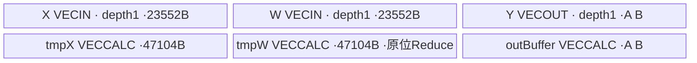

# SgemmvShrink A2/A3 ACLNN 算子知识

## 算子速览

| 项目 | 内容 |
|---|---|
| 实际入口 | `aclnnSglSgemmvShrinkGetWorkspaceSize` / `aclnnSglSgemmvShrink`；OpType SglSgemmvShrink |
| 计算语义 | 每sequence选择adapter/rank，逐slice计算低精度输入/权重的FP32点积，再乘FP16 scale转得的float，写FP32低秩y有效前缀；旧y不参与累加 |
| 输入输出 | x/weight同FP16/BF16、yFLOAT、indices/seq_len/ranks INT32、scales FP16；同NPU连续；slice_count默认1 |
| 执行类型 | 单AIV_VECTOR节点，DMA/Cast/Mul/ReduceSum/Scalar累加/Muls，无Cube/SIMT/NDDMA/通信；entry未声明KERNEL_TASK_TYPE_DEFAULT |
| Kernel 路线 | Host key0；R-001 H<=11776预载X，R-002 H>11776逐rank分块；各Half/BF16两实例；负adapter/rank0/未覆盖token跳过 |
| 核心资源 | 3个depth1 queue、3个VECCALC TBuf；真实UB=141312+2*align32(4R)B，无UB容量guard；自有workspace0 |
| 来源闭包 | source_closed：分离OpDef/infer/tiling、36B POD、两模板全部Device/helper与构建闭合；SDK ReduceSum count别名/平台后端固定来源另核实 |
| 草稿边界 | K=ceil(B*S/q)可能漏最后chunk的后缀slice；raw Host缺H%64、y.width%S及值/跨度guard；不据来源闭包推荐安全复用 |
| 验证状态 | 本次未安装、编译、真机、数值或性能测试，无verified；缺陷与别名分析为静态推导 |

## 接口与语义

### 计算语义

公共合同复用[LoRA shrink API](../../../../apis/sgl_kernel_npu/sgl_lora_shrink.md)。B为token数，H为输入宽度，S为slice_count，R=y.width/S，adapter a由seq_len前缀映射token到block再索引lora_indices；r=ranks[a]，lambda=float(scales[a])：

```text
for slice s, rank row k in [0,r):
 y[t,s*r+k] = lambda * dot_FP32(x[t,0:H], weight[a,s*r+k,0:H])
```

权重每adapter物理容量S*R*H，实际slice按s*r紧接而非s*R；输出行物理跨度S*R，实际有效前缀S*r。旧y不读取，未写列保持原值；负adapter、rank0和seq_len未覆盖token不写。输出FP32，低精度输入和scale先转float，没有最终Half/BF16舍入，也没有expand式旧y累加。

源实现的点积为每tile FP32 ReduceSum，再由Scalar acc按tile顺序加，最后Muls；不同平台ReduceSum后端累加顺序不同，不承诺位相同。公式还要求Host启动完整、元数据/存储/整数范围有效；漏启动slice不满足该全覆盖公式。

### 输入、输出与属性

| 参数 | shape/layout | dtype | 约束、默认值与语义 |
|---|---|---|---|
| x | [B,H]连续ND | FP16/BF16 | B>0、H>y.width、H%64=0；该对齐在Torch适配有guard，raw Host未查 |
| weight | [L,S*R,H]或[L,1,S*R,H]连续 | 与x同型 | slice s用第s*r..(s+1)r行，r<=R，维度由caller保证 |
| lora_indices | [numBlocks] | INT32 | 负值跳过，否则<L且metadata长度匹配 |
| seq_len | [numBlocks] | INT32 | 非负、前缀无溢出并覆盖期望token；不足则返回-1跳过 |
| lora_ranks | [L] | INT32 | 公共支持0/8/16/32/64；Device未核验集合/r<=R |
| lora_scales | [L] | FP16 | Device GlobalTensor<half>，读后存float reqLoRAScale |
| y / yRef | [B,S*R]连续 | FP32 | 有效每slice r元素覆盖写；Ref同存储，entry忽略yRef、实际写输入y指针 |
| slice_count | 标量属性 | int64 Host→uint32 POD | 默认1，必须>=1；需y.width%S=0，raw Host不查整除 |
| workspace/tiling | query W/36B | BYTE/九uint32 | 自有workspace0，entry忽略workspace；实际query W由框架返回 |

### 入口与版本

精确ACLNN pair在torch_adapter.cpp解析，query按7个Tensor再slice_count属性顺序，y为Ref只传一次。C++ torch.ops入口返回void，Python _ascendc_impl调用后return y，故公共返回别名不是底层C++返回Tensor。auto/ascendc不自动回退，torch_native是显式另选实现，不纳本卡Device图。

SGL固定commit `dda6d36b0cdb4081e102d14c0a2fb276fc416e69`。额外SDK官方asc-devkit v9.1.0固定`e5451c7feba11f9e259f4fbc19c4bf82f8c0496c`，version.cmake声明9.1.0，且上游CI各组固定CANN9.1.0容器配置。配置与官方tag不是本次运行，也不保证任何同名版本二进制与此源码完全一致。平台由公开arch22/35、2201/3510注册与产品映射确定。

## Host/Launcher 执行流程

### 参数校验与前处理

适配验证全部七Tensor同NPU，DeviceGuard后依次检查x Half/BF16、x/y二维、weight三/四维、H>y.width、B>0；再查yFLOAT、weight=x dtype、scalesFP16、三索引INT32、四metadata一维、所有Tensor连续，最后H%64=0。不做copy/contiguous修补，不读值验证rank/seq_len/scale。

raw Host分离注册：OpDef定义dtype组合与slice_count可选默认1；infer从input6 y复制shape/dtype；TilingPrepare为空成功。Tiling检查shape/yDesc/platform指针及x/y二维、weight三/四维、yFLOAT；直接GetDim(0)读metadata长度，未检查其一维。属性缺失退默认1；S>=1，metadata长度非负、B>0、H>y.width、y.width>=S；R=floor(y.width/S)，未检查整除或H%64。长度/B/H/R/S各<=UINT32_MAX，C>0、q>0，K在[1,U32]，raw/typed POD/36B容量/workspace有效才成功。无UB查询/guard、metadata值检查、全GM跨度/uint16/int32边界或替代路线。

### 参数、Workspace 与生命周期

query返回executor/W，W<=INT64_MAX分配BYTE workspace；七Tensor/workspace record_stream当前NPU stream。lambda捕获七Tensor、描述符、workspace、executor和aclStream覆盖Host队列，record_stream覆盖异步Device存储；调用RunOpApi返回不等于Device完成。描述符shared_ptr析构aclDestroyTensor，静态op_api_symbol handle定位vendor libcust_opapi.so；生成executor内部规则是框架边界，不编造手动释放。

Host workspace[0]=0，Device不读workspace/yRef，没有GM中间buffer。caller持有x/weight/metadata/y，stream完成前有效且不并发改写；y与输入yRef须按Ref协议同存储，与只读输入不能有害别名。

### 启动图与失败传播

| 节点/边 | producer→consumer | offset/extent/dtype/layout | ordering/owner/lifetime | 失败 |
|---|---|---|---|---|
| N1 | query/Host→execute→sgl_sgemmv_shrink | K=ceil(B*S/q) blocks，36B POD，y/yRef/workspace | 单stream单Kernel，生成桥接Runtime负责launch | query/execute失败抛TORCH_CHECK；Host GRAPH_FAILED |
| 只读输入GM | caller→N1 | x/weight与四metadata，按下文地址 | 捕获+record_stream；metadata Scalar按需读 | 非法值不是可控可靠错误返回 |
| y输出GM | N1→caller | 每token slice [s*r,(s+1)*r) FLOAT | 仅写输入y指针；每block独占token/slice，无cross-core边 | 漏启动保留旧y，无补算 |

构建root→lora discovery→单算子注册分离OPDEF/INFER/TILING与唯一Kernel→operators解析arch→cann_ops生成ACLNN/config与tiling/host/kernel库。SDK生成桥接/executor与底层primitive为明确边界；所有自有Host可达Device只此N1，未含Cube，使用VV。

## Route 与参数设计

### 分核与资源计算

C=平台AIV数，q=ceil(B/C)，K=ceil(B*S/q)。flat f的chunk=f/S、slice=f%S，token范围[chunk*q,min((chunk+1)*q,B))。完整计算要求K=ceil(B/q)*S；令J=ceil(B/q)、t=B-(J-1)q，则K=(J-1)S+ceil(t*S/q)，后缀slice不足恰发生ceil(t*S/q)<S。B5/C2/S3的静态例q3/K5漏f5、即tokens3..4 slice2；这不是硬件C=2的实测主张。所有推导限定乘加/转换无溢出/窄化域。

T=11776=184*64，L=floor(H/T)、h=H%T。H<=T：预载/转float整个X一次，各r行读W后共用tmpX；H>T：每r行每tile重读/转X与W，acc每行从0加各tile ReduceSum。h0无partial，h>0调用相同Compute(count=h)；适配H%64保证h也是64倍数。

A=align32(4R)，固定申请输入两槽各23552B、float tmp两块各47104B、output queue单槽A、outBuffer A，UB=141312+2A；合法R为8倍数时A=4R、总141312+8R。Host完全未查询U，此不等式须caller/平台另核UB_total<=U；无dynamic UB、通信window、自有workspace。

### Route 选择

| 顺序 | Route | Key/模板 | 精确选择条件与优先级 | 不适用去向 |
|---:|---|---|---|---|
| 0 | S0跳过 | key0同实例 | BlockIterator返回<0、adapter<0、rank==0，按此顺序 | 下token，不读scale或X/W，不写y |
| 1 | R-001驻留 | key0/ProcessImpl<false> | 非跳过、H<=11776、Half/BF16合法组合 | H>11776进R-002 |
| 2 | R-002分块 | key0/ProcessImpl<true> | 非跳过、H>11776、Half/BF16合法组合 | 非法值无fallback；Host公共guard失败返回 |

```text
Host validates shapes/POD, key0; DTYPE_X = half or bfloat16_t
Init incremental=(H>11776); bind y input pointer, ignore yRef
Process sequence/adapter/rank skip checks -> load half scale as float
incremental ? ProcessImpl<true> : ProcessImpl<false>
 -> per-rank dot product into outBuffer -> ScaleOutput Muls -> CopyOut r floats
```

### 模板/实现执行矩阵

| Route | key/selector | dtype/shape/platform 完整命中条件 | 执行拓扑与 Kernel 节点 | 实际模板/body | 内存与同步特征 | tail/fallback |
|---|---|---|---|---|---|---|
| R-001 | 0 / H<=11776 | x/weight half,yfloat,scalehalf；公共合同；2201/3510 | 单N1 AIV | KernelSgemmvShrink<half>::ProcessImpl<false>/Compute<false>/CopyAndComputeLastIteration<false> | 每token/slice一次2H字节，所有r权重行复用tmpX；UB141312+2A；queue深度1、V barrier | h>0相同count partial，h0跳过；无fallback |
| R-001 | 0 / H<=11776 | x/weight bfloat16_t,yfloat,scalehalf；公共合同；2201/3510 | 单N1 AIV | KernelSgemmvShrink<bfloat16_t>::ProcessImpl<false>/Compute<false>/CopyAndComputeLastIteration<false> | 每token/slice一次2H字节，所有r权重行复用tmpX；UB141312+2A；queue深度1、V barrier | h>0相同count partial，h0跳过；无fallback |
| R-002 | 0 / H>11776 | x/weight half,yfloat,scalehalf；公共合同；2201/3510 | 单N1 AIV | KernelSgemmvShrink<half>::ProcessImpl<true>/Compute<true>/CopyAndComputeLastIteration<true> | 每token/slice共r次完整X，每次2H字节，合2rH字节；UB141312+2A；queue深度1、V barrier | h>0相同count partial，h0跳过；无fallback |
| R-002 | 0 / H>11776 | x/weight bfloat16_t,yfloat,scalehalf；公共合同；2201/3510 | 单N1 AIV | KernelSgemmvShrink<bfloat16_t>::ProcessImpl<true>/Compute<true>/CopyAndComputeLastIteration<true> | 每token/slice共r次完整X，每次2H字节，合2rH字节；UB141312+2A；queue深度1、V barrier | h>0相同count partial，h0跳过；无fallback |

### 隐藏性能 Guard

| Guard | Host/Tiling 条件 | Device/资源原因 | 影响 Route | 不满足时去向 | 源码符号 |
|---|---|---|---|---|---|
| 合法shrink | B>0,H>y.width>=S>=1,C>0 | q不为0、R正值、slice解码有定义 | 全部 | GRAPH_FAILED | TilingSglSgemmvShrink |
| 64对齐 | raw未查，适配H%64==0 | Half/BF16 DMA整32B、float ReduceSum 64lane tail | 两条 | Torch适配抛错；raw caller负责 | adapter TORCH_CHECK/CopyIn/Compute |
| 整除输出 | raw/适配均未查y.width%S | Kernel行步长S*R而非原y.width | 两条 | 可能行寻址偏差，无fallback | R/output CopyOut |
| 完整启动 | raw未查K==ceil(B/q)*S | flat block按slice成组 | 两条 | 后缀slice缺失 | blockDim/Process |
| UB | raw无U查询 | 141312+2A固定容量 | 两条 | 分配/运行未验证 | InitBuffer |
| rank/metadata | 无Device值guard | r<=R、r合法8倍数、adapter/block索引有效 | 两条 | 非可靠失败/不支持fallback | Process/ScaleOutput/CopyOut |
| 地址与参数范围 | 仅部分维度U32 | H*R*S、S*R中间U32，slice/loop int32 | 两条 | 先窄化后宽赋值可能错误 | Init/Process/CopyOut |

### POD/ABI

SglSgemmvShrinkTilingData九uint32、offset0..32、align4、sizeof36，源码static_assert sizeof；标准布局顺序推导，未运行ABI probe。

| 结构 | 字段 | 类型/位宽 | ABI 布局 | 单位 | Host/launcher producer | Device consumer | 边界 |
|---|---|---|---|---|---|---|---|
| SglSgemmvShrinkTilingData | loraIndicesSize | uint32/32 | offset0,size4；总36/align4 | 元素/计数 | TilingSglSgemmvShrink: indices.shape[0] | loraIndicesGm视图/b索引 | 单字段U32 guard不保护后续乘积 |
| SglSgemmvShrinkTilingData | seqLenSize | uint32/32 | offset4,size4；总36/align4 | 元素/计数 | TilingSglSgemmvShrink: seq_len.shape[0] | BlockIterator blocks.GetSize | 单字段U32 guard不保护后续乘积 |
| SglSgemmvShrinkTilingData | loraRanksSize | uint32/32 | offset8,size4；总36/align4 | 元素/计数 | TilingSglSgemmvShrink: ranks.shape[0] | loraRanksGm视图/adapter索引 | 单字段U32 guard不保护后续乘积 |
| SglSgemmvShrinkTilingData | loraScalesSize | uint32/32 | offset12,size4；总36/align4 | 元素/计数 | TilingSglSgemmvShrink: scales.shape[0] | loraScalesGm视图/half读 | 单字段U32 guard不保护后续乘积 |
| SglSgemmvShrinkTilingData | batchSize | uint32/32 | offset16,size4；总36/align4 | 元素/计数 | TilingSglSgemmvShrink: B=x.rows | Process token上界 | 单字段U32 guard不保护后续乘积 |
| SglSgemmvShrinkTilingData | numTokensPerCore | uint32/32 | offset20,size4；总36/align4 | 元素/计数 | TilingSglSgemmvShrink: q=ceil(B/C) | Process token chunk | 单字段U32 guard不保护后续乘积 |
| SglSgemmvShrinkTilingData | inputHiddenDim | uint32/32 | offset24,size4；总36/align4 | 元素/计数 | TilingSglSgemmvShrink: H=x.width | X/W行步长、11776 selector、count/tail | 单字段U32 guard不保护后续乘积 |
| SglSgemmvShrinkTilingData | maxLoRARank | uint32/32 | offset28,size4；总36/align4 | 元素/计数 | TilingSglSgemmvShrink: R=floor(y.width/S) | 输出容量/row步长、adapter权重跨度 | 单字段U32 guard不保护后续乘积 |
| SglSgemmvShrinkTilingData | slicesCount | uint32/32 | offset32,size4；总36/align4 | 元素/计数 | TilingSglSgemmvShrink: slice_count属性S（默认1） | flat block解码slice与权重/输出packed布局 | 单字段U32 guard不保护后续乘积 |

### Route 源码闭包

| Route | Key/selector | Host/Tiling producer | POD/参数 | Kernel entry/router 节点 | Kernel body/直接依赖 | 构建接线 |
|---|---|---|---|---|---|---|
| R-001 | 0 / H<=11776 | op_host/sgemmv_shrink_tiling.cpp::TilingSglSgemmvShrink | 九字段36B，H/q/R/S | sgl_sgemmv_shrink→KernelSgemmvShrink<half/bfloat16_t> | ProcessImpl/Compute/CopyAndComputeLastIteration<false>、其它全部类方法/BlockIterator | CMake分离def/infer/tiling→lora/root/operators/cann_ops；2201/3510 |
| R-002 | 0 / H>11776 | op_host/sgemmv_shrink_tiling.cpp::TilingSglSgemmvShrink | 九字段36B，H/q/R/S | sgl_sgemmv_shrink→KernelSgemmvShrink<half/bfloat16_t> | ProcessImpl/Compute/CopyAndComputeLastIteration<true>、其它全部类方法/BlockIterator | CMake分离def/infer/tiling→lora/root/operators/cann_ops；2201/3510 |

## Kernel 实现

### 公共执行流程

entry GET_TILING_DATA、TPipe、KernelSgemmvShrink<DTYPE_X>，不消费yRef/workspace，Init传入y输入地址。Process解码chunk/slice，BlockIterator用previous_block/previous_offset单调扫描seq_len，返回-1或负ID/rank0就跳过；其余读取half scale至float，计算adapterBase=a*(H*R*S)+s*r*H。

每rank行acc=float0，遍历full T与可选partial；W Cast NONE至tmpW FLOAT，X依路线Cast，Mul原位覆盖tmpW，ReduceSum<float>(tmpW,tmpW,tmpW,count)把结果放tmpW[0]，Scalar acc+=GetValue(0)。每个Vector步骤后PipeBarrier<PIPE_V>。每rank acc SetValue到outBuffer[k]，最终Muls(outQueue,outBuffer,lambda,r)，V barrier、EnQue、CopyOut r个float到y[t*S*R+s*r]。这里只写r，不读旧y、也不写R-r尾部。

[ReduceSum API](../../../../../../ops/ascendc/apis/simd_api/basic_api/memory_vector_compute/reduction_compute/reduce_sum.md)已完整读取，公开文档区分平台累加与scratch；固定SDK进一步核对实际count overload的三地址相等：

| SDK节点 | A2/A3 2201 | 950 3510 |
|---|---|---|
| count分发 | ReduceSum调用不传sharedTmpBuffer，仅dst/src/count | 传dst/src/work/count，三者相同tmpW地址 |
| 实际算法 | set_mask_count/set_vector_mask(count)；vcadd repeat1, dstRep1/srcBlk1/srcRep8；get_acc_val后写dst0，恢复mask | VL256B=64float，Dispatch按count<=64/128/192/256/4096/更大选scope1..6；scope1单reg归约，2..4先reg相加再归约，5两级compact，6三级compact |
| scratch/alias | count路线不消费scratch；硬件vcadd读取源后输出同址，固定源码不额外申请UB | count2=ceil(n/64)，scope6还count3=ceil(count2/64)；ReduceSumCount逐64源值加载、ReduceSum、StoreUnAlign写紧凑前缀；stage间LocalMemBar<VEC_STORE,VEC_LOAD> |
| 同址静态条件 | dst=src同起点；primitive/hardware实现为底层边界，不能套用任意高维overlap规则改代码 | 源按64float递增、目的按1float递增，写前缀位于已消费源前部；同址不会覆盖未来64i源块的有限域推导依赖Reg Load/Store契约；不扩张为任意部分重叠可用 |
| scratch最大请求 | N/A未消费 | n<=11776，count2<=184；第一compact前缀至多184float=736B，再count3<=3；均在tmpW47104B内，无另增UB |
| Scalar同步 | SDK V_S Set/Wait取acc，再S_V及S_MTE3 Set/Wait；自有代码仍有V barrier | SDK末尾Alloc V_S Set/Wait/Release并保存accValFloat；自有GetValue读tmpW0、V barrier不替代该后端同步 |

SDK的Reg::ReduceSum/LoadAlign/StoreUnAlign及2201 vcadd/get_acc_val为ISA/primitive边界，不伪造内部延迟或二进制。官方固定v9.1.0源码证据不保证所有二进制同名版本相同，未运行观察codegen。UB对齐A采用同固定SDK TPipe::InitBuffer的32B round；queue深度1，不捏造双缓冲。


### Route R-001：完整X驻UB复用

#### 适用条件

H<=11776且公开metadata/dtype/连续存储有效，r为8/16/32/64、r<=R，H%64=0、y.width%S=0、Host启动覆盖完整、真实UB与整数范围满足。Half/BF16实例相同字节布局和FP32算法，输入转换表示不同。

##### 选择证据

| 层级 | 文件 | 符号 | 源码谓词/参数 | 结果/下一跳 |
|---|---|---|---|---|
| OpDef/Host | csrc/lora/sgemmv_shrink/op_host/sgemmv_shrink_def.cpp及tiling.cpp | SglSgemmvShrink/TilingSglSgemmvShrink | x/weight Half或BF16，yFLOAT，key0/POD.H | 同entry |
| Device Init/Process | csrc/lora/sgemmv_shrink/op_kernel/sgemmv_shrink.cpp | incremental_=H>11776/Process | H<=11776 | ProcessImpl<false>及同模板Compute/partial |

#### Device 数据流

##### 函数级调用链

```text
aclnnSglSgemmvShrink -> generated N1 -> sgl_sgemmv_shrink
 -> KernelSgemmvShrink<half / bfloat16_t>::Init
 -> Process -> BlockIterator.GetBlockIdx -> adapter/rank/scale
 -> ProcessImpl<false>先CopyInX整个H并Cast，再每rank只搬W
 -> CopyAndComputeLastIteration<false> if h>0 -> Compute<false>(count=h)
 -> acc SetValue per rank -> ScaleOutput(Muls r) -> CopyOut(r floats)
Compute: queue DeQue -> Cast -> V barrier/Free -> Mul -> V barrier
 -> ReduceSum count(tmpW,tmpW,tmpW) -> V barrier -> Scalar acc+=tmpW[0]
```

##### 源码等价伪码

```text
# 伪码，保持真实行地址与执行顺序
f=GetBlockIdx(); chunk=f/S; s=f%S
for t=chunk*q .. min(chunk*q+q,B):
 block=BlockIterator.GetBlockIdx(t); if block<0: continue
 a=indices[block]; if a<0: continue
 r=ranks[a]; if r==0: continue
 lambda=float(scales_half[a]); wbase=a*(H*R*S)+s*r*H
 CopyInX(t,0,H); tmpX=Cast_NONE(X,H); Vbarrier; FreeX
 for k=0..r:
  acc=0.0f
  for j=0..floor(H/11776):
   # tmpX驻留复用
   CopyInW(k,j,11776)
   tmpW=Cast_NONE(W,11776); Vbarrier; Free input slots
   tmpW=Mul(tmpX,tmpW,11776); Vbarrier
   ReduceSum(tmpW,tmpW,tmpW,11776); Vbarrier; acc+=tmpW.GetValue(0)
  if h=H%11776 >0:
   CopyInW(k,floor(H/11776),h)
   Compute<false>(acc,h) # same Cast/Mul/ReduceSum flow
  outBuffer.SetValue(k,acc)
 output=Muls(outBuffer,lambda,r); Vbarrier
 DMA y[t*S*R+s*r : +r] = output; Free output slot
```

#### 内存与数据搬运

##### 资源与搬运表

| 层级/缓冲区 | offset/地址公式 | extent/容量公式 | dtype/layout | producer | consumer | owner/lifetime | 对齐/复用 |
|---|---|---|---|---|---|---|---|
| GM x | 2*(t*H+j*T)B | 每tile2nB；每token/slice一次2H字节，所有r权重行复用tmpX | Half/BF16 ND | caller | CopyInX | caller，stream完成前有效 | n64倍数，GM按元素对齐 |
| GM weight | 2*(a*H*R*S+s*r*H+k*H+j*T)B | 每tile2nB，共2rH/token/slice | Half/BF16 | caller | CopyInW | caller只读 | 所有乘积/实际跨度有效 |
| GM output y | 4*(t*S*R+s*r)B | 每token/slice仅4rB，不搬旧y | FLOAT | CopyOut | caller | Ref存储，stream期 | r为8倍数，逻辑tail保持原值 |
| GM indices | 4*blockB | indicesSize*4视图，单项4B | INT32 | caller | Process | caller只读 | 返回block必须有效 |
| GM seq_len | 4*bB | seqLenSize*4视图，helper单项读 | INT32 | caller | BlockIterator | caller只读 | 单调prefix/缓存、无GM workspace |
| GM ranks | 4*aB | ranksSize*4视图，单项4B | INT32 | caller | Process | caller只读 | r<=R及合法rank集合 |
| GM scales | 2*aB | scalesSize*2视图，单项2B | Half→Scalar float | caller | Process/Muls | caller只读 | 不按输入BF16重解释scale |
| UB inQueueX VECIN | queue单槽 | depth1×23552B | scalar_t[11776] | CopyInX | Cast tmpX | 每次Alloc/EnQue/DeQue/Free | 当前token仅一次搬整个H |
| UB inQueueW VECIN | queue单槽 | depth1×23552B | scalar_t[11776] | CopyInW | Cast tmpW | 每rank每tileAlloc→Free | Cast完成V barrier后Free |
| UB tmpBufferX VECCALC | 独立TBuf | 47104B,float[11776] | FP32 | Cast X | Mul | 当前token/slice先Cast X至tmpX，整个r循环期间保持不覆盖 | 不与tmpW重叠 |
| UB tmpBufferW VECCALC | 同一TBuf起点 | 47104B,float[11776] | Wfloat→乘积→归约/scratch | Cast/Mul/ReduceSum | ReduceSum/Scalar acc | 每tile覆盖，三ReduceSum参数相同 | 950最多736B scratch前缀；2201不消费scratch |
| UB outBufferY VECCALC | 独立TBuf，k*4B | A=align32(4R)B | float[R] | Scalar acc SetValue | Muls | 当前token有效前r项写满 | 只消费r项，不要求R后缀初始化 |
| UB outQueueY VECOUT | queue单槽 | depth1×A B | float[R] | Muls | CopyOut | Alloc/EnQue/DeQue/Free | 与outBuffer独立；r<=R |
| workspace/Scalar | N/A | 自有0；acc/lambda/iterator状态 | float/int64等 | 方法内部 | 方法内部 | core局部，无dynamic/window | acc每rank清0，tile按序相加 |

##### 分层内存布局



##### 字节账与复用顺序

```text
A=align32(4R)
UB_total = 23552+23552+47104+47104+A+A = 141312+2A B
UB_total<=platform U 是前提，Host没有检查。
r/R为合法8倍数时 A=4R -> UB_total=141312+8R。
dynamic_ub=N/A; workspace_total(自有)=0。
X: 每token/slice一次2H字节，所有r权重行复用tmpX; W:2rH B; output:4r B/token/slice；
没有old-y DMA；metadata为按需Scalar单项读取。
```

| 复用子区 | 写入者 | 读取者/消费点 | 下一次覆盖 | 同步或释放依据 | 安全条件 |
|---|---|---|---|---|---|
| inputX/tmpX | CopyInX/Cast | Mul | 下token | input queue，Cast后V barrier/Free | 当前token/slice先Cast X至tmpX，整个r循环期间保持不覆盖 |
| inputW/tmpW | CopyInW/Cast/Mul/ReduceSum | 下一Vector/Scalar acc | 下一tile | queue，阶段V barrier；SDK内部事件/LocalMemBar | tmpW不再需要原权重/乘积后可被归约破坏 |
| outBuffer前r | Scalar SetValue | Muls | 下一token | 真实Scalar→Vector依赖由编译器模型处理；无自有S_V手动event | r<=R，全部有效rank行已算完 |
| output queue槽 | Muls | GM DataCopy | 下一token | V barrier→EnQue/DeQue→Free | 不提前复用，输出范围单writer |

#### 同步、精度与尾块

##### 同步与数值边界表

| 阶段 | primitive/机制 | producer | consumer/等待点 | 保护对象 | 精度/尾块 |
|---|---|---|---|---|---|
| DMA→Cast | input queue EnQue/DeQue | CopyInX/W | Compute/预载 | 输入单槽 | n<=11776，n64倍数 |
| Cast→Mul | PipeBarrier V后释放低精度槽 | Cast NONE | Mul | tmpX/tmpW | Half/BF16转FP32，tmpX跨rank复用 |
| Mul→Reduce | PipeBarrier V | Mul原位tmpW | ReduceSum(count) | tmpW有效前n | 目的/源/scratch同起点；平台实现见公共表 |
| Reduce→Scalar | 自有V barrier + SDK V_S等事件 | ReduceSum | GetValue(0)/acc+= | tmpW0 | FP32 tile结果按Scalar顺序累加；不能称跨平台位相同 |
| Scale→输出 | Muls→V barrier→queue | Scalar填outBuffer与lambda | CopyOut | outQueue/y | scale half转float，输出FP32，无最终低精度cast |
| tail | CopyAndComputeLastIteration | h=H%T | 同模板Compute(count=h) | input/tmp有效前h | h0return，h>0只搬2hB/读h元素；输出始终r项 |
| 核间/空域 | 无flag/atomic | 已启动core | caller | token/slice输出 | B0Host失败；skip不写；K缺陷不由同步修复 |

#### 关键实现

##### 符号证据表

| 阶段 | 文件 | 符号/模板实例 | 实现事实 |
|---|---|---|---|
| Host/Tiling producer | csrc/lora/sgemmv_shrink/op_host/sgemmv_shrink_tiling.cpp | TilingSglSgemmvShrink/TilingPrepare | key0、q/K、36B、无UB guard，prepare空成功 |
| Kernel entry/router | csrc/lora/sgemmv_shrink/op_kernel/sgemmv_shrink.cpp | sgl_sgemmv_shrink/KernelSgemmvShrink<half/bfloat16_t>::Process | H<=11776→ProcessImpl<false>；写y忽略yRef |
| Device body/helper | 同kernel文件 | ProcessImpl/Compute/CopyAndComputeLastIteration<false>及CopyInX/W/ScaleOutput/CopyOut | ProcessImpl<false>先CopyInX整个H并Cast，再每rank只搬W，FP32 acc/Muls |
| 共享sequence | csrc/lora/common/kernel/lora_common_kernel.h | BlockIterator<int32_t>::GetBlockIdx | prefix缓存与未覆盖返回-1 |
| SDK归约 | kernel_operator_vec_reduce_intf_impl.h及本平台vec_reduce_impl.h | ReduceSum(count)/ReduceSumImpl | count传参/scratch/事件与平台backend如公共表 |

### Route R-002：超长X逐rank分块

#### 适用条件

H>11776且公开metadata/dtype/连续存储有效，r为8/16/32/64、r<=R，H%64=0、y.width%S=0、Host启动覆盖完整、真实UB与整数范围满足。Half/BF16实例相同字节布局和FP32算法，输入转换表示不同。

##### 选择证据

| 层级 | 文件 | 符号 | 源码谓词/参数 | 结果/下一跳 |
|---|---|---|---|---|
| OpDef/Host | csrc/lora/sgemmv_shrink/op_host/sgemmv_shrink_def.cpp及tiling.cpp | SglSgemmvShrink/TilingSglSgemmvShrink | x/weight Half或BF16，yFLOAT，key0/POD.H | 同entry |
| Device Init/Process | csrc/lora/sgemmv_shrink/op_kernel/sgemmv_shrink.cpp | incremental_=H>11776/Process | H>11776 | ProcessImpl<true>及同模板Compute/partial |

#### Device 数据流

##### 函数级调用链

```text
aclnnSglSgemmvShrink -> generated N1 -> sgl_sgemmv_shrink
 -> KernelSgemmvShrink<half / bfloat16_t>::Init
 -> Process -> BlockIterator.GetBlockIdx -> adapter/rank/scale
 -> ProcessImpl<true>每rank每full/partial tile都CopyInX+CopyInW再Cast
 -> CopyAndComputeLastIteration<true> if h>0 -> Compute<true>(count=h)
 -> acc SetValue per rank -> ScaleOutput(Muls r) -> CopyOut(r floats)
Compute: queue DeQue -> Cast -> V barrier/Free -> Mul -> V barrier
 -> ReduceSum count(tmpW,tmpW,tmpW) -> V barrier -> Scalar acc+=tmpW[0]
```

##### 源码等价伪码

```text
# 伪码，保持真实行地址与执行顺序
f=GetBlockIdx(); chunk=f/S; s=f%S
for t=chunk*q .. min(chunk*q+q,B):
 block=BlockIterator.GetBlockIdx(t); if block<0: continue
 a=indices[block]; if a<0: continue
 r=ranks[a]; if r==0: continue
 lambda=float(scales_half[a]); wbase=a*(H*R*S)+s*r*H
 # incremental：不预载完整X
 for k=0..r:
  acc=0.0f
  for j=0..floor(H/11776):
   CopyInX(t,j,11776)
   CopyInW(k,j,11776)
   tmpX=Cast_NONE(X,11776); tmpW=Cast_NONE(W,11776); Vbarrier; Free input slots
   tmpW=Mul(tmpX,tmpW,11776); Vbarrier
   ReduceSum(tmpW,tmpW,tmpW,11776); Vbarrier; acc+=tmpW.GetValue(0)
  if h=H%11776 >0:
   CopyInX(t,floor(H/11776),h); CopyInW(k,floor(H/11776),h)
   Compute<true>(acc,h) # same Cast/Mul/ReduceSum flow
  outBuffer.SetValue(k,acc)
 output=Muls(outBuffer,lambda,r); Vbarrier
 DMA y[t*S*R+s*r : +r] = output; Free output slot
```

#### 内存与数据搬运

##### 资源与搬运表

| 层级/缓冲区 | offset/地址公式 | extent/容量公式 | dtype/layout | producer | consumer | owner/lifetime | 对齐/复用 |
|---|---|---|---|---|---|---|---|
| GM x | 2*(t*H+j*T)B | 每tile2nB；每token/slice共r次完整X，每次2H字节，合2rH字节 | Half/BF16 ND | caller | CopyInX | caller，stream完成前有效 | n64倍数，GM按元素对齐 |
| GM weight | 2*(a*H*R*S+s*r*H+k*H+j*T)B | 每tile2nB，共2rH/token/slice | Half/BF16 | caller | CopyInW | caller只读 | 所有乘积/实际跨度有效 |
| GM output y | 4*(t*S*R+s*r)B | 每token/slice仅4rB，不搬旧y | FLOAT | CopyOut | caller | Ref存储，stream期 | r为8倍数，逻辑tail保持原值 |
| GM indices | 4*blockB | indicesSize*4视图，单项4B | INT32 | caller | Process | caller只读 | 返回block必须有效 |
| GM seq_len | 4*bB | seqLenSize*4视图，helper单项读 | INT32 | caller | BlockIterator | caller只读 | 单调prefix/缓存、无GM workspace |
| GM ranks | 4*aB | ranksSize*4视图，单项4B | INT32 | caller | Process | caller只读 | r<=R及合法rank集合 |
| GM scales | 2*aB | scalesSize*2视图，单项2B | Half→Scalar float | caller | Process/Muls | caller只读 | 不按输入BF16重解释scale |
| UB inQueueX VECIN | queue单槽 | depth1×23552B | scalar_t[11776] | CopyInX | Cast tmpX | 每次Alloc/EnQue/DeQue/Free | 每tile/rank覆盖 |
| UB inQueueW VECIN | queue单槽 | depth1×23552B | scalar_t[11776] | CopyInW | Cast tmpW | 每rank每tileAlloc→Free | Cast完成V barrier后Free |
| UB tmpBufferX VECCALC | 独立TBuf | 47104B,float[11776] | FP32 | Cast X | Mul | 当前rank当前tile Cast X至tmpX；下一个tile或rank覆盖 | 不与tmpW重叠 |
| UB tmpBufferW VECCALC | 同一TBuf起点 | 47104B,float[11776] | Wfloat→乘积→归约/scratch | Cast/Mul/ReduceSum | ReduceSum/Scalar acc | 每tile覆盖，三ReduceSum参数相同 | 950最多736B scratch前缀；2201不消费scratch |
| UB outBufferY VECCALC | 独立TBuf，k*4B | A=align32(4R)B | float[R] | Scalar acc SetValue | Muls | 当前token有效前r项写满 | 只消费r项，不要求R后缀初始化 |
| UB outQueueY VECOUT | queue单槽 | depth1×A B | float[R] | Muls | CopyOut | Alloc/EnQue/DeQue/Free | 与outBuffer独立；r<=R |
| workspace/Scalar | N/A | 自有0；acc/lambda/iterator状态 | float/int64等 | 方法内部 | 方法内部 | core局部，无dynamic/window | acc每rank清0，tile按序相加 |

##### 分层内存布局


##### 字节账与复用顺序

```text
A=align32(4R)
UB_total = 23552+23552+47104+47104+A+A = 141312+2A B
UB_total<=platform U 是前提，Host没有检查。
r/R为合法8倍数时 A=4R -> UB_total=141312+8R。
dynamic_ub=N/A; workspace_total(自有)=0。
X: 每token/slice共r次完整X，每次2H字节，合2rH字节; W:2rH B; output:4r B/token/slice；
没有old-y DMA；metadata为按需Scalar单项读取。
```

| 复用子区 | 写入者 | 读取者/消费点 | 下一次覆盖 | 同步或释放依据 | 安全条件 |
|---|---|---|---|---|---|
| inputX/tmpX | CopyInX/Cast | Mul | 下一tile或rank | input queue，Cast后V barrier/Free | 当前rank当前tile Cast X至tmpX；下一个tile或rank覆盖 |
| inputW/tmpW | CopyInW/Cast/Mul/ReduceSum | 下一Vector/Scalar acc | 下一tile | queue，阶段V barrier；SDK内部事件/LocalMemBar | tmpW不再需要原权重/乘积后可被归约破坏 |
| outBuffer前r | Scalar SetValue | Muls | 下一token | 真实Scalar→Vector依赖由编译器模型处理；无自有S_V手动event | r<=R，全部有效rank行已算完 |
| output queue槽 | Muls | GM DataCopy | 下一token | V barrier→EnQue/DeQue→Free | 不提前复用，输出范围单writer |

#### 同步、精度与尾块

##### 同步与数值边界表

| 阶段 | primitive/机制 | producer | consumer/等待点 | 保护对象 | 精度/尾块 |
|---|---|---|---|---|---|
| DMA→Cast | input queue EnQue/DeQue | CopyInX/W | Compute/预载 | 输入单槽 | n<=11776，n64倍数 |
| Cast→Mul | PipeBarrier V后释放低精度槽 | Cast NONE | Mul | tmpX/tmpW | Half/BF16转FP32，tmpX逐tile |
| Mul→Reduce | PipeBarrier V | Mul原位tmpW | ReduceSum(count) | tmpW有效前n | 目的/源/scratch同起点；平台实现见公共表 |
| Reduce→Scalar | 自有V barrier + SDK V_S等事件 | ReduceSum | GetValue(0)/acc+= | tmpW0 | FP32 tile结果按Scalar顺序累加；不能称跨平台位相同 |
| Scale→输出 | Muls→V barrier→queue | Scalar填outBuffer与lambda | CopyOut | outQueue/y | scale half转float，输出FP32，无最终低精度cast |
| tail | CopyAndComputeLastIteration | h=H%T | 同模板Compute(count=h) | input/tmp有效前h | h0return，h>0只搬2hB/读h元素；输出始终r项 |
| 核间/空域 | 无flag/atomic | 已启动core | caller | token/slice输出 | B0Host失败；skip不写；K缺陷不由同步修复 |

#### 关键实现

##### 符号证据表

| 阶段 | 文件 | 符号/模板实例 | 实现事实 |
|---|---|---|---|
| Host/Tiling producer | csrc/lora/sgemmv_shrink/op_host/sgemmv_shrink_tiling.cpp | TilingSglSgemmvShrink/TilingPrepare | key0、q/K、36B、无UB guard，prepare空成功 |
| Kernel entry/router | csrc/lora/sgemmv_shrink/op_kernel/sgemmv_shrink.cpp | sgl_sgemmv_shrink/KernelSgemmvShrink<half/bfloat16_t>::Process | H>11776→ProcessImpl<true>；写y忽略yRef |
| Device body/helper | 同kernel文件 | ProcessImpl/Compute/CopyAndComputeLastIteration<true>及CopyInX/W/ScaleOutput/CopyOut | ProcessImpl<true>每rank每full/partial tile都CopyInX+CopyInW再Cast，FP32 acc/Muls |
| 共享sequence | csrc/lora/common/kernel/lora_common_kernel.h | BlockIterator<int32_t>::GetBlockIdx | prefix缓存与未覆盖返回-1 |
| SDK归约 | kernel_operator_vec_reduce_intf_impl.h及本平台vec_reduce_impl.h | ReduceSum(count)/ReduceSumImpl | count传参/scratch/事件与平台backend如公共表 |

## 算子特定优化

### Trick T-001：输入能驻单tile时只搬运/转换一次供全部rank行复用

#### 触发与源码依据

- 适用 Route：R-001。
- 触发条件：H<=11776，Process选择ProcessImpl<false>。
- Golden 来源：[固定提交连续106–113行](https://github.com/sgl-project/sgl-kernel-npu/blob/dda6d36b0cdb4081e102d14c0a2fb276fc416e69/csrc/lora/sgemmv_shrink/op_kernel/sgemmv_shrink.cpp#L106-L113)。

**官方源码（固定 Commit 连续逐字摘录）**：

```cpp
        if constexpr (!INCREMENTAL_MODE) {
            CopyInX(idx, 0, inputHiddenDim_);
            AscendC::LocalTensor<float> xTmpTensor = tmpBufferX_.Get<float>();
            AscendC::LocalTensor<X_T> xLocal = inQueueX_.DeQue<X_T>();
            Cast(xTmpTensor, xLocal, AscendC::RoundMode::CAST_NONE, inputHiddenDim_);
            AscendC::PipeBarrier<PIPE_V>();
            inQueueX_.FreeTensor(xLocal);
        }
```

#### 机制与设计原因

x在同一token/slice对所有r权重行不变，完整H可以放进tmpX时在rank循环外Cast一次，后续Compute<false>只Cast W并Mul。名义X输入从逐rank重读的2rH B变为2H B，不是经过实测的带宽收益。X queue输入槽可在Cast后释放，因为复用的是独立float tmpX；tmpX必须留到r行全部完成。H>T路线不具备整行容量，按tile为每rank重新加载X，保持同固定buffer上界。

#### 迁移边界

- 适用：同一输入向量被多行权重点积消费，整个输入能驻tmpX。
- 前提：H<=T、真实UB足够、tmpX不被W归约别名覆盖。
- 失效：将H>T仍走预载会超tmpX容量；增大T须重算全部四大buffer，不可只改selector。
- 未验证：本次未编译、真机、数值或性能测试。

#### 错误做法

为节省内存将tmpX与tmpW合并，随后Mul/ReduceSum会破坏下一rank仍需的X；真实源码特意是两个独立TBuf。固定仓未提供该改法的运行反例，不编造失败日志。

### Trick T-002：权重转换区复用为乘积、归约目的与scratch

#### 触发与源码依据

- 适用 Route：R-001/R-002。
- 触发条件：W已Cast为float且低精度W槽释放，当前tile有效count已确定；三个ReduceSum地址同一tmpW。
- Golden 来源：[固定提交连续162–169行](https://github.com/sgl-project/sgl-kernel-npu/blob/dda6d36b0cdb4081e102d14c0a2fb276fc416e69/csrc/lora/sgemmv_shrink/op_kernel/sgemmv_shrink.cpp#L162-L169)。

**官方源码（固定 Commit 连续逐字摘录）**：

```cpp
        // dot product of the one tile of X and W
        Mul(wTmpTensor, xTmpTensor, wTmpTensor, numElements);
        AscendC::PipeBarrier<PIPE_V>();
        // reduce sum generate one number, which is the summation of all the dot product
        ReduceSum<float>(wTmpTensor, wTmpTensor, wTmpTensor, numElements);
        AscendC::PipeBarrier<PIPE_V>();

        acc += wTmpTensor.GetValue(0);
```

#### 机制与设计原因

当前W转float后其原值只服务一次Mul，因而tmpW原位成为乘积；归约又复用同地址，最后只读取0号float。自有源码无需额外乘积/ReduceSum scratch TBuf。2201 count overload根本不消费scratch；3510使用紧凑prefix，多stage以LocalMemBar排序，最大第一prefix184float在现有47104B内。此解释限定固定SDK与相同起点、非任意部分overlap；SDK寄存器primitive与硬件仍为底层边界。

#### 迁移边界

- 适用：当前乘积在归约后不再需要、完整源与目的/scratch同起点且所选backend允许该顺序。
- 前提：完整读数先于对应prefix覆盖、SDK分发/内部同步与本卡一致，原tmpX独立保留。
- 失效：不能将此三同址行为直接推广到别的Reduce API、不同SDK实现或任意移位别名；须重新核对工作区/读取顺序。
- 未验证：本次未安装、编译、真机、数值或性能测试。

#### 错误做法

将SDK scratch需求另加一个47104B到“实际已分配UB”会虚构buffer；反过来删掉tmpW也不成立，Cast/Mul确实写入此47104B。不能把自有PipeBarrier V当作完整Scalar同步证明，2201和3510各有真实SDK事件。

## 模板与实现对比

| 对比维度 | R-001完整X驻留 | R-002长X分块 | 设计选择依据 |
|---|---|---|---|
| 命中条件/优先级 | H<=11776，incremental=false | H>11776，incremental=true | Init阈值，Host key均0 |
| 模板与 dtype | KernelSgemmvShrink<half/bfloat16_t>的false模板 | 同类的true模板 | x/weight低精度，yfloat、scalehalf |
| 循环与分核 | 先X Cast一次，再r行W遍历 | 每r行每tile都X/W Cast | 同q/K且共同漏block风险 |
| Queue/TBuf/寄存器/dynamic UB/通信 window | 三depth1 queue、三TBuf | 相同 | 固定tile，不因H变化增UB |
| 内存总占用与复用 | 141312+2A；tmpX跨rank驻留 | 相同，tmpX逐tile覆盖 | tmpW原位Reduce；无自有workspace |
| 搬运/Vector/SIMT/NDDMA/通信 API | X2H、W2rH、out4r B | X2rH、W2rH、out4r B | Cast/Mul/ReduceSum/Muls；无Cube/SIMT |
| 同步、精度与 tail | V barrier/queue+SDK事件，H<=T remainder | 同机制，full L个+optional h | FP32 tile sum按序Scalar加；无最终低精度舍入 |
| fallback/失败边界 | 非整除/H%64/metadata由caller保证 | 同左，次数/乘积更多 | Host无UB guard或fallback；B0失败 |

## 平台差异

| 项目 | A2 | A3 | Ascend 950 |
|---|---|---|---|
| 支持状态 | arch22/2201→ascend910b | arch22/2201→ascend910_93 | arch35/3510→ascend950 |
| Host/Launcher | 查询本平台C，相同q/K；不查UB | 相同 | 相同 |
| Kernel/资源 | 同单AIV body/固定141312+2A | 同左 | 同左，无业务regbase特化 |
| ReduceSum count | 2201 count mask/vcadd，scratch不消费 | 同左 | 3510 Reg分级归约/compact，n<=11776时最多184float第一scratch前缀 |
| 同步/精度 | SDK V_S/S_V/S_MTE3，mask恢复；repeat间累加顺序由vcadd后端 | 同左 | SDK LocalMemBar、末尾V_S，分级Reg顺序；不许诺与2201位相同 |
| CANN证据 | CI配置9.1.0/官方SDK tag，非本次运行 | CI含a3配置，非本次运行 | CI含950配置，非本次运行 |

本卡仅A2/A3，另见[950视图](sgl_sgemmv_shrink_950.md)。SDK fixed commit提供实际后端证据，不能据同标签认定任意已安装二进制相同；未构建/运行观察。

## 限制与失败边界

- **Host启动缺口**：在无溢出/窄化域，若ceil(t*S/q)<S（t=B-(ceil(B/q)-1)q），最后token chunk只有前若干slice被启动，后缀保留旧y，不满足完整数学语义。无第二Kernel补算；S1或完整覆盖条件成立才解除这一缺口。
- 固定UB=141312+2*align32(4R)，无Host容量查询/guard、自适应tile或workspace回退；不能将源注释“optimal performance tile length”转成实测最优结论。所有buffer深度1，无双缓冲/重叠收益宣称。
- Torch适配明确H%64 guard，raw Host未查；raw也未查y.width%S。若不整除，Kernel输出行步长S*floor(width/S)与原Tensor row步长不同。OpDef ND不代替实际连续/shape关系和值域验证。
- rank值/adapter/seq_len均未设备校验；r<=R、合法8/16/32/64、非负seq_len、indices/scales长度及weight维度/实际存储由caller保证。负ID/r0跳过，不足seq_len返回-1跳过；不能声称任意非法值会稳定报错。
- reqLoRAWeightOffset采用实际r紧凑slice，adapter容量用S*R*H；两者不能互换。输出实际写input y，entry忽略yRef；要求Ref别名，不能把新分配独立yRef当输出。
- H*R*S、S*R等先用uint32中间乘积，reqSlice/loop/count有int32，Host只检查部分单维U32；全部公式/地址/对齐字节计费限无溢出/窄化且primitive count可表示域。TPipe len窄化/4R也需可表示，不能用数学align32覆盖截断后的实际值。
- ReduceSum三参数同地址为真实实现；本卡以固定SDK count分发和compact顺序给出有限同址分析，不推广到任意高维部分重叠或不同SDK。SDK Reg/ISA primitive仍为明确边界，未执行编译或真机核验。
- Float tile归约和Scalar acc具有舍入，A2/A3与950累加顺序不同；文档“y不涉及舍入”只指无最终低精度类型转换，不能解释为无限精度或逐位相等。
- x/weight/metadata与y不可有害别名，分slice输出需互斥；stream完成前所有GM存储与workspace有效，无跨核同步。B0Host拒绝；skip保留全部当前slice原值。
- source_closed只表示自有源码与所需参数/资源链可复验，draft明确存在静态边界，不建议直接安全复用；本次未运行任何测试、上游、安装、编译或真机，无verified。

## 源码索引

### 链路索引

| 链路阶段 | 文件 | 关键符号 | 支撑内容 |
|---|---|---|---|
| SGL 公开合同 | docs/api/zh/operators/lora/sgemmv_shrink.md | sgemmv_shrink | 第一阶段、scale、packed slice与平台 |
| SGL OpDef | csrc/lora/sgemmv_shrink/op_host/sgemmv_shrink_def.cpp | SglSgemmvShrink | 七输入、Ref、slice_count默认1 |
| SGL 推导注册 | csrc/lora/sgemmv_shrink/op_host/sgemmv_shrink_infer.cpp | InferShape/InferDataType/IMPL_OP_INFERSHAPE | 从input6 y复制shape/dtype |
| SGL Host/Tiling | csrc/lora/sgemmv_shrink/op_host/sgemmv_shrink_tiling.cpp | TilingSglSgemmvShrink/TilingPrepare/IMPL_OP_OPTILING | q/K、36B POD、空prepare |
| SGL POD | csrc/lora/sgemmv_shrink/op_kernel/sgemmv_shrink_tiling.h | SglSgemmvShrinkTilingData | 九uint32/36B |
| SGL Device | csrc/lora/sgemmv_shrink/op_kernel/sgemmv_shrink.cpp | sgl_sgemmv_shrink/KernelSgemmvShrink | 两incremental模板、固定buffer/ReduceSum/scale |
| SGL 共享Device | csrc/lora/common/kernel/lora_common_kernel.h | BlockIterator::GetBlockIdx | sequence缓存扫描 |
| SGL 入口实例 | csrc/lora/sgemmv_shrink/torch_adapter.cpp | sgemmv_shrink | ACLNN pair、H%64、stream/lifetime |
| SGL 共享Host | csrc/lora/common/torch/lora_common_torch.h | IsLoraWeightDtype/IsLoraActivationDtype | 输入Half/BF16、输出float |
| SGL Python门面 | python/sgl_kernel_npu/sgl_kernel_npu/operators/lora/sgemmv_shrink.py | sgemmv_shrink/_ascendc_impl | C++ void后return y，同存储 |
| SGL 算子构建 | csrc/lora/sgemmv_shrink/CMakeLists.txt | sgl_register_operator | 分离OpDef/infer/tiling、2201/3510 |
| SGL domain | csrc/lora/CMakeLists.txt | sgl_discover_operators | 仅注册新目录，不把legacy同名Kernel加入当前图 |
| SGL 共享适配 | csrc/aclnn_torch_adapter/aclnn_runtime.h | op_api_symbol/tensor_descriptor | vendor动态库与描述符生命周期 |
| SGL domain入口 | csrc/cmake/domains.cmake | sgl_add_cann_operator_domains | 域接线 |
| SGL 算子解析 | csrc/cmake/operators.cmake | sgl_resolve_operator/sgl_select_cann_operators | 架构过滤、源角色与唯一Kernel |
| SGL 生成接线 | csrc/cmake/cann_ops.cmake | sgl_generate_cann_interfaces/sgl_add_cann_tiling/sgl_add_cann_host_libraries/sgl_add_cann_kernels | OpDef生成ACLNN、tiling/host/kernel库 |
| SGL 构建入口 | csrc/CMakeLists.txt | SGL_ARCH_VERSION/SGL_CANN_BUILD_STAGE | 独立CANN构建阶段与vendor包 |
| SGL 平台映射 | csrc/cmake/architectures.json | 2201/3510 | 910b/910_93/950 |
| SGL 公开构建说明 | python/sgl_kernel_npu/README.md | architecture mapping/REFACTOR | arch22/35与直接ACLNN用途 |
| SGL 版本配置 | .github/workflows/pr-test-kernels.yml | test-fused-ops等版本矩阵 | CANN9.1.0、a3/950配置，非本次执行 |
| SGL CI消费 | .github/workflows/pr-test-kernel-group.yml | run-kernel-group | 复用版本容器参数 |
| SDK SDK声明 | include/basic_api/kernel_operator_vec_reduce_intf.h | ReduceSum<T,isSetMask=true> | count overload实际签名 |
| SDK SDK分发 | impl/basic_api/kernel_operator_vec_reduce_intf_impl.h | ReduceSum(count) | 2201不传tmp；3510传三地址 |
| SDK SDK申请 | impl/basic_api/kernel_tpipe_impl.h | TPipe::InitBuffer | queue/TBuf长度32B向上补齐 |
| SDK SDK向量长度 | include/basic_api/kernel_operator_sys_var_intf.h | GetVecLen/GetDataBlockSizeInBytes | 3510 VL与32B块 |
| SDK SDK常量 | impl/basic_api/utils/kernel_utils_constants.h | VECTOR_REG_WIDTH/DEFAULT_* | 3510 VL256B、2201 stride1/8 |
| SDK SDK版本 | version.cmake | set_cann_package | 官方固定v9.1.0来源 |
| SDK SDK 2201 | impl/basic_api/dav_c220/kernel_operator_vec_reduce_impl.h | ReduceSumImpl(count) | count mask/vcadd/acc寄存器/真实事件 |
| SDK SDK 3510 | impl/basic_api/dav_3510/kernel_operator_vec_reduce_impl.h | DispatchReduceSumCounterMode/ReduceSumCounterMode/ReduceSumCount | 分级Reg归约、compact scratch/LocalMemBar/V_S |

每行一个文件，均列于sources；SGL与官方SDK分别固定40位commit、各恰一primary。既有[LoRA shrink API](../../../../apis/sgl_kernel_npu/sgl_lora_shrink.md)保留公共合同，本卡不混入不同Cube算子SgemmcShrink。

### 实现复用检查

| 检查项 | 可复用事实 | 不得改变的约束 | 源码符号 |
|---|---|---|---|
| ABI/POD | 九uint32/36B，key0、S默认1 | offset/单位，outputFullDim未存字段，不虚构 | SglSgemmvShrinkTilingData/Host |
| 调用顺序 | query→execute→单Kernel；C++void/Python return y | 写input y、yRef同址；先dot再scale，无old-y累加 | adapter/entry/Process |
| workspace/内存 | 三queue depth1、三TBuf，141312+2A；自有W0 | tmpX/tmpW独立，tmpW三同址与固定SDK对应 | Init/Compute/SDK ReduceSum |
| 同步 | queue、V barrier、SDK真实事件/LocalMemBar | 不捏造业务S_V；固定后端顺序不可删 | Compute/ScaleOutput/SDK |
| 精度与尾块 | FP32 dot/acc/Muls；H%64、h0跳过 | actual-r packed slice，不重复scale；无跨平台位相同承诺 | ProcessImpl/partial/CopyOut |
| 失败边界 | 部分Host guard、无UB或值/全跨度保护 | K覆盖、整除、rank与整数可表示前提，draft非运行复现 | TilingSglSgemmvShrink/Process |
