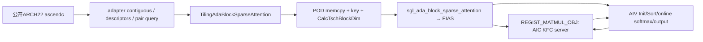
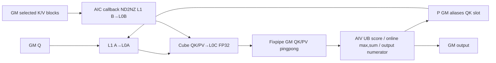
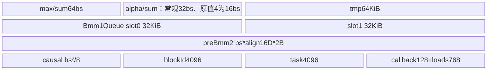
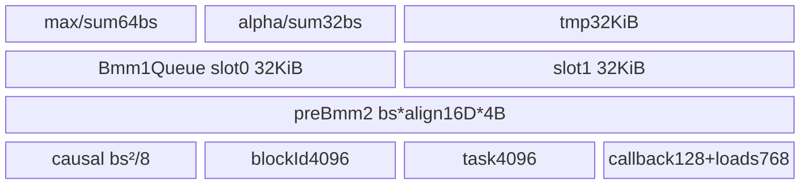

# SGL 自适应块稀疏注意力 A2/A3 ACLNN 算子知识

## 算子速览

| 项目 | 内容 |
|---|---|
| 实际入口 | aclnnSglAdaBlockSparseAttentionGetWorkspaceSize / aclnnSglAdaBlockSparseAttention；固定kernel提交dda6d36b0cdb4081e102d14c0a2fb276fc416e69 |
| 计算语义 | GQA块稀疏softmax(scale·QKᵀ)V；causal仅对判定为最后对角块的子域附加逐元素三角掩码；无可见块query块InitOutput为零 |
| 输入输出 | 公开BNSD，Q[B,Nq,S1,D]、K/V[B,Nkv,S2,D] FP16/BF16，I8/bool块mask、I32每query块count；输出与Q同shape/dtype |
| 执行类型 | 单Kernel MIX_AIC_1_2；AIV调度/排序/softmax/输出，AIC由SDK KFC Matmul服务执行QK与PV；不是两个Host kernel |
| Kernel 路线 | R-001..R-008逐key；R-009无匹配/前置失败terminal；R-010 raw TND类零任务边界。BSH系列仅raw源码边界，公开文档只BNSD |
| 核心资源 | M=sparseSize，Kchunk=1024，GM两套QK/PV及callback pingpong；L1/L0由当前Matmul POD和固定配置管理；UB显式逐项字节账见Route |
| 来源闭包 | source_closed：公开pair、adapter、OpDef/infer、Host/POD、8router/current body与所有命中自有helper、active CMake和SDK当前实例参数/同步边界可追溯；不表示实现正确 |
| 验证状态 | 本次知识提取未执行编译、真机、数值或性能测试。draft：OPS_ERR_IF实际为空、无匹配key无writer、callback base字段交换、UB/任务数组未守卫；不推荐未经修复与验证直接复用 |

## 接口与语义

### 计算语义

公开合同为每个query head使用kvHead=floor(h/G)、G=Nq/Nkv，在mask使能的KV块集合上求softmax(scale·QKᵀ)V。当前body不逐元素读取通用atten_mask/pse，也不读取quantization端口；公开Python的torch_native实现是显式另一入口，本卡只闭合独立ACLNN原生路径。在线阶段维护行max m、FP32 sum l和输出分子O：新块P=exp(score−mnew)，alpha=exp(mold−mnew)，lnew=alpha·lold+sum(P)，Onew=alpha·Oold+P·V，最终O/l。实际顺序是softmax当前块，等待并合并上一PV，启动当前PV，再按alpha缩放前序累积，最后flush最后PV并除sum。

FP16高性能的QK、softmax矩阵及PV结果为half，行max/sum为FP32；最终除法临时转FP32再回half。BF16的QK/PV结果和Vector计算为FP32，P在进入PV前CAST_ROUND成BF16，最终输出也CAST_ROUND成BF16。所有Matmul浮点乘法使用Cube累加，输出阶段精度由C type决定；无bias、ReLU或量化。FP16归一HIGH_PRECISION的Host公式存在，但router没有相应+600实例。原值inner_precise=4例外：不按bit0归一且不加600，本地擦除的拒绝宏不阻断该源码路径；BNSD、D%16=0且D≤512、未命中Cube selector时可到R-002 base key1000000000000001012。此值Host softmaxDataTypeSize保留4B，但AdjustCVTilingCVDiff只将HIGH_PRECISION/BF16判为isFloatBmm1Res，故原值4的softmaxOuter仍16；命中half Device的computeType为2B。softmaxExpSize=bs*(32/4)个元素，Device按2B申请expBuf=16bsB，区别于常规FP16性能cHost2/cDevice2的32bsB，不能据源码可达性声称公开支持或数值正确。

因Mask2Pos按mask数值排序并提取索引，不能把文档“任意非零”扩大成已证明任意I8值、索引次序与最后对角块判断都正确；body使用count−1位置作lastSparseBlockId，并据该值处理KV尾块和causal。count必须与实际有效块一致且padding为零，安全复用还须核对实际索引顺序及下文限制。

### 输入、输出与属性

| 参数 | shape/layout | dtype | 约束、默认值与语义 |
|---|---|---|---|
| query | [B,Nq,S1,D] ND/BNSD | FP16/BF16 | 公开4D；adapter只显式查设备与TND禁用，Host多数检查宏被擦掉 |
| key/value | [B,Nkv,S2,D] ND | 同Q | GQA；tensor连续工作副本，不是Paged KV |
| sparse_mask | [B,Nq,ceil(S1/bs),ceil(S2/bs)]，最后维可pad32 | I8/bool | 非零合同、padding0；device按int8视图，Sort按值；未检查count/mask数值一致 |
| sparse_count_table | [B,Nq,ceil(S1/bs)] | I32 | count0分支输出0；负数/OOB/count超1024无guard保证 |
| num_heads/num_key_value_heads | 属性 | int64公开，Host按int32指针取值 | Python默认1/1，KV=0替换为Nq；G>64及不整除由显式if返回false |
| input_layout | 属性 | str | Python默认BNSD；OpDef默认BSH；文档只BNSD。SH/BSH/BSND/NSD raw语法不当公开支持 |
| sparse_size | 属性bs | int64公开，Host按int32读取 | Python默认128，OpDef默认1；没有有效bs>0/1024÷bs≤8/UB总量守卫 |
| scale_value | scalar | float32，Python默认1 | 分数Muls；不会自动计算D^−0.5 |
| causal | bool | Host uint8 | Python默认True，OpDef默认False；只在最后块index·bs==queryOuterOffset时逐行处理最后bs列 |
| inner_precise | 属性 | int64 | 默认1；非4时bit0→性能/精度，bit1写isRowInvalid但当前body不消费；4在A2的拒绝宏被擦掉 |
| pre_tokens/next_tokens | 属性 | int64→I32 POD | 默认214748647/0；native converter不接attenMask，sparse_mode0令它们归一成INT_MAX，两字段不控制当前body逐元素窗口 |
| actual_seq_lengths/kv | optional数组 | int64 | 文档仍dense-only；adapter建aclIntArray，Host可读取每batch长度并影响task/tail，仅作为源码可达边界，不新增公开变长承诺 |
| attention_out | 与Q同shape新tensor | 同Q | caller/adapter owner；未知key无writer，不能把at::empty内容当0 |
| 原始可选pse/atten/quant | ACLNN可选端口 | 见OpDef | converter保留nullptr上下文且body不消费；本非量化逻辑不创建量化目标 |

### 入口与版本

独立CMake注册CANN_OP_TYPE=SglAdaBlockSparseAttention，编译本目录3个Host cpp与唯一kernel cpp；旧attentions插件是迁移来源，active路径不include或launch其body，不能用旧插件补接未匹配key。本卡与[现有API卡](../../../../apis/sgl_kernel_npu/sgl_ada_block_sparse_attention.md)分工：API说明接口，本卡保留固定实现、条件与风险。CANN9.1.0由README/CI固定证据绑定；SDK asc-devkit v9.1.0提交e5451c7feba11f9e259f4fbc19c4bf82f8c0496c。既未运行其构建也未推断其它CANN版本兼容。

## Host/Launcher 执行流程

### 参数校验与前处理

Python auto/ascendc仅ARCH22；impl选择器不自动回退，torch_native是显式另一路。C++ adapter拒TND、查Q是NPU/全部输入同设备，DeviceGuard后Q/K/V/mask/count contiguous，分配attentionOut=empty(Q.sizes,Q.options)。MakeIntArray对None/空返回null，其它创建aclIntArray owner。TorchToAclDtype映射half/bfloat/I8/U8/bool/I32/I64/float，其它TORCH_CHECK失败。

必须先展开本地op_host/ops_error.h：OPS_ERR_IF(COND,LOG_FUNC,EXPR)就是空花括号，COND和EXPR均不求值。原本写在宏中的检查/return/函数调用均不存在，包括CheckD、CheckDimNums、CheckKeyValueParamsConsistency以及CheckPostQuantParams调用。CheckShape等通过普通if调用的函数仍执行其宏外部分。SetInputLayout在CheckShape内的宏调用被擦掉，但RunBigKernelTilingWithParams:3159..3160普通if的短路条件在arch22仍执行SetInputLayout；即使BNSD使InputLayoutIsTNDLike=false，成员已正确赋BNSD。非法字符串则保留默认BSH且该if不直接报错。不能一概声称“参数检查都执行”或“布局永远BSH”。

### 参数、Workspace 与生命周期

queryWorkspace所有_UNUSED pse/atten/quant端口传nullptr，sparse_mode固定0；outDesc独立。workspaceSize从0初始化，executor从nullptr初始化；query失败TORCH_CHECK，不继续launch。容量超过int64最大值也拒绝。Byte workspace分配在Q设备；q/k/v/mask/count/out/workspace逐个record_stream，descriptor、intArray、input_layout、workspace、executor随launch闭包保活；执行当前NPU stream，RunOpApi后返回out。此处无自行destroy executor/Host同步等待，CANN executor生命周期为框架边界。

令V=Host aivNum，M=bs，T=1024，D=headSize，F=sizeof(mmOutputType)，SPM=spmTmpSize。本active CVDiffSetTensorSize不写SPM，所以零初始化POD给SPM=0。Host申请
```text
queryWorkspace = CANN framework part + HostGetBSAWorkSpaceSize
HostGetBSAWorkSpaceSize = 16MiB + V*4*(SPM+2*M*T+2*M*D) + V*256 B
Device user slices实际起点用GetUserWorkspace(workspace)，单位mmOutputType元素：
QK[p,c] = F*(V*SPM+c*2*M*T+p*M*T)
P[p,c]  = 同QK[p,c]地址，视图T(2B)，BF16在读完FP32 score后压缩写回
PV[p,c] = F*(V*(SPM+2*M*T)+c*2*M*D+p*M*D)
callback base = F*V*(SPM+2*M*T+2*M*D)
callback[c,mm,p] = base + c*256 + mm*128+p*64 B
```

Host计算始终以float4B预算，即FP16 user实际矩阵使用2B仍有冗余；BF16按4B一致。16MiB、框架系统部分与GetUserWorkspace偏移必须遵从CANN机制，不把Host公式任意拆成已运行的地址。SPM零域无producer/consumer内容；callback四个64B结构每逻辑AIV独占。末尾buff_offset更新式未再消费，不能把其死写当成新的分配。workspace不能提前释放或跨stream重用。

### 启动图与失败传播



Tiling入口先GetGMMCompileInfoPtr再判context空，故context空可能先解引用；compileInfo static init先设true，无重试/并发保护保证，defaultSysWorkspaceSize未赋显式值但static对象零初始化。Convert按context构建，RunBigKernel通过显式if失败时返回；外层仍先key+=10^18、SetTilingKey/SetBlockDim并调用POD复制才return ret，blockDimToBeSet在提前失败时可能未赋值，copyTiling失败返回值也被外层忽略。因此不编造稳定错误码/输出状态。

普通非空路径blockDim=PlatformAscendC::CalcTschBlockDim(aivNum,aicNum,aivNum)，entry显式KERNEL_TYPE_MIX_AIC_1_2。REGIST_MATMUL_OBJ将两个当前Matmul及POD注册给同launch内AIC服务；AIV调用IterateAll<false>，WaitIterateAll等待SDK inst/devEvtID再读GM。AIC不会重复执行AIV调度/Vector body：SDK注册宏的server loop后return。unknown key没有构造/注册/body，函数末return；空KV头虽include但没调用。

## Route 与参数设计

### 分核与资源计算

Host先平台aic/aiv/L1/L0A/B/C/UB→dtype字节/innerPrecise→布局和G→B/S1/S2/D及实际长度→D按16元素对齐→InferTilingMod→M/T与Matmul POD→Softmax/Transpose POD→key/launch/workspace。有效输入内G=Nq/Nkv；nKV0令G1，nQ/nKV不整除与G>64由真正if拒绝。Nq上界/属性与shape相等的宏检查不执行。D≤512检查也被擦掉，D>512可使splitD1且无router；不能声称上界已保护。

D按16元素对齐且非310P且splitD!=1令CVDIFF；M=bs、T=1024，score UB tile软分条：常规FP16性能softmaxOuter=16、cHost2；FP16原值4为Outer16、cHost4；BF16/高精度half为Outer8、cHost4。MM1 shape(M,1024,D)，A GM ND、B GM ND transB，C GM ND；baseK=min(D,128)，baseM=align16(min(bs,128))，baseN=floor(16384/baseK/64)*64，GetTiling后depthA1/depthB1同为1才改2，dbL0C=2。ratio==0有显式return false，但上层检查false的宏被擦，不能保证阻断。

MM2 Host常规splitS2=1/splitD=0时SetAType GM NZ、SetBType GM ND不转置、C GM ND_ALIGN、shape(M,D,1024)；**Device当前a2Type却GM ND**，须保留这一Host/Device配置差异，不能擅改成一致。一般GetTiling决定base；当Cube split selector或enableMatmulNorm时FixSplit(min(128,M),min(128,D),128)。Matmul参数失败检查多在空宏中，返回失败不一定传播。

Cube split谓词C定义为D128、Q/K/V/out同半精dtype、usePseShift0、无prefix/leftPadding/LSE、actualSeqQ/KV null、连续KV、S1=S2、CVDIFF。先S1≥16384且B*Nq≥12→ONEN_CUBE；否则S1≥3072且B*Nq*ceil(S1/(2bs))≥V且(G!=1或B!=1或needInit或S1≥8192且无attenMask)→NBS_CUBE；否则默认NBS_VECTOR。本converter无attenMask，相关token bool默认true。这些key都运行同body动态任务分配，不消费Host的SeqParams分核表，也不实例化IBShare。

AIV实际blockNum=GetBlockNum()*GetTaskRation()，记Vd；tmp_block_idx先GetBlockIdx。actualCoreNums在本active Host从未写，保持0，使skip-core重排条件恒通过（在有效block维度）：偶index/2，奇(index+Vd)/2。每head/batch全部逻辑核复制count、按cost排序query块，以相同loads/cores表决定任务；每批分Vd个高cost任务给当前低load核。不是atomic抢任务、没有跨核共享队列；Vd≤64是loads/cores长度安全前提，无有效guard。

### Route 选择

| 顺序 | Route | Key/模板 | 精确选择条件与优先级 | 不适用去向 |
|---:|---|---|---|---|
| 1 | R-001 FP16/BSH/基础key | 1000000000000101012 | 先完成显式Host流程；FP16的innerPrecise!=4且bit0=1，或源码保留值4（非公开支持扩展），CVDIFF；layout映射BSH；非C或未命中Cube谓词；无quant key偏移；仅raw BSH/SH/BSND/非法布局残留边界，非公开支持 | 其它selector到对应key；无声明到R-009 |
| 2 | R-002 FP16/BNSD/基础key | 1000000000000001012 | 先完成显式Host流程；FP16的innerPrecise!=4且bit0=1，或源码保留值4（非公开支持扩展），CVDIFF；layout映射BNSD；非C或未命中Cube谓词；无quant key偏移；公开BNSD/源码NSD同router，NSD不作为公开承诺 | 其它selector到对应key；无声明到R-009 |
| 3 | R-003 FP16/BSH/Cube-key | 1000000000002101012 | 先完成显式Host流程；FP16的innerPrecise!=4且bit0=1，或源码保留值4（非公开支持扩展），CVDIFF；layout映射BSH；C且ONEN/NBS Cube谓词；无quant key偏移；仅raw BSH/SH/BSND/非法布局残留边界，非公开支持 | 其它selector到对应key；无声明到R-009 |
| 4 | R-004 FP16/BNSD/Cube-key | 1000000000002001012 | 先完成显式Host流程；FP16的innerPrecise!=4且bit0=1，或源码保留值4（非公开支持扩展），CVDIFF；layout映射BNSD；C且ONEN/NBS Cube谓词；无quant key偏移；公开BNSD/源码NSD同router，NSD不作为公开承诺 | 其它selector到对应key；无声明到R-009 |
| 5 | R-005 BF16/BSH/基础key | 1000000000000111112 | 先完成显式Host流程；BF16→BF16，CVDIFF；layout映射BSH；非C或未命中Cube谓词；无quant key偏移；仅raw BSH/SH/BSND/非法布局残留边界，非公开支持 | 其它selector到对应key；无声明到R-009 |
| 6 | R-006 BF16/BNSD/基础key | 1000000000000011112 | 先完成显式Host流程；BF16→BF16，CVDIFF；layout映射BNSD；非C或未命中Cube谓词；无quant key偏移；公开BNSD/源码NSD同router，NSD不作为公开承诺 | 其它selector到对应key；无声明到R-009 |
| 7 | R-007 BF16/BSH/Cube-key | 1000000000002111112 | 先完成显式Host流程；BF16→BF16，CVDIFF；layout映射BSH；C且ONEN/NBS Cube谓词；无quant key偏移；仅raw BSH/SH/BSND/非法布局残留边界，非公开支持 | 其它selector到对应key；无声明到R-009 |
| 8 | R-008 BF16/BNSD/Cube-key | 1000000000002011112 | 先完成显式Host流程；BF16→BF16，CVDIFF；layout映射BNSD；C且ONEN/NBS Cube谓词；无quant key偏移；公开BNSD/源码NSD同router，NSD不作为公开承诺 | 其它selector到对应key；无声明到R-009 |
| 9 | R-009 terminal | 未列8key或querynullptr/显式Host失败 | 保留实际失败/无writer终点，不补空KV或高精度fallback | return/框架失败，具体运行结果未知 |
| 10 | R-010 raw TND类零任务 | 条件匹配BNSD基key1012/11112+10^18 | 原始TND/NTD_TND流程只赋成员bSize，普通POD局部b仍0；非公开域 | Init/UB/cleanup仍运行，batch循环0次无writer |

```text
arch22 + nonquant实际参数路径（以下都以未先失败/越界/UB为条件）
 -> 普通if执行SetInputLayout；默认BSH，合法BNSD已赋BNSD
 -> D%16==0且D<=512 -> CVDIFF
 -> FP16 innerPrecise!=4且bit0=0: 归一HIGH_PRECISION，key=base1012+600 -> 无相应router（R009）
 -> FP16（innerPrecise!=4且bit0=1，或保留值4）/BF16: base1012 + BF16?100+BF16out?10000 + BSH族?100000
 -> Cube selector先ONEN后NBS -> +2000000，否则无此偏移
 -> +10^18 -> 精确8key才能注册当前Matmul/body
 Dtail/CVSAME、splitD、emptyKV等 -> R009不补对应body
```

### 模板/实现执行矩阵

| Route | key/selector | dtype/shape/platform 完整命中条件 | 执行族与 kernel 节点 | 实际模板/body | 内存与同步特征 | tail/fallback |
|---|---|---|---|---|---|---|
| R-001 | 1000000000000101012 | arch22；FP16，CVDIFF，BSH族，Cube selector不成立；声明guard ORIG_DTYPE_KEY!=DT_INT4，FP16归一性能或保留innerPrecise=4的源码可达子域 | 单MIX_AIC_1_2；AIC2Matmul服务，AIV Sort/SM/merge | AdaBlockSparseAttentionS1s2Bns1X910<BSAType<BSALayout::BSH,half,bool>>；MM_SP/HighPerformance/MSD_OFF | F=2B，MM2 GetTiling；KFC+本地events；P复用QK GM | M尾/压缩KV尾；无fallback；BSH类非公开域 |
| R-002 | 1000000000000001012 | arch22；FP16，CVDIFF，BNSD族，Cube selector不成立；声明guard ORIG_DTYPE_KEY!=DT_INT4，FP16归一性能或保留innerPrecise=4的源码可达子域 | 单MIX_AIC_1_2；AIC2Matmul服务，AIV Sort/SM/merge | AdaBlockSparseAttentionS1s2Bns1X910<BSAType<BSALayout::BNSD,half,uint8_t>>；MM_SP/HighPerformance/MSD_OFF | F=2B，MM2 GetTiling；KFC+本地events；P复用QK GM | M尾/压缩KV尾；无fallback；BSH类非公开域 |
| R-003 | 1000000000002101012 | arch22；FP16，CVDIFF，BSH族，Cube selector成立；声明guard ORIG_DTYPE_KEY!=DT_INT4，FP16归一性能或保留innerPrecise=4的源码可达子域 | 单MIX_AIC_1_2；AIC2Matmul服务，AIV Sort/SM/merge | AdaBlockSparseAttentionS1s2Bns1X910<BSAType<BSALayout::BSH,half,bool>>；MM_SP/HighPerformance/MSD_OFF | F=2B，MM2固定baseM/N/K；KFC+本地events；P复用QK GM | M尾/压缩KV尾；无fallback；BSH类非公开域 |
| R-004 | 1000000000002001012 | arch22；FP16，CVDIFF，BNSD族，Cube selector成立；声明guard ORIG_DTYPE_KEY!=DT_INT4，FP16归一性能或保留innerPrecise=4的源码可达子域 | 单MIX_AIC_1_2；AIC2Matmul服务，AIV Sort/SM/merge | AdaBlockSparseAttentionS1s2Bns1X910<BSAType<BSALayout::BNSD,half,uint8_t>>；MM_SP/HighPerformance/MSD_OFF | F=2B，MM2固定baseM/N/K；KFC+本地events；P复用QK GM | M尾/压缩KV尾；无fallback；BSH类非公开域 |
| R-005 | 1000000000000111112 | arch22；BF16，CVDIFF，BSH族，Cube selector不成立；声明guard ORIG_DTYPE_KEY!=DT_INT4，outBF16 | 单MIX_AIC_1_2；AIC2Matmul服务，AIV Sort/SM/merge | AdaBlockSparseAttentionS1s2Bns1X910<BSAType<BSALayout::BSH,bfloat16_t,bool,bfloat16_t>>；MM_SP/HighPerformance/MSD_OFF | F=4B，MM2 GetTiling；KFC+本地events；P复用QK GM | M尾/压缩KV尾；无fallback；BSH类非公开域 |
| R-006 | 1000000000000011112 | arch22；BF16，CVDIFF，BNSD族，Cube selector不成立；声明guard ORIG_DTYPE_KEY!=DT_INT4，outBF16 | 单MIX_AIC_1_2；AIC2Matmul服务，AIV Sort/SM/merge | AdaBlockSparseAttentionS1s2Bns1X910<BSAType<BSALayout::BNSD,bfloat16_t,bool,bfloat16_t>>；MM_SP/HighPerformance/MSD_OFF | F=4B，MM2 GetTiling；KFC+本地events；P复用QK GM | M尾/压缩KV尾；无fallback；BSH类非公开域 |
| R-007 | 1000000000002111112 | arch22；BF16，CVDIFF，BSH族，Cube selector成立；声明guard ORIG_DTYPE_KEY!=DT_INT4，outBF16 | 单MIX_AIC_1_2；AIC2Matmul服务，AIV Sort/SM/merge | AdaBlockSparseAttentionS1s2Bns1X910<BSAType<BSALayout::BSH,bfloat16_t,bool,bfloat16_t>>；MM_SP/HighPerformance/MSD_OFF | F=4B，MM2固定baseM/N/K；KFC+本地events；P复用QK GM | M尾/压缩KV尾；无fallback；BSH类非公开域 |
| R-008 | 1000000000002011112 | arch22；BF16，CVDIFF，BNSD族，Cube selector成立；声明guard ORIG_DTYPE_KEY!=DT_INT4，outBF16 | 单MIX_AIC_1_2；AIC2Matmul服务，AIV Sort/SM/merge | AdaBlockSparseAttentionS1s2Bns1X910<BSAType<BSALayout::BNSD,bfloat16_t,bool,bfloat16_t>>；MM_SP/HighPerformance/MSD_OFF | F=4B，MM2固定baseM/N/K；KFC+本地events；P复用QK GM | M尾/压缩KV尾；无fallback；BSH类非公开域 |
| R-009 | 8key补集/前置终点 | 同平台源可见终点 | 无有效计算节点或提前失败 | 无匹配实例；EmptyTensor类未接 | 无计算交接 | 不补数值结果 |
| R-010 | rawTND类B0且基key匹配 | 非公开原始布局；CVDIFF/nonquant/性能half或BF16，前置流程到达 | SDK注册/UB Init，零batch无QK/PV请求 | BNSD模板body空任务循环 | 有分配/清理，无数值交接 | 无输出writer |

### 隐藏性能 Guard

| Guard | Host/Tiling 条件 | Device/资源原因 | 影响 Route | 不满足时去向 | 源码符号 |
|---|---|---|---|---|---|
| 有效宏guard | OPS_ERR_IF实际空展开 | 多数shape/null/size/Matmul失败检查不存在 | 全部 | 不保证拒绝，可能继续/越界/失败 | ops_error.h |
| G | 真正if：nQ或nKV负值、nQ%nKV!=0、G>64 | KV head映射除法 | 1..8 | false→RunBigKernel显式returnfailed；外层仍写key/blockDim风险 | SetTilingHeadNumRatio |
| D aligned | D%16=0→CVDIFF，否则CVSAME | 32B DMA/Vector行stride，且router只有CVDIFF | 1..8 | key11/16/111/116等无router；D>512 split keys300/400 | InferTilingMod |
| bs和callback | 0<bs；ceil(1024/bs)≤8且块循环有效 | params.pos[8]、callback[16u32]仅8block ID | 1..8 | 源无有效fallback；bs0除零、过多块读出header边界 | SInnerLoopFunc/callback |
| 任务/位置数组 | ceil(S1/bs)及align64后≤1024；mask paddedS2≤1024 | taskQid/taskCost各1024，blockId1024 | 1..8 | 未guard，静态越界子域 | GetTaskCost/CalcSparsePos |
| UB总量 | FP16常规性能=140160+96bs+2bs*align16(D)+bs²/8，原值4为140160+80bs+2bs*align16(D)+bs²/8（Host c4/Device c2令expBuf少16bs）；BF16=107392+96bs+4bs*align16(D)+bs²/8 B | 真实InitUb，不是Host未调用的FindOptimalTilingBasicBLock | 1..8 | 无实际guard/fallback；例如bs128/D256已超192KiB，不能推广安全支持 | InitUb/AdjustCVTilingCVDiff |
| Vd≤64 | 无有效拒绝 | loads64、cores64、负数64−blockNum会窄化 | 1..8 | 未证明行为 | ComputeEachCore |
| tail | actualKV尾由lastSparseBlockId计算；mm1SingleCoreN align(bs) | SetTail + SoftmaxShape actColCount；query尾使用真正Mtail | 1..8 | count/index顺序冲突时不能保证正确tail | SInnerLoopFunc |
| BSH公开性 | 文档只BNSD，adapter仅拒TND | raw BSH类仍可有producer/router | 1/3/5/7 | 记录源码边界，不公开推荐 | docs/API/torch_adapter |
| 生命周期 | WaitIterateAll、MTE2_V、MTE3_MTE2与最后flush | GM pingpong和同一UB的reuse | 1..8 | 没有替代跨stream/无等待路线 | ComputeEachCoreSInnerLoop/FreeGlobalResources |

### POD/ABI

所有自有plain struct通过Host零初始化、memcpy同头字节传递；下表offset为**按类型自然对齐的静态候选**，不声称编译sizeof断言。SDK kernel_tiling生成类型的安装布局是框架ABI边界：固定SDK schema为TCubeTiling 50个I32/自然200B、SoftMaxTiling16个U32/自然64B；以实际同版本生成头一致为前提。无编译验证，不把候选offset当真机报告。保留全部inactive字段，不能因同名setter存在于未调用函数而误写成active producer。所有字段offset相对所属结构，不是GM绝对地址。

| 结构 | 字段 | 类型/位宽 | ABI 布局 | 单位 | Host/launcher producer | Device consumer | 边界 |
|---|---|---|---|---|---|---|---|
| CopyTransposeTiling | dstShapeB | uint32_t / 32bit | off=0；struct 64B/align4（候选） | 元素/派生byte | B | DataCopyTranspose2空shape检查 | Host零初始化；越界/窄化不由空宏保护 |
| CopyTransposeTiling | dstShapeN | uint32_t / 32bit | off=4；struct 64B/align4（候选） | 元素/派生byte | Nq | Host求dstShapeHN | Host零初始化；越界/窄化不由空宏保护 |
| CopyTransposeTiling | dstShapeS | uint32_t / 32bit | off=8；struct 64B/align4（候选） | 元素/派生byte | S1 | Host中间量 | Host零初始化；越界/窄化不由空宏保护 |
| CopyTransposeTiling | dstShapeHN | uint32_t / 32bit | off=12；struct 64B/align4（候选） | 元素/派生byte | D | 目标head offset | Host零初始化；越界/窄化不由空宏保护 |
| CopyTransposeTiling | dstShapeH | uint32_t / 32bit | off=16；struct 64B/align4（候选） | 元素/派生byte | D*Nq | 目标row stride | Host零初始化；越界/窄化不由空宏保护 |
| CopyTransposeTiling | srcShapeB | uint32_t / 32bit | off=20；struct 64B/align4（候选） | 元素/派生byte | 1 | copy batch循环 | Host零初始化；越界/窄化不由空宏保护 |
| CopyTransposeTiling | srcShapeN | uint32_t / 32bit | off=24；struct 64B/align4（候选） | 元素/派生byte | 1 | copy head循环 | Host零初始化；越界/窄化不由空宏保护 |
| CopyTransposeTiling | srcShapeS | uint32_t / 32bit | off=28；struct 64B/align4（候选） | 元素/派生byte | bs；Device按Mtail覆盖副本 | copy row循环 | Host零初始化；越界/窄化不由空宏保护 |
| CopyTransposeTiling | srcShapeHN | uint32_t / 32bit | off=32；struct 64B/align4（候选） | 元素/派生byte | D | 源row stride | Host零初始化；越界/窄化不由空宏保护 |
| CopyTransposeTiling | originalShapeNLen | uint32_t / 32bit | off=36；struct 64B/align4（候选） | 元素/派生byte | D*2 | align-b16 DMA lenBurst字节 | Host零初始化；越界/窄化不由空宏保护 |
| CopyTransposeTiling | shapeSHValue | uint32_t / 32bit | off=40；struct 64B/align4（候选） | 元素/派生byte | S1*D*Nq | 目标batch stride | Host零初始化；越界/窄化不由空宏保护 |
| CopyTransposeTiling | shapeNsValue | uint32_t / 32bit | off=44；struct 64B/align4（候选） | 元素/派生byte | Nq*S1 | 源head stride；srcN1未触发j>0 | Host零初始化；越界/窄化不由空宏保护 |
| CopyTransposeTiling | shapeNsnValue | uint32_t / 32bit | off=48；struct 64B/align4（候选） | 元素/派生byte | Nq*bs*1 | 源batch stride；srcB1未触发i>0 | Host零初始化；越界/窄化不由空宏保护 |
| CopyTransposeTiling | invalidParamCopyTransposeTiling | uint32_t / 32bit | off=52；struct 64B/align4（候选） | 元素/派生byte | Host零；Device副本设0 | 写后不读 | Host零初始化；越界/窄化不由空宏保护 |
| CopyTransposeTiling | shapeBHValue | uint32_t / 32bit | off=56；struct 64B/align4（候选） | 元素/派生byte | B*D*Nq | 不消费 | Host零初始化；越界/窄化不由空宏保护 |
| CopyTransposeTiling | paramsAlign | uint32_t / 32bit | off=60；struct 64B/align4（候选） | 元素/派生byte | 未写→0 | 不消费 | Host零初始化；越界/窄化不由空宏保护 |
| PromptAttentionBaseParams | causal | uint8_t / 8bit | off=0；struct 280B/align8（候选） | bool | Convert::attr uint8 causal | InitTensorSize→SInnerLoopFunc最后对角块 | Host零初始化；越界/窄化不由空宏保护 |
| PromptAttentionBaseParams | sparseSize | uint32_t / 32bit | off=4；struct 280B/align8（候选） | 元素/块 | Convert::int32 sparse_size→U32 | InitTensorSize/InitUb/Task/Callback | Host零初始化；越界/窄化不由空宏保护 |
| PromptAttentionBaseParams | sparseMaskS1 | uint32_t / 32bit | off=8；struct 280B/align8（候选） | 块数 | mask origin dim2→U32 | CalcSparseMaskCountOffset/MaskOffset | Host零初始化；越界/窄化不由空宏保护 |
| PromptAttentionBaseParams | sparseMaskS2 | uint32_t / 32bit | off=12；struct 280B/align8（候选） | 块数 | mask origin dim3→U32 | CalcSparsePos/MaskOffset | Host零初始化；越界/窄化不由空宏保护 |
| PromptAttentionBaseParams | batchSize | uint32_t / 32bit | off=16；struct 280B/align8（候选） | batch | RunBigKernel lenDims=B | ComputeEachCore batch循环 | Host零初始化；越界/窄化不由空宏保护 |
| PromptAttentionBaseParams | headNumSize | uint32_t / 32bit | off=20；struct 280B/align8（候选） | head | RunBigKernel *headsNumber | 头循环/GM stride/callback | Host零初始化；越界/窄化不由空宏保护 |
| PromptAttentionBaseParams | seqSize | uint32_t / 32bit | off=24；struct 280B/align8（候选） | token | RunBigKernel s | GetSingleCoreParam/CalMultiSeqOffset | Host零初始化；越界/窄化不由空宏保护 |
| PromptAttentionBaseParams | headSize | uint32_t / 32bit | off=28；struct 280B/align8（候选） | 元素 | h/num_heads | MM/UB/输出stride | Host零初始化；越界/窄化不由空宏保护 |
| PromptAttentionBaseParams | scaleValue | float / 32bit | off=32；struct 280B/align8（候选） | 数值 | *scaleValue | Res1VecCompute::Muls | Host零初始化；越界/窄化不由空宏保护 |
| PromptAttentionBaseParams | preTokens | int32_t / 32bit | off=36；struct 280B/align8（候选） | token/I32 | 无attenMask+mode0→214748647 | body不读；仅Host selector | Host零初始化；越界/窄化不由空宏保护 |
| PromptAttentionBaseParams | nextTokens | int32_t / 32bit | off=40；struct 280B/align8（候选） | token/I32 | 同上→214748647 | body不读；仅Host selector | Host零初始化；越界/窄化不由空宏保护 |
| PromptAttentionBaseParams | blockSize | int32_t / 32bit | off=44；struct 280B/align8（候选） | token | 固定128（enablePA=false） | 不消费，sparseSize另字段 | Host零初始化；越界/窄化不由空宏保护 |
| PromptAttentionBaseParams | blockTableDim2 | int32_t / 32bit | off=48；struct 280B/align8（候选） | 块 | 成员默认1 | 不消费 | Host零初始化；越界/窄化不由空宏保护 |
| PromptAttentionBaseParams | PABlockNumSum | int32_t / 32bit | off=52；struct 280B/align8（候选） | 块 | 成员默认1 | 不消费 | Host零初始化；越界/窄化不由空宏保护 |
| PromptAttentionBaseParams | dimNumOfseq | uint32_t / 32bit | off=56；struct 280B/align8（候选） | batch | B | body不读，SetSplitCoreMode Host用 | Host零初始化；越界/窄化不由空宏保护 |
| PromptAttentionBaseParams | typeByteNum | uint32_t / 32bit | off=60；struct 280B/align8（候选） | 元素/32B | 32/inputBytes=16 | body不读 | Host零初始化；越界/窄化不由空宏保护 |
| PromptAttentionBaseParams | seqInnerSize | uint32_t / 32bit | off=64；struct 280B/align8（候选） | token | tmpS2=S2 | KV尾/stride/actual默认 | Host零初始化；越界/窄化不由空宏保护 |
| PromptAttentionBaseParams | prefixSeqInnerSize | uint32_t / 32bit | off=68；struct 280B/align8（候选） | token | 0，converter无prefix | 不消费 | Host零初始化；越界/窄化不由空宏保护 |
| PromptAttentionBaseParams | usePseShift | uint32_t / 32bit | off=72；struct 280B/align8（候选） | bool | 0，converter保留nullptr | 不消费 | Host零初始化；越界/窄化不由空宏保护 |
| PromptAttentionBaseParams | useMask | uint32_t / 32bit | off=76；struct 280B/align8（候选） | bool | 0，converter无attentionMask | 不消费，不是sparse_mask | Host零初始化；越界/窄化不由空宏保护 |
| PromptAttentionBaseParams | headNumRatio | uint32_t / 32bit | off=80；struct 280B/align8（候选） | head ratio | SetTilingHeadNumRatio：KV0→1，elseNq/Nkv | LoopSOuterOffsetInit/callbackKVhead | Host零初始化；越界/窄化不由空宏保护 |
| PromptAttentionBaseParams | attenMaskElemType | uint32_t / 32bit | off=84；struct 280B/align8（候选） | ge dtype | TilingGetKey：context.maskDataType=Qdtype | 不消费；不等于sparseMask dtype | Host零初始化；越界/窄化不由空宏保护 |
| PromptAttentionBaseParams | pseShiftTypeByteNum | uint32_t / 32bit | off=88；struct 280B/align8（候选） | 元素/32B | 成员默认0 | 不消费 | Host零初始化；越界/窄化不由空宏保护 |
| PromptAttentionBaseParams | pseMaskMaxSize | uint32_t / 32bit | off=92；struct 280B/align8（候选） | bytes | 成员默认0；FindOptimal未调用 | 不消费 | Host零初始化；越界/窄化不由空宏保护 |
| PromptAttentionBaseParams | maskTypeByteNum | uint32_t / 32bit | off=96；struct 280B/align8（候选） | 元素/32B | 32/dataTypeSize | 不消费 | Host零初始化；越界/窄化不由空宏保护 |
| PromptAttentionBaseParams | outputTypeByteNum | uint32_t / 32bit | off=100；struct 280B/align8（候选） | 元素/32B | 32/outputBytes=16 | 不消费 | Host零初始化；越界/窄化不由空宏保护 |
| PromptAttentionBaseParams | softmaxTypeByteNum | uint32_t / 32bit | off=104；struct 280B/align8（候选） | 元素/32B | 32/c：常规FP16性能c2→16，BF16及FP16原值4的Host c4→8 | Host设置softmaxExpSize；Device类static按实际模板类型取值，不保证与原值4的Host c4相同，且不读此字段 | Host零初始化；越界/窄化不由空宏保护 |
| PromptAttentionBaseParams | sparseMode | uint32_t / 32bit | off=108；struct 280B/align8（候选） | enum | 无attenMask→属性mode0 | body不消费 | Host零初始化；越界/窄化不由空宏保护 |
| PromptAttentionBaseParams | alignedHeadSize | uint32_t / 32bit | off=112；struct 280B/align8（候选） | 元素 | align16(D) | Host算bmm2ResUbSize；body间接消费 | Host零初始化；越界/窄化不由空宏保护 |
| PromptAttentionBaseParams | splitS2 | uint32_t / 32bit | off=116；struct 280B/align8（候选） | bool | 默认1，D>512且S2<=512改0 | body不读，Host key | Host零初始化；越界/窄化不由空宏保护 |
| PromptAttentionBaseParams | splitD | uint32_t / 32bit | off=120；struct 280B/align8（候选） | bool | D>512→1 | body不读，Host key300/400 | Host零初始化；越界/窄化不由空宏保护 |
| PromptAttentionBaseParams | layoutType | uint32_t / 32bit | off=124；struct 280B/align8（候选） | 值/保留 | Host零初始化；无当前active setter（其它模板留存） | 当前body不消费 | Host零初始化；越界/窄化不由空宏保护 |
| PromptAttentionBaseParams | PAlayoutType | uint32_t / 32bit | off=128；struct 280B/align8（候选） | enum | 成员默认0 | 不消费 | Host零初始化；越界/窄化不由空宏保护 |
| PromptAttentionBaseParams | pseShiftS1Size | uint32_t / 32bit | off=132；struct 280B/align8（候选） | 元素 | 0 | 不消费 | Host零初始化；越界/窄化不由空宏保护 |
| PromptAttentionBaseParams | pseShiftS2Size | uint32_t / 32bit | off=136；struct 280B/align8（候选） | 元素 | 0 | 不消费 | Host零初始化；越界/窄化不由空宏保护 |
| PromptAttentionBaseParams | maskKVsSize | uint32_t / 32bit | off=140；struct 280B/align8（候选） | 元素 | SetMaskSize(nullptr)→2048 | 不消费 | Host零初始化；越界/窄化不由空宏保护 |
| PromptAttentionBaseParams | maskQsSize | uint32_t / 32bit | off=144；struct 280B/align8（候选） | 元素 | SetMaskSize(nullptr)→2048 | 不消费 | Host零初始化；越界/窄化不由空宏保护 |
| PromptAttentionBaseParams | isLayoutSH | uint32_t / 32bit | off=148；struct 280B/align8（候选） | bool | layout==SH | body不消费，SH没有不同body | Host零初始化；越界/窄化不由空宏保护 |
| PromptAttentionBaseParams | isActualSeqLengthsNull | uint32_t / 32bit | off=152；struct 280B/align8（候选） | bool | tensor null/无data/size0→1 | Init/GetSingleCoreParam | Host零初始化；越界/窄化不由空宏保护 |
| PromptAttentionBaseParams | isActualSeqLengthsKVNull | uint32_t / 32bit | off=156；struct 280B/align8（候选） | bool | 同KV | Init/GetSingleCoreParam | Host零初始化；越界/窄化不由空宏保护 |
| PromptAttentionBaseParams | actualSeqLengthsSize | uint32_t / 32bit | off=160；struct 280B/align8（候选） | 元素 | CheckActualSeqLength：actualLenDimsQ | GetSingleCoreParam==1→broadcast，否则读batch | Host零初始化；越界/窄化不由空宏保护 |
| PromptAttentionBaseParams | actualSeqLengthsKVSize | uint32_t / 32bit | off=164；struct 280B/align8（候选） | 元素 | 同KV | 同KV | Host零初始化；越界/窄化不由空宏保护 |
| PromptAttentionBaseParams | deqScaleFlag | uint32_t / 32bit | off=168；struct 280B/align8（候选） | bool | desc uint64?0:1（普通dtype→1） | 不消费 | Host零初始化；越界/窄化不由空宏保护 |
| PromptAttentionBaseParams | deqScale2Flag | uint32_t / 32bit | off=172；struct 280B/align8（候选） | bool | 同deq2 | 不消费 | Host零初始化；越界/窄化不由空宏保护 |
| PromptAttentionBaseParams | isAntiPerchannel | uint32_t / 32bit | off=176；struct 280B/align8（候选） | 值/保留 | Host零初始化；无当前active setter（其它模板留存） | 当前body不消费 | Host零初始化；越界/窄化不由空宏保护 |
| PromptAttentionBaseParams | isRowInvalid | uint32_t / 32bit | off=180；struct 280B/align8（候选） | bool | innerPrecise bit1 | 不消费，无invalid-row修复 | Host零初始化；越界/窄化不由空宏保护 |
| PromptAttentionBaseParams | softmaxOuterSize | uint32_t / 32bit | off=184；struct 280B/align8（候选） | 行 | FP16归一性能或原值4均16；BF16/FP16高精度为8 | Bmm1VecInputCopyIn分条 | Host零初始化；越界/窄化不由空宏保护 |
| PromptAttentionBaseParams | isQuant2Perchannel | uint32_t / 32bit | off=188；struct 280B/align8（候选） | bool | 0（scale2Shape未接） | 不消费 | Host零初始化；越界/窄化不由空宏保护 |
| PromptAttentionBaseParams | isQuant2BF16 | uint32_t / 32bit | off=192；struct 280B/align8（候选） | bool | 0 | 不消费 | Host零初始化；越界/窄化不由空宏保护 |
| PromptAttentionBaseParams | isKvContinuous | uint32_t / 32bit | off=196；struct 280B/align8（候选） | bool | converter固定1 | GM stride | Host零初始化；越界/窄化不由空宏保护 |
| PromptAttentionBaseParams | fromFused | uint32_t / 32bit | off=200；struct 280B/align8（候选） | bool | converter0→0 | 不消费 | Host零初始化；越界/窄化不由空宏保护 |
| PromptAttentionBaseParams | isBSNDOut | uint32_t / 32bit | off=204；struct 280B/align8（候选） | bool | layoutStr==BNSD_BSND | ProcessLast…→TransposeOutBSH | Host零初始化；越界/窄化不由空宏保护 |
| PromptAttentionBaseParams | isIFA | uint32_t / 32bit | off=208；struct 280B/align8（候选） | 值/保留 | Host零初始化；无当前active setter（其它模板留存） | 当前body不消费 | Host零初始化；越界/窄化不由空宏保护 |
| PromptAttentionBaseParams | isSoftMaxLseEnable | uint32_t / 32bit | off=212；struct 280B/align8（候选） | bool | context默认false→0 | 不消费，无LSE输出 | Host零初始化；越界/窄化不由空宏保护 |
| PromptAttentionBaseParams | isActualSharedPrefixLenNull | uint32_t / 32bit | off=216；struct 280B/align8（候选） | bool | 无prefix→1 | 不消费 | Host零初始化；越界/窄化不由空宏保护 |
| PromptAttentionBaseParams | isQHasLeftPadding | uint32_t / 32bit | off=220；struct 280B/align8（候选） | bool | nullptr→0 | 不消费 | Host零初始化；越界/窄化不由空宏保护 |
| PromptAttentionBaseParams | isKVHasLeftPadding | uint32_t / 32bit | off=224；struct 280B/align8（候选） | bool | nullptr→0 | LoopSOuterOffsetInit读，分支inactive | Host零初始化；越界/窄化不由空宏保护 |
| PromptAttentionBaseParams | keyAntiquantMode | int64_t / 8B | off=232；struct 280B/align8（候选） | 值/保留 | Host零初始化；无当前active setter（其它模板留存） | 当前body不消费 | Host零初始化；越界/窄化不由空宏保护 |
| PromptAttentionBaseParams | valueAntiquantMode | int64_t / 8B | off=240；struct 280B/align8（候选） | 值/保留 | Host零初始化；无当前active setter（其它模板留存） | 当前body不消费 | Host零初始化；越界/窄化不由空宏保护 |
| PromptAttentionBaseParams | hasKeyAntiquantOffset | uint32_t / 32bit | off=248；struct 280B/align8（候选） | 值/保留 | Host零初始化；无当前active setter（其它模板留存） | 当前body不消费 | Host零初始化；越界/窄化不由空宏保护 |
| PromptAttentionBaseParams | isMsd | uint32_t / 32bit | off=252；struct 280B/align8（候选） | bool | hasAntiquant默认false→0 | 模板MSD_OFF，不消费 | Host零初始化；越界/窄化不由空宏保护 |
| PromptAttentionBaseParams | isQuant2FP16 | uint32_t / 32bit | off=256；struct 280B/align8（候选） | bool | 0 | 不消费 | Host零初始化；越界/窄化不由空宏保护 |
| PromptAttentionBaseParams | ropeHeadSize | uint32_t / 32bit | off=260；struct 280B/align8（候选） | 值/保留 | Host零初始化；无当前active setter（其它模板留存） | 当前body不消费 | Host零初始化；越界/窄化不由空宏保护 |
| PromptAttentionBaseParams | qkHeadSize | uint32_t / 32bit | off=264；struct 280B/align8（候选） | 值/保留 | Host零初始化；无当前active setter（其它模板留存） | 当前body不消费 | Host零初始化；越界/窄化不由空宏保护 |
| PromptAttentionBaseParams | vHeadSize | uint32_t / 32bit | off=268；struct 280B/align8（候选） | 值/保留 | Host零初始化；无当前active setter（其它模板留存） | 当前body不消费 | Host零初始化；越界/窄化不由空宏保护 |
| PromptAttentionBaseParams | gOfMla | uint32_t / 32bit | off=272；struct 280B/align8（候选） | 值/保留 | Host零初始化；无当前active setter（其它模板留存） | 当前body不消费 | Host零初始化；越界/窄化不由空宏保护 |
| PromptAttentionSeqParams | CoreHeadNumTail[64] | uint32_t / 256B | off=0；struct 1536B/align4（候选） | 64×U32 | active未调用SplitSeq/NS函数→整数组0 | 当前动态任务分配不消费；同名actualCoreNums不是SingleCore字段 | Host零初始化；越界/窄化不由空宏保护 |
| PromptAttentionSeqParams | actualS1[64] | uint32_t / 256B | off=256；struct 1536B/align4（候选） | 64×U32 | active未调用SplitSeq/NS函数→整数组0 | 当前动态任务分配不消费；同名actualCoreNums不是SingleCore字段 | Host零初始化；越界/窄化不由空宏保护 |
| PromptAttentionSeqParams | actualCoreNums[64] | uint32_t / 256B | off=512；struct 1536B/align4（候选） | 64×U32 | active未调用SplitSeq/NS函数→整数组0 | 当前动态任务分配不消费；同名actualCoreNums不是SingleCore字段 | Host零初始化；越界/窄化不由空宏保护 |
| PromptAttentionSeqParams | singleCoreHeadNumSize[64] | uint32_t / 256B | off=768；struct 1536B/align4（候选） | 64×U32 | active未调用SplitSeq/NS函数→整数组0 | 当前动态任务分配不消费；同名actualCoreNums不是SingleCore字段 | Host零初始化；越界/窄化不由空宏保护 |
| PromptAttentionSeqParams | coreSeqPosStart[64] | uint32_t / 256B | off=1024；struct 1536B/align4（候选） | 64×U32 | active未调用SplitSeq/NS函数→整数组0 | 当前动态任务分配不消费；同名actualCoreNums不是SingleCore字段 | Host零初始化；越界/窄化不由空宏保护 |
| PromptAttentionSeqParams | coreSeqPosEnd[64] | uint32_t / 256B | off=1280；struct 1536B/align4（候选） | 64×U32 | active未调用SplitSeq/NS函数→整数组0 | 当前动态任务分配不消费；同名actualCoreNums不是SingleCore字段 | Host零初始化；越界/窄化不由空宏保护 |
| PromptAttentionSingleCoreParams | singleProcessSInnerSize | uint32_t / 32bit | off=0；struct 28B/align4（候选） | 元素 | AdjustCV→1024 | GetSingleCoreParam/SInnerLoopFunc | Host零初始化；越界/窄化不由空宏保护 |
| PromptAttentionSingleCoreParams | singleProcessSOuterSize | uint32_t / 32bit | off=4；struct 28B/align4（候选） | 行 | AdjustCV→bs | query块/尾/GM slice | Host零初始化；越界/窄化不由空宏保护 |
| PromptAttentionSingleCoreParams | multiSmaxsInnerLoopTimes | uint32_t / 32bit | off=8；struct 28B/align4（候选） | 保留 | active不写→0 | 当前body不消费 | Host零初始化；越界/窄化不由空宏保护 |
| PromptAttentionSingleCoreParams | actualCoreNums | uint32_t / 32bit | off=12；struct 28B/align4（候选） | core | active不写→0 | Base::Init skip-core重排比较 | Host零初始化；越界/窄化不由空宏保护 |
| PromptAttentionSingleCoreParams | pseShiftBatch | uint32_t / 32bit | off=16；struct 28B/align4（候选） | batch | 默认0 | 不消费 | Host零初始化；越界/窄化不由空宏保护 |
| PromptAttentionSingleCoreParams | attenMaskBatch | uint32_t / 32bit | off=20；struct 28B/align4（候选） | batch | 默认1 | 不消费 | Host零初始化；越界/窄化不由空宏保护 |
| PromptAttentionSingleCoreParams | kvAntiquantSInnerSize | uint32_t / 32bit | off=24；struct 28B/align4（候选） | 保留 | active不写→0 | 当前body不消费 | Host零初始化；越界/窄化不由空宏保护 |
| PromptAttentionSingleCoreTensorSize | mmResUbSize | uint32_t / 32bit | off=0；struct 128B/align4（候选） | 元素 | softmaxOuter*1024 | InitTensorSize读；Bmm1Queue实际固定2×32768B，不用该字段分配 | Host零初始化；越界/窄化不由空宏保护 |
| PromptAttentionSingleCoreTensorSize | pseShiftUbSize | uint32_t / 32bit | off=4；struct 128B/align4（候选） | 元素/保留 | active不写→0（其它setter在未调用函数） | 当前body不消费 | Host零初始化；越界/窄化不由空宏保护 |
| PromptAttentionSingleCoreTensorSize | attenMaskUbSize | uint32_t / 32bit | off=8；struct 128B/align4（候选） | 元素 | softmaxOuter*1024 | 仅Host中间值，body不读 | Host零初始化；越界/窄化不由空宏保护 |
| PromptAttentionSingleCoreTensorSize | maskSize | uint32_t / 32bit | off=12；struct 128B/align4（候选） | 元素 | 同mmResUbSize | 不消费 | Host零初始化；越界/窄化不由空宏保护 |
| PromptAttentionSingleCoreTensorSize | softmaxMaxSize | uint32_t / 32bit | off=16；struct 128B/align4（候选） | FP32元素 | bs*8 | InitUb：max/sum连续两个FP32区 | Host零初始化；越界/窄化不由空宏保护 |
| PromptAttentionSingleCoreTensorSize | softmaxSumSize | uint32_t / 32bit | off=20；struct 128B/align4（候选） | FP32元素 | softmaxMaxSize=bs*8 | 最后拷sum/最终Div | Host零初始化；越界/窄化不由空宏保护 |
| PromptAttentionSingleCoreTensorSize | softmaxExpSize | uint32_t / 32bit | off=24；struct 128B/align4（候选） | computeType元素 | bs*(32/cHost)，cHost为Host softmaxDataTypeSize | InitUb按该元素数*cDevice（sizeof(computeType)）申请；UpdateVmul；最后复用为FP32 sum | Host零初始化；越界/窄化不由空宏保护 |
| PromptAttentionSingleCoreTensorSize | softmaxValueSize | uint32_t / 32bit | off=28；struct 128B/align4（候选） | 元素 | bs*1024 | 不消费 | Host零初始化；越界/窄化不由空宏保护 |
| PromptAttentionSingleCoreTensorSize | spmTmpSize | uint32_t / 32bit | off=32；struct 128B/align4（候选） | mmOutputType元素 | active CVDiffSetTensorSize不写→零初始化0 | workspace slice offset；无此片内容 | Host零初始化；越界/窄化不由空宏保护 |
| PromptAttentionSingleCoreTensorSize | scmTmpSize | uint32_t / 32bit | off=36；struct 128B/align4（候选） | 元素 | active不写→0 | InitTensorSize读，后续无用途 | Host零初始化；越界/窄化不由空宏保护 |
| PromptAttentionSingleCoreTensorSize | bmm2ResUbSize | uint32_t / 32bit | off=40；struct 128B/align4（候选） | computeType元素 | bs*align16(D) | preBmm2Buf/merge/Cast count | Host零初始化；越界/窄化不由空宏保护 |
| PromptAttentionSingleCoreTensorSize | tmpMMResBmm2PreUbSize | uint32_t / 32bit | off=44；struct 128B/align4（候选） | 元素 | max(mmResUbSize,bmm2ResUbSize) | 不消费 | Host零初始化；越界/窄化不由空宏保护 |
| PromptAttentionSingleCoreTensorSize | tmpSoftmaxBmm2UbSize | uint32_t / 32bit | off=48；struct 128B/align4（候选） | 元素 | 3*softmaxMaxSize | 不消费 | Host零初始化；越界/窄化不由空宏保护 |
| PromptAttentionSingleCoreTensorSize | selectSpaceUbSize | uint32_t / 32bit | off=52；struct 128B/align4（候选） | bytes | 0 | 成员未实际读取POD | Host零初始化；越界/窄化不由空宏保护 |
| PromptAttentionSingleCoreTensorSize | tmpSoftMaxV2Size | uint32_t / 32bit | off=56；struct 128B/align4（候选） | 元素/保留 | active不写→0（其它setter在未调用函数） | 当前body不消费 | Host零初始化；越界/窄化不由空宏保护 |
| PromptAttentionSingleCoreTensorSize | mm1TmpUbSize | uint32_t / 32bit | off=60；struct 128B/align4（候选） | 元素/保留 | active不写→0（其它setter在未调用函数） | 当前body不消费 | Host零初始化；越界/窄化不由空宏保护 |
| PromptAttentionSingleCoreTensorSize | mm2TmpUbSize | uint32_t / 32bit | off=64；struct 128B/align4（候选） | 元素/保留 | active不写→0（其它setter在未调用函数） | 当前body不消费 | Host零初始化；越界/窄化不由空宏保护 |
| PromptAttentionSingleCoreTensorSize | kvAntiquantUbSize | uint32_t / 32bit | off=68；struct 128B/align4（候选） | 元素/保留 | active不写→0（其它setter在未调用函数） | 当前body不消费 | Host零初始化；越界/窄化不由空宏保护 |
| PromptAttentionSingleCoreTensorSize | bmm2ResUbMsdSize | uint32_t / 32bit | off=72；struct 128B/align4（候选） | 元素/保留 | active不写→0（其它setter在未调用函数） | 当前body不消费 | Host零初始化；越界/窄化不由空宏保护 |
| PromptAttentionSingleCoreTensorSize | tempBmm2QueueMsdSize | uint32_t / 32bit | off=76；struct 128B/align4（候选） | 元素/保留 | active不写→0（其它setter在未调用函数） | 当前body不消费 | Host零初始化；越界/窄化不由空宏保护 |
| PromptAttentionSingleCoreTensorSize | msdInQueueSize | uint32_t / 32bit | off=80；struct 128B/align4（候选） | 元素/保留 | active不写→0（其它setter在未调用函数） | 当前body不消费 | Host零初始化；越界/窄化不由空宏保护 |
| PromptAttentionSingleCoreTensorSize | msdQRowSumBuffSize | uint32_t / 32bit | off=84；struct 128B/align4（候选） | 元素/保留 | active不写→0（其它setter在未调用函数） | 当前body不消费 | Host零初始化；越界/窄化不由空宏保护 |
| PromptAttentionSingleCoreTensorSize | msdAMaxTmpBuffSize | uint32_t / 32bit | off=88；struct 128B/align4（候选） | 元素/保留 | active不写→0（其它setter在未调用函数） | 当前body不消费 | Host零初始化；越界/窄化不由空宏保护 |
| PromptAttentionSingleCoreTensorSize | msdAMaxResBuffSize | uint32_t / 32bit | off=92；struct 128B/align4（候选） | 元素/保留 | active不写→0（其它setter在未调用函数） | 当前body不消费 | Host零初始化；越界/窄化不由空宏保护 |
| PromptAttentionSingleCoreTensorSize | msdSoftmaxResAmaxBuffSize | uint32_t / 32bit | off=96；struct 128B/align4（候选） | 元素/保留 | active不写→0（其它setter在未调用函数） | 当前body不消费 | Host零初始化；越界/窄化不由空宏保护 |
| PromptAttentionSingleCoreTensorSize | msdSoftmaxRowSumScaleBuffSize | uint32_t / 32bit | off=100；struct 128B/align4（候选） | 元素/保留 | active不写→0（其它setter在未调用函数） | 当前body不消费 | Host零初始化；越界/窄化不由空宏保护 |
| PromptAttentionSingleCoreTensorSize | msdScaleBuffSize | uint32_t / 32bit | off=104；struct 128B/align4（候选） | 元素/保留 | active不写→0（其它setter在未调用函数） | 当前body不消费 | Host零初始化；越界/窄化不由空宏保护 |
| PromptAttentionSingleCoreTensorSize | msdOffsetBuffSize | uint32_t / 32bit | off=108；struct 128B/align4（候选） | 元素/保留 | active不写→0（其它setter在未调用函数） | 当前body不消费 | Host零初始化；越界/窄化不由空宏保护 |
| PromptAttentionSingleCoreTensorSize | msdTmpMm1BuffSize | uint32_t / 32bit | off=112；struct 128B/align4（候选） | 元素/保留 | active不写→0（其它setter在未调用函数） | 当前body不消费 | Host零初始化；越界/窄化不由空宏保护 |
| PromptAttentionSingleCoreTensorSize | msdTmpMm2BuffSize | uint32_t / 32bit | off=116；struct 128B/align4（候选） | 元素/保留 | active不写→0（其它setter在未调用函数） | 当前body不消费 | Host零初始化；越界/窄化不由空宏保护 |
| PromptAttentionSingleCoreTensorSize | msdOutQueueSize | uint32_t / 32bit | off=120；struct 128B/align4（候选） | 元素/保留 | active不写→0（其它setter在未调用函数） | 当前body不消费 | Host零初始化；越界/窄化不由空宏保护 |
| PromptAttentionSingleCoreTensorSize | msdComputeLines | uint32_t / 32bit | off=124；struct 128B/align4（候选） | 元素/保留 | active不写→0（其它setter在未调用函数） | 当前body不消费 | Host零初始化；越界/窄化不由空宏保护 |
| PromptAttentionInitOutputParams | singleCoreSize | uint32_t / 32bit | off=0；struct 32B/align8（候选） | 元素 | needInit/empty时ceil(totalOut/V) | 8router body不消费，EmptyTensor未接 | Host零初始化；越界/窄化不由空宏保护 |
| PromptAttentionInitOutputParams | totalOutputSize | int64_t / 8B | off=8；struct 32B/align8（候选） | 元素 | needInit/empty时outShapeSize | 同上 | Host零初始化；越界/窄化不由空宏保护 |
| PromptAttentionInitOutputParams | totalSoftMaxLseOutputSize | int64_t / 8B | off=16；struct 32B/align8（候选） | 元素 | 无LSE→0 | 不消费 | Host零初始化；越界/窄化不由空宏保护 |
| PromptAttentionInitOutputParams | needInit | uint32_t / 32bit | off=24；struct 32B/align8（候选） | bool | 长度/窗口条件可设1，empty强制1 | 8router不消费，实际零count另InitOutput | Host零初始化；越界/窄化不由空宏保护 |
| PromptAttentionInitOutputParams | isOneN | uint32_t / 32bit | off=28；struct 32B/align8（候选） | bool | 0 | 不消费 | Host零初始化；越界/窄化不由空宏保护 |
| SglAdaBlockSparseAttentionTilingData | bmm1TilingDataRect | AscendC::tiling::TCubeTiling / 200B | off=0；struct 2600B/align8（候选） | POD字节 | CheckBmm1/2::GetTiling+当前override | REGIST_MATMUL_OBJ/SetOrgShape/callback | Host零初始化；越界/窄化不由空宏保护 |
| SglAdaBlockSparseAttentionTilingData | bmm2TilingDataRect | AscendC::tiling::TCubeTiling / 200B | off=200；struct 2600B/align8（候选） | POD字节 | CheckBmm1/2::GetTiling+当前override | REGIST_MATMUL_OBJ/SetOrgShape/callback | Host零初始化；越界/窄化不由空宏保护 |
| SglAdaBlockSparseAttentionTilingData | promptAttentionBaseParams | PromptAttentionBaseParams / 280B | off=400；struct 2600B/align8（候选） | POD字节 | 本表同名子结构逐字段producer | 同名子结构逐字段consumer | Host零初始化；越界/窄化不由空宏保护 |
| SglAdaBlockSparseAttentionTilingData | promptAttentionSeqParams | PromptAttentionSeqParams / 1536B | off=680；struct 2600B/align8（候选） | POD字节 | 本表同名子结构逐字段producer | 同名子结构逐字段consumer | Host零初始化；越界/窄化不由空宏保护 |
| SglAdaBlockSparseAttentionTilingData | promptAttentionSingleCoreParams | PromptAttentionSingleCoreParams / 28B | off=2216；struct 2600B/align8（候选） | POD字节 | 本表同名子结构逐字段producer | 同名子结构逐字段consumer | Host零初始化；越界/窄化不由空宏保护 |
| SglAdaBlockSparseAttentionTilingData | promptAttentionTensorSizeRect | PromptAttentionSingleCoreTensorSize / 128B | off=2244；struct 2600B/align8（候选） | POD字节 | 本表同名子结构逐字段producer | 同名子结构逐字段consumer | Host零初始化；越界/窄化不由空宏保护 |
| SglAdaBlockSparseAttentionTilingData | promptAttentionInitOutputParams | PromptAttentionInitOutputParams / 32B | off=2376；struct 2600B/align8（候选） | POD字节 | 本表同名子结构逐字段producer | 同名子结构逐字段consumer | Host零初始化；越界/窄化不由空宏保护 |
| SglAdaBlockSparseAttentionTilingData | softmaxTilingDataRect | AscendC::tiling::SoftMaxTiling / 64B | off=2408；struct 2600B/align8（候选） | POD字节 | 未写→0，未调用旧SoftmaxTiling | 不消费 | Host零初始化；越界/窄化不由空宏保护 |
| SglAdaBlockSparseAttentionTilingData | softmaxFlashTilingDataRect | AscendC::tiling::SoftMaxTiling / 64B | off=2472；struct 2600B/align8（候选） | POD字节 | ApiTiling::SoftMaxFlashV2TilingFunc(shape[16或8,1024],c,4,tmp64或32KiB,true,true) | Base::InitTensorSize→SoftmaxCompute | Host零初始化；越界/窄化不由空宏保护 |
| SglAdaBlockSparseAttentionTilingData | transposeTilingDataRect | CopyTransposeTiling / 64B | off=2536；struct 2600B/align8（候选） | POD字节 | 本表同名子结构逐字段producer | 同名子结构逐字段consumer | Host零初始化；越界/窄化不由空宏保护 |

TCubeTiling两个实例分别逐字段如下；POD由当前SDK GetTiling计算，不能把base指令名当常量模板摘要。未编译的具体depth/step/batch值不能补造；资源账保留其符号值。源schema顺序每I32 off=4i，TCubeTiling候选200B/align4。

| 结构 | 字段 | 类型/位宽 | ABI 布局 | 单位 | Host/launcher producer | Device consumer | 边界 |
|---|---|---|---|---|---|---|---|
| bmm1TilingDataRect | usedCoreNum | int32/32bit | off=0；200B/align4候选 | core/倍数/enum | CheckBmm1::GetTiling；由固定SDK MatmulApiTiling产生，失败不由空宏阻断 | SDK当前Matmul调度/容量/loop；算子不自行解释该字段 | 同版本schema/生成头一致；不假定SDK成功 |
| bmm1TilingDataRect | M | int32/32bit | off=4；200B/align4候选 | 元素/extent | CheckBmm1::GetTiling；SetShape bs | SDK当前Matmul调度/容量/loop；算子不自行解释该字段 | 同版本schema/生成头一致；不假定SDK成功 |
| bmm1TilingDataRect | N | int32/32bit | off=8；200B/align4候选 | 元素/extent | CheckBmm1::GetTiling；SetShape1024 | SDK当前Matmul；callback/SetOrgShape另显式读（详Route） | 同版本schema/生成头一致；不假定SDK成功 |
| bmm1TilingDataRect | Ka | int32/32bit | off=12；200B/align4候选 | 元素/extent | CheckBmm1::GetTiling；SetOrgShape：BNSD D/BSH Nq*D | SDK当前Matmul；callback/SetOrgShape另显式读（详Route） | 同版本schema/生成头一致；不假定SDK成功 |
| bmm1TilingDataRect | Kb | int32/32bit | off=16；200B/align4候选 | 元素/extent | CheckBmm1::GetTiling；BNSD D/BSH Nkv*D | SDK当前Matmul；callback/SetOrgShape另显式读（详Route） | 同版本schema/生成头一致；不假定SDK成功 |
| bmm1TilingDataRect | singleCoreM | int32/32bit | off=20；200B/align4候选 | 元素/extent | CheckBmm1::GetTiling；由固定SDK MatmulApiTiling产生，失败不由空宏阻断 | SDK当前Matmul调度/容量/loop；算子不自行解释该字段 | 同版本schema/生成头一致；不假定SDK成功 |
| bmm1TilingDataRect | singleCoreN | int32/32bit | off=24；200B/align4候选 | 元素/extent | CheckBmm1::GetTiling；由固定SDK MatmulApiTiling产生，失败不由空宏阻断 | SDK当前Matmul调度/容量/loop；算子不自行解释该字段 | 同版本schema/生成头一致；不假定SDK成功 |
| bmm1TilingDataRect | singleCoreK | int32/32bit | off=28；200B/align4候选 | 元素/extent | CheckBmm1::GetTiling；由固定SDK MatmulApiTiling产生，失败不由空宏阻断 | SDK当前Matmul调度/容量/loop；算子不自行解释该字段 | 同版本schema/生成头一致；不假定SDK成功 |
| bmm1TilingDataRect | baseM | int32/32bit | off=32；200B/align4候选 | 元素/extent | CheckBmm1::GetTiling；SetFixSplit align16(min(bs,128)) | SDK当前Matmul；callback/SetOrgShape另显式读（详Route） | 同版本schema/生成头一致；不假定SDK成功 |
| bmm1TilingDataRect | baseN | int32/32bit | off=36；200B/align4候选 | 元素/extent | CheckBmm1::GetTiling；SetFixSplit floor(16384/min(D,128)/64)*64 | SDK当前Matmul；callback/SetOrgShape另显式读（详Route） | 同版本schema/生成头一致；不假定SDK成功 |
| bmm1TilingDataRect | baseK | int32/32bit | off=40；200B/align4候选 | 元素/extent | CheckBmm1::GetTiling；SetFixSplit min(D,128) | SDK当前Matmul；callback/SetOrgShape另显式读（详Route） | 同版本schema/生成头一致；不假定SDK成功 |
| bmm1TilingDataRect | depthA1 | int32/32bit | off=44；200B/align4候选 | core/倍数/enum | CheckBmm1::GetTiling；GetTiling；若A/B都1则A1→2 | SDK当前Matmul调度/容量/loop；算子不自行解释该字段 | 同版本schema/生成头一致；不假定SDK成功 |
| bmm1TilingDataRect | depthB1 | int32/32bit | off=48；200B/align4候选 | core/倍数/enum | CheckBmm1::GetTiling；GetTiling；若A/B都1则B1→2 | SDK当前Matmul调度/容量/loop；算子不自行解释该字段 | 同版本schema/生成头一致；不假定SDK成功 |
| bmm1TilingDataRect | stepM | int32/32bit | off=52；200B/align4候选 | core/倍数/enum | CheckBmm1::GetTiling；由固定SDK MatmulApiTiling产生，失败不由空宏阻断 | SDK当前Matmul调度/容量/loop；算子不自行解释该字段 | 同版本schema/生成头一致；不假定SDK成功 |
| bmm1TilingDataRect | stepN | int32/32bit | off=56；200B/align4候选 | core/倍数/enum | CheckBmm1::GetTiling；由固定SDK MatmulApiTiling产生，失败不由空宏阻断 | SDK当前Matmul调度/容量/loop；算子不自行解释该字段 | 同版本schema/生成头一致；不假定SDK成功 |
| bmm1TilingDataRect | isBias | int32/32bit | off=60；200B/align4候选 | core/倍数/enum | CheckBmm1::GetTiling；SetBiasfalse | SDK当前Matmul调度/容量/loop；算子不自行解释该字段 | 同版本schema/生成头一致；不假定SDK成功 |
| bmm1TilingDataRect | transLength | int32/32bit | off=64；200B/align4候选 | bytes | CheckBmm1::GetTiling；由固定SDK MatmulApiTiling产生，失败不由空宏阻断 | SDK当前Matmul调度/容量/loop；算子不自行解释该字段 | 同版本schema/生成头一致；不假定SDK成功 |
| bmm1TilingDataRect | iterateOrder | int32/32bit | off=68；200B/align4候选 | core/倍数/enum | CheckBmm1::GetTiling；由固定SDK MatmulApiTiling产生，失败不由空宏阻断 | SDK当前Matmul调度/容量/loop；算子不自行解释该字段 | 同版本schema/生成头一致；不假定SDK成功 |
| bmm1TilingDataRect | shareMode | int32/32bit | off=72；200B/align4候选 | core/倍数/enum | CheckBmm1::GetTiling；后写0 | SDK当前Matmul调度/容量/loop；算子不自行解释该字段 | 同版本schema/生成头一致；不假定SDK成功 |
| bmm1TilingDataRect | shareL1Size | int32/32bit | off=76；200B/align4候选 | bytes | CheckBmm1::GetTiling；后写完整platformL1 bytes | SDK当前Matmul调度/容量/loop；算子不自行解释该字段 | 同版本schema/生成头一致；不假定SDK成功 |
| bmm1TilingDataRect | shareL0CSize | int32/32bit | off=80；200B/align4候选 | bytes | CheckBmm1::GetTiling；后写完整platformL0C bytes | SDK当前Matmul调度/容量/loop；算子不自行解释该字段 | 同版本schema/生成头一致；不假定SDK成功 |
| bmm1TilingDataRect | shareUbSize | int32/32bit | off=84；200B/align4候选 | bytes | CheckBmm1::GetTiling；arch22后写0 | SDK当前Matmul调度/容量/loop；算子不自行解释该字段 | 同版本schema/生成头一致；不假定SDK成功 |
| bmm1TilingDataRect | batchM | int32/32bit | off=88；200B/align4候选 | core/倍数/enum | CheckBmm1::GetTiling；由固定SDK MatmulApiTiling产生，失败不由空宏阻断 | SDK当前Matmul调度/容量/loop；算子不自行解释该字段 | 同版本schema/生成头一致；不假定SDK成功 |
| bmm1TilingDataRect | batchN | int32/32bit | off=92；200B/align4候选 | core/倍数/enum | CheckBmm1::GetTiling；由固定SDK MatmulApiTiling产生，失败不由空宏阻断 | SDK当前Matmul调度/容量/loop；算子不自行解释该字段 | 同版本schema/生成头一致；不假定SDK成功 |
| bmm1TilingDataRect | singleBatchM | int32/32bit | off=96；200B/align4候选 | core/倍数/enum | CheckBmm1::GetTiling；由固定SDK MatmulApiTiling产生，失败不由空宏阻断 | SDK当前Matmul调度/容量/loop；算子不自行解释该字段 | 同版本schema/生成头一致；不假定SDK成功 |
| bmm1TilingDataRect | singleBatchN | int32/32bit | off=100；200B/align4候选 | core/倍数/enum | CheckBmm1::GetTiling；由固定SDK MatmulApiTiling产生，失败不由空宏阻断 | SDK当前Matmul调度/容量/loop；算子不自行解释该字段 | 同版本schema/生成头一致；不假定SDK成功 |
| bmm1TilingDataRect | stepKa | int32/32bit | off=104；200B/align4候选 | core/倍数/enum | CheckBmm1::GetTiling；由固定SDK MatmulApiTiling产生，失败不由空宏阻断 | SDK当前Matmul调度/容量/loop；算子不自行解释该字段 | 同版本schema/生成头一致；不假定SDK成功 |
| bmm1TilingDataRect | stepKb | int32/32bit | off=108；200B/align4候选 | core/倍数/enum | CheckBmm1::GetTiling；由固定SDK MatmulApiTiling产生，失败不由空宏阻断 | SDK当前Matmul调度/容量/loop；算子不自行解释该字段 | 同版本schema/生成头一致；不假定SDK成功 |
| bmm1TilingDataRect | depthAL1CacheUB | int32/32bit | off=112；200B/align4候选 | core/倍数/enum | CheckBmm1::GetTiling；由固定SDK MatmulApiTiling产生，失败不由空宏阻断 | SDK当前Matmul调度/容量/loop；算子不自行解释该字段 | 同版本schema/生成头一致；不假定SDK成功 |
| bmm1TilingDataRect | depthBL1CacheUB | int32/32bit | off=116；200B/align4候选 | core/倍数/enum | CheckBmm1::GetTiling；由固定SDK MatmulApiTiling产生，失败不由空宏阻断 | SDK当前Matmul调度/容量/loop；算子不自行解释该字段 | 同版本schema/生成头一致；不假定SDK成功 |
| bmm1TilingDataRect | dbL0A | int32/32bit | off=120；200B/align4候选 | core/倍数/enum | CheckBmm1::GetTiling；由固定SDK MatmulApiTiling产生，失败不由空宏阻断 | SDK当前Matmul调度/容量/loop；算子不自行解释该字段 | 同版本schema/生成头一致；不假定SDK成功 |
| bmm1TilingDataRect | dbL0B | int32/32bit | off=124；200B/align4候选 | core/倍数/enum | CheckBmm1::GetTiling；由固定SDK MatmulApiTiling产生，失败不由空宏阻断 | SDK当前Matmul调度/容量/loop；算子不自行解释该字段 | 同版本schema/生成头一致；不假定SDK成功 |
| bmm1TilingDataRect | dbL0C | int32/32bit | off=128；200B/align4候选 | core/倍数/enum | CheckBmm1::GetTiling；EnableBmmDoubleBuffer强制2 | SDK当前Matmul调度/容量/loop；算子不自行解释该字段 | 同版本schema/生成头一致；不假定SDK成功 |
| bmm1TilingDataRect | ALayoutInfoB | int32/32bit | off=132；200B/align4候选 | 元素/extent | CheckBmm1::GetTiling；由固定SDK MatmulApiTiling产生，失败不由空宏阻断 | SDK当前Matmul调度/容量/loop；算子不自行解释该字段 | 同版本schema/生成头一致；不假定SDK成功 |
| bmm1TilingDataRect | ALayoutInfoS | int32/32bit | off=136；200B/align4候选 | 元素/extent | CheckBmm1::GetTiling；由固定SDK MatmulApiTiling产生，失败不由空宏阻断 | SDK当前Matmul调度/容量/loop；算子不自行解释该字段 | 同版本schema/生成头一致；不假定SDK成功 |
| bmm1TilingDataRect | ALayoutInfoN | int32/32bit | off=140；200B/align4候选 | 元素/extent | CheckBmm1::GetTiling；由固定SDK MatmulApiTiling产生，失败不由空宏阻断 | SDK当前Matmul调度/容量/loop；算子不自行解释该字段 | 同版本schema/生成头一致；不假定SDK成功 |
| bmm1TilingDataRect | ALayoutInfoG | int32/32bit | off=144；200B/align4候选 | 元素/extent | CheckBmm1::GetTiling；由固定SDK MatmulApiTiling产生，失败不由空宏阻断 | SDK当前Matmul调度/容量/loop；算子不自行解释该字段 | 同版本schema/生成头一致；不假定SDK成功 |
| bmm1TilingDataRect | ALayoutInfoD | int32/32bit | off=148；200B/align4候选 | 元素/extent | CheckBmm1::GetTiling；由固定SDK MatmulApiTiling产生，失败不由空宏阻断 | SDK当前Matmul调度/容量/loop；算子不自行解释该字段 | 同版本schema/生成头一致；不假定SDK成功 |
| bmm1TilingDataRect | BLayoutInfoB | int32/32bit | off=152；200B/align4候选 | 元素/extent | CheckBmm1::GetTiling；由固定SDK MatmulApiTiling产生，失败不由空宏阻断 | SDK当前Matmul调度/容量/loop；算子不自行解释该字段 | 同版本schema/生成头一致；不假定SDK成功 |
| bmm1TilingDataRect | BLayoutInfoS | int32/32bit | off=156；200B/align4候选 | 元素/extent | CheckBmm1::GetTiling；由固定SDK MatmulApiTiling产生，失败不由空宏阻断 | SDK当前Matmul调度/容量/loop；算子不自行解释该字段 | 同版本schema/生成头一致；不假定SDK成功 |
| bmm1TilingDataRect | BLayoutInfoN | int32/32bit | off=160；200B/align4候选 | 元素/extent | CheckBmm1::GetTiling；由固定SDK MatmulApiTiling产生，失败不由空宏阻断 | SDK当前Matmul调度/容量/loop；算子不自行解释该字段 | 同版本schema/生成头一致；不假定SDK成功 |
| bmm1TilingDataRect | BLayoutInfoG | int32/32bit | off=164；200B/align4候选 | 元素/extent | CheckBmm1::GetTiling；由固定SDK MatmulApiTiling产生，失败不由空宏阻断 | SDK当前Matmul调度/容量/loop；算子不自行解释该字段 | 同版本schema/生成头一致；不假定SDK成功 |
| bmm1TilingDataRect | BLayoutInfoD | int32/32bit | off=168；200B/align4候选 | 元素/extent | CheckBmm1::GetTiling；由固定SDK MatmulApiTiling产生，失败不由空宏阻断 | SDK当前Matmul调度/容量/loop；算子不自行解释该字段 | 同版本schema/生成头一致；不假定SDK成功 |
| bmm1TilingDataRect | CLayoutInfoB | int32/32bit | off=172；200B/align4候选 | 元素/extent | CheckBmm1::GetTiling；由固定SDK MatmulApiTiling产生，失败不由空宏阻断 | SDK当前Matmul调度/容量/loop；算子不自行解释该字段 | 同版本schema/生成头一致；不假定SDK成功 |
| bmm1TilingDataRect | CLayoutInfoS1 | int32/32bit | off=176；200B/align4候选 | 元素/extent | CheckBmm1::GetTiling；由固定SDK MatmulApiTiling产生，失败不由空宏阻断 | SDK当前Matmul调度/容量/loop；算子不自行解释该字段 | 同版本schema/生成头一致；不假定SDK成功 |
| bmm1TilingDataRect | CLayoutInfoN | int32/32bit | off=180；200B/align4候选 | 元素/extent | CheckBmm1::GetTiling；由固定SDK MatmulApiTiling产生，失败不由空宏阻断 | SDK当前Matmul调度/容量/loop；算子不自行解释该字段 | 同版本schema/生成头一致；不假定SDK成功 |
| bmm1TilingDataRect | CLayoutInfoG | int32/32bit | off=184；200B/align4候选 | 元素/extent | CheckBmm1::GetTiling；由固定SDK MatmulApiTiling产生，失败不由空宏阻断 | SDK当前Matmul调度/容量/loop；算子不自行解释该字段 | 同版本schema/生成头一致；不假定SDK成功 |
| bmm1TilingDataRect | CLayoutInfoS2 | int32/32bit | off=188；200B/align4候选 | 元素/extent | CheckBmm1::GetTiling；由固定SDK MatmulApiTiling产生，失败不由空宏阻断 | SDK当前Matmul调度/容量/loop；算子不自行解释该字段 | 同版本schema/生成头一致；不假定SDK成功 |
| bmm1TilingDataRect | BatchNum | int32/32bit | off=192；200B/align4候选 | core/倍数/enum | CheckBmm1::GetTiling；由固定SDK MatmulApiTiling产生，失败不由空宏阻断 | SDK当前Matmul调度/容量/loop；算子不自行解释该字段 | 同版本schema/生成头一致；不假定SDK成功 |
| bmm1TilingDataRect | mxTypePara | int32/32bit | off=196；200B/align4候选 | core/倍数/enum | CheckBmm1::GetTiling；由固定SDK MatmulApiTiling产生，失败不由空宏阻断 | SDK当前Matmul调度/容量/loop；算子不自行解释该字段 | 同版本schema/生成头一致；不假定SDK成功 |
| bmm2TilingDataRect | usedCoreNum | int32/32bit | off=0；200B/align4候选 | core/倍数/enum | CheckBmm2::GetTiling；由固定SDK MatmulApiTiling产生，失败不由空宏阻断 | SDK当前Matmul调度/容量/loop；算子不自行解释该字段 | 同版本schema/生成头一致；不假定SDK成功 |
| bmm2TilingDataRect | M | int32/32bit | off=4；200B/align4候选 | 元素/extent | CheckBmm2::GetTiling；SetShape bs | SDK当前Matmul调度/容量/loop；算子不自行解释该字段 | 同版本schema/生成头一致；不假定SDK成功 |
| bmm2TilingDataRect | N | int32/32bit | off=8；200B/align4候选 | 元素/extent | CheckBmm2::GetTiling；SetShape D | SDK当前Matmul；callback/SetOrgShape另显式读（详Route） | 同版本schema/生成头一致；不假定SDK成功 |
| bmm2TilingDataRect | Ka | int32/32bit | off=12；200B/align4候选 | 元素/extent | CheckBmm2::GetTiling；SetOrgShape1024 | SDK当前Matmul；callback/SetOrgShape另显式读（详Route） | 同版本schema/生成头一致；不假定SDK成功 |
| bmm2TilingDataRect | Kb | int32/32bit | off=16；200B/align4候选 | 元素/extent | CheckBmm2::GetTiling；SetOrgShape1024 | SDK当前Matmul；callback/SetOrgShape另显式读（详Route） | 同版本schema/生成头一致；不假定SDK成功 |
| bmm2TilingDataRect | singleCoreM | int32/32bit | off=20；200B/align4候选 | 元素/extent | CheckBmm2::GetTiling；由固定SDK MatmulApiTiling产生，失败不由空宏阻断 | SDK当前Matmul调度/容量/loop；算子不自行解释该字段 | 同版本schema/生成头一致；不假定SDK成功 |
| bmm2TilingDataRect | singleCoreN | int32/32bit | off=24；200B/align4候选 | 元素/extent | CheckBmm2::GetTiling；由固定SDK MatmulApiTiling产生，失败不由空宏阻断 | SDK当前Matmul调度/容量/loop；算子不自行解释该字段 | 同版本schema/生成头一致；不假定SDK成功 |
| bmm2TilingDataRect | singleCoreK | int32/32bit | off=28；200B/align4候选 | 元素/extent | CheckBmm2::GetTiling；由固定SDK MatmulApiTiling产生，失败不由空宏阻断 | SDK当前Matmul调度/容量/loop；算子不自行解释该字段 | 同版本schema/生成头一致；不假定SDK成功 |
| bmm2TilingDataRect | baseM | int32/32bit | off=32；200B/align4候选 | 元素/extent | CheckBmm2::GetTiling；Cube-key时min(128,bs)，否则GetTiling | SDK当前Matmul；callback/SetOrgShape另显式读（详Route） | 同版本schema/生成头一致；不假定SDK成功 |
| bmm2TilingDataRect | baseN | int32/32bit | off=36；200B/align4候选 | 元素/extent | CheckBmm2::GetTiling；Cube-key时min(128,D)，否则GetTiling | SDK当前Matmul；callback/SetOrgShape另显式读（详Route） | 同版本schema/生成头一致；不假定SDK成功 |
| bmm2TilingDataRect | baseK | int32/32bit | off=40；200B/align4候选 | 元素/extent | CheckBmm2::GetTiling；Cube-key时128，否则GetTiling | SDK当前Matmul；callback/SetOrgShape另显式读（详Route） | 同版本schema/生成头一致；不假定SDK成功 |
| bmm2TilingDataRect | depthA1 | int32/32bit | off=44；200B/align4候选 | core/倍数/enum | CheckBmm2::GetTiling；由固定SDK MatmulApiTiling产生，失败不由空宏阻断 | SDK当前Matmul调度/容量/loop；算子不自行解释该字段 | 同版本schema/生成头一致；不假定SDK成功 |
| bmm2TilingDataRect | depthB1 | int32/32bit | off=48；200B/align4候选 | core/倍数/enum | CheckBmm2::GetTiling；由固定SDK MatmulApiTiling产生，失败不由空宏阻断 | SDK当前Matmul调度/容量/loop；算子不自行解释该字段 | 同版本schema/生成头一致；不假定SDK成功 |
| bmm2TilingDataRect | stepM | int32/32bit | off=52；200B/align4候选 | core/倍数/enum | CheckBmm2::GetTiling；由固定SDK MatmulApiTiling产生，失败不由空宏阻断 | SDK当前Matmul调度/容量/loop；算子不自行解释该字段 | 同版本schema/生成头一致；不假定SDK成功 |
| bmm2TilingDataRect | stepN | int32/32bit | off=56；200B/align4候选 | core/倍数/enum | CheckBmm2::GetTiling；由固定SDK MatmulApiTiling产生，失败不由空宏阻断 | SDK当前Matmul调度/容量/loop；算子不自行解释该字段 | 同版本schema/生成头一致；不假定SDK成功 |
| bmm2TilingDataRect | isBias | int32/32bit | off=60；200B/align4候选 | core/倍数/enum | CheckBmm2::GetTiling；SetBiasfalse | SDK当前Matmul调度/容量/loop；算子不自行解释该字段 | 同版本schema/生成头一致；不假定SDK成功 |
| bmm2TilingDataRect | transLength | int32/32bit | off=64；200B/align4候选 | bytes | CheckBmm2::GetTiling；由固定SDK MatmulApiTiling产生，失败不由空宏阻断 | SDK当前Matmul调度/容量/loop；算子不自行解释该字段 | 同版本schema/生成头一致；不假定SDK成功 |
| bmm2TilingDataRect | iterateOrder | int32/32bit | off=68；200B/align4候选 | core/倍数/enum | CheckBmm2::GetTiling；由固定SDK MatmulApiTiling产生，失败不由空宏阻断 | SDK当前Matmul调度/容量/loop；算子不自行解释该字段 | 同版本schema/生成头一致；不假定SDK成功 |
| bmm2TilingDataRect | shareMode | int32/32bit | off=72；200B/align4候选 | core/倍数/enum | CheckBmm2::GetTiling；后写0 | SDK当前Matmul调度/容量/loop；算子不自行解释该字段 | 同版本schema/生成头一致；不假定SDK成功 |
| bmm2TilingDataRect | shareL1Size | int32/32bit | off=76；200B/align4候选 | bytes | CheckBmm2::GetTiling；后写完整platformL1 bytes | SDK当前Matmul调度/容量/loop；算子不自行解释该字段 | 同版本schema/生成头一致；不假定SDK成功 |
| bmm2TilingDataRect | shareL0CSize | int32/32bit | off=80；200B/align4候选 | bytes | CheckBmm2::GetTiling；后写完整platformL0C bytes | SDK当前Matmul调度/容量/loop；算子不自行解释该字段 | 同版本schema/生成头一致；不假定SDK成功 |
| bmm2TilingDataRect | shareUbSize | int32/32bit | off=84；200B/align4候选 | bytes | CheckBmm2::GetTiling；arch22后写0 | SDK当前Matmul调度/容量/loop；算子不自行解释该字段 | 同版本schema/生成头一致；不假定SDK成功 |
| bmm2TilingDataRect | batchM | int32/32bit | off=88；200B/align4候选 | core/倍数/enum | CheckBmm2::GetTiling；由固定SDK MatmulApiTiling产生，失败不由空宏阻断 | SDK当前Matmul调度/容量/loop；算子不自行解释该字段 | 同版本schema/生成头一致；不假定SDK成功 |
| bmm2TilingDataRect | batchN | int32/32bit | off=92；200B/align4候选 | core/倍数/enum | CheckBmm2::GetTiling；由固定SDK MatmulApiTiling产生，失败不由空宏阻断 | SDK当前Matmul调度/容量/loop；算子不自行解释该字段 | 同版本schema/生成头一致；不假定SDK成功 |
| bmm2TilingDataRect | singleBatchM | int32/32bit | off=96；200B/align4候选 | core/倍数/enum | CheckBmm2::GetTiling；由固定SDK MatmulApiTiling产生，失败不由空宏阻断 | SDK当前Matmul调度/容量/loop；算子不自行解释该字段 | 同版本schema/生成头一致；不假定SDK成功 |
| bmm2TilingDataRect | singleBatchN | int32/32bit | off=100；200B/align4候选 | core/倍数/enum | CheckBmm2::GetTiling；由固定SDK MatmulApiTiling产生，失败不由空宏阻断 | SDK当前Matmul调度/容量/loop；算子不自行解释该字段 | 同版本schema/生成头一致；不假定SDK成功 |
| bmm2TilingDataRect | stepKa | int32/32bit | off=104；200B/align4候选 | core/倍数/enum | CheckBmm2::GetTiling；由固定SDK MatmulApiTiling产生，失败不由空宏阻断 | SDK当前Matmul调度/容量/loop；算子不自行解释该字段 | 同版本schema/生成头一致；不假定SDK成功 |
| bmm2TilingDataRect | stepKb | int32/32bit | off=108；200B/align4候选 | core/倍数/enum | CheckBmm2::GetTiling；由固定SDK MatmulApiTiling产生，失败不由空宏阻断 | SDK当前Matmul调度/容量/loop；算子不自行解释该字段 | 同版本schema/生成头一致；不假定SDK成功 |
| bmm2TilingDataRect | depthAL1CacheUB | int32/32bit | off=112；200B/align4候选 | core/倍数/enum | CheckBmm2::GetTiling；由固定SDK MatmulApiTiling产生，失败不由空宏阻断 | SDK当前Matmul调度/容量/loop；算子不自行解释该字段 | 同版本schema/生成头一致；不假定SDK成功 |
| bmm2TilingDataRect | depthBL1CacheUB | int32/32bit | off=116；200B/align4候选 | core/倍数/enum | CheckBmm2::GetTiling；由固定SDK MatmulApiTiling产生，失败不由空宏阻断 | SDK当前Matmul调度/容量/loop；算子不自行解释该字段 | 同版本schema/生成头一致；不假定SDK成功 |
| bmm2TilingDataRect | dbL0A | int32/32bit | off=120；200B/align4候选 | core/倍数/enum | CheckBmm2::GetTiling；由固定SDK MatmulApiTiling产生，失败不由空宏阻断 | SDK当前Matmul调度/容量/loop；算子不自行解释该字段 | 同版本schema/生成头一致；不假定SDK成功 |
| bmm2TilingDataRect | dbL0B | int32/32bit | off=124；200B/align4候选 | core/倍数/enum | CheckBmm2::GetTiling；由固定SDK MatmulApiTiling产生，失败不由空宏阻断 | SDK当前Matmul调度/容量/loop；算子不自行解释该字段 | 同版本schema/生成头一致；不假定SDK成功 |
| bmm2TilingDataRect | dbL0C | int32/32bit | off=128；200B/align4候选 | core/倍数/enum | CheckBmm2::GetTiling；由固定SDK MatmulApiTiling产生，失败不由空宏阻断 | SDK当前Matmul调度/容量/loop；算子不自行解释该字段 | 同版本schema/生成头一致；不假定SDK成功 |
| bmm2TilingDataRect | ALayoutInfoB | int32/32bit | off=132；200B/align4候选 | 元素/extent | CheckBmm2::GetTiling；由固定SDK MatmulApiTiling产生，失败不由空宏阻断 | SDK当前Matmul调度/容量/loop；算子不自行解释该字段 | 同版本schema/生成头一致；不假定SDK成功 |
| bmm2TilingDataRect | ALayoutInfoS | int32/32bit | off=136；200B/align4候选 | 元素/extent | CheckBmm2::GetTiling；由固定SDK MatmulApiTiling产生，失败不由空宏阻断 | SDK当前Matmul调度/容量/loop；算子不自行解释该字段 | 同版本schema/生成头一致；不假定SDK成功 |
| bmm2TilingDataRect | ALayoutInfoN | int32/32bit | off=140；200B/align4候选 | 元素/extent | CheckBmm2::GetTiling；由固定SDK MatmulApiTiling产生，失败不由空宏阻断 | SDK当前Matmul调度/容量/loop；算子不自行解释该字段 | 同版本schema/生成头一致；不假定SDK成功 |
| bmm2TilingDataRect | ALayoutInfoG | int32/32bit | off=144；200B/align4候选 | 元素/extent | CheckBmm2::GetTiling；由固定SDK MatmulApiTiling产生，失败不由空宏阻断 | SDK当前Matmul调度/容量/loop；算子不自行解释该字段 | 同版本schema/生成头一致；不假定SDK成功 |
| bmm2TilingDataRect | ALayoutInfoD | int32/32bit | off=148；200B/align4候选 | 元素/extent | CheckBmm2::GetTiling；由固定SDK MatmulApiTiling产生，失败不由空宏阻断 | SDK当前Matmul调度/容量/loop；算子不自行解释该字段 | 同版本schema/生成头一致；不假定SDK成功 |
| bmm2TilingDataRect | BLayoutInfoB | int32/32bit | off=152；200B/align4候选 | 元素/extent | CheckBmm2::GetTiling；由固定SDK MatmulApiTiling产生，失败不由空宏阻断 | SDK当前Matmul调度/容量/loop；算子不自行解释该字段 | 同版本schema/生成头一致；不假定SDK成功 |
| bmm2TilingDataRect | BLayoutInfoS | int32/32bit | off=156；200B/align4候选 | 元素/extent | CheckBmm2::GetTiling；由固定SDK MatmulApiTiling产生，失败不由空宏阻断 | SDK当前Matmul调度/容量/loop；算子不自行解释该字段 | 同版本schema/生成头一致；不假定SDK成功 |
| bmm2TilingDataRect | BLayoutInfoN | int32/32bit | off=160；200B/align4候选 | 元素/extent | CheckBmm2::GetTiling；由固定SDK MatmulApiTiling产生，失败不由空宏阻断 | SDK当前Matmul调度/容量/loop；算子不自行解释该字段 | 同版本schema/生成头一致；不假定SDK成功 |
| bmm2TilingDataRect | BLayoutInfoG | int32/32bit | off=164；200B/align4候选 | 元素/extent | CheckBmm2::GetTiling；由固定SDK MatmulApiTiling产生，失败不由空宏阻断 | SDK当前Matmul调度/容量/loop；算子不自行解释该字段 | 同版本schema/生成头一致；不假定SDK成功 |
| bmm2TilingDataRect | BLayoutInfoD | int32/32bit | off=168；200B/align4候选 | 元素/extent | CheckBmm2::GetTiling；由固定SDK MatmulApiTiling产生，失败不由空宏阻断 | SDK当前Matmul调度/容量/loop；算子不自行解释该字段 | 同版本schema/生成头一致；不假定SDK成功 |
| bmm2TilingDataRect | CLayoutInfoB | int32/32bit | off=172；200B/align4候选 | 元素/extent | CheckBmm2::GetTiling；由固定SDK MatmulApiTiling产生，失败不由空宏阻断 | SDK当前Matmul调度/容量/loop；算子不自行解释该字段 | 同版本schema/生成头一致；不假定SDK成功 |
| bmm2TilingDataRect | CLayoutInfoS1 | int32/32bit | off=176；200B/align4候选 | 元素/extent | CheckBmm2::GetTiling；由固定SDK MatmulApiTiling产生，失败不由空宏阻断 | SDK当前Matmul调度/容量/loop；算子不自行解释该字段 | 同版本schema/生成头一致；不假定SDK成功 |
| bmm2TilingDataRect | CLayoutInfoN | int32/32bit | off=180；200B/align4候选 | 元素/extent | CheckBmm2::GetTiling；由固定SDK MatmulApiTiling产生，失败不由空宏阻断 | SDK当前Matmul调度/容量/loop；算子不自行解释该字段 | 同版本schema/生成头一致；不假定SDK成功 |
| bmm2TilingDataRect | CLayoutInfoG | int32/32bit | off=184；200B/align4候选 | 元素/extent | CheckBmm2::GetTiling；由固定SDK MatmulApiTiling产生，失败不由空宏阻断 | SDK当前Matmul调度/容量/loop；算子不自行解释该字段 | 同版本schema/生成头一致；不假定SDK成功 |
| bmm2TilingDataRect | CLayoutInfoS2 | int32/32bit | off=188；200B/align4候选 | 元素/extent | CheckBmm2::GetTiling；由固定SDK MatmulApiTiling产生，失败不由空宏阻断 | SDK当前Matmul调度/容量/loop；算子不自行解释该字段 | 同版本schema/生成头一致；不假定SDK成功 |
| bmm2TilingDataRect | BatchNum | int32/32bit | off=192；200B/align4候选 | core/倍数/enum | CheckBmm2::GetTiling；由固定SDK MatmulApiTiling产生，失败不由空宏阻断 | SDK当前Matmul调度/容量/loop；算子不自行解释该字段 | 同版本schema/生成头一致；不假定SDK成功 |
| bmm2TilingDataRect | mxTypePara | int32/32bit | off=196；200B/align4候选 | core/倍数/enum | CheckBmm2::GetTiling；由固定SDK MatmulApiTiling产生，失败不由空宏阻断 | SDK当前Matmul调度/容量/loop；算子不自行解释该字段 | 同版本schema/生成头一致；不假定SDK成功 |

| 结构 | 字段 | 类型/位宽 | ABI 布局 | 单位 | Host/launcher producer | Device consumer | 边界 |
|---|---|---|---|---|---|---|---|
| softmaxTilingDataRect | srcM | uint32/32bit | off=0；64B/align4候选 | 行/列/loop | active未写→0 | 当前body不消费 | col不同/尾条时Device重算副本，同字段语义；不改GM POD |
| softmaxTilingDataRect | srcK | uint32/32bit | off=4；64B/align4候选 | 行/列/loop | active未写→0 | 当前body不消费 | col不同/尾条时Device重算副本，同字段语义；不改GM POD |
| softmaxTilingDataRect | srcSize | uint32/32bit | off=8；64B/align4候选 | 元素 | active未写→0 | 当前body不消费 | col不同/尾条时Device重算副本，同字段语义；不改GM POD |
| softmaxTilingDataRect | outMaxM | uint32/32bit | off=12；64B/align4候选 | 行/列/loop | active未写→0 | 当前body不消费 | col不同/尾条时Device重算副本，同字段语义；不改GM POD |
| softmaxTilingDataRect | outMaxK | uint32/32bit | off=16；64B/align4候选 | 行/列/loop | active未写→0 | 当前body不消费 | col不同/尾条时Device重算副本，同字段语义；不改GM POD |
| softmaxTilingDataRect | outMaxSize | uint32/32bit | off=20；64B/align4候选 | 元素 | active未写→0 | 当前body不消费 | col不同/尾条时Device重算副本，同字段语义；不改GM POD |
| softmaxTilingDataRect | splitM | uint32/32bit | off=24；64B/align4候选 | 行/列/loop | active未写→0 | 当前body不消费 | col不同/尾条时Device重算副本，同字段语义；不改GM POD |
| softmaxTilingDataRect | splitK | uint32/32bit | off=28；64B/align4候选 | 行/列/loop | active未写→0 | 当前body不消费 | col不同/尾条时Device重算副本，同字段语义；不改GM POD |
| softmaxTilingDataRect | splitSize | uint32/32bit | off=32；64B/align4候选 | 元素 | active未写→0 | 当前body不消费 | col不同/尾条时Device重算副本，同字段语义；不改GM POD |
| softmaxTilingDataRect | reduceM | uint32/32bit | off=36；64B/align4候选 | 行/列/loop | active未写→0 | 当前body不消费 | col不同/尾条时Device重算副本，同字段语义；不改GM POD |
| softmaxTilingDataRect | reduceK | uint32/32bit | off=40；64B/align4候选 | 行/列/loop | active未写→0 | 当前body不消费 | col不同/尾条时Device重算副本，同字段语义；不改GM POD |
| softmaxTilingDataRect | reduceSize | uint32/32bit | off=44；64B/align4候选 | 元素 | active未写→0 | 当前body不消费 | col不同/尾条时Device重算副本，同字段语义；不改GM POD |
| softmaxTilingDataRect | rangeM | uint32/32bit | off=48；64B/align4候选 | 行/列/loop | active未写→0 | 当前body不消费 | col不同/尾条时Device重算副本，同字段语义；不改GM POD |
| softmaxTilingDataRect | tailM | uint32/32bit | off=52；64B/align4候选 | 行/列/loop | active未写→0 | 当前body不消费 | col不同/尾条时Device重算副本，同字段语义；不改GM POD |
| softmaxTilingDataRect | tailSplitSize | uint32/32bit | off=56；64B/align4候选 | 元素 | active未写→0 | 当前body不消费 | col不同/尾条时Device重算副本，同字段语义；不改GM POD |
| softmaxTilingDataRect | tailReduceSize | uint32/32bit | off=60；64B/align4候选 | 元素 | active未写→0 | 当前body不消费 | col不同/尾条时Device重算副本，同字段语义；不改GM POD |
| softmaxFlashTilingDataRect | srcM | uint32/32bit | off=0；64B/align4候选 | 行/列/loop | ApiTiling：m=16(FP16归一性能或原值4)/8(BF16)，m | SoftmaxCompute/Res1VecCompute/SoftmaxFlashV2当前实例 | col不同/尾条时Device重算副本，同字段语义；不改GM POD |
| softmaxFlashTilingDataRect | srcK | uint32/32bit | off=4；64B/align4候选 | 行/列/loop | ApiTiling：m=16(FP16归一性能或原值4)/8(BF16)，1024 | SoftmaxCompute/Res1VecCompute/SoftmaxFlashV2当前实例 | col不同/尾条时Device重算副本，同字段语义；不改GM POD |
| softmaxFlashTilingDataRect | srcSize | uint32/32bit | off=8；64B/align4候选 | 元素 | ApiTiling：m=16(FP16归一性能或原值4)/8(BF16)，m*1024 | SoftmaxCompute/Res1VecCompute/SoftmaxFlashV2当前实例 | col不同/尾条时Device重算副本，同字段语义；不改GM POD |
| softmaxFlashTilingDataRect | outMaxM | uint32/32bit | off=12；64B/align4候选 | 行/列/loop | ApiTiling：m=16(FP16归一性能或原值4)/8(BF16)，m | SoftmaxCompute/Res1VecCompute/SoftmaxFlashV2当前实例 | col不同/尾条时Device重算副本，同字段语义；不改GM POD |
| softmaxFlashTilingDataRect | outMaxK | uint32/32bit | off=16；64B/align4候选 | 行/列/loop | ApiTiling：m=16(FP16归一性能或原值4)/8(BF16)，8 | SoftmaxCompute/Res1VecCompute/SoftmaxFlashV2当前实例 | col不同/尾条时Device重算副本，同字段语义；不改GM POD |
| softmaxFlashTilingDataRect | outMaxSize | uint32/32bit | off=20；64B/align4候选 | 元素 | ApiTiling：m=16(FP16归一性能或原值4)/8(BF16)，8m | SoftmaxCompute/Res1VecCompute/SoftmaxFlashV2当前实例 | col不同/尾条时Device重算副本，同字段语义；不改GM POD |
| softmaxFlashTilingDataRect | splitM | uint32/32bit | off=24；64B/align4候选 | 行/列/loop | ApiTiling：m=16(FP16归一性能或原值4)/8(BF16)，r=SDK baseM(受tmp容量/基本块调整) | SoftmaxCompute/Res1VecCompute/SoftmaxFlashV2当前实例 | col不同/尾条时Device重算副本，同字段语义；不改GM POD |
| softmaxFlashTilingDataRect | splitK | uint32/32bit | off=28；64B/align4候选 | 行/列/loop | ApiTiling：m=16(FP16归一性能或原值4)/8(BF16)，1024 | SoftmaxCompute/Res1VecCompute/SoftmaxFlashV2当前实例 | col不同/尾条时Device重算副本，同字段语义；不改GM POD |
| softmaxFlashTilingDataRect | splitSize | uint32/32bit | off=32；64B/align4候选 | 元素 | ApiTiling：m=16(FP16归一性能或原值4)/8(BF16)，r*1024 | SoftmaxCompute/Res1VecCompute/SoftmaxFlashV2当前实例 | col不同/尾条时Device重算副本，同字段语义；不改GM POD |
| softmaxFlashTilingDataRect | reduceM | uint32/32bit | off=36；64B/align4候选 | 行/列/loop | ApiTiling：m=16(FP16归一性能或原值4)/8(BF16)，r | SoftmaxCompute/Res1VecCompute/SoftmaxFlashV2当前实例 | col不同/尾条时Device重算副本，同字段语义；不改GM POD |
| softmaxFlashTilingDataRect | reduceK | uint32/32bit | off=40；64B/align4候选 | 行/列/loop | ApiTiling：m=16(FP16归一性能或原值4)/8(BF16)，8 | SoftmaxCompute/Res1VecCompute/SoftmaxFlashV2当前实例 | col不同/尾条时Device重算副本，同字段语义；不改GM POD |
| softmaxFlashTilingDataRect | reduceSize | uint32/32bit | off=44；64B/align4候选 | 元素 | ApiTiling：m=16(FP16归一性能或原值4)/8(BF16)，8r | SoftmaxCompute/Res1VecCompute/SoftmaxFlashV2当前实例 | col不同/尾条时Device重算副本，同字段语义；不改GM POD |
| softmaxFlashTilingDataRect | rangeM | uint32/32bit | off=48；64B/align4候选 | 行/列/loop | ApiTiling：m=16(FP16归一性能或原值4)/8(BF16)，floor(m/r) | SoftmaxCompute/Res1VecCompute/SoftmaxFlashV2当前实例 | col不同/尾条时Device重算副本，同字段语义；不改GM POD |
| softmaxFlashTilingDataRect | tailM | uint32/32bit | off=52；64B/align4候选 | 行/列/loop | ApiTiling：m=16(FP16归一性能或原值4)/8(BF16)，m%r | SoftmaxCompute/Res1VecCompute/SoftmaxFlashV2当前实例 | col不同/尾条时Device重算副本，同字段语义；不改GM POD |
| softmaxFlashTilingDataRect | tailSplitSize | uint32/32bit | off=56；64B/align4候选 | 元素 | ApiTiling：m=16(FP16归一性能或原值4)/8(BF16)，(m%r)*1024 | SoftmaxCompute/Res1VecCompute/SoftmaxFlashV2当前实例 | col不同/尾条时Device重算副本，同字段语义；不改GM POD |
| softmaxFlashTilingDataRect | tailReduceSize | uint32/32bit | off=60；64B/align4候选 | 元素 | ApiTiling：m=16(FP16归一性能或原值4)/8(BF16)，8*(m%r) | SoftmaxCompute/Res1VecCompute/SoftmaxFlashV2当前实例 | col不同/尾条时Device重算副本，同字段语义；不改GM POD |

回调自定义GM结构不是TCubeTiling：每MM×pingpong为16个U32/64B，各字段off=4i；AIV写→S_MTE3→DataCopy16→MTE3_S→SetSelfDefineData；AIC callback以同64B读取。逐字段如下。

| 结构 | 字段 | 类型/位宽 | ABI 布局 | 单位 | Host/launcher producer | Device consumer | 边界 |
|---|---|---|---|---|---|---|---|
| bmm1/2CBData[p] | sparseBlockSize | uint32/32bit | off=0；64B/align4 | 元素/index | Bmm1/2ComputeIterate：bs | callback以sparseBlockSize语义读取 | 每逻辑核4个64B结构 |
| bmm1/2CBData[p] | kvHeadNum | uint32/32bit | off=4；64B/align4 | 元素/index | Bmm1/2ComputeIterate：Nq/G | callback以kvHeadNum语义读取 | 每逻辑核4个64B结构 |
| bmm1/2CBData[p] | kvD | uint32/32bit | off=8；64B/align4 | 元素/index | Bmm1/2ComputeIterate：D | callback以kvD语义读取 | 每逻辑核4个64B结构 |
| bmm1/2CBData[p] | baseK_slot3 | uint32/32bit | off=12；64B/align4 | 元素/index | Bmm1/2ComputeIterate：**writer放TCube.baseN** | callback以baseK_slot3语义读取 | producer/consumer命名交换；不能自动修正 |
| bmm1/2CBData[p] | baseN_slot4 | uint32/32bit | off=16；64B/align4 | 元素/index | Bmm1/2ComputeIterate：**writer放TCube.baseK** | callback以baseN_slot4语义读取 | producer/consumer命名交换；不能自动修正 |
| bmm1/2CBData[p] | Kb | uint32/32bit | off=20；64B/align4 | 元素/index | Bmm1/2ComputeIterate：bmm1.Kb（两个callback都用） | callback以Kb语义读取 | 每逻辑核4个64B结构 |
| bmm1/2CBData[p] | N | uint32/32bit | off=24；64B/align4 | 元素/index | Bmm1/2ComputeIterate：bmm2.N | callback以N语义读取 | 每逻辑核4个64B结构 |
| bmm1/2CBData[p] | unused7 | uint32/32bit | off=28；64B/align4 | 元素/index | Bmm1/2ComputeIterate：未写UB残值，consumer不读 | callback以unused7语义读取：未读 | 每逻辑核4个64B结构 |
| bmm1/2CBData[p] | pos0 | uint32/32bit | off=32；64B/align4 | 元素/index | Bmm1/2ComputeIterate：BSAComputeParam.pos[0] | callback以pos0语义读取 | 只有8个block slot，未guard超过8的callback |
| bmm1/2CBData[p] | pos1 | uint32/32bit | off=36；64B/align4 | 元素/index | Bmm1/2ComputeIterate：BSAComputeParam.pos[1] | callback以pos1语义读取 | 只有8个block slot，未guard超过8的callback |
| bmm1/2CBData[p] | pos2 | uint32/32bit | off=40；64B/align4 | 元素/index | Bmm1/2ComputeIterate：BSAComputeParam.pos[2] | callback以pos2语义读取 | 只有8个block slot，未guard超过8的callback |
| bmm1/2CBData[p] | pos3 | uint32/32bit | off=44；64B/align4 | 元素/index | Bmm1/2ComputeIterate：BSAComputeParam.pos[3] | callback以pos3语义读取 | 只有8个block slot，未guard超过8的callback |
| bmm1/2CBData[p] | pos4 | uint32/32bit | off=48；64B/align4 | 元素/index | Bmm1/2ComputeIterate：BSAComputeParam.pos[4] | callback以pos4语义读取 | 只有8个block slot，未guard超过8的callback |
| bmm1/2CBData[p] | pos5 | uint32/32bit | off=52；64B/align4 | 元素/index | Bmm1/2ComputeIterate：BSAComputeParam.pos[5] | callback以pos5语义读取 | 只有8个block slot，未guard超过8的callback |
| bmm1/2CBData[p] | pos6 | uint32/32bit | off=56；64B/align4 | 元素/index | Bmm1/2ComputeIterate：BSAComputeParam.pos[6] | callback以pos6语义读取 | 只有8个block slot，未guard超过8的callback |
| bmm1/2CBData[p] | pos7 | uint32/32bit | off=60；64B/align4 | 元素/index | Bmm1/2ComputeIterate：BSAComputeParam.pos[7] | callback以pos7语义读取 | 只有8个block slot，未guard超过8的callback |

### Route 源码闭包

| Route | Key/selector | Host/Tiling producer | POD/参数 | Kernel entry/router | Kernel body/直接依赖 | 构建接线 |
|---|---|---|---|---|---|---|
| R-001 | 1000000000000101012 | ConvertContextToBSAParams→RunBigKernelTilingWithParams→AdjustCVTilingCVDiff→TilingGetKey | SglAdaBlockSparseAttentionTilingData，各字段见上表 | sgl_ada_block_sparse_attention→FIAS当前TILING_KEY_VAR | 当前x910.h/x910_base.h；TypeTraits；Transpose；SDK Matmul/Softmax当前实例 | 独立CMake KERNEL_SOURCES唯一cpp/SUPPORTED_ARCHS2201 |
| R-002 | 1000000000000001012 | ConvertContextToBSAParams→RunBigKernelTilingWithParams→AdjustCVTilingCVDiff→TilingGetKey | SglAdaBlockSparseAttentionTilingData，各字段见上表 | sgl_ada_block_sparse_attention→FIAS当前TILING_KEY_VAR | 当前x910.h/x910_base.h；TypeTraits；Transpose；SDK Matmul/Softmax当前实例 | 独立CMake KERNEL_SOURCES唯一cpp/SUPPORTED_ARCHS2201 |
| R-003 | 1000000000002101012 | ConvertContextToBSAParams→RunBigKernelTilingWithParams→AdjustCVTilingCVDiff→TilingGetKey | SglAdaBlockSparseAttentionTilingData，各字段见上表 | sgl_ada_block_sparse_attention→FIAS当前TILING_KEY_VAR | 当前x910.h/x910_base.h；TypeTraits；Transpose；SDK Matmul/Softmax当前实例 | 独立CMake KERNEL_SOURCES唯一cpp/SUPPORTED_ARCHS2201 |
| R-004 | 1000000000002001012 | ConvertContextToBSAParams→RunBigKernelTilingWithParams→AdjustCVTilingCVDiff→TilingGetKey | SglAdaBlockSparseAttentionTilingData，各字段见上表 | sgl_ada_block_sparse_attention→FIAS当前TILING_KEY_VAR | 当前x910.h/x910_base.h；TypeTraits；Transpose；SDK Matmul/Softmax当前实例 | 独立CMake KERNEL_SOURCES唯一cpp/SUPPORTED_ARCHS2201 |
| R-005 | 1000000000000111112 | ConvertContextToBSAParams→RunBigKernelTilingWithParams→AdjustCVTilingCVDiff→TilingGetKey | SglAdaBlockSparseAttentionTilingData，各字段见上表 | sgl_ada_block_sparse_attention→FIAS当前TILING_KEY_VAR | 当前x910.h/x910_base.h；TypeTraits；Transpose；SDK Matmul/Softmax当前实例 | 独立CMake KERNEL_SOURCES唯一cpp/SUPPORTED_ARCHS2201 |
| R-006 | 1000000000000011112 | ConvertContextToBSAParams→RunBigKernelTilingWithParams→AdjustCVTilingCVDiff→TilingGetKey | SglAdaBlockSparseAttentionTilingData，各字段见上表 | sgl_ada_block_sparse_attention→FIAS当前TILING_KEY_VAR | 当前x910.h/x910_base.h；TypeTraits；Transpose；SDK Matmul/Softmax当前实例 | 独立CMake KERNEL_SOURCES唯一cpp/SUPPORTED_ARCHS2201 |
| R-007 | 1000000000002111112 | ConvertContextToBSAParams→RunBigKernelTilingWithParams→AdjustCVTilingCVDiff→TilingGetKey | SglAdaBlockSparseAttentionTilingData，各字段见上表 | sgl_ada_block_sparse_attention→FIAS当前TILING_KEY_VAR | 当前x910.h/x910_base.h；TypeTraits；Transpose；SDK Matmul/Softmax当前实例 | 独立CMake KERNEL_SOURCES唯一cpp/SUPPORTED_ARCHS2201 |
| R-008 | 1000000000002011112 | ConvertContextToBSAParams→RunBigKernelTilingWithParams→AdjustCVTilingCVDiff→TilingGetKey | SglAdaBlockSparseAttentionTilingData，各字段见上表 | sgl_ada_block_sparse_attention→FIAS当前TILING_KEY_VAR | 当前x910.h/x910_base.h；TypeTraits；Transpose；SDK Matmul/Softmax当前实例 | 独立CMake KERNEL_SOURCES唯一cpp/SUPPORTED_ARCHS2201 |
| R-009 | 8key之外/提前失败 | 同Host选择终点 | 已写/零初始化/提前失败时不完全参数 | 无相应TILING_KEY分支；querynullptr return | EmptyTensor已读但未实例化，不当fallback | 不借旧attentions其它entry补接 |
| R-010 | rawTND类B0匹配基key | RunBigKernel TND成员分支及后继lenDims=b | 普通Sgl POD B0，非MLAGeneral | BNSD基础router | InitUb/ComputeEachCore零batch/Free | 同唯一kernel/CMake |

## Kernel 实现

### 公共执行流程

entry解析Sgl POD、GetUserWorkspace并设MIX_AIC_1_2。精确8key对应4个BSAType（每个基础与Cube-key各一），高性能MM_SP、MSD_OFF、noPrefix、ibSharefalse。REGIST_MATMUL_OBJ(&tPipe,GetSysWorkSpacePtr(),mm,bmm1POD,bmm2,bmm2POD)先建立AIC KFC服务及AIV client；AIV Init后AllocGlobalResources/ComputeEachCore，参数ring4槽但queueLimit2，GM pingpong2套。调度顺序是QK0,QK1,PV0,QK2,PV1…，AIV穿插SM0,SM1,UO0…，循环后排空ring、flush最后PV、除sum/写出并释放队列/event。SDK Matmul内部通用指令实现作为明确库primitive边界，但当前traits/config/POD/自定义B-copy回调、两乘地址和WaitIterateAll consumer均在本卡闭合。

每个AIV逻辑核独立复制相同task排序/loads表，task allocation完全确定于本核重演，无GM共享scheduler/atomic，不附加不存在的全核barrier。AIC完成事件由固定SDK注册及Matmul实例提供；本body没有手写CrossCoreSetFlag数字常量，不能把其它算子的flag编号移入。SDK MatmulClient WaitIterateAll在GM非SSBUF路线WaitEvent(devEvtID)，具体devEvtID分配属于KFC实例；不是Host stream同步代替。

### Route R-001：FP16 BSH 基础key

#### 适用条件

arch22/A2/A3、nonquant FP16 Q/K/V/output，Host条件到达key1000000000000101012，D按16元素对齐且CVDIFF；innerPrecise!=4时归一后HighPerformance（bit0=1），或原值4绕过归一直接使用同base key（只作源码边界，Host softmax类型保留4B）。未命中Cube selector，MM2使用GetTiling结果。 仅raw BSH/SH/BSND族与布局解析失败残留的源码边界；文档只公开BNSD，不建立公开BSH支持承诺。 以下按参数/资源满足且到达相应语句作静态分析，空宏不提供全域正确性保证。

##### 选择证据

| 层级 | 文件 | 符号 | 源码谓词/参数 | 结果/下一跳 |
|---|---|---|---|---|
| 公开/adapter | docs/API、torch_adapter.cpp | auto/ascendc、pair | ARCH22；BSH族非公开、adapter只拒TND | queryWorkspace→Host |
| Host | op_host/ada_block_sparse_attention_tiling.cpp | InferTilingMod/SetSplitCoreMode/TilingGetKey | FP16性能、CVDIFF、BSH族、非Cube selector；相应数值偏移+10^18 | 1000000000000101012 |
| router | op_kernel/ada_block_sparse_attention.cpp | TILING_KEY_VAR | ORIG_DTYPE_QUERY DT_FLOAT16，KEY!=DT_INT4，精确key | BSAType<BSALayout::BSH,half,bool> |
| 当前实例 | x910_base.h | GetMatmulConfig<MM_SP> | GetNormalConfig(false,false,false,BATCH_LESS_THAN_L1,false)，ibSharefalse | normal/inner-product，无vecND2NZ、无消息复用，双Matmul及callback |

#### Device 数据流

##### 函数级调用链

```text
entry -> FIAS -> REGIST_MATMUL_OBJ(two current Matmul/POD)
 AIC: SDK KFC service → mm/bmm2 → sparse B1 callback → Cube mainloop → GM results → done event
 AIV: Base::Init/InitTensorSize/InitUb
  -> AllocGlobalResources -> ComputeEachCore -> InitEachCoreWorkspace
     -> per head/batch GetSingleCoreParam/GetTaskCost
     -> TaskAlloc(lowest load vs descending task cost)
     -> count0: InitOutput(query tile)；else CalcSparsePos/Mask2Pos
     -> SInnerLoopFunc pushes BSAComputeParam ring
       -> ComputeEachCoreSInnerLoop:
          first QK request -> WaitQK -> Bmm1VecInputCopyIn
          -> prefetch nextQK -> Bmm1ResDoVecBmm2Compute
             -> Res1VecCompute(scale/causal/SoftmaxFlashV2)
             -> wait previousPV/merge -> launch currentPV -> UpdateVmul
  -> drain ring -> ProcessLastSouterLoopFinalRes(wait lastPV/add/divide/cast/output)
  -> FreeGlobalResources
```

##### 源码等价伪码

```text
// 当前Route源码等价符号伪码，不补空宏guard或未匹配key的fallback
F=2; Ctype=half; Ptype=half; Layout=BSH
Vd=GetBlockNum()*GetTaskRation(); idx=GetBlockIdx()
if actualCoreNums(=0) <= Vd/2+1: idx = odd(idx)?(idx+Vd)/2:idx/2
allocate named UB/queues/events; seed both MTE3_MTE2 slots
InitEachCoreWorkspace(idx,Vd): QK/P/PV+4 callback64B per logical core
loads[0:Vd]=0; loads[Vd:64]=-1e20; cores=0..63
for h in 0..Nq:
 for batch in 0..B:
  actualQ/KV = optional[0 if size1 else batch] or POD S1/S2
  qTiles=ceil(actualQ/bs); queryMtail=actualQ%bs orbs
  count[allqTiles] -> UB; castI32→I16→half; Sort<half,true>/Extract -> taskCost/Qid
  while allocated<qTiles:
   Sort<float,true>(loads,cores) -> sorted cores
   take min(Vd,qTiles-allocated) largest remainingtask costs; loads -=cost
   scalar find currentcore index; task=taskQid[allocated+pos] or-1
   if no task: continue
   compute query/kv head offsets, Mtail forlastQ
   if count==0: InitOutput(attentionOut[queryOffset],Mtail*D); continue
   mask row -> DataCopyPad toalign32 -> index0..realS2
   I8mask→half→float -> Sort<float,true>/Extract -> blockIdUb
   last=blockId[count-1]
   realKV=count*bs - max((last+1)*bs-actualKV,0)
   for j in 0..ceil(realKV/1024):
    nTail=min(1024,realKV-j*1024); nAlign=align(bs,nTail)
    read pos[0:8] from blockId[j*1024/bs : +8] (unconditionally8)
    diagonal = causal && last*bs==queryOuterOffset && j==lastIteration
    push ring4 with gmPingpong toggled；queue limit2 triggers consumption
    current QK.SetOrgShape(Mtail,nAlign,Ka,Kb,nAlign),SetTail(Mtail,nTail)
    callback header slot3=baseN,slot4=baseK (reader expects K,N)
    callback.CopyND2NZ selected K block slices → Matmul A·Bᵀ → QKGM[p]
    WaitIterateAll(QK); copy first score strip; prefetch next QK
    per softmax strip 16rows (if nAlign differs recompute safe-sized rowstep):
     wait MTE2_V; Muls(scale castCtype)
     if diagonal: lastbs columns perrow keep lowertriangle, rest finite negative
     SoftmaxFlashV2<Ctype,nonFirst,true,false>(P/sum/max/alpha,tmp)
     P half overwrites half QK slice
     next strip overlaps DMA via slot^1; queue EnQue/DeQue; MTE3_MTE2 release
    MTE3_S after all P copyouts -> currentPV inputs ready
    firstinner: flush previous query's lastPV/output if pending
    else: secondinner initializes previousOutput0; WaitIterateAll(previousPV)
          copy previousPV; Add previousOutput; launch currentPV; Mul previousOutput*alpha
    currentPV.SetOrgShape(Mtail,D,nAlign,bmm2Kb,D),SetTail(Mtail,D,nTail)
    PV A=PGM[p] ND; B=V callback sparse block; IterateAll<false>(PVGM[p],0,false,true,Mtail==0)
    if lastinner: copy currentsoftmaxSum into expBuf<float>; pendingOutput=true
drain all ring entries; Wait lastPV; add; FP32divide sum; FP32temporary→half; TransposeOutBSH perrow aligned DMA
wait MTE3_MTE2 0/1; release all events/queue tensors
```

BSH族Q元素offset=b*S1*(NqD)+qStart*NqD+hD；K/V offset=b*S2*(NkvD)+floor(h/G)D，callback选中token再乘NkvD。SH/BSND只是Host布局映射，不是新增数学语义。 callback bmm1 row方向是K/D，col是N/压缩S2；bmm2 row是K/压缩S2，col是N/D。它们按selectedBlock逐段CopyND2NZ到L1，不物化一份GM拼接KV。

#### 内存与数据搬运

##### 资源与搬运表

| 层级/缓冲区 | offset/地址公式 | extent/容量公式 | dtype/layout | producer | consumer | owner/lifetime | 对齐/复用 |
|---|---|---|---|---|---|---|---|
| GM Q/K/V | 上述layout元素offset；callback selectedID*bs+block内offset | caller tensor | FP16 ND | caller/contiguous | AIC sparse QK/PV | tensor+descriptor闭包/stream | GQA映射；无全量KVconcat |
| GM output | queryOffset或Transpose2 row/head stride | B*Nq*S1*D*2B | FP16 | AIV final/zero count | caller | out owner | BNSD要求D32B对齐；BSH使用align_b16行copy |
| QK score[p] | F*(Vd*SPM+idx*2bs1024+p*bs1024) | F*bs*1024 per slot | half ND_ALIGN | AIC mm Fixpipe | AIV scorestrip | executoruser；2pingpong | WaitQK后读，P覆写同slot |
| P[p] | 同score[p]字节起点 | bs*1024*2有效输出空间 | FP16 ND | AIV Softmax/cast | AIC bmm2 | 当前inner迭代至PV完成 | half原地score→P |
| PV[p] | F*(Vd*(SPM+2bs1024)+idx*2bsD+p*bsD) | F*bsD per slot | half | AIC bmm2 | AIV merge | executoruser；WaitPV后读 | 不和QK GM交叉 |
| callback4 | F*Vd*(SPM+2bs1024+2bsD)+idx*256+mm*128+p*64 | 256B per logicalcore | U32[16]×4 | AIV scalar+MTE3 | AIC callback | 一个request到Matmul完成 | 64B，slot7未写不消费，slot8..15八blockID |
| L1 A/B | SDK normal Matmul按TCube.depth/step/base选片；B1由callback填 | A≥baseM*baseK*2*depthA1，B≥baseK*baseN*2*depthB1；以实际POD sharing分配为准 | FP16 fractal NZ | GM ND2NZ/callback | L0 load | 当前AIC Matmul实例 | 当前shareL1Size=platformL1；MM1/2按KFC服务互斥复用，不加成两套硬件 |
| L0A/B | SDK当前实例内部地址，无自有固定offset | dbL0A*align16(baseM)*align16(baseK)*2；dbL0B*align16(baseK)*align16(baseN)*2 | FP16 fractal | L1 LoadData | Cube Mmad | tile/K段 | 需≤platformL0A/B；db=0等SDK编码不得直接当零分配 |
| L0C | SDK当前实例Cbuffer | baseM*baseN*4×L0C buffer数，MM1 dbL0C强制2；其它SDK值保留 | FP32acc→half GM | Mmad | Fixpipe | tile累加至C输出 | shareL0CSize=platformL0C；不假定每输入全域资源成功 |
| UB max/sum queue | TPipe布局，max0，sum+softmaxMaxSize*4 | 2*bs*8*4=64bsB | FP32 | Softmax | nextSoftmax/finalDiv | queue1tensor，开始alloc末尾free | 两个stats区始终live |
| UB expBuf | TPipe独立TBuf | bs*(32/cHost)*cDevice B；常规FP16=32bsB，原值4为16bsB | Ctype alpha；最后FP32sum | Softmax/最后sumDataCopy | UpdateVmul/finalDiv | alpha用完再覆sum | dtype视图复用，不加两份 |
| UB Bmm1Queue | 2slot，每32768B | 65536B total | Ctype scorestrip/epilogue临时 | MTE2/Vector | Softmax/merge/div | 两tensor同时alloc，MTE3_MTE2保护score阶段 | 最终FP32div临时可要求bsD*4，超过单view32KiB须核对同队列相邻64KiB backing及完整生存期，不声称单slot够用 |
| UB tmpBuff | TPipe独立 | 65536B | I8/half/F32重解释 | mask/count/Sort/Softmax | 调度/Vector | 不同调用阶段复用 | 不能把嵌套scratch offset当新分配 |
| UB preBmm2 | 独立TBuf | bs*align16(D)*2B | Ctype输出分子 | merge/alpha | finalDiv/output | 当前query全部KV块 | 持久累计，不能借给score |
| UB causal | 独立TBuf | bs²/8B | byte | 仅分配无body读写 | N/A | Init到结束 | 虽未用仍算InitBuffer真实容量 |
| UB sparseId | 独立TBuf | 4096B=1024I32 | blockID | Mask2Pos | ring.pos/callback | 当前mask row至参数消费 | copy count=align32(maskS2)I32，无≤1024 guard |
| UB task | Qid0，cost+1024I16=2048B | 4096B：QidI16[1024]+costhalf[1024] | I16/half | GetTaskCost | TaskAlloc | 当前head/batch | qTiles align64≤1024才满足 |
| UB callback staging | PABmm1/PABmm2 TBuf | 64+64=128B | U32[16]×2 | scalar | MTE3/GMcallback | staging拷贝完成再改 | 非GM4套各自分配 |
| UB loads/cores | loads0，cores+64F32=256B，cmp+cores64=512B | 64*4*3=768B | FP32/I32/U64 mask | TaskAlloc | 任务分配 | 当前head/batch更新 | Vd≤64；每64核排序 |
| scalar/register | BSAComputeParam ring4、tile/offset循环 | 编译器决定；无寄存器报告 | scalar/array | AIV循环 | callback/Matmul | 一launch | ring4不是4套GM或4个Kernel |

##### 分层内存布局





TPipe分配各独立buffer的真实绝对UB地址属于SDK allocator边界，图按构成展示，不伪造地址常数。Q0/Q1 backing合计64KiB，epilogue借用范围须依实际API布局核对；当前代码没有扩展单个LocalTensor32KiB descriptor。

##### 字节账、交接边与复用顺序

```text
F=2; SPM=0 active POD; Host allocated =16MiB+V*4*(2bs1024+2bsD)+256V
Device data+callback highest endpoint:
 F*Vd*(2bs1024+2bsD) +256Vd
需Vd与Host V一致或按实际映射证明容量，不能只用launch数替代AIV数
UBtotal=140160+(innerPrecise==4?80:96)*bs+2bs*align16(D)+bs²/8 B；原值4仅源码可达，非公开支持/正确性承诺
bs128,D128两种均187264B；D增大/bs改变必须重新计算，Host本路径没调用有效UB搜索
L1/L0资源按当前TCube base/depth/step/db和platform容量逐项核对；不是常量全域可行保证
```

| 边/复用子区 | producer | offset/extent | dtype/layout | consumer | ordering/sync | owner/lifetime | 安全条件 |
|---|---|---|---|---|---|---|---|
| QK→SM | AIC mm | QK[p],Mtail*nAlign*F | Ctype ND_ALIGN | AIV Res1VecCompute | mm.WaitIterateAll→DataCopy→MTE2_V | request到SM完 | 不先覆盖尚未读score |
| SM→PV | AIV P/cast | sameQK slot，Mtail*nAlign*2B | FP16 ND | AIC bmm2 | queue EnQue/DeQue、MTE3_MTE2、末MTE3_S后IterateAll | 到PV完成 | 当前所有softmax条提交后启动PV |
| PV→merge | AIC bmm2 | PV[p],Mtail*D*F | Ctype ND | AIV Add/UpdateVmul | bmm2.WaitIterateAll→MTE2_V | 当前/上块pingpong | secondinner先clear，最终flush后Div |
| stats复用 | Softmax max/sum/alpha | max/sum64bs；exp常规32bs、原值4为16bs | FP32/Ctype | 下块/最终Div | PIPE_V；最后sum写expBuf在最后alpha消费后 | 一querytile | 不提前丢max/sum，不拿其它query覆盖pending结果 |
| callback | AIV scalar→MTE3 | 4×64B GM片 | 16U32 | AIC B1callback | S_MTE3→copy→MTE3_S→SetSelfDefineData→request | 当前请求 | template callback固定8个ID；K/N字段应按真实读写核对 |
| scoreUB DB | MTE2/Vector/MTE3 | 两32KiB queue slots | Ctype→T | nextstrip | 初始化MTE3_MTE2 seeds；wait输入MTE2_V；set输出MTE3_MTE2 | 最后等待再free | epilogue复用必须已结束score阶段 |
| output | AIV finaldiv/cast | Mtail*D*2B | FP16 | caller | V_MTE3；同stream owner | caller输出 | count0直接InitOutput，未匹配key不经过此边 |

#### 同步、精度与尾块

##### 同步与数值边界表

| 阶段 | primitive/机制 | producer | consumer/等待点 | 保护对象 | 精度/尾块 |
|---|---|---|---|---|---|
| KFC注册 | SDK REGIST_CUBE_OBJ/MatmulClient/server | AIV request | AIC service/WaitEvent(devEvtID) | 两Matmul实例/GM C | 同launch MIX1:2；无自有数字flag约定，不移植其它算子flag |
| MM1 sparsecopy | CopyND2NZ ndNum1,nValue=copyRowCnt,dValue=useK,srcDValue=Kb,dstC0Stride=align16(useN) | selected Kblocks | L1 B→L0B | Callback当前Btile | 2B dtype C016；不足一个bs按useN限制；baseK/N slot交换仅在值不同时改变地址/分块 |
| score/SM | Muls→lastdiag finite-mask→SoftmaxFlashV2<Ctype,nonFirst,true,false> | QK C | P/max/sum/alpha | UB/GM alias | half分数/halfP，FP32stats；actColCount=nTail屏蔽padding |
| last对角块 | 逐row tmp先填负数，前i+1置0再加原score前i+1 | current score | Softmax | 最后bs列 | mask值−10000；只lastSparseBlockId*bs==qStart且最后inner，不保证任意排序输入的全局causal |
| PV/online merge | WaitPV→Add previous numerator→newPV async→Mul(alpha) | PV C / stats | preBmm2 | 持久output numerator | half累计，最终Div暂转FP32再回half，无额外bias |
| query/KV tail | Mtail=actualQ%bs或bs；nTail=remaining compressedKV，nAlign=align(bs,nTail) | Host/lastIndex | SetTail/SM shape | 最后有效row/col | 输出真实Mtail；V callback按useK限制；count/index必须可信 |
| 空可见集合 | count==0 | scalarcount | InitOutput | querytile输出 | 直接零；不是emptyK/V key20 body已接通 |
| 本地events | MTE2_V/MTE3_MTE2/V_MTE3/S_MTE3/MTE3_S/V_S/S_V | 相应pipe | 精确consumer | 当前片/标量索引 | 0/1数组为动态AllocEventID而非固定ID0/1；FetchEventID不等于新申请需释放 |
| cleanup | drainring/lastPV/FreeGlobalResources | outstanding请求 | 等待后free | stats/2scoreslots/events | 没有Host提前free/跨stream自动同步保证 |

#### 关键实现

##### 符号证据表

| 阶段 | 文件 | 符号/模板实例 | 实现事实 |
|---|---|---|---|
| Host/Tiling producer | op_host/ada_block_sparse_attention_tiling.cpp/ops_error.h | RunBigKernelTilingWithParams/AdjustCVTilingCVDiff/SetSplitCoreMode | 实际普通if与被擦宏区分；普通MM2 GetTiling |
| Kernel entry/router | op_kernel/ada_block_sparse_attention.cpp | key1000000000000101012→BSAType<BSALayout::BSH,half,bool> | 精确dtype/layout/config；querynullptr提前return |
| Device body/helper | op_kernel/ada_block_sparse_attention_s1s2_bns1_x910.h | Process/TaskAlloc/GetTaskCost/ComputeEachCoreSInnerLoop/Res1VecCompute | 确定性负载分配、ring4/GM2、在线softmax及最终flush |
| sparse Matmul | op_kernel/ada_block_sparse_attention_s1s2_bns1_x910_base.h | PACBmm1/PACBmm2、bmm1CopyB1Sparse<true>/bmm2CopyB1Sparse、CopyND2NZ | 真实GM ND traits、callback受selectedblock改变Bcopy，L1→L0→Cube→GM |
| 精度/输出 | op_kernel/ada_block_sparse_attention_base.h；kernel_data_copy_transpose.h | TypeTraits<half>、Bmm2UpdateDivNoTail、DataCopyTranspose2 | 当前half中间；BSH逐row aligncopy |
| SDK实例/同步 | SDK matmul_intf/tiling.h/matmul_client.h/kfc_register_obj.h | current GetNormalConfig(false,false,false,BATCH_LESS_THAN_L1,false)、IterateAll<false>/WaitIterateAll | 正常模板、no ibShare/no mixDualMaster；实际KFC done等待 |


### Route R-002：FP16 BNSD 基础key

#### 适用条件

arch22/A2/A3、nonquant FP16 Q/K/V/output，Host条件到达key1000000000000001012，D按16元素对齐且CVDIFF；innerPrecise!=4时归一后HighPerformance（bit0=1），或原值4绕过归一直接使用同base key（只作源码边界，Host softmax类型保留4B）。未命中Cube selector，MM2使用GetTiling结果。 公开BNSD子域；NSD raw映射此实例只作源码边界。 以下按参数/资源满足且到达相应语句作静态分析，空宏不提供全域正确性保证。

##### 选择证据

| 层级 | 文件 | 符号 | 源码谓词/参数 | 结果/下一跳 |
|---|---|---|---|---|
| 公开/adapter | docs/API、torch_adapter.cpp | auto/ascendc、pair | ARCH22；BNSD公开 | queryWorkspace→Host |
| Host | op_host/ada_block_sparse_attention_tiling.cpp | InferTilingMod/SetSplitCoreMode/TilingGetKey | FP16性能、CVDIFF、BNSD族、非Cube selector；相应数值偏移+10^18 | 1000000000000001012 |
| router | op_kernel/ada_block_sparse_attention.cpp | TILING_KEY_VAR | ORIG_DTYPE_QUERY DT_FLOAT16，KEY!=DT_INT4，精确key | BSAType<BSALayout::BNSD,half,uint8_t> |
| 当前实例 | x910_base.h | GetMatmulConfig<MM_SP> | GetNormalConfig(false,false,false,BATCH_LESS_THAN_L1,false)，ibSharefalse | normal/inner-product，无vecND2NZ、无消息复用，双Matmul及callback |

#### Device 数据流

##### 函数级调用链

```text
entry -> FIAS -> REGIST_MATMUL_OBJ(two current Matmul/POD)
 AIC: SDK KFC service → mm/bmm2 → sparse B1 callback → Cube mainloop → GM results → done event
 AIV: Base::Init/InitTensorSize/InitUb
  -> AllocGlobalResources -> ComputeEachCore -> InitEachCoreWorkspace
     -> per head/batch GetSingleCoreParam/GetTaskCost
     -> TaskAlloc(lowest load vs descending task cost)
     -> count0: InitOutput(query tile)；else CalcSparsePos/Mask2Pos
     -> SInnerLoopFunc pushes BSAComputeParam ring
       -> ComputeEachCoreSInnerLoop:
          first QK request -> WaitQK -> Bmm1VecInputCopyIn
          -> prefetch nextQK -> Bmm1ResDoVecBmm2Compute
             -> Res1VecCompute(scale/causal/SoftmaxFlashV2)
             -> wait previousPV/merge -> launch currentPV -> UpdateVmul
  -> drain ring -> ProcessLastSouterLoopFinalRes(wait lastPV/add/divide/cast/output)
  -> FreeGlobalResources
```

##### 源码等价伪码

```text
// 当前Route源码等价符号伪码，不补空宏guard或未匹配key的fallback
F=2; Ctype=half; Ptype=half; Layout=BNSD
Vd=GetBlockNum()*GetTaskRation(); idx=GetBlockIdx()
if actualCoreNums(=0) <= Vd/2+1: idx = odd(idx)?(idx+Vd)/2:idx/2
allocate named UB/queues/events; seed both MTE3_MTE2 slots
InitEachCoreWorkspace(idx,Vd): QK/P/PV+4 callback64B per logical core
loads[0:Vd]=0; loads[Vd:64]=-1e20; cores=0..63
for h in 0..Nq:
 for batch in 0..B:
  actualQ/KV = optional[0 if size1 else batch] or POD S1/S2
  qTiles=ceil(actualQ/bs); queryMtail=actualQ%bs orbs
  count[allqTiles] -> UB; castI32→I16→half; Sort<half,true>/Extract -> taskCost/Qid
  while allocated<qTiles:
   Sort<float,true>(loads,cores) -> sorted cores
   take min(Vd,qTiles-allocated) largest remainingtask costs; loads -=cost
   scalar find currentcore index; task=taskQid[allocated+pos] or-1
   if no task: continue
   compute query/kv head offsets, Mtail forlastQ
   if count==0: InitOutput(attentionOut[queryOffset],Mtail*D); continue
   mask row -> DataCopyPad toalign32 -> index0..realS2
   I8mask→half→float -> Sort<float,true>/Extract -> blockIdUb
   last=blockId[count-1]
   realKV=count*bs - max((last+1)*bs-actualKV,0)
   for j in 0..ceil(realKV/1024):
    nTail=min(1024,realKV-j*1024); nAlign=align(bs,nTail)
    read pos[0:8] from blockId[j*1024/bs : +8] (unconditionally8)
    diagonal = causal && last*bs==queryOuterOffset && j==lastIteration
    push ring4 with gmPingpong toggled；queue limit2 triggers consumption
    current QK.SetOrgShape(Mtail,nAlign,Ka,Kb,nAlign),SetTail(Mtail,nTail)
    callback header slot3=baseN,slot4=baseK (reader expects K,N)
    callback.CopyND2NZ selected K block slices → Matmul A·Bᵀ → QKGM[p]
    WaitIterateAll(QK); copy first score strip; prefetch next QK
    per softmax strip 16rows (if nAlign differs recompute safe-sized rowstep):
     wait MTE2_V; Muls(scale castCtype)
     if diagonal: lastbs columns perrow keep lowertriangle, rest finite negative
     SoftmaxFlashV2<Ctype,nonFirst,true,false>(P/sum/max/alpha,tmp)
     P half overwrites half QK slice
     next strip overlaps DMA via slot^1; queue EnQue/DeQue; MTE3_MTE2 release
    MTE3_S after all P copyouts -> currentPV inputs ready
    firstinner: flush previous query's lastPV/output if pending
    else: secondinner initializes previousOutput0; WaitIterateAll(previousPV)
          copy previousPV; Add previousOutput; launch currentPV; Mul previousOutput*alpha
    currentPV.SetOrgShape(Mtail,D,nAlign,bmm2Kb,D),SetTail(Mtail,D,nTail)
    PV A=PGM[p] ND; B=V callback sparse block; IterateAll<false>(PVGM[p],0,false,true,Mtail==0)
    if lastinner: copy currentsoftmaxSum into expBuf<float>; pendingOutput=true
drain all ring entries; Wait lastPV; add; FP32divide sum; FP32temporary→half; BNSD contiguous DataCopy (or isBSNDOut→transpose)
wait MTE3_MTE2 0/1; release all events/queue tensors
```

BNSD Q元素offset=b*Nq*S1*D+h*S1*D+qStart*D；K/V offset=b*Nkv*S2*D+floor(h/G)*S2*D，callback再加selectedBlock*bs*D与块内row*D。 callback bmm1 row方向是K/D，col是N/压缩S2；bmm2 row是K/压缩S2，col是N/D。它们按selectedBlock逐段CopyND2NZ到L1，不物化一份GM拼接KV。

#### 内存与数据搬运

##### 资源与搬运表

| 层级/缓冲区 | offset/地址公式 | extent/容量公式 | dtype/layout | producer | consumer | owner/lifetime | 对齐/复用 |
|---|---|---|---|---|---|---|---|
| GM Q/K/V | 上述layout元素offset；callback selectedID*bs+block内offset | caller tensor | FP16 ND | caller/contiguous | AIC sparse QK/PV | tensor+descriptor闭包/stream | GQA映射；无全量KVconcat |
| GM output | queryOffset或Transpose2 row/head stride | B*Nq*S1*D*2B | FP16 | AIV final/zero count | caller | out owner | BNSD要求D32B对齐；BSH使用align_b16行copy |
| QK score[p] | F*(Vd*SPM+idx*2bs1024+p*bs1024) | F*bs*1024 per slot | half ND_ALIGN | AIC mm Fixpipe | AIV scorestrip | executoruser；2pingpong | WaitQK后读，P覆写同slot |
| P[p] | 同score[p]字节起点 | bs*1024*2有效输出空间 | FP16 ND | AIV Softmax/cast | AIC bmm2 | 当前inner迭代至PV完成 | half原地score→P |
| PV[p] | F*(Vd*(SPM+2bs1024)+idx*2bsD+p*bsD) | F*bsD per slot | half | AIC bmm2 | AIV merge | executoruser；WaitPV后读 | 不和QK GM交叉 |
| callback4 | F*Vd*(SPM+2bs1024+2bsD)+idx*256+mm*128+p*64 | 256B per logicalcore | U32[16]×4 | AIV scalar+MTE3 | AIC callback | 一个request到Matmul完成 | 64B，slot7未写不消费，slot8..15八blockID |
| L1 A/B | SDK normal Matmul按TCube.depth/step/base选片；B1由callback填 | A≥baseM*baseK*2*depthA1，B≥baseK*baseN*2*depthB1；以实际POD sharing分配为准 | FP16 fractal NZ | GM ND2NZ/callback | L0 load | 当前AIC Matmul实例 | 当前shareL1Size=platformL1；MM1/2按KFC服务互斥复用，不加成两套硬件 |
| L0A/B | SDK当前实例内部地址，无自有固定offset | dbL0A*align16(baseM)*align16(baseK)*2；dbL0B*align16(baseK)*align16(baseN)*2 | FP16 fractal | L1 LoadData | Cube Mmad | tile/K段 | 需≤platformL0A/B；db=0等SDK编码不得直接当零分配 |
| L0C | SDK当前实例Cbuffer | baseM*baseN*4×L0C buffer数，MM1 dbL0C强制2；其它SDK值保留 | FP32acc→half GM | Mmad | Fixpipe | tile累加至C输出 | shareL0CSize=platformL0C；不假定每输入全域资源成功 |
| UB max/sum queue | TPipe布局，max0，sum+softmaxMaxSize*4 | 2*bs*8*4=64bsB | FP32 | Softmax | nextSoftmax/finalDiv | queue1tensor，开始alloc末尾free | 两个stats区始终live |
| UB expBuf | TPipe独立TBuf | bs*(32/cHost)*cDevice B；常规FP16=32bsB，原值4为16bsB | Ctype alpha；最后FP32sum | Softmax/最后sumDataCopy | UpdateVmul/finalDiv | alpha用完再覆sum | dtype视图复用，不加两份 |
| UB Bmm1Queue | 2slot，每32768B | 65536B total | Ctype scorestrip/epilogue临时 | MTE2/Vector | Softmax/merge/div | 两tensor同时alloc，MTE3_MTE2保护score阶段 | 最终FP32div临时可要求bsD*4，超过单view32KiB须核对同队列相邻64KiB backing及完整生存期，不声称单slot够用 |
| UB tmpBuff | TPipe独立 | 65536B | I8/half/F32重解释 | mask/count/Sort/Softmax | 调度/Vector | 不同调用阶段复用 | 不能把嵌套scratch offset当新分配 |
| UB preBmm2 | 独立TBuf | bs*align16(D)*2B | Ctype输出分子 | merge/alpha | finalDiv/output | 当前query全部KV块 | 持久累计，不能借给score |
| UB causal | 独立TBuf | bs²/8B | byte | 仅分配无body读写 | N/A | Init到结束 | 虽未用仍算InitBuffer真实容量 |
| UB sparseId | 独立TBuf | 4096B=1024I32 | blockID | Mask2Pos | ring.pos/callback | 当前mask row至参数消费 | copy count=align32(maskS2)I32，无≤1024 guard |
| UB task | Qid0，cost+1024I16=2048B | 4096B：QidI16[1024]+costhalf[1024] | I16/half | GetTaskCost | TaskAlloc | 当前head/batch | qTiles align64≤1024才满足 |
| UB callback staging | PABmm1/PABmm2 TBuf | 64+64=128B | U32[16]×2 | scalar | MTE3/GMcallback | staging拷贝完成再改 | 非GM4套各自分配 |
| UB loads/cores | loads0，cores+64F32=256B，cmp+cores64=512B | 64*4*3=768B | FP32/I32/U64 mask | TaskAlloc | 任务分配 | 当前head/batch更新 | Vd≤64；每64核排序 |
| scalar/register | BSAComputeParam ring4、tile/offset循环 | 编译器决定；无寄存器报告 | scalar/array | AIV循环 | callback/Matmul | 一launch | ring4不是4套GM或4个Kernel |

##### 分层内存布局


TPipe分配各独立buffer的真实绝对UB地址属于SDK allocator边界，图按构成展示，不伪造地址常数。Q0/Q1 backing合计64KiB，epilogue借用范围须依实际API布局核对；当前代码没有扩展单个LocalTensor32KiB descriptor。

##### 字节账、交接边与复用顺序

```text
F=2; SPM=0 active POD; Host allocated =16MiB+V*4*(2bs1024+2bsD)+256V
Device data+callback highest endpoint:
 F*Vd*(2bs1024+2bsD) +256Vd
需Vd与Host V一致或按实际映射证明容量，不能只用launch数替代AIV数
UBtotal=140160+(innerPrecise==4?80:96)*bs+2bs*align16(D)+bs²/8 B；原值4仅源码可达，非公开支持/正确性承诺
bs128,D128两种均187264B；D增大/bs改变必须重新计算，Host本路径没调用有效UB搜索
L1/L0资源按当前TCube base/depth/step/db和platform容量逐项核对；不是常量全域可行保证
```

| 边/复用子区 | producer | offset/extent | dtype/layout | consumer | ordering/sync | owner/lifetime | 安全条件 |
|---|---|---|---|---|---|---|---|
| QK→SM | AIC mm | QK[p],Mtail*nAlign*F | Ctype ND_ALIGN | AIV Res1VecCompute | mm.WaitIterateAll→DataCopy→MTE2_V | request到SM完 | 不先覆盖尚未读score |
| SM→PV | AIV P/cast | sameQK slot，Mtail*nAlign*2B | FP16 ND | AIC bmm2 | queue EnQue/DeQue、MTE3_MTE2、末MTE3_S后IterateAll | 到PV完成 | 当前所有softmax条提交后启动PV |
| PV→merge | AIC bmm2 | PV[p],Mtail*D*F | Ctype ND | AIV Add/UpdateVmul | bmm2.WaitIterateAll→MTE2_V | 当前/上块pingpong | secondinner先clear，最终flush后Div |
| stats复用 | Softmax max/sum/alpha | max/sum64bs；exp常规32bs、原值4为16bs | FP32/Ctype | 下块/最终Div | PIPE_V；最后sum写expBuf在最后alpha消费后 | 一querytile | 不提前丢max/sum，不拿其它query覆盖pending结果 |
| callback | AIV scalar→MTE3 | 4×64B GM片 | 16U32 | AIC B1callback | S_MTE3→copy→MTE3_S→SetSelfDefineData→request | 当前请求 | template callback固定8个ID；K/N字段应按真实读写核对 |
| scoreUB DB | MTE2/Vector/MTE3 | 两32KiB queue slots | Ctype→T | nextstrip | 初始化MTE3_MTE2 seeds；wait输入MTE2_V；set输出MTE3_MTE2 | 最后等待再free | epilogue复用必须已结束score阶段 |
| output | AIV finaldiv/cast | Mtail*D*2B | FP16 | caller | V_MTE3；同stream owner | caller输出 | count0直接InitOutput，未匹配key不经过此边 |

#### 同步、精度与尾块

##### 同步与数值边界表

| 阶段 | primitive/机制 | producer | consumer/等待点 | 保护对象 | 精度/尾块 |
|---|---|---|---|---|---|
| KFC注册 | SDK REGIST_CUBE_OBJ/MatmulClient/server | AIV request | AIC service/WaitEvent(devEvtID) | 两Matmul实例/GM C | 同launch MIX1:2；无自有数字flag约定，不移植其它算子flag |
| MM1 sparsecopy | CopyND2NZ ndNum1,nValue=copyRowCnt,dValue=useK,srcDValue=Kb,dstC0Stride=align16(useN) | selected Kblocks | L1 B→L0B | Callback当前Btile | 2B dtype C016；不足一个bs按useN限制；baseK/N slot交换仅在值不同时改变地址/分块 |
| score/SM | Muls→lastdiag finite-mask→SoftmaxFlashV2<Ctype,nonFirst,true,false> | QK C | P/max/sum/alpha | UB/GM alias | half分数/halfP，FP32stats；actColCount=nTail屏蔽padding |
| last对角块 | 逐row tmp先填负数，前i+1置0再加原score前i+1 | current score | Softmax | 最后bs列 | mask值−10000；只lastSparseBlockId*bs==qStart且最后inner，不保证任意排序输入的全局causal |
| PV/online merge | WaitPV→Add previous numerator→newPV async→Mul(alpha) | PV C / stats | preBmm2 | 持久output numerator | half累计，最终Div暂转FP32再回half，无额外bias |
| query/KV tail | Mtail=actualQ%bs或bs；nTail=remaining compressedKV，nAlign=align(bs,nTail) | Host/lastIndex | SetTail/SM shape | 最后有效row/col | 输出真实Mtail；V callback按useK限制；count/index必须可信 |
| 空可见集合 | count==0 | scalarcount | InitOutput | querytile输出 | 直接零；不是emptyK/V key20 body已接通 |
| 本地events | MTE2_V/MTE3_MTE2/V_MTE3/S_MTE3/MTE3_S/V_S/S_V | 相应pipe | 精确consumer | 当前片/标量索引 | 0/1数组为动态AllocEventID而非固定ID0/1；FetchEventID不等于新申请需释放 |
| cleanup | drainring/lastPV/FreeGlobalResources | outstanding请求 | 等待后free | stats/2scoreslots/events | 没有Host提前free/跨stream自动同步保证 |

#### 关键实现

##### 符号证据表

| 阶段 | 文件 | 符号/模板实例 | 实现事实 |
|---|---|---|---|
| Host/Tiling producer | op_host/ada_block_sparse_attention_tiling.cpp/ops_error.h | RunBigKernelTilingWithParams/AdjustCVTilingCVDiff/SetSplitCoreMode | 实际普通if与被擦宏区分；普通MM2 GetTiling |
| Kernel entry/router | op_kernel/ada_block_sparse_attention.cpp | key1000000000000001012→BSAType<BSALayout::BNSD,half,uint8_t> | 精确dtype/layout/config；querynullptr提前return |
| Device body/helper | op_kernel/ada_block_sparse_attention_s1s2_bns1_x910.h | Process/TaskAlloc/GetTaskCost/ComputeEachCoreSInnerLoop/Res1VecCompute | 确定性负载分配、ring4/GM2、在线softmax及最终flush |
| sparse Matmul | op_kernel/ada_block_sparse_attention_s1s2_bns1_x910_base.h | PACBmm1/PACBmm2、bmm1CopyB1Sparse<false>/bmm2CopyB1Sparse、CopyND2NZ | 真实GM ND traits、callback受selectedblock改变Bcopy，L1→L0→Cube→GM |
| 精度/输出 | op_kernel/ada_block_sparse_attention_base.h；kernel_data_copy_transpose.h | TypeTraits<half>、Bmm2UpdateDivNoTail、DataCopyTranspose2 | 当前half中间；BNSD contiguous有效域copy |
| SDK实例/同步 | SDK matmul_intf/tiling.h/matmul_client.h/kfc_register_obj.h | current GetNormalConfig(false,false,false,BATCH_LESS_THAN_L1,false)、IterateAll<false>/WaitIterateAll | 正常模板、no ibShare/no mixDualMaster；实际KFC done等待 |


### Route R-003：FP16 BSH Cube-key

#### 适用条件

arch22/A2/A3、nonquant FP16 Q/K/V/output，Host条件到达key1000000000002101012，D按16元素对齐且CVDIFF；innerPrecise!=4时归一后HighPerformance（bit0=1），或原值4绕过归一直接使用同base key（只作源码边界，Host softmax类型保留4B）。SetSplitCoreMode先ONEN_CUBE后NBS_CUBE命中，MM2 FixSplit(min128bs,min128D,128)。 仅raw BSH/SH/BSND族与布局解析失败残留的源码边界；文档只公开BNSD，不建立公开BSH支持承诺。 以下按参数/资源满足且到达相应语句作静态分析，空宏不提供全域正确性保证。

##### 选择证据

| 层级 | 文件 | 符号 | 源码谓词/参数 | 结果/下一跳 |
|---|---|---|---|---|
| 公开/adapter | docs/API、torch_adapter.cpp | auto/ascendc、pair | ARCH22；BSH族非公开、adapter只拒TND | queryWorkspace→Host |
| Host | op_host/ada_block_sparse_attention_tiling.cpp | InferTilingMod/SetSplitCoreMode/TilingGetKey | FP16性能、CVDIFF、BSH族、Cube selector；相应数值偏移+10^18 | 1000000000002101012 |
| router | op_kernel/ada_block_sparse_attention.cpp | TILING_KEY_VAR | ORIG_DTYPE_QUERY DT_FLOAT16，KEY!=DT_INT4，精确key | BSAType<BSALayout::BSH,half,bool> |
| 当前实例 | x910_base.h | GetMatmulConfig<MM_SP> | GetNormalConfig(false,false,false,BATCH_LESS_THAN_L1,false)，ibSharefalse | normal/inner-product，无vecND2NZ、无消息复用，双Matmul及callback |

#### Device 数据流

##### 函数级调用链

```text
entry -> FIAS -> REGIST_MATMUL_OBJ(two current Matmul/POD)
 AIC: SDK KFC service → mm/bmm2 → sparse B1 callback → Cube mainloop → GM results → done event
 AIV: Base::Init/InitTensorSize/InitUb
  -> AllocGlobalResources -> ComputeEachCore -> InitEachCoreWorkspace
     -> per head/batch GetSingleCoreParam/GetTaskCost
     -> TaskAlloc(lowest load vs descending task cost)
     -> count0: InitOutput(query tile)；else CalcSparsePos/Mask2Pos
     -> SInnerLoopFunc pushes BSAComputeParam ring
       -> ComputeEachCoreSInnerLoop:
          first QK request -> WaitQK -> Bmm1VecInputCopyIn
          -> prefetch nextQK -> Bmm1ResDoVecBmm2Compute
             -> Res1VecCompute(scale/causal/SoftmaxFlashV2)
             -> wait previousPV/merge -> launch currentPV -> UpdateVmul
  -> drain ring -> ProcessLastSouterLoopFinalRes(wait lastPV/add/divide/cast/output)
  -> FreeGlobalResources
```

##### 源码等价伪码

```text
// 当前Route源码等价符号伪码，不补空宏guard或未匹配key的fallback
F=2; Ctype=half; Ptype=half; Layout=BSH
Vd=GetBlockNum()*GetTaskRation(); idx=GetBlockIdx()
if actualCoreNums(=0) <= Vd/2+1: idx = odd(idx)?(idx+Vd)/2:idx/2
allocate named UB/queues/events; seed both MTE3_MTE2 slots
InitEachCoreWorkspace(idx,Vd): QK/P/PV+4 callback64B per logical core
loads[0:Vd]=0; loads[Vd:64]=-1e20; cores=0..63
for h in 0..Nq:
 for batch in 0..B:
  actualQ/KV = optional[0 if size1 else batch] or POD S1/S2
  qTiles=ceil(actualQ/bs); queryMtail=actualQ%bs orbs
  count[allqTiles] -> UB; castI32→I16→half; Sort<half,true>/Extract -> taskCost/Qid
  while allocated<qTiles:
   Sort<float,true>(loads,cores) -> sorted cores
   take min(Vd,qTiles-allocated) largest remainingtask costs; loads -=cost
   scalar find currentcore index; task=taskQid[allocated+pos] or-1
   if no task: continue
   compute query/kv head offsets, Mtail forlastQ
   if count==0: InitOutput(attentionOut[queryOffset],Mtail*D); continue
   mask row -> DataCopyPad toalign32 -> index0..realS2
   I8mask→half→float -> Sort<float,true>/Extract -> blockIdUb
   last=blockId[count-1]
   realKV=count*bs - max((last+1)*bs-actualKV,0)
   for j in 0..ceil(realKV/1024):
    nTail=min(1024,realKV-j*1024); nAlign=align(bs,nTail)
    read pos[0:8] from blockId[j*1024/bs : +8] (unconditionally8)
    diagonal = causal && last*bs==queryOuterOffset && j==lastIteration
    push ring4 with gmPingpong toggled；queue limit2 triggers consumption
    current QK.SetOrgShape(Mtail,nAlign,Ka,Kb,nAlign),SetTail(Mtail,nTail)
    callback header slot3=baseN,slot4=baseK (reader expects K,N)
    callback.CopyND2NZ selected K block slices → Matmul A·Bᵀ → QKGM[p]
    WaitIterateAll(QK); copy first score strip; prefetch next QK
    per softmax strip 16rows (if nAlign differs recompute safe-sized rowstep):
     wait MTE2_V; Muls(scale castCtype)
     if diagonal: lastbs columns perrow keep lowertriangle, rest finite negative
     SoftmaxFlashV2<Ctype,nonFirst,true,false>(P/sum/max/alpha,tmp)
     P half overwrites half QK slice
     next strip overlaps DMA via slot^1; queue EnQue/DeQue; MTE3_MTE2 release
    MTE3_S after all P copyouts -> currentPV inputs ready
    firstinner: flush previous query's lastPV/output if pending
    else: secondinner initializes previousOutput0; WaitIterateAll(previousPV)
          copy previousPV; Add previousOutput; launch currentPV; Mul previousOutput*alpha
    currentPV.SetOrgShape(Mtail,D,nAlign,bmm2Kb,D),SetTail(Mtail,D,nTail)
    PV A=PGM[p] ND; B=V callback sparse block; IterateAll<false>(PVGM[p],0,false,true,Mtail==0)
    if lastinner: copy currentsoftmaxSum into expBuf<float>; pendingOutput=true
drain all ring entries; Wait lastPV; add; FP32divide sum; FP32temporary→half; TransposeOutBSH perrow aligned DMA
wait MTE3_MTE2 0/1; release all events/queue tensors
```

BSH族Q元素offset=b*S1*(NqD)+qStart*NqD+hD；K/V offset=b*S2*(NkvD)+floor(h/G)D，callback选中token再乘NkvD。SH/BSND只是Host布局映射，不是新增数学语义。 callback bmm1 row方向是K/D，col是N/压缩S2；bmm2 row是K/压缩S2，col是N/D。它们按selectedBlock逐段CopyND2NZ到L1，不物化一份GM拼接KV。

#### 内存与数据搬运

##### 资源与搬运表

| 层级/缓冲区 | offset/地址公式 | extent/容量公式 | dtype/layout | producer | consumer | owner/lifetime | 对齐/复用 |
|---|---|---|---|---|---|---|---|
| GM Q/K/V | 上述layout元素offset；callback selectedID*bs+block内offset | caller tensor | FP16 ND | caller/contiguous | AIC sparse QK/PV | tensor+descriptor闭包/stream | GQA映射；无全量KVconcat |
| GM output | queryOffset或Transpose2 row/head stride | B*Nq*S1*D*2B | FP16 | AIV final/zero count | caller | out owner | BNSD要求D32B对齐；BSH使用align_b16行copy |
| QK score[p] | F*(Vd*SPM+idx*2bs1024+p*bs1024) | F*bs*1024 per slot | half ND_ALIGN | AIC mm Fixpipe | AIV scorestrip | executoruser；2pingpong | WaitQK后读，P覆写同slot |
| P[p] | 同score[p]字节起点 | bs*1024*2有效输出空间 | FP16 ND | AIV Softmax/cast | AIC bmm2 | 当前inner迭代至PV完成 | half原地score→P |
| PV[p] | F*(Vd*(SPM+2bs1024)+idx*2bsD+p*bsD) | F*bsD per slot | half | AIC bmm2 | AIV merge | executoruser；WaitPV后读 | 不和QK GM交叉 |
| callback4 | F*Vd*(SPM+2bs1024+2bsD)+idx*256+mm*128+p*64 | 256B per logicalcore | U32[16]×4 | AIV scalar+MTE3 | AIC callback | 一个request到Matmul完成 | 64B，slot7未写不消费，slot8..15八blockID |
| L1 A/B | SDK normal Matmul按TCube.depth/step/base选片；B1由callback填 | A≥baseM*baseK*2*depthA1，B≥baseK*baseN*2*depthB1；以实际POD sharing分配为准 | FP16 fractal NZ | GM ND2NZ/callback | L0 load | 当前AIC Matmul实例 | 当前shareL1Size=platformL1；MM1/2按KFC服务互斥复用，不加成两套硬件 |
| L0A/B | SDK当前实例内部地址，无自有固定offset | dbL0A*align16(baseM)*align16(baseK)*2；dbL0B*align16(baseK)*align16(baseN)*2 | FP16 fractal | L1 LoadData | Cube Mmad | tile/K段 | 需≤platformL0A/B；db=0等SDK编码不得直接当零分配 |
| L0C | SDK当前实例Cbuffer | baseM*baseN*4×L0C buffer数，MM1 dbL0C强制2；其它SDK值保留 | FP32acc→half GM | Mmad | Fixpipe | tile累加至C输出 | shareL0CSize=platformL0C；不假定每输入全域资源成功 |
| UB max/sum queue | TPipe布局，max0，sum+softmaxMaxSize*4 | 2*bs*8*4=64bsB | FP32 | Softmax | nextSoftmax/finalDiv | queue1tensor，开始alloc末尾free | 两个stats区始终live |
| UB expBuf | TPipe独立TBuf | bs*(32/cHost)*cDevice B；常规FP16=32bsB，原值4为16bsB | Ctype alpha；最后FP32sum | Softmax/最后sumDataCopy | UpdateVmul/finalDiv | alpha用完再覆sum | dtype视图复用，不加两份 |
| UB Bmm1Queue | 2slot，每32768B | 65536B total | Ctype scorestrip/epilogue临时 | MTE2/Vector | Softmax/merge/div | 两tensor同时alloc，MTE3_MTE2保护score阶段 | 最终FP32div临时可要求bsD*4，超过单view32KiB须核对同队列相邻64KiB backing及完整生存期，不声称单slot够用 |
| UB tmpBuff | TPipe独立 | 65536B | I8/half/F32重解释 | mask/count/Sort/Softmax | 调度/Vector | 不同调用阶段复用 | 不能把嵌套scratch offset当新分配 |
| UB preBmm2 | 独立TBuf | bs*align16(D)*2B | Ctype输出分子 | merge/alpha | finalDiv/output | 当前query全部KV块 | 持久累计，不能借给score |
| UB causal | 独立TBuf | bs²/8B | byte | 仅分配无body读写 | N/A | Init到结束 | 虽未用仍算InitBuffer真实容量 |
| UB sparseId | 独立TBuf | 4096B=1024I32 | blockID | Mask2Pos | ring.pos/callback | 当前mask row至参数消费 | copy count=align32(maskS2)I32，无≤1024 guard |
| UB task | Qid0，cost+1024I16=2048B | 4096B：QidI16[1024]+costhalf[1024] | I16/half | GetTaskCost | TaskAlloc | 当前head/batch | qTiles align64≤1024才满足 |
| UB callback staging | PABmm1/PABmm2 TBuf | 64+64=128B | U32[16]×2 | scalar | MTE3/GMcallback | staging拷贝完成再改 | 非GM4套各自分配 |
| UB loads/cores | loads0，cores+64F32=256B，cmp+cores64=512B | 64*4*3=768B | FP32/I32/U64 mask | TaskAlloc | 任务分配 | 当前head/batch更新 | Vd≤64；每64核排序 |
| scalar/register | BSAComputeParam ring4、tile/offset循环 | 编译器决定；无寄存器报告 | scalar/array | AIV循环 | callback/Matmul | 一launch | ring4不是4套GM或4个Kernel |

##### 分层内存布局


TPipe分配各独立buffer的真实绝对UB地址属于SDK allocator边界，图按构成展示，不伪造地址常数。Q0/Q1 backing合计64KiB，epilogue借用范围须依实际API布局核对；当前代码没有扩展单个LocalTensor32KiB descriptor。

##### 字节账、交接边与复用顺序

```text
F=2; SPM=0 active POD; Host allocated =16MiB+V*4*(2bs1024+2bsD)+256V
Device data+callback highest endpoint:
 F*Vd*(2bs1024+2bsD) +256Vd
需Vd与Host V一致或按实际映射证明容量，不能只用launch数替代AIV数
UBtotal=140160+(innerPrecise==4?80:96)*bs+2bs*align16(D)+bs²/8 B；原值4仅源码可达，非公开支持/正确性承诺
bs128,D128两种均187264B；D增大/bs改变必须重新计算，Host本路径没调用有效UB搜索
L1/L0资源按当前TCube base/depth/step/db和platform容量逐项核对；不是常量全域可行保证
```

| 边/复用子区 | producer | offset/extent | dtype/layout | consumer | ordering/sync | owner/lifetime | 安全条件 |
|---|---|---|---|---|---|---|---|
| QK→SM | AIC mm | QK[p],Mtail*nAlign*F | Ctype ND_ALIGN | AIV Res1VecCompute | mm.WaitIterateAll→DataCopy→MTE2_V | request到SM完 | 不先覆盖尚未读score |
| SM→PV | AIV P/cast | sameQK slot，Mtail*nAlign*2B | FP16 ND | AIC bmm2 | queue EnQue/DeQue、MTE3_MTE2、末MTE3_S后IterateAll | 到PV完成 | 当前所有softmax条提交后启动PV |
| PV→merge | AIC bmm2 | PV[p],Mtail*D*F | Ctype ND | AIV Add/UpdateVmul | bmm2.WaitIterateAll→MTE2_V | 当前/上块pingpong | secondinner先clear，最终flush后Div |
| stats复用 | Softmax max/sum/alpha | max/sum64bs；exp常规32bs、原值4为16bs | FP32/Ctype | 下块/最终Div | PIPE_V；最后sum写expBuf在最后alpha消费后 | 一querytile | 不提前丢max/sum，不拿其它query覆盖pending结果 |
| callback | AIV scalar→MTE3 | 4×64B GM片 | 16U32 | AIC B1callback | S_MTE3→copy→MTE3_S→SetSelfDefineData→request | 当前请求 | template callback固定8个ID；K/N字段应按真实读写核对 |
| scoreUB DB | MTE2/Vector/MTE3 | 两32KiB queue slots | Ctype→T | nextstrip | 初始化MTE3_MTE2 seeds；wait输入MTE2_V；set输出MTE3_MTE2 | 最后等待再free | epilogue复用必须已结束score阶段 |
| output | AIV finaldiv/cast | Mtail*D*2B | FP16 | caller | V_MTE3；同stream owner | caller输出 | count0直接InitOutput，未匹配key不经过此边 |

#### 同步、精度与尾块

##### 同步与数值边界表

| 阶段 | primitive/机制 | producer | consumer/等待点 | 保护对象 | 精度/尾块 |
|---|---|---|---|---|---|
| KFC注册 | SDK REGIST_CUBE_OBJ/MatmulClient/server | AIV request | AIC service/WaitEvent(devEvtID) | 两Matmul实例/GM C | 同launch MIX1:2；无自有数字flag约定，不移植其它算子flag |
| MM1 sparsecopy | CopyND2NZ ndNum1,nValue=copyRowCnt,dValue=useK,srcDValue=Kb,dstC0Stride=align16(useN) | selected Kblocks | L1 B→L0B | Callback当前Btile | 2B dtype C016；不足一个bs按useN限制；baseK/N slot交换仅在值不同时改变地址/分块 |
| score/SM | Muls→lastdiag finite-mask→SoftmaxFlashV2<Ctype,nonFirst,true,false> | QK C | P/max/sum/alpha | UB/GM alias | half分数/halfP，FP32stats；actColCount=nTail屏蔽padding |
| last对角块 | 逐row tmp先填负数，前i+1置0再加原score前i+1 | current score | Softmax | 最后bs列 | mask值−10000；只lastSparseBlockId*bs==qStart且最后inner，不保证任意排序输入的全局causal |
| PV/online merge | WaitPV→Add previous numerator→newPV async→Mul(alpha) | PV C / stats | preBmm2 | 持久output numerator | half累计，最终Div暂转FP32再回half，无额外bias |
| query/KV tail | Mtail=actualQ%bs或bs；nTail=remaining compressedKV，nAlign=align(bs,nTail) | Host/lastIndex | SetTail/SM shape | 最后有效row/col | 输出真实Mtail；V callback按useK限制；count/index必须可信 |
| 空可见集合 | count==0 | scalarcount | InitOutput | querytile输出 | 直接零；不是emptyK/V key20 body已接通 |
| 本地events | MTE2_V/MTE3_MTE2/V_MTE3/S_MTE3/MTE3_S/V_S/S_V | 相应pipe | 精确consumer | 当前片/标量索引 | 0/1数组为动态AllocEventID而非固定ID0/1；FetchEventID不等于新申请需释放 |
| cleanup | drainring/lastPV/FreeGlobalResources | outstanding请求 | 等待后free | stats/2scoreslots/events | 没有Host提前free/跨stream自动同步保证 |

#### 关键实现

##### 符号证据表

| 阶段 | 文件 | 符号/模板实例 | 实现事实 |
|---|---|---|---|
| Host/Tiling producer | op_host/ada_block_sparse_attention_tiling.cpp/ops_error.h | RunBigKernelTilingWithParams/AdjustCVTilingCVDiff/SetSplitCoreMode | 实际普通if与被擦宏区分；Cube selector及MM2 fixedsplit |
| Kernel entry/router | op_kernel/ada_block_sparse_attention.cpp | key1000000000002101012→BSAType<BSALayout::BSH,half,bool> | 精确dtype/layout/config；querynullptr提前return |
| Device body/helper | op_kernel/ada_block_sparse_attention_s1s2_bns1_x910.h | Process/TaskAlloc/GetTaskCost/ComputeEachCoreSInnerLoop/Res1VecCompute | 确定性负载分配、ring4/GM2、在线softmax及最终flush |
| sparse Matmul | op_kernel/ada_block_sparse_attention_s1s2_bns1_x910_base.h | PACBmm1/PACBmm2、bmm1CopyB1Sparse<true>/bmm2CopyB1Sparse、CopyND2NZ | 真实GM ND traits、callback受selectedblock改变Bcopy，L1→L0→Cube→GM |
| 精度/输出 | op_kernel/ada_block_sparse_attention_base.h；kernel_data_copy_transpose.h | TypeTraits<half>、Bmm2UpdateDivNoTail、DataCopyTranspose2 | 当前half中间；BSH逐row aligncopy |
| SDK实例/同步 | SDK matmul_intf/tiling.h/matmul_client.h/kfc_register_obj.h | current GetNormalConfig(false,false,false,BATCH_LESS_THAN_L1,false)、IterateAll<false>/WaitIterateAll | 正常模板、no ibShare/no mixDualMaster；实际KFC done等待 |


### Route R-004：FP16 BNSD Cube-key

#### 适用条件

arch22/A2/A3、nonquant FP16 Q/K/V/output，Host条件到达key1000000000002001012，D按16元素对齐且CVDIFF；innerPrecise!=4时归一后HighPerformance（bit0=1），或原值4绕过归一直接使用同base key（只作源码边界，Host softmax类型保留4B）。SetSplitCoreMode先ONEN_CUBE后NBS_CUBE命中，MM2 FixSplit(min128bs,min128D,128)。 公开BNSD子域；NSD raw映射此实例只作源码边界。 以下按参数/资源满足且到达相应语句作静态分析，空宏不提供全域正确性保证。

##### 选择证据

| 层级 | 文件 | 符号 | 源码谓词/参数 | 结果/下一跳 |
|---|---|---|---|---|
| 公开/adapter | docs/API、torch_adapter.cpp | auto/ascendc、pair | ARCH22；BNSD公开 | queryWorkspace→Host |
| Host | op_host/ada_block_sparse_attention_tiling.cpp | InferTilingMod/SetSplitCoreMode/TilingGetKey | FP16性能、CVDIFF、BNSD族、Cube selector；相应数值偏移+10^18 | 1000000000002001012 |
| router | op_kernel/ada_block_sparse_attention.cpp | TILING_KEY_VAR | ORIG_DTYPE_QUERY DT_FLOAT16，KEY!=DT_INT4，精确key | BSAType<BSALayout::BNSD,half,uint8_t> |
| 当前实例 | x910_base.h | GetMatmulConfig<MM_SP> | GetNormalConfig(false,false,false,BATCH_LESS_THAN_L1,false)，ibSharefalse | normal/inner-product，无vecND2NZ、无消息复用，双Matmul及callback |

#### Device 数据流

##### 函数级调用链

```text
entry -> FIAS -> REGIST_MATMUL_OBJ(two current Matmul/POD)
 AIC: SDK KFC service → mm/bmm2 → sparse B1 callback → Cube mainloop → GM results → done event
 AIV: Base::Init/InitTensorSize/InitUb
  -> AllocGlobalResources -> ComputeEachCore -> InitEachCoreWorkspace
     -> per head/batch GetSingleCoreParam/GetTaskCost
     -> TaskAlloc(lowest load vs descending task cost)
     -> count0: InitOutput(query tile)；else CalcSparsePos/Mask2Pos
     -> SInnerLoopFunc pushes BSAComputeParam ring
       -> ComputeEachCoreSInnerLoop:
          first QK request -> WaitQK -> Bmm1VecInputCopyIn
          -> prefetch nextQK -> Bmm1ResDoVecBmm2Compute
             -> Res1VecCompute(scale/causal/SoftmaxFlashV2)
             -> wait previousPV/merge -> launch currentPV -> UpdateVmul
  -> drain ring -> ProcessLastSouterLoopFinalRes(wait lastPV/add/divide/cast/output)
  -> FreeGlobalResources
```

##### 源码等价伪码

```text
// 当前Route源码等价符号伪码，不补空宏guard或未匹配key的fallback
F=2; Ctype=half; Ptype=half; Layout=BNSD
Vd=GetBlockNum()*GetTaskRation(); idx=GetBlockIdx()
if actualCoreNums(=0) <= Vd/2+1: idx = odd(idx)?(idx+Vd)/2:idx/2
allocate named UB/queues/events; seed both MTE3_MTE2 slots
InitEachCoreWorkspace(idx,Vd): QK/P/PV+4 callback64B per logical core
loads[0:Vd]=0; loads[Vd:64]=-1e20; cores=0..63
for h in 0..Nq:
 for batch in 0..B:
  actualQ/KV = optional[0 if size1 else batch] or POD S1/S2
  qTiles=ceil(actualQ/bs); queryMtail=actualQ%bs orbs
  count[allqTiles] -> UB; castI32→I16→half; Sort<half,true>/Extract -> taskCost/Qid
  while allocated<qTiles:
   Sort<float,true>(loads,cores) -> sorted cores
   take min(Vd,qTiles-allocated) largest remainingtask costs; loads -=cost
   scalar find currentcore index; task=taskQid[allocated+pos] or-1
   if no task: continue
   compute query/kv head offsets, Mtail forlastQ
   if count==0: InitOutput(attentionOut[queryOffset],Mtail*D); continue
   mask row -> DataCopyPad toalign32 -> index0..realS2
   I8mask→half→float -> Sort<float,true>/Extract -> blockIdUb
   last=blockId[count-1]
   realKV=count*bs - max((last+1)*bs-actualKV,0)
   for j in 0..ceil(realKV/1024):
    nTail=min(1024,realKV-j*1024); nAlign=align(bs,nTail)
    read pos[0:8] from blockId[j*1024/bs : +8] (unconditionally8)
    diagonal = causal && last*bs==queryOuterOffset && j==lastIteration
    push ring4 with gmPingpong toggled；queue limit2 triggers consumption
    current QK.SetOrgShape(Mtail,nAlign,Ka,Kb,nAlign),SetTail(Mtail,nTail)
    callback header slot3=baseN,slot4=baseK (reader expects K,N)
    callback.CopyND2NZ selected K block slices → Matmul A·Bᵀ → QKGM[p]
    WaitIterateAll(QK); copy first score strip; prefetch next QK
    per softmax strip 16rows (if nAlign differs recompute safe-sized rowstep):
     wait MTE2_V; Muls(scale castCtype)
     if diagonal: lastbs columns perrow keep lowertriangle, rest finite negative
     SoftmaxFlashV2<Ctype,nonFirst,true,false>(P/sum/max/alpha,tmp)
     P half overwrites half QK slice
     next strip overlaps DMA via slot^1; queue EnQue/DeQue; MTE3_MTE2 release
    MTE3_S after all P copyouts -> currentPV inputs ready
    firstinner: flush previous query's lastPV/output if pending
    else: secondinner initializes previousOutput0; WaitIterateAll(previousPV)
          copy previousPV; Add previousOutput; launch currentPV; Mul previousOutput*alpha
    currentPV.SetOrgShape(Mtail,D,nAlign,bmm2Kb,D),SetTail(Mtail,D,nTail)
    PV A=PGM[p] ND; B=V callback sparse block; IterateAll<false>(PVGM[p],0,false,true,Mtail==0)
    if lastinner: copy currentsoftmaxSum into expBuf<float>; pendingOutput=true
drain all ring entries; Wait lastPV; add; FP32divide sum; FP32temporary→half; BNSD contiguous DataCopy (or isBSNDOut→transpose)
wait MTE3_MTE2 0/1; release all events/queue tensors
```

BNSD Q元素offset=b*Nq*S1*D+h*S1*D+qStart*D；K/V offset=b*Nkv*S2*D+floor(h/G)*S2*D，callback再加selectedBlock*bs*D与块内row*D。 callback bmm1 row方向是K/D，col是N/压缩S2；bmm2 row是K/压缩S2，col是N/D。它们按selectedBlock逐段CopyND2NZ到L1，不物化一份GM拼接KV。

#### 内存与数据搬运

##### 资源与搬运表

| 层级/缓冲区 | offset/地址公式 | extent/容量公式 | dtype/layout | producer | consumer | owner/lifetime | 对齐/复用 |
|---|---|---|---|---|---|---|---|
| GM Q/K/V | 上述layout元素offset；callback selectedID*bs+block内offset | caller tensor | FP16 ND | caller/contiguous | AIC sparse QK/PV | tensor+descriptor闭包/stream | GQA映射；无全量KVconcat |
| GM output | queryOffset或Transpose2 row/head stride | B*Nq*S1*D*2B | FP16 | AIV final/zero count | caller | out owner | BNSD要求D32B对齐；BSH使用align_b16行copy |
| QK score[p] | F*(Vd*SPM+idx*2bs1024+p*bs1024) | F*bs*1024 per slot | half ND_ALIGN | AIC mm Fixpipe | AIV scorestrip | executoruser；2pingpong | WaitQK后读，P覆写同slot |
| P[p] | 同score[p]字节起点 | bs*1024*2有效输出空间 | FP16 ND | AIV Softmax/cast | AIC bmm2 | 当前inner迭代至PV完成 | half原地score→P |
| PV[p] | F*(Vd*(SPM+2bs1024)+idx*2bsD+p*bsD) | F*bsD per slot | half | AIC bmm2 | AIV merge | executoruser；WaitPV后读 | 不和QK GM交叉 |
| callback4 | F*Vd*(SPM+2bs1024+2bsD)+idx*256+mm*128+p*64 | 256B per logicalcore | U32[16]×4 | AIV scalar+MTE3 | AIC callback | 一个request到Matmul完成 | 64B，slot7未写不消费，slot8..15八blockID |
| L1 A/B | SDK normal Matmul按TCube.depth/step/base选片；B1由callback填 | A≥baseM*baseK*2*depthA1，B≥baseK*baseN*2*depthB1；以实际POD sharing分配为准 | FP16 fractal NZ | GM ND2NZ/callback | L0 load | 当前AIC Matmul实例 | 当前shareL1Size=platformL1；MM1/2按KFC服务互斥复用，不加成两套硬件 |
| L0A/B | SDK当前实例内部地址，无自有固定offset | dbL0A*align16(baseM)*align16(baseK)*2；dbL0B*align16(baseK)*align16(baseN)*2 | FP16 fractal | L1 LoadData | Cube Mmad | tile/K段 | 需≤platformL0A/B；db=0等SDK编码不得直接当零分配 |
| L0C | SDK当前实例Cbuffer | baseM*baseN*4×L0C buffer数，MM1 dbL0C强制2；其它SDK值保留 | FP32acc→half GM | Mmad | Fixpipe | tile累加至C输出 | shareL0CSize=platformL0C；不假定每输入全域资源成功 |
| UB max/sum queue | TPipe布局，max0，sum+softmaxMaxSize*4 | 2*bs*8*4=64bsB | FP32 | Softmax | nextSoftmax/finalDiv | queue1tensor，开始alloc末尾free | 两个stats区始终live |
| UB expBuf | TPipe独立TBuf | bs*(32/cHost)*cDevice B；常规FP16=32bsB，原值4为16bsB | Ctype alpha；最后FP32sum | Softmax/最后sumDataCopy | UpdateVmul/finalDiv | alpha用完再覆sum | dtype视图复用，不加两份 |
| UB Bmm1Queue | 2slot，每32768B | 65536B total | Ctype scorestrip/epilogue临时 | MTE2/Vector | Softmax/merge/div | 两tensor同时alloc，MTE3_MTE2保护score阶段 | 最终FP32div临时可要求bsD*4，超过单view32KiB须核对同队列相邻64KiB backing及完整生存期，不声称单slot够用 |
| UB tmpBuff | TPipe独立 | 65536B | I8/half/F32重解释 | mask/count/Sort/Softmax | 调度/Vector | 不同调用阶段复用 | 不能把嵌套scratch offset当新分配 |
| UB preBmm2 | 独立TBuf | bs*align16(D)*2B | Ctype输出分子 | merge/alpha | finalDiv/output | 当前query全部KV块 | 持久累计，不能借给score |
| UB causal | 独立TBuf | bs²/8B | byte | 仅分配无body读写 | N/A | Init到结束 | 虽未用仍算InitBuffer真实容量 |
| UB sparseId | 独立TBuf | 4096B=1024I32 | blockID | Mask2Pos | ring.pos/callback | 当前mask row至参数消费 | copy count=align32(maskS2)I32，无≤1024 guard |
| UB task | Qid0，cost+1024I16=2048B | 4096B：QidI16[1024]+costhalf[1024] | I16/half | GetTaskCost | TaskAlloc | 当前head/batch | qTiles align64≤1024才满足 |
| UB callback staging | PABmm1/PABmm2 TBuf | 64+64=128B | U32[16]×2 | scalar | MTE3/GMcallback | staging拷贝完成再改 | 非GM4套各自分配 |
| UB loads/cores | loads0，cores+64F32=256B，cmp+cores64=512B | 64*4*3=768B | FP32/I32/U64 mask | TaskAlloc | 任务分配 | 当前head/batch更新 | Vd≤64；每64核排序 |
| scalar/register | BSAComputeParam ring4、tile/offset循环 | 编译器决定；无寄存器报告 | scalar/array | AIV循环 | callback/Matmul | 一launch | ring4不是4套GM或4个Kernel |

##### 分层内存布局


TPipe分配各独立buffer的真实绝对UB地址属于SDK allocator边界，图按构成展示，不伪造地址常数。Q0/Q1 backing合计64KiB，epilogue借用范围须依实际API布局核对；当前代码没有扩展单个LocalTensor32KiB descriptor。

##### 字节账、交接边与复用顺序

```text
F=2; SPM=0 active POD; Host allocated =16MiB+V*4*(2bs1024+2bsD)+256V
Device data+callback highest endpoint:
 F*Vd*(2bs1024+2bsD) +256Vd
需Vd与Host V一致或按实际映射证明容量，不能只用launch数替代AIV数
UBtotal=140160+(innerPrecise==4?80:96)*bs+2bs*align16(D)+bs²/8 B；原值4仅源码可达，非公开支持/正确性承诺
bs128,D128两种均187264B；D增大/bs改变必须重新计算，Host本路径没调用有效UB搜索
L1/L0资源按当前TCube base/depth/step/db和platform容量逐项核对；不是常量全域可行保证
```

| 边/复用子区 | producer | offset/extent | dtype/layout | consumer | ordering/sync | owner/lifetime | 安全条件 |
|---|---|---|---|---|---|---|---|
| QK→SM | AIC mm | QK[p],Mtail*nAlign*F | Ctype ND_ALIGN | AIV Res1VecCompute | mm.WaitIterateAll→DataCopy→MTE2_V | request到SM完 | 不先覆盖尚未读score |
| SM→PV | AIV P/cast | sameQK slot，Mtail*nAlign*2B | FP16 ND | AIC bmm2 | queue EnQue/DeQue、MTE3_MTE2、末MTE3_S后IterateAll | 到PV完成 | 当前所有softmax条提交后启动PV |
| PV→merge | AIC bmm2 | PV[p],Mtail*D*F | Ctype ND | AIV Add/UpdateVmul | bmm2.WaitIterateAll→MTE2_V | 当前/上块pingpong | secondinner先clear，最终flush后Div |
| stats复用 | Softmax max/sum/alpha | max/sum64bs；exp常规32bs、原值4为16bs | FP32/Ctype | 下块/最终Div | PIPE_V；最后sum写expBuf在最后alpha消费后 | 一querytile | 不提前丢max/sum，不拿其它query覆盖pending结果 |
| callback | AIV scalar→MTE3 | 4×64B GM片 | 16U32 | AIC B1callback | S_MTE3→copy→MTE3_S→SetSelfDefineData→request | 当前请求 | template callback固定8个ID；K/N字段应按真实读写核对 |
| scoreUB DB | MTE2/Vector/MTE3 | 两32KiB queue slots | Ctype→T | nextstrip | 初始化MTE3_MTE2 seeds；wait输入MTE2_V；set输出MTE3_MTE2 | 最后等待再free | epilogue复用必须已结束score阶段 |
| output | AIV finaldiv/cast | Mtail*D*2B | FP16 | caller | V_MTE3；同stream owner | caller输出 | count0直接InitOutput，未匹配key不经过此边 |

#### 同步、精度与尾块

##### 同步与数值边界表

| 阶段 | primitive/机制 | producer | consumer/等待点 | 保护对象 | 精度/尾块 |
|---|---|---|---|---|---|
| KFC注册 | SDK REGIST_CUBE_OBJ/MatmulClient/server | AIV request | AIC service/WaitEvent(devEvtID) | 两Matmul实例/GM C | 同launch MIX1:2；无自有数字flag约定，不移植其它算子flag |
| MM1 sparsecopy | CopyND2NZ ndNum1,nValue=copyRowCnt,dValue=useK,srcDValue=Kb,dstC0Stride=align16(useN) | selected Kblocks | L1 B→L0B | Callback当前Btile | 2B dtype C016；不足一个bs按useN限制；baseK/N slot交换仅在值不同时改变地址/分块 |
| score/SM | Muls→lastdiag finite-mask→SoftmaxFlashV2<Ctype,nonFirst,true,false> | QK C | P/max/sum/alpha | UB/GM alias | half分数/halfP，FP32stats；actColCount=nTail屏蔽padding |
| last对角块 | 逐row tmp先填负数，前i+1置0再加原score前i+1 | current score | Softmax | 最后bs列 | mask值−10000；只lastSparseBlockId*bs==qStart且最后inner，不保证任意排序输入的全局causal |
| PV/online merge | WaitPV→Add previous numerator→newPV async→Mul(alpha) | PV C / stats | preBmm2 | 持久output numerator | half累计，最终Div暂转FP32再回half，无额外bias |
| query/KV tail | Mtail=actualQ%bs或bs；nTail=remaining compressedKV，nAlign=align(bs,nTail) | Host/lastIndex | SetTail/SM shape | 最后有效row/col | 输出真实Mtail；V callback按useK限制；count/index必须可信 |
| 空可见集合 | count==0 | scalarcount | InitOutput | querytile输出 | 直接零；不是emptyK/V key20 body已接通 |
| 本地events | MTE2_V/MTE3_MTE2/V_MTE3/S_MTE3/MTE3_S/V_S/S_V | 相应pipe | 精确consumer | 当前片/标量索引 | 0/1数组为动态AllocEventID而非固定ID0/1；FetchEventID不等于新申请需释放 |
| cleanup | drainring/lastPV/FreeGlobalResources | outstanding请求 | 等待后free | stats/2scoreslots/events | 没有Host提前free/跨stream自动同步保证 |

#### 关键实现

##### 符号证据表

| 阶段 | 文件 | 符号/模板实例 | 实现事实 |
|---|---|---|---|
| Host/Tiling producer | op_host/ada_block_sparse_attention_tiling.cpp/ops_error.h | RunBigKernelTilingWithParams/AdjustCVTilingCVDiff/SetSplitCoreMode | 实际普通if与被擦宏区分；Cube selector及MM2 fixedsplit |
| Kernel entry/router | op_kernel/ada_block_sparse_attention.cpp | key1000000000002001012→BSAType<BSALayout::BNSD,half,uint8_t> | 精确dtype/layout/config；querynullptr提前return |
| Device body/helper | op_kernel/ada_block_sparse_attention_s1s2_bns1_x910.h | Process/TaskAlloc/GetTaskCost/ComputeEachCoreSInnerLoop/Res1VecCompute | 确定性负载分配、ring4/GM2、在线softmax及最终flush |
| sparse Matmul | op_kernel/ada_block_sparse_attention_s1s2_bns1_x910_base.h | PACBmm1/PACBmm2、bmm1CopyB1Sparse<false>/bmm2CopyB1Sparse、CopyND2NZ | 真实GM ND traits、callback受selectedblock改变Bcopy，L1→L0→Cube→GM |
| 精度/输出 | op_kernel/ada_block_sparse_attention_base.h；kernel_data_copy_transpose.h | TypeTraits<half>、Bmm2UpdateDivNoTail、DataCopyTranspose2 | 当前half中间；BNSD contiguous有效域copy |
| SDK实例/同步 | SDK matmul_intf/tiling.h/matmul_client.h/kfc_register_obj.h | current GetNormalConfig(false,false,false,BATCH_LESS_THAN_L1,false)、IterateAll<false>/WaitIterateAll | 正常模板、no ibShare/no mixDualMaster；实际KFC done等待 |


### Route R-005：BF16 BSH 基础key

#### 适用条件

arch22/A2/A3、nonquant BF16 Q/K/V/output，Host条件到达key1000000000000111112，D按16元素对齐且CVDIFF；BF16输出guard成立，calcMode仍HighPerformance但traits选择FP32中间类型。未命中Cube selector，MM2使用GetTiling结果。 仅raw BSH/SH/BSND族与布局解析失败残留的源码边界；文档只公开BNSD，不建立公开BSH支持承诺。 以下按参数/资源满足且到达相应语句作静态分析，空宏不提供全域正确性保证。

##### 选择证据

| 层级 | 文件 | 符号 | 源码谓词/参数 | 结果/下一跳 |
|---|---|---|---|---|
| 公开/adapter | docs/API、torch_adapter.cpp | auto/ascendc、pair | ARCH22；BSH族非公开、adapter只拒TND | queryWorkspace→Host |
| Host | op_host/ada_block_sparse_attention_tiling.cpp | InferTilingMod/SetSplitCoreMode/TilingGetKey | BF16→BF16、CVDIFF、BSH族、非Cube selector；相应数值偏移+10^18 | 1000000000000111112 |
| router | op_kernel/ada_block_sparse_attention.cpp | TILING_KEY_VAR | ORIG_DTYPE_QUERY DT_BF16且OUT BF16，KEY!=DT_INT4，精确key | BSAType<BSALayout::BSH,bfloat16_t,bool,bfloat16_t> |
| 当前实例 | x910_base.h | GetMatmulConfig<MM_SP> | GetNormalConfig(false,false,false,BATCH_LESS_THAN_L1,false)，ibSharefalse | normal/inner-product，无vecND2NZ、无消息复用，双Matmul及callback |

#### Device 数据流

##### 函数级调用链

```text
entry -> FIAS -> REGIST_MATMUL_OBJ(two current Matmul/POD)
 AIC: SDK KFC service → mm/bmm2 → sparse B1 callback → Cube mainloop → GM results → done event
 AIV: Base::Init/InitTensorSize/InitUb
  -> AllocGlobalResources -> ComputeEachCore -> InitEachCoreWorkspace
     -> per head/batch GetSingleCoreParam/GetTaskCost
     -> TaskAlloc(lowest load vs descending task cost)
     -> count0: InitOutput(query tile)；else CalcSparsePos/Mask2Pos
     -> SInnerLoopFunc pushes BSAComputeParam ring
       -> ComputeEachCoreSInnerLoop:
          first QK request -> WaitQK -> Bmm1VecInputCopyIn
          -> prefetch nextQK -> Bmm1ResDoVecBmm2Compute
             -> Res1VecCompute(scale/causal/SoftmaxFlashV2)
             -> wait previousPV/merge -> launch currentPV -> UpdateVmul
  -> drain ring -> ProcessLastSouterLoopFinalRes(wait lastPV/add/divide/cast/output)
  -> FreeGlobalResources
```

##### 源码等价伪码

```text
// 当前Route源码等价符号伪码，不补空宏guard或未匹配key的fallback
F=4; Ctype=float; Ptype=bfloat16_t; Layout=BSH
Vd=GetBlockNum()*GetTaskRation(); idx=GetBlockIdx()
if actualCoreNums(=0) <= Vd/2+1: idx = odd(idx)?(idx+Vd)/2:idx/2
allocate named UB/queues/events; seed both MTE3_MTE2 slots
InitEachCoreWorkspace(idx,Vd): QK/P/PV+4 callback64B per logical core
loads[0:Vd]=0; loads[Vd:64]=-1e20; cores=0..63
for h in 0..Nq:
 for batch in 0..B:
  actualQ/KV = optional[0 if size1 else batch] or POD S1/S2
  qTiles=ceil(actualQ/bs); queryMtail=actualQ%bs orbs
  count[allqTiles] -> UB; castI32→I16→half; Sort<half,true>/Extract -> taskCost/Qid
  while allocated<qTiles:
   Sort<float,true>(loads,cores) -> sorted cores
   take min(Vd,qTiles-allocated) largest remainingtask costs; loads -=cost
   scalar find currentcore index; task=taskQid[allocated+pos] or-1
   if no task: continue
   compute query/kv head offsets, Mtail forlastQ
   if count==0: InitOutput(attentionOut[queryOffset],Mtail*D); continue
   mask row -> DataCopyPad toalign32 -> index0..realS2
   I8mask→half→float -> Sort<float,true>/Extract -> blockIdUb
   last=blockId[count-1]
   realKV=count*bs - max((last+1)*bs-actualKV,0)
   for j in 0..ceil(realKV/1024):
    nTail=min(1024,realKV-j*1024); nAlign=align(bs,nTail)
    read pos[0:8] from blockId[j*1024/bs : +8] (unconditionally8)
    diagonal = causal && last*bs==queryOuterOffset && j==lastIteration
    push ring4 with gmPingpong toggled；queue limit2 triggers consumption
    current QK.SetOrgShape(Mtail,nAlign,Ka,Kb,nAlign),SetTail(Mtail,nTail)
    callback header slot3=baseN,slot4=baseK (reader expects K,N)
    callback.CopyND2NZ selected K block slices → Matmul A·Bᵀ → QKGM[p]
    WaitIterateAll(QK); copy first score strip; prefetch next QK
    per softmax strip 8rows (if nAlign differs recompute safe-sized rowstep):
     wait MTE2_V; Muls(scale castCtype)
     if diagonal: lastbs columns perrow keep lowertriangle, rest finite negative
     SoftmaxFlashV2<Ctype,nonFirst,true,false>(P/sum/max/alpha,tmp)
     cast FP32 P→BF16 CAST_ROUND, compressed P view aliases QK base
     next strip overlaps DMA via slot^1; queue EnQue/DeQue; MTE3_MTE2 release
    MTE3_S after all P copyouts -> currentPV inputs ready
    firstinner: flush previous query's lastPV/output if pending
    else: secondinner initializes previousOutput0; WaitIterateAll(previousPV)
          copy previousPV; Add previousOutput; launch currentPV; Mul previousOutput*alpha
    currentPV.SetOrgShape(Mtail,D,nAlign,bmm2Kb,D),SetTail(Mtail,D,nTail)
    PV A=PGM[p] ND; B=V callback sparse block; IterateAll<false>(PVGM[p],0,false,true,Mtail==0)
    if lastinner: copy currentsoftmaxSum into expBuf<float>; pendingOutput=true
drain all ring entries; Wait lastPV; add; FP32divide sum; FP32→BF16 CAST_ROUND; TransposeOutBSH perrow aligned DMA
wait MTE3_MTE2 0/1; release all events/queue tensors
```

BSH族Q元素offset=b*S1*(NqD)+qStart*NqD+hD；K/V offset=b*S2*(NkvD)+floor(h/G)D，callback选中token再乘NkvD。SH/BSND只是Host布局映射，不是新增数学语义。 callback bmm1 row方向是K/D，col是N/压缩S2；bmm2 row是K/压缩S2，col是N/D。它们按selectedBlock逐段CopyND2NZ到L1，不物化一份GM拼接KV。

#### 内存与数据搬运

##### 资源与搬运表

| 层级/缓冲区 | offset/地址公式 | extent/容量公式 | dtype/layout | producer | consumer | owner/lifetime | 对齐/复用 |
|---|---|---|---|---|---|---|---|
| GM Q/K/V | 上述layout元素offset；callback selectedID*bs+block内offset | caller tensor | BF16 ND | caller/contiguous | AIC sparse QK/PV | tensor+descriptor闭包/stream | GQA映射；无全量KVconcat |
| GM output | queryOffset或Transpose2 row/head stride | B*Nq*S1*D*2B | BF16 | AIV final/zero count | caller | out owner | BNSD要求D32B对齐；BSH使用align_b16行copy |
| QK score[p] | F*(Vd*SPM+idx*2bs1024+p*bs1024) | F*bs*1024 per slot | FP32 ND_ALIGN | AIC mm Fixpipe | AIV scorestrip | executoruser；2pingpong | WaitQK后读，P覆写同slot |
| P[p] | 同score[p]字节起点 | bs*1024*2有效输出空间 | BF16 ND | AIV Softmax/cast | AIC bmm2 | 当前inner迭代至PV完成 | FP32score先读入UB，BF16 P压缩存该slot前半域 |
| PV[p] | F*(Vd*(SPM+2bs1024)+idx*2bsD+p*bsD) | F*bsD per slot | FP32 | AIC bmm2 | AIV merge | executoruser；WaitPV后读 | 不和QK GM交叉 |
| callback4 | F*Vd*(SPM+2bs1024+2bsD)+idx*256+mm*128+p*64 | 256B per logicalcore | U32[16]×4 | AIV scalar+MTE3 | AIC callback | 一个request到Matmul完成 | 64B，slot7未写不消费，slot8..15八blockID |
| L1 A/B | SDK normal Matmul按TCube.depth/step/base选片；B1由callback填 | A≥baseM*baseK*2*depthA1，B≥baseK*baseN*2*depthB1；以实际POD sharing分配为准 | BF16 fractal NZ | GM ND2NZ/callback | L0 load | 当前AIC Matmul实例 | 当前shareL1Size=platformL1；MM1/2按KFC服务互斥复用，不加成两套硬件 |
| L0A/B | SDK当前实例内部地址，无自有固定offset | dbL0A*align16(baseM)*align16(baseK)*2；dbL0B*align16(baseK)*align16(baseN)*2 | BF16 fractal | L1 LoadData | Cube Mmad | tile/K段 | 需≤platformL0A/B；db=0等SDK编码不得直接当零分配 |
| L0C | SDK当前实例Cbuffer | baseM*baseN*4×L0C buffer数，MM1 dbL0C强制2；其它SDK值保留 | FP32acc→FP32 GM | Mmad | Fixpipe | tile累加至C输出 | shareL0CSize=platformL0C；不假定每输入全域资源成功 |
| UB max/sum queue | TPipe布局，max0，sum+softmaxMaxSize*4 | 2*bs*8*4=64bsB | FP32 | Softmax | nextSoftmax/finalDiv | queue1tensor，开始alloc末尾free | 两个stats区始终live |
| UB expBuf | TPipe独立TBuf | bs*(32/c)*c=32bsB | Ctype alpha；最后FP32sum | Softmax/最后sumDataCopy | UpdateVmul/finalDiv | alpha用完再覆sum | dtype视图复用，不加两份 |
| UB Bmm1Queue | 2slot，每32768B | 65536B total | Ctype scorestrip/epilogue临时 | MTE2/Vector | Softmax/merge/div | 两tensor同时alloc，MTE3_MTE2保护score阶段 | PV拷回临时可要求bsD*4，超过单view32KiB须核对同队列相邻64KiB backing及完整生存期，不声称单slot够用 |
| UB tmpBuff | TPipe独立 | 32768B | I8/half/F32重解释 | mask/count/Sort/Softmax | 调度/Vector | 不同调用阶段复用 | 不能把嵌套scratch offset当新分配 |
| UB preBmm2 | 独立TBuf | bs*align16(D)*4B | Ctype输出分子 | merge/alpha | finalDiv/output | 当前query全部KV块 | 持久累计，不能借给score |
| UB causal | 独立TBuf | bs²/8B | byte | 仅分配无body读写 | N/A | Init到结束 | 虽未用仍算InitBuffer真实容量 |
| UB sparseId | 独立TBuf | 4096B=1024I32 | blockID | Mask2Pos | ring.pos/callback | 当前mask row至参数消费 | copy count=align32(maskS2)I32，无≤1024 guard |
| UB task | Qid0，cost+1024I16=2048B | 4096B：QidI16[1024]+costhalf[1024] | I16/half | GetTaskCost | TaskAlloc | 当前head/batch | qTiles align64≤1024才满足 |
| UB callback staging | PABmm1/PABmm2 TBuf | 64+64=128B | U32[16]×2 | scalar | MTE3/GMcallback | staging拷贝完成再改 | 非GM4套各自分配 |
| UB loads/cores | loads0，cores+64F32=256B，cmp+cores64=512B | 64*4*3=768B | FP32/I32/U64 mask | TaskAlloc | 任务分配 | 当前head/batch更新 | Vd≤64；每64核排序 |
| scalar/register | BSAComputeParam ring4、tile/offset循环 | 编译器决定；无寄存器报告 | scalar/array | AIV循环 | callback/Matmul | 一launch | ring4不是4套GM或4个Kernel |

##### 分层内存布局




TPipe分配各独立buffer的真实绝对UB地址属于SDK allocator边界，图按构成展示，不伪造地址常数。Q0/Q1 backing合计64KiB，epilogue借用范围须依实际API布局核对；当前代码没有扩展单个LocalTensor32KiB descriptor。

##### 字节账、交接边与复用顺序

```text
F=4; SPM=0 active POD; Host allocated =16MiB+V*4*(2bs1024+2bsD)+256V
Device data+callback highest endpoint:
 F*Vd*(2bs1024+2bsD) +256Vd
需Vd与Host V一致或按实际映射证明容量，不能只用launch数替代AIV数
UBtotal=107392+96bs+4bs*align16(D)+bs²/8 B
bs128,D128两种均187264B；D增大/bs改变必须重新计算，Host本路径没调用有效UB搜索
L1/L0资源按当前TCube base/depth/step/db和platform容量逐项核对；不是常量全域可行保证
```

| 边/复用子区 | producer | offset/extent | dtype/layout | consumer | ordering/sync | owner/lifetime | 安全条件 |
|---|---|---|---|---|---|---|---|
| QK→SM | AIC mm | QK[p],Mtail*nAlign*F | Ctype ND_ALIGN | AIV Res1VecCompute | mm.WaitIterateAll→DataCopy→MTE2_V | request到SM完 | 不先覆盖尚未读score |
| SM→PV | AIV P/cast | sameQK slot，Mtail*nAlign*2B | BF16 ND | AIC bmm2 | queue EnQue/DeQue、MTE3_MTE2、末MTE3_S后IterateAll | 到PV完成 | 当前所有softmax条提交后启动PV |
| PV→merge | AIC bmm2 | PV[p],Mtail*D*F | Ctype ND | AIV Add/UpdateVmul | bmm2.WaitIterateAll→MTE2_V | 当前/上块pingpong | secondinner先clear，最终flush后Div |
| stats复用 | Softmax max/sum/alpha | max/sum64bs；exp32bs | FP32/Ctype | 下块/最终Div | PIPE_V；最后sum写expBuf在最后alpha消费后 | 一querytile | 不提前丢max/sum，不拿其它query覆盖pending结果 |
| callback | AIV scalar→MTE3 | 4×64B GM片 | 16U32 | AIC B1callback | S_MTE3→copy→MTE3_S→SetSelfDefineData→request | 当前请求 | template callback固定8个ID；K/N字段应按真实读写核对 |
| scoreUB DB | MTE2/Vector/MTE3 | 两32KiB queue slots | Ctype→T | nextstrip | 初始化MTE3_MTE2 seeds；wait输入MTE2_V；set输出MTE3_MTE2 | 最后等待再free | epilogue复用必须已结束score阶段 |
| output | AIV finaldiv/cast | Mtail*D*2B | BF16 | caller | V_MTE3；同stream owner | caller输出 | count0直接InitOutput，未匹配key不经过此边 |

#### 同步、精度与尾块

##### 同步与数值边界表

| 阶段 | primitive/机制 | producer | consumer/等待点 | 保护对象 | 精度/尾块 |
|---|---|---|---|---|---|
| KFC注册 | SDK REGIST_CUBE_OBJ/MatmulClient/server | AIV request | AIC service/WaitEvent(devEvtID) | 两Matmul实例/GM C | 同launch MIX1:2；无自有数字flag约定，不移植其它算子flag |
| MM1 sparsecopy | CopyND2NZ ndNum1,nValue=copyRowCnt,dValue=useK,srcDValue=Kb,dstC0Stride=align16(useN) | selected Kblocks | L1 B→L0B | Callback当前Btile | 2B dtype C016；不足一个bs按useN限制；baseK/N slot交换仅在值不同时改变地址/分块 |
| score/SM | Muls→lastdiag finite-mask→SoftmaxFlashV2<Ctype,nonFirst,true,false> | QK C | P/max/sum/alpha | UB/GM alias | FP32分数/stats，P→BF16 CAST_ROUND；actColCount=nTail屏蔽padding |
| last对角块 | 逐row tmp先填负数，前i+1置0再加原score前i+1 | current score | Softmax | 最后bs列 | mask值−1e12；只lastSparseBlockId*bs==qStart且最后inner，不保证任意排序输入的全局causal |
| PV/online merge | WaitPV→Add previous numerator→newPV async→Mul(alpha) | PV C / stats | preBmm2 | 持久output numerator | FP32累计/Div，最终BF16 ROUND，无额外bias |
| query/KV tail | Mtail=actualQ%bs或bs；nTail=remaining compressedKV，nAlign=align(bs,nTail) | Host/lastIndex | SetTail/SM shape | 最后有效row/col | 输出真实Mtail；V callback按useK限制；count/index必须可信 |
| 空可见集合 | count==0 | scalarcount | InitOutput | querytile输出 | 直接零；不是emptyK/V key20 body已接通 |
| 本地events | MTE2_V/MTE3_MTE2/V_MTE3/S_MTE3/MTE3_S/V_S/S_V | 相应pipe | 精确consumer | 当前片/标量索引 | 0/1数组为动态AllocEventID而非固定ID0/1；FetchEventID不等于新申请需释放 |
| cleanup | drainring/lastPV/FreeGlobalResources | outstanding请求 | 等待后free | stats/2scoreslots/events | 没有Host提前free/跨stream自动同步保证 |

#### 关键实现

##### 符号证据表

| 阶段 | 文件 | 符号/模板实例 | 实现事实 |
|---|---|---|---|
| Host/Tiling producer | op_host/ada_block_sparse_attention_tiling.cpp/ops_error.h | RunBigKernelTilingWithParams/AdjustCVTilingCVDiff/SetSplitCoreMode | 实际普通if与被擦宏区分；普通MM2 GetTiling |
| Kernel entry/router | op_kernel/ada_block_sparse_attention.cpp | key1000000000000111112→BSAType<BSALayout::BSH,bfloat16_t,bool,bfloat16_t> | 精确dtype/layout/config；querynullptr提前return |
| Device body/helper | op_kernel/ada_block_sparse_attention_s1s2_bns1_x910.h | Process/TaskAlloc/GetTaskCost/ComputeEachCoreSInnerLoop/Res1VecCompute | 确定性负载分配、ring4/GM2、在线softmax及最终flush |
| sparse Matmul | op_kernel/ada_block_sparse_attention_s1s2_bns1_x910_base.h | PACBmm1/PACBmm2、bmm1CopyB1Sparse<true>/bmm2CopyB1Sparse、CopyND2NZ | 真实GM ND traits、callback受selectedblock改变Bcopy，L1→L0→Cube→GM |
| 精度/输出 | op_kernel/ada_block_sparse_attention_base.h；kernel_data_copy_transpose.h | TypeTraits<bfloat16_t>、Bmm2UpdateDivNoTail、DataCopyTranspose2 | 当前float中间；BSH逐row aligncopy |
| SDK实例/同步 | SDK matmul_intf/tiling.h/matmul_client.h/kfc_register_obj.h | current GetNormalConfig(false,false,false,BATCH_LESS_THAN_L1,false)、IterateAll<false>/WaitIterateAll | 正常模板、no ibShare/no mixDualMaster；实际KFC done等待 |


### Route R-006：BF16 BNSD 基础key

#### 适用条件

arch22/A2/A3、nonquant BF16 Q/K/V/output，Host条件到达key1000000000000011112，D按16元素对齐且CVDIFF；BF16输出guard成立，calcMode仍HighPerformance但traits选择FP32中间类型。未命中Cube selector，MM2使用GetTiling结果。 公开BNSD子域；NSD raw映射此实例只作源码边界。 以下按参数/资源满足且到达相应语句作静态分析，空宏不提供全域正确性保证。

##### 选择证据

| 层级 | 文件 | 符号 | 源码谓词/参数 | 结果/下一跳 |
|---|---|---|---|---|
| 公开/adapter | docs/API、torch_adapter.cpp | auto/ascendc、pair | ARCH22；BNSD公开 | queryWorkspace→Host |
| Host | op_host/ada_block_sparse_attention_tiling.cpp | InferTilingMod/SetSplitCoreMode/TilingGetKey | BF16→BF16、CVDIFF、BNSD族、非Cube selector；相应数值偏移+10^18 | 1000000000000011112 |
| router | op_kernel/ada_block_sparse_attention.cpp | TILING_KEY_VAR | ORIG_DTYPE_QUERY DT_BF16且OUT BF16，KEY!=DT_INT4，精确key | BSAType<BSALayout::BNSD,bfloat16_t,bool,bfloat16_t> |
| 当前实例 | x910_base.h | GetMatmulConfig<MM_SP> | GetNormalConfig(false,false,false,BATCH_LESS_THAN_L1,false)，ibSharefalse | normal/inner-product，无vecND2NZ、无消息复用，双Matmul及callback |

#### Device 数据流

##### 函数级调用链

```text
entry -> FIAS -> REGIST_MATMUL_OBJ(two current Matmul/POD)
 AIC: SDK KFC service → mm/bmm2 → sparse B1 callback → Cube mainloop → GM results → done event
 AIV: Base::Init/InitTensorSize/InitUb
  -> AllocGlobalResources -> ComputeEachCore -> InitEachCoreWorkspace
     -> per head/batch GetSingleCoreParam/GetTaskCost
     -> TaskAlloc(lowest load vs descending task cost)
     -> count0: InitOutput(query tile)；else CalcSparsePos/Mask2Pos
     -> SInnerLoopFunc pushes BSAComputeParam ring
       -> ComputeEachCoreSInnerLoop:
          first QK request -> WaitQK -> Bmm1VecInputCopyIn
          -> prefetch nextQK -> Bmm1ResDoVecBmm2Compute
             -> Res1VecCompute(scale/causal/SoftmaxFlashV2)
             -> wait previousPV/merge -> launch currentPV -> UpdateVmul
  -> drain ring -> ProcessLastSouterLoopFinalRes(wait lastPV/add/divide/cast/output)
  -> FreeGlobalResources
```

##### 源码等价伪码

```text
// 当前Route源码等价符号伪码，不补空宏guard或未匹配key的fallback
F=4; Ctype=float; Ptype=bfloat16_t; Layout=BNSD
Vd=GetBlockNum()*GetTaskRation(); idx=GetBlockIdx()
if actualCoreNums(=0) <= Vd/2+1: idx = odd(idx)?(idx+Vd)/2:idx/2
allocate named UB/queues/events; seed both MTE3_MTE2 slots
InitEachCoreWorkspace(idx,Vd): QK/P/PV+4 callback64B per logical core
loads[0:Vd]=0; loads[Vd:64]=-1e20; cores=0..63
for h in 0..Nq:
 for batch in 0..B:
  actualQ/KV = optional[0 if size1 else batch] or POD S1/S2
  qTiles=ceil(actualQ/bs); queryMtail=actualQ%bs orbs
  count[allqTiles] -> UB; castI32→I16→half; Sort<half,true>/Extract -> taskCost/Qid
  while allocated<qTiles:
   Sort<float,true>(loads,cores) -> sorted cores
   take min(Vd,qTiles-allocated) largest remainingtask costs; loads -=cost
   scalar find currentcore index; task=taskQid[allocated+pos] or-1
   if no task: continue
   compute query/kv head offsets, Mtail forlastQ
   if count==0: InitOutput(attentionOut[queryOffset],Mtail*D); continue
   mask row -> DataCopyPad toalign32 -> index0..realS2
   I8mask→half→float -> Sort<float,true>/Extract -> blockIdUb
   last=blockId[count-1]
   realKV=count*bs - max((last+1)*bs-actualKV,0)
   for j in 0..ceil(realKV/1024):
    nTail=min(1024,realKV-j*1024); nAlign=align(bs,nTail)
    read pos[0:8] from blockId[j*1024/bs : +8] (unconditionally8)
    diagonal = causal && last*bs==queryOuterOffset && j==lastIteration
    push ring4 with gmPingpong toggled；queue limit2 triggers consumption
    current QK.SetOrgShape(Mtail,nAlign,Ka,Kb,nAlign),SetTail(Mtail,nTail)
    callback header slot3=baseN,slot4=baseK (reader expects K,N)
    callback.CopyND2NZ selected K block slices → Matmul A·Bᵀ → QKGM[p]
    WaitIterateAll(QK); copy first score strip; prefetch next QK
    per softmax strip 8rows (if nAlign differs recompute safe-sized rowstep):
     wait MTE2_V; Muls(scale castCtype)
     if diagonal: lastbs columns perrow keep lowertriangle, rest finite negative
     SoftmaxFlashV2<Ctype,nonFirst,true,false>(P/sum/max/alpha,tmp)
     cast FP32 P→BF16 CAST_ROUND, compressed P view aliases QK base
     next strip overlaps DMA via slot^1; queue EnQue/DeQue; MTE3_MTE2 release
    MTE3_S after all P copyouts -> currentPV inputs ready
    firstinner: flush previous query's lastPV/output if pending
    else: secondinner initializes previousOutput0; WaitIterateAll(previousPV)
          copy previousPV; Add previousOutput; launch currentPV; Mul previousOutput*alpha
    currentPV.SetOrgShape(Mtail,D,nAlign,bmm2Kb,D),SetTail(Mtail,D,nTail)
    PV A=PGM[p] ND; B=V callback sparse block; IterateAll<false>(PVGM[p],0,false,true,Mtail==0)
    if lastinner: copy currentsoftmaxSum into expBuf<float>; pendingOutput=true
drain all ring entries; Wait lastPV; add; FP32divide sum; FP32→BF16 CAST_ROUND; BNSD contiguous DataCopy (or isBSNDOut→transpose)
wait MTE3_MTE2 0/1; release all events/queue tensors
```

BNSD Q元素offset=b*Nq*S1*D+h*S1*D+qStart*D；K/V offset=b*Nkv*S2*D+floor(h/G)*S2*D，callback再加selectedBlock*bs*D与块内row*D。 callback bmm1 row方向是K/D，col是N/压缩S2；bmm2 row是K/压缩S2，col是N/D。它们按selectedBlock逐段CopyND2NZ到L1，不物化一份GM拼接KV。

#### 内存与数据搬运

##### 资源与搬运表

| 层级/缓冲区 | offset/地址公式 | extent/容量公式 | dtype/layout | producer | consumer | owner/lifetime | 对齐/复用 |
|---|---|---|---|---|---|---|---|
| GM Q/K/V | 上述layout元素offset；callback selectedID*bs+block内offset | caller tensor | BF16 ND | caller/contiguous | AIC sparse QK/PV | tensor+descriptor闭包/stream | GQA映射；无全量KVconcat |
| GM output | queryOffset或Transpose2 row/head stride | B*Nq*S1*D*2B | BF16 | AIV final/zero count | caller | out owner | BNSD要求D32B对齐；BSH使用align_b16行copy |
| QK score[p] | F*(Vd*SPM+idx*2bs1024+p*bs1024) | F*bs*1024 per slot | FP32 ND_ALIGN | AIC mm Fixpipe | AIV scorestrip | executoruser；2pingpong | WaitQK后读，P覆写同slot |
| P[p] | 同score[p]字节起点 | bs*1024*2有效输出空间 | BF16 ND | AIV Softmax/cast | AIC bmm2 | 当前inner迭代至PV完成 | FP32score先读入UB，BF16 P压缩存该slot前半域 |
| PV[p] | F*(Vd*(SPM+2bs1024)+idx*2bsD+p*bsD) | F*bsD per slot | FP32 | AIC bmm2 | AIV merge | executoruser；WaitPV后读 | 不和QK GM交叉 |
| callback4 | F*Vd*(SPM+2bs1024+2bsD)+idx*256+mm*128+p*64 | 256B per logicalcore | U32[16]×4 | AIV scalar+MTE3 | AIC callback | 一个request到Matmul完成 | 64B，slot7未写不消费，slot8..15八blockID |
| L1 A/B | SDK normal Matmul按TCube.depth/step/base选片；B1由callback填 | A≥baseM*baseK*2*depthA1，B≥baseK*baseN*2*depthB1；以实际POD sharing分配为准 | BF16 fractal NZ | GM ND2NZ/callback | L0 load | 当前AIC Matmul实例 | 当前shareL1Size=platformL1；MM1/2按KFC服务互斥复用，不加成两套硬件 |
| L0A/B | SDK当前实例内部地址，无自有固定offset | dbL0A*align16(baseM)*align16(baseK)*2；dbL0B*align16(baseK)*align16(baseN)*2 | BF16 fractal | L1 LoadData | Cube Mmad | tile/K段 | 需≤platformL0A/B；db=0等SDK编码不得直接当零分配 |
| L0C | SDK当前实例Cbuffer | baseM*baseN*4×L0C buffer数，MM1 dbL0C强制2；其它SDK值保留 | FP32acc→FP32 GM | Mmad | Fixpipe | tile累加至C输出 | shareL0CSize=platformL0C；不假定每输入全域资源成功 |
| UB max/sum queue | TPipe布局，max0，sum+softmaxMaxSize*4 | 2*bs*8*4=64bsB | FP32 | Softmax | nextSoftmax/finalDiv | queue1tensor，开始alloc末尾free | 两个stats区始终live |
| UB expBuf | TPipe独立TBuf | bs*(32/c)*c=32bsB | Ctype alpha；最后FP32sum | Softmax/最后sumDataCopy | UpdateVmul/finalDiv | alpha用完再覆sum | dtype视图复用，不加两份 |
| UB Bmm1Queue | 2slot，每32768B | 65536B total | Ctype scorestrip/epilogue临时 | MTE2/Vector | Softmax/merge/div | 两tensor同时alloc，MTE3_MTE2保护score阶段 | PV拷回临时可要求bsD*4，超过单view32KiB须核对同队列相邻64KiB backing及完整生存期，不声称单slot够用 |
| UB tmpBuff | TPipe独立 | 32768B | I8/half/F32重解释 | mask/count/Sort/Softmax | 调度/Vector | 不同调用阶段复用 | 不能把嵌套scratch offset当新分配 |
| UB preBmm2 | 独立TBuf | bs*align16(D)*4B | Ctype输出分子 | merge/alpha | finalDiv/output | 当前query全部KV块 | 持久累计，不能借给score |
| UB causal | 独立TBuf | bs²/8B | byte | 仅分配无body读写 | N/A | Init到结束 | 虽未用仍算InitBuffer真实容量 |
| UB sparseId | 独立TBuf | 4096B=1024I32 | blockID | Mask2Pos | ring.pos/callback | 当前mask row至参数消费 | copy count=align32(maskS2)I32，无≤1024 guard |
| UB task | Qid0，cost+1024I16=2048B | 4096B：QidI16[1024]+costhalf[1024] | I16/half | GetTaskCost | TaskAlloc | 当前head/batch | qTiles align64≤1024才满足 |
| UB callback staging | PABmm1/PABmm2 TBuf | 64+64=128B | U32[16]×2 | scalar | MTE3/GMcallback | staging拷贝完成再改 | 非GM4套各自分配 |
| UB loads/cores | loads0，cores+64F32=256B，cmp+cores64=512B | 64*4*3=768B | FP32/I32/U64 mask | TaskAlloc | 任务分配 | 当前head/batch更新 | Vd≤64；每64核排序 |
| scalar/register | BSAComputeParam ring4、tile/offset循环 | 编译器决定；无寄存器报告 | scalar/array | AIV循环 | callback/Matmul | 一launch | ring4不是4套GM或4个Kernel |

##### 分层内存布局


TPipe分配各独立buffer的真实绝对UB地址属于SDK allocator边界，图按构成展示，不伪造地址常数。Q0/Q1 backing合计64KiB，epilogue借用范围须依实际API布局核对；当前代码没有扩展单个LocalTensor32KiB descriptor。

##### 字节账、交接边与复用顺序

```text
F=4; SPM=0 active POD; Host allocated =16MiB+V*4*(2bs1024+2bsD)+256V
Device data+callback highest endpoint:
 F*Vd*(2bs1024+2bsD) +256Vd
需Vd与Host V一致或按实际映射证明容量，不能只用launch数替代AIV数
UBtotal=107392+96bs+4bs*align16(D)+bs²/8 B
bs128,D128两种均187264B；D增大/bs改变必须重新计算，Host本路径没调用有效UB搜索
L1/L0资源按当前TCube base/depth/step/db和platform容量逐项核对；不是常量全域可行保证
```

| 边/复用子区 | producer | offset/extent | dtype/layout | consumer | ordering/sync | owner/lifetime | 安全条件 |
|---|---|---|---|---|---|---|---|
| QK→SM | AIC mm | QK[p],Mtail*nAlign*F | Ctype ND_ALIGN | AIV Res1VecCompute | mm.WaitIterateAll→DataCopy→MTE2_V | request到SM完 | 不先覆盖尚未读score |
| SM→PV | AIV P/cast | sameQK slot，Mtail*nAlign*2B | BF16 ND | AIC bmm2 | queue EnQue/DeQue、MTE3_MTE2、末MTE3_S后IterateAll | 到PV完成 | 当前所有softmax条提交后启动PV |
| PV→merge | AIC bmm2 | PV[p],Mtail*D*F | Ctype ND | AIV Add/UpdateVmul | bmm2.WaitIterateAll→MTE2_V | 当前/上块pingpong | secondinner先clear，最终flush后Div |
| stats复用 | Softmax max/sum/alpha | max/sum64bs；exp32bs | FP32/Ctype | 下块/最终Div | PIPE_V；最后sum写expBuf在最后alpha消费后 | 一querytile | 不提前丢max/sum，不拿其它query覆盖pending结果 |
| callback | AIV scalar→MTE3 | 4×64B GM片 | 16U32 | AIC B1callback | S_MTE3→copy→MTE3_S→SetSelfDefineData→request | 当前请求 | template callback固定8个ID；K/N字段应按真实读写核对 |
| scoreUB DB | MTE2/Vector/MTE3 | 两32KiB queue slots | Ctype→T | nextstrip | 初始化MTE3_MTE2 seeds；wait输入MTE2_V；set输出MTE3_MTE2 | 最后等待再free | epilogue复用必须已结束score阶段 |
| output | AIV finaldiv/cast | Mtail*D*2B | BF16 | caller | V_MTE3；同stream owner | caller输出 | count0直接InitOutput，未匹配key不经过此边 |

#### 同步、精度与尾块

##### 同步与数值边界表

| 阶段 | primitive/机制 | producer | consumer/等待点 | 保护对象 | 精度/尾块 |
|---|---|---|---|---|---|
| KFC注册 | SDK REGIST_CUBE_OBJ/MatmulClient/server | AIV request | AIC service/WaitEvent(devEvtID) | 两Matmul实例/GM C | 同launch MIX1:2；无自有数字flag约定，不移植其它算子flag |
| MM1 sparsecopy | CopyND2NZ ndNum1,nValue=copyRowCnt,dValue=useK,srcDValue=Kb,dstC0Stride=align16(useN) | selected Kblocks | L1 B→L0B | Callback当前Btile | 2B dtype C016；不足一个bs按useN限制；baseK/N slot交换仅在值不同时改变地址/分块 |
| score/SM | Muls→lastdiag finite-mask→SoftmaxFlashV2<Ctype,nonFirst,true,false> | QK C | P/max/sum/alpha | UB/GM alias | FP32分数/stats，P→BF16 CAST_ROUND；actColCount=nTail屏蔽padding |
| last对角块 | 逐row tmp先填负数，前i+1置0再加原score前i+1 | current score | Softmax | 最后bs列 | mask值−1e12；只lastSparseBlockId*bs==qStart且最后inner，不保证任意排序输入的全局causal |
| PV/online merge | WaitPV→Add previous numerator→newPV async→Mul(alpha) | PV C / stats | preBmm2 | 持久output numerator | FP32累计/Div，最终BF16 ROUND，无额外bias |
| query/KV tail | Mtail=actualQ%bs或bs；nTail=remaining compressedKV，nAlign=align(bs,nTail) | Host/lastIndex | SetTail/SM shape | 最后有效row/col | 输出真实Mtail；V callback按useK限制；count/index必须可信 |
| 空可见集合 | count==0 | scalarcount | InitOutput | querytile输出 | 直接零；不是emptyK/V key20 body已接通 |
| 本地events | MTE2_V/MTE3_MTE2/V_MTE3/S_MTE3/MTE3_S/V_S/S_V | 相应pipe | 精确consumer | 当前片/标量索引 | 0/1数组为动态AllocEventID而非固定ID0/1；FetchEventID不等于新申请需释放 |
| cleanup | drainring/lastPV/FreeGlobalResources | outstanding请求 | 等待后free | stats/2scoreslots/events | 没有Host提前free/跨stream自动同步保证 |

#### 关键实现

##### 符号证据表

| 阶段 | 文件 | 符号/模板实例 | 实现事实 |
|---|---|---|---|
| Host/Tiling producer | op_host/ada_block_sparse_attention_tiling.cpp/ops_error.h | RunBigKernelTilingWithParams/AdjustCVTilingCVDiff/SetSplitCoreMode | 实际普通if与被擦宏区分；普通MM2 GetTiling |
| Kernel entry/router | op_kernel/ada_block_sparse_attention.cpp | key1000000000000011112→BSAType<BSALayout::BNSD,bfloat16_t,bool,bfloat16_t> | 精确dtype/layout/config；querynullptr提前return |
| Device body/helper | op_kernel/ada_block_sparse_attention_s1s2_bns1_x910.h | Process/TaskAlloc/GetTaskCost/ComputeEachCoreSInnerLoop/Res1VecCompute | 确定性负载分配、ring4/GM2、在线softmax及最终flush |
| sparse Matmul | op_kernel/ada_block_sparse_attention_s1s2_bns1_x910_base.h | PACBmm1/PACBmm2、bmm1CopyB1Sparse<false>/bmm2CopyB1Sparse、CopyND2NZ | 真实GM ND traits、callback受selectedblock改变Bcopy，L1→L0→Cube→GM |
| 精度/输出 | op_kernel/ada_block_sparse_attention_base.h；kernel_data_copy_transpose.h | TypeTraits<bfloat16_t>、Bmm2UpdateDivNoTail、DataCopyTranspose2 | 当前float中间；BNSD contiguous有效域copy |
| SDK实例/同步 | SDK matmul_intf/tiling.h/matmul_client.h/kfc_register_obj.h | current GetNormalConfig(false,false,false,BATCH_LESS_THAN_L1,false)、IterateAll<false>/WaitIterateAll | 正常模板、no ibShare/no mixDualMaster；实际KFC done等待 |


### Route R-007：BF16 BSH Cube-key

#### 适用条件

arch22/A2/A3、nonquant BF16 Q/K/V/output，Host条件到达key1000000000002111112，D按16元素对齐且CVDIFF；BF16输出guard成立，calcMode仍HighPerformance但traits选择FP32中间类型。SetSplitCoreMode先ONEN_CUBE后NBS_CUBE命中，MM2 FixSplit(min128bs,min128D,128)。 仅raw BSH/SH/BSND族与布局解析失败残留的源码边界；文档只公开BNSD，不建立公开BSH支持承诺。 以下按参数/资源满足且到达相应语句作静态分析，空宏不提供全域正确性保证。

##### 选择证据

| 层级 | 文件 | 符号 | 源码谓词/参数 | 结果/下一跳 |
|---|---|---|---|---|
| 公开/adapter | docs/API、torch_adapter.cpp | auto/ascendc、pair | ARCH22；BSH族非公开、adapter只拒TND | queryWorkspace→Host |
| Host | op_host/ada_block_sparse_attention_tiling.cpp | InferTilingMod/SetSplitCoreMode/TilingGetKey | BF16→BF16、CVDIFF、BSH族、Cube selector；相应数值偏移+10^18 | 1000000000002111112 |
| router | op_kernel/ada_block_sparse_attention.cpp | TILING_KEY_VAR | ORIG_DTYPE_QUERY DT_BF16且OUT BF16，KEY!=DT_INT4，精确key | BSAType<BSALayout::BSH,bfloat16_t,bool,bfloat16_t> |
| 当前实例 | x910_base.h | GetMatmulConfig<MM_SP> | GetNormalConfig(false,false,false,BATCH_LESS_THAN_L1,false)，ibSharefalse | normal/inner-product，无vecND2NZ、无消息复用，双Matmul及callback |

#### Device 数据流

##### 函数级调用链

```text
entry -> FIAS -> REGIST_MATMUL_OBJ(two current Matmul/POD)
 AIC: SDK KFC service → mm/bmm2 → sparse B1 callback → Cube mainloop → GM results → done event
 AIV: Base::Init/InitTensorSize/InitUb
  -> AllocGlobalResources -> ComputeEachCore -> InitEachCoreWorkspace
     -> per head/batch GetSingleCoreParam/GetTaskCost
     -> TaskAlloc(lowest load vs descending task cost)
     -> count0: InitOutput(query tile)；else CalcSparsePos/Mask2Pos
     -> SInnerLoopFunc pushes BSAComputeParam ring
       -> ComputeEachCoreSInnerLoop:
          first QK request -> WaitQK -> Bmm1VecInputCopyIn
          -> prefetch nextQK -> Bmm1ResDoVecBmm2Compute
             -> Res1VecCompute(scale/causal/SoftmaxFlashV2)
             -> wait previousPV/merge -> launch currentPV -> UpdateVmul
  -> drain ring -> ProcessLastSouterLoopFinalRes(wait lastPV/add/divide/cast/output)
  -> FreeGlobalResources
```

##### 源码等价伪码

```text
// 当前Route源码等价符号伪码，不补空宏guard或未匹配key的fallback
F=4; Ctype=float; Ptype=bfloat16_t; Layout=BSH
Vd=GetBlockNum()*GetTaskRation(); idx=GetBlockIdx()
if actualCoreNums(=0) <= Vd/2+1: idx = odd(idx)?(idx+Vd)/2:idx/2
allocate named UB/queues/events; seed both MTE3_MTE2 slots
InitEachCoreWorkspace(idx,Vd): QK/P/PV+4 callback64B per logical core
loads[0:Vd]=0; loads[Vd:64]=-1e20; cores=0..63
for h in 0..Nq:
 for batch in 0..B:
  actualQ/KV = optional[0 if size1 else batch] or POD S1/S2
  qTiles=ceil(actualQ/bs); queryMtail=actualQ%bs orbs
  count[allqTiles] -> UB; castI32→I16→half; Sort<half,true>/Extract -> taskCost/Qid
  while allocated<qTiles:
   Sort<float,true>(loads,cores) -> sorted cores
   take min(Vd,qTiles-allocated) largest remainingtask costs; loads -=cost
   scalar find currentcore index; task=taskQid[allocated+pos] or-1
   if no task: continue
   compute query/kv head offsets, Mtail forlastQ
   if count==0: InitOutput(attentionOut[queryOffset],Mtail*D); continue
   mask row -> DataCopyPad toalign32 -> index0..realS2
   I8mask→half→float -> Sort<float,true>/Extract -> blockIdUb
   last=blockId[count-1]
   realKV=count*bs - max((last+1)*bs-actualKV,0)
   for j in 0..ceil(realKV/1024):
    nTail=min(1024,realKV-j*1024); nAlign=align(bs,nTail)
    read pos[0:8] from blockId[j*1024/bs : +8] (unconditionally8)
    diagonal = causal && last*bs==queryOuterOffset && j==lastIteration
    push ring4 with gmPingpong toggled；queue limit2 triggers consumption
    current QK.SetOrgShape(Mtail,nAlign,Ka,Kb,nAlign),SetTail(Mtail,nTail)
    callback header slot3=baseN,slot4=baseK (reader expects K,N)
    callback.CopyND2NZ selected K block slices → Matmul A·Bᵀ → QKGM[p]
    WaitIterateAll(QK); copy first score strip; prefetch next QK
    per softmax strip 8rows (if nAlign differs recompute safe-sized rowstep):
     wait MTE2_V; Muls(scale castCtype)
     if diagonal: lastbs columns perrow keep lowertriangle, rest finite negative
     SoftmaxFlashV2<Ctype,nonFirst,true,false>(P/sum/max/alpha,tmp)
     cast FP32 P→BF16 CAST_ROUND, compressed P view aliases QK base
     next strip overlaps DMA via slot^1; queue EnQue/DeQue; MTE3_MTE2 release
    MTE3_S after all P copyouts -> currentPV inputs ready
    firstinner: flush previous query's lastPV/output if pending
    else: secondinner initializes previousOutput0; WaitIterateAll(previousPV)
          copy previousPV; Add previousOutput; launch currentPV; Mul previousOutput*alpha
    currentPV.SetOrgShape(Mtail,D,nAlign,bmm2Kb,D),SetTail(Mtail,D,nTail)
    PV A=PGM[p] ND; B=V callback sparse block; IterateAll<false>(PVGM[p],0,false,true,Mtail==0)
    if lastinner: copy currentsoftmaxSum into expBuf<float>; pendingOutput=true
drain all ring entries; Wait lastPV; add; FP32divide sum; FP32→BF16 CAST_ROUND; TransposeOutBSH perrow aligned DMA
wait MTE3_MTE2 0/1; release all events/queue tensors
```

BSH族Q元素offset=b*S1*(NqD)+qStart*NqD+hD；K/V offset=b*S2*(NkvD)+floor(h/G)D，callback选中token再乘NkvD。SH/BSND只是Host布局映射，不是新增数学语义。 callback bmm1 row方向是K/D，col是N/压缩S2；bmm2 row是K/压缩S2，col是N/D。它们按selectedBlock逐段CopyND2NZ到L1，不物化一份GM拼接KV。

#### 内存与数据搬运

##### 资源与搬运表

| 层级/缓冲区 | offset/地址公式 | extent/容量公式 | dtype/layout | producer | consumer | owner/lifetime | 对齐/复用 |
|---|---|---|---|---|---|---|---|
| GM Q/K/V | 上述layout元素offset；callback selectedID*bs+block内offset | caller tensor | BF16 ND | caller/contiguous | AIC sparse QK/PV | tensor+descriptor闭包/stream | GQA映射；无全量KVconcat |
| GM output | queryOffset或Transpose2 row/head stride | B*Nq*S1*D*2B | BF16 | AIV final/zero count | caller | out owner | BNSD要求D32B对齐；BSH使用align_b16行copy |
| QK score[p] | F*(Vd*SPM+idx*2bs1024+p*bs1024) | F*bs*1024 per slot | FP32 ND_ALIGN | AIC mm Fixpipe | AIV scorestrip | executoruser；2pingpong | WaitQK后读，P覆写同slot |
| P[p] | 同score[p]字节起点 | bs*1024*2有效输出空间 | BF16 ND | AIV Softmax/cast | AIC bmm2 | 当前inner迭代至PV完成 | FP32score先读入UB，BF16 P压缩存该slot前半域 |
| PV[p] | F*(Vd*(SPM+2bs1024)+idx*2bsD+p*bsD) | F*bsD per slot | FP32 | AIC bmm2 | AIV merge | executoruser；WaitPV后读 | 不和QK GM交叉 |
| callback4 | F*Vd*(SPM+2bs1024+2bsD)+idx*256+mm*128+p*64 | 256B per logicalcore | U32[16]×4 | AIV scalar+MTE3 | AIC callback | 一个request到Matmul完成 | 64B，slot7未写不消费，slot8..15八blockID |
| L1 A/B | SDK normal Matmul按TCube.depth/step/base选片；B1由callback填 | A≥baseM*baseK*2*depthA1，B≥baseK*baseN*2*depthB1；以实际POD sharing分配为准 | BF16 fractal NZ | GM ND2NZ/callback | L0 load | 当前AIC Matmul实例 | 当前shareL1Size=platformL1；MM1/2按KFC服务互斥复用，不加成两套硬件 |
| L0A/B | SDK当前实例内部地址，无自有固定offset | dbL0A*align16(baseM)*align16(baseK)*2；dbL0B*align16(baseK)*align16(baseN)*2 | BF16 fractal | L1 LoadData | Cube Mmad | tile/K段 | 需≤platformL0A/B；db=0等SDK编码不得直接当零分配 |
| L0C | SDK当前实例Cbuffer | baseM*baseN*4×L0C buffer数，MM1 dbL0C强制2；其它SDK值保留 | FP32acc→FP32 GM | Mmad | Fixpipe | tile累加至C输出 | shareL0CSize=platformL0C；不假定每输入全域资源成功 |
| UB max/sum queue | TPipe布局，max0，sum+softmaxMaxSize*4 | 2*bs*8*4=64bsB | FP32 | Softmax | nextSoftmax/finalDiv | queue1tensor，开始alloc末尾free | 两个stats区始终live |
| UB expBuf | TPipe独立TBuf | bs*(32/c)*c=32bsB | Ctype alpha；最后FP32sum | Softmax/最后sumDataCopy | UpdateVmul/finalDiv | alpha用完再覆sum | dtype视图复用，不加两份 |
| UB Bmm1Queue | 2slot，每32768B | 65536B total | Ctype scorestrip/epilogue临时 | MTE2/Vector | Softmax/merge/div | 两tensor同时alloc，MTE3_MTE2保护score阶段 | PV拷回临时可要求bsD*4，超过单view32KiB须核对同队列相邻64KiB backing及完整生存期，不声称单slot够用 |
| UB tmpBuff | TPipe独立 | 32768B | I8/half/F32重解释 | mask/count/Sort/Softmax | 调度/Vector | 不同调用阶段复用 | 不能把嵌套scratch offset当新分配 |
| UB preBmm2 | 独立TBuf | bs*align16(D)*4B | Ctype输出分子 | merge/alpha | finalDiv/output | 当前query全部KV块 | 持久累计，不能借给score |
| UB causal | 独立TBuf | bs²/8B | byte | 仅分配无body读写 | N/A | Init到结束 | 虽未用仍算InitBuffer真实容量 |
| UB sparseId | 独立TBuf | 4096B=1024I32 | blockID | Mask2Pos | ring.pos/callback | 当前mask row至参数消费 | copy count=align32(maskS2)I32，无≤1024 guard |
| UB task | Qid0，cost+1024I16=2048B | 4096B：QidI16[1024]+costhalf[1024] | I16/half | GetTaskCost | TaskAlloc | 当前head/batch | qTiles align64≤1024才满足 |
| UB callback staging | PABmm1/PABmm2 TBuf | 64+64=128B | U32[16]×2 | scalar | MTE3/GMcallback | staging拷贝完成再改 | 非GM4套各自分配 |
| UB loads/cores | loads0，cores+64F32=256B，cmp+cores64=512B | 64*4*3=768B | FP32/I32/U64 mask | TaskAlloc | 任务分配 | 当前head/batch更新 | Vd≤64；每64核排序 |
| scalar/register | BSAComputeParam ring4、tile/offset循环 | 编译器决定；无寄存器报告 | scalar/array | AIV循环 | callback/Matmul | 一launch | ring4不是4套GM或4个Kernel |

##### 分层内存布局


TPipe分配各独立buffer的真实绝对UB地址属于SDK allocator边界，图按构成展示，不伪造地址常数。Q0/Q1 backing合计64KiB，epilogue借用范围须依实际API布局核对；当前代码没有扩展单个LocalTensor32KiB descriptor。

##### 字节账、交接边与复用顺序

```text
F=4; SPM=0 active POD; Host allocated =16MiB+V*4*(2bs1024+2bsD)+256V
Device data+callback highest endpoint:
 F*Vd*(2bs1024+2bsD) +256Vd
需Vd与Host V一致或按实际映射证明容量，不能只用launch数替代AIV数
UBtotal=107392+96bs+4bs*align16(D)+bs²/8 B
bs128,D128两种均187264B；D增大/bs改变必须重新计算，Host本路径没调用有效UB搜索
L1/L0资源按当前TCube base/depth/step/db和platform容量逐项核对；不是常量全域可行保证
```

| 边/复用子区 | producer | offset/extent | dtype/layout | consumer | ordering/sync | owner/lifetime | 安全条件 |
|---|---|---|---|---|---|---|---|
| QK→SM | AIC mm | QK[p],Mtail*nAlign*F | Ctype ND_ALIGN | AIV Res1VecCompute | mm.WaitIterateAll→DataCopy→MTE2_V | request到SM完 | 不先覆盖尚未读score |
| SM→PV | AIV P/cast | sameQK slot，Mtail*nAlign*2B | BF16 ND | AIC bmm2 | queue EnQue/DeQue、MTE3_MTE2、末MTE3_S后IterateAll | 到PV完成 | 当前所有softmax条提交后启动PV |
| PV→merge | AIC bmm2 | PV[p],Mtail*D*F | Ctype ND | AIV Add/UpdateVmul | bmm2.WaitIterateAll→MTE2_V | 当前/上块pingpong | secondinner先clear，最终flush后Div |
| stats复用 | Softmax max/sum/alpha | max/sum64bs；exp32bs | FP32/Ctype | 下块/最终Div | PIPE_V；最后sum写expBuf在最后alpha消费后 | 一querytile | 不提前丢max/sum，不拿其它query覆盖pending结果 |
| callback | AIV scalar→MTE3 | 4×64B GM片 | 16U32 | AIC B1callback | S_MTE3→copy→MTE3_S→SetSelfDefineData→request | 当前请求 | template callback固定8个ID；K/N字段应按真实读写核对 |
| scoreUB DB | MTE2/Vector/MTE3 | 两32KiB queue slots | Ctype→T | nextstrip | 初始化MTE3_MTE2 seeds；wait输入MTE2_V；set输出MTE3_MTE2 | 最后等待再free | epilogue复用必须已结束score阶段 |
| output | AIV finaldiv/cast | Mtail*D*2B | BF16 | caller | V_MTE3；同stream owner | caller输出 | count0直接InitOutput，未匹配key不经过此边 |

#### 同步、精度与尾块

##### 同步与数值边界表

| 阶段 | primitive/机制 | producer | consumer/等待点 | 保护对象 | 精度/尾块 |
|---|---|---|---|---|---|
| KFC注册 | SDK REGIST_CUBE_OBJ/MatmulClient/server | AIV request | AIC service/WaitEvent(devEvtID) | 两Matmul实例/GM C | 同launch MIX1:2；无自有数字flag约定，不移植其它算子flag |
| MM1 sparsecopy | CopyND2NZ ndNum1,nValue=copyRowCnt,dValue=useK,srcDValue=Kb,dstC0Stride=align16(useN) | selected Kblocks | L1 B→L0B | Callback当前Btile | 2B dtype C016；不足一个bs按useN限制；baseK/N slot交换仅在值不同时改变地址/分块 |
| score/SM | Muls→lastdiag finite-mask→SoftmaxFlashV2<Ctype,nonFirst,true,false> | QK C | P/max/sum/alpha | UB/GM alias | FP32分数/stats，P→BF16 CAST_ROUND；actColCount=nTail屏蔽padding |
| last对角块 | 逐row tmp先填负数，前i+1置0再加原score前i+1 | current score | Softmax | 最后bs列 | mask值−1e12；只lastSparseBlockId*bs==qStart且最后inner，不保证任意排序输入的全局causal |
| PV/online merge | WaitPV→Add previous numerator→newPV async→Mul(alpha) | PV C / stats | preBmm2 | 持久output numerator | FP32累计/Div，最终BF16 ROUND，无额外bias |
| query/KV tail | Mtail=actualQ%bs或bs；nTail=remaining compressedKV，nAlign=align(bs,nTail) | Host/lastIndex | SetTail/SM shape | 最后有效row/col | 输出真实Mtail；V callback按useK限制；count/index必须可信 |
| 空可见集合 | count==0 | scalarcount | InitOutput | querytile输出 | 直接零；不是emptyK/V key20 body已接通 |
| 本地events | MTE2_V/MTE3_MTE2/V_MTE3/S_MTE3/MTE3_S/V_S/S_V | 相应pipe | 精确consumer | 当前片/标量索引 | 0/1数组为动态AllocEventID而非固定ID0/1；FetchEventID不等于新申请需释放 |
| cleanup | drainring/lastPV/FreeGlobalResources | outstanding请求 | 等待后free | stats/2scoreslots/events | 没有Host提前free/跨stream自动同步保证 |

#### 关键实现

##### 符号证据表

| 阶段 | 文件 | 符号/模板实例 | 实现事实 |
|---|---|---|---|
| Host/Tiling producer | op_host/ada_block_sparse_attention_tiling.cpp/ops_error.h | RunBigKernelTilingWithParams/AdjustCVTilingCVDiff/SetSplitCoreMode | 实际普通if与被擦宏区分；Cube selector及MM2 fixedsplit |
| Kernel entry/router | op_kernel/ada_block_sparse_attention.cpp | key1000000000002111112→BSAType<BSALayout::BSH,bfloat16_t,bool,bfloat16_t> | 精确dtype/layout/config；querynullptr提前return |
| Device body/helper | op_kernel/ada_block_sparse_attention_s1s2_bns1_x910.h | Process/TaskAlloc/GetTaskCost/ComputeEachCoreSInnerLoop/Res1VecCompute | 确定性负载分配、ring4/GM2、在线softmax及最终flush |
| sparse Matmul | op_kernel/ada_block_sparse_attention_s1s2_bns1_x910_base.h | PACBmm1/PACBmm2、bmm1CopyB1Sparse<true>/bmm2CopyB1Sparse、CopyND2NZ | 真实GM ND traits、callback受selectedblock改变Bcopy，L1→L0→Cube→GM |
| 精度/输出 | op_kernel/ada_block_sparse_attention_base.h；kernel_data_copy_transpose.h | TypeTraits<bfloat16_t>、Bmm2UpdateDivNoTail、DataCopyTranspose2 | 当前float中间；BSH逐row aligncopy |
| SDK实例/同步 | SDK matmul_intf/tiling.h/matmul_client.h/kfc_register_obj.h | current GetNormalConfig(false,false,false,BATCH_LESS_THAN_L1,false)、IterateAll<false>/WaitIterateAll | 正常模板、no ibShare/no mixDualMaster；实际KFC done等待 |


### Route R-008：BF16 BNSD Cube-key

#### 适用条件

arch22/A2/A3、nonquant BF16 Q/K/V/output，Host条件到达key1000000000002011112，D按16元素对齐且CVDIFF；BF16输出guard成立，calcMode仍HighPerformance但traits选择FP32中间类型。SetSplitCoreMode先ONEN_CUBE后NBS_CUBE命中，MM2 FixSplit(min128bs,min128D,128)。 公开BNSD子域；NSD raw映射此实例只作源码边界。 以下按参数/资源满足且到达相应语句作静态分析，空宏不提供全域正确性保证。

##### 选择证据

| 层级 | 文件 | 符号 | 源码谓词/参数 | 结果/下一跳 |
|---|---|---|---|---|
| 公开/adapter | docs/API、torch_adapter.cpp | auto/ascendc、pair | ARCH22；BNSD公开 | queryWorkspace→Host |
| Host | op_host/ada_block_sparse_attention_tiling.cpp | InferTilingMod/SetSplitCoreMode/TilingGetKey | BF16→BF16、CVDIFF、BNSD族、Cube selector；相应数值偏移+10^18 | 1000000000002011112 |
| router | op_kernel/ada_block_sparse_attention.cpp | TILING_KEY_VAR | ORIG_DTYPE_QUERY DT_BF16且OUT BF16，KEY!=DT_INT4，精确key | BSAType<BSALayout::BNSD,bfloat16_t,bool,bfloat16_t> |
| 当前实例 | x910_base.h | GetMatmulConfig<MM_SP> | GetNormalConfig(false,false,false,BATCH_LESS_THAN_L1,false)，ibSharefalse | normal/inner-product，无vecND2NZ、无消息复用，双Matmul及callback |

#### Device 数据流

##### 函数级调用链

```text
entry -> FIAS -> REGIST_MATMUL_OBJ(two current Matmul/POD)
 AIC: SDK KFC service → mm/bmm2 → sparse B1 callback → Cube mainloop → GM results → done event
 AIV: Base::Init/InitTensorSize/InitUb
  -> AllocGlobalResources -> ComputeEachCore -> InitEachCoreWorkspace
     -> per head/batch GetSingleCoreParam/GetTaskCost
     -> TaskAlloc(lowest load vs descending task cost)
     -> count0: InitOutput(query tile)；else CalcSparsePos/Mask2Pos
     -> SInnerLoopFunc pushes BSAComputeParam ring
       -> ComputeEachCoreSInnerLoop:
          first QK request -> WaitQK -> Bmm1VecInputCopyIn
          -> prefetch nextQK -> Bmm1ResDoVecBmm2Compute
             -> Res1VecCompute(scale/causal/SoftmaxFlashV2)
             -> wait previousPV/merge -> launch currentPV -> UpdateVmul
  -> drain ring -> ProcessLastSouterLoopFinalRes(wait lastPV/add/divide/cast/output)
  -> FreeGlobalResources
```

##### 源码等价伪码

```text
// 当前Route源码等价符号伪码，不补空宏guard或未匹配key的fallback
F=4; Ctype=float; Ptype=bfloat16_t; Layout=BNSD
Vd=GetBlockNum()*GetTaskRation(); idx=GetBlockIdx()
if actualCoreNums(=0) <= Vd/2+1: idx = odd(idx)?(idx+Vd)/2:idx/2
allocate named UB/queues/events; seed both MTE3_MTE2 slots
InitEachCoreWorkspace(idx,Vd): QK/P/PV+4 callback64B per logical core
loads[0:Vd]=0; loads[Vd:64]=-1e20; cores=0..63
for h in 0..Nq:
 for batch in 0..B:
  actualQ/KV = optional[0 if size1 else batch] or POD S1/S2
  qTiles=ceil(actualQ/bs); queryMtail=actualQ%bs orbs
  count[allqTiles] -> UB; castI32→I16→half; Sort<half,true>/Extract -> taskCost/Qid
  while allocated<qTiles:
   Sort<float,true>(loads,cores) -> sorted cores
   take min(Vd,qTiles-allocated) largest remainingtask costs; loads -=cost
   scalar find currentcore index; task=taskQid[allocated+pos] or-1
   if no task: continue
   compute query/kv head offsets, Mtail forlastQ
   if count==0: InitOutput(attentionOut[queryOffset],Mtail*D); continue
   mask row -> DataCopyPad toalign32 -> index0..realS2
   I8mask→half→float -> Sort<float,true>/Extract -> blockIdUb
   last=blockId[count-1]
   realKV=count*bs - max((last+1)*bs-actualKV,0)
   for j in 0..ceil(realKV/1024):
    nTail=min(1024,realKV-j*1024); nAlign=align(bs,nTail)
    read pos[0:8] from blockId[j*1024/bs : +8] (unconditionally8)
    diagonal = causal && last*bs==queryOuterOffset && j==lastIteration
    push ring4 with gmPingpong toggled；queue limit2 triggers consumption
    current QK.SetOrgShape(Mtail,nAlign,Ka,Kb,nAlign),SetTail(Mtail,nTail)
    callback header slot3=baseN,slot4=baseK (reader expects K,N)
    callback.CopyND2NZ selected K block slices → Matmul A·Bᵀ → QKGM[p]
    WaitIterateAll(QK); copy first score strip; prefetch next QK
    per softmax strip 8rows (if nAlign differs recompute safe-sized rowstep):
     wait MTE2_V; Muls(scale castCtype)
     if diagonal: lastbs columns perrow keep lowertriangle, rest finite negative
     SoftmaxFlashV2<Ctype,nonFirst,true,false>(P/sum/max/alpha,tmp)
     cast FP32 P→BF16 CAST_ROUND, compressed P view aliases QK base
     next strip overlaps DMA via slot^1; queue EnQue/DeQue; MTE3_MTE2 release
    MTE3_S after all P copyouts -> currentPV inputs ready
    firstinner: flush previous query's lastPV/output if pending
    else: secondinner initializes previousOutput0; WaitIterateAll(previousPV)
          copy previousPV; Add previousOutput; launch currentPV; Mul previousOutput*alpha
    currentPV.SetOrgShape(Mtail,D,nAlign,bmm2Kb,D),SetTail(Mtail,D,nTail)
    PV A=PGM[p] ND; B=V callback sparse block; IterateAll<false>(PVGM[p],0,false,true,Mtail==0)
    if lastinner: copy currentsoftmaxSum into expBuf<float>; pendingOutput=true
drain all ring entries; Wait lastPV; add; FP32divide sum; FP32→BF16 CAST_ROUND; BNSD contiguous DataCopy (or isBSNDOut→transpose)
wait MTE3_MTE2 0/1; release all events/queue tensors
```

BNSD Q元素offset=b*Nq*S1*D+h*S1*D+qStart*D；K/V offset=b*Nkv*S2*D+floor(h/G)*S2*D，callback再加selectedBlock*bs*D与块内row*D。 callback bmm1 row方向是K/D，col是N/压缩S2；bmm2 row是K/压缩S2，col是N/D。它们按selectedBlock逐段CopyND2NZ到L1，不物化一份GM拼接KV。

#### 内存与数据搬运

##### 资源与搬运表

| 层级/缓冲区 | offset/地址公式 | extent/容量公式 | dtype/layout | producer | consumer | owner/lifetime | 对齐/复用 |
|---|---|---|---|---|---|---|---|
| GM Q/K/V | 上述layout元素offset；callback selectedID*bs+block内offset | caller tensor | BF16 ND | caller/contiguous | AIC sparse QK/PV | tensor+descriptor闭包/stream | GQA映射；无全量KVconcat |
| GM output | queryOffset或Transpose2 row/head stride | B*Nq*S1*D*2B | BF16 | AIV final/zero count | caller | out owner | BNSD要求D32B对齐；BSH使用align_b16行copy |
| QK score[p] | F*(Vd*SPM+idx*2bs1024+p*bs1024) | F*bs*1024 per slot | FP32 ND_ALIGN | AIC mm Fixpipe | AIV scorestrip | executoruser；2pingpong | WaitQK后读，P覆写同slot |
| P[p] | 同score[p]字节起点 | bs*1024*2有效输出空间 | BF16 ND | AIV Softmax/cast | AIC bmm2 | 当前inner迭代至PV完成 | FP32score先读入UB，BF16 P压缩存该slot前半域 |
| PV[p] | F*(Vd*(SPM+2bs1024)+idx*2bsD+p*bsD) | F*bsD per slot | FP32 | AIC bmm2 | AIV merge | executoruser；WaitPV后读 | 不和QK GM交叉 |
| callback4 | F*Vd*(SPM+2bs1024+2bsD)+idx*256+mm*128+p*64 | 256B per logicalcore | U32[16]×4 | AIV scalar+MTE3 | AIC callback | 一个request到Matmul完成 | 64B，slot7未写不消费，slot8..15八blockID |
| L1 A/B | SDK normal Matmul按TCube.depth/step/base选片；B1由callback填 | A≥baseM*baseK*2*depthA1，B≥baseK*baseN*2*depthB1；以实际POD sharing分配为准 | BF16 fractal NZ | GM ND2NZ/callback | L0 load | 当前AIC Matmul实例 | 当前shareL1Size=platformL1；MM1/2按KFC服务互斥复用，不加成两套硬件 |
| L0A/B | SDK当前实例内部地址，无自有固定offset | dbL0A*align16(baseM)*align16(baseK)*2；dbL0B*align16(baseK)*align16(baseN)*2 | BF16 fractal | L1 LoadData | Cube Mmad | tile/K段 | 需≤platformL0A/B；db=0等SDK编码不得直接当零分配 |
| L0C | SDK当前实例Cbuffer | baseM*baseN*4×L0C buffer数，MM1 dbL0C强制2；其它SDK值保留 | FP32acc→FP32 GM | Mmad | Fixpipe | tile累加至C输出 | shareL0CSize=platformL0C；不假定每输入全域资源成功 |
| UB max/sum queue | TPipe布局，max0，sum+softmaxMaxSize*4 | 2*bs*8*4=64bsB | FP32 | Softmax | nextSoftmax/finalDiv | queue1tensor，开始alloc末尾free | 两个stats区始终live |
| UB expBuf | TPipe独立TBuf | bs*(32/c)*c=32bsB | Ctype alpha；最后FP32sum | Softmax/最后sumDataCopy | UpdateVmul/finalDiv | alpha用完再覆sum | dtype视图复用，不加两份 |
| UB Bmm1Queue | 2slot，每32768B | 65536B total | Ctype scorestrip/epilogue临时 | MTE2/Vector | Softmax/merge/div | 两tensor同时alloc，MTE3_MTE2保护score阶段 | PV拷回临时可要求bsD*4，超过单view32KiB须核对同队列相邻64KiB backing及完整生存期，不声称单slot够用 |
| UB tmpBuff | TPipe独立 | 32768B | I8/half/F32重解释 | mask/count/Sort/Softmax | 调度/Vector | 不同调用阶段复用 | 不能把嵌套scratch offset当新分配 |
| UB preBmm2 | 独立TBuf | bs*align16(D)*4B | Ctype输出分子 | merge/alpha | finalDiv/output | 当前query全部KV块 | 持久累计，不能借给score |
| UB causal | 独立TBuf | bs²/8B | byte | 仅分配无body读写 | N/A | Init到结束 | 虽未用仍算InitBuffer真实容量 |
| UB sparseId | 独立TBuf | 4096B=1024I32 | blockID | Mask2Pos | ring.pos/callback | 当前mask row至参数消费 | copy count=align32(maskS2)I32，无≤1024 guard |
| UB task | Qid0，cost+1024I16=2048B | 4096B：QidI16[1024]+costhalf[1024] | I16/half | GetTaskCost | TaskAlloc | 当前head/batch | qTiles align64≤1024才满足 |
| UB callback staging | PABmm1/PABmm2 TBuf | 64+64=128B | U32[16]×2 | scalar | MTE3/GMcallback | staging拷贝完成再改 | 非GM4套各自分配 |
| UB loads/cores | loads0，cores+64F32=256B，cmp+cores64=512B | 64*4*3=768B | FP32/I32/U64 mask | TaskAlloc | 任务分配 | 当前head/batch更新 | Vd≤64；每64核排序 |
| scalar/register | BSAComputeParam ring4、tile/offset循环 | 编译器决定；无寄存器报告 | scalar/array | AIV循环 | callback/Matmul | 一launch | ring4不是4套GM或4个Kernel |

##### 分层内存布局


TPipe分配各独立buffer的真实绝对UB地址属于SDK allocator边界，图按构成展示，不伪造地址常数。Q0/Q1 backing合计64KiB，epilogue借用范围须依实际API布局核对；当前代码没有扩展单个LocalTensor32KiB descriptor。

##### 字节账、交接边与复用顺序

```text
F=4; SPM=0 active POD; Host allocated =16MiB+V*4*(2bs1024+2bsD)+256V
Device data+callback highest endpoint:
 F*Vd*(2bs1024+2bsD) +256Vd
需Vd与Host V一致或按实际映射证明容量，不能只用launch数替代AIV数
UBtotal=107392+96bs+4bs*align16(D)+bs²/8 B
bs128,D128两种均187264B；D增大/bs改变必须重新计算，Host本路径没调用有效UB搜索
L1/L0资源按当前TCube base/depth/step/db和platform容量逐项核对；不是常量全域可行保证
```

| 边/复用子区 | producer | offset/extent | dtype/layout | consumer | ordering/sync | owner/lifetime | 安全条件 |
|---|---|---|---|---|---|---|---|
| QK→SM | AIC mm | QK[p],Mtail*nAlign*F | Ctype ND_ALIGN | AIV Res1VecCompute | mm.WaitIterateAll→DataCopy→MTE2_V | request到SM完 | 不先覆盖尚未读score |
| SM→PV | AIV P/cast | sameQK slot，Mtail*nAlign*2B | BF16 ND | AIC bmm2 | queue EnQue/DeQue、MTE3_MTE2、末MTE3_S后IterateAll | 到PV完成 | 当前所有softmax条提交后启动PV |
| PV→merge | AIC bmm2 | PV[p],Mtail*D*F | Ctype ND | AIV Add/UpdateVmul | bmm2.WaitIterateAll→MTE2_V | 当前/上块pingpong | secondinner先clear，最终flush后Div |
| stats复用 | Softmax max/sum/alpha | max/sum64bs；exp32bs | FP32/Ctype | 下块/最终Div | PIPE_V；最后sum写expBuf在最后alpha消费后 | 一querytile | 不提前丢max/sum，不拿其它query覆盖pending结果 |
| callback | AIV scalar→MTE3 | 4×64B GM片 | 16U32 | AIC B1callback | S_MTE3→copy→MTE3_S→SetSelfDefineData→request | 当前请求 | template callback固定8个ID；K/N字段应按真实读写核对 |
| scoreUB DB | MTE2/Vector/MTE3 | 两32KiB queue slots | Ctype→T | nextstrip | 初始化MTE3_MTE2 seeds；wait输入MTE2_V；set输出MTE3_MTE2 | 最后等待再free | epilogue复用必须已结束score阶段 |
| output | AIV finaldiv/cast | Mtail*D*2B | BF16 | caller | V_MTE3；同stream owner | caller输出 | count0直接InitOutput，未匹配key不经过此边 |

#### 同步、精度与尾块

##### 同步与数值边界表

| 阶段 | primitive/机制 | producer | consumer/等待点 | 保护对象 | 精度/尾块 |
|---|---|---|---|---|---|
| KFC注册 | SDK REGIST_CUBE_OBJ/MatmulClient/server | AIV request | AIC service/WaitEvent(devEvtID) | 两Matmul实例/GM C | 同launch MIX1:2；无自有数字flag约定，不移植其它算子flag |
| MM1 sparsecopy | CopyND2NZ ndNum1,nValue=copyRowCnt,dValue=useK,srcDValue=Kb,dstC0Stride=align16(useN) | selected Kblocks | L1 B→L0B | Callback当前Btile | 2B dtype C016；不足一个bs按useN限制；baseK/N slot交换仅在值不同时改变地址/分块 |
| score/SM | Muls→lastdiag finite-mask→SoftmaxFlashV2<Ctype,nonFirst,true,false> | QK C | P/max/sum/alpha | UB/GM alias | FP32分数/stats，P→BF16 CAST_ROUND；actColCount=nTail屏蔽padding |
| last对角块 | 逐row tmp先填负数，前i+1置0再加原score前i+1 | current score | Softmax | 最后bs列 | mask值−1e12；只lastSparseBlockId*bs==qStart且最后inner，不保证任意排序输入的全局causal |
| PV/online merge | WaitPV→Add previous numerator→newPV async→Mul(alpha) | PV C / stats | preBmm2 | 持久output numerator | FP32累计/Div，最终BF16 ROUND，无额外bias |
| query/KV tail | Mtail=actualQ%bs或bs；nTail=remaining compressedKV，nAlign=align(bs,nTail) | Host/lastIndex | SetTail/SM shape | 最后有效row/col | 输出真实Mtail；V callback按useK限制；count/index必须可信 |
| 空可见集合 | count==0 | scalarcount | InitOutput | querytile输出 | 直接零；不是emptyK/V key20 body已接通 |
| 本地events | MTE2_V/MTE3_MTE2/V_MTE3/S_MTE3/MTE3_S/V_S/S_V | 相应pipe | 精确consumer | 当前片/标量索引 | 0/1数组为动态AllocEventID而非固定ID0/1；FetchEventID不等于新申请需释放 |
| cleanup | drainring/lastPV/FreeGlobalResources | outstanding请求 | 等待后free | stats/2scoreslots/events | 没有Host提前free/跨stream自动同步保证 |

#### 关键实现

##### 符号证据表

| 阶段 | 文件 | 符号/模板实例 | 实现事实 |
|---|---|---|---|
| Host/Tiling producer | op_host/ada_block_sparse_attention_tiling.cpp/ops_error.h | RunBigKernelTilingWithParams/AdjustCVTilingCVDiff/SetSplitCoreMode | 实际普通if与被擦宏区分；Cube selector及MM2 fixedsplit |
| Kernel entry/router | op_kernel/ada_block_sparse_attention.cpp | key1000000000002011112→BSAType<BSALayout::BNSD,bfloat16_t,bool,bfloat16_t> | 精确dtype/layout/config；querynullptr提前return |
| Device body/helper | op_kernel/ada_block_sparse_attention_s1s2_bns1_x910.h | Process/TaskAlloc/GetTaskCost/ComputeEachCoreSInnerLoop/Res1VecCompute | 确定性负载分配、ring4/GM2、在线softmax及最终flush |
| sparse Matmul | op_kernel/ada_block_sparse_attention_s1s2_bns1_x910_base.h | PACBmm1/PACBmm2、bmm1CopyB1Sparse<false>/bmm2CopyB1Sparse、CopyND2NZ | 真实GM ND traits、callback受selectedblock改变Bcopy，L1→L0→Cube→GM |
| 精度/输出 | op_kernel/ada_block_sparse_attention_base.h；kernel_data_copy_transpose.h | TypeTraits<bfloat16_t>、Bmm2UpdateDivNoTail、DataCopyTranspose2 | 当前float中间；BNSD contiguous有效域copy |
| SDK实例/同步 | SDK matmul_intf/tiling.h/matmul_client.h/kfc_register_obj.h | current GetNormalConfig(false,false,false,BATCH_LESS_THAN_L1,false)、IterateAll<false>/WaitIterateAll | 正常模板、no ibShare/no mixDualMaster；实际KFC done等待 |

### Route R-009：无匹配key与前置失败终点

#### 适用条件

Host产生非8个声明key，或显式Host条件失败、匹配key但querynullptr。典型非空FP16高精度CVDIFF key=10^18+1612（另有BSH/Cube偏移）；Dtail CVSAME的BNSD key=10^18+16/116；D>512可覆盖为300/400；空KV/out key=10^18+20。以上都是到达该producer后的条件公式，具体前置失败/UB/SDK结果不外推成保证执行。未知key失败是可见终点，不是缺少尚待恢复的自有文件。

##### 选择证据

| 层级 | 文件 | 符号 | 源码谓词/参数 | 结果/下一跳 |
|---|---|---|---|---|
| Host | tiling.cpp | RunBigKernelTilingWithParams/TilingGetKey | empty、FP16高精度、Dtail/splitD等 | 原始key20/1612/16/116/300/400加10^18 |
| router | ada_block_sparse_attention.cpp | TILING_KEY_IS/VAR | 精确8key补集 | 不构造op/不注册Matmul/无output writer |
| null query | 同cpp INVOKE宏 | if(query==nullptr)return | 仅匹配分支内，TPipe已构造 | 不继续读参数/body |
| 失败传播 | tiling.cpp | TilingAdaBlockSparseAttention | RunBigKernel显式返回failed | 外层仍写key/blockDim/POD，不能补确定错误码/输出 |

#### Device 数据流

##### 函数级调用链

```text
未匹配：sgl entry→FIAS→GET_TILING_DATA/GetUserWorkspace/task type→无条件分支→return
matched+Qnull：TPipe→ifQnull return，没REGIST_MATMUL_OBJ
Host failed：RunBigKernel failed→外层仍SetKey/BlockDim/POD→return ret
```

##### 源码等价伪码

```text
if Host显式失败: ret=failed; key+=10^18; SetKey; SetBlockDim(可能未赋值); copyPOD; returnret
if 到达entry且key不在8项: 无op/无kernelbody writer
if 匹配key且querynull: return
不调用已include的AdaBlockSparseAttentionEmptyTensor::Process
```

#### 内存与数据搬运

##### 资源与搬运表

| 层级/缓冲区 | offset/地址公式 | extent/容量公式 | dtype/layout | producer | consumer | owner/lifetime | 对齐/复用 |
|---|---|---|---|---|---|---|---|
| GM POD | tiling pointer | sizeof Sgl POD，候选2600B | POD | Host零初始化/字段写入/memcpy | entry解析 | executor | 失败时部分字段/外层blockDim未赋值风险 |
| GM output | caller output | caller extent | dtype合同 | 此Route无writer | caller | out owner | 不是0/正确结果 |
| workspace | query预算/empty16MiB | 未匹配不构造body | byte | framework allocator | 仅算user指针 | executor | 不把分配当计算已发生 |
| L1/L0A/B/C/UB | N/A | 无当前op Init | N/A | N/A | N/A | N/A | querynull可能已构造空TPipe，未分配算子buffer |
| register | key/pointer/POD解析 | compiler未知 | scalar | entry | branch/return | entry | 不编造寄存器数 |

##### 分层内存布局


无Vector计算，UB block-beta为N/A；头文件可见的EmptyTensor没有router producer。

##### 字节账、交接边与复用顺序

```text
empty query budget=16MiB（Host公式）
其它query预算见Host；body层L1/L0/UB=N/A
无QK/SM/PV跨族数据交接；输出没有owned writer
```

| 边/复用子区 | producer | offset/extent | dtype/layout | consumer | ordering/sync | owner/lifetime | 安全条件 |
|---|---|---|---|---|---|---|---|
| POD→router | Host | sizeof POD | scalar结构 | entry | CANN executor | stream/executor | no-match不补fallback |
| output | 无 | caller extent | FP16/BF16 | caller | 无该body写入依赖 | caller | 内容不确定，不能声称数值0 |

#### 同步、精度与尾块

##### 同步与数值边界表

| 阶段 | primitive/机制 | producer | consumer/等待点 | 保护对象 | 精度/尾块 |
|---|---|---|---|---|---|
| 无匹配 | 无Matmul注册/计算 | N/A | return | N/A | 无softmax/尾块数值 |
| Host失败 | 显式if/return，仅宏外条件 | Host | CANN错误传播 | ret | 不把空宏中的return当实际失败 |
| nullquery | 普通if | GM pointer | return | body未运行 | 无替代计算 |

#### 关键实现

##### 符号证据表

| 阶段 | 文件 | 符号/模板实例 | 实现事实 |
|---|---|---|---|
| Host/Tiling producer | op_host/ada_block_sparse_attention_tiling.cpp | key/empty/Dtail/innerPrecise | 条件公式和真实显式失败 |
| Kernel entry/router | op_kernel/ada_block_sparse_attention.cpp | 8 TILING_KEY_IS、nullquery | 无匹配无writer |
| Device body/helper | op_kernel/ada_block_sparse_attention_empty_tensor.h | EmptyTensor::Process | body已读但未接，不作为fallback |

### Route R-010：raw TND类布局的匹配key但零任务边界

#### 适用条件

公开adapter先拒TND，文档只BNSD；本Route仅原始ACLNN layout=TND/NTD_TND并通过宏外Host操作后，nonquant FP16性能/BF16、D按16对齐且≤512、最终key分别10^18+1012或11112的源码边界。不是公开变长支持。RunBigKernel的TND分支赋bSize/s1Size/s2Size/h=h1等成员，但局部b/s/seqInnerSize仍初始0；后继lenDims=b=0，普通POD batchSize=0、seqSize/seqInnerSize=0。没有设置mlaRunFlag_或调用新MLA kernel，因此最终可能进入BNSD模板但零batch任务。

##### 选择证据

| 层级 | 文件 | 符号 | 源码谓词/参数 | 结果/下一跳 |
|---|---|---|---|---|
| 公开 | torch_adapter.cpp | TND check | layoutTND | TORCH_CHECK失败，不走本rawRoute |
| raw Host | tiling.cpp | RunBigKernel TND branch | SetInputLayout真实普通if已赋TND类，raw actual数据可读 | 仅成员bSize等赋值；局部b/s/seqInnerSize仍0 |
| key/router | 同Host+kernel cpp | TilingGetKey/精确1012或11112 | D对齐/CVDIFF；不是BSH族加项；无Cube长度条件 | BNSD模板 |
| body | x910.h | ComputeEachCore | outerhead循环，innerbatch<batchSize(0) | 无QK/PV/输出writer，只有Init/cleanup |

#### Device 数据流

##### 函数级调用链

```text
raw pair→TND Host成员赋值→普通Sgl POD B/S1/S2为0
 →匹配BNSDrouter→SDK双Matmul注册→AIV Init/UB/AllocResources
 →ComputeEachCore loads/cores/workspace views→batch循环0次
 →ring空/lastflush pendingfalse→FreeResources；输出未写
```

##### 源码等价伪码

```text
b=0;s=0;seqInnerSize=0
if TNDLike: fill成员bSize,s1Size,s2Size,dSize,h1; h=h1; 不赋局部b/s/seqInnerSize
lenDims=b(0); tmpS2=seqInnerSize(0)
POD.batchSize=0;seqSize=0;seqInnerSize=0;其它bs/D/UB字段仍常规生产
if finalkey matched:
 registerSDK(); InitUb(); AllocResources()
 ComputeEachCore: init loads/cores/views; forhead: forbatch<0: noiteration
 noMatmulrequests; nooutputwriter; cleanup
```

#### 内存与数据搬运

##### 资源与搬运表

| 层级/缓冲区 | offset/地址公式 | extent/容量公式 | dtype/layout | producer | consumer | owner/lifetime | 对齐/复用 |
|---|---|---|---|---|---|---|---|
| GM POD | raw tiling | Sgl POD | B0普通结构 | Host | BNSD模板 | executor | 不是MLAGeneralPOD |
| output | caller storage | caller extent | FP16/BF16 | 无writer | caller | caller | 未初始化内容不当正确结果 |
| GM workspace | 仍Host常规公式 | 16MiB+V*4*(2bs1024+2bsD)+256V | byte | allocator | 只建views/SDK系统区 | executor | 无计算数据生存期 |
| UB | 同InitUb真实分配 | FP16/BF16公式仍适用 | 队列/TBuf | InitUb | loads/cores初始化、随后free | AIVlaunch | B0不自动取消InitBuffer，资源风险仍可先出现 |
| L1/L0 | SDK服务注册 | 无实际QK/PV请求 | N/A实际输入 | 无Matmul数据producer | N/A | SDK服务生命周期 | 不虚构Cube算术执行 |
| register | localcounter/POD | compiler未知 | scalar | Init/loops | zeroiterationreturn | launch | 无报告 |

##### 分层内存布局


##### 字节账、交接边与复用顺序

```text
UBtotal和Hostworkspace按前述dtype公式，B0不删除分配。
Matmul QK/PV数据搬运=无请求；outwriter=无。
```

| 边/复用子区 | producer | offset/extent | dtype/layout | consumer | ordering/sync | owner/lifetime | 安全条件 |
|---|---|---|---|---|---|---|---|
| POD→loop | Host | batchSize0 | U32 | ComputeEachCore | 同launch | executor | 不把成员bSize替代普通POD B |
| resources→cleanup | InitUb/AllocResources | 同InitUb公式 | mixed | FreeGlobalResources | 已seed MTE3_MTE2两event在free等待 | AIV | 无softmax/pv数据边，不保证初始化资源足够 |

#### 同步、精度与尾块

##### 同步与数值边界表

| 阶段 | primitive/机制 | producer | consumer/等待点 | 保护对象 | 精度/尾块 |
|---|---|---|---|---|---|
| 0 batch | 无QK/SM/PV提交 | N/A | cleanup | N/A | 无数值结果，不支持公开TND |
| event lifecycle | Alloc/seed→Wait/Release | 本地events | FreeGlobalResources | 已分配queue/events | 不等于计算完成正确输出 |

#### 关键实现

##### 符号证据表

| 阶段 | 文件 | 符号/模板实例 | 实现事实 |
|---|---|---|---|
| Host/Tiling producer | op_host/ada_block_sparse_attention_tiling.cpp | RunBigKernel TND分支与lenDims=b | 成员与局部维度分离 |
| Kernel entry/router | op_kernel/ada_block_sparse_attention.cpp | BNSD half/BF16基key | 可匹配，但不能据此推公开TND支持 |
| Device body/helper | op_kernel/ada_block_sparse_attention_s1s2_bns1_x910.h | ComputeEachCore/Process/FreeGlobalResources | batch0无任务，Init/cleanup仍运行 |

## 算子特定优化

### Trick T-001：稀疏B1回调直接搬selected KV块

#### 触发与源码依据

- 适用 Route：R-001..R-008。
- 触发条件：当前MM_SP实例，回调收到每次最多8个selected ID；相应base字段/稀疏块容量成立。
- Golden 来源：[csrc/attention/ada_block_sparse_attention/op_kernel/ada_block_sparse_attention_s1s2_bns1_x910_base.h:271–280](https://github.com/sgl-project/sgl-kernel-npu/blob/dda6d36b0cdb4081e102d14c0a2fb276fc416e69/csrc/attention/ada_block_sparse_attention/op_kernel/ada_block_sparse_attention_s1s2_bns1_x910_base.h#L271-L280)。

**官方源码（固定 Commit 连续逐字摘录）**：

```cpp
            curKvOffset = isLayoutBSH == 1 ? realkvS2Offset * kvHeadNum * kvD : realkvS2Offset * kvD;
            GlobalTensor<T> src;
            src.SetGlobalBuffer((__gm__ T *)gm);
            LocalTensor<T> dst = bMatrix.template ReinterpretCast<T>();

            baseRowOffsetInSingle = 0;
            baseColOffsetInSingle = row * baseK;  // headDim
            CopyND2NZ(dst[copyFinishRowCnt * colElementCnt], src[curKvOffset], baseRowOffsetInSingle,
                      baseColOffsetInSingle, copyRowCnt, useK, Kb, 1, 0, 1, true, useN);

```

#### 机制与设计原因

callback在GM不创建KV拼接副本，按真实block ID逐段ND2NZ写L1 Btile；BSH乘NkvD行stride，BNSD乘D。与A正常GM ND搬运组成Cube请求，减少一个owned GM concat阶段。模板callback是当前实例不可替代部分。

#### 迁移边界

- 适用：当前固定arch22非量化实例及上述触发子域。
- 前提：slot3/4 writer分别baseN/baseK，reader当baseK/baseN。两值相等的子域没有该交换影响；两值不同必须核对/修复，不能把理想回调语义冒充所有输入已正确。
- 失效：不满足当前selector、资源、dtype/layout或同步条件时，不沿用为正确fallback。
- 未验证：本次知识提取未执行编译、真机、数值或性能测试。

#### 错误做法

slot3/4 writer分别baseN/baseK，reader当baseK/baseN。两值相等的子域没有该交换影响；两值不同必须核对/修复，不能把理想回调语义冒充所有输入已正确。

### Trick T-002：按query块稀疏cost做确定性负载分配

#### 触发与源码依据

- 适用 Route：R-001..R-008。
- 触发条件：ceil(actualQ/bs) align64≤1024、Vd≤64；count可信，I32→I16→half窄化可接受。
- Golden 来源：[csrc/attention/ada_block_sparse_attention/op_kernel/ada_block_sparse_attention_s1s2_bns1_x910.h:582–598](https://github.com/sgl-project/sgl-kernel-npu/blob/dda6d36b0cdb4081e102d14c0a2fb276fc416e69/csrc/attention/ada_block_sparse_attention/op_kernel/ada_block_sparse_attention_s1s2_bns1_x910.h#L582-L598)。

**官方源码（固定 Commit 连续逐字摘录）**：

```cpp
    auto sortTmpLocal = dstSort[64 * 2];
    AscendC::Sort<float, true>(dstSort, this->loads, this->cores.template ReinterpretCast<uint32_t>(), sortTmpLocal, 2);
    pipe_barrier(PIPE_V);
    AscendC::Extract<float>(this->loads, this->cores.template ReinterpretCast<uint32_t>(), dstSort, 2);
    pipe_barrier(PIPE_V);

    auto n = onceAlloc < sOuterBlockNum - allocatedQtaskAllCore ? onceAlloc : sOuterBlockNum - allocatedQtaskAllCore;
    constexpr auto FP16BYTENUM = BYTE_BLOCK_BSA / sizeof(half);
    auto calcStart = allocatedQtaskAllCore / FP16BYTENUM * FP16BYTENUM;  //! allocatedQtaskAllCore is 8 aligned
    Cast(dstSort, this->taskCost[calcStart], AscendC::RoundMode::CAST_NONE, allocatedQtaskAllCore + n - calcStart);

    pipe_barrier(PIPE_V);
    Sub(this->loads, this->loads, dstSort[allocatedQtaskAllCore - calcStart], n);
    pipe_barrier(PIPE_V);

    //* good impl
    auto cmpRes = this->cores[64].template ReinterpretCast<uint64_t>();
```

#### 机制与设计原因

GetTaskCost按count排序query任务；loads初值0、无效核负巨大数，每轮对loads排序，分配至多Vd个大cost任务后Sub扣相应cost，各逻辑核重演同一表并定位自己。用负load使高优先值代表较空闲，避免atomic工作队列。

#### 迁移边界

- 适用：当前固定arch22非量化实例及上述触发子域。
- 前提：I16 task ID/cost、half cost精度与排序tie都必须保留；count过大窄化不受空宏保护。不能称真实跨核动态抢占或声称最优均衡/性能收益。
- 失效：不满足当前selector、资源、dtype/layout或同步条件时，不沿用为正确fallback。
- 未验证：本次知识提取未执行编译、真机、数值或性能测试。

#### 错误做法

I16 task ID/cost、half cost精度与排序tie都必须保留；count过大窄化不受空宏保护。不能称真实跨核动态抢占或声称最优均衡/性能收益。

### Trick T-003：用参数ring预发下一QK并交叠当前Vector/PV

#### 触发与源码依据

- 适用 Route：R-001..R-008。
- 触发条件：ring4、queueLimit2、GM pingpong2；每请求done事件与片owner成立。
- Golden 来源：[csrc/attention/ada_block_sparse_attention/op_kernel/ada_block_sparse_attention_s1s2_bns1_x910.h:556–571](https://github.com/sgl-project/sgl-kernel-npu/blob/dda6d36b0cdb4081e102d14c0a2fb276fc416e69/csrc/attention/ada_block_sparse_attention/op_kernel/ada_block_sparse_attention_s1s2_bns1_x910.h#L556-L571)。

**官方源码（固定 Commit 连续逐字摘录）**：

```cpp
template <typename BSAT>
__aicore__ inline void AdaBlockSparseAttentionS1s2Bns1X910<BSAT>::ComputeEachCoreSInnerLoop()
{
    BSAComputeParam *params = this->headParams;
    BSAComputeParam *nextParams = &(this->bsaParamsQueue[(this->headId + 1) % BSA_PARAMS_QUEUE_CAPBABILITY]);
    if (this->isGlobalFirstCompute) {
        this->Bmm1ComputeIterate(params);
    }
    this->mm.WaitIterateAll();
    Bmm1VecInputCopyIn();
    if (this->queSize > 0) {
        this->Bmm1ComputeIterate(nextParams);
    }
    Bmm1ResDoVecBmm2Compute();
    this->isGlobalFirstCompute = false;
}
```

#### 机制与设计原因

先Wait当前QK、把第一条score搬UB，再发下一QK，随后本AIV执行当前softmax和前序PV合并。参数ring与GM双片分别承担元数据前瞻和数据复用，最后必须drain/flush，不能只执行steady state。

#### 迁移边界

- 适用：当前固定arch22非量化实例及上述触发子域。
- 前提：不能把WaitQK删成Host launch顺序，也不能把参数4槽错误扩成4套GM；FreeGlobalResources等待MTE3_MTE2后释放。
- 失效：不满足当前selector、资源、dtype/layout或同步条件时，不沿用为正确fallback。
- 未验证：本次知识提取未执行编译、真机、数值或性能测试。

#### 错误做法

不能把WaitQK删成Host launch顺序，也不能把参数4槽错误扩成4套GM；FreeGlobalResources等待MTE3_MTE2后释放。

### Trick T-004：FP32score与低精P复用同一GM片

#### 触发与源码依据

- 适用 Route：R-001..R-008，BF16压缩分支尤为关键。
- 触发条件：BF16当前traits CtypeFP32，PV输入BF16；QK片等到当前strip已读后才覆P。
- Golden 来源：[csrc/attention/ada_block_sparse_attention/op_kernel/ada_block_sparse_attention_s1s2_bns1_x910.h:267–284](https://github.com/sgl-project/sgl-kernel-npu/blob/dda6d36b0cdb4081e102d14c0a2fb276fc416e69/csrc/attention/ada_block_sparse_attention/op_kernel/ada_block_sparse_attention_s1s2_bns1_x910.h#L267-L284)。

**官方源码（固定 Commit 连续逐字摘录）**：

```cpp
            auto mmResUbOut = this->mmResUb[ubPingpong].template ReinterpretCast<T>();
            if constexpr (sizeof(computeType) == 4) {
                pipe_barrier(PIPE_V);
                Cast(mmResUbOut, this->mmResUb[ubPingpong], RoundMode::CAST_ROUND, computeSize);
            }
            this->Bmm1Queue.EnQue(this->mmResUb[ubPingpong]);
            this->Bmm1Queue.template DeQue<computeType>();

            // !todo ： bf16 to check
            if constexpr (sizeof(computeType) == 2) {
                DataCopy(this->bmm1ResGmDb[gmPingpong][mm1ResGmOffset], this->mmResUb[ubPingpong],
                         souterSize * colCount);
            } else {
                DataCopy(this->softmaxResGmDb[gmPingpong][mm1ResGmOffset], mmResUbOut, souterSize * colCount);
            }
            SetFlag<HardEvent::MTE3_MTE2>(this->bmm1ResCopyOutEvent[ubPingpong]);
            mm1ResGmOffset = nextMm1ResGmOffset;
            ubPingpong ^= 1;
```

#### 机制与设计原因

BF16把score搬到32KiB UB后Softmax原位FP32，再CAST_ROUND BF16写同GM基址的低精视图；FP16无需此cast，直接同half score片写P。BF16 slot后半未用不作为P extent，双片和MTE3_S保证消费次序。

#### 迁移边界

- 适用：当前固定arch22非量化实例及上述触发子域。
- 前提：保留type字节、GM片间距F*bs1024、P内容extent2*bs1024与MM2 ND traits；不能删最终cast或当成与高精P数学完全相同。
- 失效：不满足当前selector、资源、dtype/layout或同步条件时，不沿用为正确fallback。
- 未验证：本次知识提取未执行编译、真机、数值或性能测试。

#### 错误做法

保留type字节、GM片间距F*bs1024、P内容extent2*bs1024与MM2 ND traits；不能删最终cast或当成与高精P数学完全相同。

### Trick T-005：只在最后对角块生成逐行causal遮挡

#### 触发与源码依据

- 适用 Route：R-001..R-008。
- 触发条件：causal && lastSparseBlockId*bs==sOuterOffset && lastInner；mask索引顺序/尾count正确。
- Golden 来源：[csrc/attention/ada_block_sparse_attention/op_kernel/ada_block_sparse_attention_s1s2_bns1_x910.h:238–260](https://github.com/sgl-project/sgl-kernel-npu/blob/dda6d36b0cdb4081e102d14c0a2fb276fc416e69/csrc/attention/ada_block_sparse_attention/op_kernel/ada_block_sparse_attention_s1s2_bns1_x910.h#L238-L260)。

**官方源码（固定 Commit 连续逐字摘录）**：

```cpp
            if (isLastBlockCausalDiag) {
                auto &dst = this->mmResUb[ubPingpong];
                auto maskTensor = this->tmpBuff.template Get<computeType>();
                for (auto j = 0; j < souterSize; j++) {
                    auto i = j + souterOffset;
                    auto ubOffset = (j + 1) * colCount - this->sparseBlockSize;
                    Duplicate(maskTensor, maskValue, this->sparseBlockSize);
                    pipe_barrier(PIPE_V);
                    Duplicate(maskTensor, static_cast<computeType>(0.0f), i + 1);
                    pipe_barrier(PIPE_V);
                    Add(maskTensor, maskTensor, dst[ubOffset], i + 1);
                    pipe_barrier(PIPE_V);
                    DataCopy(dst[ubOffset], maskTensor, this->sparseBlockSize);
                    pipe_barrier(PIPE_V);
                }
            }
            if (isFirstInnerIter) {
                SoftmaxCompute<false>(this->mmResUb[ubPingpong], softmaxMaxUb_, softmaxSumUb_, softmaxExpUb_,
                                      this->tmpBuff.template Get<uint8_t>(), souterSize, colCount, actColCount);
            } else {
                SoftmaxCompute<true>(this->mmResUb[ubPingpong], softmaxMaxUb_, softmaxSumUb_, softmaxExpUb_,
                                     this->tmpBuff.template Get<uint8_t>(), souterSize, colCount, actColCount);
            }
```

#### 机制与设计原因

body只修改每row的最后bs列，前i+1保留原scaled score，其余填finite negative，随后first/nonFirst在线Softmax。避免物化全S1×S2逐元素mask，但其有效性严格依赖最后selected ID对应对角块的前提。

#### 迁移边界

- 适用：当前固定arch22非量化实例及上述触发子域。
- 前提：mask值half−10000/float−1e12并非负无穷；Sort按mask值而非专门按index，count/id次序不正确会改变tail/causal；不能宣传任意非零I8 mask均已证明。
- 失效：不满足当前selector、资源、dtype/layout或同步条件时，不沿用为正确fallback。
- 未验证：本次知识提取未执行编译、真机、数值或性能测试。

#### 错误做法

mask值half−10000/float−1e12并非负无穷；Sort按mask值而非专门按index，count/id次序不正确会改变tail/causal；不能宣传任意非零I8 mask均已证明。

## 模板与实现对比

| 对比维度 | FP16 BNSD R-002/004 | BF16 BNSD R-006/008 | raw BSH族R-001/003/005/007 | R-009/010终点 | 设计选择依据 |
|---|---|---|---|---|---|
| 命中条件/优先级 | CVDIFF、非4时性能bit0或原值4；Cube-key先ONEN后NBS | CVDIFF BF16→BF16；相同Cube优先级 | layout加100000，文档只BNSD | 无匹配/失败；rawTND B0可匹配但无任务 | Host顺序与精确key |
| 执行族/节点图 | 单MIX1:2双Matmul+AIV | 同拓扑 | 同拓扑，输出transpose | 无有效计算writer | 实际REGIST/body |
| M/N/K、tile与scheduler | QK(bs,1024,D),PV(bs,D,1024)，动态cost | 同几何，softmax条8 | BSH GM stride=N*D | 无QK/PV请求 | 当前SetShape/TaskAlloc |
| workspace/L1/L0/UB | F2，常规UB140160+96bs+2bsDa+bs²/8；原值4改80bs | F4，UB107392+96bs+4bsDa+bs²/8 | 随dtype；callback布局相同 | rawTND仍分配UB/系统服务 | 真实InitBuffer，非目录名 |
| AIC/AIV交接 | KFC QKdone→SM→P ready→PVdone | 同，P由FP32→BF16压缩 | 同 | 无数值交接 | WaitIterateAll/MTEevents |
| 同步、精度与tail | half score/P/PV，FP32stats/最终Div | FP32score/PV/stats，BF16P/out round | BSH零count offset未赋值风险 | 不补输出值 | traits/输出方法 |
| fallback/失败边界 | 高精度没有router，UB未guard | Dtail无router，容量未guard | 仅raw边界，不公开支持 | 源可见失败terminal；非缺body | 不借legacy补接 |

## 平台差异

| 项目 | A2 | A3 | Ascend 950 |
|---|---|---|---|
| 支持状态 | 公开arch22 ascendc FP16/BF16 | 同arch22公开 | API表明确原生不支持；显式torch_native参考可用不属于本入口 |
| Host/Launcher | 同独立pair/Host，平台数与容量从PlatformAscendC | 同源；不假设核数固定 | CMake SUPPORTED_ARCHS只有2201，不产此平台卡 |
| Kernel/资源 | 同MIX_AIC_1_2/8router；资源以实际platform报告 | 同，未跑编译/设备 | 不以SDK有3510或其它kernel文件推定支持 |

CANN版本只绑定任务9.1.0和固定CI/README证据。README部分CI总述属于仓库覆盖，不证明本算子每个route已运行；本次无verified事件。

## 限制与失败边界

- 本地OPS_ERR_IF空展开是确定预处理事实：
```cpp
/* 条件报错 */
#define OPS_ERR_IF(COND, LOG_FUNC, EXPR) \
    {}
```
  条件/报错/return和条件内部函数调用都被擦掉。保留真正普通if的错误分支，不能仅从宏实参推出检查执行。SetInputLayout在arch22普通if仍求值，不能相反断言布局永远BSH。
- emptyKV/out、高精度half、Dtail/splitD的未匹配key为源可见终点，不表示缺少可恢复的同key实现文件。querynullptr也是明确return。原始ACLNN其它可选端口不在native converter上下文中接通，不扩成量化/通用mask/PSE等支持。
- BSH版LoopSOuterOffsetInit未写attentionOutOffset，零count分支却读取该ring字段并InitOutput；这是BSH族零count可达的未初始化offset风险，不适用于正确写offset的BNSD版本。未知偏移不可补成0，后续地址只作条件分析。BNSD attentionOutOffset、multiSeqOffset等U32成员还会窄化大元素offset，不声称所有大shape安全。
- BMM1/BMM2 callback header writer slot3=baseN、slot4=baseK，而reader按baseK/baseN；只有两值不相等子域受交换影响，不能说所有D128固定相等tile均有该问题。callback8 ID、blockId/task1024、loads64与Sort repeat≤255、bs>0/索引/count/取整溢出均需检查，当前源未提供完整guard/fallback。
- Host CVDiff参数函数不调用FindOptimalTilingBasicBLock，不用ubSize搜索；InitUb真实容量表不能用理想调优函数摘要替代。Bmm1Queue单view32KiB，末级merge/FP32 Div可能请求64KiB，须依同队列backing与别名/生命周期证明，不能只声称每个32KiB view足够。独立bs128/D256的显式UB总量已超过192KiB（即使计算宏表面会接受），未做运行验证。
- sparse_count必须等于有效块数且padding为零；Sort按mask值，后续把count−1位置作last ID，索引顺序/负I8/nonbinary mask不能仅由“非零”文档视为正确。causal只操作特定最后对角块；未来块是否已禁用由块mask承担，body不会自动裁所有未来块。
- 普通API文档不承诺变长/滑窗；当前实际长度读取的源可达边界不扩为支持。raw TND/NTD_TND普通POD B0可无输出（R-010），不能用另一个未启用MLA POD类替代。
- Host失败后外层仍写key/blockDim且忽略copyTiling返回；提前失败可能读未赋值blockDim，不能编造确定执行轨迹/错误码。源可见错误不等于源码缺失；本卡draft/source_closed不提供数值/内存安全保证。
- SDK生成bridge/kernel_tiling安装ABI、硬件指令和通用Matmul/Softmax primitive内部按明确框架/库边界处理；本卡已展开本实例traits、POD、自有callback、资源账和ordering，不声称编译验证或寄存器/性能测量。

## 源码索引

### 链路索引

| 链路阶段 | 文件 | 关键符号 | 支撑内容 |
|---|---|---|---|
| 公开约束 | [docs/api/en/operators/attention/ada_block_sparse_attention.md](https://github.com/sgl-project/sgl-kernel-npu/blob/dda6d36b0cdb4081e102d14c0a2fb276fc416e69/docs/api/en/operators/attention/ada_block_sparse_attention.md) | ada_block_sparse_attention.md | 当前固定入口/producer/body/构建事实；未实例化类不补Route |
| 自有链路 | [python/sgl_kernel_npu/sgl_kernel_npu/operators/attention/ada_block_sparse_attention.py](https://github.com/sgl-project/sgl-kernel-npu/blob/dda6d36b0cdb4081e102d14c0a2fb276fc416e69/python/sgl_kernel_npu/sgl_kernel_npu/operators/attention/ada_block_sparse_attention.py) | ada_block_sparse_attention.py | 当前固定入口/producer/body/构建事实；未实例化类不补Route |
| 自有链路 | [csrc/attention/ada_block_sparse_attention/torch_adapter.cpp](https://github.com/sgl-project/sgl-kernel-npu/blob/dda6d36b0cdb4081e102d14c0a2fb276fc416e69/csrc/attention/ada_block_sparse_attention/torch_adapter.cpp) | pair/owner/contiguous | 当前固定入口/producer/body/构建事实；未实例化类不补Route |
| 构建/平台 | [csrc/attention/ada_block_sparse_attention/CMakeLists.txt](https://github.com/sgl-project/sgl-kernel-npu/blob/dda6d36b0cdb4081e102d14c0a2fb276fc416e69/csrc/attention/ada_block_sparse_attention/CMakeLists.txt) | CMakeLists.txt | 当前固定入口/producer/body/构建事实；未实例化类不补Route |
| 自有链路 | [csrc/attention/ada_block_sparse_attention/op_host/ada_block_sparse_attention_def.cpp](https://github.com/sgl-project/sgl-kernel-npu/blob/dda6d36b0cdb4081e102d14c0a2fb276fc416e69/csrc/attention/ada_block_sparse_attention/op_host/ada_block_sparse_attention_def.cpp) | ada_block_sparse_attention_def.cpp | 当前固定入口/producer/body/构建事实；未实例化类不补Route |
| 自有链路 | [csrc/attention/ada_block_sparse_attention/op_host/ada_block_sparse_attention_infer.cpp](https://github.com/sgl-project/sgl-kernel-npu/blob/dda6d36b0cdb4081e102d14c0a2fb276fc416e69/csrc/attention/ada_block_sparse_attention/op_host/ada_block_sparse_attention_infer.cpp) | ada_block_sparse_attention_infer.cpp | 当前固定入口/producer/body/构建事实；未实例化类不补Route |
| 自有链路 | [csrc/attention/ada_block_sparse_attention/op_host/ada_block_sparse_attention_tiling.cpp](https://github.com/sgl-project/sgl-kernel-npu/blob/dda6d36b0cdb4081e102d14c0a2fb276fc416e69/csrc/attention/ada_block_sparse_attention/op_host/ada_block_sparse_attention_tiling.cpp) | Convert/RunBigKernel/AdjustCV/SetSplitCoreMode/TilingGetKey | 当前固定入口/producer/body/构建事实；未实例化类不补Route |
| 自有链路 | [csrc/attention/ada_block_sparse_attention/op_host/ada_block_sparse_attention_tiling.h](https://github.com/sgl-project/sgl-kernel-npu/blob/dda6d36b0cdb4081e102d14c0a2fb276fc416e69/csrc/attention/ada_block_sparse_attention/op_host/ada_block_sparse_attention_tiling.h) | ada_block_sparse_attention_tiling.h | 当前固定入口/producer/body/构建事实；未实例化类不补Route |
| 自有链路 | [csrc/attention/ada_block_sparse_attention/op_host/ada_block_sparse_attention_tiling_v2.h](https://github.com/sgl-project/sgl-kernel-npu/blob/dda6d36b0cdb4081e102d14c0a2fb276fc416e69/csrc/attention/ada_block_sparse_attention/op_host/ada_block_sparse_attention_tiling_v2.h) | ada_block_sparse_attention_tiling_v2.h | 当前固定入口/producer/body/构建事实；未实例化类不补Route |
| 自有链路 | [csrc/attention/ada_block_sparse_attention/op_host/ada_block_sparse_attention_tiling_const.h](https://github.com/sgl-project/sgl-kernel-npu/blob/dda6d36b0cdb4081e102d14c0a2fb276fc416e69/csrc/attention/ada_block_sparse_attention/op_host/ada_block_sparse_attention_tiling_const.h) | ada_block_sparse_attention_tiling_const.h | 当前固定入口/producer/body/构建事实；未实例化类不补Route |
| 自有链路 | [csrc/attention/ada_block_sparse_attention/op_host/ada_block_sparse_attention_tiling_context.h](https://github.com/sgl-project/sgl-kernel-npu/blob/dda6d36b0cdb4081e102d14c0a2fb276fc416e69/csrc/attention/ada_block_sparse_attention/op_host/ada_block_sparse_attention_tiling_context.h) | ada_block_sparse_attention_tiling_context.h | 当前固定入口/producer/body/构建事实；未实例化类不补Route |
| 自有链路 | [csrc/attention/ada_block_sparse_attention/op_host/ada_block_sparse_attention_tiling_struct.h](https://github.com/sgl-project/sgl-kernel-npu/blob/dda6d36b0cdb4081e102d14c0a2fb276fc416e69/csrc/attention/ada_block_sparse_attention/op_host/ada_block_sparse_attention_tiling_struct.h) | ada_block_sparse_attention_tiling_struct.h | 当前固定入口/producer/body/构建事实；未实例化类不补Route |
| 自有链路 | [csrc/attention/ada_block_sparse_attention/op_host/ada_block_sparse_attention_tiling_compile_info.h](https://github.com/sgl-project/sgl-kernel-npu/blob/dda6d36b0cdb4081e102d14c0a2fb276fc416e69/csrc/attention/ada_block_sparse_attention/op_host/ada_block_sparse_attention_tiling_compile_info.h) | ada_block_sparse_attention_tiling_compile_info.h | 当前固定入口/producer/body/构建事实；未实例化类不补Route |
| 自有链路 | [csrc/attention/ada_block_sparse_attention/op_host/data_copy_transpose_tiling.h](https://github.com/sgl-project/sgl-kernel-npu/blob/dda6d36b0cdb4081e102d14c0a2fb276fc416e69/csrc/attention/ada_block_sparse_attention/op_host/data_copy_transpose_tiling.h) | data_copy_transpose_tiling.h | 当前固定入口/producer/body/构建事实；未实例化类不补Route |
| 自有链路 | [csrc/attention/ada_block_sparse_attention/op_host/data_copy_transpose_tiling_def.h](https://github.com/sgl-project/sgl-kernel-npu/blob/dda6d36b0cdb4081e102d14c0a2fb276fc416e69/csrc/attention/ada_block_sparse_attention/op_host/data_copy_transpose_tiling_def.h) | data_copy_transpose_tiling_def.h | 当前固定入口/producer/body/构建事实；未实例化类不补Route |
| 自有链路 | [csrc/attention/ada_block_sparse_attention/op_host/ops_error.h](https://github.com/sgl-project/sgl-kernel-npu/blob/dda6d36b0cdb4081e102d14c0a2fb276fc416e69/csrc/attention/ada_block_sparse_attention/op_host/ops_error.h) | OPS_ERR_IF/OPS_LOG | 当前固定入口/producer/body/构建事实；未实例化类不补Route |
| 自有链路 | [csrc/attention/ada_block_sparse_attention/op_kernel/ada_block_sparse_attention.cpp](https://github.com/sgl-project/sgl-kernel-npu/blob/dda6d36b0cdb4081e102d14c0a2fb276fc416e69/csrc/attention/ada_block_sparse_attention/op_kernel/ada_block_sparse_attention.cpp) | sgl entry/FIAS/8router | 当前固定入口/producer/body/构建事实；未实例化类不补Route |
| 自有链路 | [csrc/attention/ada_block_sparse_attention/op_kernel/ada_block_sparse_attention_tiling_data.h](https://github.com/sgl-project/sgl-kernel-npu/blob/dda6d36b0cdb4081e102d14c0a2fb276fc416e69/csrc/attention/ada_block_sparse_attention/op_kernel/ada_block_sparse_attention_tiling_data.h) | plain POD/全部字段 | 当前固定入口/producer/body/构建事实；未实例化类不补Route |
| 自有链路 | [csrc/attention/ada_block_sparse_attention/op_kernel/ada_block_sparse_attention_s1s2_bns1_x910.h](https://github.com/sgl-project/sgl-kernel-npu/blob/dda6d36b0cdb4081e102d14c0a2fb276fc416e69/csrc/attention/ada_block_sparse_attention/op_kernel/ada_block_sparse_attention_s1s2_bns1_x910.h) | Process/TaskAlloc/SM/GM workspace | 当前固定入口/producer/body/构建事实；未实例化类不补Route |
| 自有链路 | [csrc/attention/ada_block_sparse_attention/op_kernel/ada_block_sparse_attention_s1s2_bns1_x910_base.h](https://github.com/sgl-project/sgl-kernel-npu/blob/dda6d36b0cdb4081e102d14c0a2fb276fc416e69/csrc/attention/ada_block_sparse_attention/op_kernel/ada_block_sparse_attention_s1s2_bns1_x910_base.h) | BSAType/Matmul callback/InitUb/输出 | 当前固定入口/producer/body/构建事实；未实例化类不补Route |
| 自有链路 | [csrc/attention/ada_block_sparse_attention/op_kernel/ada_block_sparse_attention_base.h](https://github.com/sgl-project/sgl-kernel-npu/blob/dda6d36b0cdb4081e102d14c0a2fb276fc416e69/csrc/attention/ada_block_sparse_attention/op_kernel/ada_block_sparse_attention_base.h) | TypeTraits | 当前固定入口/producer/body/构建事实；未实例化类不补Route |
| 自有链路 | [csrc/attention/ada_block_sparse_attention/op_kernel/kernel_data_copy_transpose.h](https://github.com/sgl-project/sgl-kernel-npu/blob/dda6d36b0cdb4081e102d14c0a2fb276fc416e69/csrc/attention/ada_block_sparse_attention/op_kernel/kernel_data_copy_transpose.h) | DataCopyTranspose2 | 当前固定入口/producer/body/构建事实；未实例化类不补Route |
| 自有链路 | [csrc/attention/ada_block_sparse_attention/op_kernel/ada_block_sparse_attention_empty_tensor.h](https://github.com/sgl-project/sgl-kernel-npu/blob/dda6d36b0cdb4081e102d14c0a2fb276fc416e69/csrc/attention/ada_block_sparse_attention/op_kernel/ada_block_sparse_attention_empty_tensor.h) | EmptyTensor未实例化 | 当前固定入口/producer/body/构建事实；未实例化类不补Route |
| 自有链路 | [csrc/aclnn_torch_adapter/aclnn_runtime.h](https://github.com/sgl-project/sgl-kernel-npu/blob/dda6d36b0cdb4081e102d14c0a2fb276fc416e69/csrc/aclnn_torch_adapter/aclnn_runtime.h) | pair/owner/contiguous | 当前固定入口/producer/body/构建事实；未实例化类不补Route |
| 构建/平台 | [csrc/cmake/operators.cmake](https://github.com/sgl-project/sgl-kernel-npu/blob/dda6d36b0cdb4081e102d14c0a2fb276fc416e69/csrc/cmake/operators.cmake) | operators.cmake | 当前固定入口/producer/body/构建事实；未实例化类不补Route |
| 构建/平台 | [csrc/cmake/cann_ops.cmake](https://github.com/sgl-project/sgl-kernel-npu/blob/dda6d36b0cdb4081e102d14c0a2fb276fc416e69/csrc/cmake/cann_ops.cmake) | cann_ops.cmake | 当前固定入口/producer/body/构建事实；未实例化类不补Route |
| 构建/平台 | [csrc/cmake/domains.cmake](https://github.com/sgl-project/sgl-kernel-npu/blob/dda6d36b0cdb4081e102d14c0a2fb276fc416e69/csrc/cmake/domains.cmake) | domains.cmake | 当前固定入口/producer/body/构建事实；未实例化类不补Route |
| 构建/平台 | [csrc/cmake/architectures.json](https://github.com/sgl-project/sgl-kernel-npu/blob/dda6d36b0cdb4081e102d14c0a2fb276fc416e69/csrc/cmake/architectures.json) | architectures.json | 当前固定入口/producer/body/构建事实；未实例化类不补Route |
| 构建/平台 | [csrc/CMakeLists.txt](https://github.com/sgl-project/sgl-kernel-npu/blob/dda6d36b0cdb4081e102d14c0a2fb276fc416e69/csrc/CMakeLists.txt) | CMakeLists.txt | 当前固定入口/producer/body/构建事实；未实例化类不补Route |
| 自有链路 | [README.md](https://github.com/sgl-project/sgl-kernel-npu/blob/dda6d36b0cdb4081e102d14c0a2fb276fc416e69/README.md) | README.md | 当前固定入口/producer/body/构建事实；未实例化类不补Route |
| 自有链路 | [python/sgl_kernel_npu/README.md](https://github.com/sgl-project/sgl-kernel-npu/blob/dda6d36b0cdb4081e102d14c0a2fb276fc416e69/python/sgl_kernel_npu/README.md) | README.md | 当前固定入口/producer/body/构建事实；未实例化类不补Route |
| 自有链路 | [.github/workflows/pr-test-kernels.yml](https://github.com/sgl-project/sgl-kernel-npu/blob/dda6d36b0cdb4081e102d14c0a2fb276fc416e69/.github/workflows/pr-test-kernels.yml) | pr-test-kernels.yml | 当前固定入口/producer/body/构建事实；未实例化类不补Route |
| 自有链路 | [csrc/attention/ada_block_sparse_attention/op_host/error_manager.h](https://github.com/sgl-project/sgl-kernel-npu/blob/dda6d36b0cdb4081e102d14c0a2fb276fc416e69/csrc/attention/ada_block_sparse_attention/op_host/error_manager.h) | error_manager.h | 当前固定入口/producer/body/构建事实；未实例化类不补Route |
| 固定SDK9.1 | [include/adv_api/matmul/matmul_intf.h](https://gitcode.com/cann/asc-devkit/blob/e5451c7feba11f9e259f4fbc19c4bf82f8c0496c/include/adv_api/matmul/matmul_intf.h) | matmul_intf.h | 当前Matmul配置/参数schema/KFC服务和done事件/Softmax schema与重算/排序或同步primitive边界 |
| 固定SDK9.1 | [include/adv_api/matmul/matmul_config.h](https://gitcode.com/cann/asc-devkit/blob/e5451c7feba11f9e259f4fbc19c4bf82f8c0496c/include/adv_api/matmul/matmul_config.h) | matmul_config.h | 当前Matmul配置/参数schema/KFC服务和done事件/Softmax schema与重算/排序或同步primitive边界 |
| 固定SDK9.1 | [include/adv_api/matmul/tiling.h](https://gitcode.com/cann/asc-devkit/blob/e5451c7feba11f9e259f4fbc19c4bf82f8c0496c/include/adv_api/matmul/tiling.h) | tiling.h | 当前Matmul配置/参数schema/KFC服务和done事件/Softmax schema与重算/排序或同步primitive边界 |
| 固定SDK9.1 | [include/adv_api/matmul/matmul_tilingdata.h](https://gitcode.com/cann/asc-devkit/blob/e5451c7feba11f9e259f4fbc19c4bf82f8c0496c/include/adv_api/matmul/matmul_tilingdata.h) | matmul_tilingdata.h | 当前Matmul配置/参数schema/KFC服务和done事件/Softmax schema与重算/排序或同步primitive边界 |
| 固定SDK9.1 | [include/adv_api/matmul/matmul_client.h](https://gitcode.com/cann/asc-devkit/blob/e5451c7feba11f9e259f4fbc19c4bf82f8c0496c/include/adv_api/matmul/matmul_client.h) | matmul_client.h | 当前Matmul配置/参数schema/KFC服务和done事件/Softmax schema与重算/排序或同步primitive边界 |
| 固定SDK9.1 | [impl/adv_api/detail/kfc/kfc_register_obj.h](https://gitcode.com/cann/asc-devkit/blob/e5451c7feba11f9e259f4fbc19c4bf82f8c0496c/impl/adv_api/detail/kfc/kfc_register_obj.h) | kfc_register_obj.h | 当前Matmul配置/参数schema/KFC服务和done事件/Softmax schema与重算/排序或同步primitive边界 |
| 固定SDK9.1 | [include/adv_api/activation/softmax_tilingdata.h](https://gitcode.com/cann/asc-devkit/blob/e5451c7feba11f9e259f4fbc19c4bf82f8c0496c/include/adv_api/activation/softmax_tilingdata.h) | softmax_tilingdata.h | 当前Matmul配置/参数schema/KFC服务和done事件/Softmax schema与重算/排序或同步primitive边界 |
| 固定SDK9.1 | [include/adv_api/activation/softmaxflashv2.h](https://gitcode.com/cann/asc-devkit/blob/e5451c7feba11f9e259f4fbc19c4bf82f8c0496c/include/adv_api/activation/softmaxflashv2.h) | softmaxflashv2.h | 当前Matmul配置/参数schema/KFC服务和done事件/Softmax schema与重算/排序或同步primitive边界 |
| 固定SDK9.1 | [impl/adv_api/tiling/activation/softmax_tiling.cpp](https://gitcode.com/cann/asc-devkit/blob/e5451c7feba11f9e259f4fbc19c4bf82f8c0496c/impl/adv_api/tiling/activation/softmax_tiling.cpp) | softmax_tiling.cpp | 当前Matmul配置/参数schema/KFC服务和done事件/Softmax schema与重算/排序或同步primitive边界 |
| 固定SDK9.1 | [impl/adv_api/detail/activation/softmax/softmax_flashv2_base_impl.h](https://gitcode.com/cann/asc-devkit/blob/e5451c7feba11f9e259f4fbc19c4bf82f8c0496c/impl/adv_api/detail/activation/softmax/softmax_flashv2_base_impl.h) | softmax_flashv2_base_impl.h | 当前Matmul配置/参数schema/KFC服务和done事件/Softmax schema与重算/排序或同步primitive边界 |
| 固定SDK9.1 | [include/basic_api/kernel_operator_block_sync_intf.h](https://gitcode.com/cann/asc-devkit/blob/e5451c7feba11f9e259f4fbc19c4bf82f8c0496c/include/basic_api/kernel_operator_block_sync_intf.h) | kernel_operator_block_sync_intf.h | 当前Matmul配置/参数schema/KFC服务和done事件/Softmax schema与重算/排序或同步primitive边界 |
| 固定SDK9.1 | [impl/basic_api/kernel_operator_block_sync_intf_impl.h](https://gitcode.com/cann/asc-devkit/blob/e5451c7feba11f9e259f4fbc19c4bf82f8c0496c/impl/basic_api/kernel_operator_block_sync_intf_impl.h) | kernel_operator_block_sync_intf_impl.h | 当前Matmul配置/参数schema/KFC服务和done事件/Softmax schema与重算/排序或同步primitive边界 |
| 固定SDK9.1 | [impl/basic_api/dav_c220/kernel_operator_sync_impl.h](https://gitcode.com/cann/asc-devkit/blob/e5451c7feba11f9e259f4fbc19c4bf82f8c0496c/impl/basic_api/dav_c220/kernel_operator_sync_impl.h) | kernel_operator_sync_impl.h | 当前Matmul配置/参数schema/KFC服务和done事件/Softmax schema与重算/排序或同步primitive边界 |
| 固定SDK9.1 | [impl/basic_api/dav_c220/kernel_operator_sys_var_impl.h](https://gitcode.com/cann/asc-devkit/blob/e5451c7feba11f9e259f4fbc19c4bf82f8c0496c/impl/basic_api/dav_c220/kernel_operator_sys_var_impl.h) | kernel_operator_sys_var_impl.h | 当前Matmul配置/参数schema/KFC服务和done事件/Softmax schema与重算/排序或同步primitive边界 |
| 固定SDK9.1 | [include/basic_api/kernel_operator_proposal_intf.h](https://gitcode.com/cann/asc-devkit/blob/e5451c7feba11f9e259f4fbc19c4bf82f8c0496c/include/basic_api/kernel_operator_proposal_intf.h) | kernel_operator_proposal_intf.h | 当前Matmul配置/参数schema/KFC服务和done事件/Softmax schema与重算/排序或同步primitive边界 |
| 固定SDK9.1 | [impl/basic_api/kernel_operator_proposal_intf_impl.h](https://gitcode.com/cann/asc-devkit/blob/e5451c7feba11f9e259f4fbc19c4bf82f8c0496c/impl/basic_api/kernel_operator_proposal_intf_impl.h) | kernel_operator_proposal_intf_impl.h | 当前Matmul配置/参数schema/KFC服务和done事件/Softmax schema与重算/排序或同步primitive边界 |

每行一个固定文件，均列sources。kernel与SDK各一个primary；旧attentions没有被active源码include或CMake复用，不用旧入口填补router。API链接仅复用接口解释，不替代Operator body。

### 实现复用检查

| 检查项 | 可复用事实 | 不得改变的约束 | 源码符号 |
|---|---|---|---|
| ABI/POD | 同头plain结构、Host零初始化/memcpy；SDK当前TCube/Softmax字段逐行 | dtype宽度、自然对齐候选与真实生成ABI区分、inactive0、callback K/Nslot事实 | tiling_data/SetTilingData/callback |
| 调用顺序 | contiguous→pair query/execute→单MIX内双Matmul与AIV | KFC注册AICreturn、ring drain/最后PVflush不能遗漏；raw无匹配不补fallback | adapter/entry/Process |
| workspace/内存 | score/P alias、PV独立、4×64B callback、UB明细 | F元素单位、2GM片、2UB slots、完整capacity与真正lifetime；bs/D变化重新算 | InitEachCoreWorkspace/InitUb |
| 同步 | KFC instance done、MTE2_V/MTE3_MTE2/V_MTE3及标量事件 | 动态event ID不是数组下标，callback先copy完成、P末MTE3_S后PV | ComputeEachCoreSInnerLoop/Res1VecCompute |
| 精度与尾块 | FP16/BF16实际traits、FP32stats、P cast/最终Div、count0 | scale/finitecausal/cast顺序、lastID/真正tail长度/索引顺序 | TypeTraits/SM/ProcessLast |
| 失败边界 | 空宏、8key补集、rawTND B0、BSH零count未初始化offset | 不扩大公开平台/layout/语义，不把source_closed当安全保证或真机验证 | ops_error/Host/router/offset |
