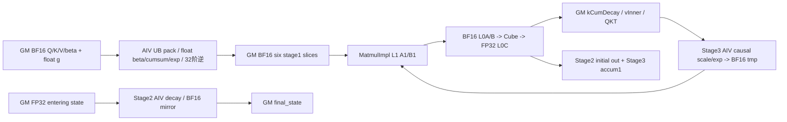
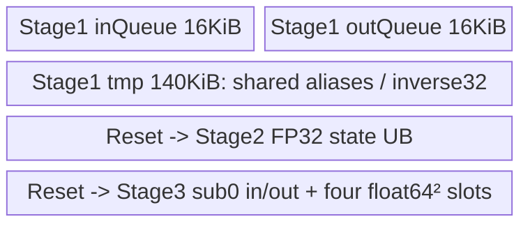
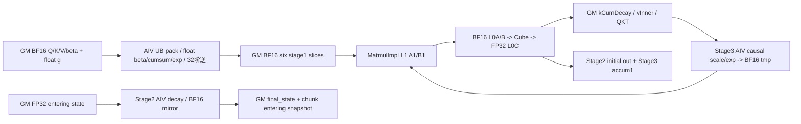
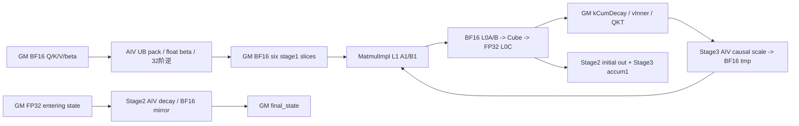
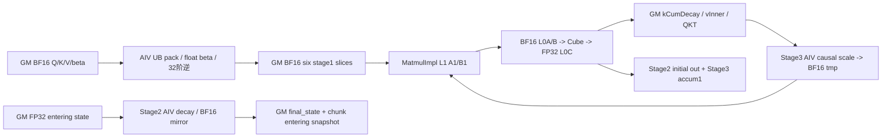
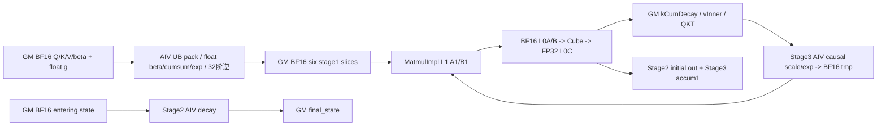
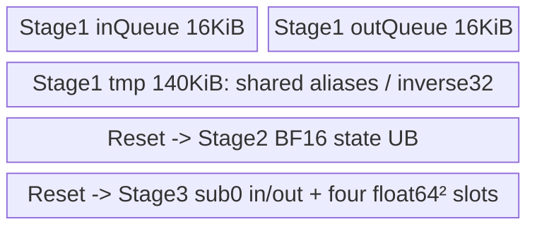
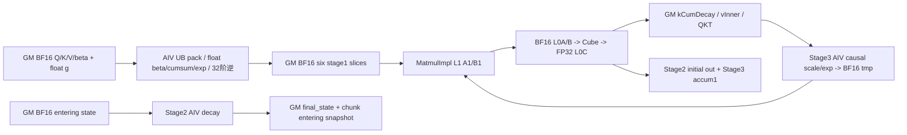
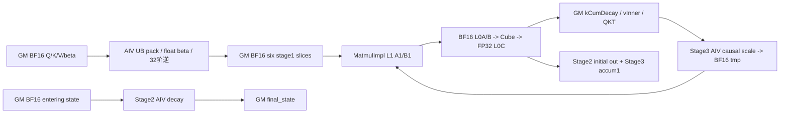
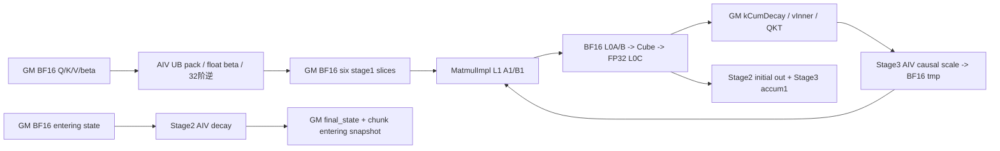

# SGL 分块门控 Delta 递推 950 ACLNN 算子知识

## 算子速览

| 项目 | 内容 |
|---|---|
| 实际入口 | 公开 ACLNN `aclnnSglChunkGatedDeltaRuleGetWorkspaceSize / aclnnSglChunkGatedDeltaRule`；Torch `npu::sgl_chunk_gated_delta_rule` |
| 计算语义 | 按序列独立执行门控Delta递推；状态最后两维为 V,K；64 token分块只改变实现 |
| 输入输出 | Q/K/V/beta BF16，g可选FP32，lengths int32；状态BF16或FP32；out BF16，final_state同状态dtype |
| 执行类型 | 单entry `KERNEL_TYPE_MIX_AIC_1_2`：AIC_CUBE与两AIV_VECTOR，阶段一包含RegBase VF；不是三个Host kernel |
| Kernel路线 | R-001、R-002、R-003、R-004、R-005、R-006、R-007、R-008；将可选chunk写回分开，避免混淆不同内存副作用 |
| 核心资源 | 16MiB系统前缀 + inter工作区 + stage复用区；Cube Matmul GM ND BF16 A/B；AIV独立UB队列/别名scratch |
| 来源闭包 | `source_closed`：公开文档→Python/Torch ACLNN双阶段→本地OpDef/Infer/Tiling→POD→当前架构entry→三stage及helper→构建。CANN生成bridge、Contiguous与Matmul primitive为显式框架边界 |
| 验证状态 | 已完成源码闭包检查；本次知识提取未执行编译、真机、数值或性能测试。draft不承诺内存或数值安全。 |

## 接口与语义

### 计算语义

令T为打包token总数，B为序列数，N=Nk、H=Nv、K=Dk、V=Dv。value head h使用Q/K head `floor(h*N/H)`。每个序列各自从 `[H,V,K]` 初态开始：

```text
D_i = exp(g_i) * S_(i-1)       # 无g时乘数1
u_i = beta_i * (v_i - D_i @ k_i)
S_i = D_i + outer(u_i,k_i)
out_i = scale * (S_i @ q_i)
```

这是公开数学语义；原生实现的BF16中间物化、FP32 Vector计算与舍入会影响误差，不能等同逐token全FP32参考。每个chunk的进入态在衰减前保存。`actual_seq_lengths` 是每序列长度，不是累积边界。

### 输入、输出与属性

| 参数 | shape/layout | dtype | 约束、默认值与语义 |
|---|---|---|---|
| query | [T,N,K] ND | BF16 | 必选；全维正；N≤64，K≤128 |
| key | 同query | BF16 | 与query形状完全相同 |
| value | [T,H,V] ND | BF16 | H≤64，V≤128，H%N==0 |
| beta | [T,H] ND | BF16 | Python默认None但原生必选 |
| initial_state | [B,H,V,K] ND | BF16 / FP32 | B>0；每序列初态，原输入不被覆盖 |
| actual_seq_lengths | [B] ND | int32 | 必须全部>0且和为T；源码未读取内容做Host校验 |
| g | [T,H] ND | FP32 / None | 可选log衰减；无g走明确无衰减分支 |
| chunk_state | [sum_b ceil(L_b/64),H,V,K] ND | 同initial_state | 可选工作buffer；只校验后三维和dtype，不校验容量；连续输入原地写，非连续临时副本无copyback |
| scale | 标量属性 | float，默认1.0 | None→1.0；显式0.0保留；double输入转float |
| out | [T,H,V] ND | BF16 | 返回；阶段二初写，阶段三accum=1 |
| final_state | [B,H,V,K] ND | 同initial_state | 返回；阶段二每chunk递推 |
| chunk_state_result | 同chunk_state | 同initial_state | ACLNN可选输出；Torch将其与chunk输入descriptor绑定同一工作buffer，Kernel消费该输出指针 |
| impl | Python关键字 | auto / ascendc / torch_native | 本卡只闭合auto/ascendc对应的ACLNN原生路线；选择失败无自动切换 |

### 入口与版本

固定版本为 `dda6d36b0cdb4081e102d14c0a2fb276fc416e69`，CANN版本范围按固定README与CI取9.1.0，不声称实际装载或运行。公开产品表和活跃CMake共同支持950。`auto`与`ascendc`共用原生入口；`torch_native`是显式替代backend，不是失败兜底，也不是本ACLNN启动图的一部分。当前注意力目录保留旧导入代码的provenance注释，但活动CMake编译本目录自己的Host和当前代际body，没有运行时跳到legacy Triton或外部ops-transformer核心算子。

接口详见[原生公开API](../../../../apis/sgl_kernel_npu/sgl_chunk_gated_delta_rule.md)。旧[官方非Sgl算子卡](../../../../../../ops/ascendc/operators/aclnn/transformer/attention/chunk_gated_delta_rule.md)是另一入口，不能将其保守workspace公式直接套入本Host。[旧集成Guide](../../../../guides/integration/sgl_kernel_npu/sgl_legacy_gdn_chunk_mega.md)说明legacy Triton状态K,V；本native状态V,K，需显式转置，不能只按同名参数替换。

## Host/Launcher 执行流程

### 参数校验与前处理

Torch adapter依次检查必选tensor已定义、同NPU、rank `3/3/3/2/4/1`、dtype和维度关系，再检查可选g和chunk。所有输入转连续工作tensor；输出用`empty`新分配。Host Tiling重复检查上述storage shape、dtype和可选端口，并要求AIC数A>0；FP32状态只在`SocVersion::ASCEND950`通过，A2/A3返回GRAPH_FAILED。没有Host读回lengths检查正值/和，也没有chunk第0维容量检查。InferShape复制value→out、initial_state→final_state、chunk输入→chunk结果；InferDataType对应复制dtype。

### 参数、Workspace 与生命周期

adapter按OpDef顺序创建aclTensor描述符，动态解析两个准确ACLNN符号，先GetWorkspaceSize获得executor及字节数；非ACL_SUCCESS抛错，若大小超过int64上限也抛错。分配byte workspace后，闭包capture全部工作tensor、输出和descriptor，逐tensor对当前NPU stream执行`record_stream`，再用`RunOpApi`排队第二阶段execute。execute同步返回错误时抛错；本地没有第三次提交。异步Device完成与allocator复用由stream记录保护，不能以lambda返回当Device已完成。

记A=平台AIC核数，C=64，P=4，S=2AC，Ka=ceil(K/16)*16，Va=ceil(V/16)*16。`GetUserWorkspace`后的user指针为下列offset原点；Host显式保留16MiB系统前缀，具体系统库使用属于CANN边界。下表逐片连续相加，没有额外对齐填洞；BF16乘积大小与FP32掩码区均按真实dtype计字节。

| slice | 容量/字节 | dtype/layout | producer→consumer与生命周期 |
|---|---|---|---|
| gCum | 4HS | float [H,S] | Stage1累计log g→Stage2/3；无g保留但不读 |
| kCumDecay | 2HSK | BF16 [H,S,K] | Stage1→Stage2 |
| vInner | 4HSV（FP32 state）/2HSV（BF16 state） | float/BF16 [H,S,V] | Stage1初值→Stage2修正→Stage3（FP32时通过镜像） |
| vInnerBf16 | 2HSV，仅FP32 state | BF16 [H,S,V] | Stage2 CastGmToGm→CalStateNew与Stage3 |
| qPrime | 2HSK | BF16 [H,S,K] | Stage1→Stage2 |
| attnInter | 2HSV | BF16保留区 | 兼容切片；实际Stage2直接写out，不消费此tensor |
| kg | 2HSK | BF16 [H,S,K] | Stage1→Stage2 |
| qkt | 2HSC | BF16 [H,S,C]槽 | Stage1→Stage3；每chunk内部按实际m×m紧密存放 |
| stateBf16Wk | 2HVK，仅FP32 state | BF16 [H,V,K] | Stage2 float进入态的BF16镜像；序列/组复用 |
| stageOneMask | 8AC² | float [2A,C,C] | 每AIV一份严格下三角mask |
| stageThreeMask | 8AC² | float [2A,C,C] | 每AIV一份含对角下三角mask |
| stageWs | 2ACP(2C+3K+V) | BF16六片；见分核章节 | Stage1按core/slot独占；Stage3在SyncAll与pipe.Reset后复用 |

```text
I_BF16 = 4HS + 6HSK + 4HSV + 2HSC + 16AC²
I_FP32 = 4HS + 6HSK + 8HSV + 2HSC + 2HVK + 16AC²
J = 2ACP(2C+3K+V)
Wtotal = 16777216 + I + J
offset(slice_i) = sum(bytes(slice_j), j<i)
```

所有inter slice容量以最大组S预留；当前组按 `Sp=ceil(groupLength/C)*C≤S` 紧密寻址。中间行 `head*Sp+chunk*C+row`；不能误用head*S解释Device当前组地址。数据在三个stage间保留，在下一组覆盖；初态/final/out及可选chunk为独立tensor owner。

### 启动图与失败传播

```text
公开auto/ascendc → torch.ops.npu.sgl_chunk_gated_delta_rule
 → adapter校验/contiguous → GetWorkspaceSize(executor)
 → TilingChunkGatedDeltaRule → raw POD，key=0，blockDim=A
 → 当前stream execute → sgl_chunk_gated_delta_rule(MIX_AIC_1_2)
   InitMatmul + InitMask → SyncAll
   每序列、每至多S个token的group：
     Stage1(AIC+两AIV) → pipe.Reset → SyncAll
     Stage2(AIC+两AIV握手，sub0做状态Vector) → pipe.Reset → SyncAll
     Stage3(AIC+两AIV握手，sub0做Vector) → pipe.Reset → SyncAll
 → out/final_state；可选chunk_state_result
```

上图Reset的源码位置是各`RunStage*`返回前，`SyncAll`在控制器后继语句；Reset不承担跨核可见性。Tiling资源/容量/shape失败返回GRAPH_FAILED，adapter接收ACLNN错误后停止。源码没有未知key分支：Host总写0，entry不按tiling key切换；历史key头中的0/1/10/11常量不构成当前路线。Device按lengths值推进，数据错误没有fallback或显式错误报告。

## Route 与参数设计

### 分核与资源计算

先取storage shape和dtype→校验→GetCoreNumAic A及SoC→生成C/P/S与workspace→生成Matmul Tiling→memcpy共享POD→设置blockDim/key。Stage1将 `H*ceil(groupLength/64)` 任务按商余数连续分给A个逻辑核，首余数个核多1个；每核按最多4任务一批，任务号映射 `h=id%H, chunk=id/H`。两个AIV分别处理行0..31与32..63，尾行由subValidLen限制并补0。Stage2按 `ceil(H/A)` 的head区间分核，单head按chunk串行依赖。Stage3将相同任务总数按 `ceil(total/A)` 分核，但映射为 `h=id/chunkNum, chunk=id%chunkNum`，与Stage1任务顺序不同。AIV逻辑core=`GetBlockIdx()/2`，subblock0/1与一个AIC对应；不能把物理AIV编号直接当head。

Cube实例：Stage1 A/B为 `MatmulType<GM,ND,bfloat16_t>`；Stage2/3 A/B为 `MatmulType<GM,ND,bfloat16_t,true>`（类型允许转置，实际SetTensorA/B另定）。C为GM ND BF16，FP32状态时Stage1 vInner与Stage2两项状态相关积另用GM ND float C。Host对两类C均设M/N/K和FixSplit为128³，dim1、无bias，`dbL0C/stepKa/stepKb/depthA1/depthB1/stepM/stepN=1`；没有自定义scheduler/prologue/epilogue类。`MatmulImpl`按SetOrgShape/SetSingleShape处理实际tile及尾部；不从这些字段反推SDK内部buffer数量。

| 阶段 | 实际M,N,K与转置 | 输出与累加 |
|---|---|---|
| Stage1 KK | C,C,K；B转置 | BF16 C×C |
| Stage1 QKT | m,m,K；B转置，m=有效chunk长度 | BF16 m×m紧密结果 |
| Stage1逆矩阵下左块 | 两次32,32,32，原矩阵行距64 | BF16 lower-left原位替换；FIX_MTE2防读未完成结果 |
| Stage1 inverse×gBK | C,K,C；无转置 | BF16 kCumDecay |
| Stage1 inverse×vBeta | C,V,C；无转置 | FP32 C仅950 FP32 state，其余BF16 |
| Stage2 kCumDecay×stateᵀ | m,V,K；B转置 | accum=1加到vInner |
| Stage2 qPrime×stateᵀ | m,V,K；B转置 | 初写out，行距H*V |
| Stage2 vInnerᵀ×kg | V,K,m；A转置 | accum=1加到已衰减state；950 FP32路线C为float |
| Stage3 maskedQKT×vInner | m,V,m；均不转置 | BF16 out，accum=1加到Stage2输出 |

### Route 选择

下表各行共同前提为接口所有shape/dtype关系通过、A>0、当前平台构建可用。g与chunk条件是“optional已定义/descriptor非空”，不是数值是否为0。

| 顺序 | Route | Key/模板 | 精确选择条件与优先级 | 不适用去向 |
|---|---|---|---|---|
| 1 | R-001 FP32含g不保存chunk态 | key0；CGDR<bfloat16_t,float,float,true> | state=FP32；g存在；chunk_state缺省；state/g依entry的if→else if顺序，chunk位于Stage2写回if | 下一互斥行；全部非法输入在Host失败 |
| 2 | R-002 FP32含g并保存chunk进入态 | key0；CGDR<bfloat16_t,float,float,true> | state=FP32；g存在；chunk_state存在；state/g依entry的if→else if顺序，chunk位于Stage2写回if | 下一互斥行；全部非法输入在Host失败 |
| 3 | R-003 FP32无g不保存chunk态 | key0；CGDR<bfloat16_t,float,float,false> | state=FP32；g缺省；chunk_state缺省；state/g依entry的if→else if顺序，chunk位于Stage2写回if | 下一互斥行；全部非法输入在Host失败 |
| 4 | R-004 FP32无g并保存chunk进入态 | key0；CGDR<bfloat16_t,float,float,false> | state=FP32；g缺省；chunk_state存在；state/g依entry的if→else if顺序，chunk位于Stage2写回if | 下一互斥行；全部非法输入在Host失败 |
| 5 | R-005 BF16含g不保存chunk态 | key0；CGDR<bfloat16_t,float,bfloat16_t,true> | state=BF16；g存在；chunk_state缺省；state/g依entry的if→else if顺序，chunk位于Stage2写回if | 下一互斥行；全部非法输入在Host失败 |
| 6 | R-006 BF16含g并保存chunk进入态 | key0；CGDR<bfloat16_t,float,bfloat16_t,true> | state=BF16；g存在；chunk_state存在；state/g依entry的if→else if顺序，chunk位于Stage2写回if | 下一互斥行；全部非法输入在Host失败 |
| 7 | R-007 BF16无g不保存chunk态 | key0；CGDR<bfloat16_t,float,bfloat16_t,false> | state=BF16；g缺省；chunk_state缺省；state/g依entry的if→else if顺序，chunk位于Stage2写回if | 下一互斥行；全部非法输入在Host失败 |
| 8 | R-008 BF16无g并保存chunk进入态 | key0；CGDR<bfloat16_t,float,bfloat16_t,false> | state=BF16；g缺省；chunk_state存在；state/g依entry的if→else if顺序，chunk位于Stage2写回if | 下一互斥行；全部非法输入在Host失败 |

```text
if stateIsFp32!=0 && hasGamma!=0: CGDR<bf16,float,float,true>
elif stateIsFp32!=0: CGDR<bf16,float,float,false>
elif hasGamma!=0: CGDR<bf16,float,bf16,true>
else: CGDR<bf16,float,bf16,false>
每个实例内 outputChunkState==0 → 不保存；!=0 → 保存每chunk衰减前状态
```

### 模板/实现执行矩阵

| Route | key/selector | dtype/shape/platform 完整命中条件 | 执行族与kernel节点 | 实际模板/body | 内存与同步特征 | tail/fallback |
|---|---|---|---|---|---|---|
| R-001 | 0 / state=FP32；g存在；chunk_state缺省 | 950；正维、N,H≤64、K,V≤128、H%N=0；state=FP32；g存在；chunk_state缺省 | 单MIX entry，Stage1→2→3；AIC_CUBE+AIV_VECTOR | CGDR<bfloat16_t,float,float,true>；Stage1<true,true>/Stage2<float,true>/Stage3<true> | I_FP32+J；无chunk外写；每slot stage1旗标 | m∈[1,64]，维度补齐；无native fallback |
| R-002 | 0 / state=FP32；g存在；chunk_state存在 | 950；正维、N,H≤64、K,V≤128、H%N=0；state=FP32；g存在；chunk_state存在 | 单MIX entry，Stage1→2→3；AIC_CUBE+AIV_VECTOR | CGDR<bfloat16_t,float,float,true>；Stage1<true,true>/Stage2<float,true>/Stage3<true> | I_FP32+J；chunk外部写；每slot stage1旗标 | m∈[1,64]，维度补齐；无native fallback |
| R-003 | 0 / state=FP32；g缺省；chunk_state缺省 | 950；正维、N,H≤64、K,V≤128、H%N=0；state=FP32；g缺省；chunk_state缺省 | 单MIX entry，Stage1→2→3；AIC_CUBE+AIV_VECTOR | CGDR<bfloat16_t,float,float,false>；Stage1<true,false>/Stage2<float,false>/Stage3<false> | I_FP32+J；无chunk外写；每slot stage1旗标 | m∈[1,64]，维度补齐；无native fallback |
| R-004 | 0 / state=FP32；g缺省；chunk_state存在 | 950；正维、N,H≤64、K,V≤128、H%N=0；state=FP32；g缺省；chunk_state存在 | 单MIX entry，Stage1→2→3；AIC_CUBE+AIV_VECTOR | CGDR<bfloat16_t,float,float,false>；Stage1<true,false>/Stage2<float,false>/Stage3<false> | I_FP32+J；chunk外部写；每slot stage1旗标 | m∈[1,64]，维度补齐；无native fallback |
| R-005 | 0 / state=BF16；g存在；chunk_state缺省 | 950；正维、N,H≤64、K,V≤128、H%N=0；state=BF16；g存在；chunk_state缺省 | 单MIX entry，Stage1→2→3；AIC_CUBE+AIV_VECTOR | CGDR<bfloat16_t,float,bfloat16_t,true>；Stage1<false,true>/Stage2<bfloat16_t,true>/Stage3<true> | I_BF16+J；无chunk外写；每slot stage1旗标 | m∈[1,64]，维度补齐；无native fallback |
| R-006 | 0 / state=BF16；g存在；chunk_state存在 | 950；正维、N,H≤64、K,V≤128、H%N=0；state=BF16；g存在；chunk_state存在 | 单MIX entry，Stage1→2→3；AIC_CUBE+AIV_VECTOR | CGDR<bfloat16_t,float,bfloat16_t,true>；Stage1<false,true>/Stage2<bfloat16_t,true>/Stage3<true> | I_BF16+J；chunk外部写；每slot stage1旗标 | m∈[1,64]，维度补齐；无native fallback |
| R-007 | 0 / state=BF16；g缺省；chunk_state缺省 | 950；正维、N,H≤64、K,V≤128、H%N=0；state=BF16；g缺省；chunk_state缺省 | 单MIX entry，Stage1→2→3；AIC_CUBE+AIV_VECTOR | CGDR<bfloat16_t,float,bfloat16_t,false>；Stage1<false,false>/Stage2<bfloat16_t,false>/Stage3<false> | I_BF16+J；无chunk外写；每slot stage1旗标 | m∈[1,64]，维度补齐；无native fallback |
| R-008 | 0 / state=BF16；g缺省；chunk_state存在 | 950；正维、N,H≤64、K,V≤128、H%N=0；state=BF16；g缺省；chunk_state存在 | 单MIX entry，Stage1→2→3；AIC_CUBE+AIV_VECTOR | CGDR<bfloat16_t,float,bfloat16_t,false>；Stage1<false,false>/Stage2<bfloat16_t,false>/Stage3<false> | I_BF16+J；chunk外部写；每slot stage1旗标 | m∈[1,64]，维度补齐；无native fallback |

### 隐藏性能 Guard

| Guard | Host/Tiling 条件 | Device/资源原因 | 影响Route | 不满足时去向 | 源码符号 |
|---|---|---|---|---|---|
| 输入域 | T,N,H,K,V,B>0；N,H≤64；K,V≤128；H%N==0 | 固定64/32逆与UB上界；整除GQA映射 | 全部 | GRAPH_FAILED/TORCH_CHECK | TilingChunkGatedDeltaRule / adapter |
| 平台状态 | stateIsFp32 ⇒ isAscend950 | arch22只BF16实例 | 全部 | GRAPH_FAILED | TilingChunkGatedDeltaRule |
| AIC资源 | A>0；GetTiling!=−1 | blockDim=A；Matmul基块128³ | 全部 | GRAPH_FAILED | ComputeMatmulTiling |
| raw容量 | raw非空且capacity≥sizeof(POD) | memcpy无字段序列化转换 | 全部 | GRAPH_FAILED | TilingChunkGatedDeltaRule |
| 输入对齐 | Host无K/V整除16限制；Device Ka/Va上取16 | 32B对齐搬运；Stage1/3不保证尾维为0，Stage1仅显式清零无效token行，Stage2按自身CopyIn显式零填 | 全部 | Device padding，无另一route | Stage1 QKPreProcess / Stage2 CopyIn / Stage3 AlignedCopyIn |
| length内容 | 未校验L_b>0及sum L=T | 零/负跳过，超过T可越界，少于T有未写输出 | 全部 | 无fallback/诊断；调用者前提 | CGDR::Process |
| chunk容量 | 未校验第0维≥sum ceil(L/64) | Stage2按globalChunkOffset线性写 | 保存chunk路线 | 无fallback；不足可越界 | CalGCumExp / ProcessAivFp32 |
| UB容量 | Host仅将平台UB供Matmul Tiling；未比较Vector各stage总量 | Stage1/2/3各自InitBuffer；不能用Tiling成功证明全UB充足 | 全部 | 无本地降级route | InitLocalBuffers |
| 整数范围 | 尺寸乘积无显式溢出检查；A转uint32 blockDim | workspace/int64偏移与DMA uint16/uint32参数窄化 | 全部 | 无本地fallback | ComputeTilingData / DataCopy helpers |

### POD/ABI

共享POD声明 `#pragma pack(push,8)` 与 `alignas(8)`；前13个int64 offset固定，scale在104。令 `F=offsetof(matmulTilingFp32)`，`Q=sizeof(AscendC::tiling::TCubeTiling)`，`G=offsetof(matmulTilingFp32C)`，`Z=offsetof(stateIsFp32)`。TCubeTiling定义位于CANN SDK，固定仓未给出其sizeof/alignof，因此F/G/Z和总sizeof不填伪造常数。Host与Device同头使用raw memcpy；总sizeof由同版本SDK编译决定，未实测。

| 结构 | 字段 | 类型/位宽 | ABI布局 | 单位 | Host/launcher producer | Device consumer | 边界 |
|---|---|---|---|---|---|---|---|
| ChunkGatedDeltaRuleTilingData | aiCoreNum | int64 | 0 | 单位：core | platform.GetCoreNumAic() | 分核/掩码/WS | >0 |
| ChunkGatedDeltaRuleTilingData | t | int64 | 8 | 单位：token | q.dim0 | 输入输出extent | >0 |
| ChunkGatedDeltaRuleTilingData | nk | int64 | 16 | 单位：head | q.dim1 | GQA输入head | 1..64 |
| ChunkGatedDeltaRuleTilingData | dk | int64 | 24 | 单位：element | q.dim2 | K、对齐和寻址 | 1..128 |
| ChunkGatedDeltaRuleTilingData | nv | int64 | 32 | 单位：head | v.dim1 | 任务总数/状态head | 1..64且%nk=0 |
| ChunkGatedDeltaRuleTilingData | dv | int64 | 40 | 单位：element | v.dim2 | V、对齐和寻址 | 1..128 |
| ChunkGatedDeltaRuleTilingData | b | int64 | 48 | 单位：sequence | state.dim0 | 序列循环/extent | >0 |
| ChunkGatedDeltaRuleTilingData | hasGamma | int64 | 56 | 单位：bool编码 | gDesc!=nullptr ?1:0 | arch35模板分发；arch22实际使用g指针 | 0/1，必须和端口一致 |
| ChunkGatedDeltaRuleTilingData | chunkSize | int64 | 64 | 单位：token | 64 | 三个stage的C | 固定64 |
| ChunkGatedDeltaRuleTilingData | maxGroupLength | int64 | 72 | 单位：token | 2*A*64 | Process组长 | 正值，乘积未查溢出 |
| ChunkGatedDeltaRuleTilingData | interWorkspaceSz | int64 | 80 | 单位：byte | ComputeTilingData逐slice求和 | Host workspace；Device按相同切片推导 | I；Device不以此字段逐片切割 |
| ChunkGatedDeltaRuleTilingData | stageWorkspaceSz | int64 | 88 | 单位：byte | 2*C*(2*C+3*K+V)*4*A | Host workspace | J；各stage局部按固定公式寻址 |
| ChunkGatedDeltaRuleTilingData | stageOneParaNum | int64 | 96 | 单位：task/core | 4 | Stage1批slot与WS | ≤MAX_PARALLEL_NUM6，当前固定4 |
| ChunkGatedDeltaRuleTilingData | scale | float32 | 104 | 单位：multiplier | attr0或1.0 | QPrimeCompute及CalMaskedQKT | 显式0有效；无finite校验 |
| ChunkGatedDeltaRuleTilingData | matmulTilingFp32 | TCubeTiling | F（SDK布局） | 单位：mixed | ComputeMatmulTiling BF16 C；七个step/depth/db字段=1 | Stage1/Stage2/Stage3 Matmul Init | 名称含Fp32但C为BF16 |
| ChunkGatedDeltaRuleTilingData | matmulTilingFp32C | TCubeTiling | G（SDK布局） | 单位：mixed | 仅stateFP32生成float C，否则memset零 | 950 FP32 Stage1/2 | BF16 inactive，不可误读零Tiling |
| ChunkGatedDeltaRuleTilingData | stateIsFp32 | int64 | Z（SDK布局） | 单位：bool编码 | state dtype==float ?1:0 | arch35 entry；arch22不切模板 | 0/1；A2/A3只0 |
| ChunkGatedDeltaRuleTilingData | stateStride0 | int64 | Z+8 | 单位：element | H*V*K | 950 initialState batch offset | 连续state；arch22用等价乘积 |
| ChunkGatedDeltaRuleTilingData | stateStride1 | int64 | Z+16 | 单位：element | V*K | 950 initialState head offset | 连续state；arch22用等价乘积 |
| ChunkGatedDeltaRuleTilingData | outputChunkState | int64 | Z+24 | 单位：bool编码 | chunkDesc非空 ?1:0 | Init绑定结果指针、Stage2可选保存 | 0/1；不得只传输入而不给输出buffer |

其余结构是entry内C++局部参数对象，不是额外跨Host raw POD；仍逐字段列清producer/consumer。GlobalTensor、TPipe与Matmul指针的ABI依CANN编译器，不假定对象字节数。纯整数`ChunkGroup`按声明顺序五个int64，常规8B对齐推导40B（未编译测量）；`CGDRInitParams`十个GM_ADDR指针按声明顺序，其指针宽度/sizeof遵目标编译ABI。

| 结构 | 字段 | 类型/位宽 | ABI布局 | producer | consumer | 单位/边界 |
|---|---|---|---|---|---|---|
| CGDRInitParams | query | GM_ADDR；ptr ABI | 声明序0 | entry参数query | Init对应GlobalTensor | 指针不拥有底层tensor |
| CGDRInitParams | key | GM_ADDR；ptr ABI | 声明序1 | entry参数key | Init对应GlobalTensor | 指针不拥有底层tensor |
| CGDRInitParams | value | GM_ADDR；ptr ABI | 声明序2 | entry参数value | Init对应GlobalTensor | 指针不拥有底层tensor |
| CGDRInitParams | beta | GM_ADDR；ptr ABI | 声明序3 | entry参数beta | Init对应GlobalTensor | 指针不拥有底层tensor |
| CGDRInitParams | initState | GM_ADDR；ptr ABI | 声明序4 | entry参数initState | Init state extent | 指针不拥有底层tensor |
| CGDRInitParams | seqlens | GM_ADDR；ptr ABI | 声明序5 | entry参数seqlens | actualSeqLens_ / Process | 指针不拥有底层tensor |
| CGDRInitParams | gOptional | GM_ADDR；ptr ABI | 声明序6 | entry参数gOptional | gFlag_或compile g绑定 | 指针不拥有底层tensor |
| CGDRInitParams | attnOut | GM_ADDR；ptr ABI | 声明序7 | entry参数attnOut | out_ | 指针不拥有底层tensor |
| CGDRInitParams | finalState | GM_ADDR；ptr ABI | 声明序8 | entry参数finalState | Init对应GlobalTensor | 指针不拥有底层tensor |
| CGDRInitParams | chunkState | GM_ADDR；ptr ABI | 声明序9 | entry参数chunkStateResult | chunkState_绑定chunkStateResult | 指针不拥有底层tensor |
| ChunkGroup | startPos | int64 | 0 | pos | Stage1/2/3 | token |
| ChunkGroup | length | int64 | 8 | min(S,seqEnd-pos) | Stage1/2/3 | token |
| ChunkGroup | chunkSize | int64 | 16 | 64 | Stage1/2/3 | token |
| ChunkGroup | coreStart | int64 | 24 | 默认0 | 无活动读取 | 保留inactive |
| ChunkGroup | coreEnd | int64 | 32 | 默认0 | 无活动读取 | 保留inactive |
| MatmulShapeParams | m | uint64 | 声明顺序；6×8B静态推导48B | AICProcess调用点实际M/N/K与singleM/N/K | SetOrgShape | 元素数；无pointer |
| MatmulShapeParams | n | uint64 | 声明顺序；6×8B静态推导48B | AICProcess调用点实际M/N/K与singleM/N/K | SetOrgShape | 元素数；无pointer |
| MatmulShapeParams | k | uint64 | 声明顺序；6×8B静态推导48B | AICProcess调用点实际M/N/K与singleM/N/K | SetOrgShape | 元素数；无pointer |
| MatmulShapeParams | sm | uint64 | 声明顺序；6×8B静态推导48B | AICProcess调用点实际M/N/K与singleM/N/K | SetSingleShape | 元素数；无pointer |
| MatmulShapeParams | sn | uint64 | 声明顺序；6×8B静态推导48B | AICProcess调用点实际M/N/K与singleM/N/K | SetSingleShape | 元素数；无pointer |
| MatmulShapeParams | sk | uint64 | 声明顺序；6×8B静态推导48B | AICProcess调用点实际M/N/K与singleM/N/K | SetSingleShape | 元素数；无pointer |
| GDRStageOneInitParams<vInnerType> | query | GlobalTensor<对应dtype> | Device局部ABI；无Host offset | CGDR::RunStage1对应成员/tiling/cg | Stage1输入预处理 | g仅含groute活跃；vInnerType随state |
| GDRStageOneInitParams<vInnerType> | key | GlobalTensor<对应dtype> | Device局部ABI；无Host offset | CGDR::RunStage1对应成员/tiling/cg | Stage1输入预处理 | g仅含groute活跃；vInnerType随state |
| GDRStageOneInitParams<vInnerType> | value | GlobalTensor<对应dtype> | Device局部ABI；无Host offset | CGDR::RunStage1对应成员/tiling/cg | Stage1输入预处理 | g仅含groute活跃；vInnerType随state |
| GDRStageOneInitParams<vInnerType> | beta | GlobalTensor<对应dtype> | Device局部ABI；无Host offset | CGDR::RunStage1对应成员/tiling/cg | Stage1输入预处理 | g仅含groute活跃；vInnerType随state |
| GDRStageOneInitParams<vInnerType> | g | GlobalTensor<对应dtype> | Device局部ABI；无Host offset | CGDR::RunStage1对应成员/tiling/cg | Stage1输入预处理 | g仅含groute活跃；vInnerType随state |
| GDRStageOneInitParams<vInnerType> | gCumExp | GlobalTensor<对应dtype> | Device局部ABI；无Host offset | CGDR::RunStage1对应成员/tiling/cg | GCumExpCompute写累计log g | g仅含groute活跃；vInnerType随state |
| GDRStageOneInitParams<vInnerType> | kCumdecay | GlobalTensor<对应dtype> | Device局部ABI；无Host offset | CGDR::RunStage1对应成员/tiling/cg | AIC inverse@gBK写 | g仅含groute活跃；vInnerType随state |
| GDRStageOneInitParams<vInnerType> | vInner | GlobalTensor<对应dtype> | Device局部ABI；无Host offset | CGDR::RunStage1对应成员/tiling/cg | AIC inverse@vBeta写 | g仅含groute活跃；vInnerType随state |
| GDRStageOneInitParams<vInnerType> | qPrime | GlobalTensor<对应dtype> | Device局部ABI；无Host offset | CGDR::RunStage1对应成员/tiling/cg | QPrimeCompute写 | g仅含groute活跃；vInnerType随state |
| GDRStageOneInitParams<vInnerType> | kG | GlobalTensor<对应dtype> | Device局部ABI；无Host offset | CGDR::RunStage1对应成员/tiling/cg | GBKCompute写 | g仅含groute活跃；vInnerType随state |
| GDRStageOneInitParams<vInnerType> | qK | GlobalTensor<对应dtype> | Device局部ABI；无Host offset | CGDR::RunStage1对应成员/tiling/cg | AIC QKT写 | g仅含groute活跃；vInnerType随state |
| GDRStageOneInitParams<vInnerType> | ws | GM_ADDR | Device局部ABI；无Host offset | CGDR::RunStage1对应成员/tiling/cg | Stage1六片切割 | g仅含groute活跃；vInnerType随state |
| GDRStageOneInitParams<vInnerType> | stageOneMask | GlobalTensor<对应dtype> | Device局部ABI；无Host offset | CGDR::RunStage1对应成员/tiling/cg | Gamma/Inverse严格下三角 | g仅含groute活跃；vInnerType随state |
| GDRStageOneInitParams<vInnerType> | cg | ChunkGroup值 | Device局部ABI；无Host offset | CGDR::RunStage1对应成员/tiling/cg | 组长/起点/任务总数 | g仅含groute活跃；vInnerType随state |
| StageTwoParams<stateType> | qPrime | GlobalTensor<对应dtype> | Device局部ABI；无Host offset | CGDR::RunStage2逐字段/聚合赋值 | CalAttnInter | mm1Fp32仅FP32 route；chunkState仅capture；g仅groute |
| StageTwoParams<stateType> | vInner | GlobalTensor<对应dtype> | Device局部ABI；无Host offset | CGDR::RunStage2逐字段/聚合赋值 | CalVPrime/CalStateNew | mm1Fp32仅FP32 route；chunkState仅capture；g仅groute |
| StageTwoParams<stateType> | vInnerBf16 | GlobalTensor<对应dtype> | Device局部ABI；无Host offset | CGDR::RunStage2逐字段/聚合赋值 | FP32修正后cast→CalStateNew | mm1Fp32仅FP32 route；chunkState仅capture；g仅groute |
| StageTwoParams<stateType> | gCum | GlobalTensor<对应dtype> | Device局部ABI；无Host offset | CGDR::RunStage2逐字段/聚合赋值 | 取chunk末累计log g再exp | mm1Fp32仅FP32 route；chunkState仅capture；g仅groute |
| StageTwoParams<stateType> | kCumdecay | GlobalTensor<对应dtype> | Device局部ABI；无Host offset | CGDR::RunStage2逐字段/聚合赋值 | CalVPrime | mm1Fp32仅FP32 route；chunkState仅capture；g仅groute |
| StageTwoParams<stateType> | curStateBf16 | GlobalTensor<对应dtype> | Device局部ABI；无Host offset | CGDR::RunStage2逐字段/聚合赋值 | old state BF16 Matmul | mm1Fp32仅FP32 route；chunkState仅capture；g仅groute |
| StageTwoParams<stateType> | stateIn | GlobalTensor<对应dtype> | Device局部ABI；无Host offset | CGDR::RunStage2逐字段/聚合赋值 | 首group首chunk输入 | mm1Fp32仅FP32 route；chunkState仅capture；g仅groute |
| StageTwoParams<stateType> | stateOut | GlobalTensor<对应dtype> | Device局部ABI；无Host offset | CGDR::RunStage2逐字段/聚合赋值 | 衰减+累加写final | mm1Fp32仅FP32 route；chunkState仅capture；g仅groute |
| StageTwoParams<stateType> | chunkState | GlobalTensor<对应dtype> | Device局部ABI；无Host offset | CGDR::RunStage2逐字段/聚合赋值 | 衰减前可选写 | mm1Fp32仅FP32 route；chunkState仅capture；g仅groute |
| StageTwoParams<stateType> | kg | GlobalTensor<对应dtype> | Device局部ABI；无Host offset | CGDR::RunStage2逐字段/聚合赋值 | CalStateNew | mm1Fp32仅FP32 route；chunkState仅capture；g仅groute |
| StageTwoParams<stateType> | out | GlobalTensor<对应dtype> | Device局部ABI；无Host offset | CGDR::RunStage2逐字段/聚合赋值 | 阶段二初始输出 | mm1Fp32仅FP32 route；chunkState仅capture；g仅groute |
| StageTwoParams<stateType> | ws | pointer | Device局部ABI；无Host offset | CGDR::RunStage2逐字段/聚合赋值 | 保留传入，Stage2不以其另分核心scratch | mm1Fp32仅FP32 route；chunkState仅capture；g仅groute |
| StageTwoParams<stateType> | mm1Bf16 | pointer | Device局部ABI；无Host offset | CGDR::RunStage2逐字段/聚合赋值 | Stage2::Init对应成员/Matmul | mm1Fp32仅FP32 route；chunkState仅capture；g仅groute |
| StageTwoParams<stateType> | mm1Fp32 | pointer | Device局部ABI；无Host offset | CGDR::RunStage2逐字段/聚合赋值 | Stage2::Init对应成员/Matmul | mm1Fp32仅FP32 route；chunkState仅capture；g仅groute |
| StageTwoParams<stateType> | pipe | pointer | Device局部ABI；无Host offset | CGDR::RunStage2逐字段/聚合赋值 | Stage2::Init对应成员/Matmul | mm1Fp32仅FP32 route；chunkState仅capture；g仅groute |
| StageTwoParams<stateType> | cg | pointer | Device局部ABI；无Host offset | CGDR::RunStage2逐字段/聚合赋值 | Stage2::Init对应成员/Matmul | mm1Fp32仅FP32 route；chunkState仅capture；g仅groute |
| StageTwoParams<stateType> | Nv | int64 | Device局部ABI；无Host offset | CGDR::RunStage2逐字段/聚合赋值 | Stage2::Init对应成员/Matmul | mm1Fp32仅FP32 route；chunkState仅capture；g仅groute |
| StageTwoParams<stateType> | Nk | int64 | Device局部ABI；无Host offset | CGDR::RunStage2逐字段/聚合赋值 | Stage2::Init对应成员/Matmul | mm1Fp32仅FP32 route；chunkState仅capture；g仅groute |
| StageTwoParams<stateType> | Dv | int64 | Device局部ABI；无Host offset | CGDR::RunStage2逐字段/聚合赋值 | Stage2::Init对应成员/Matmul | mm1Fp32仅FP32 route；chunkState仅capture；g仅groute |
| StageTwoParams<stateType> | Dk | int64 | Device局部ABI；无Host offset | CGDR::RunStage2逐字段/聚合赋值 | Stage2::Init对应成员/Matmul | mm1Fp32仅FP32 route；chunkState仅capture；g仅groute |
| StageTwoParams<stateType> | stateStride1 | int64 | Device局部ABI；无Host offset | CGDR::RunStage2逐字段/聚合赋值 | initial head步长 | mm1Fp32仅FP32 route；chunkState仅capture；g仅groute |
| StageTwoParams<stateType> | globalChunkOffset | int64 | Device局部ABI；无Host offset | CGDR::RunStage2逐字段/聚合赋值 | chunk输出总序号 | mm1Fp32仅FP32 route；chunkState仅capture；g仅groute |
| StageTwoParams<stateType> | useInitialState | bool | Device局部ABI；无Host offset | CGDR::RunStage2逐字段/聚合赋值 | Init接收，当前body未另用；isFirstGroup判定 | mm1Fp32仅FP32 route；chunkState仅capture；g仅groute |
| StageTwoParams<stateType> | isFirstGroup | bool | Device局部ABI；无Host offset | CGDR::RunStage2逐字段/聚合赋值 | FP32首group首chunk选择 | mm1Fp32仅FP32 route；chunkState仅capture；g仅groute |
| StageTwoParams<stateType> | outputChunkState | bool | Device局部ABI；无Host offset | CGDR::RunStage2逐字段/聚合赋值 | 控制保存进入态 | mm1Fp32仅FP32 route；chunkState仅capture；g仅groute |
| StageThreeParams | qkt | pointer/GlobalTensor | Device局部ABI；无Host offset | CGDR::RunStage3聚合赋值 | Stage3::Init / CalMaskedQKT / AICProcess | vInner在950 FP32route改传BF16镜像；gCumExp实际为log累积 |
| StageThreeParams | gCumExp | pointer/GlobalTensor | Device局部ABI；无Host offset | CGDR::RunStage3聚合赋值 | Stage3::Init / CalMaskedQKT / AICProcess | vInner在950 FP32route改传BF16镜像；gCumExp实际为log累积 |
| StageThreeParams | vInner | pointer/GlobalTensor | Device局部ABI；无Host offset | CGDR::RunStage3聚合赋值 | Stage3::Init / CalMaskedQKT / AICProcess | vInner在950 FP32route改传BF16镜像；gCumExp实际为log累积 |
| StageThreeParams | maskTensor | pointer/GlobalTensor | Device局部ABI；无Host offset | CGDR::RunStage3聚合赋值 | Stage3::Init / CalMaskedQKT / AICProcess | vInner在950 FP32route改传BF16镜像；gCumExp实际为log累积 |
| StageThreeParams | ws | pointer/GlobalTensor | Device局部ABI；无Host offset | CGDR::RunStage3聚合赋值 | Stage3::Init / CalMaskedQKT / AICProcess | vInner在950 FP32route改传BF16镜像；gCumExp实际为log累积 |
| StageThreeParams | attnOut | pointer/GlobalTensor | Device局部ABI；无Host offset | CGDR::RunStage3聚合赋值 | Stage3::Init / CalMaskedQKT / AICProcess | vInner在950 FP32route改传BF16镜像；gCumExp实际为log累积 |
| StageThreeParams | mm3 | pointer/GlobalTensor | Device局部ABI；无Host offset | CGDR::RunStage3聚合赋值 | Stage3::Init / CalMaskedQKT / AICProcess | vInner在950 FP32route改传BF16镜像；gCumExp实际为log累积 |
| StageThreeParams | pipe | pointer/GlobalTensor | Device局部ABI；无Host offset | CGDR::RunStage3聚合赋值 | Stage3::Init / CalMaskedQKT / AICProcess | vInner在950 FP32route改传BF16镜像；gCumExp实际为log累积 |
| StageThreeParams | cg | pointer/GlobalTensor | Device局部ABI；无Host offset | CGDR::RunStage3聚合赋值 | Stage3::Init / CalMaskedQKT / AICProcess | vInner在950 FP32route改传BF16镜像；gCumExp实际为log累积 |
| StageThreeParams | scale | float32 | Device局部ABI；无Host offset | CGDR::RunStage3聚合赋值 | Stage3::Init / CalMaskedQKT / AICProcess | vInner在950 FP32route改传BF16镜像；gCumExp实际为log累积 |
| StageThreeParams | Nv | int64 | Device局部ABI；无Host offset | CGDR::RunStage3聚合赋值 | Stage3::Init / CalMaskedQKT / AICProcess | vInner在950 FP32route改传BF16镜像；gCumExp实际为log累积 |
| StageThreeParams | Nk | int64 | Device局部ABI；无Host offset | CGDR::RunStage3聚合赋值 | Stage3::Init / CalMaskedQKT / AICProcess | vInner在950 FP32route改传BF16镜像；gCumExp实际为log累积 |
| StageThreeParams | Dv | int64 | Device局部ABI；无Host offset | CGDR::RunStage3聚合赋值 | Stage3::Init / CalMaskedQKT / AICProcess | vInner在950 FP32route改传BF16镜像；gCumExp实际为log累积 |
| StageThreeParams | Dk | int64 | Device局部ABI；无Host offset | CGDR::RunStage3聚合赋值 | Stage3::Init / CalMaskedQKT / AICProcess | vInner在950 FP32route改传BF16镜像；gCumExp实际为log累积 |

### Route 源码闭包

| Route | Key/selector | Host/Tiling producer | POD/参数 | Kernel entry/router | Kernel body/直接依赖 | 构建接线 |
|---|---|---|---|---|---|---|
| R-001 | 0；state=FP32；g存在；chunk_state缺省 | csrc/attention/chunk_gated_delta_rule/op_host/chunk_gated_delta_rule_tiling.cpp::TilingChunkGatedDeltaRule | 完整TilingData；state=FP32；g存在；chunk_state缺省 | csrc/attention/chunk_gated_delta_rule/op_kernel/chunk_gated_delta_rule_arch35.cpp::sgl_chunk_gated_delta_rule→CGDR<bfloat16_t,float,float,true> | csrc/attention/chunk_gated_delta_rule/op_kernel/arch35/chunk_gated_delta_rule.h::Process→arch35三stage/utils/vf InverseAIVVF<32> | csrc/attention/chunk_gated_delta_rule/CMakeLists ARCH 3510→cann_ops.cmake |
| R-002 | 0；state=FP32；g存在；chunk_state存在 | csrc/attention/chunk_gated_delta_rule/op_host/chunk_gated_delta_rule_tiling.cpp::TilingChunkGatedDeltaRule | 完整TilingData；state=FP32；g存在；chunk_state存在 | csrc/attention/chunk_gated_delta_rule/op_kernel/chunk_gated_delta_rule_arch35.cpp::sgl_chunk_gated_delta_rule→CGDR<bfloat16_t,float,float,true> | csrc/attention/chunk_gated_delta_rule/op_kernel/arch35/chunk_gated_delta_rule.h::Process→arch35三stage/utils/vf InverseAIVVF<32> | csrc/attention/chunk_gated_delta_rule/CMakeLists ARCH 3510→cann_ops.cmake |
| R-003 | 0；state=FP32；g缺省；chunk_state缺省 | csrc/attention/chunk_gated_delta_rule/op_host/chunk_gated_delta_rule_tiling.cpp::TilingChunkGatedDeltaRule | 完整TilingData；state=FP32；g缺省；chunk_state缺省 | csrc/attention/chunk_gated_delta_rule/op_kernel/chunk_gated_delta_rule_arch35.cpp::sgl_chunk_gated_delta_rule→CGDR<bfloat16_t,float,float,false> | csrc/attention/chunk_gated_delta_rule/op_kernel/arch35/chunk_gated_delta_rule.h::Process→arch35三stage/utils/vf InverseAIVVF<32> | csrc/attention/chunk_gated_delta_rule/CMakeLists ARCH 3510→cann_ops.cmake |
| R-004 | 0；state=FP32；g缺省；chunk_state存在 | csrc/attention/chunk_gated_delta_rule/op_host/chunk_gated_delta_rule_tiling.cpp::TilingChunkGatedDeltaRule | 完整TilingData；state=FP32；g缺省；chunk_state存在 | csrc/attention/chunk_gated_delta_rule/op_kernel/chunk_gated_delta_rule_arch35.cpp::sgl_chunk_gated_delta_rule→CGDR<bfloat16_t,float,float,false> | csrc/attention/chunk_gated_delta_rule/op_kernel/arch35/chunk_gated_delta_rule.h::Process→arch35三stage/utils/vf InverseAIVVF<32> | csrc/attention/chunk_gated_delta_rule/CMakeLists ARCH 3510→cann_ops.cmake |
| R-005 | 0；state=BF16；g存在；chunk_state缺省 | csrc/attention/chunk_gated_delta_rule/op_host/chunk_gated_delta_rule_tiling.cpp::TilingChunkGatedDeltaRule | 完整TilingData；state=BF16；g存在；chunk_state缺省 | csrc/attention/chunk_gated_delta_rule/op_kernel/chunk_gated_delta_rule_arch35.cpp::sgl_chunk_gated_delta_rule→CGDR<bfloat16_t,float,bfloat16_t,true> | csrc/attention/chunk_gated_delta_rule/op_kernel/arch35/chunk_gated_delta_rule.h::Process→arch35三stage/utils/vf InverseAIVVF<32> | csrc/attention/chunk_gated_delta_rule/CMakeLists ARCH 3510→cann_ops.cmake |
| R-006 | 0；state=BF16；g存在；chunk_state存在 | csrc/attention/chunk_gated_delta_rule/op_host/chunk_gated_delta_rule_tiling.cpp::TilingChunkGatedDeltaRule | 完整TilingData；state=BF16；g存在；chunk_state存在 | csrc/attention/chunk_gated_delta_rule/op_kernel/chunk_gated_delta_rule_arch35.cpp::sgl_chunk_gated_delta_rule→CGDR<bfloat16_t,float,bfloat16_t,true> | csrc/attention/chunk_gated_delta_rule/op_kernel/arch35/chunk_gated_delta_rule.h::Process→arch35三stage/utils/vf InverseAIVVF<32> | csrc/attention/chunk_gated_delta_rule/CMakeLists ARCH 3510→cann_ops.cmake |
| R-007 | 0；state=BF16；g缺省；chunk_state缺省 | csrc/attention/chunk_gated_delta_rule/op_host/chunk_gated_delta_rule_tiling.cpp::TilingChunkGatedDeltaRule | 完整TilingData；state=BF16；g缺省；chunk_state缺省 | csrc/attention/chunk_gated_delta_rule/op_kernel/chunk_gated_delta_rule_arch35.cpp::sgl_chunk_gated_delta_rule→CGDR<bfloat16_t,float,bfloat16_t,false> | csrc/attention/chunk_gated_delta_rule/op_kernel/arch35/chunk_gated_delta_rule.h::Process→arch35三stage/utils/vf InverseAIVVF<32> | csrc/attention/chunk_gated_delta_rule/CMakeLists ARCH 3510→cann_ops.cmake |
| R-008 | 0；state=BF16；g缺省；chunk_state存在 | csrc/attention/chunk_gated_delta_rule/op_host/chunk_gated_delta_rule_tiling.cpp::TilingChunkGatedDeltaRule | 完整TilingData；state=BF16；g缺省；chunk_state存在 | csrc/attention/chunk_gated_delta_rule/op_kernel/chunk_gated_delta_rule_arch35.cpp::sgl_chunk_gated_delta_rule→CGDR<bfloat16_t,float,bfloat16_t,false> | csrc/attention/chunk_gated_delta_rule/op_kernel/arch35/chunk_gated_delta_rule.h::Process→arch35三stage/utils/vf InverseAIVVF<32> | csrc/attention/chunk_gated_delta_rule/CMakeLists ARCH 3510→cann_ops.cmake |

## Kernel 实现

### 公共执行流程

entry参数依次为query,key,value,beta,initialState,seqlens,gOptional,chunkState,out,finalState,chunkStateResult,workspaceGM,tilingGM；第8个chunk输入指针本身没有传入body，InitParams.chunkState绑定的是第11个结果指针。POD解析后构造当前实例，Init绑定所有tensor和workspace，再Process。InitMask在每个物理AIV上生成C²严格下三角和含对角下三角，每mask共2A份；临时UB为4C²=16384B，V_MTE3/MTE3_S/S_MTE3/MTE3_MTE2事件保护行写、标量设置与GM读后继，末尾Reset。

Stage1 AIV先将Q/K按head跨行stride搬成连续C×K，BF16→float完成beta、g前缀和及exp，再RINT回BF16。KK经beta和严格下三角衰减形成单位下三角系统；两AIV各解32×32对角块，AIC两次32³乘完成下左逆块。AIC并行路线计算QKᵀ、inverse×gBK和inverse×vBeta；gBK=-beta·exp(G_i)·K，kg=exp(G_end−G_i)·K，qPrime=scale·exp(G_i)·Q。无g时去掉exp、kg直接由K复制。`gCumExp`变量/字段名容易误导：GM实际写的是G_i=cumsum(g)，不是exp(G_i)。

Stage2对同head串行消费每chunk的进入态，AIC先做kCumDecay·Sᵀ累计修正vInner和qPrime·Sᵀ初始out；AIV保存可选进入态、计算exp(G_end)衰减状态；AIC待衰减写完成后用vInnerᵀ·kg累计更新state。Stage3 AIV对QKT施加scale、exp(G_i−G_j)和含对角下三角mask，写BF16临时矩阵；AIC与vInner相乘并accum=1加到out。阶段间SyncAll后才复用stage workspace，阶段内flag保护GM handoff，未使用atomic。

950 FP32状态路线先将FP32进入态RINT到stateBf16Wk，Cube用此镜像；衰减与最终状态C累加保留FP32。Stage1产生FP32 vInner，Stage2修正后再次RINT成BF16镜像，供状态增量与Stage3。因此FP32状态不是全FP32乘法，BF16镜像是实际精度边界。Stage1 32阶对角求逆使用RegBase VF：mask为32 float，逐行i遍历j<i，Gather广播系数，MulAddDst累积，identity_i−acc写当前行，每行VEC_STORE→VEC_LOAD屏障；没有SIMT thread/warp调度。

公共字节账：Stage1队列各 `4*C*maxLen`，maxLen=max(Va/2,Ka/2,C)=64；可选gOut=4C；scratch固定143360B，所有队列深度1。故Stage1UB=176128+256·hasG。scratch依次为betaBF16 64、gCum256、gB128、gEnd128、betaFloat512、四别名65536、三个别名16384、q/k别名128Ka、gather256、G前缀1024、exp1024、六别名20480、inverseRes8192B；最大高水位130368≤143360。别名只按最大一个计数，不能累加gBroad/gamma/value/q等同址名字。

Stage2 BF16：in=2max(C,V)Ka，out=2max(C²,VKa)，tmp=4(max(C,V)Ka+8)，合计最大131104B；两个AIV都InitBuffer，sub1只握手不做状态Vector。 FP32：in=max(4max(C,V)Ka,4CV)，out=max(4max(C,V)Ka,2CV)，tmp=4(VKa+8)，最大196640B。未将此值强加为某平台的已知可用UB上限；Host没有Vector总UB比较或降级分支。 Stage3只sub0分配：in=2Cmax(C,Va)，out=(C>Va ?4C²:2CVa)，tmp=16C²=65536，合计最大98304B；tmp划4个C²float槽，实际命名tmp1/tmp2/mask三个，第四保留。三个stage与InitMask由Reset串行复用UB，不能相加当同时容量。

L1/L0：源码通过MatmulImpl管理，没有本地raw地址分配；当前128³基块的单份操作数payload为A1/B1各128²×2=32768B、L0A/B各32768B，FP32累加L0C128²×4=65536B。它们是当前实例单tile字节需求，不是SDK实际全部物理buffer总和。L1/L0总分配、NZ转换和Matmul内部微kernel/epilogue属固定仓外CANN primitive边界，Host把平台L1/L0C/UB容量传SetBufferSpace并保留GetTiling失败；不得自行补造ping-pong层数、HF32模式或私有offset。寄存器保存标量寻址/loop与Vector临时值，VF显式RegTensor<float/uint32>和MaskReg，未声明固定总寄存器字节数。

### Route R-001：FP32含g不保存chunk态

#### 适用条件

950、接口正维与整除关系通过、A>0、state=FP32；g存在；chunk_state缺省。本路线不改变Host key0；state/g选择当前entry的精确编译实例，chunk为body内写回selector。

##### 选择证据

| 层级 | 文件 | 符号 | 源码谓词/参数 | 结果/下一跳 |
|---|---|---|---|---|
| API | python/sgl_kernel_npu/sgl_kernel_npu/operators/attention/chunk_gated_delta_rule.py | _ascendc_impl | impl=auto/ascendc；state=FP32；g存在；chunk_state缺省 | Torch adapter |
| Host | csrc/attention/chunk_gated_delta_rule/op_host/chunk_gated_delta_rule_tiling.cpp | TilingChunkGatedDeltaRule | 全部shape/dtype校验；stateFP32允许950；gDesc 非空；chunkDesc 空 | ComputeTilingData：hasGamma=1，stateIsFp32=1，outputChunkState=0 |
| Router | csrc/attention/chunk_gated_delta_rule/op_kernel/chunk_gated_delta_rule_arch35.cpp | sgl_chunk_gated_delta_rule | CGDR<bfloat16_t,float,float,true> | CGDR<bfloat16_t,float,float,true> |
| Device | csrc/attention/chunk_gated_delta_rule/op_kernel/arch35/chunk_gated_delta_rule_stage2.h | Stage2 | outputChunkState_ false | 跳过chunk保存 |

#### Device 数据流

##### 函数级调用链

```text
sgl_chunk_gated_delta_rule → CGDR<bfloat16_t,float,float,true>::Init / Process
  InitMatmul → InitMask → SyncAll
  for bid / group:
    RunStage1 → Stage1::Init/Process → ProcessParaChunk
      AIV ParaChunkAIV: QKPreProcess → GCumExpCompute/GammaCompute → KKBetaCompute/InverseCompute
        → GBKCompute → VBetaCompute → QPrimeCompute
      AIC ParaChunkAIC: KK → QKT → AttnInverseMMCompute
        → inverse@gBK → inverse@vBeta
    Reset → SyncAll → RunStage2 → Stage2::Init/Process
      ProcessAivFp32: BF16镜像/可选chunk/float衰减；ProcessAic: CalVPrime/CalAttnInter → CastGmToGm → CalStateNew
    Reset → SyncAll → RunStage3 → CalMaskedQKT / AICProcess
    Reset → SyncAll → 下一组
```

##### 源码等价伪码

```text
# 以下为源码顺序伪码；每个barrier/flag仍按后表执行
seqEnd=0; globalChunkOffset=0
for bid in [0,B):
  seqStart=seqEnd; seqEnd += lengths[bid]
  for start in range(seqStart,seqEnd,S):
    L=min(S,seqEnd-start); Sp=ceil(L/64)*64
    entering=initial[bid] if start==seqStart else final[bid]
    parallel Stage1 task id: h=id%H; c=id/H; m=min(64,L-c*64)
      pack/zeroPad Q,K; beta=float(BF16 beta)
      G=cumsum(float g); gamma=exp(G_i-G_j)*strictLower
      KK=BF16(K@K^T); solve 32+32 diagonal blocks; AIC compose lower-left
      kCumDecay=inverse@(-beta*exp(G)*K)
      vInner=inverse@(beta*V); qPrime=scale*exp(G)*Q; qkt=BF16(Q@K^T)
    Reset; SyncAll
    parallel Stage2 assigned heads; serial chunks:
      old=entering for first chunk, else final[bid,h]
      stateBF16=RINT_BF16(old); final=old*exp(G_end)
      wait mirror-ready; vInner += kCumDecay@stateBF16^T
      out = qPrime@stateBF16^T
      wait Cube output-ready; vInnerBF16=RINT_BF16(vInner)
      wait cast-ready; final += vInnerBF16^T@kg  # C float
    Reset; SyncAll; globalChunkOffset += ceil(L/64)
    parallel Stage3 tasks: h=id/chunkNum; c=id%chunkNum
      sub0: tmp=RINT_BF16(scale*float(qkt)*exp(G_i-G_j)*lowerInclusive)
      set4; AIC wait4 → out += tmp@vInnerBF16; set3; AIV wait3
    Reset; SyncAll
```

#### 内存与数据搬运

##### 资源与搬运表

| 层级/缓冲区 | offset/地址公式 | extent/容量公式 | dtype/layout | producer | consumer | owner/lifetime | 对齐/复用 |
|---|---|---|---|---|---|---|---|
| GM inputs | Q/K[(start+cC+r)*N*K+floor(hN/H)*K]；V[(...)*H*V+hV] | Q/K各2TNK，V2THV，beta2TH | BF16 ND | adapter contiguous | Stage1 AIV | tensor/stream lifetime | DMA有效行、Ka/Va补齐；g 4TH FP32 |
| GM state | (bid*H+h)*VK | 每态4BHVK | [B,H,V,K] FP32 | initial/Stage2 | Stage2/返回 | tensor owner；同head chunk串行 | 初态只读；final独立输出 |
| GM out | ((start+cC+r)*H+h)*V | 2THV | BF16 ND | Stage2初写/Stage3 accum1 | 返回 | tensor/stream | rowstride=H*V |
| GM chunk结果 | ((globalChunkOffset+c)*H+h)*VK | 0（本路线不写） | FP32 | N/A | N/A | 连续输入原tensor或无copyback临时 | 容量由调用者保证 |
| inter workspace | 本卡slice表前缀和offset | I_FP32 | 真实dtype + 当前组Sp紧排 | Stage1/Stage2 | Stage2/Stage3 | 整次execute owner，逐组复用 | 所有Slice保留；无g时gCum不读 |
| stage1 six slices | stageWs前缀；每核core*P*tile + slot*tile | gBK/QCon/KCon各2APCK；KK/attn各2APC²；vBeta2APCV | BF16 | AIV pack/预处理与AIC KK/逆 | AIC/AIV | 当前core Pslot一批；下一批前旧数据消费 | 同物理片不并行混用 |
| stage3 scratch | stageWs + 4AC² + core*2C² | 2AC²，位于J内 | BF16 m×m紧排 | AIV sub0 | AIC | Stage1完成+Reset+SyncAll后复用 | 每核独占C²元素；尾m≤64 |
| L1(A1/B1) | MatmulImpl内部地址，非本地raw偏移 | 单128³基块各32768B payload | BF16 ND接口→内部Cube格式 | Matmul GM加载 | L0A/B | primitive调用内部 | step/depth等字段=1；物理总量SDK边界 |
| L0A/L0B | MatmulImpl管理 | 各32768B单tile payload | BF16 | L1路径 | Cube multiply | primitive内部 | 转置如公共M/N/K表 |
| L0C | MatmulImpl管理 | 65536B单128²FP32累加tile | FP32 accumulator→float C用于两项state/vInner；其余BF16 | Cube | Fixpipe/GM | 每次IterateAll内部；accum=1读旧GM C | SDK物理buffer数未在仓给出 |
| UB Stage1 | in/out各16384；tmp143360；gOut256 | 176384 | BF16/float别名布局见公共账 | MTE2/Vector | Vector/MTE3 | TQue depth1；批次临时 | scratch高水位130368B |
| UB Stage2 | in/out/tmp公式见字节账 | 196640B max | state FP32；Ka padded | MTE2/sub0 Vector | MTE3及下一chunk | 两AIV各自分配，sub0计算 | 队列depth1；状态行copy按dtype补32B |
| UB Stage3 | in2Cmax(C,Va)，out条件式，tmp16C² | ≤98304B | BF16 qkt/float exp&mask | sub0 MTE2/Vector | MTE3 | 仅sub0分配；各stage Reset | out条件严格C>Va，不用错误max公式 |
| 寄存器 | 循环/地址/Vector临时；VF mask32 float | 编译器分配；无固定byte总数 | int/float/RegTensor/MaskReg | scalar/Vector | scalar/Vector | 函数/迭代局部 | 无SIMT/NDDMA/通信节点 |

##### 分层内存布局





##### 字节账、交接边与复用顺序

```text
workspace_total = 16MiB + I_FP32 + 2ACP(2C+3K+V)
I与各offset逐片见公共slice表；optional chunk外部tensor不属于workspace
Stage1UB = 2*(4*C*64) + 143360 + 4*C = 176384
Stage2UB = max(4max(C,V)Ka,4CV)+max(4max(C,V)Ka,2CV)+4(VKa+8) <= 196640
Stage3UB = 2Cmax(C,Va) + (C>Va ?4C²:2CVa) +16C² <=98304
InitMaskUB = 4C² =16384；阶段串行，不相加
L1单tile A/B payload各32768；L0A/B各32768；L0C65536；总物理分配SDK边界
源码未建立全部VectorUB_total <= 当前平台可用UB的不等式；不得补造通过结论
```

| 边/复用子区 | producer | offset/extent | dtype/layout | consumer | ordering/sync | owner/lifetime | 安全条件 |
|---|---|---|---|---|---|---|---|
| pack→KK | QKPreProcess | QCon/KCon每core每slot 2CK | BF16 C×K | AIC KK/QKT | AIV PIPE_MTE3 set9→AIC wait9 | Pslot批次；每slot信号 | 尾行清0；AIC消费后才下批覆盖 |
| KK→inverse | AIC KK | KK每slot2C² | BF16→Vector float | KKBetaCompute/InverseCompute | AIC PIPE_FIX set8→AIV wait8 | 当前slot/批 | 两个AIV各32行，mask相同C |
| inverse→cross block | AIV inverse32 | attn每slot2C² | BF16逆块 | AttnInverseMMCompute | set7/wait7；两次FIX_MTE2事件 | 原位下左块 | 先完成第一乘后读其结果 |
| gBK/vBeta→Cube | GBKCompute/VBetaCompute | 2CK / 2CV每slot | BF16 | inverse@gBK / inverse@vBeta | AIV set6/set5→AIC wait6/wait5；PIPE_MTE3 | 当前slot/批 | 各producer输出完成 |
| QKT→Stage3 | AIC QKT | qkt slice + (hSp+cC)*C*2；有效2m² | BF16紧密m×m | CalMaskedQKT | setA/waitA；随后stage全SyncAll | 当前group | 不能以stride64读tail的紧密m² |
| Stage1→Stage2 | Stage1 outputs | qPrime/kCum/vInner/kg对应slice与Sp | BF16/float vInner | Stage2 | RunStage1 Reset返回→SyncAll | 当前group | 下次group前Stage3完成 |
| FP32镜像交接 | ProcessAivFp32 / CastGmToGm | stateBf16Wk2HVK；vInnerBf16每chunk2mV | RINT BF16 | Stage2 old state Matmul / CalStateNew / Stage3 | state AIV set3→AIC wait3；Cube set2→AIV wait2；cast AIV set5→AIC wait5 | state镜像逐chunk复用；vInner镜像保留全组 | FLOAT state仍不可跳过BF16转换 |
| old state→decay/update | AIC CalVPrime/CalAttnInter | 进入state / vInner / out | BF16乘数，C FP32 | AIV衰减写及CalStateNew | AIC set2→AIV wait2；AIV set5→AIC wait5；更新set4→AIV wait4 | 每head串行chunk | 旧态乘法结束后才覆盖其GM；float路线另有mirror-ready旗标 |
| Stage2→Stage3 | state/vInner修正 | vInner slice与BF16镜像；out[组起点] | BF16 Stage3乘数 | Stage3 | Reset→SyncAll | 当前group | 先完成vInner全部修正，out可accum1 |
| stageWs复用 | Stage1全部consumer | Stage3 offset4AC²，extent2AC² | BF16 m×m | Stage3 AIC | 两阶段间SyncAll+Reset；set4/wait4→set3/wait3 | 当前group；后续group覆盖 | 不将Stage1与3改成无barrier并发 |
| chunk进入态 | Stage2 before decay | 本route N/A | FP32 | N/A | sub0写回的MTE3顺序；分支跳过 | 外部buffer / stream | 容量足够且接受非连续无copyback语义 |

#### 同步、精度与尾块

##### 同步与数值边界表

| 阶段 | primitive/机制 | producer | consumer/等待点 | 保护对象 | 精度/尾块 |
|---|---|---|---|---|---|
| mask初始化 | V_MTE3/MTE3_S/S_MTE3/MTE3_MTE2 | 逐AIV写严格/含对角mask | Init后SyncAll | 两mask区 | float；C64固定 |
| Stage1 9/8 | CrossCoreSetFlag<0x2,PIPE_MTE3/FIX> | pack/KK | AIC wait9 / AIV wait8 | Q/K连续片与KK | 本架构每slot重复，不可跨架构照搬计数 |
| Stage1 7/6/5/A | CrossCore flag + FIX_MTE2 | inverse / gBK / vBeta / QKT | 对应wait7/6/5/A | 三种消费者与QKT就绪 | BF16物化；VF32行LocalMemBar保护行依赖 |
| Stage2 old state | PIPE_FIX flag2→AIV wait2 | CalVPrime/CalAttnInter | CopyOutState / float vInner cast | 避免覆盖旧态及读取未完vInner | state/vInner保持float C，镜像RINT BF16 |
| Stage2 update | PIPE_MTE3 flag5→AIC wait5；PIPE_FIX flag4→AIV wait4 | 衰减/镜像与状态累加 | 后继chunk | stateOut、vInner | 另有flag3镜像就绪 |
| Stage3 4/3 | AIV set4→AIC wait4；AIC set3→AIV wait3 | maskedQKT / Matmul | Cube / AIV下一任务 | 每core复用tmpGM | sub1不计算但不删共同握手；m≤64 |
| Vector DMA | DataCopyPad + MTE2_V/V_MTE3；TQue EnQue/DeQue | MTE2/Vector | Vector/MTE3 | Ka/Va padded UB | 输入srcStride以byte；UB输出srcStride以32B block，不能混单位 |
| Stage间/组间 | SyncAll<false>；pipe.Reset | 全部核 | 后继stage/group | inter与stage复用区 | length≤0跳过无final写；不把这解释为zero-state支持 |
| 精度 | float CumSum/Exp、BF16 CAST_RINT、Cube实际C类型 | Stage1→2→3 | out/final | 数值边界 | scale在qPrime和maskedQKT两个贡献各施一次；不额外全out再乘scale |

尾chunk `m=min(64,remaining)`：Q/K/V/g/beta按有效行搬运，其余行清0；QKT只生成m×m，Stage3用有效m×m重排并以m,V,m Matmul提交；状态乘法以m为归约维。K/V尾维按Ka/Va及32B搬运对齐；Stage1/3的DataCopyPad使用isPad=false、左右padding为0，不构成尾维补零保证（对齐填充可复制块首元素）；与Stage1无效token行和Stage2显式清零分别解释，但Host没有运行资源验证。g的exp可能溢出/下溢，scale/g/beta未做finite检查。

#### 关键实现

##### 符号证据表

| 阶段 | 文件 | 符号/模板实例 | 实现事实 |
|---|---|---|---|
| Host/Tiling producer | csrc/attention/chunk_gated_delta_rule/op_host/chunk_gated_delta_rule_tiling.cpp | ComputeTilingData / ComputeMatmulTiling | 真实dtype切片；C64/P4/S2AC；128³ base与step=1 |
| Kernel entry/router | csrc/attention/chunk_gated_delta_rule/op_kernel/chunk_gated_delta_rule_arch35.cpp | CGDR<bfloat16_t,float,float,true> | state=FP32；g存在；chunk_state缺省；MIX_AIC_1_2 |
| Device body/helper | csrc/attention/chunk_gated_delta_rule/op_kernel/arch35/chunk_gated_delta_rule.h | CGDR::Process / RunStage1/2/3 | 序列/组循环、状态指针、SyncAll/Reset |
| Device body/helper | csrc/attention/chunk_gated_delta_rule/op_kernel/arch35/chunk_gated_delta_rule_stage1.h | Stage1::ParaChunkAIC / ParaChunkAIV / InverseCompute | 本route 含g前缀和、32+32逆与交接 |
| Device body/helper | csrc/attention/chunk_gated_delta_rule/op_kernel/arch35/chunk_gated_delta_rule_stage2.h | ProcessAivFp32 / ProcessAic | FP32镜像、float C累加；chunk写跳过 |
| Device body/helper | csrc/attention/chunk_gated_delta_rule/op_kernel/arch35/chunk_gated_delta_rule_stage3.h | CalMaskedQKT / AICProcess | scale*exp差值*causal mask；BF16 tmp乘vInner并accum1 |

### Route R-002：FP32含g并保存chunk进入态

#### 适用条件

950、接口正维与整除关系通过、A>0、state=FP32；g存在；chunk_state存在。本路线不改变Host key0；state/g选择当前entry的精确编译实例，chunk为body内写回selector。

##### 选择证据

| 层级 | 文件 | 符号 | 源码谓词/参数 | 结果/下一跳 |
|---|---|---|---|---|
| API | python/sgl_kernel_npu/sgl_kernel_npu/operators/attention/chunk_gated_delta_rule.py | _ascendc_impl | impl=auto/ascendc；state=FP32；g存在；chunk_state存在 | Torch adapter |
| Host | csrc/attention/chunk_gated_delta_rule/op_host/chunk_gated_delta_rule_tiling.cpp | TilingChunkGatedDeltaRule | 全部shape/dtype校验；stateFP32允许950；gDesc 非空；chunkDesc 非空 | ComputeTilingData：hasGamma=1，stateIsFp32=1，outputChunkState=1 |
| Router | csrc/attention/chunk_gated_delta_rule/op_kernel/chunk_gated_delta_rule_arch35.cpp | sgl_chunk_gated_delta_rule | CGDR<bfloat16_t,float,float,true> | CGDR<bfloat16_t,float,float,true> |
| Device | csrc/attention/chunk_gated_delta_rule/op_kernel/arch35/chunk_gated_delta_rule_stage2.h | Stage2 | outputChunkState_ true | 保存进入态 |

#### Device 数据流

##### 函数级调用链

```text
sgl_chunk_gated_delta_rule → CGDR<bfloat16_t,float,float,true>::Init / Process
  InitMatmul → InitMask → SyncAll
  for bid / group:
    RunStage1 → Stage1::Init/Process → ProcessParaChunk
      AIV ParaChunkAIV: QKPreProcess → GCumExpCompute/GammaCompute → KKBetaCompute/InverseCompute
        → GBKCompute → VBetaCompute → QPrimeCompute
      AIC ParaChunkAIC: KK → QKT → AttnInverseMMCompute
        → inverse@gBK → inverse@vBeta
    Reset → SyncAll → RunStage2 → Stage2::Init/Process
      ProcessAivFp32: BF16镜像/可选chunk/float衰减；ProcessAic: CalVPrime/CalAttnInter → CastGmToGm → CalStateNew
    Reset → SyncAll → RunStage3 → CalMaskedQKT / AICProcess
    Reset → SyncAll → 下一组
```

##### 源码等价伪码

```text
# 以下为源码顺序伪码；每个barrier/flag仍按后表执行
seqEnd=0; globalChunkOffset=0
for bid in [0,B):
  seqStart=seqEnd; seqEnd += lengths[bid]
  for start in range(seqStart,seqEnd,S):
    L=min(S,seqEnd-start); Sp=ceil(L/64)*64
    entering=initial[bid] if start==seqStart else final[bid]
    parallel Stage1 task id: h=id%H; c=id/H; m=min(64,L-c*64)
      pack/zeroPad Q,K; beta=float(BF16 beta)
      G=cumsum(float g); gamma=exp(G_i-G_j)*strictLower
      KK=BF16(K@K^T); solve 32+32 diagonal blocks; AIC compose lower-left
      kCumDecay=inverse@(-beta*exp(G)*K)
      vInner=inverse@(beta*V); qPrime=scale*exp(G)*Q; qkt=BF16(Q@K^T)
    Reset; SyncAll
    parallel Stage2 assigned heads; serial chunks:
      old=entering for first chunk, else final[bid,h]
      chunkState[globalChunkOffset+c,h] = old  # before decay; FP32
      stateBF16=RINT_BF16(old); final=old*exp(G_end)
      wait mirror-ready; vInner += kCumDecay@stateBF16^T
      out = qPrime@stateBF16^T
      wait Cube output-ready; vInnerBF16=RINT_BF16(vInner)
      wait cast-ready; final += vInnerBF16^T@kg  # C float
    Reset; SyncAll; globalChunkOffset += ceil(L/64)
    parallel Stage3 tasks: h=id/chunkNum; c=id%chunkNum
      sub0: tmp=RINT_BF16(scale*float(qkt)*exp(G_i-G_j)*lowerInclusive)
      set4; AIC wait4 → out += tmp@vInnerBF16; set3; AIV wait3
    Reset; SyncAll
```

#### 内存与数据搬运

##### 资源与搬运表

| 层级/缓冲区 | offset/地址公式 | extent/容量公式 | dtype/layout | producer | consumer | owner/lifetime | 对齐/复用 |
|---|---|---|---|---|---|---|---|
| GM inputs | Q/K[(start+cC+r)*N*K+floor(hN/H)*K]；V[(...)*H*V+hV] | Q/K各2TNK，V2THV，beta2TH | BF16 ND | adapter contiguous | Stage1 AIV | tensor/stream lifetime | DMA有效行、Ka/Va补齐；g 4TH FP32 |
| GM state | (bid*H+h)*VK | 每态4BHVK | [B,H,V,K] FP32 | initial/Stage2 | Stage2/返回 | tensor owner；同head chunk串行 | 初态只读；final独立输出 |
| GM out | ((start+cC+r)*H+h)*V | 2THV | BF16 ND | Stage2初写/Stage3 accum1 | 返回 | tensor/stream | rowstride=H*V |
| GM chunk结果 | ((globalChunkOffset+c)*H+h)*VK | 每chunk 4HVK | FP32 | Stage2衰减前进入态 | 调用者buffer | 连续输入原tensor或无copyback临时 | 容量由调用者保证 |
| inter workspace | 本卡slice表前缀和offset | I_FP32 | 真实dtype + 当前组Sp紧排 | Stage1/Stage2 | Stage2/Stage3 | 整次execute owner，逐组复用 | 所有Slice保留；无g时gCum不读 |
| stage1 six slices | stageWs前缀；每核core*P*tile + slot*tile | gBK/QCon/KCon各2APCK；KK/attn各2APC²；vBeta2APCV | BF16 | AIV pack/预处理与AIC KK/逆 | AIC/AIV | 当前core Pslot一批；下一批前旧数据消费 | 同物理片不并行混用 |
| stage3 scratch | stageWs + 4AC² + core*2C² | 2AC²，位于J内 | BF16 m×m紧排 | AIV sub0 | AIC | Stage1完成+Reset+SyncAll后复用 | 每核独占C²元素；尾m≤64 |
| L1(A1/B1) | MatmulImpl内部地址，非本地raw偏移 | 单128³基块各32768B payload | BF16 ND接口→内部Cube格式 | Matmul GM加载 | L0A/B | primitive调用内部 | step/depth等字段=1；物理总量SDK边界 |
| L0A/L0B | MatmulImpl管理 | 各32768B单tile payload | BF16 | L1路径 | Cube multiply | primitive内部 | 转置如公共M/N/K表 |
| L0C | MatmulImpl管理 | 65536B单128²FP32累加tile | FP32 accumulator→float C用于两项state/vInner；其余BF16 | Cube | Fixpipe/GM | 每次IterateAll内部；accum=1读旧GM C | SDK物理buffer数未在仓给出 |
| UB Stage1 | in/out各16384；tmp143360；gOut256 | 176384 | BF16/float别名布局见公共账 | MTE2/Vector | Vector/MTE3 | TQue depth1；批次临时 | scratch高水位130368B |
| UB Stage2 | in/out/tmp公式见字节账 | 196640B max | state FP32；Ka padded | MTE2/sub0 Vector | MTE3及下一chunk | 两AIV各自分配，sub0计算 | 队列depth1；状态行copy按dtype补32B |
| UB Stage3 | in2Cmax(C,Va)，out条件式，tmp16C² | ≤98304B | BF16 qkt/float exp&mask | sub0 MTE2/Vector | MTE3 | 仅sub0分配；各stage Reset | out条件严格C>Va，不用错误max公式 |
| 寄存器 | 循环/地址/Vector临时；VF mask32 float | 编译器分配；无固定byte总数 | int/float/RegTensor/MaskReg | scalar/Vector | scalar/Vector | 函数/迭代局部 | 无SIMT/NDDMA/通信节点 |

##### 分层内存布局




##### 字节账、交接边与复用顺序

```text
workspace_total = 16MiB + I_FP32 + 2ACP(2C+3K+V)
I与各offset逐片见公共slice表；optional chunk外部tensor不属于workspace
Stage1UB = 2*(4*C*64) + 143360 + 4*C = 176384
Stage2UB = max(4max(C,V)Ka,4CV)+max(4max(C,V)Ka,2CV)+4(VKa+8) <= 196640
Stage3UB = 2Cmax(C,Va) + (C>Va ?4C²:2CVa) +16C² <=98304
InitMaskUB = 4C² =16384；阶段串行，不相加
L1单tile A/B payload各32768；L0A/B各32768；L0C65536；总物理分配SDK边界
源码未建立全部VectorUB_total <= 当前平台可用UB的不等式；不得补造通过结论
```

| 边/复用子区 | producer | offset/extent | dtype/layout | consumer | ordering/sync | owner/lifetime | 安全条件 |
|---|---|---|---|---|---|---|---|
| pack→KK | QKPreProcess | QCon/KCon每core每slot 2CK | BF16 C×K | AIC KK/QKT | AIV PIPE_MTE3 set9→AIC wait9 | Pslot批次；每slot信号 | 尾行清0；AIC消费后才下批覆盖 |
| KK→inverse | AIC KK | KK每slot2C² | BF16→Vector float | KKBetaCompute/InverseCompute | AIC PIPE_FIX set8→AIV wait8 | 当前slot/批 | 两个AIV各32行，mask相同C |
| inverse→cross block | AIV inverse32 | attn每slot2C² | BF16逆块 | AttnInverseMMCompute | set7/wait7；两次FIX_MTE2事件 | 原位下左块 | 先完成第一乘后读其结果 |
| gBK/vBeta→Cube | GBKCompute/VBetaCompute | 2CK / 2CV每slot | BF16 | inverse@gBK / inverse@vBeta | AIV set6/set5→AIC wait6/wait5；PIPE_MTE3 | 当前slot/批 | 各producer输出完成 |
| QKT→Stage3 | AIC QKT | qkt slice + (hSp+cC)*C*2；有效2m² | BF16紧密m×m | CalMaskedQKT | setA/waitA；随后stage全SyncAll | 当前group | 不能以stride64读tail的紧密m² |
| Stage1→Stage2 | Stage1 outputs | qPrime/kCum/vInner/kg对应slice与Sp | BF16/float vInner | Stage2 | RunStage1 Reset返回→SyncAll | 当前group | 下次group前Stage3完成 |
| FP32镜像交接 | ProcessAivFp32 / CastGmToGm | stateBf16Wk2HVK；vInnerBf16每chunk2mV | RINT BF16 | Stage2 old state Matmul / CalStateNew / Stage3 | state AIV set3→AIC wait3；Cube set2→AIV wait2；cast AIV set5→AIC wait5 | state镜像逐chunk复用；vInner镜像保留全组 | FLOAT state仍不可跳过BF16转换 |
| old state→decay/update | AIC CalVPrime/CalAttnInter | 进入state / vInner / out | BF16乘数，C FP32 | AIV衰减写及CalStateNew | AIC set2→AIV wait2；AIV set5→AIC wait5；更新set4→AIV wait4 | 每head串行chunk | 旧态乘法结束后才覆盖其GM；float路线另有mirror-ready旗标 |
| Stage2→Stage3 | state/vInner修正 | vInner slice与BF16镜像；out[组起点] | BF16 Stage3乘数 | Stage3 | Reset→SyncAll | 当前group | 先完成vInner全部修正，out可accum1 |
| stageWs复用 | Stage1全部consumer | Stage3 offset4AC²，extent2AC² | BF16 m×m | Stage3 AIC | 两阶段间SyncAll+Reset；set4/wait4→set3/wait3 | 当前group；后续group覆盖 | 不将Stage1与3改成无barrier并发 |
| chunk进入态 | Stage2 before decay | ((globalChunkOffset+c)*H+h)*VK*4 | FP32 | 调用者 | sub0写回的MTE3顺序；capture活跃 | 外部buffer / stream | 容量足够且接受非连续无copyback语义 |

#### 同步、精度与尾块

##### 同步与数值边界表

| 阶段 | primitive/机制 | producer | consumer/等待点 | 保护对象 | 精度/尾块 |
|---|---|---|---|---|---|
| mask初始化 | V_MTE3/MTE3_S/S_MTE3/MTE3_MTE2 | 逐AIV写严格/含对角mask | Init后SyncAll | 两mask区 | float；C64固定 |
| Stage1 9/8 | CrossCoreSetFlag<0x2,PIPE_MTE3/FIX> | pack/KK | AIC wait9 / AIV wait8 | Q/K连续片与KK | 本架构每slot重复，不可跨架构照搬计数 |
| Stage1 7/6/5/A | CrossCore flag + FIX_MTE2 | inverse / gBK / vBeta / QKT | 对应wait7/6/5/A | 三种消费者与QKT就绪 | BF16物化；VF32行LocalMemBar保护行依赖 |
| Stage2 old state | PIPE_FIX flag2→AIV wait2 | CalVPrime/CalAttnInter | CopyOutState / float vInner cast | 避免覆盖旧态及读取未完vInner | state/vInner保持float C，镜像RINT BF16 |
| Stage2 update | PIPE_MTE3 flag5→AIC wait5；PIPE_FIX flag4→AIV wait4 | 衰减/镜像与状态累加 | 后继chunk | stateOut、vInner | 另有flag3镜像就绪 |
| Stage3 4/3 | AIV set4→AIC wait4；AIC set3→AIV wait3 | maskedQKT / Matmul | Cube / AIV下一任务 | 每core复用tmpGM | sub1不计算但不删共同握手；m≤64 |
| Vector DMA | DataCopyPad + MTE2_V/V_MTE3；TQue EnQue/DeQue | MTE2/Vector | Vector/MTE3 | Ka/Va padded UB | 输入srcStride以byte；UB输出srcStride以32B block，不能混单位 |
| Stage间/组间 | SyncAll<false>；pipe.Reset | 全部核 | 后继stage/group | inter与stage复用区 | length≤0跳过无final写；不把这解释为zero-state支持 |
| 精度 | float CumSum/Exp、BF16 CAST_RINT、Cube实际C类型 | Stage1→2→3 | out/final | 数值边界 | scale在qPrime和maskedQKT两个贡献各施一次；不额外全out再乘scale |

尾chunk `m=min(64,remaining)`：Q/K/V/g/beta按有效行搬运，其余行清0；QKT只生成m×m，Stage3用有效m×m重排并以m,V,m Matmul提交；状态乘法以m为归约维。K/V尾维按Ka/Va及32B搬运对齐；Stage1/3的DataCopyPad使用isPad=false、左右padding为0，不构成尾维补零保证（对齐填充可复制块首元素）；与Stage1无效token行和Stage2显式清零分别解释，但Host没有运行资源验证。g的exp可能溢出/下溢，scale/g/beta未做finite检查。

#### 关键实现

##### 符号证据表

| 阶段 | 文件 | 符号/模板实例 | 实现事实 |
|---|---|---|---|
| Host/Tiling producer | csrc/attention/chunk_gated_delta_rule/op_host/chunk_gated_delta_rule_tiling.cpp | ComputeTilingData / ComputeMatmulTiling | 真实dtype切片；C64/P4/S2AC；128³ base与step=1 |
| Kernel entry/router | csrc/attention/chunk_gated_delta_rule/op_kernel/chunk_gated_delta_rule_arch35.cpp | CGDR<bfloat16_t,float,float,true> | state=FP32；g存在；chunk_state存在；MIX_AIC_1_2 |
| Device body/helper | csrc/attention/chunk_gated_delta_rule/op_kernel/arch35/chunk_gated_delta_rule.h | CGDR::Process / RunStage1/2/3 | 序列/组循环、状态指针、SyncAll/Reset |
| Device body/helper | csrc/attention/chunk_gated_delta_rule/op_kernel/arch35/chunk_gated_delta_rule_stage1.h | Stage1::ParaChunkAIC / ParaChunkAIV / InverseCompute | 本route 含g前缀和、32+32逆与交接 |
| Device body/helper | csrc/attention/chunk_gated_delta_rule/op_kernel/arch35/chunk_gated_delta_rule_stage2.h | ProcessAivFp32 / ProcessAic | FP32镜像、float C累加；可选chunk写活跃 |
| Device body/helper | csrc/attention/chunk_gated_delta_rule/op_kernel/arch35/chunk_gated_delta_rule_stage3.h | CalMaskedQKT / AICProcess | scale*exp差值*causal mask；BF16 tmp乘vInner并accum1 |

### Route R-003：FP32无g不保存chunk态

#### 适用条件

950、接口正维与整除关系通过、A>0、state=FP32；g缺省；chunk_state缺省。本路线不改变Host key0；state/g选择当前entry的精确编译实例，chunk为body内写回selector。

##### 选择证据

| 层级 | 文件 | 符号 | 源码谓词/参数 | 结果/下一跳 |
|---|---|---|---|---|
| API | python/sgl_kernel_npu/sgl_kernel_npu/operators/attention/chunk_gated_delta_rule.py | _ascendc_impl | impl=auto/ascendc；state=FP32；g缺省；chunk_state缺省 | Torch adapter |
| Host | csrc/attention/chunk_gated_delta_rule/op_host/chunk_gated_delta_rule_tiling.cpp | TilingChunkGatedDeltaRule | 全部shape/dtype校验；stateFP32允许950；gDesc 空；chunkDesc 空 | ComputeTilingData：hasGamma=0，stateIsFp32=1，outputChunkState=0 |
| Router | csrc/attention/chunk_gated_delta_rule/op_kernel/chunk_gated_delta_rule_arch35.cpp | sgl_chunk_gated_delta_rule | CGDR<bfloat16_t,float,float,false> | CGDR<bfloat16_t,float,float,false> |
| Device | csrc/attention/chunk_gated_delta_rule/op_kernel/arch35/chunk_gated_delta_rule_stage2.h | Stage2 | outputChunkState_ false | 跳过chunk保存 |

#### Device 数据流

##### 函数级调用链

```text
sgl_chunk_gated_delta_rule → CGDR<bfloat16_t,float,float,false>::Init / Process
  InitMatmul → InitMask → SyncAll
  for bid / group:
    RunStage1 → Stage1::Init/Process → ProcessParaChunk
      AIV ParaChunkAIV: QKPreProcess → KKBetaCompute/InverseCompute
        → GBKCompute → VBetaCompute → QPrimeCompute
      AIC ParaChunkAIC: KK → QKT → AttnInverseMMCompute
        → inverse@gBK → inverse@vBeta
    Reset → SyncAll → RunStage2 → Stage2::Init/Process
      ProcessAivFp32: BF16镜像/可选chunk/float衰减；ProcessAic: CalVPrime/CalAttnInter → CastGmToGm → CalStateNew
    Reset → SyncAll → RunStage3 → CalMaskedQKT / AICProcess
    Reset → SyncAll → 下一组
```

##### 源码等价伪码

```text
# 以下为源码顺序伪码；每个barrier/flag仍按后表执行
seqEnd=0; globalChunkOffset=0
for bid in [0,B):
  seqStart=seqEnd; seqEnd += lengths[bid]
  for start in range(seqStart,seqEnd,S):
    L=min(S,seqEnd-start); Sp=ceil(L/64)*64
    entering=initial[bid] if start==seqStart else final[bid]
    parallel Stage1 task id: h=id%H; c=id/H; m=min(64,L-c*64)
      pack/zeroPad Q,K; beta=float(BF16 beta)
      G is not loaded; gamma=strictLower; kg=packed K
      KK=BF16(K@K^T); solve 32+32 diagonal blocks; AIC compose lower-left
      kCumDecay=inverse@(-beta*K)
      vInner=inverse@(beta*V); qPrime=scale*Q; qkt=BF16(Q@K^T)
    Reset; SyncAll
    parallel Stage2 assigned heads; serial chunks:
      old=entering for first chunk, else final[bid,h]
      stateBF16=RINT_BF16(old); final=old*1
      wait mirror-ready; vInner += kCumDecay@stateBF16^T
      out = qPrime@stateBF16^T
      wait Cube output-ready; vInnerBF16=RINT_BF16(vInner)
      wait cast-ready; final += vInnerBF16^T@kg  # C float
    Reset; SyncAll; globalChunkOffset += ceil(L/64)
    parallel Stage3 tasks: h=id/chunkNum; c=id%chunkNum
      sub0: tmp=RINT_BF16(scale*float(qkt)*lowerInclusive)
      set4; AIC wait4 → out += tmp@vInnerBF16; set3; AIV wait3
    Reset; SyncAll
```

#### 内存与数据搬运

##### 资源与搬运表

| 层级/缓冲区 | offset/地址公式 | extent/容量公式 | dtype/layout | producer | consumer | owner/lifetime | 对齐/复用 |
|---|---|---|---|---|---|---|---|
| GM inputs | Q/K[(start+cC+r)*N*K+floor(hN/H)*K]；V[(...)*H*V+hV] | Q/K各2TNK，V2THV，beta2TH | BF16 ND | adapter contiguous | Stage1 AIV | tensor/stream lifetime | DMA有效行、Ka/Va补齐；g 不绑定 |
| GM state | (bid*H+h)*VK | 每态4BHVK | [B,H,V,K] FP32 | initial/Stage2 | Stage2/返回 | tensor owner；同head chunk串行 | 初态只读；final独立输出 |
| GM out | ((start+cC+r)*H+h)*V | 2THV | BF16 ND | Stage2初写/Stage3 accum1 | 返回 | tensor/stream | rowstride=H*V |
| GM chunk结果 | ((globalChunkOffset+c)*H+h)*VK | 0（本路线不写） | FP32 | N/A | N/A | 连续输入原tensor或无copyback临时 | 容量由调用者保证 |
| inter workspace | 本卡slice表前缀和offset | I_FP32 | 真实dtype + 当前组Sp紧排 | Stage1/Stage2 | Stage2/Stage3 | 整次execute owner，逐组复用 | 所有Slice保留；无g时gCum不读 |
| stage1 six slices | stageWs前缀；每核core*P*tile + slot*tile | gBK/QCon/KCon各2APCK；KK/attn各2APC²；vBeta2APCV | BF16 | AIV pack/预处理与AIC KK/逆 | AIC/AIV | 当前core Pslot一批；下一批前旧数据消费 | 同物理片不并行混用 |
| stage3 scratch | stageWs + 4AC² + core*2C² | 2AC²，位于J内 | BF16 m×m紧排 | AIV sub0 | AIC | Stage1完成+Reset+SyncAll后复用 | 每核独占C²元素；尾m≤64 |
| L1(A1/B1) | MatmulImpl内部地址，非本地raw偏移 | 单128³基块各32768B payload | BF16 ND接口→内部Cube格式 | Matmul GM加载 | L0A/B | primitive调用内部 | step/depth等字段=1；物理总量SDK边界 |
| L0A/L0B | MatmulImpl管理 | 各32768B单tile payload | BF16 | L1路径 | Cube multiply | primitive内部 | 转置如公共M/N/K表 |
| L0C | MatmulImpl管理 | 65536B单128²FP32累加tile | FP32 accumulator→float C用于两项state/vInner；其余BF16 | Cube | Fixpipe/GM | 每次IterateAll内部；accum=1读旧GM C | SDK物理buffer数未在仓给出 |
| UB Stage1 | in/out各16384；tmp143360；无gOut | 176128 | BF16/float别名布局见公共账 | MTE2/Vector | Vector/MTE3 | TQue depth1；批次临时 | scratch高水位130368B |
| UB Stage2 | in/out/tmp公式见字节账 | 196640B max | state FP32；Ka padded | MTE2/sub0 Vector | MTE3及下一chunk | 两AIV各自分配，sub0计算 | 队列depth1；状态行copy按dtype补32B |
| UB Stage3 | in2Cmax(C,Va)，out条件式，tmp16C² | ≤98304B | BF16 qkt/float exp&mask | sub0 MTE2/Vector | MTE3 | 仅sub0分配；各stage Reset | out条件严格C>Va，不用错误max公式 |
| 寄存器 | 循环/地址/Vector临时；VF mask32 float | 编译器分配；无固定byte总数 | int/float/RegTensor/MaskReg | scalar/Vector | scalar/Vector | 函数/迭代局部 | 无SIMT/NDDMA/通信节点 |

##### 分层内存布局




##### 字节账、交接边与复用顺序

```text
workspace_total = 16MiB + I_FP32 + 2ACP(2C+3K+V)
I与各offset逐片见公共slice表；optional chunk外部tensor不属于workspace
Stage1UB = 2*(4*C*64) + 143360 + 0 = 176128
Stage2UB = max(4max(C,V)Ka,4CV)+max(4max(C,V)Ka,2CV)+4(VKa+8) <= 196640
Stage3UB = 2Cmax(C,Va) + (C>Va ?4C²:2CVa) +16C² <=98304
InitMaskUB = 4C² =16384；阶段串行，不相加
L1单tile A/B payload各32768；L0A/B各32768；L0C65536；总物理分配SDK边界
源码未建立全部VectorUB_total <= 当前平台可用UB的不等式；不得补造通过结论
```

| 边/复用子区 | producer | offset/extent | dtype/layout | consumer | ordering/sync | owner/lifetime | 安全条件 |
|---|---|---|---|---|---|---|---|
| pack→KK | QKPreProcess | QCon/KCon每core每slot 2CK | BF16 C×K | AIC KK/QKT | AIV PIPE_MTE3 set9→AIC wait9 | Pslot批次；每slot信号 | 尾行清0；AIC消费后才下批覆盖 |
| KK→inverse | AIC KK | KK每slot2C² | BF16→Vector float | KKBetaCompute/InverseCompute | AIC PIPE_FIX set8→AIV wait8 | 当前slot/批 | 两个AIV各32行，mask相同C |
| inverse→cross block | AIV inverse32 | attn每slot2C² | BF16逆块 | AttnInverseMMCompute | set7/wait7；两次FIX_MTE2事件 | 原位下左块 | 先完成第一乘后读其结果 |
| gBK/vBeta→Cube | GBKCompute/VBetaCompute | 2CK / 2CV每slot | BF16 | inverse@gBK / inverse@vBeta | AIV set6/set5→AIC wait6/wait5；PIPE_MTE3 | 当前slot/批 | 各producer输出完成 |
| QKT→Stage3 | AIC QKT | qkt slice + (hSp+cC)*C*2；有效2m² | BF16紧密m×m | CalMaskedQKT | setA/waitA；随后stage全SyncAll | 当前group | 不能以stride64读tail的紧密m² |
| Stage1→Stage2 | Stage1 outputs | qPrime/kCum/vInner/kg对应slice与Sp | BF16/float vInner | Stage2 | RunStage1 Reset返回→SyncAll | 当前group | 下次group前Stage3完成 |
| FP32镜像交接 | ProcessAivFp32 / CastGmToGm | stateBf16Wk2HVK；vInnerBf16每chunk2mV | RINT BF16 | Stage2 old state Matmul / CalStateNew / Stage3 | state AIV set3→AIC wait3；Cube set2→AIV wait2；cast AIV set5→AIC wait5 | state镜像逐chunk复用；vInner镜像保留全组 | FLOAT state仍不可跳过BF16转换 |
| old state→decay/update | AIC CalVPrime/CalAttnInter | 进入state / vInner / out | BF16乘数，C FP32 | AIV衰减写及CalStateNew | AIC set2→AIV wait2；AIV set5→AIC wait5；更新set4→AIV wait4 | 每head串行chunk | 旧态乘法结束后才覆盖其GM；float路线另有mirror-ready旗标 |
| Stage2→Stage3 | state/vInner修正 | vInner slice与BF16镜像；out[组起点] | BF16 Stage3乘数 | Stage3 | Reset→SyncAll | 当前group | 先完成vInner全部修正，out可accum1 |
| stageWs复用 | Stage1全部consumer | Stage3 offset4AC²，extent2AC² | BF16 m×m | Stage3 AIC | 两阶段间SyncAll+Reset；set4/wait4→set3/wait3 | 当前group；后续group覆盖 | 不将Stage1与3改成无barrier并发 |
| chunk进入态 | Stage2 before decay | 本route N/A | FP32 | N/A | sub0写回的MTE3顺序；分支跳过 | 外部buffer / stream | 容量足够且接受非连续无copyback语义 |

#### 同步、精度与尾块

##### 同步与数值边界表

| 阶段 | primitive/机制 | producer | consumer/等待点 | 保护对象 | 精度/尾块 |
|---|---|---|---|---|---|
| mask初始化 | V_MTE3/MTE3_S/S_MTE3/MTE3_MTE2 | 逐AIV写严格/含对角mask | Init后SyncAll | 两mask区 | float；C64固定 |
| Stage1 9/8 | CrossCoreSetFlag<0x2,PIPE_MTE3/FIX> | pack/KK | AIC wait9 / AIV wait8 | Q/K连续片与KK | 本架构每slot重复，不可跨架构照搬计数 |
| Stage1 7/6/5/A | CrossCore flag + FIX_MTE2 | inverse / gBK / vBeta / QKT | 对应wait7/6/5/A | 三种消费者与QKT就绪 | BF16物化；VF32行LocalMemBar保护行依赖 |
| Stage2 old state | PIPE_FIX flag2→AIV wait2 | CalVPrime/CalAttnInter | CopyOutState / float vInner cast | 避免覆盖旧态及读取未完vInner | state/vInner保持float C，镜像RINT BF16 |
| Stage2 update | PIPE_MTE3 flag5→AIC wait5；PIPE_FIX flag4→AIV wait4 | 衰减/镜像与状态累加 | 后继chunk | stateOut、vInner | 另有flag3镜像就绪 |
| Stage3 4/3 | AIV set4→AIC wait4；AIC set3→AIV wait3 | maskedQKT / Matmul | Cube / AIV下一任务 | 每core复用tmpGM | sub1不计算但不删共同握手；m≤64 |
| Vector DMA | DataCopyPad + MTE2_V/V_MTE3；TQue EnQue/DeQue | MTE2/Vector | Vector/MTE3 | Ka/Va padded UB | 输入srcStride以byte；UB输出srcStride以32B block，不能混单位 |
| Stage间/组间 | SyncAll<false>；pipe.Reset | 全部核 | 后继stage/group | inter与stage复用区 | length≤0跳过无final写；不把这解释为zero-state支持 |
| 精度 | float CumSum/Exp、BF16 CAST_RINT、Cube实际C类型 | Stage1→2→3 | out/final | 数值边界 | scale在qPrime和maskedQKT两个贡献各施一次；不额外全out再乘scale |

尾chunk `m=min(64,remaining)`：Q/K/V/g/beta按有效行搬运，其余行清0；QKT只生成m×m，Stage3用有效m×m重排并以m,V,m Matmul提交；状态乘法以m为归约维。K/V尾维按Ka/Va及32B搬运对齐；Stage1/3的DataCopyPad使用isPad=false、左右padding为0，不构成尾维补零保证（对齐填充可复制块首元素）；与Stage1无效token行和Stage2显式清零分别解释，但Host没有运行资源验证。g的exp可能溢出/下溢，scale/g/beta未做finite检查。

#### 关键实现

##### 符号证据表

| 阶段 | 文件 | 符号/模板实例 | 实现事实 |
|---|---|---|---|
| Host/Tiling producer | csrc/attention/chunk_gated_delta_rule/op_host/chunk_gated_delta_rule_tiling.cpp | ComputeTilingData / ComputeMatmulTiling | 真实dtype切片；C64/P4/S2AC；128³ base与step=1 |
| Kernel entry/router | csrc/attention/chunk_gated_delta_rule/op_kernel/chunk_gated_delta_rule_arch35.cpp | CGDR<bfloat16_t,float,float,false> | state=FP32；g缺省；chunk_state缺省；MIX_AIC_1_2 |
| Device body/helper | csrc/attention/chunk_gated_delta_rule/op_kernel/arch35/chunk_gated_delta_rule.h | CGDR::Process / RunStage1/2/3 | 序列/组循环、状态指针、SyncAll/Reset |
| Device body/helper | csrc/attention/chunk_gated_delta_rule/op_kernel/arch35/chunk_gated_delta_rule_stage1.h | Stage1::ParaChunkAIC / ParaChunkAIV / InverseCompute | 本route 无g不读gCum、32+32逆与交接 |
| Device body/helper | csrc/attention/chunk_gated_delta_rule/op_kernel/arch35/chunk_gated_delta_rule_stage2.h | ProcessAivFp32 / ProcessAic | FP32镜像、float C累加；chunk写跳过 |
| Device body/helper | csrc/attention/chunk_gated_delta_rule/op_kernel/arch35/chunk_gated_delta_rule_stage3.h | CalMaskedQKT / AICProcess | scale*causal mask；BF16 tmp乘vInner并accum1 |

### Route R-004：FP32无g并保存chunk进入态

#### 适用条件

950、接口正维与整除关系通过、A>0、state=FP32；g缺省；chunk_state存在。本路线不改变Host key0；state/g选择当前entry的精确编译实例，chunk为body内写回selector。

##### 选择证据

| 层级 | 文件 | 符号 | 源码谓词/参数 | 结果/下一跳 |
|---|---|---|---|---|
| API | python/sgl_kernel_npu/sgl_kernel_npu/operators/attention/chunk_gated_delta_rule.py | _ascendc_impl | impl=auto/ascendc；state=FP32；g缺省；chunk_state存在 | Torch adapter |
| Host | csrc/attention/chunk_gated_delta_rule/op_host/chunk_gated_delta_rule_tiling.cpp | TilingChunkGatedDeltaRule | 全部shape/dtype校验；stateFP32允许950；gDesc 空；chunkDesc 非空 | ComputeTilingData：hasGamma=0，stateIsFp32=1，outputChunkState=1 |
| Router | csrc/attention/chunk_gated_delta_rule/op_kernel/chunk_gated_delta_rule_arch35.cpp | sgl_chunk_gated_delta_rule | CGDR<bfloat16_t,float,float,false> | CGDR<bfloat16_t,float,float,false> |
| Device | csrc/attention/chunk_gated_delta_rule/op_kernel/arch35/chunk_gated_delta_rule_stage2.h | Stage2 | outputChunkState_ true | 保存进入态 |

#### Device 数据流

##### 函数级调用链

```text
sgl_chunk_gated_delta_rule → CGDR<bfloat16_t,float,float,false>::Init / Process
  InitMatmul → InitMask → SyncAll
  for bid / group:
    RunStage1 → Stage1::Init/Process → ProcessParaChunk
      AIV ParaChunkAIV: QKPreProcess → KKBetaCompute/InverseCompute
        → GBKCompute → VBetaCompute → QPrimeCompute
      AIC ParaChunkAIC: KK → QKT → AttnInverseMMCompute
        → inverse@gBK → inverse@vBeta
    Reset → SyncAll → RunStage2 → Stage2::Init/Process
      ProcessAivFp32: BF16镜像/可选chunk/float衰减；ProcessAic: CalVPrime/CalAttnInter → CastGmToGm → CalStateNew
    Reset → SyncAll → RunStage3 → CalMaskedQKT / AICProcess
    Reset → SyncAll → 下一组
```

##### 源码等价伪码

```text
# 以下为源码顺序伪码；每个barrier/flag仍按后表执行
seqEnd=0; globalChunkOffset=0
for bid in [0,B):
  seqStart=seqEnd; seqEnd += lengths[bid]
  for start in range(seqStart,seqEnd,S):
    L=min(S,seqEnd-start); Sp=ceil(L/64)*64
    entering=initial[bid] if start==seqStart else final[bid]
    parallel Stage1 task id: h=id%H; c=id/H; m=min(64,L-c*64)
      pack/zeroPad Q,K; beta=float(BF16 beta)
      G is not loaded; gamma=strictLower; kg=packed K
      KK=BF16(K@K^T); solve 32+32 diagonal blocks; AIC compose lower-left
      kCumDecay=inverse@(-beta*K)
      vInner=inverse@(beta*V); qPrime=scale*Q; qkt=BF16(Q@K^T)
    Reset; SyncAll
    parallel Stage2 assigned heads; serial chunks:
      old=entering for first chunk, else final[bid,h]
      chunkState[globalChunkOffset+c,h] = old  # before decay; FP32
      stateBF16=RINT_BF16(old); final=old*1
      wait mirror-ready; vInner += kCumDecay@stateBF16^T
      out = qPrime@stateBF16^T
      wait Cube output-ready; vInnerBF16=RINT_BF16(vInner)
      wait cast-ready; final += vInnerBF16^T@kg  # C float
    Reset; SyncAll; globalChunkOffset += ceil(L/64)
    parallel Stage3 tasks: h=id/chunkNum; c=id%chunkNum
      sub0: tmp=RINT_BF16(scale*float(qkt)*lowerInclusive)
      set4; AIC wait4 → out += tmp@vInnerBF16; set3; AIV wait3
    Reset; SyncAll
```

#### 内存与数据搬运

##### 资源与搬运表

| 层级/缓冲区 | offset/地址公式 | extent/容量公式 | dtype/layout | producer | consumer | owner/lifetime | 对齐/复用 |
|---|---|---|---|---|---|---|---|
| GM inputs | Q/K[(start+cC+r)*N*K+floor(hN/H)*K]；V[(...)*H*V+hV] | Q/K各2TNK，V2THV，beta2TH | BF16 ND | adapter contiguous | Stage1 AIV | tensor/stream lifetime | DMA有效行、Ka/Va补齐；g 不绑定 |
| GM state | (bid*H+h)*VK | 每态4BHVK | [B,H,V,K] FP32 | initial/Stage2 | Stage2/返回 | tensor owner；同head chunk串行 | 初态只读；final独立输出 |
| GM out | ((start+cC+r)*H+h)*V | 2THV | BF16 ND | Stage2初写/Stage3 accum1 | 返回 | tensor/stream | rowstride=H*V |
| GM chunk结果 | ((globalChunkOffset+c)*H+h)*VK | 每chunk 4HVK | FP32 | Stage2衰减前进入态 | 调用者buffer | 连续输入原tensor或无copyback临时 | 容量由调用者保证 |
| inter workspace | 本卡slice表前缀和offset | I_FP32 | 真实dtype + 当前组Sp紧排 | Stage1/Stage2 | Stage2/Stage3 | 整次execute owner，逐组复用 | 所有Slice保留；无g时gCum不读 |
| stage1 six slices | stageWs前缀；每核core*P*tile + slot*tile | gBK/QCon/KCon各2APCK；KK/attn各2APC²；vBeta2APCV | BF16 | AIV pack/预处理与AIC KK/逆 | AIC/AIV | 当前core Pslot一批；下一批前旧数据消费 | 同物理片不并行混用 |
| stage3 scratch | stageWs + 4AC² + core*2C² | 2AC²，位于J内 | BF16 m×m紧排 | AIV sub0 | AIC | Stage1完成+Reset+SyncAll后复用 | 每核独占C²元素；尾m≤64 |
| L1(A1/B1) | MatmulImpl内部地址，非本地raw偏移 | 单128³基块各32768B payload | BF16 ND接口→内部Cube格式 | Matmul GM加载 | L0A/B | primitive调用内部 | step/depth等字段=1；物理总量SDK边界 |
| L0A/L0B | MatmulImpl管理 | 各32768B单tile payload | BF16 | L1路径 | Cube multiply | primitive内部 | 转置如公共M/N/K表 |
| L0C | MatmulImpl管理 | 65536B单128²FP32累加tile | FP32 accumulator→float C用于两项state/vInner；其余BF16 | Cube | Fixpipe/GM | 每次IterateAll内部；accum=1读旧GM C | SDK物理buffer数未在仓给出 |
| UB Stage1 | in/out各16384；tmp143360；无gOut | 176128 | BF16/float别名布局见公共账 | MTE2/Vector | Vector/MTE3 | TQue depth1；批次临时 | scratch高水位130368B |
| UB Stage2 | in/out/tmp公式见字节账 | 196640B max | state FP32；Ka padded | MTE2/sub0 Vector | MTE3及下一chunk | 两AIV各自分配，sub0计算 | 队列depth1；状态行copy按dtype补32B |
| UB Stage3 | in2Cmax(C,Va)，out条件式，tmp16C² | ≤98304B | BF16 qkt/float exp&mask | sub0 MTE2/Vector | MTE3 | 仅sub0分配；各stage Reset | out条件严格C>Va，不用错误max公式 |
| 寄存器 | 循环/地址/Vector临时；VF mask32 float | 编译器分配；无固定byte总数 | int/float/RegTensor/MaskReg | scalar/Vector | scalar/Vector | 函数/迭代局部 | 无SIMT/NDDMA/通信节点 |

##### 分层内存布局




##### 字节账、交接边与复用顺序

```text
workspace_total = 16MiB + I_FP32 + 2ACP(2C+3K+V)
I与各offset逐片见公共slice表；optional chunk外部tensor不属于workspace
Stage1UB = 2*(4*C*64) + 143360 + 0 = 176128
Stage2UB = max(4max(C,V)Ka,4CV)+max(4max(C,V)Ka,2CV)+4(VKa+8) <= 196640
Stage3UB = 2Cmax(C,Va) + (C>Va ?4C²:2CVa) +16C² <=98304
InitMaskUB = 4C² =16384；阶段串行，不相加
L1单tile A/B payload各32768；L0A/B各32768；L0C65536；总物理分配SDK边界
源码未建立全部VectorUB_total <= 当前平台可用UB的不等式；不得补造通过结论
```

| 边/复用子区 | producer | offset/extent | dtype/layout | consumer | ordering/sync | owner/lifetime | 安全条件 |
|---|---|---|---|---|---|---|---|
| pack→KK | QKPreProcess | QCon/KCon每core每slot 2CK | BF16 C×K | AIC KK/QKT | AIV PIPE_MTE3 set9→AIC wait9 | Pslot批次；每slot信号 | 尾行清0；AIC消费后才下批覆盖 |
| KK→inverse | AIC KK | KK每slot2C² | BF16→Vector float | KKBetaCompute/InverseCompute | AIC PIPE_FIX set8→AIV wait8 | 当前slot/批 | 两个AIV各32行，mask相同C |
| inverse→cross block | AIV inverse32 | attn每slot2C² | BF16逆块 | AttnInverseMMCompute | set7/wait7；两次FIX_MTE2事件 | 原位下左块 | 先完成第一乘后读其结果 |
| gBK/vBeta→Cube | GBKCompute/VBetaCompute | 2CK / 2CV每slot | BF16 | inverse@gBK / inverse@vBeta | AIV set6/set5→AIC wait6/wait5；PIPE_MTE3 | 当前slot/批 | 各producer输出完成 |
| QKT→Stage3 | AIC QKT | qkt slice + (hSp+cC)*C*2；有效2m² | BF16紧密m×m | CalMaskedQKT | setA/waitA；随后stage全SyncAll | 当前group | 不能以stride64读tail的紧密m² |
| Stage1→Stage2 | Stage1 outputs | qPrime/kCum/vInner/kg对应slice与Sp | BF16/float vInner | Stage2 | RunStage1 Reset返回→SyncAll | 当前group | 下次group前Stage3完成 |
| FP32镜像交接 | ProcessAivFp32 / CastGmToGm | stateBf16Wk2HVK；vInnerBf16每chunk2mV | RINT BF16 | Stage2 old state Matmul / CalStateNew / Stage3 | state AIV set3→AIC wait3；Cube set2→AIV wait2；cast AIV set5→AIC wait5 | state镜像逐chunk复用；vInner镜像保留全组 | FLOAT state仍不可跳过BF16转换 |
| old state→decay/update | AIC CalVPrime/CalAttnInter | 进入state / vInner / out | BF16乘数，C FP32 | AIV衰减写及CalStateNew | AIC set2→AIV wait2；AIV set5→AIC wait5；更新set4→AIV wait4 | 每head串行chunk | 旧态乘法结束后才覆盖其GM；float路线另有mirror-ready旗标 |
| Stage2→Stage3 | state/vInner修正 | vInner slice与BF16镜像；out[组起点] | BF16 Stage3乘数 | Stage3 | Reset→SyncAll | 当前group | 先完成vInner全部修正，out可accum1 |
| stageWs复用 | Stage1全部consumer | Stage3 offset4AC²，extent2AC² | BF16 m×m | Stage3 AIC | 两阶段间SyncAll+Reset；set4/wait4→set3/wait3 | 当前group；后续group覆盖 | 不将Stage1与3改成无barrier并发 |
| chunk进入态 | Stage2 before decay | ((globalChunkOffset+c)*H+h)*VK*4 | FP32 | 调用者 | sub0写回的MTE3顺序；capture活跃 | 外部buffer / stream | 容量足够且接受非连续无copyback语义 |

#### 同步、精度与尾块

##### 同步与数值边界表

| 阶段 | primitive/机制 | producer | consumer/等待点 | 保护对象 | 精度/尾块 |
|---|---|---|---|---|---|
| mask初始化 | V_MTE3/MTE3_S/S_MTE3/MTE3_MTE2 | 逐AIV写严格/含对角mask | Init后SyncAll | 两mask区 | float；C64固定 |
| Stage1 9/8 | CrossCoreSetFlag<0x2,PIPE_MTE3/FIX> | pack/KK | AIC wait9 / AIV wait8 | Q/K连续片与KK | 本架构每slot重复，不可跨架构照搬计数 |
| Stage1 7/6/5/A | CrossCore flag + FIX_MTE2 | inverse / gBK / vBeta / QKT | 对应wait7/6/5/A | 三种消费者与QKT就绪 | BF16物化；VF32行LocalMemBar保护行依赖 |
| Stage2 old state | PIPE_FIX flag2→AIV wait2 | CalVPrime/CalAttnInter | CopyOutState / float vInner cast | 避免覆盖旧态及读取未完vInner | state/vInner保持float C，镜像RINT BF16 |
| Stage2 update | PIPE_MTE3 flag5→AIC wait5；PIPE_FIX flag4→AIV wait4 | 衰减/镜像与状态累加 | 后继chunk | stateOut、vInner | 另有flag3镜像就绪 |
| Stage3 4/3 | AIV set4→AIC wait4；AIC set3→AIV wait3 | maskedQKT / Matmul | Cube / AIV下一任务 | 每core复用tmpGM | sub1不计算但不删共同握手；m≤64 |
| Vector DMA | DataCopyPad + MTE2_V/V_MTE3；TQue EnQue/DeQue | MTE2/Vector | Vector/MTE3 | Ka/Va padded UB | 输入srcStride以byte；UB输出srcStride以32B block，不能混单位 |
| Stage间/组间 | SyncAll<false>；pipe.Reset | 全部核 | 后继stage/group | inter与stage复用区 | length≤0跳过无final写；不把这解释为zero-state支持 |
| 精度 | float CumSum/Exp、BF16 CAST_RINT、Cube实际C类型 | Stage1→2→3 | out/final | 数值边界 | scale在qPrime和maskedQKT两个贡献各施一次；不额外全out再乘scale |

尾chunk `m=min(64,remaining)`：Q/K/V/g/beta按有效行搬运，其余行清0；QKT只生成m×m，Stage3用有效m×m重排并以m,V,m Matmul提交；状态乘法以m为归约维。K/V尾维按Ka/Va及32B搬运对齐；Stage1/3的DataCopyPad使用isPad=false、左右padding为0，不构成尾维补零保证（对齐填充可复制块首元素）；与Stage1无效token行和Stage2显式清零分别解释，但Host没有运行资源验证。g的exp可能溢出/下溢，scale/g/beta未做finite检查。

#### 关键实现

##### 符号证据表

| 阶段 | 文件 | 符号/模板实例 | 实现事实 |
|---|---|---|---|
| Host/Tiling producer | csrc/attention/chunk_gated_delta_rule/op_host/chunk_gated_delta_rule_tiling.cpp | ComputeTilingData / ComputeMatmulTiling | 真实dtype切片；C64/P4/S2AC；128³ base与step=1 |
| Kernel entry/router | csrc/attention/chunk_gated_delta_rule/op_kernel/chunk_gated_delta_rule_arch35.cpp | CGDR<bfloat16_t,float,float,false> | state=FP32；g缺省；chunk_state存在；MIX_AIC_1_2 |
| Device body/helper | csrc/attention/chunk_gated_delta_rule/op_kernel/arch35/chunk_gated_delta_rule.h | CGDR::Process / RunStage1/2/3 | 序列/组循环、状态指针、SyncAll/Reset |
| Device body/helper | csrc/attention/chunk_gated_delta_rule/op_kernel/arch35/chunk_gated_delta_rule_stage1.h | Stage1::ParaChunkAIC / ParaChunkAIV / InverseCompute | 本route 无g不读gCum、32+32逆与交接 |
| Device body/helper | csrc/attention/chunk_gated_delta_rule/op_kernel/arch35/chunk_gated_delta_rule_stage2.h | ProcessAivFp32 / ProcessAic | FP32镜像、float C累加；可选chunk写活跃 |
| Device body/helper | csrc/attention/chunk_gated_delta_rule/op_kernel/arch35/chunk_gated_delta_rule_stage3.h | CalMaskedQKT / AICProcess | scale*causal mask；BF16 tmp乘vInner并accum1 |

### Route R-005：BF16含g不保存chunk态

#### 适用条件

950、接口正维与整除关系通过、A>0、state=BF16；g存在；chunk_state缺省。本路线不改变Host key0；state/g选择当前entry的精确编译实例，chunk为body内写回selector。

##### 选择证据

| 层级 | 文件 | 符号 | 源码谓词/参数 | 结果/下一跳 |
|---|---|---|---|---|
| API | python/sgl_kernel_npu/sgl_kernel_npu/operators/attention/chunk_gated_delta_rule.py | _ascendc_impl | impl=auto/ascendc；state=BF16；g存在；chunk_state缺省 | Torch adapter |
| Host | csrc/attention/chunk_gated_delta_rule/op_host/chunk_gated_delta_rule_tiling.cpp | TilingChunkGatedDeltaRule | 全部shape/dtype校验；state BF16；gDesc 非空；chunkDesc 空 | ComputeTilingData：hasGamma=1，stateIsFp32=0，outputChunkState=0 |
| Router | csrc/attention/chunk_gated_delta_rule/op_kernel/chunk_gated_delta_rule_arch35.cpp | sgl_chunk_gated_delta_rule | CGDR<bfloat16_t,float,bfloat16_t,true> | CGDR<bfloat16_t,float,bfloat16_t,true> |
| Device | csrc/attention/chunk_gated_delta_rule/op_kernel/arch35/chunk_gated_delta_rule_stage2.h | Stage2 | outputChunkState_ false | 跳过chunk保存 |

#### Device 数据流

##### 函数级调用链

```text
sgl_chunk_gated_delta_rule → CGDR<bfloat16_t,float,bfloat16_t,true>::Init / Process
  InitMatmul → InitMask → SyncAll
  for bid / group:
    RunStage1 → Stage1::Init/Process → ProcessParaChunk
      AIV ParaChunkAIV: QKPreProcess → GCumExpCompute/GammaCompute → KKBetaCompute/InverseCompute
        → GBKCompute → VBetaCompute → QPrimeCompute
      AIC ParaChunkAIC: KK → QKT → AttnInverseMMCompute
        → inverse@gBK → inverse@vBeta
    Reset → SyncAll → RunStage2 → Stage2::Init/Process
      AIV CopyIn/CalGCumExpBf16/CopyOutState；AIC CalVPrime/CalAttnInter/CalStateNew
    Reset → SyncAll → RunStage3 → CalMaskedQKT / AICProcess
    Reset → SyncAll → 下一组
```

##### 源码等价伪码

```text
# 以下为源码顺序伪码；每个barrier/flag仍按后表执行
seqEnd=0; globalChunkOffset=0
for bid in [0,B):
  seqStart=seqEnd; seqEnd += lengths[bid]
  for start in range(seqStart,seqEnd,S):
    L=min(S,seqEnd-start); Sp=ceil(L/64)*64
    entering=initial[bid] if start==seqStart else final[bid]
    parallel Stage1 task id: h=id%H; c=id/H; m=min(64,L-c*64)
      pack/zeroPad Q,K; beta=float(BF16 beta)
      G=cumsum(float g); gamma=exp(G_i-G_j)*strictLower
      KK=BF16(K@K^T); solve 32+32 diagonal blocks; AIC compose lower-left
      kCumDecay=inverse@(-beta*exp(G)*K)
      vInner=inverse@(beta*V); qPrime=scale*exp(G)*Q; qkt=BF16(Q@K^T)
    Reset; SyncAll
    parallel Stage2 assigned heads; serial chunks:
      old=entering for first chunk, else final[bid,h]
      AIC: vInner += kCumDecay@old^T; out=qPrime@old^T
      AIV: final = RINT_BF16(float(old)*exp(G_end))
      wait decay-ready; AIC final += vInner^T@kg  # C BF16
    Reset; SyncAll; globalChunkOffset += ceil(L/64)
    parallel Stage3 tasks: h=id/chunkNum; c=id%chunkNum
      sub0: tmp=RINT_BF16(scale*float(qkt)*exp(G_i-G_j)*lowerInclusive)
      set4; AIC wait4 → out += tmp@vInner; set3; AIV wait3
    Reset; SyncAll
```

#### 内存与数据搬运

##### 资源与搬运表

| 层级/缓冲区 | offset/地址公式 | extent/容量公式 | dtype/layout | producer | consumer | owner/lifetime | 对齐/复用 |
|---|---|---|---|---|---|---|---|
| GM inputs | Q/K[(start+cC+r)*N*K+floor(hN/H)*K]；V[(...)*H*V+hV] | Q/K各2TNK，V2THV，beta2TH | BF16 ND | adapter contiguous | Stage1 AIV | tensor/stream lifetime | DMA有效行、Ka/Va补齐；g 4TH FP32 |
| GM state | (bid*H+h)*VK | 每态2BHVK | [B,H,V,K] BF16 | initial/Stage2 | Stage2/返回 | tensor owner；同head chunk串行 | 初态只读；final独立输出 |
| GM out | ((start+cC+r)*H+h)*V | 2THV | BF16 ND | Stage2初写/Stage3 accum1 | 返回 | tensor/stream | rowstride=H*V |
| GM chunk结果 | ((globalChunkOffset+c)*H+h)*VK | 0（本路线不写） | BF16 | N/A | N/A | 连续输入原tensor或无copyback临时 | 容量由调用者保证 |
| inter workspace | 本卡slice表前缀和offset | I_BF16 | 真实dtype + 当前组Sp紧排 | Stage1/Stage2 | Stage2/Stage3 | 整次execute owner，逐组复用 | 所有Slice保留；无g时gCum不读 |
| stage1 six slices | stageWs前缀；每核core*P*tile + slot*tile | gBK/QCon/KCon各2APCK；KK/attn各2APC²；vBeta2APCV | BF16 | AIV pack/预处理与AIC KK/逆 | AIC/AIV | 当前core Pslot一批；下一批前旧数据消费 | 同物理片不并行混用 |
| stage3 scratch | stageWs + 4AC² + core*2C² | 2AC²，位于J内 | BF16 m×m紧排 | AIV sub0 | AIC | Stage1完成+Reset+SyncAll后复用 | 每核独占C²元素；尾m≤64 |
| L1(A1/B1) | MatmulImpl内部地址，非本地raw偏移 | 单128³基块各32768B payload | BF16 ND接口→内部Cube格式 | Matmul GM加载 | L0A/B | primitive调用内部 | step/depth等字段=1；物理总量SDK边界 |
| L0A/L0B | MatmulImpl管理 | 各32768B单tile payload | BF16 | L1路径 | Cube multiply | primitive内部 | 转置如公共M/N/K表 |
| L0C | MatmulImpl管理 | 65536B单128²FP32累加tile | FP32 accumulator→BF16 C | Cube | Fixpipe/GM | 每次IterateAll内部；accum=1读旧GM C | SDK物理buffer数未在仓给出 |
| UB Stage1 | in/out各16384；tmp143360；gOut256 | 176384 | BF16/float别名布局见公共账 | MTE2/Vector | Vector/MTE3 | TQue depth1；批次临时 | scratch高水位130368B |
| UB Stage2 | in/out/tmp公式见字节账 | 131104B max | state BF16；Ka padded | MTE2/sub0 Vector | MTE3及下一chunk | 两AIV各自分配，sub0计算 | 队列depth1；状态行copy按dtype补32B |
| UB Stage3 | in2Cmax(C,Va)，out条件式，tmp16C² | ≤98304B | BF16 qkt/float exp&mask | sub0 MTE2/Vector | MTE3 | 仅sub0分配；各stage Reset | out条件严格C>Va，不用错误max公式 |
| 寄存器 | 循环/地址/Vector临时；VF mask32 float | 编译器分配；无固定byte总数 | int/float/RegTensor/MaskReg | scalar/Vector | scalar/Vector | 函数/迭代局部 | 无SIMT/NDDMA/通信节点 |

##### 分层内存布局





##### 字节账、交接边与复用顺序

```text
workspace_total = 16MiB + I_BF16 + 2ACP(2C+3K+V)
I与各offset逐片见公共slice表；optional chunk外部tensor不属于workspace
Stage1UB = 2*(4*C*64) + 143360 + 4*C = 176384
Stage2UB = 2max(C,V)Ka+2max(C²,VKa)+4(max(C,V)Ka+8) <= 131104
Stage3UB = 2Cmax(C,Va) + (C>Va ?4C²:2CVa) +16C² <=98304
InitMaskUB = 4C² =16384；阶段串行，不相加
L1单tile A/B payload各32768；L0A/B各32768；L0C65536；总物理分配SDK边界
源码未建立全部VectorUB_total <= 当前平台可用UB的不等式；不得补造通过结论
```

| 边/复用子区 | producer | offset/extent | dtype/layout | consumer | ordering/sync | owner/lifetime | 安全条件 |
|---|---|---|---|---|---|---|---|
| pack→KK | QKPreProcess | QCon/KCon每core每slot 2CK | BF16 C×K | AIC KK/QKT | AIV PIPE_MTE3 set9→AIC wait9 | Pslot批次；每slot信号 | 尾行清0；AIC消费后才下批覆盖 |
| KK→inverse | AIC KK | KK每slot2C² | BF16→Vector float | KKBetaCompute/InverseCompute | AIC PIPE_FIX set8→AIV wait8 | 当前slot/批 | 两个AIV各32行，mask相同C |
| inverse→cross block | AIV inverse32 | attn每slot2C² | BF16逆块 | AttnInverseMMCompute | set7/wait7；两次FIX_MTE2事件 | 原位下左块 | 先完成第一乘后读其结果 |
| gBK/vBeta→Cube | GBKCompute/VBetaCompute | 2CK / 2CV每slot | BF16 | inverse@gBK / inverse@vBeta | AIV set6/set5→AIC wait6/wait5；PIPE_MTE3 | 当前slot/批 | 各producer输出完成 |
| QKT→Stage3 | AIC QKT | qkt slice + (hSp+cC)*C*2；有效2m² | BF16紧密m×m | CalMaskedQKT | setA/waitA；随后stage全SyncAll | 当前group | 不能以stride64读tail的紧密m² |
| Stage1→Stage2 | Stage1 outputs | qPrime/kCum/vInner/kg对应slice与Sp | BF16 | Stage2 | RunStage1 Reset返回→SyncAll | 当前group | 下次group前Stage3完成 |
| old state→decay/update | AIC CalVPrime/CalAttnInter | 进入state / vInner / out | BF16乘数，C BF16 | AIV衰减写及CalStateNew | AIC set2→AIV wait2；AIV set5→AIC wait5；更新set4→AIV wait4 | 每head串行chunk | 旧态乘法结束后才覆盖其GM；float路线另有mirror-ready旗标 |
| Stage2→Stage3 | state/vInner修正 | vInner slice；out[组起点] | BF16 Stage3乘数 | Stage3 | Reset→SyncAll | 当前group | 先完成vInner全部修正，out可accum1 |
| stageWs复用 | Stage1全部consumer | Stage3 offset4AC²，extent2AC² | BF16 m×m | Stage3 AIC | 两阶段间SyncAll+Reset；set4/wait4→set3/wait3 | 当前group；后续group覆盖 | 不将Stage1与3改成无barrier并发 |
| chunk进入态 | Stage2 before decay | 本route N/A | BF16 | N/A | sub0写回的MTE3顺序；分支跳过 | 外部buffer / stream | 容量足够且接受非连续无copyback语义 |

#### 同步、精度与尾块

##### 同步与数值边界表

| 阶段 | primitive/机制 | producer | consumer/等待点 | 保护对象 | 精度/尾块 |
|---|---|---|---|---|---|
| mask初始化 | V_MTE3/MTE3_S/S_MTE3/MTE3_MTE2 | 逐AIV写严格/含对角mask | Init后SyncAll | 两mask区 | float；C64固定 |
| Stage1 9/8 | CrossCoreSetFlag<0x2,PIPE_MTE3/FIX> | pack/KK | AIC wait9 / AIV wait8 | Q/K连续片与KK | 本架构每slot重复，不可跨架构照搬计数 |
| Stage1 7/6/5/A | CrossCore flag + FIX_MTE2 | inverse / gBK / vBeta / QKT | 对应wait7/6/5/A | 三种消费者与QKT就绪 | BF16物化；VF32行LocalMemBar保护行依赖 |
| Stage2 old state | PIPE_FIX flag2→AIV wait2 | CalVPrime/CalAttnInter | CopyOutState / float vInner cast | 避免覆盖旧态及读取未完vInner | state衰减float算后RINT BF16 |
| Stage2 update | PIPE_MTE3 flag5→AIC wait5；PIPE_FIX flag4→AIV wait4 | 衰减/镜像与状态累加 | 后继chunk | stateOut、vInner | BF16路径显式FIX_MTE2 event6 |
| Stage3 4/3 | AIV set4→AIC wait4；AIC set3→AIV wait3 | maskedQKT / Matmul | Cube / AIV下一任务 | 每core复用tmpGM | sub1不计算但不删共同握手；m≤64 |
| Vector DMA | DataCopyPad + MTE2_V/V_MTE3；TQue EnQue/DeQue | MTE2/Vector | Vector/MTE3 | Ka/Va padded UB | 输入srcStride以byte；UB输出srcStride以32B block，不能混单位 |
| Stage间/组间 | SyncAll<false>；pipe.Reset | 全部核 | 后继stage/group | inter与stage复用区 | length≤0跳过无final写；不把这解释为zero-state支持 |
| 精度 | float CumSum/Exp、BF16 CAST_RINT、Cube实际C类型 | Stage1→2→3 | out/final | 数值边界 | scale在qPrime和maskedQKT两个贡献各施一次；不额外全out再乘scale |

尾chunk `m=min(64,remaining)`：Q/K/V/g/beta按有效行搬运，其余行清0；QKT只生成m×m，Stage3用有效m×m重排并以m,V,m Matmul提交；状态乘法以m为归约维。K/V尾维按Ka/Va及32B搬运对齐；Stage1/3的DataCopyPad使用isPad=false、左右padding为0，不构成尾维补零保证（对齐填充可复制块首元素）；与Stage1无效token行和Stage2显式清零分别解释，但Host没有运行资源验证。g的exp可能溢出/下溢，scale/g/beta未做finite检查。

#### 关键实现

##### 符号证据表

| 阶段 | 文件 | 符号/模板实例 | 实现事实 |
|---|---|---|---|
| Host/Tiling producer | csrc/attention/chunk_gated_delta_rule/op_host/chunk_gated_delta_rule_tiling.cpp | ComputeTilingData / ComputeMatmulTiling | 真实dtype切片；C64/P4/S2AC；128³ base与step=1 |
| Kernel entry/router | csrc/attention/chunk_gated_delta_rule/op_kernel/chunk_gated_delta_rule_arch35.cpp | CGDR<bfloat16_t,float,bfloat16_t,true> | state=BF16；g存在；chunk_state缺省；MIX_AIC_1_2 |
| Device body/helper | csrc/attention/chunk_gated_delta_rule/op_kernel/arch35/chunk_gated_delta_rule.h | CGDR::Process / RunStage1/2/3 | 序列/组循环、状态指针、SyncAll/Reset |
| Device body/helper | csrc/attention/chunk_gated_delta_rule/op_kernel/arch35/chunk_gated_delta_rule_stage1.h | Stage1::ParaChunkAIC / ParaChunkAIV / InverseCompute | 本route 含g前缀和、32+32逆与交接 |
| Device body/helper | csrc/attention/chunk_gated_delta_rule/op_kernel/arch35/chunk_gated_delta_rule_stage2.h | ProcessAivBf16 / ProcessAic | BF16进入态与float衰减后RINT；chunk写跳过 |
| Device body/helper | csrc/attention/chunk_gated_delta_rule/op_kernel/arch35/chunk_gated_delta_rule_stage3.h | CalMaskedQKT / AICProcess | scale*exp差值*causal mask；BF16 tmp乘vInner并accum1 |

### Route R-006：BF16含g并保存chunk进入态

#### 适用条件

950、接口正维与整除关系通过、A>0、state=BF16；g存在；chunk_state存在。本路线不改变Host key0；state/g选择当前entry的精确编译实例，chunk为body内写回selector。

##### 选择证据

| 层级 | 文件 | 符号 | 源码谓词/参数 | 结果/下一跳 |
|---|---|---|---|---|
| API | python/sgl_kernel_npu/sgl_kernel_npu/operators/attention/chunk_gated_delta_rule.py | _ascendc_impl | impl=auto/ascendc；state=BF16；g存在；chunk_state存在 | Torch adapter |
| Host | csrc/attention/chunk_gated_delta_rule/op_host/chunk_gated_delta_rule_tiling.cpp | TilingChunkGatedDeltaRule | 全部shape/dtype校验；state BF16；gDesc 非空；chunkDesc 非空 | ComputeTilingData：hasGamma=1，stateIsFp32=0，outputChunkState=1 |
| Router | csrc/attention/chunk_gated_delta_rule/op_kernel/chunk_gated_delta_rule_arch35.cpp | sgl_chunk_gated_delta_rule | CGDR<bfloat16_t,float,bfloat16_t,true> | CGDR<bfloat16_t,float,bfloat16_t,true> |
| Device | csrc/attention/chunk_gated_delta_rule/op_kernel/arch35/chunk_gated_delta_rule_stage2.h | Stage2 | outputChunkState_ true | 保存进入态 |

#### Device 数据流

##### 函数级调用链

```text
sgl_chunk_gated_delta_rule → CGDR<bfloat16_t,float,bfloat16_t,true>::Init / Process
  InitMatmul → InitMask → SyncAll
  for bid / group:
    RunStage1 → Stage1::Init/Process → ProcessParaChunk
      AIV ParaChunkAIV: QKPreProcess → GCumExpCompute/GammaCompute → KKBetaCompute/InverseCompute
        → GBKCompute → VBetaCompute → QPrimeCompute
      AIC ParaChunkAIC: KK → QKT → AttnInverseMMCompute
        → inverse@gBK → inverse@vBeta
    Reset → SyncAll → RunStage2 → Stage2::Init/Process
      AIV CopyIn/CalGCumExpBf16/CopyOutState；AIC CalVPrime/CalAttnInter/CalStateNew
    Reset → SyncAll → RunStage3 → CalMaskedQKT / AICProcess
    Reset → SyncAll → 下一组
```

##### 源码等价伪码

```text
# 以下为源码顺序伪码；每个barrier/flag仍按后表执行
seqEnd=0; globalChunkOffset=0
for bid in [0,B):
  seqStart=seqEnd; seqEnd += lengths[bid]
  for start in range(seqStart,seqEnd,S):
    L=min(S,seqEnd-start); Sp=ceil(L/64)*64
    entering=initial[bid] if start==seqStart else final[bid]
    parallel Stage1 task id: h=id%H; c=id/H; m=min(64,L-c*64)
      pack/zeroPad Q,K; beta=float(BF16 beta)
      G=cumsum(float g); gamma=exp(G_i-G_j)*strictLower
      KK=BF16(K@K^T); solve 32+32 diagonal blocks; AIC compose lower-left
      kCumDecay=inverse@(-beta*exp(G)*K)
      vInner=inverse@(beta*V); qPrime=scale*exp(G)*Q; qkt=BF16(Q@K^T)
    Reset; SyncAll
    parallel Stage2 assigned heads; serial chunks:
      old=entering for first chunk, else final[bid,h]
      chunkState[globalChunkOffset+c,h] = old  # before decay; BF16
      AIC: vInner += kCumDecay@old^T; out=qPrime@old^T
      AIV: final = RINT_BF16(float(old)*exp(G_end))
      wait decay-ready; AIC final += vInner^T@kg  # C BF16
    Reset; SyncAll; globalChunkOffset += ceil(L/64)
    parallel Stage3 tasks: h=id/chunkNum; c=id%chunkNum
      sub0: tmp=RINT_BF16(scale*float(qkt)*exp(G_i-G_j)*lowerInclusive)
      set4; AIC wait4 → out += tmp@vInner; set3; AIV wait3
    Reset; SyncAll
```

#### 内存与数据搬运

##### 资源与搬运表

| 层级/缓冲区 | offset/地址公式 | extent/容量公式 | dtype/layout | producer | consumer | owner/lifetime | 对齐/复用 |
|---|---|---|---|---|---|---|---|
| GM inputs | Q/K[(start+cC+r)*N*K+floor(hN/H)*K]；V[(...)*H*V+hV] | Q/K各2TNK，V2THV，beta2TH | BF16 ND | adapter contiguous | Stage1 AIV | tensor/stream lifetime | DMA有效行、Ka/Va补齐；g 4TH FP32 |
| GM state | (bid*H+h)*VK | 每态2BHVK | [B,H,V,K] BF16 | initial/Stage2 | Stage2/返回 | tensor owner；同head chunk串行 | 初态只读；final独立输出 |
| GM out | ((start+cC+r)*H+h)*V | 2THV | BF16 ND | Stage2初写/Stage3 accum1 | 返回 | tensor/stream | rowstride=H*V |
| GM chunk结果 | ((globalChunkOffset+c)*H+h)*VK | 每chunk 2HVK | BF16 | Stage2衰减前进入态 | 调用者buffer | 连续输入原tensor或无copyback临时 | 容量由调用者保证 |
| inter workspace | 本卡slice表前缀和offset | I_BF16 | 真实dtype + 当前组Sp紧排 | Stage1/Stage2 | Stage2/Stage3 | 整次execute owner，逐组复用 | 所有Slice保留；无g时gCum不读 |
| stage1 six slices | stageWs前缀；每核core*P*tile + slot*tile | gBK/QCon/KCon各2APCK；KK/attn各2APC²；vBeta2APCV | BF16 | AIV pack/预处理与AIC KK/逆 | AIC/AIV | 当前core Pslot一批；下一批前旧数据消费 | 同物理片不并行混用 |
| stage3 scratch | stageWs + 4AC² + core*2C² | 2AC²，位于J内 | BF16 m×m紧排 | AIV sub0 | AIC | Stage1完成+Reset+SyncAll后复用 | 每核独占C²元素；尾m≤64 |
| L1(A1/B1) | MatmulImpl内部地址，非本地raw偏移 | 单128³基块各32768B payload | BF16 ND接口→内部Cube格式 | Matmul GM加载 | L0A/B | primitive调用内部 | step/depth等字段=1；物理总量SDK边界 |
| L0A/L0B | MatmulImpl管理 | 各32768B单tile payload | BF16 | L1路径 | Cube multiply | primitive内部 | 转置如公共M/N/K表 |
| L0C | MatmulImpl管理 | 65536B单128²FP32累加tile | FP32 accumulator→BF16 C | Cube | Fixpipe/GM | 每次IterateAll内部；accum=1读旧GM C | SDK物理buffer数未在仓给出 |
| UB Stage1 | in/out各16384；tmp143360；gOut256 | 176384 | BF16/float别名布局见公共账 | MTE2/Vector | Vector/MTE3 | TQue depth1；批次临时 | scratch高水位130368B |
| UB Stage2 | in/out/tmp公式见字节账 | 131104B max | state BF16；Ka padded | MTE2/sub0 Vector | MTE3及下一chunk | 两AIV各自分配，sub0计算 | 队列depth1；状态行copy按dtype补32B |
| UB Stage3 | in2Cmax(C,Va)，out条件式，tmp16C² | ≤98304B | BF16 qkt/float exp&mask | sub0 MTE2/Vector | MTE3 | 仅sub0分配；各stage Reset | out条件严格C>Va，不用错误max公式 |
| 寄存器 | 循环/地址/Vector临时；VF mask32 float | 编译器分配；无固定byte总数 | int/float/RegTensor/MaskReg | scalar/Vector | scalar/Vector | 函数/迭代局部 | 无SIMT/NDDMA/通信节点 |

##### 分层内存布局




##### 字节账、交接边与复用顺序

```text
workspace_total = 16MiB + I_BF16 + 2ACP(2C+3K+V)
I与各offset逐片见公共slice表；optional chunk外部tensor不属于workspace
Stage1UB = 2*(4*C*64) + 143360 + 4*C = 176384
Stage2UB = 2max(C,V)Ka+2max(C²,VKa)+4(max(C,V)Ka+8) <= 131104
Stage3UB = 2Cmax(C,Va) + (C>Va ?4C²:2CVa) +16C² <=98304
InitMaskUB = 4C² =16384；阶段串行，不相加
L1单tile A/B payload各32768；L0A/B各32768；L0C65536；总物理分配SDK边界
源码未建立全部VectorUB_total <= 当前平台可用UB的不等式；不得补造通过结论
```

| 边/复用子区 | producer | offset/extent | dtype/layout | consumer | ordering/sync | owner/lifetime | 安全条件 |
|---|---|---|---|---|---|---|---|
| pack→KK | QKPreProcess | QCon/KCon每core每slot 2CK | BF16 C×K | AIC KK/QKT | AIV PIPE_MTE3 set9→AIC wait9 | Pslot批次；每slot信号 | 尾行清0；AIC消费后才下批覆盖 |
| KK→inverse | AIC KK | KK每slot2C² | BF16→Vector float | KKBetaCompute/InverseCompute | AIC PIPE_FIX set8→AIV wait8 | 当前slot/批 | 两个AIV各32行，mask相同C |
| inverse→cross block | AIV inverse32 | attn每slot2C² | BF16逆块 | AttnInverseMMCompute | set7/wait7；两次FIX_MTE2事件 | 原位下左块 | 先完成第一乘后读其结果 |
| gBK/vBeta→Cube | GBKCompute/VBetaCompute | 2CK / 2CV每slot | BF16 | inverse@gBK / inverse@vBeta | AIV set6/set5→AIC wait6/wait5；PIPE_MTE3 | 当前slot/批 | 各producer输出完成 |
| QKT→Stage3 | AIC QKT | qkt slice + (hSp+cC)*C*2；有效2m² | BF16紧密m×m | CalMaskedQKT | setA/waitA；随后stage全SyncAll | 当前group | 不能以stride64读tail的紧密m² |
| Stage1→Stage2 | Stage1 outputs | qPrime/kCum/vInner/kg对应slice与Sp | BF16 | Stage2 | RunStage1 Reset返回→SyncAll | 当前group | 下次group前Stage3完成 |
| old state→decay/update | AIC CalVPrime/CalAttnInter | 进入state / vInner / out | BF16乘数，C BF16 | AIV衰减写及CalStateNew | AIC set2→AIV wait2；AIV set5→AIC wait5；更新set4→AIV wait4 | 每head串行chunk | 旧态乘法结束后才覆盖其GM；float路线另有mirror-ready旗标 |
| Stage2→Stage3 | state/vInner修正 | vInner slice；out[组起点] | BF16 Stage3乘数 | Stage3 | Reset→SyncAll | 当前group | 先完成vInner全部修正，out可accum1 |
| stageWs复用 | Stage1全部consumer | Stage3 offset4AC²，extent2AC² | BF16 m×m | Stage3 AIC | 两阶段间SyncAll+Reset；set4/wait4→set3/wait3 | 当前group；后续group覆盖 | 不将Stage1与3改成无barrier并发 |
| chunk进入态 | Stage2 before decay | ((globalChunkOffset+c)*H+h)*VK*2 | BF16 | 调用者 | sub0写回的MTE3顺序；capture活跃 | 外部buffer / stream | 容量足够且接受非连续无copyback语义 |

#### 同步、精度与尾块

##### 同步与数值边界表

| 阶段 | primitive/机制 | producer | consumer/等待点 | 保护对象 | 精度/尾块 |
|---|---|---|---|---|---|
| mask初始化 | V_MTE3/MTE3_S/S_MTE3/MTE3_MTE2 | 逐AIV写严格/含对角mask | Init后SyncAll | 两mask区 | float；C64固定 |
| Stage1 9/8 | CrossCoreSetFlag<0x2,PIPE_MTE3/FIX> | pack/KK | AIC wait9 / AIV wait8 | Q/K连续片与KK | 本架构每slot重复，不可跨架构照搬计数 |
| Stage1 7/6/5/A | CrossCore flag + FIX_MTE2 | inverse / gBK / vBeta / QKT | 对应wait7/6/5/A | 三种消费者与QKT就绪 | BF16物化；VF32行LocalMemBar保护行依赖 |
| Stage2 old state | PIPE_FIX flag2→AIV wait2 | CalVPrime/CalAttnInter | CopyOutState / float vInner cast | 避免覆盖旧态及读取未完vInner | state衰减float算后RINT BF16 |
| Stage2 update | PIPE_MTE3 flag5→AIC wait5；PIPE_FIX flag4→AIV wait4 | 衰减/镜像与状态累加 | 后继chunk | stateOut、vInner | BF16路径显式FIX_MTE2 event6 |
| Stage3 4/3 | AIV set4→AIC wait4；AIC set3→AIV wait3 | maskedQKT / Matmul | Cube / AIV下一任务 | 每core复用tmpGM | sub1不计算但不删共同握手；m≤64 |
| Vector DMA | DataCopyPad + MTE2_V/V_MTE3；TQue EnQue/DeQue | MTE2/Vector | Vector/MTE3 | Ka/Va padded UB | 输入srcStride以byte；UB输出srcStride以32B block，不能混单位 |
| Stage间/组间 | SyncAll<false>；pipe.Reset | 全部核 | 后继stage/group | inter与stage复用区 | length≤0跳过无final写；不把这解释为zero-state支持 |
| 精度 | float CumSum/Exp、BF16 CAST_RINT、Cube实际C类型 | Stage1→2→3 | out/final | 数值边界 | scale在qPrime和maskedQKT两个贡献各施一次；不额外全out再乘scale |

尾chunk `m=min(64,remaining)`：Q/K/V/g/beta按有效行搬运，其余行清0；QKT只生成m×m，Stage3用有效m×m重排并以m,V,m Matmul提交；状态乘法以m为归约维。K/V尾维按Ka/Va及32B搬运对齐；Stage1/3的DataCopyPad使用isPad=false、左右padding为0，不构成尾维补零保证（对齐填充可复制块首元素）；与Stage1无效token行和Stage2显式清零分别解释，但Host没有运行资源验证。g的exp可能溢出/下溢，scale/g/beta未做finite检查。

#### 关键实现

##### 符号证据表

| 阶段 | 文件 | 符号/模板实例 | 实现事实 |
|---|---|---|---|
| Host/Tiling producer | csrc/attention/chunk_gated_delta_rule/op_host/chunk_gated_delta_rule_tiling.cpp | ComputeTilingData / ComputeMatmulTiling | 真实dtype切片；C64/P4/S2AC；128³ base与step=1 |
| Kernel entry/router | csrc/attention/chunk_gated_delta_rule/op_kernel/chunk_gated_delta_rule_arch35.cpp | CGDR<bfloat16_t,float,bfloat16_t,true> | state=BF16；g存在；chunk_state存在；MIX_AIC_1_2 |
| Device body/helper | csrc/attention/chunk_gated_delta_rule/op_kernel/arch35/chunk_gated_delta_rule.h | CGDR::Process / RunStage1/2/3 | 序列/组循环、状态指针、SyncAll/Reset |
| Device body/helper | csrc/attention/chunk_gated_delta_rule/op_kernel/arch35/chunk_gated_delta_rule_stage1.h | Stage1::ParaChunkAIC / ParaChunkAIV / InverseCompute | 本route 含g前缀和、32+32逆与交接 |
| Device body/helper | csrc/attention/chunk_gated_delta_rule/op_kernel/arch35/chunk_gated_delta_rule_stage2.h | ProcessAivBf16 / ProcessAic | BF16进入态与float衰减后RINT；可选chunk写活跃 |
| Device body/helper | csrc/attention/chunk_gated_delta_rule/op_kernel/arch35/chunk_gated_delta_rule_stage3.h | CalMaskedQKT / AICProcess | scale*exp差值*causal mask；BF16 tmp乘vInner并accum1 |

### Route R-007：BF16无g不保存chunk态

#### 适用条件

950、接口正维与整除关系通过、A>0、state=BF16；g缺省；chunk_state缺省。本路线不改变Host key0；state/g选择当前entry的精确编译实例，chunk为body内写回selector。

##### 选择证据

| 层级 | 文件 | 符号 | 源码谓词/参数 | 结果/下一跳 |
|---|---|---|---|---|
| API | python/sgl_kernel_npu/sgl_kernel_npu/operators/attention/chunk_gated_delta_rule.py | _ascendc_impl | impl=auto/ascendc；state=BF16；g缺省；chunk_state缺省 | Torch adapter |
| Host | csrc/attention/chunk_gated_delta_rule/op_host/chunk_gated_delta_rule_tiling.cpp | TilingChunkGatedDeltaRule | 全部shape/dtype校验；state BF16；gDesc 空；chunkDesc 空 | ComputeTilingData：hasGamma=0，stateIsFp32=0，outputChunkState=0 |
| Router | csrc/attention/chunk_gated_delta_rule/op_kernel/chunk_gated_delta_rule_arch35.cpp | sgl_chunk_gated_delta_rule | CGDR<bfloat16_t,float,bfloat16_t,false> | CGDR<bfloat16_t,float,bfloat16_t,false> |
| Device | csrc/attention/chunk_gated_delta_rule/op_kernel/arch35/chunk_gated_delta_rule_stage2.h | Stage2 | outputChunkState_ false | 跳过chunk保存 |

#### Device 数据流

##### 函数级调用链

```text
sgl_chunk_gated_delta_rule → CGDR<bfloat16_t,float,bfloat16_t,false>::Init / Process
  InitMatmul → InitMask → SyncAll
  for bid / group:
    RunStage1 → Stage1::Init/Process → ProcessParaChunk
      AIV ParaChunkAIV: QKPreProcess → KKBetaCompute/InverseCompute
        → GBKCompute → VBetaCompute → QPrimeCompute
      AIC ParaChunkAIC: KK → QKT → AttnInverseMMCompute
        → inverse@gBK → inverse@vBeta
    Reset → SyncAll → RunStage2 → Stage2::Init/Process
      AIV CopyIn/CalGCumExpBf16/CopyOutState；AIC CalVPrime/CalAttnInter/CalStateNew
    Reset → SyncAll → RunStage3 → CalMaskedQKT / AICProcess
    Reset → SyncAll → 下一组
```

##### 源码等价伪码

```text
# 以下为源码顺序伪码；每个barrier/flag仍按后表执行
seqEnd=0; globalChunkOffset=0
for bid in [0,B):
  seqStart=seqEnd; seqEnd += lengths[bid]
  for start in range(seqStart,seqEnd,S):
    L=min(S,seqEnd-start); Sp=ceil(L/64)*64
    entering=initial[bid] if start==seqStart else final[bid]
    parallel Stage1 task id: h=id%H; c=id/H; m=min(64,L-c*64)
      pack/zeroPad Q,K; beta=float(BF16 beta)
      G is not loaded; gamma=strictLower; kg=packed K
      KK=BF16(K@K^T); solve 32+32 diagonal blocks; AIC compose lower-left
      kCumDecay=inverse@(-beta*K)
      vInner=inverse@(beta*V); qPrime=scale*Q; qkt=BF16(Q@K^T)
    Reset; SyncAll
    parallel Stage2 assigned heads; serial chunks:
      old=entering for first chunk, else final[bid,h]
      AIC: vInner += kCumDecay@old^T; out=qPrime@old^T
      AIV: final = RINT_BF16(float(old)*1)
      wait decay-ready; AIC final += vInner^T@kg  # C BF16
    Reset; SyncAll; globalChunkOffset += ceil(L/64)
    parallel Stage3 tasks: h=id/chunkNum; c=id%chunkNum
      sub0: tmp=RINT_BF16(scale*float(qkt)*lowerInclusive)
      set4; AIC wait4 → out += tmp@vInner; set3; AIV wait3
    Reset; SyncAll
```

#### 内存与数据搬运

##### 资源与搬运表

| 层级/缓冲区 | offset/地址公式 | extent/容量公式 | dtype/layout | producer | consumer | owner/lifetime | 对齐/复用 |
|---|---|---|---|---|---|---|---|
| GM inputs | Q/K[(start+cC+r)*N*K+floor(hN/H)*K]；V[(...)*H*V+hV] | Q/K各2TNK，V2THV，beta2TH | BF16 ND | adapter contiguous | Stage1 AIV | tensor/stream lifetime | DMA有效行、Ka/Va补齐；g 不绑定 |
| GM state | (bid*H+h)*VK | 每态2BHVK | [B,H,V,K] BF16 | initial/Stage2 | Stage2/返回 | tensor owner；同head chunk串行 | 初态只读；final独立输出 |
| GM out | ((start+cC+r)*H+h)*V | 2THV | BF16 ND | Stage2初写/Stage3 accum1 | 返回 | tensor/stream | rowstride=H*V |
| GM chunk结果 | ((globalChunkOffset+c)*H+h)*VK | 0（本路线不写） | BF16 | N/A | N/A | 连续输入原tensor或无copyback临时 | 容量由调用者保证 |
| inter workspace | 本卡slice表前缀和offset | I_BF16 | 真实dtype + 当前组Sp紧排 | Stage1/Stage2 | Stage2/Stage3 | 整次execute owner，逐组复用 | 所有Slice保留；无g时gCum不读 |
| stage1 six slices | stageWs前缀；每核core*P*tile + slot*tile | gBK/QCon/KCon各2APCK；KK/attn各2APC²；vBeta2APCV | BF16 | AIV pack/预处理与AIC KK/逆 | AIC/AIV | 当前core Pslot一批；下一批前旧数据消费 | 同物理片不并行混用 |
| stage3 scratch | stageWs + 4AC² + core*2C² | 2AC²，位于J内 | BF16 m×m紧排 | AIV sub0 | AIC | Stage1完成+Reset+SyncAll后复用 | 每核独占C²元素；尾m≤64 |
| L1(A1/B1) | MatmulImpl内部地址，非本地raw偏移 | 单128³基块各32768B payload | BF16 ND接口→内部Cube格式 | Matmul GM加载 | L0A/B | primitive调用内部 | step/depth等字段=1；物理总量SDK边界 |
| L0A/L0B | MatmulImpl管理 | 各32768B单tile payload | BF16 | L1路径 | Cube multiply | primitive内部 | 转置如公共M/N/K表 |
| L0C | MatmulImpl管理 | 65536B单128²FP32累加tile | FP32 accumulator→BF16 C | Cube | Fixpipe/GM | 每次IterateAll内部；accum=1读旧GM C | SDK物理buffer数未在仓给出 |
| UB Stage1 | in/out各16384；tmp143360；无gOut | 176128 | BF16/float别名布局见公共账 | MTE2/Vector | Vector/MTE3 | TQue depth1；批次临时 | scratch高水位130368B |
| UB Stage2 | in/out/tmp公式见字节账 | 131104B max | state BF16；Ka padded | MTE2/sub0 Vector | MTE3及下一chunk | 两AIV各自分配，sub0计算 | 队列depth1；状态行copy按dtype补32B |
| UB Stage3 | in2Cmax(C,Va)，out条件式，tmp16C² | ≤98304B | BF16 qkt/float exp&mask | sub0 MTE2/Vector | MTE3 | 仅sub0分配；各stage Reset | out条件严格C>Va，不用错误max公式 |
| 寄存器 | 循环/地址/Vector临时；VF mask32 float | 编译器分配；无固定byte总数 | int/float/RegTensor/MaskReg | scalar/Vector | scalar/Vector | 函数/迭代局部 | 无SIMT/NDDMA/通信节点 |

##### 分层内存布局




##### 字节账、交接边与复用顺序

```text
workspace_total = 16MiB + I_BF16 + 2ACP(2C+3K+V)
I与各offset逐片见公共slice表；optional chunk外部tensor不属于workspace
Stage1UB = 2*(4*C*64) + 143360 + 0 = 176128
Stage2UB = 2max(C,V)Ka+2max(C²,VKa)+4(max(C,V)Ka+8) <= 131104
Stage3UB = 2Cmax(C,Va) + (C>Va ?4C²:2CVa) +16C² <=98304
InitMaskUB = 4C² =16384；阶段串行，不相加
L1单tile A/B payload各32768；L0A/B各32768；L0C65536；总物理分配SDK边界
源码未建立全部VectorUB_total <= 当前平台可用UB的不等式；不得补造通过结论
```

| 边/复用子区 | producer | offset/extent | dtype/layout | consumer | ordering/sync | owner/lifetime | 安全条件 |
|---|---|---|---|---|---|---|---|
| pack→KK | QKPreProcess | QCon/KCon每core每slot 2CK | BF16 C×K | AIC KK/QKT | AIV PIPE_MTE3 set9→AIC wait9 | Pslot批次；每slot信号 | 尾行清0；AIC消费后才下批覆盖 |
| KK→inverse | AIC KK | KK每slot2C² | BF16→Vector float | KKBetaCompute/InverseCompute | AIC PIPE_FIX set8→AIV wait8 | 当前slot/批 | 两个AIV各32行，mask相同C |
| inverse→cross block | AIV inverse32 | attn每slot2C² | BF16逆块 | AttnInverseMMCompute | set7/wait7；两次FIX_MTE2事件 | 原位下左块 | 先完成第一乘后读其结果 |
| gBK/vBeta→Cube | GBKCompute/VBetaCompute | 2CK / 2CV每slot | BF16 | inverse@gBK / inverse@vBeta | AIV set6/set5→AIC wait6/wait5；PIPE_MTE3 | 当前slot/批 | 各producer输出完成 |
| QKT→Stage3 | AIC QKT | qkt slice + (hSp+cC)*C*2；有效2m² | BF16紧密m×m | CalMaskedQKT | setA/waitA；随后stage全SyncAll | 当前group | 不能以stride64读tail的紧密m² |
| Stage1→Stage2 | Stage1 outputs | qPrime/kCum/vInner/kg对应slice与Sp | BF16 | Stage2 | RunStage1 Reset返回→SyncAll | 当前group | 下次group前Stage3完成 |
| old state→decay/update | AIC CalVPrime/CalAttnInter | 进入state / vInner / out | BF16乘数，C BF16 | AIV衰减写及CalStateNew | AIC set2→AIV wait2；AIV set5→AIC wait5；更新set4→AIV wait4 | 每head串行chunk | 旧态乘法结束后才覆盖其GM；float路线另有mirror-ready旗标 |
| Stage2→Stage3 | state/vInner修正 | vInner slice；out[组起点] | BF16 Stage3乘数 | Stage3 | Reset→SyncAll | 当前group | 先完成vInner全部修正，out可accum1 |
| stageWs复用 | Stage1全部consumer | Stage3 offset4AC²，extent2AC² | BF16 m×m | Stage3 AIC | 两阶段间SyncAll+Reset；set4/wait4→set3/wait3 | 当前group；后续group覆盖 | 不将Stage1与3改成无barrier并发 |
| chunk进入态 | Stage2 before decay | 本route N/A | BF16 | N/A | sub0写回的MTE3顺序；分支跳过 | 外部buffer / stream | 容量足够且接受非连续无copyback语义 |

#### 同步、精度与尾块

##### 同步与数值边界表

| 阶段 | primitive/机制 | producer | consumer/等待点 | 保护对象 | 精度/尾块 |
|---|---|---|---|---|---|
| mask初始化 | V_MTE3/MTE3_S/S_MTE3/MTE3_MTE2 | 逐AIV写严格/含对角mask | Init后SyncAll | 两mask区 | float；C64固定 |
| Stage1 9/8 | CrossCoreSetFlag<0x2,PIPE_MTE3/FIX> | pack/KK | AIC wait9 / AIV wait8 | Q/K连续片与KK | 本架构每slot重复，不可跨架构照搬计数 |
| Stage1 7/6/5/A | CrossCore flag + FIX_MTE2 | inverse / gBK / vBeta / QKT | 对应wait7/6/5/A | 三种消费者与QKT就绪 | BF16物化；VF32行LocalMemBar保护行依赖 |
| Stage2 old state | PIPE_FIX flag2→AIV wait2 | CalVPrime/CalAttnInter | CopyOutState / float vInner cast | 避免覆盖旧态及读取未完vInner | state衰减float算后RINT BF16 |
| Stage2 update | PIPE_MTE3 flag5→AIC wait5；PIPE_FIX flag4→AIV wait4 | 衰减/镜像与状态累加 | 后继chunk | stateOut、vInner | BF16路径显式FIX_MTE2 event6 |
| Stage3 4/3 | AIV set4→AIC wait4；AIC set3→AIV wait3 | maskedQKT / Matmul | Cube / AIV下一任务 | 每core复用tmpGM | sub1不计算但不删共同握手；m≤64 |
| Vector DMA | DataCopyPad + MTE2_V/V_MTE3；TQue EnQue/DeQue | MTE2/Vector | Vector/MTE3 | Ka/Va padded UB | 输入srcStride以byte；UB输出srcStride以32B block，不能混单位 |
| Stage间/组间 | SyncAll<false>；pipe.Reset | 全部核 | 后继stage/group | inter与stage复用区 | length≤0跳过无final写；不把这解释为zero-state支持 |
| 精度 | float CumSum/Exp、BF16 CAST_RINT、Cube实际C类型 | Stage1→2→3 | out/final | 数值边界 | scale在qPrime和maskedQKT两个贡献各施一次；不额外全out再乘scale |

尾chunk `m=min(64,remaining)`：Q/K/V/g/beta按有效行搬运，其余行清0；QKT只生成m×m，Stage3用有效m×m重排并以m,V,m Matmul提交；状态乘法以m为归约维。K/V尾维按Ka/Va及32B搬运对齐；Stage1/3的DataCopyPad使用isPad=false、左右padding为0，不构成尾维补零保证（对齐填充可复制块首元素）；与Stage1无效token行和Stage2显式清零分别解释，但Host没有运行资源验证。g的exp可能溢出/下溢，scale/g/beta未做finite检查。

#### 关键实现

##### 符号证据表

| 阶段 | 文件 | 符号/模板实例 | 实现事实 |
|---|---|---|---|
| Host/Tiling producer | csrc/attention/chunk_gated_delta_rule/op_host/chunk_gated_delta_rule_tiling.cpp | ComputeTilingData / ComputeMatmulTiling | 真实dtype切片；C64/P4/S2AC；128³ base与step=1 |
| Kernel entry/router | csrc/attention/chunk_gated_delta_rule/op_kernel/chunk_gated_delta_rule_arch35.cpp | CGDR<bfloat16_t,float,bfloat16_t,false> | state=BF16；g缺省；chunk_state缺省；MIX_AIC_1_2 |
| Device body/helper | csrc/attention/chunk_gated_delta_rule/op_kernel/arch35/chunk_gated_delta_rule.h | CGDR::Process / RunStage1/2/3 | 序列/组循环、状态指针、SyncAll/Reset |
| Device body/helper | csrc/attention/chunk_gated_delta_rule/op_kernel/arch35/chunk_gated_delta_rule_stage1.h | Stage1::ParaChunkAIC / ParaChunkAIV / InverseCompute | 本route 无g不读gCum、32+32逆与交接 |
| Device body/helper | csrc/attention/chunk_gated_delta_rule/op_kernel/arch35/chunk_gated_delta_rule_stage2.h | ProcessAivBf16 / ProcessAic | BF16进入态与float衰减后RINT；chunk写跳过 |
| Device body/helper | csrc/attention/chunk_gated_delta_rule/op_kernel/arch35/chunk_gated_delta_rule_stage3.h | CalMaskedQKT / AICProcess | scale*causal mask；BF16 tmp乘vInner并accum1 |

### Route R-008：BF16无g并保存chunk进入态

#### 适用条件

950、接口正维与整除关系通过、A>0、state=BF16；g缺省；chunk_state存在。本路线不改变Host key0；state/g选择当前entry的精确编译实例，chunk为body内写回selector。

##### 选择证据

| 层级 | 文件 | 符号 | 源码谓词/参数 | 结果/下一跳 |
|---|---|---|---|---|
| API | python/sgl_kernel_npu/sgl_kernel_npu/operators/attention/chunk_gated_delta_rule.py | _ascendc_impl | impl=auto/ascendc；state=BF16；g缺省；chunk_state存在 | Torch adapter |
| Host | csrc/attention/chunk_gated_delta_rule/op_host/chunk_gated_delta_rule_tiling.cpp | TilingChunkGatedDeltaRule | 全部shape/dtype校验；state BF16；gDesc 空；chunkDesc 非空 | ComputeTilingData：hasGamma=0，stateIsFp32=0，outputChunkState=1 |
| Router | csrc/attention/chunk_gated_delta_rule/op_kernel/chunk_gated_delta_rule_arch35.cpp | sgl_chunk_gated_delta_rule | CGDR<bfloat16_t,float,bfloat16_t,false> | CGDR<bfloat16_t,float,bfloat16_t,false> |
| Device | csrc/attention/chunk_gated_delta_rule/op_kernel/arch35/chunk_gated_delta_rule_stage2.h | Stage2 | outputChunkState_ true | 保存进入态 |

#### Device 数据流

##### 函数级调用链

```text
sgl_chunk_gated_delta_rule → CGDR<bfloat16_t,float,bfloat16_t,false>::Init / Process
  InitMatmul → InitMask → SyncAll
  for bid / group:
    RunStage1 → Stage1::Init/Process → ProcessParaChunk
      AIV ParaChunkAIV: QKPreProcess → KKBetaCompute/InverseCompute
        → GBKCompute → VBetaCompute → QPrimeCompute
      AIC ParaChunkAIC: KK → QKT → AttnInverseMMCompute
        → inverse@gBK → inverse@vBeta
    Reset → SyncAll → RunStage2 → Stage2::Init/Process
      AIV CopyIn/CalGCumExpBf16/CopyOutState；AIC CalVPrime/CalAttnInter/CalStateNew
    Reset → SyncAll → RunStage3 → CalMaskedQKT / AICProcess
    Reset → SyncAll → 下一组
```

##### 源码等价伪码

```text
# 以下为源码顺序伪码；每个barrier/flag仍按后表执行
seqEnd=0; globalChunkOffset=0
for bid in [0,B):
  seqStart=seqEnd; seqEnd += lengths[bid]
  for start in range(seqStart,seqEnd,S):
    L=min(S,seqEnd-start); Sp=ceil(L/64)*64
    entering=initial[bid] if start==seqStart else final[bid]
    parallel Stage1 task id: h=id%H; c=id/H; m=min(64,L-c*64)
      pack/zeroPad Q,K; beta=float(BF16 beta)
      G is not loaded; gamma=strictLower; kg=packed K
      KK=BF16(K@K^T); solve 32+32 diagonal blocks; AIC compose lower-left
      kCumDecay=inverse@(-beta*K)
      vInner=inverse@(beta*V); qPrime=scale*Q; qkt=BF16(Q@K^T)
    Reset; SyncAll
    parallel Stage2 assigned heads; serial chunks:
      old=entering for first chunk, else final[bid,h]
      chunkState[globalChunkOffset+c,h] = old  # before decay; BF16
      AIC: vInner += kCumDecay@old^T; out=qPrime@old^T
      AIV: final = RINT_BF16(float(old)*1)
      wait decay-ready; AIC final += vInner^T@kg  # C BF16
    Reset; SyncAll; globalChunkOffset += ceil(L/64)
    parallel Stage3 tasks: h=id/chunkNum; c=id%chunkNum
      sub0: tmp=RINT_BF16(scale*float(qkt)*lowerInclusive)
      set4; AIC wait4 → out += tmp@vInner; set3; AIV wait3
    Reset; SyncAll
```

#### 内存与数据搬运

##### 资源与搬运表

| 层级/缓冲区 | offset/地址公式 | extent/容量公式 | dtype/layout | producer | consumer | owner/lifetime | 对齐/复用 |
|---|---|---|---|---|---|---|---|
| GM inputs | Q/K[(start+cC+r)*N*K+floor(hN/H)*K]；V[(...)*H*V+hV] | Q/K各2TNK，V2THV，beta2TH | BF16 ND | adapter contiguous | Stage1 AIV | tensor/stream lifetime | DMA有效行、Ka/Va补齐；g 不绑定 |
| GM state | (bid*H+h)*VK | 每态2BHVK | [B,H,V,K] BF16 | initial/Stage2 | Stage2/返回 | tensor owner；同head chunk串行 | 初态只读；final独立输出 |
| GM out | ((start+cC+r)*H+h)*V | 2THV | BF16 ND | Stage2初写/Stage3 accum1 | 返回 | tensor/stream | rowstride=H*V |
| GM chunk结果 | ((globalChunkOffset+c)*H+h)*VK | 每chunk 2HVK | BF16 | Stage2衰减前进入态 | 调用者buffer | 连续输入原tensor或无copyback临时 | 容量由调用者保证 |
| inter workspace | 本卡slice表前缀和offset | I_BF16 | 真实dtype + 当前组Sp紧排 | Stage1/Stage2 | Stage2/Stage3 | 整次execute owner，逐组复用 | 所有Slice保留；无g时gCum不读 |
| stage1 six slices | stageWs前缀；每核core*P*tile + slot*tile | gBK/QCon/KCon各2APCK；KK/attn各2APC²；vBeta2APCV | BF16 | AIV pack/预处理与AIC KK/逆 | AIC/AIV | 当前core Pslot一批；下一批前旧数据消费 | 同物理片不并行混用 |
| stage3 scratch | stageWs + 4AC² + core*2C² | 2AC²，位于J内 | BF16 m×m紧排 | AIV sub0 | AIC | Stage1完成+Reset+SyncAll后复用 | 每核独占C²元素；尾m≤64 |
| L1(A1/B1) | MatmulImpl内部地址，非本地raw偏移 | 单128³基块各32768B payload | BF16 ND接口→内部Cube格式 | Matmul GM加载 | L0A/B | primitive调用内部 | step/depth等字段=1；物理总量SDK边界 |
| L0A/L0B | MatmulImpl管理 | 各32768B单tile payload | BF16 | L1路径 | Cube multiply | primitive内部 | 转置如公共M/N/K表 |
| L0C | MatmulImpl管理 | 65536B单128²FP32累加tile | FP32 accumulator→BF16 C | Cube | Fixpipe/GM | 每次IterateAll内部；accum=1读旧GM C | SDK物理buffer数未在仓给出 |
| UB Stage1 | in/out各16384；tmp143360；无gOut | 176128 | BF16/float别名布局见公共账 | MTE2/Vector | Vector/MTE3 | TQue depth1；批次临时 | scratch高水位130368B |
| UB Stage2 | in/out/tmp公式见字节账 | 131104B max | state BF16；Ka padded | MTE2/sub0 Vector | MTE3及下一chunk | 两AIV各自分配，sub0计算 | 队列depth1；状态行copy按dtype补32B |
| UB Stage3 | in2Cmax(C,Va)，out条件式，tmp16C² | ≤98304B | BF16 qkt/float exp&mask | sub0 MTE2/Vector | MTE3 | 仅sub0分配；各stage Reset | out条件严格C>Va，不用错误max公式 |
| 寄存器 | 循环/地址/Vector临时；VF mask32 float | 编译器分配；无固定byte总数 | int/float/RegTensor/MaskReg | scalar/Vector | scalar/Vector | 函数/迭代局部 | 无SIMT/NDDMA/通信节点 |

##### 分层内存布局




##### 字节账、交接边与复用顺序

```text
workspace_total = 16MiB + I_BF16 + 2ACP(2C+3K+V)
I与各offset逐片见公共slice表；optional chunk外部tensor不属于workspace
Stage1UB = 2*(4*C*64) + 143360 + 0 = 176128
Stage2UB = 2max(C,V)Ka+2max(C²,VKa)+4(max(C,V)Ka+8) <= 131104
Stage3UB = 2Cmax(C,Va) + (C>Va ?4C²:2CVa) +16C² <=98304
InitMaskUB = 4C² =16384；阶段串行，不相加
L1单tile A/B payload各32768；L0A/B各32768；L0C65536；总物理分配SDK边界
源码未建立全部VectorUB_total <= 当前平台可用UB的不等式；不得补造通过结论
```

| 边/复用子区 | producer | offset/extent | dtype/layout | consumer | ordering/sync | owner/lifetime | 安全条件 |
|---|---|---|---|---|---|---|---|
| pack→KK | QKPreProcess | QCon/KCon每core每slot 2CK | BF16 C×K | AIC KK/QKT | AIV PIPE_MTE3 set9→AIC wait9 | Pslot批次；每slot信号 | 尾行清0；AIC消费后才下批覆盖 |
| KK→inverse | AIC KK | KK每slot2C² | BF16→Vector float | KKBetaCompute/InverseCompute | AIC PIPE_FIX set8→AIV wait8 | 当前slot/批 | 两个AIV各32行，mask相同C |
| inverse→cross block | AIV inverse32 | attn每slot2C² | BF16逆块 | AttnInverseMMCompute | set7/wait7；两次FIX_MTE2事件 | 原位下左块 | 先完成第一乘后读其结果 |
| gBK/vBeta→Cube | GBKCompute/VBetaCompute | 2CK / 2CV每slot | BF16 | inverse@gBK / inverse@vBeta | AIV set6/set5→AIC wait6/wait5；PIPE_MTE3 | 当前slot/批 | 各producer输出完成 |
| QKT→Stage3 | AIC QKT | qkt slice + (hSp+cC)*C*2；有效2m² | BF16紧密m×m | CalMaskedQKT | setA/waitA；随后stage全SyncAll | 当前group | 不能以stride64读tail的紧密m² |
| Stage1→Stage2 | Stage1 outputs | qPrime/kCum/vInner/kg对应slice与Sp | BF16 | Stage2 | RunStage1 Reset返回→SyncAll | 当前group | 下次group前Stage3完成 |
| old state→decay/update | AIC CalVPrime/CalAttnInter | 进入state / vInner / out | BF16乘数，C BF16 | AIV衰减写及CalStateNew | AIC set2→AIV wait2；AIV set5→AIC wait5；更新set4→AIV wait4 | 每head串行chunk | 旧态乘法结束后才覆盖其GM；float路线另有mirror-ready旗标 |
| Stage2→Stage3 | state/vInner修正 | vInner slice；out[组起点] | BF16 Stage3乘数 | Stage3 | Reset→SyncAll | 当前group | 先完成vInner全部修正，out可accum1 |
| stageWs复用 | Stage1全部consumer | Stage3 offset4AC²，extent2AC² | BF16 m×m | Stage3 AIC | 两阶段间SyncAll+Reset；set4/wait4→set3/wait3 | 当前group；后续group覆盖 | 不将Stage1与3改成无barrier并发 |
| chunk进入态 | Stage2 before decay | ((globalChunkOffset+c)*H+h)*VK*2 | BF16 | 调用者 | sub0写回的MTE3顺序；capture活跃 | 外部buffer / stream | 容量足够且接受非连续无copyback语义 |

#### 同步、精度与尾块

##### 同步与数值边界表

| 阶段 | primitive/机制 | producer | consumer/等待点 | 保护对象 | 精度/尾块 |
|---|---|---|---|---|---|
| mask初始化 | V_MTE3/MTE3_S/S_MTE3/MTE3_MTE2 | 逐AIV写严格/含对角mask | Init后SyncAll | 两mask区 | float；C64固定 |
| Stage1 9/8 | CrossCoreSetFlag<0x2,PIPE_MTE3/FIX> | pack/KK | AIC wait9 / AIV wait8 | Q/K连续片与KK | 本架构每slot重复，不可跨架构照搬计数 |
| Stage1 7/6/5/A | CrossCore flag + FIX_MTE2 | inverse / gBK / vBeta / QKT | 对应wait7/6/5/A | 三种消费者与QKT就绪 | BF16物化；VF32行LocalMemBar保护行依赖 |
| Stage2 old state | PIPE_FIX flag2→AIV wait2 | CalVPrime/CalAttnInter | CopyOutState / float vInner cast | 避免覆盖旧态及读取未完vInner | state衰减float算后RINT BF16 |
| Stage2 update | PIPE_MTE3 flag5→AIC wait5；PIPE_FIX flag4→AIV wait4 | 衰减/镜像与状态累加 | 后继chunk | stateOut、vInner | BF16路径显式FIX_MTE2 event6 |
| Stage3 4/3 | AIV set4→AIC wait4；AIC set3→AIV wait3 | maskedQKT / Matmul | Cube / AIV下一任务 | 每core复用tmpGM | sub1不计算但不删共同握手；m≤64 |
| Vector DMA | DataCopyPad + MTE2_V/V_MTE3；TQue EnQue/DeQue | MTE2/Vector | Vector/MTE3 | Ka/Va padded UB | 输入srcStride以byte；UB输出srcStride以32B block，不能混单位 |
| Stage间/组间 | SyncAll<false>；pipe.Reset | 全部核 | 后继stage/group | inter与stage复用区 | length≤0跳过无final写；不把这解释为zero-state支持 |
| 精度 | float CumSum/Exp、BF16 CAST_RINT、Cube实际C类型 | Stage1→2→3 | out/final | 数值边界 | scale在qPrime和maskedQKT两个贡献各施一次；不额外全out再乘scale |

尾chunk `m=min(64,remaining)`：Q/K/V/g/beta按有效行搬运，其余行清0；QKT只生成m×m，Stage3用有效m×m重排并以m,V,m Matmul提交；状态乘法以m为归约维。K/V尾维按Ka/Va及32B搬运对齐；Stage1/3的DataCopyPad使用isPad=false、左右padding为0，不构成尾维补零保证（对齐填充可复制块首元素）；与Stage1无效token行和Stage2显式清零分别解释，但Host没有运行资源验证。g的exp可能溢出/下溢，scale/g/beta未做finite检查。

#### 关键实现

##### 符号证据表

| 阶段 | 文件 | 符号/模板实例 | 实现事实 |
|---|---|---|---|
| Host/Tiling producer | csrc/attention/chunk_gated_delta_rule/op_host/chunk_gated_delta_rule_tiling.cpp | ComputeTilingData / ComputeMatmulTiling | 真实dtype切片；C64/P4/S2AC；128³ base与step=1 |
| Kernel entry/router | csrc/attention/chunk_gated_delta_rule/op_kernel/chunk_gated_delta_rule_arch35.cpp | CGDR<bfloat16_t,float,bfloat16_t,false> | state=BF16；g缺省；chunk_state存在；MIX_AIC_1_2 |
| Device body/helper | csrc/attention/chunk_gated_delta_rule/op_kernel/arch35/chunk_gated_delta_rule.h | CGDR::Process / RunStage1/2/3 | 序列/组循环、状态指针、SyncAll/Reset |
| Device body/helper | csrc/attention/chunk_gated_delta_rule/op_kernel/arch35/chunk_gated_delta_rule_stage1.h | Stage1::ParaChunkAIC / ParaChunkAIV / InverseCompute | 本route 无g不读gCum、32+32逆与交接 |
| Device body/helper | csrc/attention/chunk_gated_delta_rule/op_kernel/arch35/chunk_gated_delta_rule_stage2.h | ProcessAivBf16 / ProcessAic | BF16进入态与float衰减后RINT；可选chunk写活跃 |
| Device body/helper | csrc/attention/chunk_gated_delta_rule/op_kernel/arch35/chunk_gated_delta_rule_stage3.h | CalMaskedQKT / AICProcess | scale*causal mask；BF16 tmp乘vInner并accum1 |

## 算子特定优化

### Trick T-001：三stage复用同一组工作区并串行传递状态

#### 触发与源码依据

- 适用 Route：全部路线。
- 触发条件：所有输入guard通过，C64、group≤S、相邻group沿同一序列递推。
- Golden 来源：[连续源码](https://github.com/sgl-project/sgl-kernel-npu/blob/dda6d36b0cdb4081e102d14c0a2fb276fc416e69/csrc/attention/chunk_gated_delta_rule/op_kernel/arch35/chunk_gated_delta_rule.h#L209-L220)。

**官方源码（固定 Commit 连续逐字摘录）**：

```cpp
                RunStage1(cg);
                SyncAll<false>();

                RunStage2(cg, curState, finalState_[bid * tiling_->nv * tiling_->dv * tiling_->dk], useInitialState,
                          globalChunkOffset);
                SyncAll<false>();

                int64_t chunksInGroup = (cg.length + tiling_->chunkSize - 1) / tiling_->chunkSize;
                globalChunkOffset += chunksInGroup;

                RunStage3(cg);
                SyncAll<false>();
```

#### 机制与设计原因

先Stage1生成全组中间量、Stage2逐chunk递推，再Stage3并行块内贡献；每阶段Reset释放局部队列，SyncAll保护跨核共享GM。只按最大组S预留中间片，stageWs可在Stage3覆盖Stage1临时；不物化全T²分数。这里的同步与三段依赖是资源复用前提，不表示已测性能收益。

#### 迁移边界

- 适用：相同数学语义、dtype、group/chunk划分和当前架构实例。
- 前提：保留slice字节、head/slot映射、flag轮次、cast顺序及容量校验边界。
- 失效：不同C、P、状态精度或平台需重算布局与同步；非法shape回Host失败，无自动native fallback。
- 未验证：本次知识提取未执行编译、真机、数值或性能测试。

#### 错误做法

不能删除阶段SyncAll或把同一stageWs交给并发Stage1/3；源码明确在复用前等待。

### Trick T-002：FP32状态保留与BF16 Cube镜像分离

#### 触发与源码依据

- 适用 Route：FP32状态路线。
- 触发条件：stateIsFp32=1，arch3510；g/chunk两位按本route。
- Golden 来源：[连续源码](https://github.com/sgl-project/sgl-kernel-npu/blob/dda6d36b0cdb4081e102d14c0a2fb276fc416e69/csrc/attention/chunk_gated_delta_rule/op_kernel/arch35/chunk_gated_delta_rule_stage2.h#L166-L180)。

**官方源码（固定 Commit 连续逐字摘录）**：

```cpp
            auto stateIn = inQueue_.DeQue<float>();
            DataCopy(stateFp32Ub_, stateIn, Dv_ * curDk_);
            inQueue_.FreeTensor(stateIn);
            auto bf16State = outQueue_.AllocTensor<bfloat16_t>();
            Cast(bf16State, stateFp32Ub_, RoundMode::CAST_RINT, Dv_ * curDk_);
            outQueue_.EnQue(bf16State);
            CopyOut<bfloat16_t>(sTP_->curStateBf16[nvId * Dv_ * Dk_], Dv_, Dk_, false, curDk_);
            // Save entering state to chunkState before decay
            if (outputChunkState_) {
                int64_t globalChunkIdx = globalChunkOffset_ + cId;
                uint64_t csOffset = globalChunkIdx * Nv_ * Dv_ * Dk_ + nvId * Dv_ * Dk_;
                auto csLocal = outQueue_.AllocTensor<float>();
                DataCopy(csLocal, stateFp32Ub_, Dv_ * curDk_);
                outQueue_.EnQue(csLocal);
                CopyOut<float>(sTP_->chunkState[csOffset], Dv_, Dk_, false, curDk_);
```

#### 机制与设计原因

进入态保留float UB/输出，通过CAST_RINT生成BF16 state镜像给Cube；Stage1/2的float vInner又在消费前转BF16镜像。这样状态存储/累加和乘数精度分开，不能因final=float就宣传全FP32。

#### 迁移边界

- 适用：相同数学语义、dtype、group/chunk划分和当前架构实例。
- 前提：保留slice字节、head/slot映射、flag轮次、cast顺序及容量校验边界。
- 失效：不同C、P、状态精度或平台需重算布局与同步；非法shape回Host失败，无自动native fallback。
- 未验证：本次知识提取未执行编译、真机、数值或性能测试。

#### 错误做法

把stateForAic当成FP32与实际GlobalTensor<bfloat16_t>和Cast冲突。

### Trick T-003：RegBase逐行前代替换经典Vector求逆

#### 触发与源码依据

- 适用 Route：全部950路线。
- 触发条件：InverseAIVVF<32>，每AIV一个32阶对角块；identity按行距64预填。
- Golden 来源：[连续源码](https://github.com/sgl-project/sgl-kernel-npu/blob/dda6d36b0cdb4081e102d14c0a2fb276fc416e69/csrc/attention/chunk_gated_delta_rule/op_kernel/arch35/vf/chunk_gated_delta_rule_stage1_vf.h#L45-L65)。

**官方源码（固定 Commit 连续逐字摘录）**：

```cpp
    RegTensor<uint32_t> idxReg;
    RegTensor<float> acc;
    for (uint16_t i = 1; i < static_cast<uint16_t>(N); ++i) {
        Duplicate(acc, static_cast<float>(0.0));
        RegTensor<float> li;
        LoadAlign(li, attnUb + offset + i * chunkSize);
        for (uint16_t j = 0; j < i; ++j) {
            Duplicate(idxReg, j);
            RegTensor<float> lijBrc;
            Gather(lijBrc, li, idxReg);
            RegTensor<float> invj;
            LoadAlign(invj, invResUb + offset + j * chunkSize);
            MulAddDst(acc, invj, lijBrc, maskN);
        }
        RegTensor<float> ei_i;
        LoadAlign(ei_i, eiUb + i * chunkSize);
        RegTensor<float> invi;
        Sub(invi, ei_i, acc, maskN);
        StoreAlign<float, StoreDist::DIST_NORM_B32>(invResUb + offset + i * chunkSize, invi, maskN);
        LocalMemBar<MemType::VEC_STORE, MemType::VEC_LOAD>();
    }
```

#### 机制与设计原因

mask32 float，Gather广播lij，MulAddDst累加已求解行，Sub得到当前逆行；每行LocalMemBar使后继Load读到前一Store。VF只替换对角求逆，AIC下左块两次32³乘仍保留。

#### 迁移边界

- 适用：相同数学语义、dtype、group/chunk划分和当前架构实例。
- 前提：保留slice字节、head/slot映射、flag轮次、cast顺序及容量校验边界。
- 失效：不同C、P、状态精度或平台需重算布局与同步；非法shape回Host失败，无自动native fallback。
- 未验证：本次知识提取未执行编译、真机、数值或性能测试。

#### 错误做法

固定仓未提供可验证反例。

### Trick T-004：块逆下左片用两次32阶Cube乘原位补齐

#### 触发与源码依据

- 适用 Route：全部路线。
- 触发条件：C64拆成两个32阶对角块，AIV已发flag7，attn scratch的四象限布局不变。
- Golden 来源：[连续源码](https://github.com/sgl-project/sgl-kernel-npu/blob/dda6d36b0cdb4081e102d14c0a2fb276fc416e69/csrc/attention/chunk_gated_delta_rule/op_kernel/arch35/chunk_gated_delta_rule_stage1.h#L740-L754)。

**官方源码（固定 Commit 连续逐字摘录）**：

```cpp
    __aicore__ inline void AttnInverseMMCompute(uint64_t offset)
    {
        uint64_t leftDown = offset + chunkSize_ * INVERSE_SHAPE;
        uint64_t rightDown = leftDown + INVERSE_SHAPE;
        AICProcess(mmBf16_, attnWsGm_[leftDown], attnWsGm_[offset], attnWsGm_[leftDown],
                   {chunkSize_, chunkSize_, chunkSize_, INVERSE_SHAPE, INVERSE_SHAPE, INVERSE_SHAPE});
        int32_t eventID = static_cast<int32_t>(pipe_->FetchEventID(HardEvent::FIX_MTE2));
        SetFlag<HardEvent::FIX_MTE2>(eventID);
        WaitFlag<HardEvent::FIX_MTE2>(eventID);
        AICProcess(mmBf16_, attnWsGm_[rightDown], attnWsGm_[leftDown], attnWsGm_[leftDown],
                   {chunkSize_, chunkSize_, chunkSize_, INVERSE_SHAPE, INVERSE_SHAPE, INVERSE_SHAPE});
        eventID = static_cast<int32_t>(pipe_->FetchEventID(HardEvent::FIX_MTE2));
        SetFlag<HardEvent::FIX_MTE2>(eventID);
        WaitFlag<HardEvent::FIX_MTE2>(eventID);
    }
```

#### 机制与设计原因

先由两AIV完成对角块，AIC对下左子块执行两次32³乘；每次FIX_MTE2事件等待Fixpipe产物后再读取同片。固定64块可复用专用32阶逆和Cube乘，无需对全64矩阵做通用求逆。

#### 迁移边界

- 适用：相同数学语义、dtype、group/chunk划分和当前架构实例。
- 前提：保留slice字节、head/slot映射、flag轮次、cast顺序及容量校验边界。
- 失效：不同C、P、状态精度或平台需重算布局与同步；非法shape回Host失败，无自动native fallback。
- 未验证：本次知识提取未执行编译、真机、数值或性能测试。

#### 错误做法

不能在第一乘结束前读取同址结果；连续源码显式保留FIX_MTE2。

## 模板与实现对比

| 对比维度 | BF16无g | BF16含g | FP32状态（950） | 设计选择依据 |
|---|---|---|---|---|
| 命中条件/优先级 | g端口空；BF16状态 | g端口非空；BF16状态 | entry先FP32+g、再FP32 | 当前平台Tiling通过且精确POD/指针一致 |
| 执行族/节点图 | 单MIX，3stage | 相同3stage，Vector多g计算 | 同图，RegBase逆共用；Stage2多cast交接 | 没有增加Host kernel |
| M/N/K、tile与scheduler | C64、对角逆32、base128³ | 同左 | 同左；部分C=float | 实际m尾块；step/depth/db均1 |
| workspace/L1/L0/UB | I_BF16；Stage1无gOut | I_BF16同容量；Stage1额外256B | I_FP32有两镜像；Stage2最大196640B UB | 真实dtype计字节，不复制旧全float reserve |
| AIC/AIV交接 | 9/8/7/6/5/A；Stage2 2/5/4；Stage3 4/3 | 同编号，另保护g产物 | Stage2多3/2/5/4镜像握手 | arch22 stage1整批、arch35逐slot |
| 同步、精度与tail | 不读gCum，kg=K | float cumsum/exp→BF16中间物化 | float状态/C仍用BF16乘数 | m≤64，Ka/Va padding、RINT不变 |
| chunk capture差异 | 每种g路线再分capture0/1 | 同左 | 同左 | capture1外写衰减前进入态，不增workspace |
| fallback/失败边界 | 非法Host输入失败 | 同左 | A2/A3拒绝FP32 state | 无自动切换torch_native |

## 平台差异

| 项目 | A2 | A3 | Ascend 950 |
|---|---|---|---|
| 支持状态 | 公开arch22 BF16 state | 公开arch22 BF16 state | 公开arch35 BF16/FP32 state |
| Host/Launcher | 同原生Host，2201→ascend910b | 同原生Host，2201→ascend910_93 | 3510→ascend950；FP32 gate通过 |
| Kernel/资源 | arch22 CGDR<bf16,float>；g runtime | 同A2，A由平台取值 | arch35四state/g实例；RegBase逆；FP32镜像区；BF16不保留highState |
| 本卡范围 | 见A2/A3配套卡 | 见A2/A3配套卡 | 包含 |

配套实现见[A2/A3 算子卡](sgl_chunk_gated_delta_rule.md)。平台表来源为公开API产品表、architectures.json与活动variant；仅文件名arch35不能证明支持。

## 限制与失败边界

- lengths各项必须为正、和为T；源码只校验shape/dtype。零长度可使final_state保持empty未写，负长度影响后继序列偏移，长度和错误可能导致未写输出或越界；不把参考torch_native允许零长序列推广到原生。
- chunk_state第0维容量由调用者保证。Device GlobalTensor声明使用 `(ceil(T/64)+B)*H*V*K` 的宽松extent元数据，并未检查真实分配，也不等于必须分配这整个上界；有效写数是sum ceil(L_b/64)。
- Torch非连续chunk buffer只写临时副本，无copyback且不返回该副本；若需要观察进入态，必须传连续buffer。直接ACLNN调用者需提供正确chunk_state_result输出指针，不能只填输入端口。
- native状态是[B,H,V,K]，legacy Triton state K,V不是兼容ABI。旧同名官方入口、旧Host保守workspace和当前Sgl真实dtype切片应分别辨认。
- Host未验证Vector总UB、所有尺寸乘法溢出或输入finite值；Matmul GetTiling成功不覆盖Vector容量及数值安全。950 FP32状态Stage2资源最大196640B是源码公式，不是运行成功证据。
- FP32状态存储、衰减及部分C累加并未消除BF16 state/vInner镜像；不得以FP32输出状态宣传全FP32计算。
- CANN生成的ACLNN bridge、allocator/Contiguous、MatmulImpl及intrinsic微实现属于声明的框架/库边界；本地核心三stage、实际specialization、调用顺序、workspace和同步均已展开，不存在已知自有核心body缺失。
- source_closed表示可追溯，不表示运行正确。本次知识提取未执行编译、真机、数值或性能测试，未填写verified。

## 源码索引

### 链路索引

每行一个固定源码文件，全部在Frontmatter sources中；外部CANN生成/primitive边界不伪造文件。

| 链路阶段 | 文件 | 关键符号 | 支撑内容 |
|---|---|---|---|
| 入口约束 | docs/api/en/operators/attention/chunk_gated_delta_rule.md | Hardware support / Description | 公开平台、逐token语义与调用边界 |
| 公开Python入口 | python/sgl_kernel_npu/sgl_kernel_npu/operators/attention/chunk_gated_delta_rule.py | chunk_gated_delta_rule / _ascendc_impl | auto与ascendc调用原生Torch入口 |
| 平台识别 | python/sgl_kernel_npu/sgl_kernel_npu/operators/utils/generation.py | generation_from_arch / get_hardware | 2201与3510映射，未知平台失败 |
| 入口选择 | python/sgl_kernel_npu/sgl_kernel_npu/operators/utils/registry.py | get_impl_by_name | 显式impl，无自动回退 |
| ACLNN调用 | csrc/attention/chunk_gated_delta_rule/torch_adapter.cpp | chunk_gated_delta_rule | 校验、连续化、双端口chunk别名和stream owner |
| 框架适配 | csrc/aclnn_torch_adapter/aclnn_runtime.h | op_api_symbol / tensor_descriptor | 加载随包opapi及描述符 |
| 算子注册 | csrc/attention/chunk_gated_delta_rule/op_host/chunk_gated_delta_rule_def.cpp | SglChunkGatedDeltaRule | OpDef顺序、dtype与SGL_CANN_CONFIGS |
| 输出推导 | csrc/attention/chunk_gated_delta_rule/op_host/chunk_gated_delta_rule_infer.cpp | InferShape / InferDataType | out/value与final/initial以及optional chunk对应 |
| Host/Tiling | csrc/attention/chunk_gated_delta_rule/op_host/chunk_gated_delta_rule_tiling.cpp | TilingChunkGatedDeltaRule / ComputeTilingData / ComputeMatmulTiling | 参数、workspace和Matmul配置 |
| 共享POD | csrc/attention/chunk_gated_delta_rule/op_kernel/chunk_gated_delta_rule_tiling_data.h | ChunkGatedDeltaRuleTilingData / ChunkGroup | pack8共享数据 |
| 历史key常量 | csrc/attention/chunk_gated_delta_rule/op_kernel/chunk_gated_delta_rule_tiling_key.h | tiling key constants | 当前Host固定key0，实际由字段分发 |
| Kernel entry | csrc/attention/chunk_gated_delta_rule/op_kernel/chunk_gated_delta_rule_arch35.cpp | sgl_chunk_gated_delta_rule | MIX_AIC_1_2和当前架构实例 |
| Device调度 | csrc/attention/chunk_gated_delta_rule/op_kernel/arch35/chunk_gated_delta_rule.h | CGDR::Init / Process / RunStage1/2/3 | 三stage、workspace切片、序列及分组 |
| 阶段一 | csrc/attention/chunk_gated_delta_rule/op_kernel/arch35/chunk_gated_delta_rule_stage1.h | Stage1 / ParaChunkAIC / ParaChunkAIV | QK/KK、块逆、g/beta预处理与交接 |
| 阶段二 | csrc/attention/chunk_gated_delta_rule/op_kernel/arch35/chunk_gated_delta_rule_stage2.h | Stage2 / CalVPrime / CalAttnInter / CalStateNew | 跨chunk状态递推 |
| 阶段三 | csrc/attention/chunk_gated_delta_rule/op_kernel/arch35/chunk_gated_delta_rule_stage3.h | Stage3 / CalMaskedQKT / AICProcess | 因果块内贡献累加 |
| 共享常量 | csrc/attention/chunk_gated_delta_rule/op_kernel/arch35/chunk_gated_delta_rule_utils.h | TASK_RATIO / BLOCK_SIZE / events | 比例、32B对齐、事件编号 |
| Vector RegBase子过程 | csrc/attention/chunk_gated_delta_rule/op_kernel/arch35/vf/chunk_gated_delta_rule_stage1_vf.h | InverseAIVVF<32> / InverseAIVVFImpl<32> | 32行前代、寄存器mask及局部存储屏障 |
| 算子构建 | csrc/attention/chunk_gated_delta_rule/CMakeLists.txt | sgl_register_operator / sgl_register_operator_variant | AICORE、2201/3510独立entry |
| 构建入口 | csrc/CMakeLists.txt | CODEGEN / TILING / KERNEL stages | ACLNN生成到原生target |
| 构建实现 | csrc/cmake/cann_ops.cmake | sgl_generate_cann_interfaces / sgl_add_cann_kernels | 生成API、Host插件及逐架构kernel |
| 平台映射 | csrc/cmake/architectures.json | 2201 / 3510 | A2/A3与950计算单元 |
| 版本 | README.md | CANN and CI coverage | 任务固定CANN9.1.0 |
| CI版本 | .github/workflows/pr-test-kernels.yml | cann_version | 9.1.0矩阵证据；不表示本次运行 |
| 公开平台 | python/sgl_kernel_npu/README.md | architecture mapping | 代际与产品对应 |

### 实现复用检查

| 检查项 | 可复用事实 | 不得改变的约束 | 源码符号 |
|---|---|---|---|
| ABI/POD | pack8共享头、memset0、memcpy | 前13×int64、scale与TCube布局；SDK相关offset不伪造 | ChunkGatedDeltaRuleTilingData |
| 调用顺序 | 单MIX的三stage及组递推 | Stage1→Reset→SyncAll→Stage2→Reset→SyncAll→Stage3→Reset→SyncAll | CGDR::Process / RunStage* |
| workspace/内存 | I逐dtype切片与J六片复用 | 当前组Sp紧排、S仅容量；可选capture外部tensor；保留兼容占位 | ComputeTilingData / CGDR::Init |
| 同步 | 阶段内flag、阶段间SyncAll、局部硬事件 | arch22整批与arch35逐slot不可混协议；float镜像两条交接 | ParaChunkAIC/AIV / Stage2 / Stage3 |
| 精度与尾块 | float Vector、BF16物化、m有效chunk与Ka/Va | G为累计log、RINT、state V,K、两个贡献各一次scale | GCumExpCompute / QPrimeCompute / CalMaskedQKT |
| 失败边界 | Host显式失败与Device输入内容前提分开 | 不补长度/容量检查，不默默fallback，不以draft代替验证 | TilingChunkGatedDeltaRule / adapter |
