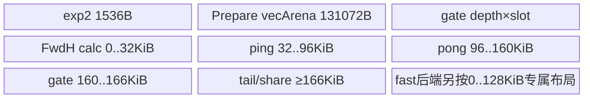
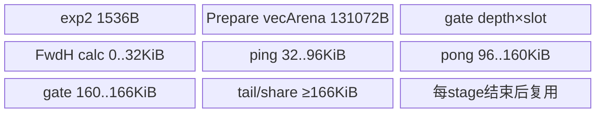

```mermaid
flowchart LR
 GM["Q/K/V,g,beta GM"] --> GU["Gate/Prepare AIV UB"]
 GU --> SW["BF16 score因子 GM"]
 SW --> L1["L1 zN/nZ ping-pong"]
 L1 --> L0["L0A/B→MMAD→L0C float"]
 L0 --> CW["Score direct UB或FP32 score/solve GM"]
 CW --> AU["AIV 三角解/cast/seed"]
 AU --> PW["PostWU推迟到fast FwdH内"]
 PW --> H1["FwdH C1/C2与FP32 state"]
 H1 --> O["fast FwdH direct UB→out"]
```

```mermaid
flowchart LR
 GM["Q/K/V,g,beta GM"] --> GU["Gate/Prepare AIV UB"]
 GU --> SW["BF16 score因子 GM"]
 SW --> L1["L1 zN/nZ ping-pong"]
 L1 --> L0["L0A/B→MMAD→L0C float"]
 L0 --> CW["Score direct UB或FP32 score/solve GM"]
 CW --> AU["AIV 三角解/cast/seed"]
 AU --> PW["Prepare::ProcessPreparedHeadPairBatchArch35"]
 PW --> H1["FwdH C1/C2与FP32 state"]
 H1 --> O["fast FwdH direct UB→out"]
```

```mermaid
flowchart LR
 GM["Q/K/V,g,beta GM"] --> GU["Gate/Prepare AIV UB"]
 GU --> SW["BF16 score因子 GM"]
 SW --> L1["L1 zN/nZ ping-pong"]
 L1 --> L0["L0A/B→MMAD→L0C float"]
 L0 --> CW[" FP32 score/solve GM"]
 CW --> AU["AIV 三角解/cast/seed"]
 AU --> PW["RunChunkKdaPostWu"]
 PW --> H1["FwdH C1/C2与FP32 state"]
 H1 --> O["fast FwdH direct UB→out"]
```

```mermaid
flowchart LR
 GM["Q/K/V,g,beta GM"] --> GU["Gate/Prepare AIV UB"]
 GU --> SW["BF16 score因子 GM"]
 SW --> L1["L1 zN/nZ ping-pong"]
 L1 --> L0["L0A/B→MMAD→L0C float"]
 L0 --> CW["Score direct UB或FP32 score/solve GM"]
 CW --> AU["AIV 三角解/cast/seed"]
 AU --> PW["RunChunkKdaPostWu"]
 PW --> H1["FwdH C1/C2与FP32 state"]
 H1 --> O["Finalize GM双plane→UB→out"]
```

```mermaid
flowchart LR
 GM["Q/K/V,g,beta GM"] --> GU["Gate/Prepare AIV UB"]
 GU --> SW["BF16 score因子 GM"]
 SW --> L1["L1 zN/nZ ping-pong"]
 L1 --> L0["L0A/B→MMAD→L0C float"]
 L0 --> CW[" FP32 score/solve GM"]
 CW --> AU["AIV 三角解/cast/seed"]
 AU --> PW["RunChunkKdaPostWu"]
 PW --> H1["FwdH C1/C2与FP32 state"]
 H1 --> O["Finalize GM双plane→UB→out"]
```

# 分块 KDA 前向 950 ACLNN 算子知识

## 算子速览

| 项目 | 内容 |
|---|---|
| 实际入口 | 公开 ACLNN pair：aclnnSglChunkKdaFwdGetWorkspaceSize / aclnnSglChunkKdaFwd；OpType SglChunkKdaFwd，当前固定版本 |
| 计算语义 | 带逐 K 通道保留门的 chunk Kimi Delta Attention 前向：累计门、因果系数与下三角解、W/U 变换、FP32 递归状态、输出重建 |
| 输入输出 | Q/K/V BF16；g、beta 各自 BF16 或 FP32；状态 FP32；C=64/128；K/V∈[16,256] 且为16倍数；固定11槽输出 |
| 执行类型 | 一个 sgl_chunk_kda_fwd launch，KERNEL_TYPE_MIX_AIC_1_2；AIC_CUBE 与两个 AIV_VECTOR，950 的部分 Vector 使用 RegBase；没有 SIMT/通信/独立 NDDMA kernel |
| Kernel 路线 | 下文完整管线族及其显式 Gate、beta、尾块、scheduler 子选择；五个逻辑阶段不能写成五次 Host launch |
| 核心资源 | GM 正式输出和512字节对齐 workspace；私有 L1/L0A/L0B/L0C 与 AIV UB；Prepare score/solve、FwdH 状态轮转、Finalize FP32 双平面 |
| 来源闭包 | source_closed：公开约束→Python/C++ adapter→动态 ACLNN pair→OpDef/Infer/Tiling→共享 POD→entry→逐阶段及本地 vendored TLA/CATLASS 当前实例→构建接线。generated ACLNN bridge 与硬件原语是框架边界 |
| 复用风险 | draft。源码可追溯不等于正确：Host 对 cu_seqlens 的 dtype 校验晚于 int64 读取；变长空序列的 state 索引与原序号可能分离；Device 地址存在 uint32 窄化；950 另有直接 Score guard 与初始化风险。仅为静态事实，不保证所有公开输入可安全运行 |
| 验证状态 | 已完成源码闭包检查；本次知识提取未执行编译、真机、数值或性能测试 |

## 接口与语义

### 计算语义

令 B 为 batch，T 为 token 数，H 为 Q/K 头数，HV 为 V/g/beta 头数，K、V 为通道宽，C 为 chunk_size，m 为当前块有效 token 数。V 头 hv 对应 Q/K 头 floor(hv/(HV/H))。内部序列轴布局以 head-major 为主；BSND 输入用 inputSequenceMajor 保留原序列步幅。逐块且逐序列计算，状态轴为 **[K,V]**。

g 已是自然对数衰减时直接使用。use_gate_in_kernel=true 时先令 z=g+可选 dt_bias，然后 unsafe 为 -exp(a_log)*softplus(z)，safe 为 lower_bound*sigmoid(exp(a_log)*z)。softplus 使用稳定 max/log1p-exp 形式；beta 已激活，不额外 sigmoid。Gate 保存 G_i=sum_{r=0..i}g_r/ln(2)，每块重新从0累计，后续用 exp(G*ln(2)) 实现 exp2。safe_gate 在 g 已预处理时仍选择不同三角解实现，不能把它当作仅控制激活的标志。

以当前块局部行 i,j 表示，概念等价关系为：

```text
qg_i = BF16(Q_i * exp2(G_i))
Wseed_i = BF16(beta_i * BF16(K_i * exp2(G_i)))
Useed_i = BF16(beta_i * V_i)
L_ij = beta_i * sum_d K_i,d*K_j,d*exp2(G_i,d-G_j,d), j<i；其余为0
A = (I+L)^(-1)                     # 严格下三角结构，不是一般矩阵求逆接口
aqk_ij = BF16(scale * sum_d Q_i,d*K_j,d*exp2(G_i,d-G_j,d)), j<=i
akk = BF16(A)
w=BF16(akk@Wseed); u=BF16(akk@Useed)
kg_i=BF16(K_i*exp2(G_last-G_i))；最后有效行可直接拷 K
v_new=BF16(u-w@BF16(h_enter))
h_next=exp2(G_last)[:,None]*h_enter + kg.T@v_new
attn_out=BF16(scale*(qg@BF16(h_enter)) + aqk@v_new)
```

这是理解各中间量的符号公式，实际 score 因子先 BF16 化、Cube FP32 累加，三角解局部 FP32 算式与输出 cast 顺序以 Device 段为准，不能承诺与一次全 FP32 公式逐位一致。qgScaled 的名称不表示它已乘 scale；跨块项在 Finalize/fast FwdH 乘 scale，aqk 已含 scale。不能对最终和再次统一乘 scale。普通指数 clamp 为 [-80,80]；score BF16 因子使用特殊 [-126,120] 的 base2 限幅。初始/持续 state 为 FP32，但 Cube 消费 BF16 entering h；导出的 h 为 BF16 快照。

safe 路线先对16阶对角块做前代，再用 Cube 合并32/64/128阶块。unsafe full 路线对16阶对角块做3轮有限多项式迭代（X←X+XY，Y←Y²）再合并；950 unsafe tail 改用可见的精确对角前代。均保留该固定源码的精度边界，没有另外调用外部 TriInv 核心算子。

### 输入、输出与属性

| 参数 | shape/layout | dtype | 约束、默认值与语义 |
|---|---|---|---|
| q | BSND[B,T,H,K]；BNSD[B,H,T,K]；TND[T,H,K]；NTD[H,T,K] | BF16 | 与 k shape 相同；H>0，H、HV≤128；K为16倍数且16..256 |
| k | 同 q | BF16 | 同 q；按 hv→h 映射共享 |
| v | 相同布局，头数HV，宽V | BF16 | HV 是 H 的整数倍；V为16倍数且16..256 |
| g | 相同布局，头数HV，宽K | FP32/BF16 | 逐通道已处理 log decay 或 raw gate |
| beta | v 去最后一维 | FP32/BF16 | 与 g 的 dtype 独立；已经激活 |
| a_log | [HV] | FP32/None | raw gate 必需；adapter 检查 dtype，未完整检查此 shape |
| dt_bias | [HV*K] | FP32/None | raw gate 可选加性偏置；adapter 未完整检查此 shape |
| initial_state | [N,HV,K,V]；state_v_first 时 [N,HV,V,K] | FP32/None | N=dense B 或 packed 序列数；None 表示零 |
| cu_seqlens | [N+1] | int64/None | 起点0、终点T、非递减、N≤1024；公开 packed 生产约束 B=1；空序列虽通过非递减校验，却触发下文索引风险 |
| chunk_indices | [total_chunks,2] 或 flat view | int64/None | 依赖 cu_seqlens；应为按序列顺序排列的 canonical(seq_id,local_chunk)；Device 检查范围但不证明唯一、完整和顺序 |
| layout | 字符串 | BSND/BNSD/TND/NTD | 默认BSND；rank3由 adapter 归一化；输出out总为sequence-major |
| scale | scalar | Host double→POD float | 默认1；通常K^-0.5；源码不作有限性保证 |
| chunk_size | scalar | int64 | 默认64；只能64或128 |
| safe_gate | scalar | bool | 默认false；同时影响激活和三角解族 |
| lower_bound | scalar | double→float | 默认-5；仅 use_gate_in_kernel && safe_gate 时要求[-5,0) |
| use_gate_in_kernel | scalar | bool | 默认false；true要求a_log；beta不变 |
| state_v_first | scalar | bool | 默认false；adapter交换state最后两维后 contiguous，返回再交换 |
| output_final_state | scalar | bool | 默认true；false仍需要内部FP32 recurrence storage |
| output_gk | scalar | bool | 默认false；控制槽2是否导出 |
| output_w | scalar | bool | 默认false；控制槽5是否导出 |
| output_u | scalar | bool | 默认false；控制槽6是否导出 |
| output_qg | scalar | bool | 默认false；控制槽7是否导出，并参与950融合选择 |
| output_kg | scalar | bool | 默认false；控制槽8是否导出 |
| output_v_new | scalar | bool | 默认false；控制槽9是否导出，并参与950融合选择 |
| output_h | scalar | bool | 默认false；控制槽10是否导出，并参与950融合选择 |
| 槽0 attn_out | [B,T,HV,V] 或[T,HV,V] | BF16 | 总是返回；BNSD/NTD输入也不改变此输出布局 |
| 槽1 final_state | [N,HV,K,V] 或V,K | FP32/None | 由output_final_state控制 |
| 槽2 gk | [B,HV,T,K] 或[HV,T,K] | FP32/None | chunk-local log2累计门 |
| 槽3 aqk | [B,HV,T,C] 或[HV,T,C] | BF16 | 总是返回；含对角的因果系数、含scale |
| 槽4 akk | 同aqk | BF16 | 总是返回；已求解三角变换 |
| 槽5 w | [B,HV,T,K] 或[HV,T,K] | BF16/None | 输出开关只决定存储owner |
| 槽6 u | [B,HV,T,V] 或[HV,T,V] | BF16/None | 同上 |
| 槽7 qg | 同w | BF16/None | Q乘exp2(G) |
| 槽8 kg | 同w | BF16/None | K衰减到chunk末 |
| 槽9 v_new | 同u | BF16/None | 经过进入state校正的值 |
| 槽10 h | [B,NC,HV,K,V] 或[NC,HV,K,V] | BF16/None | 进入每块的state；state_v_first交换K/V；内部head-major由adapter permute导出 |

### 入口与版本

[公开接口卡](../../../../apis/sgl_kernel_npu/sgl_chunk_kda_fwd.md)保留完整参数说明。这里闭合其 native ACLNN 实现；Python impl=auto/ascendc 经 torch.ops.npu.chunk_kda_fwd 进入相同 C++ adapter，torch_native 是另一个实现，未冒充本 Device Route。旧 CATLASS 集成 Guide 来自不同上游与版本，它的 FP16、返回元组数量、mode4/独立flags等内容不能移植成此入口的事实。

文档 ARCH22/ARCH35 均 Supported；本地 CMake SUPPORTED_ARCHS 2201 3510、架构映射、OpDef AddConfig 与 Host selector 提供落地证据。CANN9.1.0 来自固定 README 与 CI 配置，仅是本次源码知识范围，没有实际安装或运行验证。

## Host/Launcher 执行流程

### 参数校验与前处理

顺序为 defined→C=64/128→layout枚举→Q/K/V BF16、g/beta FP32/BF16及可选state/gate参数dtype→raw gate必需a_log→ResolveShapeInfo/rank/布局轴匹配/CountChunks→头数与K/V范围→q/k同形及seqlen/chunk数→cu/chunk元数据检查→safe raw gate的lower_bound→initial_state shape检查→布局归一化→创建固定11槽输出→构造ACL描述符→query→workspace→launch→返回布局恢复。TORCH_CHECK 抛异常后不进入后继调用。

CountChunks 在 cu_seqlens 的 int64 校验之前把其 CPU contiguous 存储 reinterpret_cast<const int64_t*>，并按原 numel 访问。错误dtype可能越界读取；后续检查不能追溯修复。packed batch 检查实际写成 !isRank3 || info.batch==1，rank4 B>1被放过；公开 B=1约束仍必须遵守。NTD 的归一化仅 reshape，没有统一 contiguous，非连续输入可能在 runtime tensor_descriptor 被拒绝；BSND/BNSD、TND路径有各自明确 contiguous/transpose。

cu 元数据复制到 Host 用于计数并检查0/末尾/非递减；用户chunk_indices存在时检查int64与元素数，但不验证 canonical 无重复/顺序。state_v_first在调用前交换末两轴。BSND q/k/v/g保持sequenceMajor；beta转head-major；BNSD保持head-major；TND转头主序加B=1；NTD reshape加B=1。a_log、dt_bias缺少完整shape检查，同device约束不应从同一个q推断。

直接调用 ACLNN 时，OpDef 提供类型/可选输入/属性schema，Tiling主要相信23个业务属性；它并未重复 adapter 全部shape校验。调用者必须使属性、tensor尺寸、rank、可选输入与公开有效域一致。generated inner bridge、普通 descriptor/contiguous 和错误码是框架边界，不推断其隐藏算法。

### 参数、Workspace 与生命周期

定义 X=B*HV*T，D=launch AIC blockDim，S=N*HV*K*V，HC=isVarLen?totalChunks:B*totalChunks，A512(x)=ceil(x/512)*512。以下所有offset为**字节**，tensor内索引为元素。分配函数先把cursor向512对齐，记录offset，然后cursor+=bytes；不可把逻辑长度代替物理分配。store=true时正式输出拥有storage，POD对应offset=0但不读它；store=false时指向userWorkspace+offset。

| slice | 分配字节 | producer→consumer与生命周期 |
|---|---:|---|
| gkStorage | storeGk?0:4XK | Gate/Prepare→Prepare/PostWU/FwdH；到末次消费 |
| finalStateStorage | storeFinalState?0:4S | FP32 initial/updated recurrence→下一块；最终可不导出仍需存在 |
| wStorage | storeW?0:2XK | Prepare seed或PostWU→FwdH |
| uStorage | storeU?0:2XV | PostWU→FwdH；融合时也作为Useed |
| qgStorage | storeQG?0:2XK | Prepare→可选输出；qgScaled另有必需副本 |
| kgStorage | storeKg?0:2XK | Prepare/PostWU→FwdH |
| vNewStorage | storeVNew?0:(denseFast?2BHV*C*V:2XV) | FwdH→Finalize；denseFast内部仅需一块容量 |
| hStorage | storeH?0:(denseFast?2BHV*K*V:2HC*HV*K*V) | FwdH进入状态BF16→Finalize；denseFast可不物化全序列 |
| qgScaled | 2XK | Prepare→Finalize/fast FwdH，无scale预乘 |
| prepareAqkFp32 | 4XC | Prepare score→AIV精度处理/aqk |
| prepareAkkFp32 | 4XC | Prepare score→三角解 |
| prepareScratch | A512(4D*(safe?4:1)*5*C²)+2D*4*3*C*K | 每core solve五平面×depth，加4个score slot×Qpos/Kpos/Kneg三平面 |
| postWuScratch | !fusePost&&!fuseIntoH ? 4BHV*totalChunks*C*K :0 | A2 W FP32物化；950无融合时先放BF16 Wseed，避免覆盖尚未消费seed；按padded chunk而非packed token计 |
| fwdHWorkspace | 各slice分别A512；见下 | 相对于fwdHWorkspaceBaseOffset，两个stream容量始终保留 |
| outputScratch | 8XV | FrontEnd临时Useed占其中BF16部分，全部FrontEnd/FwdH结束后复用为Finalize两个FP32平面 |
| system workspace | platform.GetLibApiWorkSpaceSize() | SDK owner；GetUserWorkspace剥离前缀 |

fwdH 相对cursor依次为 vWorkspace=8D*C*V，vUpdateWorkspace=8D*C*V，kDecayWorkspace=8D*C*K，hWorkspace=8D*K*V，numSeq=8*(tokenBatch+1)，numChunks=8*(tokenBatch+1)，tokenBatch=isVarLen?N:1。vUpdate/kDecay实际BF16消费，但Host按float×2留量，不能因此缩小分配。尾部主cursor=fwdHBase+A512(fwdHCursor)，再分配outputScratch。total=system+A512(outputScratchOffset+8XV)。源码没有检查乘法溢出、uint64→int64偏移或Device uint32窄化。

C++ adapter query生成executor/workspaceSize；当前NPU stream传给launch，workspace由NPU caching allocator DataPtr持有，lambda捕获输入、归一化tensor和输出，executor由runtime helper管理。必须保持输入、POD backing、workspace和输出到stream完成，不可因API返回就回收裸地址。query/launch非成功TORCH_CHECK，不会合法返回完整结果。输出h最终permute成公开轴序；未请求的槽为None。

### 启动图与失败传播

```mermaid
flowchart LR
 P["Python/torch adapter"] --> Q["ACLNN GetWorkspaceSize: executor + Tiling"]
 Q --> L["ACLNN execute: 一个 sgl_chunk_kda_fwd MIX_AIC_1_2"]
 L --> G["Gate: AIV"]
 G --> B["SyncAll"]
 B --> R["Prepare: AIC score/solve + AIV gate/cast"]
 R --> B2["SyncAll + pipe.Reset"]
 B2 --> W["PostWU: AIC完整块/AIV尾块"]
 W --> B3["SyncAll + pipe.Reset"]
 B3 --> H["FwdH: AIC/AIV逐序列状态"]
 H --> B4["SyncAll"]
 B4 --> O["Finalize: AIC乘积/AIV输出"]
```



图是未融合逻辑路线；950由明确Host选项删除Gate或PostWU阶段边，fast dense FwdH内部生成最终out且直接return，不再调用generic Finalize。所有阶段仍在同一MIX launch。AIC:AIV=1:2，由KERNEL_TASK_TYPE_DEFAULT定义；Gate usedCoreNum=2D，其他usedCoreNum=D。Tiling key实际0，entry从C/K/V字段选择<64,128,128>或<0,0,0>，注释“key2”不构成真实TilingKey=2。POD复制为alignas(8)的41个uint64字，sizeof328；未知/损坏字段没有安全default Route。

## Route 与参数设计

### 分核与资源计算

先从layout得到B/T/H/HV/K/V，再确定N、totalChunks、rawg/beta dtype与输出标志。A2/A3 D=max(AIC物理核数,1)；950 D=min(物理核数,max((isVarLen?N:B)*HV,1))。Gate以2D个AIV处理dense B*HV*ceil(T/C)块；packed以N*HV个序列任务串行枚举该序列的chunks。Prepare/PostWU/Finalize以chunk×HV任务stride D分配，一个AIC对应两个AIV行分片；950 head-pair把相邻两个HV头配成一个AIC任务，一个AIV负责一个头。

FwdH不能跨同一序列/头的chunk并行推进。generic scheduler从cu推导序列与chunk前缀、按V block分配；950两个stream只在taskNum>D时均活跃；A2虽声明depth2，当前只启用stream0，其余flags仍初始化/排空。device scheduler压缩空序列，而state offset按压缩后的batchIdx计算，存在原始state序号丢失的风险。chunk_indices用于FrontEnd/Finalize的ResolveChunkRange，不支配FwdH scheduler，必须canonical一致。

当前 local ArchTag 资源上界：AtlasA2/A3 UB=192KiB、L1=512KiB、L0A/B各64KiB、L0C=128KiB；Ascend950 UB=248KiB、L1=512KiB、L0A/B各64KiB、L0C=256KiB。Resource为当前scope持有整个local tensor buffer；实际占用要按各阶段切片计，不把各阶段求和为并发容量。pipe.Reset/Destroy、作用域析构与SyncAll共同限定复用；Resource构造中显式处理TPipe，不可另插隐式同步假设。

### Route 选择

F=(C64 && K128 && V128)，dense=(!isVarLen && T%C==0)，Gfuse=(gFP32 && hasALog && useGateInKernel && safeGate)，均按Host布尔关系。950选项先要求F与平台950；A2/A3四选项全false。下表按互斥完整管线谓词排列；表后每个Route另保持公共执行流程列出的G/B/M/H子选择，不把dtype或tail差异删掉。

| 顺序 | Route | Key/模板 | 精确选择条件与优先级 | 不适用去向 |
|---:|---|---|---|---|
| 1 | R-001 raw Gate 与 PostWU 融入 FwdH | key0；SAFE=true；COMPILE=64,128,128 | F && dense && safeGate && HV%2==0 && Gfuse && !storeQG && !storeVNew && !storeH | 下一互斥行；无效接口参数失败 |
| 2 | R-002 raw Gate 与 Prepare 内 PostWU | key0；SAFE=true；COMPILE=64,128,128 | F && dense && safeGate && HV%2==0 && Gfuse && (storeQG || storeVNew || storeH) | 下一互斥行；无效接口参数失败 |
| 3 | R-003 独立 Gate 与 Prepare 内 PostWU | key0；SAFE=true；COMPILE=64,128,128 | F && dense && safeGate && HV%2==0 && !Gfuse | 下一互斥行；无效接口参数失败 |
| 4 | R-004 raw Gate 与奇数头独立 PostWU | key0；SAFE=true；COMPILE=64,128,128 | F && dense && safeGate && HV%2!=0 && Gfuse | 下一互斥行；无效接口参数失败 |
| 5 | R-005 独立 Gate 与奇数头独立 PostWU | key0；SAFE=true；COMPILE=64,128,128 | F && dense && safeGate && HV%2!=0 && !Gfuse | 下一互斥行；无效接口参数失败 |
| 6 | R-006 非安全门 dense 专属后端 | key0；SAFE=false；COMPILE=64,128,128 | F && dense && !safeGate | 下一互斥行；无效接口参数失败 |
| 7 | R-007 raw Gate 的典型非 dense 后端 | key0；SAFE=true；COMPILE=64,128,128 | F && !dense && Gfuse | 下一互斥行；无效接口参数失败 |
| 8 | R-008 安全门典型非 dense 后端 | key0；SAFE=true；COMPILE=64,128,128 | F && !dense && safeGate && !Gfuse | 下一互斥行；无效接口参数失败 |
| 9 | R-009 非安全门典型非 dense 后端 | key0；SAFE=false；COMPILE=64,128,128 | F && !dense && !safeGate | 下一互斥行；无效接口参数失败 |
| 10 | R-010 动态 shape 安全偶数头窄 V | key0；SAFE=true；COMPILE=0,0,0 | !F && safeGate && HV%2==0 && V<=128 | 下一互斥行；无效接口参数失败 |
| 11 | R-011 动态 shape 安全奇数头窄 V | key0；SAFE=true；COMPILE=0,0,0 | !F && safeGate && HV%2!=0 && V<=128 | 下一互斥行；无效接口参数失败 |
| 12 | R-012 动态 shape 非安全门窄 V | key0；SAFE=false；COMPILE=0,0,0 | !F && !safeGate && V<=128 | 下一互斥行；无效接口参数失败 |
| 13 | R-013 动态 shape 安全偶数头宽 V | key0；SAFE=true；COMPILE=0,0,0 | !F && safeGate && HV%2==0 && V>128 | 下一互斥行；无效接口参数失败 |
| 14 | R-014 动态 shape 安全奇数头宽 V | key0；SAFE=true；COMPILE=0,0,0 | !F && safeGate && HV%2!=0 && V>128 | 下一互斥行；无效接口参数失败 |
| 15 | R-015 动态 shape 非安全门宽 V | key0；SAFE=false；COMPILE=0,0,0 | !F && !safeGate && V>128 | 下一互斥行；无效接口参数失败 |

```text
合法API输入→Host D与storage参数
 if F: COMPILE=64,128,128；else COMPILE=0,0,0
 SAFE_GATE依safeGate选择true/false
 若950&&F：先算Gfuse；dense时fast FwdH
   safe&&HV偶数&&Gfuse&&!storeQG&&!storeVNew&&!storeH → Post入FwdH
   否则safe&&HV偶数 → Post入Prepare
   其他 → 独立Post
   !dense → generic FwdH + Finalize；只可省独立Gate
 若!F → generic全五阶段，headPair依safe&&HV偶数；后端bounded/multi依varlen或T%C
 所有阶段再用layout、G/B、m和metadata的显式子选择
```

### 模板/实现执行矩阵

| Route | key/selector | dtype/shape/platform 完整命中条件 | 执行族与 kernel 节点 | 实际模板/body | 内存与同步特征 | tail/fallback |
|---|---|---|---|---|---|---|
| R-001 raw Gate 与 PostWU 融入 FwdH | key0；F/SAFE/融合位 | 950；F && dense && safeGate && HV%2==0 && Gfuse && !storeQG && !storeVNew && !storeH；QKV BF16；g/beta各自FP32/BF16，G/B子表保持 | 单MIX_CV；Prepare内Gate→Prepare AIC/AIV→FwdH内Post→专属FwdH含out | COMPILE64,128,128；SAFE=true；ChunkKdaFwdFwdH | solveDepth4；direct UB/L1 flags8/9；逐route资源表 | Host拒绝此路线tail/varlen，改generic |
| R-002 raw Gate 与 Prepare 内 PostWU | key0；F/SAFE/融合位 | 950；F && dense && safeGate && HV%2==0 && Gfuse && (storeQG || storeVNew || storeH)；QKV BF16；g/beta各自FP32/BF16，G/B子表保持 | 单MIX_CV；Prepare内Gate→Prepare AIC/AIV→Prepare内Post→专属FwdH含out | COMPILE64,128,128；SAFE=true；ChunkKdaFwdFwdH | solveDepth4；direct UB/L1 flags8/9；逐route资源表 | Host拒绝此路线tail/varlen，改generic |
| R-003 独立 Gate 与 Prepare 内 PostWU | key0；F/SAFE/融合位 | 950；F && dense && safeGate && HV%2==0 && !Gfuse；QKV BF16；g/beta各自FP32/BF16，G/B子表保持 | 单MIX_CV；AIV Gate→Prepare AIC/AIV→Prepare内Post→专属FwdH含out | COMPILE64,128,128；SAFE=true；ChunkKdaFwdFwdH | solveDepth4；direct UB/L1 flags8/9；逐route资源表 | Host拒绝此路线tail/varlen，改generic |
| R-004 raw Gate 与奇数头独立 PostWU | key0；F/SAFE/融合位 | 950；F && dense && safeGate && HV%2!=0 && Gfuse；QKV BF16；g/beta各自FP32/BF16，G/B子表保持 | 单MIX_CV；Prepare内Gate→Prepare AIC/AIV→PostWU→专属FwdH含out | COMPILE64,128,128；SAFE=true；ChunkKdaFwdFwdH | solveDepth4；direct UB/L1 flags8/9；逐route资源表 | Host拒绝此路线tail/varlen，改generic |
| R-005 独立 Gate 与奇数头独立 PostWU | key0；F/SAFE/融合位 | 950；F && dense && safeGate && HV%2!=0 && !Gfuse；QKV BF16；g/beta各自FP32/BF16，G/B子表保持 | 单MIX_CV；AIV Gate→Prepare AIC/AIV→PostWU→专属FwdH含out | COMPILE64,128,128；SAFE=true；ChunkKdaFwdFwdH | solveDepth4；direct UB/L1 flags8/9；逐route资源表 | Host拒绝此路线tail/varlen，改generic |
| R-006 非安全门 dense 专属后端 | key0；F/SAFE/融合位 | 950；F && dense && !safeGate；QKV BF16；g/beta各自FP32/BF16，G/B子表保持 | 单MIX_CV；AIV Gate→Prepare AIC/AIV→PostWU→专属FwdH含out | COMPILE64,128,128；SAFE=false；ChunkKdaFwdFwdH | solveDepth1；direct UB/L1 flags8/9；逐route资源表 | Host拒绝此路线tail/varlen，改generic |
| R-007 raw Gate 的典型非 dense 后端 | key0；F/SAFE/融合位 | 950；F && !dense && Gfuse；QKV BF16；g/beta各自FP32/BF16，G/B子表保持 | 单MIX_CV；Prepare内Gate→Prepare AIC/AIV→PostWU→generic FwdH→Finalize | COMPILE64,128,128；SAFE=true；KdaFwdHKernel<bf16,float,float,float,Shapes128,true,false,true> | solveDepth4；GM交接或950 mode4 direct；逐route资源表 | m<C Post Vector；m<16 FwdH Vector；950 tiny Finalize Vector |
| R-008 安全门典型非 dense 后端 | key0；F/SAFE/融合位 | 950；F && !dense && safeGate && !Gfuse；QKV BF16；g/beta各自FP32/BF16，G/B子表保持 | 单MIX_CV；AIV Gate→Prepare AIC/AIV→PostWU→generic FwdH→Finalize | COMPILE64,128,128；SAFE=true；KdaFwdHKernel<bf16,float,float,float,Shapes128,true,false,true> | solveDepth4；GM交接或950 mode4 direct；逐route资源表 | m<C Post Vector；m<16 FwdH Vector；950 tiny Finalize Vector |
| R-009 非安全门典型非 dense 后端 | key0；F/SAFE/融合位 | 950；F && !dense && !safeGate；QKV BF16；g/beta各自FP32/BF16，G/B子表保持 | 单MIX_CV；AIV Gate→Prepare AIC/AIV→PostWU→generic FwdH→Finalize | COMPILE64,128,128；SAFE=false；KdaFwdHKernel<bf16,float,float,float,Shapes128,true,false,true> | solveDepth1；GM交接或950 mode4 direct；逐route资源表 | m<C Post Vector；m<16 FwdH Vector；950 tiny Finalize Vector |
| R-010 动态 shape 安全偶数头窄 V | key0；F/SAFE/融合位 | 950；!F && safeGate && HV%2==0 && V<=128；QKV BF16；g/beta各自FP32/BF16，G/B子表保持 | 单MIX_CV；AIV Gate→Prepare AIC/AIV→PostWU→generic FwdH→Finalize | COMPILE0,0,0；SAFE=true；KdaFwdHKernel<bf16,float,float,float,Shapes128,true,false,true> | solveDepth4；GM交接或950 mode4 direct；逐route资源表 | m<C Post Vector；m<16 FwdH Vector；950 tiny Finalize Vector |
| R-011 动态 shape 安全奇数头窄 V | key0；F/SAFE/融合位 | 950；!F && safeGate && HV%2!=0 && V<=128；QKV BF16；g/beta各自FP32/BF16，G/B子表保持 | 单MIX_CV；AIV Gate→Prepare AIC/AIV→PostWU→generic FwdH→Finalize | COMPILE0,0,0；SAFE=true；KdaFwdHKernel<bf16,float,float,float,Shapes128,true,false,true> | solveDepth4；GM交接或950 mode4 direct；逐route资源表 | m<C Post Vector；m<16 FwdH Vector；950 tiny Finalize Vector |
| R-012 动态 shape 非安全门窄 V | key0；F/SAFE/融合位 | 950；!F && !safeGate && V<=128；QKV BF16；g/beta各自FP32/BF16，G/B子表保持 | 单MIX_CV；AIV Gate→Prepare AIC/AIV→PostWU→generic FwdH→Finalize | COMPILE0,0,0；SAFE=false；KdaFwdHKernel<bf16,float,float,float,Shapes128,true,false,true> | solveDepth1；GM交接或950 mode4 direct；逐route资源表 | m<C Post Vector；m<16 FwdH Vector；950 tiny Finalize Vector |
| R-013 动态 shape 安全偶数头宽 V | key0；F/SAFE/融合位 | 950；!F && safeGate && HV%2==0 && V>128；QKV BF16；g/beta各自FP32/BF16，G/B子表保持 | 单MIX_CV；AIV Gate→Prepare AIC/AIV→PostWU→generic FwdH→Finalize | COMPILE0,0,0；SAFE=true；KdaFwdHKernel<bf16,float,float,float,Shapes256,true,false,true> | solveDepth4；GM交接或950 mode4 direct；逐route资源表 | m<C Post Vector；m<16 FwdH Vector；950 tiny Finalize Vector |
| R-014 动态 shape 安全奇数头宽 V | key0；F/SAFE/融合位 | 950；!F && safeGate && HV%2!=0 && V>128；QKV BF16；g/beta各自FP32/BF16，G/B子表保持 | 单MIX_CV；AIV Gate→Prepare AIC/AIV→PostWU→generic FwdH→Finalize | COMPILE0,0,0；SAFE=true；KdaFwdHKernel<bf16,float,float,float,Shapes256,true,false,true> | solveDepth4；GM交接或950 mode4 direct；逐route资源表 | m<C Post Vector；m<16 FwdH Vector；950 tiny Finalize Vector |
| R-015 动态 shape 非安全门宽 V | key0；F/SAFE/融合位 | 950；!F && !safeGate && V>128；QKV BF16；g/beta各自FP32/BF16，G/B子表保持 | 单MIX_CV；AIV Gate→Prepare AIC/AIV→PostWU→generic FwdH→Finalize | COMPILE0,0,0；SAFE=false；KdaFwdHKernel<bf16,float,float,float,Shapes256,true,false,true> | solveDepth1；GM交接或950 mode4 direct；逐route资源表 | m<C Post Vector；m<16 FwdH Vector；950 tiny Finalize Vector |

### 隐藏性能 Guard

| Guard | Host/Tiling 条件 | Device/资源原因 | 影响 Route | 不满足时去向 | 源码符号 |
|---|---|---|---|---|---|
| BF16 native | q/k/v BF16 | Copy/Mmad与手工packed格式绑定2字节 | 全部 | TORCH_CHECK/OpDef不匹配 | torch_adapter / OpDef |
| H/HV与K/V | H、HV≤128，HV%H=0；K/V16..256且16倍数 | 分组映射、32B DMA、L0容量、固定UB | 全部 | adapter失败；直接ACLNN不得伪造属性 | ResolveShapeInfo/chunk_kda_fwd |
| C64/128 | chunkSize只能两值 | solve scratch与层次合并、score stride | 全部 | adapter失败 | chunk_kda_fwd |
| raw safe | useGate&&safe→aLog必需、bound[-5,0) | 有界门激活；不能外推任意输入为有限值 | G2 | 不满足抛异常 | adapter/Gate |
| compile shape | C64 K128 V128 | 典型packed、RegBase、direct UB固定宽度 | F路线 | COMPILE0动态族 | entry useFastPath |
| dense fast | 950&&F&&!varlen&&T%C0 | 专属循环固定m64、serial UB state | H950-dense | generic后端 | ConfigureChunkKdaFwdArch35 |
| head pair/fuse | safe&&HV偶数；fuseIntoH再需Gfuse且3导出标志全false | 一AIV一头、两lane，降低物化但换owner与handshake | 950安全路线 | odd分行/独立Post；额外输出改Prepare fusion | arch35 options / headPairMode |
| V宽 | V>128 | 128×256×64 L0、UB按16行 | H256 | H128 | RunGenericBackEnd |
| local静态容量 | template static_assert | L1/L0逐stage乘depth；不含外加L1 base的断言不代表总base安全 | Cube当前实例 | 编译拒绝，无动态资源fallback | BlockMmadTla |
| tiny m | m<16 | 低reduction Cube替代、实际shape/UB mask | FwdH/950输出 | 正常Cube；A2输出保留自身实现 | Process/Finalize |
| packed metadata | cu canonical、N≤1024、B=1 | FrontEnd与FwdH调度来源不同；固定stack/元数据容量 | packed | adapter部分检查；非canonical无安全fallback | ResolveChunkRange / scheduler |
| 地址位宽 | Host int64/uint64→Device uint32 | workspace/tensor offset可截断 | 全部generic | 无guard，应由复用者额外约束；本卡不宣称已修 | InitFromData/GetOffsets |
| 完成/复用 | flags与SyncAll完整drain | score/solve、输出scratch、TPipe local布局重叠 | 全部 | 无可证明安全跳过 | RunFrontEnd/Resource |

### POD/ABI

以下ABI为固定结构声明与 pack(8) 的静态推导，采用目标常规 int64/float/bool=8/4/1字节、int64对齐8；未进行sizeof/offsetof编译测量。ChunkKdaFwdTilingData sizeof=328、alignof=8；float后19个bool末尾补5字节。Host ComputeChunkKdaFwdTilingData先memset清零再赋值，Device entry逐uint64复制。字段单位与相对基址不得混淆。

| 结构 | 字段 | 类型/位宽 | ABI 布局 | 单位 | Host/launcher producer | Device consumer | 边界 |
|---|---|---|---|---|---|---|---|
| ChunkKdaFwdTilingData | batch | int64/64 | offsetof=0 | B | batch | 所有阶段地址分解 | 合法域见接口/selector；非活跃可选值不得当成有效指针 |
| ChunkKdaFwdTilingData | seqNum | int64/64 | offsetof=8 | N | seqNum | packed task与state维 | 合法域见接口/selector；非活跃可选值不得当成有效指针 |
| ChunkKdaFwdTilingData | qHeadNum | int64/64 | offsetof=16 | H | hNum | Prepare映射hv→h | 合法域见接口/selector；非活跃可选值不得当成有效指针 |
| ChunkKdaFwdTilingData | vHeadNum | int64/64 | offsetof=24 | HV | hvNum | 全阶段头维 | 合法域见接口/selector；非活跃可选值不得当成有效指针 |
| ChunkKdaFwdTilingData | seqlen | int64/64 | offsetof=32 | T | seqlen | token域 | 合法域见接口/selector；非活跃可选值不得当成有效指针 |
| ChunkKdaFwdTilingData | kHeadDim | int64/64 | offsetof=40 | K | kDim | 向量宽、Cube K | 合法域见接口/selector；非活跃可选值不得当成有效指针 |
| ChunkKdaFwdTilingData | vHeadDim | int64/64 | offsetof=48 | V | vDim | 状态/输出宽 | 合法域见接口/selector；非活跃可选值不得当成有效指针 |
| ChunkKdaFwdTilingData | chunkSize | int64/64 | offsetof=56 | C | chunkSize | chunk/tile/solve | 合法域见接口/selector；非活跃可选值不得当成有效指针 |
| ChunkKdaFwdTilingData | totalChunks | int64/64 | offsetof=64 | NC | totalChunks | dense每batch或packed全局块数 | 合法域见接口/selector；非活跃可选值不得当成有效指针 |
| ChunkKdaFwdTilingData | inputRank | int64/64 | offsetof=72 | 3/4 | inputRank | Gate布局 | 合法域见接口/selector；非活跃可选值不得当成有效指针 |
| ChunkKdaFwdTilingData | scale | float/32 | offsetof=80 | 标量 | static_cast<float>(scale) | aqk和最终跨块项 | 合法域见接口/selector；非活跃可选值不得当成有效指针 |
| ChunkKdaFwdTilingData | lowerBound | float/32 | offsetof=84 | 标量 | static_cast<float>(lowerBound) | raw safe Gate | 合法域见接口/selector；非活跃可选值不得当成有效指针 |
| ChunkKdaFwdTilingData | hasInitialState | bool/8 | offsetof=88 | bool | hasInitialState | FwdH初始状态 | 合法域见接口/selector；非活跃可选值不得当成有效指针 |
| ChunkKdaFwdTilingData | isVarLen | bool/8 | offsetof=89 | bool | isVarLen | 所有range/scheduler | 合法域见接口/selector；非活跃可选值不得当成有效指针 |
| ChunkKdaFwdTilingData | safeGate | bool/8 | offsetof=90 | bool | safeGate | entry SAFE_GATE模板、Gate | 合法域见接口/selector；非活跃可选值不得当成有效指针 |
| ChunkKdaFwdTilingData | inputSequenceMajor | bool/8 | offsetof=91 | bool | sequenceMajor | 输入地址步幅 | 合法域见接口/selector；非活跃可选值不得当成有效指针 |
| ChunkKdaFwdTilingData | useGateInKernel | bool/8 | offsetof=92 | bool | useGateInKernel | Gate激活 | 合法域见接口/selector；非活跃可选值不得当成有效指针 |
| ChunkKdaFwdTilingData | hasALog | bool/8 | offsetof=93 | bool | hasALog | aLog可选地址 | 合法域见接口/selector；非活跃可选值不得当成有效指针 |
| ChunkKdaFwdTilingData | hasDtBias | bool/8 | offsetof=94 | bool | hasDtBias | bias可选地址 | 合法域见接口/selector；非活跃可选值不得当成有效指针 |
| ChunkKdaFwdTilingData | computeGateInPrepare | bool/8 | offsetof=95 | bool | arch35Options.computeGateInPrepare | RunGateCumsum跳过、Prepare materialize | 合法域见接口/selector；非活跃可选值不得当成有效指针 |
| ChunkKdaFwdTilingData | fusePostWu | bool/8 | offsetof=96 | bool | arch35Options.fusePostWu | Prepare内部PostWU；独立Post跳过 | 合法域见接口/selector；非活跃可选值不得当成有效指针 |
| ChunkKdaFwdTilingData | fusePostWuIntoFwdH | bool/8 | offsetof=97 | bool | arch35Options.fusePostWuIntoFwdH | fast FwdH处理Akk×seed；独立Post跳过 | 合法域见接口/selector；非活跃可选值不得当成有效指针 |
| ChunkKdaFwdTilingData | useDenseFwdH | bool/8 | offsetof=98 | bool | arch35Options.useDenseFwdH | arch35::Run进入fast backend | 合法域见接口/selector；非活跃可选值不得当成有效指针 |
| ChunkKdaFwdTilingData | storeFinalState | bool/8 | offsetof=99 | bool | storeFinalState | ResolveStorage/当前阶段输出owner与950 selector | false仍分配内部storage；true导出 |
| ChunkKdaFwdTilingData | storeGk | bool/8 | offsetof=100 | bool | storeGk | ResolveStorage/当前阶段输出owner与950 selector | false仍分配内部storage；true导出 |
| ChunkKdaFwdTilingData | storeW | bool/8 | offsetof=101 | bool | storeW | ResolveStorage/当前阶段输出owner与950 selector | false仍分配内部storage；true导出 |
| ChunkKdaFwdTilingData | storeU | bool/8 | offsetof=102 | bool | storeU | ResolveStorage/当前阶段输出owner与950 selector | false仍分配内部storage；true导出 |
| ChunkKdaFwdTilingData | storeQG | bool/8 | offsetof=103 | bool | storeQG | ResolveStorage/当前阶段输出owner与950 selector | false仍分配内部storage；true导出 |
| ChunkKdaFwdTilingData | storeKg | bool/8 | offsetof=104 | bool | storeKg | ResolveStorage/当前阶段输出owner与950 selector | false仍分配内部storage；true导出 |
| ChunkKdaFwdTilingData | storeVNew | bool/8 | offsetof=105 | bool | storeVNew | ResolveStorage/当前阶段输出owner与950 selector | false仍分配内部storage；true导出 |
| ChunkKdaFwdTilingData | storeH | bool/8 | offsetof=106 | bool | storeH | ResolveStorage/当前阶段输出owner与950 selector | false仍分配内部storage；true导出 |
| ChunkKdaFwdTilingData | gateDataType | int64/64 | offsetof=112 | 枚举 | gIsFp32?2:1 | RunGateCumsum float/BF16 | 合法域见接口/selector；非活跃可选值不得当成有效指针 |
| ChunkKdaFwdTilingData | gateUsedCoreNum | int64/64 | offsetof=120 | AIV核 | int64(blockDim)*2 | Gate任务stride | 合法域见接口/selector；非活跃可选值不得当成有效指针 |
| ChunkKdaFwdTilingData | prepareUsedCoreNum | int64/64 | offsetof=128 | AIC核 | blockDim | Prepare task stride/WS | 合法域见接口/selector；非活跃可选值不得当成有效指针 |
| ChunkKdaFwdTilingData | postWuUsedCoreNum | int64/64 | offsetof=136 | AIC核 | blockDim | Post task stride/WS | 合法域见接口/selector；非活跃可选值不得当成有效指针 |
| ChunkKdaFwdTilingData | outputUsedCoreNum | int64/64 | offsetof=144 | AIC核 | blockDim | Finalize task stride/WS | 合法域见接口/selector；非活跃可选值不得当成有效指针 |
| ChunkKdaFwdTilingData | gkStorageOffset | int64/64 | offsetof=152 | 字节 | ComputeChunkKdaFwdTilingData：前述同名slice的AllocateWorkspace/AlignWorkspace | ResolveAddresses/当前阶段相对于userWorkspace | 输出存储offset仅store=false活跃；其他offset按图活跃；uint32窄化无guard |
| ChunkKdaFwdTilingData | finalStateStorageOffset | int64/64 | offsetof=160 | 字节 | ComputeChunkKdaFwdTilingData：前述同名slice的AllocateWorkspace/AlignWorkspace | ResolveAddresses/当前阶段相对于userWorkspace | 输出存储offset仅store=false活跃；其他offset按图活跃；uint32窄化无guard |
| ChunkKdaFwdTilingData | wStorageOffset | int64/64 | offsetof=168 | 字节 | ComputeChunkKdaFwdTilingData：前述同名slice的AllocateWorkspace/AlignWorkspace | ResolveAddresses/当前阶段相对于userWorkspace | 输出存储offset仅store=false活跃；其他offset按图活跃；uint32窄化无guard |
| ChunkKdaFwdTilingData | uStorageOffset | int64/64 | offsetof=176 | 字节 | ComputeChunkKdaFwdTilingData：前述同名slice的AllocateWorkspace/AlignWorkspace | ResolveAddresses/当前阶段相对于userWorkspace | 输出存储offset仅store=false活跃；其他offset按图活跃；uint32窄化无guard |
| ChunkKdaFwdTilingData | qgStorageOffset | int64/64 | offsetof=184 | 字节 | ComputeChunkKdaFwdTilingData：前述同名slice的AllocateWorkspace/AlignWorkspace | ResolveAddresses/当前阶段相对于userWorkspace | 输出存储offset仅store=false活跃；其他offset按图活跃；uint32窄化无guard |
| ChunkKdaFwdTilingData | kgStorageOffset | int64/64 | offsetof=192 | 字节 | ComputeChunkKdaFwdTilingData：前述同名slice的AllocateWorkspace/AlignWorkspace | ResolveAddresses/当前阶段相对于userWorkspace | 输出存储offset仅store=false活跃；其他offset按图活跃；uint32窄化无guard |
| ChunkKdaFwdTilingData | vNewStorageOffset | int64/64 | offsetof=200 | 字节 | ComputeChunkKdaFwdTilingData：前述同名slice的AllocateWorkspace/AlignWorkspace | ResolveAddresses/当前阶段相对于userWorkspace | 输出存储offset仅store=false活跃；其他offset按图活跃；uint32窄化无guard |
| ChunkKdaFwdTilingData | hStorageOffset | int64/64 | offsetof=208 | 字节 | ComputeChunkKdaFwdTilingData：前述同名slice的AllocateWorkspace/AlignWorkspace | ResolveAddresses/当前阶段相对于userWorkspace | 输出存储offset仅store=false活跃；其他offset按图活跃；uint32窄化无guard |
| ChunkKdaFwdTilingData | qgScaledOffset | int64/64 | offsetof=216 | 字节 | ComputeChunkKdaFwdTilingData：前述同名slice的AllocateWorkspace/AlignWorkspace | ResolveAddresses/当前阶段相对于userWorkspace | 输出存储offset仅store=false活跃；其他offset按图活跃；uint32窄化无guard |
| ChunkKdaFwdTilingData | prepareAqkFp32Offset | int64/64 | offsetof=224 | 字节 | ComputeChunkKdaFwdTilingData：前述同名slice的AllocateWorkspace/AlignWorkspace | ResolveAddresses/当前阶段相对于userWorkspace | 输出存储offset仅store=false活跃；其他offset按图活跃；uint32窄化无guard |
| ChunkKdaFwdTilingData | prepareAkkFp32Offset | int64/64 | offsetof=232 | 字节 | ComputeChunkKdaFwdTilingData：前述同名slice的AllocateWorkspace/AlignWorkspace | ResolveAddresses/当前阶段相对于userWorkspace | 输出存储offset仅store=false活跃；其他offset按图活跃；uint32窄化无guard |
| ChunkKdaFwdTilingData | prepareScratchOffset | int64/64 | offsetof=240 | 字节 | ComputeChunkKdaFwdTilingData：前述同名slice的AllocateWorkspace/AlignWorkspace | ResolveAddresses/当前阶段相对于userWorkspace | 输出存储offset仅store=false活跃；其他offset按图活跃；uint32窄化无guard |
| ChunkKdaFwdTilingData | postWuScratchOffset | int64/64 | offsetof=248 | 字节 | ComputeChunkKdaFwdTilingData：前述同名slice的AllocateWorkspace/AlignWorkspace | ResolveAddresses/当前阶段相对于userWorkspace | 输出存储offset仅store=false活跃；其他offset按图活跃；uint32窄化无guard |
| ChunkKdaFwdTilingData | outputScratchOffset | int64/64 | offsetof=256 | 字节 | ComputeChunkKdaFwdTilingData：前述同名slice的AllocateWorkspace/AlignWorkspace | ResolveAddresses/当前阶段相对于userWorkspace | 输出存储offset仅store=false活跃；其他offset按图活跃；uint32窄化无guard |
| ChunkKdaFwdTilingData | fwdHWorkspaceBaseOffset | int64/64 | offsetof=264 | 字节 | ComputeChunkKdaFwdTilingData：前述同名slice的AllocateWorkspace/AlignWorkspace | ResolveAddresses/当前阶段相对于userWorkspace | 输出存储offset仅store=false活跃；其他offset按图活跃；uint32窄化无guard |
| ChunkKdaFwdTilingData | vWorkspaceOffset | int64/64 | offsetof=272 | 字节 | ComputeChunkKdaFwdTilingData：前述同名slice的AllocateWorkspace/AlignWorkspace | FwdH InitFromData相对于fwdHWorkspaceBaseOffset | 输出存储offset仅store=false活跃；其他offset按图活跃；uint32窄化无guard |
| ChunkKdaFwdTilingData | vUpdateWorkspaceOffset | int64/64 | offsetof=280 | 字节 | ComputeChunkKdaFwdTilingData：前述同名slice的AllocateWorkspace/AlignWorkspace | FwdH InitFromData相对于fwdHWorkspaceBaseOffset | 输出存储offset仅store=false活跃；其他offset按图活跃；uint32窄化无guard |
| ChunkKdaFwdTilingData | kDecayWorkspaceOffset | int64/64 | offsetof=288 | 字节 | ComputeChunkKdaFwdTilingData：前述同名slice的AllocateWorkspace/AlignWorkspace | FwdH InitFromData相对于fwdHWorkspaceBaseOffset | 输出存储offset仅store=false活跃；其他offset按图活跃；uint32窄化无guard |
| ChunkKdaFwdTilingData | hWorkspaceOffset | int64/64 | offsetof=296 | 字节 | ComputeChunkKdaFwdTilingData：前述同名slice的AllocateWorkspace/AlignWorkspace | FwdH InitFromData相对于fwdHWorkspaceBaseOffset | 输出存储offset仅store=false活跃；其他offset按图活跃；uint32窄化无guard |
| ChunkKdaFwdTilingData | numSeqWorkspaceOffset | int64/64 | offsetof=304 | 字节 | ComputeChunkKdaFwdTilingData：前述同名slice的AllocateWorkspace/AlignWorkspace | FwdH InitFromData相对于fwdHWorkspaceBaseOffset | 输出存储offset仅store=false活跃；其他offset按图活跃；uint32窄化无guard |
| ChunkKdaFwdTilingData | numChunksWorkspaceOffset | int64/64 | offsetof=312 | 字节 | ComputeChunkKdaFwdTilingData：前述同名slice的AllocateWorkspace/AlignWorkspace | FwdH InitFromData相对于fwdHWorkspaceBaseOffset | 输出存储offset仅store=false活跃；其他offset按图活跃；uint32窄化无guard |
| ChunkKdaFwdTilingData | betaDataType | int64/64 | offsetof=320 | 枚举 | beta dtype float?0:1 | Prepare/Post betaIsFp32 | 合法域见接口/selector；非活跃可选值不得当成有效指针 |

GateRuntimeTiling为Device内部按值聚合，sizeof128/align8；不是第二次Host上传。MakeGateTiling为唯一producer。

| 结构 | 字段 | 类型/位宽 | ABI 布局 | 单位 | Host/launcher producer | Device consumer | 边界 |
|---|---|---|---|---|---|---|---|
| GateRuntimeTiling | batch | int64/64 | 0 | 元素/维度 | MakeGateTiling对应主POD字段 | KdaGateCumsum::Init/Process | Gate未省略时活跃 |
| GateRuntimeTiling | t | int64/64 | 8 | 元素/维度 | MakeGateTiling对应主POD字段 | KdaGateCumsum::Init/Process | Gate未省略时活跃 |
| GateRuntimeTiling | hv | int64/64 | 16 | 元素/维度 | MakeGateTiling对应主POD字段 | KdaGateCumsum::Init/Process | Gate未省略时活跃 |
| GateRuntimeTiling | k | int64/64 | 24 | 元素/维度 | MakeGateTiling对应主POD字段 | KdaGateCumsum::Init/Process | Gate未省略时活跃 |
| GateRuntimeTiling | rank | int64/64 | 32 | 元素/维度 | MakeGateTiling对应主POD字段 | KdaGateCumsum::Init/Process | Gate未省略时活跃 |
| GateRuntimeTiling | chunkSize | int64/64 | 40 | 元素/维度 | MakeGateTiling对应主POD字段 | KdaGateCumsum::Init/Process | Gate未省略时活跃 |
| GateRuntimeTiling | seqNum | int64/64 | 48 | 元素/维度 | MakeGateTiling对应主POD字段 | KdaGateCumsum::Init/Process | Gate未省略时活跃 |
| GateRuntimeTiling | hasCuSeqlens | int64/64 | 56 | 枚举/bool整数 | MakeGateTiling对应主POD字段 | KdaGateCumsum::Init/Process | Gate未省略时活跃 |
| GateRuntimeTiling | hasALog | int64/64 | 64 | 枚举/bool整数 | MakeGateTiling对应主POD字段 | KdaGateCumsum::Init/Process | Gate未省略时活跃 |
| GateRuntimeTiling | hasDtBias | int64/64 | 72 | 枚举/bool整数 | MakeGateTiling对应主POD字段 | KdaGateCumsum::Init/Process | Gate未省略时活跃 |
| GateRuntimeTiling | dataType | int64/64 | 80 | 枚举/bool整数 | MakeGateTiling对应主POD字段 | KdaGateCumsum::Init/Process | Gate未省略时活跃 |
| GateRuntimeTiling | useGateInKernel | int64/64 | 88 | 枚举/bool整数 | MakeGateTiling对应主POD字段 | KdaGateCumsum::Init/Process | Gate未省略时活跃 |
| GateRuntimeTiling | safeGate | int64/64 | 96 | 枚举/bool整数 | MakeGateTiling对应主POD字段 | KdaGateCumsum::Init/Process | Gate未省略时活跃 |
| GateRuntimeTiling | inputSequenceMajor | int64/64 | 104 | 枚举/bool整数 | MakeGateTiling对应主POD字段 | KdaGateCumsum::Init/Process | Gate未省略时活跃 |
| GateRuntimeTiling | lowerBound | float/32 | 112 | 标量 | tiling.lowerBound | safe raw gate | 末尾补4字节 |
| GateRuntimeTiling | usedCoreNum | int64/64 | 120 | AIV核数 | tiling.gateUsedCoreNum | Gate task stride | 2D |

FwdHTilingView同为Device内部按值结构，sizeof136/align8；这里的storeFinalState固定true，独立于公开输出开关。

| 结构 | 字段 | 类型/位宽 | ABI 布局 | 单位 | Host/launcher producer | Device consumer | 边界 |
|---|---|---|---|---|---|---|---|
| FwdHTilingView | batch | int64/64 | 0 | 维度/bool | MakeFwdHTiling：isVarLen?seqNum:batch | KdaFwdHKernel::InitFromData→Cube/Vec scheduler | 读取时部分窄为uint32；采用fast dense后端时不消费此View；generic后端MakeFwdHTiling→InitFromData会消费 |
| FwdHTilingView | seqlen | int64/64 | 8 | 维度/bool | MakeFwdHTiling：seqlen | KdaFwdHKernel::InitFromData→Cube/Vec scheduler | 读取时部分窄为uint32；采用fast dense后端时不消费此View；generic后端MakeFwdHTiling→InitFromData会消费 |
| FwdHTilingView | kNumHead | int64/64 | 16 | 维度/bool | MakeFwdHTiling：vHeadNum | KdaFwdHKernel::InitFromData→Cube/Vec scheduler | 读取时部分窄为uint32；采用fast dense后端时不消费此View；generic后端MakeFwdHTiling→InitFromData会消费 |
| FwdHTilingView | vNumHead | int64/64 | 24 | 维度/bool | MakeFwdHTiling：vHeadNum | KdaFwdHKernel::InitFromData→Cube/Vec scheduler | 读取时部分窄为uint32；采用fast dense后端时不消费此View；generic后端MakeFwdHTiling→InitFromData会消费 |
| FwdHTilingView | kHeadDim | int64/64 | 32 | 维度/bool | MakeFwdHTiling：kHeadDim | KdaFwdHKernel::InitFromData→Cube/Vec scheduler | 读取时部分窄为uint32；采用fast dense后端时不消费此View；generic后端MakeFwdHTiling→InitFromData会消费 |
| FwdHTilingView | vHeadDim | int64/64 | 40 | 维度/bool | MakeFwdHTiling：vHeadDim | KdaFwdHKernel::InitFromData→Cube/Vec scheduler | 读取时部分窄为uint32；采用fast dense后端时不消费此View；generic后端MakeFwdHTiling→InitFromData会消费 |
| FwdHTilingView | chunkSize | int64/64 | 48 | 维度/bool | MakeFwdHTiling：chunkSize | KdaFwdHKernel::InitFromData→Cube/Vec scheduler | 读取时部分窄为uint32；采用fast dense后端时不消费此View；generic后端MakeFwdHTiling→InitFromData会消费 |
| FwdHTilingView | useInitialState | bool/8 | 56 | 维度/bool | MakeFwdHTiling：hasInitialState | KdaFwdHKernel::InitFromData→Cube/Vec scheduler | 读取时部分窄为uint32；采用fast dense后端时不消费此View；generic后端MakeFwdHTiling→InitFromData会消费 |
| FwdHTilingView | storeFinalState | bool/8 | 57 | 维度/bool | MakeFwdHTiling：true | KdaFwdHKernel::InitFromData→Cube/Vec scheduler | 读取时部分窄为uint32；采用fast dense后端时不消费此View；generic后端MakeFwdHTiling→InitFromData会消费 |
| FwdHTilingView | isVariedLen | int64/64 | 64 | 维度/bool | MakeFwdHTiling：isVarLen?1:0 | KdaFwdHKernel::InitFromData→Cube/Vec scheduler | 读取时部分窄为uint32；采用fast dense后端时不消费此View；generic后端MakeFwdHTiling→InitFromData会消费 |
| FwdHTilingView | shapeBatch | int64/64 | 72 | 维度/bool | MakeFwdHTiling：isVarLen?1:batch | KdaFwdHKernel::InitFromData→Cube/Vec scheduler | 读取时部分窄为uint32；采用fast dense后端时不消费此View；generic后端MakeFwdHTiling→InitFromData会消费 |
| FwdHTilingView | tokenBatch | int64/64 | 80 | 维度/bool | MakeFwdHTiling：isVarLen?seqNum:1 | KdaFwdHKernel::InitFromData→Cube/Vec scheduler | 读取时部分窄为uint32；采用fast dense后端时不消费此View；generic后端MakeFwdHTiling→InitFromData会消费 |
| FwdHTilingView | vWorkspaceOffset | int64/64 | 88 | 字节 | MakeFwdHTiling：vWorkspaceOffset | KdaFwdHKernel::InitFromData→Cube/Vec scheduler | 读取时部分窄为uint32；采用fast dense后端时不消费此View；generic后端MakeFwdHTiling→InitFromData会消费 |
| FwdHTilingView | vUpdateWorkspaceOffset | int64/64 | 96 | 字节 | MakeFwdHTiling：vUpdateWorkspaceOffset | KdaFwdHKernel::InitFromData→Cube/Vec scheduler | 读取时部分窄为uint32；采用fast dense后端时不消费此View；generic后端MakeFwdHTiling→InitFromData会消费 |
| FwdHTilingView | kDecayWorkspaceOffset | int64/64 | 104 | 字节 | MakeFwdHTiling：kDecayWorkspaceOffset | KdaFwdHKernel::InitFromData→Cube/Vec scheduler | 读取时部分窄为uint32；采用fast dense后端时不消费此View；generic后端MakeFwdHTiling→InitFromData会消费 |
| FwdHTilingView | hWorkspaceOffset | int64/64 | 112 | 字节 | MakeFwdHTiling：hWorkspaceOffset | KdaFwdHKernel::InitFromData→Cube/Vec scheduler | 读取时部分窄为uint32；采用fast dense后端时不消费此View；generic后端MakeFwdHTiling→InitFromData会消费 |
| FwdHTilingView | numSeqWorkspaceOffset | int64/64 | 120 | 字节 | MakeFwdHTiling：numSeqWorkspaceOffset | KdaFwdHKernel::InitFromData→Cube/Vec scheduler | 读取时部分窄为uint32；采用fast dense后端时不消费此View；generic后端MakeFwdHTiling→InitFromData会消费 |
| FwdHTilingView | numChunksWorkspaceOffset | int64/64 | 128 | 字节 | MakeFwdHTiling：numChunksWorkspaceOffset | KdaFwdHKernel::InitFromData→Cube/Vec scheduler | 读取时部分窄为uint32；采用fast dense后端时不消费此View；generic后端MakeFwdHTiling→InitFromData会消费 |

ChunkKdaFwdAddresses是内部GM地址聚合；按目标64位GM_ADDR静态推导sizeof80/align8。若工具链采用不同地址ABI须重新核对，源码没有额外ABI断言。

| 结构 | 字段 | 类型/位宽 | ABI 布局 | 单位 | Host/launcher producer | Device consumer | 边界 |
|---|---|---|---|---|---|---|---|
| ChunkKdaFwdAddresses | gk | GM_ADDR/目标64位 | 0 | GM字节地址 | ResolveAddresses：store?正式输出:userWorkspace+对应StorageOffset | FrontEnd/FwdH/Finalize同名地址 | 非活跃导出槽可为空；内部地址依store flag解析 |
| ChunkKdaFwdAddresses | finalState | GM_ADDR/目标64位 | 8 | GM字节地址 | ResolveAddresses：store?正式输出:userWorkspace+对应StorageOffset | FrontEnd/FwdH/Finalize同名地址 | 非活跃导出槽可为空；内部地址依store flag解析 |
| ChunkKdaFwdAddresses | w | GM_ADDR/目标64位 | 16 | GM字节地址 | ResolveAddresses：store?正式输出:userWorkspace+对应StorageOffset | FrontEnd/FwdH/Finalize同名地址 | 非活跃导出槽可为空；内部地址依store flag解析 |
| ChunkKdaFwdAddresses | u | GM_ADDR/目标64位 | 24 | GM字节地址 | ResolveAddresses：store?正式输出:userWorkspace+对应StorageOffset | FrontEnd/FwdH/Finalize同名地址 | 非活跃导出槽可为空；内部地址依store flag解析 |
| ChunkKdaFwdAddresses | qg | GM_ADDR/目标64位 | 32 | GM字节地址 | ResolveAddresses：store?正式输出:userWorkspace+对应StorageOffset | FrontEnd/FwdH/Finalize同名地址 | 非活跃导出槽可为空；内部地址依store flag解析 |
| ChunkKdaFwdAddresses | kg | GM_ADDR/目标64位 | 40 | GM字节地址 | ResolveAddresses：store?正式输出:userWorkspace+对应StorageOffset | FrontEnd/FwdH/Finalize同名地址 | 非活跃导出槽可为空；内部地址依store flag解析 |
| ChunkKdaFwdAddresses | vNew | GM_ADDR/目标64位 | 48 | GM字节地址 | ResolveAddresses：store?正式输出:userWorkspace+对应StorageOffset | FrontEnd/FwdH/Finalize同名地址 | 非活跃导出槽可为空；内部地址依store flag解析 |
| ChunkKdaFwdAddresses | h | GM_ADDR/目标64位 | 56 | GM字节地址 | ResolveAddresses：store?正式输出:userWorkspace+对应StorageOffset | FrontEnd/FwdH/Finalize同名地址 | 非活跃导出槽可为空；内部地址依store flag解析 |
| ChunkKdaFwdAddresses | qgScaled | GM_ADDR/目标64位 | 64 | GM字节地址 | ResolveAddresses：userWorkspace+qgScaledOffset | FrontEnd/FwdH/Finalize同名地址 | 非活跃导出槽可为空；内部地址依store flag解析 |
| ChunkKdaFwdAddresses | uSeed | GM_ADDR/目标64位 | 72 | GM字节地址 | ResolveAddresses：userWorkspace+outputScratchOffset | FrontEnd/FwdH/Finalize同名地址 | 非活跃导出槽可为空；内部地址依store flag解析 |

KdaFwdHOffsets由GetOffsets按任务/stream生成，Element offset与byte workspace基址分开；sizeof80/align4的静态推导，不跨Host上传。

| 结构 | 字段 | 类型/位宽 | ABI 布局 | 单位 | Host/launcher producer | Device consumer | 边界 |
|---|---|---|---|---|---|---|---|
| KdaFwdHOffsets | hSrcOffset | uint32/32 | 0 | 元素offset | BlockSchedulerKdaFwdH::GetOffsets，batch/head/chunk/Vblock/stream公式 | C1/C2与两epilogue同名tensor视图 | 大地址无溢出guard |
| KdaFwdHOffsets | hDstOffset | uint32/32 | 4 | 元素offset | BlockSchedulerKdaFwdH::GetOffsets，batch/head/chunk/Vblock/stream公式 | C1/C2与两epilogue同名tensor视图 | 大地址无溢出guard |
| KdaFwdHOffsets | uvOffset | uint32/32 | 8 | 元素offset | BlockSchedulerKdaFwdH::GetOffsets，batch/head/chunk/Vblock/stream公式 | C1/C2与两epilogue同名tensor视图 | 大地址无溢出guard |
| KdaFwdHOffsets | wkOffset | uint32/32 | 12 | 元素offset | BlockSchedulerKdaFwdH::GetOffsets，batch/head/chunk/Vblock/stream公式 | C1/C2与两epilogue同名tensor视图 | 大地址无溢出guard |
| KdaFwdHOffsets | wOffset | uint32/32 | 16 | 元素offset | BlockSchedulerKdaFwdH::GetOffsets，batch/head/chunk/Vblock/stream公式 | C1/C2与两epilogue同名tensor视图 | 大地址无溢出guard |
| KdaFwdHOffsets | gOffset | uint32/32 | 20 | 元素offset | BlockSchedulerKdaFwdH::GetOffsets，batch/head/chunk/Vblock/stream公式 | C1/C2与两epilogue同名tensor视图 | 大地址无溢出guard |
| KdaFwdHOffsets | gkOffset | uint32/32 | 24 | 元素offset | BlockSchedulerKdaFwdH::GetOffsets，batch/head/chunk/Vblock/stream公式 | C1/C2与两epilogue同名tensor视图 | 大地址无溢出guard |
| KdaFwdHOffsets | hWorkOffset | uint32/32 | 28 | 元素offset | BlockSchedulerKdaFwdH::GetOffsets，batch/head/chunk/Vblock/stream公式 | C1/C2与两epilogue同名tensor视图 | 大地址无溢出guard |
| KdaFwdHOffsets | vWorkOffset | uint32/32 | 32 | 元素offset | BlockSchedulerKdaFwdH::GetOffsets，batch/head/chunk/Vblock/stream公式 | C1/C2与两epilogue同名tensor视图 | 大地址无溢出guard |
| KdaFwdHOffsets | kDecayWorkOffset | uint32/32 | 36 | 元素offset | BlockSchedulerKdaFwdH::GetOffsets，batch/head/chunk/Vblock/stream公式 | C1/C2与两epilogue同名tensor视图 | 大地址无溢出guard |
| KdaFwdHOffsets | vBlockOffset | uint32/32 | 40 | 元素offset | BlockSchedulerKdaFwdH::GetOffsets，batch/head/chunk/Vblock/stream公式 | C1/C2与两epilogue同名tensor视图 | 大地址无溢出guard |
| KdaFwdHOffsets | vBlockDim | uint32/32 | 44 | 元素数 | BlockSchedulerKdaFwdH::GetOffsets，batch/head/chunk/Vblock/stream公式 | C1/C2与两epilogue同名tensor视图 | 大地址无溢出guard |
| KdaFwdHOffsets | initialStateOffset | uint32/32 | 48 | 元素offset | BlockSchedulerKdaFwdH::GetOffsets，batch/head/chunk/Vblock/stream公式 | C1/C2与两epilogue同名tensor视图 | 大地址无溢出guard |
| KdaFwdHOffsets | finalStateOffset | uint32/32 | 52 | 元素offset | BlockSchedulerKdaFwdH::GetOffsets，batch/head/chunk/Vblock/stream公式 | C1/C2与两epilogue同名tensor视图 | 大地址无溢出guard |
| KdaFwdHOffsets | isInitialState | bool/8 | 56 | bool | chunkIdx==0 | initial state/zero分支 | 每序列重新判定 |
| KdaFwdHOffsets | isFinalState | bool/8 | 57 | bool | chunkIdx+1==batchChunks | final state/下一h写回 | 58..59 padding |
| KdaFwdHOffsets | blockTokens | uint32/32 | 60 | 当前m | GetOffsets当前stream | Cube actualShape/epilogue/scheduler | 非调度active slot不可消费 |
| KdaFwdHOffsets | streamId | uint32/32 | 64 | 编号 | GetOffsets当前stream | Cube actualShape/epilogue/scheduler | 非调度active slot不可消费 |
| KdaFwdHOffsets | batchIdx | uint32/32 | 68 | 编号 | GetOffsets当前stream | Cube actualShape/epilogue/scheduler | 非调度active slot不可消费 |
| KdaFwdHOffsets | headIdx | uint32/32 | 72 | 编号 | GetOffsets当前stream | Cube actualShape/epilogue/scheduler | 非调度active slot不可消费 |
| KdaFwdHOffsets | chunkIdx | uint32/32 | 76 | 编号 | GetOffsets当前stream | Cube actualShape/epilogue/scheduler | 非调度active slot不可消费 |

ChunkKdaFwdHRuntimeTiling带dtype/useG/useGk等字段的旧Init(GM tiling)结构仍被include，但本入口只调用InitFromData(FwdHTilingView)，没有Host producer，不属于当前上传ABI；不能把其字段排列覆盖本次328字节主POD。scheduler内部KdaFwdHStream/RunningQ是Device私有状态，chunkIdx/batchChunks/nextTaskIdx/active有声明默认值，其余由InitStream/StartStream初始化；inactive stream只允许走显式done判断，不能读取未建立字段。

### Route 源码闭包

| Route | Key/selector | Host/Tiling producer | POD/参数 | Kernel entry/router | Kernel body/直接依赖 | 构建接线 |
|---|---|---|---|---|---|---|
| R-001 raw Gate 与 PostWU 融入 FwdH | F && dense && safeGate && HV%2==0 && Gfuse && !storeQG && !storeVNew && !storeH；key0 | torch_adapter.cpp / op_host/chunk_kda_fwd_tiling.cpp / arch35 options | ChunkKdaFwdTilingData、GateRuntimeTiling、FwdHTilingView、Addresses；按本Route活跃位 | sgl_chunk_kda_fwd→arch35::Run | arch35三阶段body＋ChunkKdaFwdFwdH＋Gate＋vendored TLA/CATLASS当前实例 | chunk_kda_fwd/CMakeLists.txt→sgl_register_operator/variant→cann_ops生成ACLNN/host/kernel；3510 |
| R-002 raw Gate 与 Prepare 内 PostWU | F && dense && safeGate && HV%2==0 && Gfuse && (storeQG || storeVNew || storeH)；key0 | torch_adapter.cpp / op_host/chunk_kda_fwd_tiling.cpp / arch35 options | ChunkKdaFwdTilingData、GateRuntimeTiling、FwdHTilingView、Addresses；按本Route活跃位 | sgl_chunk_kda_fwd→arch35::Run | arch35三阶段body＋ChunkKdaFwdFwdH＋Gate＋vendored TLA/CATLASS当前实例 | chunk_kda_fwd/CMakeLists.txt→sgl_register_operator/variant→cann_ops生成ACLNN/host/kernel；3510 |
| R-003 独立 Gate 与 Prepare 内 PostWU | F && dense && safeGate && HV%2==0 && !Gfuse；key0 | torch_adapter.cpp / op_host/chunk_kda_fwd_tiling.cpp / arch35 options | ChunkKdaFwdTilingData、GateRuntimeTiling、FwdHTilingView、Addresses；按本Route活跃位 | sgl_chunk_kda_fwd→arch35::Run | arch35三阶段body＋ChunkKdaFwdFwdH＋Gate＋vendored TLA/CATLASS当前实例 | chunk_kda_fwd/CMakeLists.txt→sgl_register_operator/variant→cann_ops生成ACLNN/host/kernel；3510 |
| R-004 raw Gate 与奇数头独立 PostWU | F && dense && safeGate && HV%2!=0 && Gfuse；key0 | torch_adapter.cpp / op_host/chunk_kda_fwd_tiling.cpp / arch35 options | ChunkKdaFwdTilingData、GateRuntimeTiling、FwdHTilingView、Addresses；按本Route活跃位 | sgl_chunk_kda_fwd→arch35::Run | arch35三阶段body＋ChunkKdaFwdFwdH＋Gate＋vendored TLA/CATLASS当前实例 | chunk_kda_fwd/CMakeLists.txt→sgl_register_operator/variant→cann_ops生成ACLNN/host/kernel；3510 |
| R-005 独立 Gate 与奇数头独立 PostWU | F && dense && safeGate && HV%2!=0 && !Gfuse；key0 | torch_adapter.cpp / op_host/chunk_kda_fwd_tiling.cpp / arch35 options | ChunkKdaFwdTilingData、GateRuntimeTiling、FwdHTilingView、Addresses；按本Route活跃位 | sgl_chunk_kda_fwd→arch35::Run | arch35三阶段body＋ChunkKdaFwdFwdH＋Gate＋vendored TLA/CATLASS当前实例 | chunk_kda_fwd/CMakeLists.txt→sgl_register_operator/variant→cann_ops生成ACLNN/host/kernel；3510 |
| R-006 非安全门 dense 专属后端 | F && dense && !safeGate；key0 | torch_adapter.cpp / op_host/chunk_kda_fwd_tiling.cpp / arch35 options | ChunkKdaFwdTilingData、GateRuntimeTiling、FwdHTilingView、Addresses；按本Route活跃位 | sgl_chunk_kda_fwd→arch35::Run | arch35三阶段body＋ChunkKdaFwdFwdH＋Gate＋vendored TLA/CATLASS当前实例 | chunk_kda_fwd/CMakeLists.txt→sgl_register_operator/variant→cann_ops生成ACLNN/host/kernel；3510 |
| R-007 raw Gate 的典型非 dense 后端 | F && !dense && Gfuse；key0 | torch_adapter.cpp / op_host/chunk_kda_fwd_tiling.cpp / arch35 options | ChunkKdaFwdTilingData、GateRuntimeTiling、FwdHTilingView、Addresses；按本Route活跃位 | sgl_chunk_kda_fwd→arch35::Run | arch35三阶段body＋arch35 scheduler/epilogue/Kernel＋Gate＋vendored TLA/CATLASS当前实例 | chunk_kda_fwd/CMakeLists.txt→sgl_register_operator/variant→cann_ops生成ACLNN/host/kernel；3510 |
| R-008 安全门典型非 dense 后端 | F && !dense && safeGate && !Gfuse；key0 | torch_adapter.cpp / op_host/chunk_kda_fwd_tiling.cpp / arch35 options | ChunkKdaFwdTilingData、GateRuntimeTiling、FwdHTilingView、Addresses；按本Route活跃位 | sgl_chunk_kda_fwd→arch35::Run | arch35三阶段body＋arch35 scheduler/epilogue/Kernel＋Gate＋vendored TLA/CATLASS当前实例 | chunk_kda_fwd/CMakeLists.txt→sgl_register_operator/variant→cann_ops生成ACLNN/host/kernel；3510 |
| R-009 非安全门典型非 dense 后端 | F && !dense && !safeGate；key0 | torch_adapter.cpp / op_host/chunk_kda_fwd_tiling.cpp / arch35 options | ChunkKdaFwdTilingData、GateRuntimeTiling、FwdHTilingView、Addresses；按本Route活跃位 | sgl_chunk_kda_fwd→arch35::Run | arch35三阶段body＋arch35 scheduler/epilogue/Kernel＋Gate＋vendored TLA/CATLASS当前实例 | chunk_kda_fwd/CMakeLists.txt→sgl_register_operator/variant→cann_ops生成ACLNN/host/kernel；3510 |
| R-010 动态 shape 安全偶数头窄 V | !F && safeGate && HV%2==0 && V<=128；key0 | torch_adapter.cpp / op_host/chunk_kda_fwd_tiling.cpp / arch35 options | ChunkKdaFwdTilingData、GateRuntimeTiling、FwdHTilingView、Addresses；按本Route活跃位 | sgl_chunk_kda_fwd→RunGeneric | arch35三阶段body＋arch35 scheduler/epilogue/Kernel＋Gate＋vendored TLA/CATLASS当前实例 | chunk_kda_fwd/CMakeLists.txt→sgl_register_operator/variant→cann_ops生成ACLNN/host/kernel；3510 |
| R-011 动态 shape 安全奇数头窄 V | !F && safeGate && HV%2!=0 && V<=128；key0 | torch_adapter.cpp / op_host/chunk_kda_fwd_tiling.cpp / arch35 options | ChunkKdaFwdTilingData、GateRuntimeTiling、FwdHTilingView、Addresses；按本Route活跃位 | sgl_chunk_kda_fwd→RunGeneric | arch35三阶段body＋arch35 scheduler/epilogue/Kernel＋Gate＋vendored TLA/CATLASS当前实例 | chunk_kda_fwd/CMakeLists.txt→sgl_register_operator/variant→cann_ops生成ACLNN/host/kernel；3510 |
| R-012 动态 shape 非安全门窄 V | !F && !safeGate && V<=128；key0 | torch_adapter.cpp / op_host/chunk_kda_fwd_tiling.cpp / arch35 options | ChunkKdaFwdTilingData、GateRuntimeTiling、FwdHTilingView、Addresses；按本Route活跃位 | sgl_chunk_kda_fwd→RunGeneric | arch35三阶段body＋arch35 scheduler/epilogue/Kernel＋Gate＋vendored TLA/CATLASS当前实例 | chunk_kda_fwd/CMakeLists.txt→sgl_register_operator/variant→cann_ops生成ACLNN/host/kernel；3510 |
| R-013 动态 shape 安全偶数头宽 V | !F && safeGate && HV%2==0 && V>128；key0 | torch_adapter.cpp / op_host/chunk_kda_fwd_tiling.cpp / arch35 options | ChunkKdaFwdTilingData、GateRuntimeTiling、FwdHTilingView、Addresses；按本Route活跃位 | sgl_chunk_kda_fwd→RunGeneric | arch35三阶段body＋arch35 scheduler/epilogue/Kernel＋Gate＋vendored TLA/CATLASS当前实例 | chunk_kda_fwd/CMakeLists.txt→sgl_register_operator/variant→cann_ops生成ACLNN/host/kernel；3510 |
| R-014 动态 shape 安全奇数头宽 V | !F && safeGate && HV%2!=0 && V>128；key0 | torch_adapter.cpp / op_host/chunk_kda_fwd_tiling.cpp / arch35 options | ChunkKdaFwdTilingData、GateRuntimeTiling、FwdHTilingView、Addresses；按本Route活跃位 | sgl_chunk_kda_fwd→RunGeneric | arch35三阶段body＋arch35 scheduler/epilogue/Kernel＋Gate＋vendored TLA/CATLASS当前实例 | chunk_kda_fwd/CMakeLists.txt→sgl_register_operator/variant→cann_ops生成ACLNN/host/kernel；3510 |
| R-015 动态 shape 非安全门宽 V | !F && !safeGate && V>128；key0 | torch_adapter.cpp / op_host/chunk_kda_fwd_tiling.cpp / arch35 options | ChunkKdaFwdTilingData、GateRuntimeTiling、FwdHTilingView、Addresses；按本Route活跃位 | sgl_chunk_kda_fwd→RunGeneric | arch35三阶段body＋arch35 scheduler/epilogue/Kernel＋Gate＋vendored TLA/CATLASS当前实例 | chunk_kda_fwd/CMakeLists.txt→sgl_register_operator/variant→cann_ops生成ACLNN/host/kernel；3510 |

## Kernel 实现

### 公共执行流程

entry参数顺序为 q,k,v,g,beta,a_log,dt_bias,initial_state,cu_seqlens,chunk_indices,attn_out,final_state,gk,aqk,akk,w,u,qg,kg,v_new,h,workspace,tiling。主POD从GM复制到local，GetUserWorkspace后ResolveAddresses按store选择正式输出或workspace；T=BF16、GK=float。主分发shape F=(C==64 && K==128 && V==128)，F命中编译实参64,128,128，其余0,0,0；SAFE_GATE再分true/false。所有有效Route共享此ABI。编译guard __CCE_AICORE__==310选择arch35，其他选择arch22；Host平台证据约束目标二进制，不靠宏猜公开支持。

下表显式定义每个管线Route的子分支。完整选择身份是“R编号/输入布局/变长性/门分支G/beta分支B/当前m分支M/后端H”，这些身份不互相替代：每个表行保留自身producer、dtype、内存、同步和尾块，不能只因数学公式相同就换用另一行。布局只改tensor地址stride；变长还改任务域和metadata，不删除。

| 子选择 | 完整谓词与实际body | 精度、内存/同步差异与终点 |
|---|---|---|
| G0-F32 | !useGateInKernel && g FP32 | float输入；无激活；row/bulk cumsum base2；没有a_log/bias消费 |
| G0-BF16 | !useGateInKernel && g BF16 | 先BF16→FP32再累计 |
| G1-F32 / G1-BF16 | useGateInKernel && !safeGate，分别g float/BF16 | stable softplus→负exp(a_log)缩放→FP32 cumsum；bf16先cast |
| G2-F32 / G2-BF16 | useGateInKernel && safeGate，分别g float/BF16 | exp(a_log)*(g+bias)→sigmoid→lowerBound缩放→cumsum；仅950 F+G2-F32可省独立Gate |
| B0 | betaDataType==0 | GM FP32读入；B1不能视作同dtype读取 |
| B1 | betaDataType==1 | GM BF16→FP32；乘beta后CAST_RINT的边界与B0同位置 |
| Mfull | m==C | PostWU Cube完整块；泛化Cube实际M仍来自m |
| Mtail | 0<m<C | A2 PostWU转AIV；950典型族PostWU AIC跳过，由AIV负责；非典型950分支另有冲突风险 |
| Mtiny | 0<m<16 | generic FwdH两次Cube乘法跳过但handshake保留；AIV补W@h与kg.T@vnew；950 Finalize转Vector；A2 Finalize仍走可见Cube分支 |
| Mempty | m==0/无有效range | 当前task跳过；不能据此承诺公开零长度序列finalState已写零 |
| H128 | V<=128 | FwdH tile L1/L0=128,128,128 |
| H256 | V>128 | FwdH L1=128,256,128；L0=128,256,64；UB epilogue按16行分块 |
| H950-direct | 950 generic；workspace float && C<=64 && K=V=128 && effectiveTaskCount=(isVariedLen?tokenBatch:shapeBatch)*vNumHead >= GetBlockNum() | L0C直接FP32 UB；mode4 free=1+slot+16*sub，ready=6+slot+16*sub；2slots |
| H950-bounded | 950 generic && !direct && (isVarLen || T%C!=0) | Multi UNIT=true,L0C1，每task独立preSet/drain，clearL1Padding=true |
| H950-multi | 950 generic && !direct && !bounded | Multi UNIT=false,L0C2；两stream C1/C2分阶段批次，显式M_FIX/FIX_M |
| H950-dense | 950 F && !isVarLen && T%C==0 | 专属ChunkKdaFwdFwdH；FP32 state在UB跨块保留，融合最终输出；不会再走generic Finalize |

Gate的row实现每channel累计；每个chunk reset累计值。A2 useGate&&safe&&gFP32&&K128&&C64且完整块时classic Vector bulk；其余row回退。950同族raw safe与已处理float门可走RegBase bulk（含tail），已处理float且K%128==0可走row RegBase；其他用classic Vector。RegBase UpdateMask接收可变uint32引用并POST_UPDATE，不能把下一次mask当固定满mask；有效count按每个循环消费，tail显式限制。Gate row两slot事件包含MTE2_V、V_MTE2、V_MTE3、MTE3_V，另有MTE3_MTE2保护bulk覆盖；S/V事件保护读标量。固定Gate UB=5*1024+2048+2*256*sizeof(g)+65536+64，BF16=73792字节、float=74816字节；L1/L0 N/A，实际GM→UB→Vector/Reg→UB→GM。

Prepare的score：
AIV以row block≤32的reference token对Q/K正负门因子重心化，写BF16三平面Qpos/Kpos/Kneg到scoreWorkspace。AIC对QK和KK共享resident右B，按rowBegin/validColEnd与因果mask产生FP32 score；低层GM RowMajor→L1 zN、ColumnMajor→L1 nZ，L0A A2为zZ/950为zN，L0B nZ。safe row中16阶对角前代写X，AIC用FP32合并更大对角块；unsafe全块用X/Y三轮有限多项式再合并。solve scratch每slot五个C×C float平面，depth safe4/unsafe1；不能把score的BF16 workspace误写为float。

A2 Prepare在最终输出cast前重算QK对角的FP32原始点积，再乘scale、CAST_RINT aqk；950已移除此重算。kg最后有效行直接取原K；qg存BF16并另外复制qgScaled；Wseed和Useed带beta并RINT。safe解允许挂起前一task，在后续score阶段推进；finish/drain必须完成后才能SyncAll/Reset。

| 当前 Cube specialization | 完整模板/traits | L1/L0配置与字节（不含可选base） |
|---|---|---|
| Prepare score | MmadPingpongTlaMulti<Arch,true,false,1,true,2,1,2,2>；PackedTileCopyTla<Arch,BF16,RowMajor,BF16,ColumnMajor,float,RowMajor>及QK/KK实际矩阵视图；TileMmadTla | L1=(64*128*2)*2+(128*128*2)*1=64KiB；L0A32KiB/L0B64KiB/L0C32KiB；tile64,128,128；右B resident |
| Prepare solve/merge | MmadPingpong<Arch,true,false>；float×float→float，IEEE FP32、无HF32，无bias/量化/ReLU | L1/L0 tile64³；L1=64KiB；L0A/B各32KiB；L0C16KiB；动态actualShape取16/32/64块 |
| PostWU W、U(V<=128) | MmadPingpong<Arch,true,false>；BF16×BF16→W float/U BF16 | L1 tile128,128,256；L0 128³；L1 256KiB；L0A/B各64KiB；L0C64KiB |
| PostWU U(V>128) | 同policy，TileCopy结果BF16 | L1 tile128,256,256；L0 128,256,64；L1 384KiB；L0A32KiB/L0B64KiB/L0C128KiB |
| generic FwdH H128 | BF16×BF16→float；GateTag<true,false,true>；A2 Multi<Arch,true,false>；950 policy按上表H分支 | L1 tile128³：128KiB；L0A/B各64KiB；L0C64KiB*stages |
| generic FwdH H256 | 相同数据类型；C1 W RowMajor×h RowMajor；C2 kg ColumnMajor×vNew A2 RowMajor/950 zN | L1=192KiB；L0A32KiB/L0B64KiB；L0C128KiB*stages；950两stage达256KiB |
| generic Finalize | MmadPingpong<Arch,true,false>；BF16×BF16→float，结果两个GM plane；分别actual(K)和actual(m) | L1/L0 tile64,128,128；L1=96KiB；L0A32KiB/L0B64KiB/L0C32KiB；无偏置/量化/ReLU |

通用BlockMmadTla实际prologue先等L1 free→GM→L1→MTE2_MTE1 ready；K循环预取下一L1 slot，再等L0 free→LoadData→MTE1_M ready→MMAD。initC仅首K块，最后K的unitFlag=0b11，其他0b10；UNIT=false改为M_FIX→copy→FIX_M并轮转L0C。resident比较GM指针与tile坐标决定省B拷贝，RestoreStatus不可遗漏。Multi由preSetFlags/finalWaitFlags显式启动/排空，默认Pingpong由构造/析构启动/排空；不能混用生命周期。A2 actual M==1时内部按M16避开gemv；950 TileMmad disableGemv=true。A2小于10个16×16输出块时插PIPE_M barrier。

低层Copy当前实例：GM ND→NZ用Nd2NzParams(ndNum=1，nValue/dValue=实际形状，srcDValue=源stride，dstNzC0/NStride由TLA fractal stride/16)；A2源stride过硬件阈值时按单行循环，950直接传对应stride。L1→L0A/B按C0=32字节、16行fractal派生LoadData repeat/stride/transpose；A2 float solve使用SetFmatrix+LoadData3D，保证16对齐；950使用LoadData2DParamsV2，float transpose kStep补偶。A2 GM结果FixpipeParamsV220/CFG_ROW_MAJOR或CFG_NZ；950 DataCopyCO12DstParams设置nz2ndEn/quantPre，float→BF16用F322BF16，float→float NoQuant。直接UB用FixpipeParamsC310，指定subBlockId和分M实际行数；其round由该API硬件行为约束，不伪称所有Fixpipe与Vector CAST_RINT逐位相同。TLA GetTile保留物理shape/stride并裁剪originShape，未提供一般越界检查；不能把tile view当补零内存。

PostWU full：AIC用akk乘Wseed得到W FP32临时矩阵与U BF16，AIV在通知后RINT写W并算kg。A2 tail AIC不乘，两个AIV先snapshot全部Wseed到vecArena上半64KiB，mode1 MTE2 flag10屏障后才允许输出覆盖seed，再以每row coefficient FP32点积算W/U。snapshot最大127*256*2=65024字节；AIV行数为0也参加屏障。950无融合时Wseed在postWuScratch，典型64/128/128 full将W/U合成N256一次MMAD；tiny tail典型仅sub0批量staging后RegBase求行结果。非典型950 tail并非同一条件，见限制。

generic FwdH当前实例调用InitFromData而非旧Init。C1做W@BF16(h)，AIV将Useed校正为vNew并RINT；C2做kg.T@vNew，AIV用FP32持久状态乘exp2(Glast)再加C2，写FP32 state供下一chunk，并在需要的进入状态位置写BF16快照。storeFinalState在View固定true，所以公开output_final_state=false不允许删除此内部producer。tiny m<16两Cube节点跳过实际乘法但仍发布/消费同步，AIV软件dot与outer-product替代。H更新分段并保护ping/pong复用，含V_MTE2和MTE3_MTE2的不同等待；用一条统一barrier描述会丢失读写方向。

generic Finalize先两次Cube：qgScaled@h 与 aqk@vNew，写outputScratch两个FP32 plane（每plane4XV）；AIV等done后将第一项乘scale再加第二项，CAST_RINT BF16并按sequence-major输出。两个AIV分m行，DMA每行V*2字节且V16对齐；packed使用metadata定位start。950 tiny改用Vector/RegBase点积；denseFast已在FwdH生成out，generic Finalize的dense专用代码对该主入口条件不再可达，不能作为另一个真实dense Route推荐。

H950-direct的effectiveTaskCount来自InitFromData中的原始tokenBatch/shapeBatch，不是删除空序列后的task数。F&&!dense时Host的D≤N*HV/B*HV且K=V128、C64，当前入口满足direct谓词；不能另编造按空序列数量自动回退bounded的分支。

Finalize UB与Post使用相同R=floor(131072/(28K))且K>=128时cap32，gateWriteback=10RK；总=132608+10RK。输出行tile=min(floor(32768/(3V)),floor(10RK/(2V)))，三份FP32数组共12*tile*V，typed结果占2*tile*V，二者分别限制在arena/gateBuf内；maxRows==0为显式return，本公开K/V范围下不能据此扩展支持域。

950 frontend的真实额外选择：
safe&&HV偶数启用headPairMode；每个AIV独立处理一个头，非pair时仍按行分片。典型safe编译族Gate buffer depth=2，行数R=min(16,floor(64000/[2*(12K+4)]))，K128时R16；UB=1536+131072+2*16*(12*128+4)=181888字节。此slot包含Q/K/g/beta staging及kg；其他族depth3、按2份BF16输入+float门计算，不能用典型beta staging布局套过去。

典型safe full head-pair score直接UB：
每个lane L1 A64×128 BF16（16384B），B128×N BF16（256N B），N首32/后64；两个lane总32768+512N，L0A两slot共32768，L0B两slot共512N，L0C两slot共512N。仍从GM score factor读L1，directScoreL1常量false，manualScorePipeline常量false。Fixpipe目标UB base=1536+20*1024*4=83456，2slot，每slot3*32*64*4=24576；尾地址132608。AIC wait mode4 free(8+slot+16*sub)，Fixpipe分别写QK/KK，set ready(10+slot+16*sub)；AIV InitDirectScoreUb先给2slot free，wait ready→16阶解/aqk cast/写solve WS→free。direct输出别名vecArena，并不与原arena全长同时相加。必须限定典型编译族；见限制中的guard错位。

computeGateInPrepare时Prepare在vecArena的10KiB float offset（40960字节）物化C64×K128 FP32累计门（32768字节），继续写gk GM供后端；没有独立Gate阶段/对应SyncAll。fusePostWu时Prepare保存4个task加1个lookahead，完成解后postWuReady(mode2 flag0、reverse1、depth4)交给AIC ProcessPreparedHeadPairBatchArch35，不能在解完成前消费akk/seed。

典型独立PostWU full使用两slot packed W/U：
L1每slot Akk8192+Wseed16384，另U16384，共2*(8192+16384+16384)=81920字节；
L0A两slot16384，L0B两slot65536，L0C两slot131072字节。一次MMAD (64,256,64) 后Fixpipe分别输出W/U BF16；L1对应MTE events3+slot、5+slot，MTE1_MTE2防覆盖，L0用M_MTE1和FIX_M。kg可用3个32行staging slot，每slot32*128*(2+4)+128*4=25088，合75264字节，位于131072字节vecArena内，不能另加全arena。typical tiny tail由sub0把m*128*2的Wseed、Useed和m*64*2的akk合并staging；m≤15时≤9600字节，RegBase两组64列FP32累加，CAST_RINT写W/U。

generic后端在950按H950-direct/bounded/multi分开。vUpdate传给C2为BF16 zN GM布局，L1前缀保留2*C*vBlockSize*2字节；BlockMmad的base为该前缀。直接FP32 UB双slot使用ping32KiB/pong96KiB，mode4 NO_SPLIT通过subBlockId分发C1的m行/C2的K行给两AIV。非direct路径把C1/C2写到各自float workspace。tiny final-state可将kg外积和门更新合并到RegBase CalculateKdaTailFinalState；有后续chunk时仍需生成下一BF16 h。若经过下文未初始化读取终点，以上只是该分支后续body的符号化描述，并非保证本次执行能到达。

fast dense后端的资源和任务序列必须单独展开：

| 层级/缓冲 | 字节布局 | producer/consumer与复用 |
|---|---|---|
| L1 shared H / Vnew | H@32KiB,32768B；Vnew@96KiB,16384B | AIV CAST_RINT+pack→AIC；mode2 flag9 ready/free；整个task |
| L1 4个chunk slot | W@0/112/176/240KiB；Q@16/128/192/256；kg@64/144/208/272；aqk@80/160/224/288；W/Q/kg各16KiB、aqk各8KiB | AIC预取GM，slot=chunk&3；MTE事件0..3和MTE1_MTE2使4slot轮转 |
| L1 fused PostWU追加 | Akk@304KiB+slot*8KiB；Useed@336KiB+slot*16KiB | fuseIntoH时活跃，总高水位400KiB≤512KiB；非融合最后aqk高水位296KiB |
| L0A | state@0,16KiB；Vnew@16KiB,16KiB；post@32KiB,8KiB | 模板之外手工LoadData/MMAD；最大高水位40KiB |
| L0B | state@0,32KiB；Vnew/post@32KiB，最多32KiB | 最大64KiB；串行阶段别名 |
| L0C | @0，最大128*128*4或64*256*4=64KiB | 每次MMAD→Fixpipe，未跨stage保存C |
| AIV UB state | FP32@0,32768B；BF16 pack@32KiB,16384B | 一个AIV持有64×128 FP32 state，跨chunk不落GM；初始FP32或零 |
| AIV UB direct | @48KiB,32768B | C1/QH/C2/aqkV或PostWU共用；消费后归还flag8 credit |
| AIV UB output暂存 | out1@80KiB,16384B；vnew@96KiB,16384B；IO@112KiB,8192B；gate@128KiB,256B | out1保存scale*QH直到aqkV；最大尾地址131328B，Resource分配整个248KiB UB |

AIC每个(b,hv)串行chunk：
可选akk@[Wseed,Useed]→W/U；
W@h→direct、QG@h→direct；
等AIV vNew pack ready→kg.T@vNew→direct；
aqk@vNew→direct。
AIV先装/清state，并按需导出BF16 h；把state RINT成BF16打包到L1；读u或fused post结果，减W@h得到vNew float，再RINT BF16（按需导出且总送L1）；QH direct乘scale存out1；kgV direct加exp2(Glast)*FP32 state推进state；aqkV direct加out1并RINT写out；最后按storeFinalState写FP32 final。无请求的全量h/vNew可以不物化，但给Cube的BF16边界仍存在。

PublishDirect过程是AIC wait free8→M_FIX→Fixpipe分subblock UB→set ready8→FIX_M；AIV等ready8，读完后归还free8。state、W、vNew的L1往返共用mode2 flag9（两个方向的pipe/阶段严格顺序），并以publishCount跳过首次free wait，融合PostWU还增加W握手；源码没有旧Guide的mode4与独立9/10标志。Prepare已完全drain，SyncAll用11..14的既定区间；这里flag8/9不能与前段并发使用。专属后端要求无tail且非varlen；F&&!dense必须回generic后端，不能把常量m64套到尾块。

### Route R-001：raw Gate 与 PostWU 融入 FwdH

#### 适用条件

F && dense && safeGate && HV%2==0 && Gfuse && !storeQG && !storeVNew && !storeH；并遵守接口有效域。该dense fast管线保留输入layout、G0/G1/G2与g dtype、B0/B1子选择；固定C64、m64且非varlen，无Mtail/Mtiny或packed子路线，不能交换其stride、producer或同步。headPair=true，computeGateInPrepare=true，fusePostWu=false，fusePostWuIntoFwdH=true，useDenseFwdH=true。

##### 选择证据

| 层级 | 文件 | 符号 | 源码谓词/参数 | 结果/下一跳 |
|---|---|---|---|---|
| API/Host | torch_adapter.cpp | chunk_kda_fwd | QKV BF16、C64/128、K/V16..256、HV%H=0 | 生成业务属性，错误TORCH_CHECK终点 |
| Tiling | op_host/chunk_kda_fwd_tiling.cpp | TilingChunkKdaFwd/ConfigureChunkKdaFwdArch35 | F && dense && safeGate && HV%2==0 && Gfuse && !storeQG && !storeVNew && !storeH | key0与328B POD；D按平台定义 |
| Router | op_kernel/chunk_kda_fwd.cpp | DispatchArch35SafeGate→arch35::Run | <true,bfloat16_t,ChunkKdaFwdTilingData,64,128,128> | Prepare::MaterializeRawGateChunkArch35（独立Gate省略）→Prepare→PostWU推迟到fast FwdH内→ChunkKdaFwdFwdH::ProcessAic/ProcessAiv（状态＋最终out） |
| Device子选择 | arch35/chunk_kda_fwd_prepare_arch35.h / arch35/fwd_h/gemm/kernel/kda_fwd_h_kernel_arch35.hpp | ProcessPreAic/ProcessPreAiv / KdaFwdHKernel | m、V、pair、direct/bounded/multi保留原顺序 | 各自实际body；空range跳过；不补安全fallback |

#### Device 数据流

##### 函数级调用链

```text
sgl_chunk_kda_fwd(q..h,workspace,tiling)
 → DispatchArch35SafeGate→arch35::Run <true,bfloat16_t,ChunkKdaFwdTilingData,64,128,128>
 → ResolveAddresses
 → RunFrontEnd
   → Prepare::MaterializeRawGateChunkArch35（独立Gate省略）
   → RunChunkKdaPrepare<true,bfloat16_t,ChunkKdaFwdTilingData,64,128,128>
      → ProcessPreAiv[HeadPair]/ProcessPreAic[HeadPair]
      → PrepareGateProducts→ComputeRawAqkAkkCubeBlock
      → 16阶前代＋层次FP32 Cube合并；solve depth4
   → PostWU推迟到fast FwdH内
 → ChunkKdaFwdFwdH::ProcessAic/ProcessAiv（状态＋最终out）
 → 按storeFinalState写final，直接return
```

##### 源码等价伪码

```text
# 伪码：每一stage保持自己的core任务stride；同一launch的AIC/AIV分别执行
resolve(output flags,workspace offsets)
Prepare AIV在当前task物化raw safe g与G，写gk
for task in flatChunk×(HV/2) stride D:
  resolve range；m==0则跳过；按inputSequenceMajor或head-major计算GM地址
  AIV stage(scoreSlot, Qpos,Kpos,Kneg)；scoreReady(4,reverse5,depth2)
  AIC wait scoreReady；score QK/KK Cube；scoreDone(2,reverse3,depth2)
  AIV wait scoreDone；strict-lower/causal mask；16阶前代＋层次FP32 Cube合并；solve depth4
  cast aqk/akk→BF16；qg/qgScaled、Wseed、Useed、kg按当前producer写出
在本段不变换W/U；seed留给fast backend
SyncAll；Reset/Destroy按Run/RunGeneric作用域
for (b,hv) stride D:
  stateFP32=initial or0；serial chunks（全部m64）
  Akk@[Wseed,Useed]，direct UB；AIV写W L1与U暂存
  AIV导出可选h；RINT state→L1
  AIC W@state→direct；AIV vnew=u-direct，RINT vnew→L1
  AIC QG@state→direct；AIV out1=scale*direct
  AIC kg.T@vnew→direct；AIV state=exp2(Glast)*state+direct
  AIC aqk@vnew→direct；AIV out=RINT(out1+direct)
  每一direct和L1边遵守flag8/9 credit；最后可选FP32 final
```

#### 内存与数据搬运

##### 资源与搬运表

| 层级/缓冲区 | offset/地址公式 | extent/容量公式 | dtype/layout | producer | consumer | owner/lifetime | 对齐/复用 |
|---|---|---|---|---|---|---|---|
| GM输入 | QOffset/KVOffset/BetaOffset；布局表对应stride | 逻辑有效域；packed start/end | BF16 QKV，g/beta按G/B；state float[K,V] | 调用者 | Gate/Prepare/FwdH | 直到stream完成 | metadata必须canonical |
| GM输出/storage | ResolveStorage(store,offset) | 主workspace逐slice表 | G float；系数/中间BF16；state float | 各阶段 | 下一阶段/调用者 | executor/输出tensor owner | offset0仅store=true inactive |
| Prepare score WS | prepareScratch+A512(solveBytes)+slot*3*C*K*2 | 4slot/core，3*C*K*2B/slot | BF16 row-major因素 | AIV | score AIC | score reverse credit归还后复用 | queue2×lane2 |
| Prepare solve WS | prepareScratch+((core*4+solveSlot)*5+plane)*4*C² | 4D*4*5*C² | FP32五平面 | AIV/solve AIC | 对角解/merge | done后覆盖 | 512字节边界 |
| L1/L0 | 当前specialization资源表 | Prepare score64KiB L1/solve64KiB；fast dense专属资源表：L1非融合296KiB高水位、fuseIntoH400KiB；L0A40KiB/L0B64KiB/L0C64KiB；AIV UB131328B高水位，Resource248KiB | zN/nZ/zZ/L0C fractal | MTE2/MTE1/MMAD | MMAD/Fixpipe | local Resource scope | buffer depth与实际tile不裁剪 |
| UB Prepare | exp2@独立1536B、vecArena131072B、gate slots | 典型181888B | FP32、typedBF16与mask别名 | MTE2/Vector | Vector/MTE3 | 每task事件回收 | 950 direct score与arena按寿命alias |
| UB Post/Finalize | 1536B exp2+131072B arena+gateWriteback | Post R=min(floor(131072/(28K)),K>=128?32:无限)；gate=10RK；Finalize按其行tile分块 | FP32/typedBF16 | MTE2/Fixpipe | Vector→out | 各stage的pipe scope | tail snapshot在arena+64KiB |
| UB FwdH | state0/typed32/direct48/out80/vnew96/io112/gate128KiB | 末尾131328B | state float、h/vnew BF16、workspace float | AIV/Fixpipe | C1/C2/状态更新 | stream/task直到drain | 阶段别名，不能重复加同一arena |
| 寄存器 | scalar/task索引；RegBase有效mask/FP32向量 | 编译器分配，固定源码无静态总寄存器字节数 | FP32/scalar | Device | 当前循环 | VF/函数scope | 不编造容量 |

##### 分层内存布局





##### 字节账、交接边与复用顺序

```text
workspace_total = system + A512(outputScratchOffset+8*X*V)
各storage按公开store开关选择0或Host逐slice表的精确字节；不得删除未导出的内部producer
Prepare solve = 4*D*4*5*C*C；score = 2*D*4*3*C*K
FwdH = fast dense专属资源表：L1非融合296KiB高水位、fuseIntoH400KiB；L0A40KiB/L0B64KiB/L0C64KiB；AIV UB131328B高水位，Resource248KiB
UB_prepare = 181888B（K128典型安全族）；实际资源容量 253952B
Post/Finalize的131072B arena按内部alias计一次；tail W snapshot≤65024B
```

| 边/复用子区 | producer | offset/extent | dtype/layout | consumer | ordering/sync | owner/lifetime | 安全条件 |
|---|---|---|---|---|---|---|---|
| Gate→Prepare | MaterializeRawGateChunkArch35 | gkStorage，4XK | float head-major | score factors/FwdH | 当前Prepare task的MTE/Vector事件 | storage owner到FwdH结束 | chunk-local累计；raw Gate参数已建立 |
| score因子→score | PrepareGateProducts | 每slot3*C*K*2 | BF16因素 | ComputeRawAqkAkkCubeBlock | mode2 ready4/reverse5 depth2；done2/reverse3 depth2 | percore slot | padded pipeline也须通知/drain |
| solve→akk/W/U | AIV对角解+Cube merge | solve five float planes→akk BF16 C列 | FP32→BF16 | PostWU或fast Post | ready7/done6；unsafe另复用4/5与2/3 depth1；SyncAll/Reset | 到消费完成 | 完整merge完成才提交；16阶前代＋层次FP32 Cube合并；solve depth4 |
| seed与PostWU结果 | Prepare/PostWU | Wseed wStorage；Useed uStorage | BF16 | fast FwdH packed Post | 各packed slot free/ready | seed消费后可复用 | 尾块不得先覆盖Wseed |
| FwdH dense交接 | ChunkKdaFwdFwdH AIC/AIV | direct UB与L1 state/W/vNew | FP32计算、BF16供Cube | 同任务下一阶段 | mode2 flag8 UB ready/free，flag9 L1往返 | 对应阶段归还credit后复用 | 固定m64、无varlen/tiny，chunk串行 |
| 输出scratch别名 | FrontEnd Useed→Finalize | outputScratch先BF16 seed，再两个4XV float平面 | BF16→FP32 | 专属后端不消费generic双plane | FrontEnd/FwdH SyncAll及done2/reverse3 | executor workspace | 不能并行覆盖Useed |
| 临时local生命周期 | pipe/Resource | 当前local切片 | 各层 | 下一stage | SyncAll→Reset/Destroy→新scope，preSet/drain | stage结束释放事件 | 不能重排析构或同时持有两个冲突arena |

#### 同步、精度与尾块

##### 同步与数值边界表

| 阶段 | primitive/机制 | producer | consumer/等待点 | 保护对象 | 精度/尾块 |
|---|---|---|---|---|---|
| Gate | 两slot MTE2_V/V_MTE2/V_MTE3/MTE3_V；bulk MTE3_MTE2 | 输入DMA/Vector | 扫描/写回 | row/chunk UB | g→float；累计除ln2；每块reset；G分支由前表逐条定义 |
| Prepare | score reverse2、solve7/6、unsafe reverse1；directUB mode4 8/10、sub stride16 | AIV/AIC | 对方对应wait | score、solve、direct别名 | 16阶前代＋层次FP32 Cube合并；solve depth4；BF16因子、FP32累加、输出RINT；m=0跳过 |
| PostWU | full done2/reverse3；tail snapshot barrier10；packed流水MTE1/M/FIX事件 | AIC或tail AIV | Post AIV | W/U、原Wseed | m<C走对应Vector；950非典型冲突见限制；kg最后行直接copy K |
| FwdH dense fast | mode2 flag8交接direct UB、flag9往返交接L1；Prepare已drain后复用 | ChunkKdaFwdFwdH AIC→AIV→AIC | 固定m64、同一任务内逐chunk串行推进 | FP32 state/vnew、direct UB/L1 | 无tiny/varlen子路线；不套generic stream0..7与ping/pong事件协议 |
| Finalize/fast out | direct flag8 free/ready、L1 flag9往返 | AIC float累加 | AIV | 输出相关UB/GM plane | scale只乘跨块项；BF16 CAST_RINT；无tail |
| 失败/未定义边界 | 无运行验证；已知未定义读取不假设取值 | Host/Device可见缺陷 | 到达该表达式即不能推定后续执行 | 全图 | source_closed只保证可追溯；不能声称安全或数值正确 |

#### 关键实现

##### 符号证据表

| 阶段 | 文件 | 符号/模板实例 | 实现事实 |
|---|---|---|---|
| Host/Tiling producer | csrc/attention/chunk_kda_fwd/op_host/chunk_kda_fwd_tiling.cpp | ComputeChunkKdaFwdTilingData | key0、D、全部storage/WS分片 |
| Kernel entry/router | csrc/attention/chunk_kda_fwd/op_kernel/chunk_kda_fwd.cpp | DispatchArch35SafeGate→arch35::Run <true,bfloat16_t,ChunkKdaFwdTilingData,64,128,128> | shape字段分发，不读取所谓key2 |
| Device body/helper | csrc/attention/chunk_kda_fwd/op_kernel/arch35/chunk_kda_fwd_prepare_arch35.h | RunChunkKdaPrepare/ProcessPreAiv/ProcessPreAic | 16阶前代＋层次FP32 Cube合并；solve depth4，score resident与gate/cast |
| Post/seed | csrc/attention/chunk_kda_fwd/op_kernel/arch35/chunk_kda_fwd_post_wu_arch35.h | RunChunkKdaPostWu/ProcessChunkPostAicTyped/ComputeTailWuVector | PostWU推迟到fast FwdH内的实际full/tail与输入output别名 |
| State | csrc/attention/chunk_kda_fwd/op_kernel/arch35/chunk_kda_fwd_fwd_h.h | ChunkKdaFwdFwdH | ChunkKdaFwdFwdH::ProcessAic/ProcessAiv（状态＋最终out）；当前模板逐层字节与flag协议见上 |
| 输出 | csrc/attention/chunk_kda_fwd/op_kernel/arch35/chunk_kda_fwd_fwd_h.h | ProcessAiv | 同状态遍历产最终out |


### Route R-002：raw Gate 与 Prepare 内 PostWU

#### 适用条件

F && dense && safeGate && HV%2==0 && Gfuse && (storeQG || storeVNew || storeH)；并遵守接口有效域。该dense fast管线保留输入layout、G0/G1/G2与g dtype、B0/B1子选择；固定C64、m64且非varlen，无Mtail/Mtiny或packed子路线，不能交换其stride、producer或同步。headPair=true，computeGateInPrepare=true，fusePostWu=true，fusePostWuIntoFwdH=false，useDenseFwdH=true。

##### 选择证据

| 层级 | 文件 | 符号 | 源码谓词/参数 | 结果/下一跳 |
|---|---|---|---|---|
| API/Host | torch_adapter.cpp | chunk_kda_fwd | QKV BF16、C64/128、K/V16..256、HV%H=0 | 生成业务属性，错误TORCH_CHECK终点 |
| Tiling | op_host/chunk_kda_fwd_tiling.cpp | TilingChunkKdaFwd/ConfigureChunkKdaFwdArch35 | F && dense && safeGate && HV%2==0 && Gfuse && (storeQG || storeVNew || storeH) | key0与328B POD；D按平台定义 |
| Router | op_kernel/chunk_kda_fwd.cpp | DispatchArch35SafeGate→arch35::Run | <true,bfloat16_t,ChunkKdaFwdTilingData,64,128,128> | Prepare::MaterializeRawGateChunkArch35（独立Gate省略）→Prepare→Prepare::ProcessPreparedHeadPairBatchArch35→ChunkKdaFwdFwdH::ProcessAic/ProcessAiv（状态＋最终out） |
| Device子选择 | arch35/chunk_kda_fwd_prepare_arch35.h / arch35/fwd_h/gemm/kernel/kda_fwd_h_kernel_arch35.hpp | ProcessPreAic/ProcessPreAiv / KdaFwdHKernel | m、V、pair、direct/bounded/multi保留原顺序 | 各自实际body；空range跳过；不补安全fallback |

#### Device 数据流

##### 函数级调用链

```text
sgl_chunk_kda_fwd(q..h,workspace,tiling)
 → DispatchArch35SafeGate→arch35::Run <true,bfloat16_t,ChunkKdaFwdTilingData,64,128,128>
 → ResolveAddresses
 → RunFrontEnd
   → Prepare::MaterializeRawGateChunkArch35（独立Gate省略）
   → RunChunkKdaPrepare<true,bfloat16_t,ChunkKdaFwdTilingData,64,128,128>
      → ProcessPreAiv[HeadPair]/ProcessPreAic[HeadPair]
      → PrepareGateProducts→ComputeRawAqkAkkCubeBlock
      → 16阶前代＋层次FP32 Cube合并；solve depth4
   → Prepare::ProcessPreparedHeadPairBatchArch35
 → ChunkKdaFwdFwdH::ProcessAic/ProcessAiv（状态＋最终out）
 → 按storeFinalState写final，直接return
```

##### 源码等价伪码

```text
# 伪码：每一stage保持自己的core任务stride；同一launch的AIC/AIV分别执行
resolve(output flags,workspace offsets)
Prepare AIV在当前task物化raw safe g与G，写gk
for task in flatChunk×(HV/2) stride D:
  resolve range；m==0则跳过；按inputSequenceMajor或head-major计算GM地址
  AIV stage(scoreSlot, Qpos,Kpos,Kneg)；scoreReady(4,reverse5,depth2)
  AIC wait scoreReady；score QK/KK Cube；scoreDone(2,reverse3,depth2)
  AIV wait scoreDone；strict-lower/causal mask；16阶前代＋层次FP32 Cube合并；solve depth4
  cast aqk/akk→BF16；qg/qgScaled、Wseed、Useed、kg按当前producer写出
Prepare排队4+1任务，postReady(0,reverse1)后AIC执行packed W/U
SyncAll；Reset/Destroy按Run/RunGeneric作用域
for (b,hv) stride D:
  stateFP32=initial or0；serial chunks（全部m64）

  AIV导出可选h；RINT state→L1
  AIC W@state→direct；AIV vnew=u-direct，RINT vnew→L1
  AIC QG@state→direct；AIV out1=scale*direct
  AIC kg.T@vnew→direct；AIV state=exp2(Glast)*state+direct
  AIC aqk@vnew→direct；AIV out=RINT(out1+direct)
  每一direct和L1边遵守flag8/9 credit；最后可选FP32 final
```

#### 内存与数据搬运

##### 资源与搬运表

| 层级/缓冲区 | offset/地址公式 | extent/容量公式 | dtype/layout | producer | consumer | owner/lifetime | 对齐/复用 |
|---|---|---|---|---|---|---|---|
| GM输入 | QOffset/KVOffset/BetaOffset；布局表对应stride | 逻辑有效域；packed start/end | BF16 QKV，g/beta按G/B；state float[K,V] | 调用者 | Gate/Prepare/FwdH | 直到stream完成 | metadata必须canonical |
| GM输出/storage | ResolveStorage(store,offset) | 主workspace逐slice表 | G float；系数/中间BF16；state float | 各阶段 | 下一阶段/调用者 | executor/输出tensor owner | offset0仅store=true inactive |
| Prepare score WS | prepareScratch+A512(solveBytes)+slot*3*C*K*2 | 4slot/core，3*C*K*2B/slot | BF16 row-major因素 | AIV | score AIC | score reverse credit归还后复用 | queue2×lane2 |
| Prepare solve WS | prepareScratch+((core*4+solveSlot)*5+plane)*4*C² | 4D*4*5*C² | FP32五平面 | AIV/solve AIC | 对角解/merge | done后覆盖 | 512字节边界 |
| L1/L0 | 当前specialization资源表 | Prepare score64KiB L1/solve64KiB；fast dense专属资源表：L1非融合296KiB高水位、fuseIntoH400KiB；L0A40KiB/L0B64KiB/L0C64KiB；AIV UB131328B高水位，Resource248KiB | zN/nZ/zZ/L0C fractal | MTE2/MTE1/MMAD | MMAD/Fixpipe | local Resource scope | buffer depth与实际tile不裁剪 |
| UB Prepare | exp2@独立1536B、vecArena131072B、gate slots | 典型181888B | FP32、typedBF16与mask别名 | MTE2/Vector | Vector/MTE3 | 每task事件回收 | 950 direct score与arena按寿命alias |
| UB Post/Finalize | 1536B exp2+131072B arena+gateWriteback | Post R=min(floor(131072/(28K)),K>=128?32:无限)；gate=10RK；Finalize按其行tile分块 | FP32/typedBF16 | MTE2/Fixpipe | Vector→out | 各stage的pipe scope | tail snapshot在arena+64KiB |
| UB FwdH | state0/typed32/direct48/out80/vnew96/io112/gate128KiB | 末尾131328B | state float、h/vnew BF16、workspace float | AIV/Fixpipe | C1/C2/状态更新 | stream/task直到drain | 阶段别名，不能重复加同一arena |
| 寄存器 | scalar/task索引；RegBase有效mask/FP32向量 | 编译器分配，固定源码无静态总寄存器字节数 | FP32/scalar | Device | 当前循环 | VF/函数scope | 不编造容量 |

##### 分层内存布局




##### 字节账、交接边与复用顺序

```text
workspace_total = system + A512(outputScratchOffset+8*X*V)
各storage按公开store开关选择0或Host逐slice表的精确字节；不得删除未导出的内部producer
Prepare solve = 4*D*4*5*C*C；score = 2*D*4*3*C*K
FwdH = fast dense专属资源表：L1非融合296KiB高水位、fuseIntoH400KiB；L0A40KiB/L0B64KiB/L0C64KiB；AIV UB131328B高水位，Resource248KiB
UB_prepare = 181888B（K128典型安全族）；实际资源容量 253952B
Post/Finalize的131072B arena按内部alias计一次；tail W snapshot≤65024B
```

| 边/复用子区 | producer | offset/extent | dtype/layout | consumer | ordering/sync | owner/lifetime | 安全条件 |
|---|---|---|---|---|---|---|---|
| Gate→Prepare | MaterializeRawGateChunkArch35 | gkStorage，4XK | float head-major | score factors/FwdH | 当前Prepare task的MTE/Vector事件 | storage owner到FwdH结束 | chunk-local累计；raw Gate参数已建立 |
| score因子→score | PrepareGateProducts | 每slot3*C*K*2 | BF16因素 | ComputeRawAqkAkkCubeBlock | mode2 ready4/reverse5 depth2；done2/reverse3 depth2 | percore slot | padded pipeline也须通知/drain |
| solve→akk/W/U | AIV对角解+Cube merge | solve five float planes→akk BF16 C列 | FP32→BF16 | PostWU或fast Post | ready7/done6；unsafe另复用4/5与2/3 depth1；postReady0/reverse1 depth4 | 到消费完成 | 完整merge完成才提交；16阶前代＋层次FP32 Cube合并；solve depth4 |
| seed与PostWU结果 | Prepare/PostWU | Wseed wStorage；Useed uStorage | BF16 | PostWU | 各packed slot free/ready | seed消费后可复用 | 尾块不得先覆盖Wseed |
| FwdH dense交接 | ChunkKdaFwdFwdH AIC/AIV | direct UB与L1 state/W/vNew | FP32计算、BF16供Cube | 同任务下一阶段 | mode2 flag8 UB ready/free，flag9 L1往返 | 对应阶段归还credit后复用 | 固定m64、无varlen/tiny，chunk串行 |
| 输出scratch别名 | FrontEnd Useed→Finalize | outputScratch先BF16 seed，再两个4XV float平面 | BF16→FP32 | 专属后端不消费generic双plane | FrontEnd/FwdH SyncAll及done2/reverse3 | executor workspace | 不能并行覆盖Useed |
| 临时local生命周期 | pipe/Resource | 当前local切片 | 各层 | 下一stage | SyncAll→Reset/Destroy→新scope，preSet/drain | stage结束释放事件 | 不能重排析构或同时持有两个冲突arena |

#### 同步、精度与尾块

##### 同步与数值边界表

| 阶段 | primitive/机制 | producer | consumer/等待点 | 保护对象 | 精度/尾块 |
|---|---|---|---|---|---|
| Gate | 两slot MTE2_V/V_MTE2/V_MTE3/MTE3_V；bulk MTE3_MTE2 | 输入DMA/Vector | 扫描/写回 | row/chunk UB | g→float；累计除ln2；每块reset；G分支由前表逐条定义 |
| Prepare | score reverse2、solve7/6、unsafe reverse1；directUB mode4 8/10、sub stride16 | AIV/AIC | 对方对应wait | score、solve、direct别名 | 16阶前代＋层次FP32 Cube合并；solve depth4；BF16因子、FP32累加、输出RINT；m=0跳过 |
| PostWU | full done2/reverse3；tail snapshot barrier10；packed流水MTE1/M/FIX事件 | AIC或tail AIV | Post AIV | W/U、原Wseed | m<C走对应Vector；950非典型冲突见限制；kg最后行直接copy K |
| FwdH dense fast | mode2 flag8交接direct UB、flag9往返交接L1；Prepare已drain后复用 | ChunkKdaFwdFwdH AIC→AIV→AIC | 固定m64、同一任务内逐chunk串行推进 | FP32 state/vnew、direct UB/L1 | 无tiny/varlen子路线；不套generic stream0..7与ping/pong事件协议 |
| Finalize/fast out | direct flag8 free/ready、L1 flag9往返 | AIC float累加 | AIV | 输出相关UB/GM plane | scale只乘跨块项；BF16 CAST_RINT；无tail |
| 失败/未定义边界 | 无运行验证；已知未定义读取不假设取值 | Host/Device可见缺陷 | 到达该表达式即不能推定后续执行 | 全图 | source_closed只保证可追溯；不能声称安全或数值正确 |

#### 关键实现

##### 符号证据表

| 阶段 | 文件 | 符号/模板实例 | 实现事实 |
|---|---|---|---|
| Host/Tiling producer | csrc/attention/chunk_kda_fwd/op_host/chunk_kda_fwd_tiling.cpp | ComputeChunkKdaFwdTilingData | key0、D、全部storage/WS分片 |
| Kernel entry/router | csrc/attention/chunk_kda_fwd/op_kernel/chunk_kda_fwd.cpp | DispatchArch35SafeGate→arch35::Run <true,bfloat16_t,ChunkKdaFwdTilingData,64,128,128> | shape字段分发，不读取所谓key2 |
| Device body/helper | csrc/attention/chunk_kda_fwd/op_kernel/arch35/chunk_kda_fwd_prepare_arch35.h | RunChunkKdaPrepare/ProcessPreAiv/ProcessPreAic | 16阶前代＋层次FP32 Cube合并；solve depth4，score resident与gate/cast |
| Post/seed | csrc/attention/chunk_kda_fwd/op_kernel/arch35/chunk_kda_fwd_post_wu_arch35.h | RunChunkKdaPostWu/ProcessChunkPostAicTyped/ComputeTailWuVector | Prepare::ProcessPreparedHeadPairBatchArch35的实际full/tail与输入output别名 |
| State | csrc/attention/chunk_kda_fwd/op_kernel/arch35/chunk_kda_fwd_fwd_h.h | ChunkKdaFwdFwdH | ChunkKdaFwdFwdH::ProcessAic/ProcessAiv（状态＋最终out）；当前模板逐层字节与flag协议见上 |
| 输出 | csrc/attention/chunk_kda_fwd/op_kernel/arch35/chunk_kda_fwd_fwd_h.h | ProcessAiv | 同状态遍历产最终out |


### Route R-003：独立 Gate 与 Prepare 内 PostWU

#### 适用条件

F && dense && safeGate && HV%2==0 && !Gfuse；并遵守接口有效域。该dense fast管线保留输入layout、G0/G1/G2与g dtype、B0/B1子选择；固定C64、m64且非varlen，无Mtail/Mtiny或packed子路线，不能交换其stride、producer或同步。headPair=true，computeGateInPrepare=false，fusePostWu=true，fusePostWuIntoFwdH=false，useDenseFwdH=true。

##### 选择证据

| 层级 | 文件 | 符号 | 源码谓词/参数 | 结果/下一跳 |
|---|---|---|---|---|
| API/Host | torch_adapter.cpp | chunk_kda_fwd | QKV BF16、C64/128、K/V16..256、HV%H=0 | 生成业务属性，错误TORCH_CHECK终点 |
| Tiling | op_host/chunk_kda_fwd_tiling.cpp | TilingChunkKdaFwd/ConfigureChunkKdaFwdArch35 | F && dense && safeGate && HV%2==0 && !Gfuse | key0与328B POD；D按平台定义 |
| Router | op_kernel/chunk_kda_fwd.cpp | DispatchArch35SafeGate→arch35::Run | <true,bfloat16_t,ChunkKdaFwdTilingData,64,128,128> | RunGateCumsum→DispatchKdaGateCumsum<float或bfloat16_t>→Prepare→Prepare::ProcessPreparedHeadPairBatchArch35→ChunkKdaFwdFwdH::ProcessAic/ProcessAiv（状态＋最终out） |
| Device子选择 | arch35/chunk_kda_fwd_prepare_arch35.h / arch35/fwd_h/gemm/kernel/kda_fwd_h_kernel_arch35.hpp | ProcessPreAic/ProcessPreAiv / KdaFwdHKernel | m、V、pair、direct/bounded/multi保留原顺序 | 各自实际body；空range跳过；不补安全fallback |

#### Device 数据流

##### 函数级调用链

```text
sgl_chunk_kda_fwd(q..h,workspace,tiling)
 → DispatchArch35SafeGate→arch35::Run <true,bfloat16_t,ChunkKdaFwdTilingData,64,128,128>
 → ResolveAddresses
 → RunFrontEnd
   → RunGateCumsum→DispatchKdaGateCumsum<float或bfloat16_t>
   → RunChunkKdaPrepare<true,bfloat16_t,ChunkKdaFwdTilingData,64,128,128>
      → ProcessPreAiv[HeadPair]/ProcessPreAic[HeadPair]
      → PrepareGateProducts→ComputeRawAqkAkkCubeBlock
      → 16阶前代＋层次FP32 Cube合并；solve depth4
   → Prepare::ProcessPreparedHeadPairBatchArch35
 → ChunkKdaFwdFwdH::ProcessAic/ProcessAiv（状态＋最终out）
 → 按storeFinalState写final，直接return
```

##### 源码等价伪码

```text
# 伪码：每一stage保持自己的core任务stride；同一launch的AIC/AIV分别执行
resolve(output flags,workspace offsets)
AIV各G分支逐chunk累计G；全部core SyncAll
for task in flatChunk×(HV/2) stride D:
  resolve range；m==0则跳过；按inputSequenceMajor或head-major计算GM地址
  AIV stage(scoreSlot, Qpos,Kpos,Kneg)；scoreReady(4,reverse5,depth2)
  AIC wait scoreReady；score QK/KK Cube；scoreDone(2,reverse3,depth2)
  AIV wait scoreDone；strict-lower/causal mask；16阶前代＋层次FP32 Cube合并；solve depth4
  cast aqk/akk→BF16；qg/qgScaled、Wseed、Useed、kg按当前producer写出
Prepare排队4+1任务，postReady(0,reverse1)后AIC执行packed W/U
SyncAll；Reset/Destroy按Run/RunGeneric作用域
for (b,hv) stride D:
  stateFP32=initial or0；serial chunks（全部m64）

  AIV导出可选h；RINT state→L1
  AIC W@state→direct；AIV vnew=u-direct，RINT vnew→L1
  AIC QG@state→direct；AIV out1=scale*direct
  AIC kg.T@vnew→direct；AIV state=exp2(Glast)*state+direct
  AIC aqk@vnew→direct；AIV out=RINT(out1+direct)
  每一direct和L1边遵守flag8/9 credit；最后可选FP32 final
```

#### 内存与数据搬运

##### 资源与搬运表

| 层级/缓冲区 | offset/地址公式 | extent/容量公式 | dtype/layout | producer | consumer | owner/lifetime | 对齐/复用 |
|---|---|---|---|---|---|---|---|
| GM输入 | QOffset/KVOffset/BetaOffset；布局表对应stride | 逻辑有效域；packed start/end | BF16 QKV，g/beta按G/B；state float[K,V] | 调用者 | Gate/Prepare/FwdH | 直到stream完成 | metadata必须canonical |
| GM输出/storage | ResolveStorage(store,offset) | 主workspace逐slice表 | G float；系数/中间BF16；state float | 各阶段 | 下一阶段/调用者 | executor/输出tensor owner | offset0仅store=true inactive |
| Prepare score WS | prepareScratch+A512(solveBytes)+slot*3*C*K*2 | 4slot/core，3*C*K*2B/slot | BF16 row-major因素 | AIV | score AIC | score reverse credit归还后复用 | queue2×lane2 |
| Prepare solve WS | prepareScratch+((core*4+solveSlot)*5+plane)*4*C² | 4D*4*5*C² | FP32五平面 | AIV/solve AIC | 对角解/merge | done后覆盖 | 512字节边界 |
| L1/L0 | 当前specialization资源表 | Prepare score64KiB L1/solve64KiB；fast dense专属资源表：L1非融合296KiB高水位、fuseIntoH400KiB；L0A40KiB/L0B64KiB/L0C64KiB；AIV UB131328B高水位，Resource248KiB | zN/nZ/zZ/L0C fractal | MTE2/MTE1/MMAD | MMAD/Fixpipe | local Resource scope | buffer depth与实际tile不裁剪 |
| UB Prepare | exp2@独立1536B、vecArena131072B、gate slots | 典型181888B | FP32、typedBF16与mask别名 | MTE2/Vector | Vector/MTE3 | 每task事件回收 | 950 direct score与arena按寿命alias |
| UB Post/Finalize | 1536B exp2+131072B arena+gateWriteback | Post R=min(floor(131072/(28K)),K>=128?32:无限)；gate=10RK；Finalize按其行tile分块 | FP32/typedBF16 | MTE2/Fixpipe | Vector→out | 各stage的pipe scope | tail snapshot在arena+64KiB |
| UB FwdH | state0/typed32/direct48/out80/vnew96/io112/gate128KiB | 末尾131328B | state float、h/vnew BF16、workspace float | AIV/Fixpipe | C1/C2/状态更新 | stream/task直到drain | 阶段别名，不能重复加同一arena |
| 寄存器 | scalar/task索引；RegBase有效mask/FP32向量 | 编译器分配，固定源码无静态总寄存器字节数 | FP32/scalar | Device | 当前循环 | VF/函数scope | 不编造容量 |

##### 分层内存布局


##### 字节账、交接边与复用顺序

```text
workspace_total = system + A512(outputScratchOffset+8*X*V)
各storage按公开store开关选择0或Host逐slice表的精确字节；不得删除未导出的内部producer
Prepare solve = 4*D*4*5*C*C；score = 2*D*4*3*C*K
FwdH = fast dense专属资源表：L1非融合296KiB高水位、fuseIntoH400KiB；L0A40KiB/L0B64KiB/L0C64KiB；AIV UB131328B高水位，Resource248KiB
UB_prepare = 181888B（K128典型安全族）；实际资源容量 253952B
Post/Finalize的131072B arena按内部alias计一次；tail W snapshot≤65024B
```

| 边/复用子区 | producer | offset/extent | dtype/layout | consumer | ordering/sync | owner/lifetime | 安全条件 |
|---|---|---|---|---|---|---|---|
| Gate→Prepare | Gate Process | gkStorage，4XK | float head-major | score factors/FwdH | SyncAll<false> | storage owner到FwdH结束 | chunk-local累计；raw Gate参数已建立 |
| score因子→score | PrepareGateProducts | 每slot3*C*K*2 | BF16因素 | ComputeRawAqkAkkCubeBlock | mode2 ready4/reverse5 depth2；done2/reverse3 depth2 | percore slot | padded pipeline也须通知/drain |
| solve→akk/W/U | AIV对角解+Cube merge | solve five float planes→akk BF16 C列 | FP32→BF16 | PostWU或fast Post | ready7/done6；unsafe另复用4/5与2/3 depth1；postReady0/reverse1 depth4 | 到消费完成 | 完整merge完成才提交；16阶前代＋层次FP32 Cube合并；solve depth4 |
| seed与PostWU结果 | Prepare/PostWU | Wseed wStorage；Useed uStorage | BF16 | PostWU | 各packed slot free/ready | seed消费后可复用 | 尾块不得先覆盖Wseed |
| FwdH dense交接 | ChunkKdaFwdFwdH AIC/AIV | direct UB与L1 state/W/vNew | FP32计算、BF16供Cube | 同任务下一阶段 | mode2 flag8 UB ready/free，flag9 L1往返 | 对应阶段归还credit后复用 | 固定m64、无varlen/tiny，chunk串行 |
| 输出scratch别名 | FrontEnd Useed→Finalize | outputScratch先BF16 seed，再两个4XV float平面 | BF16→FP32 | 专属后端不消费generic双plane | FrontEnd/FwdH SyncAll及done2/reverse3 | executor workspace | 不能并行覆盖Useed |
| 临时local生命周期 | pipe/Resource | 当前local切片 | 各层 | 下一stage | SyncAll→Reset/Destroy→新scope，preSet/drain | stage结束释放事件 | 不能重排析构或同时持有两个冲突arena |

#### 同步、精度与尾块

##### 同步与数值边界表

| 阶段 | primitive/机制 | producer | consumer/等待点 | 保护对象 | 精度/尾块 |
|---|---|---|---|---|---|
| Gate | 两slot MTE2_V/V_MTE2/V_MTE3/MTE3_V；bulk MTE3_MTE2 | 输入DMA/Vector | 扫描/写回 | row/chunk UB | g→float；累计除ln2；每块reset；G分支由前表逐条定义 |
| Prepare | score reverse2、solve7/6、unsafe reverse1；directUB mode4 8/10、sub stride16 | AIV/AIC | 对方对应wait | score、solve、direct别名 | 16阶前代＋层次FP32 Cube合并；solve depth4；BF16因子、FP32累加、输出RINT；m=0跳过 |
| PostWU | full done2/reverse3；tail snapshot barrier10；packed流水MTE1/M/FIX事件 | AIC或tail AIV | Post AIV | W/U、原Wseed | m<C走对应Vector；950非典型冲突见限制；kg最后行直接copy K |
| FwdH dense fast | mode2 flag8交接direct UB、flag9往返交接L1；Prepare已drain后复用 | ChunkKdaFwdFwdH AIC→AIV→AIC | 固定m64、同一任务内逐chunk串行推进 | FP32 state/vnew、direct UB/L1 | 无tiny/varlen子路线；不套generic stream0..7与ping/pong事件协议 |
| Finalize/fast out | direct flag8 free/ready、L1 flag9往返 | AIC float累加 | AIV | 输出相关UB/GM plane | scale只乘跨块项；BF16 CAST_RINT；无tail |
| 失败/未定义边界 | 无运行验证；已知未定义读取不假设取值 | Host/Device可见缺陷 | 到达该表达式即不能推定后续执行 | 全图 | source_closed只保证可追溯；不能声称安全或数值正确 |

#### 关键实现

##### 符号证据表

| 阶段 | 文件 | 符号/模板实例 | 实现事实 |
|---|---|---|---|
| Host/Tiling producer | csrc/attention/chunk_kda_fwd/op_host/chunk_kda_fwd_tiling.cpp | ComputeChunkKdaFwdTilingData | key0、D、全部storage/WS分片 |
| Kernel entry/router | csrc/attention/chunk_kda_fwd/op_kernel/chunk_kda_fwd.cpp | DispatchArch35SafeGate→arch35::Run <true,bfloat16_t,ChunkKdaFwdTilingData,64,128,128> | shape字段分发，不读取所谓key2 |
| Device body/helper | csrc/attention/chunk_kda_fwd/op_kernel/arch35/chunk_kda_fwd_prepare_arch35.h | RunChunkKdaPrepare/ProcessPreAiv/ProcessPreAic | 16阶前代＋层次FP32 Cube合并；solve depth4，score resident与gate/cast |
| Post/seed | csrc/attention/chunk_kda_fwd/op_kernel/arch35/chunk_kda_fwd_post_wu_arch35.h | RunChunkKdaPostWu/ProcessChunkPostAicTyped/ComputeTailWuVector | Prepare::ProcessPreparedHeadPairBatchArch35的实际full/tail与输入output别名 |
| State | csrc/attention/chunk_kda_fwd/op_kernel/arch35/chunk_kda_fwd_fwd_h.h | ChunkKdaFwdFwdH | ChunkKdaFwdFwdH::ProcessAic/ProcessAiv（状态＋最终out）；当前模板逐层字节与flag协议见上 |
| 输出 | csrc/attention/chunk_kda_fwd/op_kernel/arch35/chunk_kda_fwd_fwd_h.h | ProcessAiv | 同状态遍历产最终out |


### Route R-004：raw Gate 与奇数头独立 PostWU

#### 适用条件

F && dense && safeGate && HV%2!=0 && Gfuse；并遵守接口有效域。该dense fast管线保留输入layout、G0/G1/G2与g dtype、B0/B1子选择；固定C64、m64且非varlen，无Mtail/Mtiny或packed子路线，不能交换其stride、producer或同步。headPair=false，computeGateInPrepare=true，fusePostWu=false，fusePostWuIntoFwdH=false，useDenseFwdH=true。

##### 选择证据

| 层级 | 文件 | 符号 | 源码谓词/参数 | 结果/下一跳 |
|---|---|---|---|---|
| API/Host | torch_adapter.cpp | chunk_kda_fwd | QKV BF16、C64/128、K/V16..256、HV%H=0 | 生成业务属性，错误TORCH_CHECK终点 |
| Tiling | op_host/chunk_kda_fwd_tiling.cpp | TilingChunkKdaFwd/ConfigureChunkKdaFwdArch35 | F && dense && safeGate && HV%2!=0 && Gfuse | key0与328B POD；D按平台定义 |
| Router | op_kernel/chunk_kda_fwd.cpp | DispatchArch35SafeGate→arch35::Run | <true,bfloat16_t,ChunkKdaFwdTilingData,64,128,128> | Prepare::MaterializeRawGateChunkArch35（独立Gate省略）→Prepare→RunChunkKdaPostWu→ChunkKdaFwdFwdH::ProcessAic/ProcessAiv（状态＋最终out） |
| Device子选择 | arch35/chunk_kda_fwd_prepare_arch35.h / arch35/fwd_h/gemm/kernel/kda_fwd_h_kernel_arch35.hpp | ProcessPreAic/ProcessPreAiv / KdaFwdHKernel | m、V、pair、direct/bounded/multi保留原顺序 | 各自实际body；空range跳过；不补安全fallback |

#### Device 数据流

##### 函数级调用链

```text
sgl_chunk_kda_fwd(q..h,workspace,tiling)
 → DispatchArch35SafeGate→arch35::Run <true,bfloat16_t,ChunkKdaFwdTilingData,64,128,128>
 → ResolveAddresses
 → RunFrontEnd
   → Prepare::MaterializeRawGateChunkArch35（独立Gate省略）
   → RunChunkKdaPrepare<true,bfloat16_t,ChunkKdaFwdTilingData,64,128,128>
      → ProcessPreAiv[HeadPair]/ProcessPreAic[HeadPair]
      → PrepareGateProducts→ComputeRawAqkAkkCubeBlock
      → 16阶前代＋层次FP32 Cube合并；solve depth4
   → RunChunkKdaPostWu
 → ChunkKdaFwdFwdH::ProcessAic/ProcessAiv（状态＋最终out）
 → 按storeFinalState写final，直接return
```

##### 源码等价伪码

```text
# 伪码：每一stage保持自己的core任务stride；同一launch的AIC/AIV分别执行
resolve(output flags,workspace offsets)
Prepare AIV在当前task物化raw safe g与G，写gk
for task in flatChunk×HV stride D:
  resolve range；m==0则跳过；按inputSequenceMajor或head-major计算GM地址
  AIV stage(scoreSlot, Qpos,Kpos,Kneg)；scoreReady(4,reverse5,depth2)
  AIC wait scoreReady；score QK/KK Cube；scoreDone(2,reverse3,depth2)
  AIV wait scoreDone；strict-lower/causal mask；16阶前代＋层次FP32 Cube合并；solve depth4
  cast aqk/akk→BF16；qg/qgScaled、Wseed、Useed、kg按当前producer写出
SyncAll/Reset；完整m用PostWU Cube，tail AIV软件dot；保护Wseed与输出别名
SyncAll；Reset/Destroy按Run/RunGeneric作用域
for (b,hv) stride D:
  stateFP32=initial or0；serial chunks（全部m64）

  AIV导出可选h；RINT state→L1
  AIC W@state→direct；AIV vnew=u-direct，RINT vnew→L1
  AIC QG@state→direct；AIV out1=scale*direct
  AIC kg.T@vnew→direct；AIV state=exp2(Glast)*state+direct
  AIC aqk@vnew→direct；AIV out=RINT(out1+direct)
  每一direct和L1边遵守flag8/9 credit；最后可选FP32 final
```

#### 内存与数据搬运

##### 资源与搬运表

| 层级/缓冲区 | offset/地址公式 | extent/容量公式 | dtype/layout | producer | consumer | owner/lifetime | 对齐/复用 |
|---|---|---|---|---|---|---|---|
| GM输入 | QOffset/KVOffset/BetaOffset；布局表对应stride | 逻辑有效域；packed start/end | BF16 QKV，g/beta按G/B；state float[K,V] | 调用者 | Gate/Prepare/FwdH | 直到stream完成 | metadata必须canonical |
| GM输出/storage | ResolveStorage(store,offset) | 主workspace逐slice表 | G float；系数/中间BF16；state float | 各阶段 | 下一阶段/调用者 | executor/输出tensor owner | offset0仅store=true inactive |
| Prepare score WS | prepareScratch+A512(solveBytes)+slot*3*C*K*2 | 4slot/core，3*C*K*2B/slot | BF16 row-major因素 | AIV | score AIC | score reverse credit归还后复用 | queue2×lane2 |
| Prepare solve WS | prepareScratch+((core*4+solveSlot)*5+plane)*4*C² | 4D*4*5*C² | FP32五平面 | AIV/solve AIC | 对角解/merge | done后覆盖 | 512字节边界 |
| L1/L0 | 当前specialization资源表 | Prepare score64KiB L1/solve64KiB；fast dense专属资源表：L1非融合296KiB高水位、fuseIntoH400KiB；L0A40KiB/L0B64KiB/L0C64KiB；AIV UB131328B高水位，Resource248KiB | zN/nZ/zZ/L0C fractal | MTE2/MTE1/MMAD | MMAD/Fixpipe | local Resource scope | buffer depth与实际tile不裁剪 |
| UB Prepare | exp2@独立1536B、vecArena131072B、gate slots | 典型181888B | FP32、typedBF16与mask别名 | MTE2/Vector | Vector/MTE3 | 每task事件回收 | 950 direct score与arena按寿命alias |
| UB Post/Finalize | 1536B exp2+131072B arena+gateWriteback | Post R=min(floor(131072/(28K)),K>=128?32:无限)；gate=10RK；Finalize按其行tile分块 | FP32/typedBF16 | MTE2/Fixpipe | Vector→out | 各stage的pipe scope | tail snapshot在arena+64KiB |
| UB FwdH | state0/typed32/direct48/out80/vnew96/io112/gate128KiB | 末尾131328B | state float、h/vnew BF16、workspace float | AIV/Fixpipe | C1/C2/状态更新 | stream/task直到drain | 阶段别名，不能重复加同一arena |
| 寄存器 | scalar/task索引；RegBase有效mask/FP32向量 | 编译器分配，固定源码无静态总寄存器字节数 | FP32/scalar | Device | 当前循环 | VF/函数scope | 不编造容量 |

##### 分层内存布局




##### 字节账、交接边与复用顺序

```text
workspace_total = system + A512(outputScratchOffset+8*X*V)
各storage按公开store开关选择0或Host逐slice表的精确字节；不得删除未导出的内部producer
Prepare solve = 4*D*4*5*C*C；score = 2*D*4*3*C*K
FwdH = fast dense专属资源表：L1非融合296KiB高水位、fuseIntoH400KiB；L0A40KiB/L0B64KiB/L0C64KiB；AIV UB131328B高水位，Resource248KiB
UB_prepare = 181888B（K128典型安全族）；实际资源容量 253952B
Post/Finalize的131072B arena按内部alias计一次；tail W snapshot≤65024B
```

| 边/复用子区 | producer | offset/extent | dtype/layout | consumer | ordering/sync | owner/lifetime | 安全条件 |
|---|---|---|---|---|---|---|---|
| Gate→Prepare | MaterializeRawGateChunkArch35 | gkStorage，4XK | float head-major | score factors/FwdH | 当前Prepare task的MTE/Vector事件 | storage owner到FwdH结束 | chunk-local累计；raw Gate参数已建立 |
| score因子→score | PrepareGateProducts | 每slot3*C*K*2 | BF16因素 | ComputeRawAqkAkkCubeBlock | mode2 ready4/reverse5 depth2；done2/reverse3 depth2 | percore slot | padded pipeline也须通知/drain |
| solve→akk/W/U | AIV对角解+Cube merge | solve five float planes→akk BF16 C列 | FP32→BF16 | PostWU或fast Post | ready7/done6；unsafe另复用4/5与2/3 depth1；SyncAll/Reset | 到消费完成 | 完整merge完成才提交；16阶前代＋层次FP32 Cube合并；solve depth4 |
| seed与PostWU结果 | Prepare/PostWU | Wseed postWuScratch；Useed outputScratch | BF16 | PostWU | 各packed slot free/ready | seed消费后可复用 | 尾块不得先覆盖Wseed |
| FwdH dense交接 | ChunkKdaFwdFwdH AIC/AIV | direct UB与L1 state/W/vNew | FP32计算、BF16供Cube | 同任务下一阶段 | mode2 flag8 UB ready/free，flag9 L1往返 | 对应阶段归还credit后复用 | 固定m64、无varlen/tiny，chunk串行 |
| 输出scratch别名 | FrontEnd Useed→Finalize | outputScratch先BF16 seed，再两个4XV float平面 | BF16→FP32 | 专属后端不消费generic双plane | FrontEnd/FwdH SyncAll及done2/reverse3 | executor workspace | 不能并行覆盖Useed |
| 临时local生命周期 | pipe/Resource | 当前local切片 | 各层 | 下一stage | SyncAll→Reset/Destroy→新scope，preSet/drain | stage结束释放事件 | 不能重排析构或同时持有两个冲突arena |

#### 同步、精度与尾块

##### 同步与数值边界表

| 阶段 | primitive/机制 | producer | consumer/等待点 | 保护对象 | 精度/尾块 |
|---|---|---|---|---|---|
| Gate | 两slot MTE2_V/V_MTE2/V_MTE3/MTE3_V；bulk MTE3_MTE2 | 输入DMA/Vector | 扫描/写回 | row/chunk UB | g→float；累计除ln2；每块reset；G分支由前表逐条定义 |
| Prepare | score reverse2、solve7/6、unsafe reverse1；directUB mode4 8/10、sub stride16 | AIV/AIC | 对方对应wait | score、solve、direct别名 | 16阶前代＋层次FP32 Cube合并；solve depth4；BF16因子、FP32累加、输出RINT；m=0跳过 |
| PostWU | full done2/reverse3；tail snapshot barrier10；packed流水MTE1/M/FIX事件 | AIC或tail AIV | Post AIV | W/U、原Wseed | m<C走对应Vector；950非典型冲突见限制；kg最后行直接copy K |
| FwdH dense fast | mode2 flag8交接direct UB、flag9往返交接L1；Prepare已drain后复用 | ChunkKdaFwdFwdH AIC→AIV→AIC | 固定m64、同一任务内逐chunk串行推进 | FP32 state/vnew、direct UB/L1 | 无tiny/varlen子路线；不套generic stream0..7与ping/pong事件协议 |
| Finalize/fast out | direct flag8 free/ready、L1 flag9往返 | AIC float累加 | AIV | 输出相关UB/GM plane | scale只乘跨块项；BF16 CAST_RINT；无tail |
| 失败/未定义边界 | 无运行验证；已知未定义读取不假设取值 | Host/Device可见缺陷 | 到达该表达式即不能推定后续执行 | 全图 | source_closed只保证可追溯；不能声称安全或数值正确 |

#### 关键实现

##### 符号证据表

| 阶段 | 文件 | 符号/模板实例 | 实现事实 |
|---|---|---|---|
| Host/Tiling producer | csrc/attention/chunk_kda_fwd/op_host/chunk_kda_fwd_tiling.cpp | ComputeChunkKdaFwdTilingData | key0、D、全部storage/WS分片 |
| Kernel entry/router | csrc/attention/chunk_kda_fwd/op_kernel/chunk_kda_fwd.cpp | DispatchArch35SafeGate→arch35::Run <true,bfloat16_t,ChunkKdaFwdTilingData,64,128,128> | shape字段分发，不读取所谓key2 |
| Device body/helper | csrc/attention/chunk_kda_fwd/op_kernel/arch35/chunk_kda_fwd_prepare_arch35.h | RunChunkKdaPrepare/ProcessPreAiv/ProcessPreAic | 16阶前代＋层次FP32 Cube合并；solve depth4，score resident与gate/cast |
| Post/seed | csrc/attention/chunk_kda_fwd/op_kernel/arch35/chunk_kda_fwd_post_wu_arch35.h | RunChunkKdaPostWu/ProcessChunkPostAicTyped/ComputeTailWuVector | RunChunkKdaPostWu的实际full/tail与输入output别名 |
| State | csrc/attention/chunk_kda_fwd/op_kernel/arch35/chunk_kda_fwd_fwd_h.h | ChunkKdaFwdFwdH | ChunkKdaFwdFwdH::ProcessAic/ProcessAiv（状态＋最终out）；当前模板逐层字节与flag协议见上 |
| 输出 | csrc/attention/chunk_kda_fwd/op_kernel/arch35/chunk_kda_fwd_fwd_h.h | ProcessAiv | 同状态遍历产最终out |


### Route R-005：独立 Gate 与奇数头独立 PostWU

#### 适用条件

F && dense && safeGate && HV%2!=0 && !Gfuse；并遵守接口有效域。该dense fast管线保留输入layout、G0/G1/G2与g dtype、B0/B1子选择；固定C64、m64且非varlen，无Mtail/Mtiny或packed子路线，不能交换其stride、producer或同步。headPair=false，computeGateInPrepare=false，fusePostWu=false，fusePostWuIntoFwdH=false，useDenseFwdH=true。

##### 选择证据

| 层级 | 文件 | 符号 | 源码谓词/参数 | 结果/下一跳 |
|---|---|---|---|---|
| API/Host | torch_adapter.cpp | chunk_kda_fwd | QKV BF16、C64/128、K/V16..256、HV%H=0 | 生成业务属性，错误TORCH_CHECK终点 |
| Tiling | op_host/chunk_kda_fwd_tiling.cpp | TilingChunkKdaFwd/ConfigureChunkKdaFwdArch35 | F && dense && safeGate && HV%2!=0 && !Gfuse | key0与328B POD；D按平台定义 |
| Router | op_kernel/chunk_kda_fwd.cpp | DispatchArch35SafeGate→arch35::Run | <true,bfloat16_t,ChunkKdaFwdTilingData,64,128,128> | RunGateCumsum→DispatchKdaGateCumsum<float或bfloat16_t>→Prepare→RunChunkKdaPostWu→ChunkKdaFwdFwdH::ProcessAic/ProcessAiv（状态＋最终out） |
| Device子选择 | arch35/chunk_kda_fwd_prepare_arch35.h / arch35/fwd_h/gemm/kernel/kda_fwd_h_kernel_arch35.hpp | ProcessPreAic/ProcessPreAiv / KdaFwdHKernel | m、V、pair、direct/bounded/multi保留原顺序 | 各自实际body；空range跳过；不补安全fallback |

#### Device 数据流

##### 函数级调用链

```text
sgl_chunk_kda_fwd(q..h,workspace,tiling)
 → DispatchArch35SafeGate→arch35::Run <true,bfloat16_t,ChunkKdaFwdTilingData,64,128,128>
 → ResolveAddresses
 → RunFrontEnd
   → RunGateCumsum→DispatchKdaGateCumsum<float或bfloat16_t>
   → RunChunkKdaPrepare<true,bfloat16_t,ChunkKdaFwdTilingData,64,128,128>
      → ProcessPreAiv[HeadPair]/ProcessPreAic[HeadPair]
      → PrepareGateProducts→ComputeRawAqkAkkCubeBlock
      → 16阶前代＋层次FP32 Cube合并；solve depth4
   → RunChunkKdaPostWu
 → ChunkKdaFwdFwdH::ProcessAic/ProcessAiv（状态＋最终out）
 → 按storeFinalState写final，直接return
```

##### 源码等价伪码

```text
# 伪码：每一stage保持自己的core任务stride；同一launch的AIC/AIV分别执行
resolve(output flags,workspace offsets)
AIV各G分支逐chunk累计G；全部core SyncAll
for task in flatChunk×HV stride D:
  resolve range；m==0则跳过；按inputSequenceMajor或head-major计算GM地址
  AIV stage(scoreSlot, Qpos,Kpos,Kneg)；scoreReady(4,reverse5,depth2)
  AIC wait scoreReady；score QK/KK Cube；scoreDone(2,reverse3,depth2)
  AIV wait scoreDone；strict-lower/causal mask；16阶前代＋层次FP32 Cube合并；solve depth4
  cast aqk/akk→BF16；qg/qgScaled、Wseed、Useed、kg按当前producer写出
SyncAll/Reset；完整m用PostWU Cube，tail AIV软件dot；保护Wseed与输出别名
SyncAll；Reset/Destroy按Run/RunGeneric作用域
for (b,hv) stride D:
  stateFP32=initial or0；serial chunks（全部m64）

  AIV导出可选h；RINT state→L1
  AIC W@state→direct；AIV vnew=u-direct，RINT vnew→L1
  AIC QG@state→direct；AIV out1=scale*direct
  AIC kg.T@vnew→direct；AIV state=exp2(Glast)*state+direct
  AIC aqk@vnew→direct；AIV out=RINT(out1+direct)
  每一direct和L1边遵守flag8/9 credit；最后可选FP32 final
```

#### 内存与数据搬运

##### 资源与搬运表

| 层级/缓冲区 | offset/地址公式 | extent/容量公式 | dtype/layout | producer | consumer | owner/lifetime | 对齐/复用 |
|---|---|---|---|---|---|---|---|
| GM输入 | QOffset/KVOffset/BetaOffset；布局表对应stride | 逻辑有效域；packed start/end | BF16 QKV，g/beta按G/B；state float[K,V] | 调用者 | Gate/Prepare/FwdH | 直到stream完成 | metadata必须canonical |
| GM输出/storage | ResolveStorage(store,offset) | 主workspace逐slice表 | G float；系数/中间BF16；state float | 各阶段 | 下一阶段/调用者 | executor/输出tensor owner | offset0仅store=true inactive |
| Prepare score WS | prepareScratch+A512(solveBytes)+slot*3*C*K*2 | 4slot/core，3*C*K*2B/slot | BF16 row-major因素 | AIV | score AIC | score reverse credit归还后复用 | queue2×lane2 |
| Prepare solve WS | prepareScratch+((core*4+solveSlot)*5+plane)*4*C² | 4D*4*5*C² | FP32五平面 | AIV/solve AIC | 对角解/merge | done后覆盖 | 512字节边界 |
| L1/L0 | 当前specialization资源表 | Prepare score64KiB L1/solve64KiB；fast dense专属资源表：L1非融合296KiB高水位、fuseIntoH400KiB；L0A40KiB/L0B64KiB/L0C64KiB；AIV UB131328B高水位，Resource248KiB | zN/nZ/zZ/L0C fractal | MTE2/MTE1/MMAD | MMAD/Fixpipe | local Resource scope | buffer depth与实际tile不裁剪 |
| UB Prepare | exp2@独立1536B、vecArena131072B、gate slots | 典型181888B | FP32、typedBF16与mask别名 | MTE2/Vector | Vector/MTE3 | 每task事件回收 | 950 direct score与arena按寿命alias |
| UB Post/Finalize | 1536B exp2+131072B arena+gateWriteback | Post R=min(floor(131072/(28K)),K>=128?32:无限)；gate=10RK；Finalize按其行tile分块 | FP32/typedBF16 | MTE2/Fixpipe | Vector→out | 各stage的pipe scope | tail snapshot在arena+64KiB |
| UB FwdH | state0/typed32/direct48/out80/vnew96/io112/gate128KiB | 末尾131328B | state float、h/vnew BF16、workspace float | AIV/Fixpipe | C1/C2/状态更新 | stream/task直到drain | 阶段别名，不能重复加同一arena |
| 寄存器 | scalar/task索引；RegBase有效mask/FP32向量 | 编译器分配，固定源码无静态总寄存器字节数 | FP32/scalar | Device | 当前循环 | VF/函数scope | 不编造容量 |

##### 分层内存布局


##### 字节账、交接边与复用顺序

```text
workspace_total = system + A512(outputScratchOffset+8*X*V)
各storage按公开store开关选择0或Host逐slice表的精确字节；不得删除未导出的内部producer
Prepare solve = 4*D*4*5*C*C；score = 2*D*4*3*C*K
FwdH = fast dense专属资源表：L1非融合296KiB高水位、fuseIntoH400KiB；L0A40KiB/L0B64KiB/L0C64KiB；AIV UB131328B高水位，Resource248KiB
UB_prepare = 181888B（K128典型安全族）；实际资源容量 253952B
Post/Finalize的131072B arena按内部alias计一次；tail W snapshot≤65024B
```

| 边/复用子区 | producer | offset/extent | dtype/layout | consumer | ordering/sync | owner/lifetime | 安全条件 |
|---|---|---|---|---|---|---|---|
| Gate→Prepare | Gate Process | gkStorage，4XK | float head-major | score factors/FwdH | SyncAll<false> | storage owner到FwdH结束 | chunk-local累计；raw Gate参数已建立 |
| score因子→score | PrepareGateProducts | 每slot3*C*K*2 | BF16因素 | ComputeRawAqkAkkCubeBlock | mode2 ready4/reverse5 depth2；done2/reverse3 depth2 | percore slot | padded pipeline也须通知/drain |
| solve→akk/W/U | AIV对角解+Cube merge | solve five float planes→akk BF16 C列 | FP32→BF16 | PostWU或fast Post | ready7/done6；unsafe另复用4/5与2/3 depth1；SyncAll/Reset | 到消费完成 | 完整merge完成才提交；16阶前代＋层次FP32 Cube合并；solve depth4 |
| seed与PostWU结果 | Prepare/PostWU | Wseed postWuScratch；Useed outputScratch | BF16 | PostWU | 各packed slot free/ready | seed消费后可复用 | 尾块不得先覆盖Wseed |
| FwdH dense交接 | ChunkKdaFwdFwdH AIC/AIV | direct UB与L1 state/W/vNew | FP32计算、BF16供Cube | 同任务下一阶段 | mode2 flag8 UB ready/free，flag9 L1往返 | 对应阶段归还credit后复用 | 固定m64、无varlen/tiny，chunk串行 |
| 输出scratch别名 | FrontEnd Useed→Finalize | outputScratch先BF16 seed，再两个4XV float平面 | BF16→FP32 | 专属后端不消费generic双plane | FrontEnd/FwdH SyncAll及done2/reverse3 | executor workspace | 不能并行覆盖Useed |
| 临时local生命周期 | pipe/Resource | 当前local切片 | 各层 | 下一stage | SyncAll→Reset/Destroy→新scope，preSet/drain | stage结束释放事件 | 不能重排析构或同时持有两个冲突arena |

#### 同步、精度与尾块

##### 同步与数值边界表

| 阶段 | primitive/机制 | producer | consumer/等待点 | 保护对象 | 精度/尾块 |
|---|---|---|---|---|---|
| Gate | 两slot MTE2_V/V_MTE2/V_MTE3/MTE3_V；bulk MTE3_MTE2 | 输入DMA/Vector | 扫描/写回 | row/chunk UB | g→float；累计除ln2；每块reset；G分支由前表逐条定义 |
| Prepare | score reverse2、solve7/6、unsafe reverse1；directUB mode4 8/10、sub stride16 | AIV/AIC | 对方对应wait | score、solve、direct别名 | 16阶前代＋层次FP32 Cube合并；solve depth4；BF16因子、FP32累加、输出RINT；m=0跳过 |
| PostWU | full done2/reverse3；tail snapshot barrier10；packed流水MTE1/M/FIX事件 | AIC或tail AIV | Post AIV | W/U、原Wseed | m<C走对应Vector；950非典型冲突见限制；kg最后行直接copy K |
| FwdH dense fast | mode2 flag8交接direct UB、flag9往返交接L1；Prepare已drain后复用 | ChunkKdaFwdFwdH AIC→AIV→AIC | 固定m64、同一任务内逐chunk串行推进 | FP32 state/vnew、direct UB/L1 | 无tiny/varlen子路线；不套generic stream0..7与ping/pong事件协议 |
| Finalize/fast out | direct flag8 free/ready、L1 flag9往返 | AIC float累加 | AIV | 输出相关UB/GM plane | scale只乘跨块项；BF16 CAST_RINT；无tail |
| 失败/未定义边界 | 无运行验证；已知未定义读取不假设取值 | Host/Device可见缺陷 | 到达该表达式即不能推定后续执行 | 全图 | source_closed只保证可追溯；不能声称安全或数值正确 |

#### 关键实现

##### 符号证据表

| 阶段 | 文件 | 符号/模板实例 | 实现事实 |
|---|---|---|---|
| Host/Tiling producer | csrc/attention/chunk_kda_fwd/op_host/chunk_kda_fwd_tiling.cpp | ComputeChunkKdaFwdTilingData | key0、D、全部storage/WS分片 |
| Kernel entry/router | csrc/attention/chunk_kda_fwd/op_kernel/chunk_kda_fwd.cpp | DispatchArch35SafeGate→arch35::Run <true,bfloat16_t,ChunkKdaFwdTilingData,64,128,128> | shape字段分发，不读取所谓key2 |
| Device body/helper | csrc/attention/chunk_kda_fwd/op_kernel/arch35/chunk_kda_fwd_prepare_arch35.h | RunChunkKdaPrepare/ProcessPreAiv/ProcessPreAic | 16阶前代＋层次FP32 Cube合并；solve depth4，score resident与gate/cast |
| Post/seed | csrc/attention/chunk_kda_fwd/op_kernel/arch35/chunk_kda_fwd_post_wu_arch35.h | RunChunkKdaPostWu/ProcessChunkPostAicTyped/ComputeTailWuVector | RunChunkKdaPostWu的实际full/tail与输入output别名 |
| State | csrc/attention/chunk_kda_fwd/op_kernel/arch35/chunk_kda_fwd_fwd_h.h | ChunkKdaFwdFwdH | ChunkKdaFwdFwdH::ProcessAic/ProcessAiv（状态＋最终out）；当前模板逐层字节与flag协议见上 |
| 输出 | csrc/attention/chunk_kda_fwd/op_kernel/arch35/chunk_kda_fwd_fwd_h.h | ProcessAiv | 同状态遍历产最终out |


### Route R-006：非安全门 dense 专属后端

#### 适用条件

F && dense && !safeGate；并遵守接口有效域。该dense fast管线保留输入layout、G0/G1/G2与g dtype、B0/B1子选择；固定C64、m64且非varlen，无Mtail/Mtiny或packed子路线，不能交换其stride、producer或同步。headPair=false，computeGateInPrepare=false，fusePostWu=false，fusePostWuIntoFwdH=false，useDenseFwdH=true。

##### 选择证据

| 层级 | 文件 | 符号 | 源码谓词/参数 | 结果/下一跳 |
|---|---|---|---|---|
| API/Host | torch_adapter.cpp | chunk_kda_fwd | QKV BF16、C64/128、K/V16..256、HV%H=0 | 生成业务属性，错误TORCH_CHECK终点 |
| Tiling | op_host/chunk_kda_fwd_tiling.cpp | TilingChunkKdaFwd/ConfigureChunkKdaFwdArch35 | F && dense && !safeGate | key0与328B POD；D按平台定义 |
| Router | op_kernel/chunk_kda_fwd.cpp | DispatchArch35SafeGate→arch35::Run | <false,bfloat16_t,ChunkKdaFwdTilingData,64,128,128> | RunGateCumsum→DispatchKdaGateCumsum<float或bfloat16_t>→Prepare→RunChunkKdaPostWu→ChunkKdaFwdFwdH::ProcessAic/ProcessAiv（状态＋最终out） |
| Device子选择 | arch35/chunk_kda_fwd_prepare_arch35.h / arch35/fwd_h/gemm/kernel/kda_fwd_h_kernel_arch35.hpp | ProcessPreAic/ProcessPreAiv / KdaFwdHKernel | m、V、pair、direct/bounded/multi保留原顺序 | 各自实际body；空range跳过；不补安全fallback |

#### Device 数据流

##### 函数级调用链

```text
sgl_chunk_kda_fwd(q..h,workspace,tiling)
 → DispatchArch35SafeGate→arch35::Run <false,bfloat16_t,ChunkKdaFwdTilingData,64,128,128>
 → ResolveAddresses
 → RunFrontEnd
   → RunGateCumsum→DispatchKdaGateCumsum<float或bfloat16_t>
   → RunChunkKdaPrepare<false,bfloat16_t,ChunkKdaFwdTilingData,64,128,128>
      → ProcessPreAiv[HeadPair]/ProcessPreAic[HeadPair]
      → PrepareGateProducts→ComputeRawAqkAkkCubeBlock
      → 16阶3轮有限多项式＋层次FP32 Cube合并；solve depth1；tail用精确16阶前代
   → RunChunkKdaPostWu
 → ChunkKdaFwdFwdH::ProcessAic/ProcessAiv（状态＋最终out）
 → 按storeFinalState写final，直接return
```

##### 源码等价伪码

```text
# 伪码：每一stage保持自己的core任务stride；同一launch的AIC/AIV分别执行
resolve(output flags,workspace offsets)
AIV各G分支逐chunk累计G；全部core SyncAll
for task in flatChunk×HV stride D:
  resolve range；m==0则跳过；按inputSequenceMajor或head-major计算GM地址
  AIV stage(scoreSlot, Qpos,Kpos,Kneg)；scoreReady(4,reverse5,depth2)
  AIC wait scoreReady；score QK/KK Cube；scoreDone(2,reverse3,depth2)
  AIV wait scoreDone；strict-lower/causal mask；16阶3轮有限多项式＋层次FP32 Cube合并；solve depth1；tail用精确16阶前代
  cast aqk/akk→BF16；qg/qgScaled、Wseed、Useed、kg按当前producer写出
SyncAll/Reset；完整m用PostWU Cube，tail AIV软件dot；保护Wseed与输出别名
SyncAll；Reset/Destroy按Run/RunGeneric作用域
for (b,hv) stride D:
  stateFP32=initial or0；serial chunks（全部m64）

  AIV导出可选h；RINT state→L1
  AIC W@state→direct；AIV vnew=u-direct，RINT vnew→L1
  AIC QG@state→direct；AIV out1=scale*direct
  AIC kg.T@vnew→direct；AIV state=exp2(Glast)*state+direct
  AIC aqk@vnew→direct；AIV out=RINT(out1+direct)
  每一direct和L1边遵守flag8/9 credit；最后可选FP32 final
```

#### 内存与数据搬运

##### 资源与搬运表

| 层级/缓冲区 | offset/地址公式 | extent/容量公式 | dtype/layout | producer | consumer | owner/lifetime | 对齐/复用 |
|---|---|---|---|---|---|---|---|
| GM输入 | QOffset/KVOffset/BetaOffset；布局表对应stride | 逻辑有效域；packed start/end | BF16 QKV，g/beta按G/B；state float[K,V] | 调用者 | Gate/Prepare/FwdH | 直到stream完成 | metadata必须canonical |
| GM输出/storage | ResolveStorage(store,offset) | 主workspace逐slice表 | G float；系数/中间BF16；state float | 各阶段 | 下一阶段/调用者 | executor/输出tensor owner | offset0仅store=true inactive |
| Prepare score WS | prepareScratch+A512(solveBytes)+slot*3*C*K*2 | 4slot/core，3*C*K*2B/slot | BF16 row-major因素 | AIV | score AIC | score reverse credit归还后复用 | queue2×lane2 |
| Prepare solve WS | prepareScratch+((core*1+solveSlot)*5+plane)*4*C² | 4D*1*5*C² | FP32五平面 | AIV/solve AIC | 对角解/merge | done后覆盖 | 512字节边界 |
| L1/L0 | 当前specialization资源表 | Prepare score64KiB L1/solve64KiB；fast dense专属资源表：L1非融合296KiB高水位、fuseIntoH400KiB；L0A40KiB/L0B64KiB/L0C64KiB；AIV UB131328B高水位，Resource248KiB | zN/nZ/zZ/L0C fractal | MTE2/MTE1/MMAD | MMAD/Fixpipe | local Resource scope | buffer depth与实际tile不裁剪 |
| UB Prepare | exp2@独立1536B、vecArena131072B、gate slots | 132608+30*R*K，R=min(16,floor(64000/(30K)))≤196608B | FP32、typedBF16与mask别名 | MTE2/Vector | Vector/MTE3 | 每task事件回收 | 950 direct score与arena按寿命alias |
| UB Post/Finalize | 1536B exp2+131072B arena+gateWriteback | Post R=min(floor(131072/(28K)),K>=128?32:无限)；gate=10RK；Finalize按其行tile分块 | FP32/typedBF16 | MTE2/Fixpipe | Vector→out | 各stage的pipe scope | tail snapshot在arena+64KiB |
| UB FwdH | state0/typed32/direct48/out80/vnew96/io112/gate128KiB | 末尾131328B | state float、h/vnew BF16、workspace float | AIV/Fixpipe | C1/C2/状态更新 | stream/task直到drain | 阶段别名，不能重复加同一arena |
| 寄存器 | scalar/task索引；RegBase有效mask/FP32向量 | 编译器分配，固定源码无静态总寄存器字节数 | FP32/scalar | Device | 当前循环 | VF/函数scope | 不编造容量 |

##### 分层内存布局


##### 字节账、交接边与复用顺序

```text
workspace_total = system + A512(outputScratchOffset+8*X*V)
各storage按公开store开关选择0或Host逐slice表的精确字节；不得删除未导出的内部producer
Prepare solve = 4*D*1*5*C*C；score = 2*D*4*3*C*K
FwdH = fast dense专属资源表：L1非融合296KiB高水位、fuseIntoH400KiB；L0A40KiB/L0B64KiB/L0C64KiB；AIV UB131328B高水位，Resource248KiB
UB_prepare = 132608+30*R*K≤196608B；实际资源容量 253952B
Post/Finalize的131072B arena按内部alias计一次；tail W snapshot≤65024B
```

| 边/复用子区 | producer | offset/extent | dtype/layout | consumer | ordering/sync | owner/lifetime | 安全条件 |
|---|---|---|---|---|---|---|---|
| Gate→Prepare | Gate Process | gkStorage，4XK | float head-major | score factors/FwdH | SyncAll<false> | storage owner到FwdH结束 | chunk-local累计；raw Gate参数已建立 |
| score因子→score | PrepareGateProducts | 每slot3*C*K*2 | BF16因素 | ComputeRawAqkAkkCubeBlock | mode2 ready4/reverse5 depth2；done2/reverse3 depth2 | percore slot | padded pipeline也须通知/drain |
| solve→akk/W/U | AIV对角解+Cube merge | solve five float planes→akk BF16 C列 | FP32→BF16 | PostWU或fast Post | ready7/done6；unsafe另复用4/5与2/3 depth1；SyncAll/Reset | 到消费完成 | 完整merge完成才提交；16阶3轮有限多项式＋层次FP32 Cube合并；solve depth1；tail用精确16阶前代 |
| seed与PostWU结果 | Prepare/PostWU | Wseed postWuScratch；Useed outputScratch | BF16 | PostWU | 各packed slot free/ready | seed消费后可复用 | 尾块不得先覆盖Wseed |
| FwdH dense交接 | ChunkKdaFwdFwdH AIC/AIV | direct UB与L1 state/W/vNew | FP32计算、BF16供Cube | 同任务下一阶段 | mode2 flag8 UB ready/free，flag9 L1往返 | 对应阶段归还credit后复用 | 固定m64、无varlen/tiny，chunk串行 |
| 输出scratch别名 | FrontEnd Useed→Finalize | outputScratch先BF16 seed，再两个4XV float平面 | BF16→FP32 | 专属后端不消费generic双plane | FrontEnd/FwdH SyncAll及done2/reverse3 | executor workspace | 不能并行覆盖Useed |
| 临时local生命周期 | pipe/Resource | 当前local切片 | 各层 | 下一stage | SyncAll→Reset/Destroy→新scope，preSet/drain | stage结束释放事件 | 不能重排析构或同时持有两个冲突arena |

#### 同步、精度与尾块

##### 同步与数值边界表

| 阶段 | primitive/机制 | producer | consumer/等待点 | 保护对象 | 精度/尾块 |
|---|---|---|---|---|---|
| Gate | 两slot MTE2_V/V_MTE2/V_MTE3/MTE3_V；bulk MTE3_MTE2 | 输入DMA/Vector | 扫描/写回 | row/chunk UB | g→float；累计除ln2；每块reset；G分支由前表逐条定义 |
| Prepare | score reverse2、solve7/6、unsafe reverse1；directUB mode4 8/10、sub stride16 | AIV/AIC | 对方对应wait | score、solve、direct别名 | 16阶3轮有限多项式＋层次FP32 Cube合并；solve depth1；tail用精确16阶前代；BF16因子、FP32累加、输出RINT；m=0跳过 |
| PostWU | full done2/reverse3；tail snapshot barrier10；packed流水MTE1/M/FIX事件 | AIC或tail AIV | Post AIV | W/U、原Wseed | m<C走对应Vector；950非典型冲突见限制；kg最后行直接copy K |
| FwdH dense fast | mode2 flag8交接direct UB、flag9往返交接L1；Prepare已drain后复用 | ChunkKdaFwdFwdH AIC→AIV→AIC | 固定m64、同一任务内逐chunk串行推进 | FP32 state/vnew、direct UB/L1 | 无tiny/varlen子路线；不套generic stream0..7与ping/pong事件协议 |
| Finalize/fast out | direct flag8 free/ready、L1 flag9往返 | AIC float累加 | AIV | 输出相关UB/GM plane | scale只乘跨块项；BF16 CAST_RINT；无tail |
| 失败/未定义边界 | 无运行验证；已知未定义读取不假设取值 | Host/Device可见缺陷 | 到达该表达式即不能推定后续执行 | 全图 | source_closed只保证可追溯；不能声称安全或数值正确 |

#### 关键实现

##### 符号证据表

| 阶段 | 文件 | 符号/模板实例 | 实现事实 |
|---|---|---|---|
| Host/Tiling producer | csrc/attention/chunk_kda_fwd/op_host/chunk_kda_fwd_tiling.cpp | ComputeChunkKdaFwdTilingData | key0、D、全部storage/WS分片 |
| Kernel entry/router | csrc/attention/chunk_kda_fwd/op_kernel/chunk_kda_fwd.cpp | DispatchArch35SafeGate→arch35::Run <false,bfloat16_t,ChunkKdaFwdTilingData,64,128,128> | shape字段分发，不读取所谓key2 |
| Device body/helper | csrc/attention/chunk_kda_fwd/op_kernel/arch35/chunk_kda_fwd_prepare_arch35.h | RunChunkKdaPrepare/ProcessPreAiv/ProcessPreAic | 16阶3轮有限多项式＋层次FP32 Cube合并；solve depth1；tail用精确16阶前代，score resident与gate/cast |
| Post/seed | csrc/attention/chunk_kda_fwd/op_kernel/arch35/chunk_kda_fwd_post_wu_arch35.h | RunChunkKdaPostWu/ProcessChunkPostAicTyped/ComputeTailWuVector | RunChunkKdaPostWu的实际full/tail与输入output别名 |
| State | csrc/attention/chunk_kda_fwd/op_kernel/arch35/chunk_kda_fwd_fwd_h.h | ChunkKdaFwdFwdH | ChunkKdaFwdFwdH::ProcessAic/ProcessAiv（状态＋最终out）；当前模板逐层字节与flag协议见上 |
| 输出 | csrc/attention/chunk_kda_fwd/op_kernel/arch35/chunk_kda_fwd_fwd_h.h | ProcessAiv | 同状态遍历产最终out |


### Route R-007：raw Gate 的典型非 dense 后端

#### 适用条件

F && !dense && Gfuse；并遵守接口有效域。该管线的输入layout、G0/G1/G2与g dtype、B0/B1、dense/packed、Mfull/Mtail/Mtiny子选择保持前述显式定义，不能交换其stride、producer或同步。headPair=safe&&HV偶数，computeGateInPrepare=true，fusePostWu=false，fusePostWuIntoFwdH=false，useDenseFwdH=false。

##### 选择证据

| 层级 | 文件 | 符号 | 源码谓词/参数 | 结果/下一跳 |
|---|---|---|---|---|
| API/Host | torch_adapter.cpp | chunk_kda_fwd | QKV BF16、C64/128、K/V16..256、HV%H=0 | 生成业务属性，错误TORCH_CHECK终点 |
| Tiling | op_host/chunk_kda_fwd_tiling.cpp | TilingChunkKdaFwd/ConfigureChunkKdaFwdArch35 | F && !dense && Gfuse | key0与328B POD；D按平台定义 |
| Router | op_kernel/chunk_kda_fwd.cpp | DispatchArch35SafeGate→arch35::Run | <true,bfloat16_t,ChunkKdaFwdTilingData,64,128,128> | Prepare::MaterializeRawGateChunkArch35（独立Gate省略）→Prepare→RunChunkKdaPostWu→RunFwdH<KdaFwdHTileShapes128>→KdaFwdHKernel::Process→RunChunkKdaOutput |
| Device子选择 | arch35/chunk_kda_fwd_prepare_arch35.h / arch35/fwd_h/gemm/kernel/kda_fwd_h_kernel_arch35.hpp | ProcessPreAic/ProcessPreAiv / KdaFwdHKernel | m、V、pair、direct/bounded/multi保留原顺序 | 各自实际body；空range跳过；不补安全fallback |

#### Device 数据流

##### 函数级调用链

```text
sgl_chunk_kda_fwd(q..h,workspace,tiling)
 → DispatchArch35SafeGate→arch35::Run <true,bfloat16_t,ChunkKdaFwdTilingData,64,128,128>
 → ResolveAddresses
 → RunFrontEnd
   → Prepare::MaterializeRawGateChunkArch35（独立Gate省略）
   → RunChunkKdaPrepare<true,bfloat16_t,ChunkKdaFwdTilingData,64,128,128>
      → ProcessPreAiv[HeadPair]/ProcessPreAic[HeadPair]
      → PrepareGateProducts→ComputeRawAqkAkkCubeBlock
      → 16阶前代＋层次FP32 Cube合并；solve depth4
   → RunChunkKdaPostWu
 → RunFwdH<KdaFwdHTileShapes128>→KdaFwdHKernel::Process→RunChunkKdaOutput
 → SyncAll→Finalize ProcessOutputAic/ProcessOutputAiv→sequence-major out
```

##### 源码等价伪码

```text
# 伪码：每一stage保持自己的core任务stride；同一launch的AIC/AIV分别执行
resolve(output flags,workspace offsets)
Prepare AIV在当前task物化raw safe g与G，写gk
for task in flatChunk×HV stride D:
  resolve range；m==0则跳过；按inputSequenceMajor或head-major计算GM地址
  AIV stage(scoreSlot, Qpos,Kpos,Kneg)；scoreReady(4,reverse5,depth2)
  AIC wait scoreReady；score QK/KK Cube；scoreDone(2,reverse3,depth2)
  AIV wait scoreDone；strict-lower/causal mask；16阶前代＋层次FP32 Cube合并；solve depth4
  cast aqk/akk→BF16；qg/qgScaled、Wseed、Useed、kg按当前producer写出
SyncAll/Reset；完整m用PostWU Cube，tail AIV软件dot；保护Wseed与输出别名
SyncAll；Reset/Destroy按Run/RunGeneric作用域
generic scheduler InitFromData：dense/packed分别建立序列/chunk前缀
while sequence/head/Vblock active，保持每个序列chunk顺序:
  C1 W@BF16(h)；tiny时由AIV代算；v1=u-C1，RINT vnew
  C2 kg.T@vnew；tiny时AIV外积；v2=exp2(Glast)*FP32_state+C2
  写FP32 recurrence与BF16下一h；等待对应stream v2Done后推进chunk
SyncAll；Finalize两个float plane→AIV scale第一项＋第二项→RINT out
```

#### 内存与数据搬运

##### 资源与搬运表

| 层级/缓冲区 | offset/地址公式 | extent/容量公式 | dtype/layout | producer | consumer | owner/lifetime | 对齐/复用 |
|---|---|---|---|---|---|---|---|
| GM输入 | QOffset/KVOffset/BetaOffset；布局表对应stride | 逻辑有效域；packed start/end | BF16 QKV，g/beta按G/B；state float[K,V] | 调用者 | Gate/Prepare/FwdH | 直到stream完成 | metadata必须canonical |
| GM输出/storage | ResolveStorage(store,offset) | 主workspace逐slice表 | G float；系数/中间BF16；state float | 各阶段 | 下一阶段/调用者 | executor/输出tensor owner | offset0仅store=true inactive |
| Prepare score WS | prepareScratch+A512(solveBytes)+slot*3*C*K*2 | 4slot/core，3*C*K*2B/slot | BF16 row-major因素 | AIV | score AIC | score reverse credit归还后复用 | queue2×lane2 |
| Prepare solve WS | prepareScratch+((core*4+solveSlot)*5+plane)*4*C² | 4D*4*5*C² | FP32五平面 | AIV/solve AIC | 对角解/merge | done后覆盖 | 512字节边界 |
| L1/L0 | 当前specialization资源表 | Prepare score64KiB L1/solve64KiB；generic H128：L1 128KiB+4*C*vBlockSize字节前缀，L0A64KiB/L0B64KiB/L0C64KiB*stages；direct/bounded/multi分别L0C2/1/2，见子选择 | zN/nZ/zZ/L0C fractal | MTE2/MTE1/MMAD | MMAD/Fixpipe | local Resource scope | buffer depth与实际tile不裁剪 |
| UB Prepare | exp2@独立1536B、vecArena131072B、gate slots | 典型181888B | FP32、typedBF16与mask别名 | MTE2/Vector | Vector/MTE3 | 每task事件回收 | 950 direct score与arena按寿命alias |
| UB Post/Finalize | 1536B exp2+131072B arena+gateWriteback | Post R=min(floor(131072/(28K)),K>=128?32:无限)；gate=10RK；Finalize按其行tile分块 | FP32/typedBF16 | MTE2/Fixpipe | Vector→out | 各stage的pipe scope | tail snapshot在arena+64KiB |
| UB FwdH | calc0；ping32/48/64/80KiB；pong96/112/128/144KiB；gate160..166KiB；scratch166KiB | 资源整段248KiB；高水位与当前m/V行分块受实际代码限制 | state float、h/vnew BF16、workspace float | AIV/Fixpipe | C1/C2/状态更新 | stream/task直到drain | 阶段别名，不能重复加同一arena |
| 寄存器 | scalar/task索引；RegBase有效mask/FP32向量 | 编译器分配，固定源码无静态总寄存器字节数 | FP32/scalar | Device | 当前循环 | VF/函数scope | 不编造容量 |

##### 分层内存布局





##### 字节账、交接边与复用顺序

```text
workspace_total = system + A512(outputScratchOffset+8*X*V)
各storage按公开store开关选择0或Host逐slice表的精确字节；不得删除未导出的内部producer
Prepare solve = 4*D*4*5*C*C；score = 2*D*4*3*C*K
FwdH = generic H128：L1 128KiB+4*C*vBlockSize字节前缀，L0A64KiB/L0B64KiB/L0C64KiB*stages；direct/bounded/multi分别L0C2/1/2，见子选择
UB_prepare = 181888B（K128典型安全族）；实际资源容量 253952B
Post/Finalize的131072B arena按内部alias计一次；tail W snapshot≤65024B
```

| 边/复用子区 | producer | offset/extent | dtype/layout | consumer | ordering/sync | owner/lifetime | 安全条件 |
|---|---|---|---|---|---|---|---|
| Gate→Prepare | MaterializeRawGateChunkArch35 | gkStorage，4XK | float head-major | score factors/FwdH | 当前Prepare task的MTE/Vector事件 | storage owner到FwdH结束 | chunk-local累计；raw Gate参数已建立 |
| score因子→score | PrepareGateProducts | 每slot3*C*K*2 | BF16因素 | ComputeRawAqkAkkCubeBlock | mode2 ready4/reverse5 depth2；done2/reverse3 depth2 | percore slot | padded pipeline也须通知/drain |
| solve→akk/W/U | AIV对角解+Cube merge | solve five float planes→akk BF16 C列 | FP32→BF16 | PostWU或fast Post | ready7/done6；unsafe另复用4/5与2/3 depth1；SyncAll/Reset | 到消费完成 | 完整merge完成才提交；16阶前代＋层次FP32 Cube合并；solve depth4 |
| seed与PostWU结果 | Prepare/PostWU | Wseed postWuScratch；Useed outputScratch | BF16 | PostWU | 各packed slot free/ready | seed消费后可复用 | 尾块不得先覆盖Wseed |
| FwdH C1/C2交接 | AIC或tiny AIV | stream0/1的vWork/hWork与vUpdate/kDecay | FP32 C、BF16输入 | 两epilogue/C2 | C1done0/1、V1done2/3、C2done4/5、V2done6/7；950direct另mode4 | perstream到返回credit | 同一state严格chunk顺序；tiny也排空 |
| 输出scratch别名 | FrontEnd Useed→Finalize | outputScratch先BF16 seed，再两个4XV float平面 | BF16→FP32 | Finalize AIC→AIV | FrontEnd/FwdH SyncAll及done2/reverse3 | executor workspace | 不能并行覆盖Useed |
| 临时local生命周期 | pipe/Resource | 当前local切片 | 各层 | 下一stage | SyncAll→Reset/Destroy→新scope，preSet/drain | stage结束释放事件 | 不能重排析构或同时持有两个冲突arena |

#### 同步、精度与尾块

##### 同步与数值边界表

| 阶段 | primitive/机制 | producer | consumer/等待点 | 保护对象 | 精度/尾块 |
|---|---|---|---|---|---|
| Gate | 两slot MTE2_V/V_MTE2/V_MTE3/MTE3_V；bulk MTE3_MTE2 | 输入DMA/Vector | 扫描/写回 | row/chunk UB | g→float；累计除ln2；每块reset；G分支由前表逐条定义 |
| Prepare | score reverse2、solve7/6、unsafe reverse1；directUB mode4 8/10、sub stride16 | AIV/AIC | 对方对应wait | score、solve、direct别名 | 16阶前代＋层次FP32 Cube合并；solve depth4；BF16因子、FP32累加、输出RINT；m=0跳过 |
| PostWU | full done2/reverse3；tail snapshot barrier10；packed流水MTE1/M/FIX事件 | AIC或tail AIV | Post AIV | W/U、原Wseed | m<C走对应Vector；950非典型冲突见限制；kg最后行直接copy K |
| FwdH | 每stream 0..7握手；ping0..3/pong+4硬事件 | C1→V1→C2→V2 | scheduler推进 | state/vnew/workspace | FP32 state持久、BF16供Cube；m<16由AIV代算；varlen空序号风险 |
| Finalize/fast out | done2/reverse3后Vector合并 | AIC float累加 | AIV | 输出相关UB/GM plane | scale只乘跨块项；BF16 CAST_RINT；tail遵守actualShape/有效mask |
| 失败/未定义边界 | 无运行验证；已知未定义读取不假设取值 | Host/Device可见缺陷 | 到达该表达式即不能推定后续执行 | 全图 | source_closed只保证可追溯；不能声称安全或数值正确 |

#### 关键实现

##### 符号证据表

| 阶段 | 文件 | 符号/模板实例 | 实现事实 |
|---|---|---|---|
| Host/Tiling producer | csrc/attention/chunk_kda_fwd/op_host/chunk_kda_fwd_tiling.cpp | ComputeChunkKdaFwdTilingData | key0、D、全部storage/WS分片 |
| Kernel entry/router | csrc/attention/chunk_kda_fwd/op_kernel/chunk_kda_fwd.cpp | DispatchArch35SafeGate→arch35::Run <true,bfloat16_t,ChunkKdaFwdTilingData,64,128,128> | shape字段分发，不读取所谓key2 |
| Device body/helper | csrc/attention/chunk_kda_fwd/op_kernel/arch35/chunk_kda_fwd_prepare_arch35.h | RunChunkKdaPrepare/ProcessPreAiv/ProcessPreAic | 16阶前代＋层次FP32 Cube合并；solve depth4，score resident与gate/cast |
| Post/seed | csrc/attention/chunk_kda_fwd/op_kernel/arch35/chunk_kda_fwd_post_wu_arch35.h | RunChunkKdaPostWu/ProcessChunkPostAicTyped/ComputeTailWuVector | RunChunkKdaPostWu的实际full/tail与输入output别名 |
| State | csrc/attention/chunk_kda_fwd/op_kernel/arch35/fwd_h/gemm/kernel/kda_fwd_h_kernel_arch35.hpp | KdaFwdHKernel | RunFwdH<KdaFwdHTileShapes128>→KdaFwdHKernel::Process→RunChunkKdaOutput；当前模板逐层字节与flag协议见上 |
| 输出 | csrc/attention/chunk_kda_fwd/op_kernel/arch35/chunk_kda_fwd_finalize_arch35.h | RunChunkKdaOutput/ProcessOutputAiv | 双FP32平面→scale/add/RINT |


### Route R-008：安全门典型非 dense 后端

#### 适用条件

F && !dense && safeGate && !Gfuse；并遵守接口有效域。该管线的输入layout、G0/G1/G2与g dtype、B0/B1、dense/packed、Mfull/Mtail/Mtiny子选择保持前述显式定义，不能交换其stride、producer或同步。headPair=safe&&HV偶数，computeGateInPrepare=false，fusePostWu=false，fusePostWuIntoFwdH=false，useDenseFwdH=false。

##### 选择证据

| 层级 | 文件 | 符号 | 源码谓词/参数 | 结果/下一跳 |
|---|---|---|---|---|
| API/Host | torch_adapter.cpp | chunk_kda_fwd | QKV BF16、C64/128、K/V16..256、HV%H=0 | 生成业务属性，错误TORCH_CHECK终点 |
| Tiling | op_host/chunk_kda_fwd_tiling.cpp | TilingChunkKdaFwd/ConfigureChunkKdaFwdArch35 | F && !dense && safeGate && !Gfuse | key0与328B POD；D按平台定义 |
| Router | op_kernel/chunk_kda_fwd.cpp | DispatchArch35SafeGate→arch35::Run | <true,bfloat16_t,ChunkKdaFwdTilingData,64,128,128> | RunGateCumsum→DispatchKdaGateCumsum<float或bfloat16_t>→Prepare→RunChunkKdaPostWu→RunFwdH<KdaFwdHTileShapes128>→KdaFwdHKernel::Process→RunChunkKdaOutput |
| Device子选择 | arch35/chunk_kda_fwd_prepare_arch35.h / arch35/fwd_h/gemm/kernel/kda_fwd_h_kernel_arch35.hpp | ProcessPreAic/ProcessPreAiv / KdaFwdHKernel | m、V、pair、direct/bounded/multi保留原顺序 | 各自实际body；空range跳过；不补安全fallback |

#### Device 数据流

##### 函数级调用链

```text
sgl_chunk_kda_fwd(q..h,workspace,tiling)
 → DispatchArch35SafeGate→arch35::Run <true,bfloat16_t,ChunkKdaFwdTilingData,64,128,128>
 → ResolveAddresses
 → RunFrontEnd
   → RunGateCumsum→DispatchKdaGateCumsum<float或bfloat16_t>
   → RunChunkKdaPrepare<true,bfloat16_t,ChunkKdaFwdTilingData,64,128,128>
      → ProcessPreAiv[HeadPair]/ProcessPreAic[HeadPair]
      → PrepareGateProducts→ComputeRawAqkAkkCubeBlock
      → 16阶前代＋层次FP32 Cube合并；solve depth4
   → RunChunkKdaPostWu
 → RunFwdH<KdaFwdHTileShapes128>→KdaFwdHKernel::Process→RunChunkKdaOutput
 → SyncAll→Finalize ProcessOutputAic/ProcessOutputAiv→sequence-major out
```

##### 源码等价伪码

```text
# 伪码：每一stage保持自己的core任务stride；同一launch的AIC/AIV分别执行
resolve(output flags,workspace offsets)
AIV各G分支逐chunk累计G；全部core SyncAll
for task in flatChunk×HV stride D:
  resolve range；m==0则跳过；按inputSequenceMajor或head-major计算GM地址
  AIV stage(scoreSlot, Qpos,Kpos,Kneg)；scoreReady(4,reverse5,depth2)
  AIC wait scoreReady；score QK/KK Cube；scoreDone(2,reverse3,depth2)
  AIV wait scoreDone；strict-lower/causal mask；16阶前代＋层次FP32 Cube合并；solve depth4
  cast aqk/akk→BF16；qg/qgScaled、Wseed、Useed、kg按当前producer写出
SyncAll/Reset；完整m用PostWU Cube，tail AIV软件dot；保护Wseed与输出别名
SyncAll；Reset/Destroy按Run/RunGeneric作用域
generic scheduler InitFromData：dense/packed分别建立序列/chunk前缀
while sequence/head/Vblock active，保持每个序列chunk顺序:
  C1 W@BF16(h)；tiny时由AIV代算；v1=u-C1，RINT vnew
  C2 kg.T@vnew；tiny时AIV外积；v2=exp2(Glast)*FP32_state+C2
  写FP32 recurrence与BF16下一h；等待对应stream v2Done后推进chunk
SyncAll；Finalize两个float plane→AIV scale第一项＋第二项→RINT out
```

#### 内存与数据搬运

##### 资源与搬运表

| 层级/缓冲区 | offset/地址公式 | extent/容量公式 | dtype/layout | producer | consumer | owner/lifetime | 对齐/复用 |
|---|---|---|---|---|---|---|---|
| GM输入 | QOffset/KVOffset/BetaOffset；布局表对应stride | 逻辑有效域；packed start/end | BF16 QKV，g/beta按G/B；state float[K,V] | 调用者 | Gate/Prepare/FwdH | 直到stream完成 | metadata必须canonical |
| GM输出/storage | ResolveStorage(store,offset) | 主workspace逐slice表 | G float；系数/中间BF16；state float | 各阶段 | 下一阶段/调用者 | executor/输出tensor owner | offset0仅store=true inactive |
| Prepare score WS | prepareScratch+A512(solveBytes)+slot*3*C*K*2 | 4slot/core，3*C*K*2B/slot | BF16 row-major因素 | AIV | score AIC | score reverse credit归还后复用 | queue2×lane2 |
| Prepare solve WS | prepareScratch+((core*4+solveSlot)*5+plane)*4*C² | 4D*4*5*C² | FP32五平面 | AIV/solve AIC | 对角解/merge | done后覆盖 | 512字节边界 |
| L1/L0 | 当前specialization资源表 | Prepare score64KiB L1/solve64KiB；generic H128：L1 128KiB+4*C*vBlockSize字节前缀，L0A64KiB/L0B64KiB/L0C64KiB*stages；direct/bounded/multi分别L0C2/1/2，见子选择 | zN/nZ/zZ/L0C fractal | MTE2/MTE1/MMAD | MMAD/Fixpipe | local Resource scope | buffer depth与实际tile不裁剪 |
| UB Prepare | exp2@独立1536B、vecArena131072B、gate slots | 典型181888B | FP32、typedBF16与mask别名 | MTE2/Vector | Vector/MTE3 | 每task事件回收 | 950 direct score与arena按寿命alias |
| UB Post/Finalize | 1536B exp2+131072B arena+gateWriteback | Post R=min(floor(131072/(28K)),K>=128?32:无限)；gate=10RK；Finalize按其行tile分块 | FP32/typedBF16 | MTE2/Fixpipe | Vector→out | 各stage的pipe scope | tail snapshot在arena+64KiB |
| UB FwdH | calc0；ping32/48/64/80KiB；pong96/112/128/144KiB；gate160..166KiB；scratch166KiB | 资源整段248KiB；高水位与当前m/V行分块受实际代码限制 | state float、h/vnew BF16、workspace float | AIV/Fixpipe | C1/C2/状态更新 | stream/task直到drain | 阶段别名，不能重复加同一arena |
| 寄存器 | scalar/task索引；RegBase有效mask/FP32向量 | 编译器分配，固定源码无静态总寄存器字节数 | FP32/scalar | Device | 当前循环 | VF/函数scope | 不编造容量 |

##### 分层内存布局


##### 字节账、交接边与复用顺序

```text
workspace_total = system + A512(outputScratchOffset+8*X*V)
各storage按公开store开关选择0或Host逐slice表的精确字节；不得删除未导出的内部producer
Prepare solve = 4*D*4*5*C*C；score = 2*D*4*3*C*K
FwdH = generic H128：L1 128KiB+4*C*vBlockSize字节前缀，L0A64KiB/L0B64KiB/L0C64KiB*stages；direct/bounded/multi分别L0C2/1/2，见子选择
UB_prepare = 181888B（K128典型安全族）；实际资源容量 253952B
Post/Finalize的131072B arena按内部alias计一次；tail W snapshot≤65024B
```

| 边/复用子区 | producer | offset/extent | dtype/layout | consumer | ordering/sync | owner/lifetime | 安全条件 |
|---|---|---|---|---|---|---|---|
| Gate→Prepare | Gate Process | gkStorage，4XK | float head-major | score factors/FwdH | SyncAll<false> | storage owner到FwdH结束 | chunk-local累计；raw Gate参数已建立 |
| score因子→score | PrepareGateProducts | 每slot3*C*K*2 | BF16因素 | ComputeRawAqkAkkCubeBlock | mode2 ready4/reverse5 depth2；done2/reverse3 depth2 | percore slot | padded pipeline也须通知/drain |
| solve→akk/W/U | AIV对角解+Cube merge | solve five float planes→akk BF16 C列 | FP32→BF16 | PostWU或fast Post | ready7/done6；unsafe另复用4/5与2/3 depth1；SyncAll/Reset | 到消费完成 | 完整merge完成才提交；16阶前代＋层次FP32 Cube合并；solve depth4 |
| seed与PostWU结果 | Prepare/PostWU | Wseed postWuScratch；Useed outputScratch | BF16 | PostWU | 各packed slot free/ready | seed消费后可复用 | 尾块不得先覆盖Wseed |
| FwdH C1/C2交接 | AIC或tiny AIV | stream0/1的vWork/hWork与vUpdate/kDecay | FP32 C、BF16输入 | 两epilogue/C2 | C1done0/1、V1done2/3、C2done4/5、V2done6/7；950direct另mode4 | perstream到返回credit | 同一state严格chunk顺序；tiny也排空 |
| 输出scratch别名 | FrontEnd Useed→Finalize | outputScratch先BF16 seed，再两个4XV float平面 | BF16→FP32 | Finalize AIC→AIV | FrontEnd/FwdH SyncAll及done2/reverse3 | executor workspace | 不能并行覆盖Useed |
| 临时local生命周期 | pipe/Resource | 当前local切片 | 各层 | 下一stage | SyncAll→Reset/Destroy→新scope，preSet/drain | stage结束释放事件 | 不能重排析构或同时持有两个冲突arena |

#### 同步、精度与尾块

##### 同步与数值边界表

| 阶段 | primitive/机制 | producer | consumer/等待点 | 保护对象 | 精度/尾块 |
|---|---|---|---|---|---|
| Gate | 两slot MTE2_V/V_MTE2/V_MTE3/MTE3_V；bulk MTE3_MTE2 | 输入DMA/Vector | 扫描/写回 | row/chunk UB | g→float；累计除ln2；每块reset；G分支由前表逐条定义 |
| Prepare | score reverse2、solve7/6、unsafe reverse1；directUB mode4 8/10、sub stride16 | AIV/AIC | 对方对应wait | score、solve、direct别名 | 16阶前代＋层次FP32 Cube合并；solve depth4；BF16因子、FP32累加、输出RINT；m=0跳过 |
| PostWU | full done2/reverse3；tail snapshot barrier10；packed流水MTE1/M/FIX事件 | AIC或tail AIV | Post AIV | W/U、原Wseed | m<C走对应Vector；950非典型冲突见限制；kg最后行直接copy K |
| FwdH | 每stream 0..7握手；ping0..3/pong+4硬事件 | C1→V1→C2→V2 | scheduler推进 | state/vnew/workspace | FP32 state持久、BF16供Cube；m<16由AIV代算；varlen空序号风险 |
| Finalize/fast out | done2/reverse3后Vector合并 | AIC float累加 | AIV | 输出相关UB/GM plane | scale只乘跨块项；BF16 CAST_RINT；tail遵守actualShape/有效mask |
| 失败/未定义边界 | 无运行验证；已知未定义读取不假设取值 | Host/Device可见缺陷 | 到达该表达式即不能推定后续执行 | 全图 | source_closed只保证可追溯；不能声称安全或数值正确 |

#### 关键实现

##### 符号证据表

| 阶段 | 文件 | 符号/模板实例 | 实现事实 |
|---|---|---|---|
| Host/Tiling producer | csrc/attention/chunk_kda_fwd/op_host/chunk_kda_fwd_tiling.cpp | ComputeChunkKdaFwdTilingData | key0、D、全部storage/WS分片 |
| Kernel entry/router | csrc/attention/chunk_kda_fwd/op_kernel/chunk_kda_fwd.cpp | DispatchArch35SafeGate→arch35::Run <true,bfloat16_t,ChunkKdaFwdTilingData,64,128,128> | shape字段分发，不读取所谓key2 |
| Device body/helper | csrc/attention/chunk_kda_fwd/op_kernel/arch35/chunk_kda_fwd_prepare_arch35.h | RunChunkKdaPrepare/ProcessPreAiv/ProcessPreAic | 16阶前代＋层次FP32 Cube合并；solve depth4，score resident与gate/cast |
| Post/seed | csrc/attention/chunk_kda_fwd/op_kernel/arch35/chunk_kda_fwd_post_wu_arch35.h | RunChunkKdaPostWu/ProcessChunkPostAicTyped/ComputeTailWuVector | RunChunkKdaPostWu的实际full/tail与输入output别名 |
| State | csrc/attention/chunk_kda_fwd/op_kernel/arch35/fwd_h/gemm/kernel/kda_fwd_h_kernel_arch35.hpp | KdaFwdHKernel | RunFwdH<KdaFwdHTileShapes128>→KdaFwdHKernel::Process→RunChunkKdaOutput；当前模板逐层字节与flag协议见上 |
| 输出 | csrc/attention/chunk_kda_fwd/op_kernel/arch35/chunk_kda_fwd_finalize_arch35.h | RunChunkKdaOutput/ProcessOutputAiv | 双FP32平面→scale/add/RINT |


### Route R-009：非安全门典型非 dense 后端

#### 适用条件

F && !dense && !safeGate；并遵守接口有效域。该管线的输入layout、G0/G1/G2与g dtype、B0/B1、dense/packed、Mfull/Mtail/Mtiny子选择保持前述显式定义，不能交换其stride、producer或同步。headPair=false，computeGateInPrepare=false，fusePostWu=false，fusePostWuIntoFwdH=false，useDenseFwdH=false。

##### 选择证据

| 层级 | 文件 | 符号 | 源码谓词/参数 | 结果/下一跳 |
|---|---|---|---|---|
| API/Host | torch_adapter.cpp | chunk_kda_fwd | QKV BF16、C64/128、K/V16..256、HV%H=0 | 生成业务属性，错误TORCH_CHECK终点 |
| Tiling | op_host/chunk_kda_fwd_tiling.cpp | TilingChunkKdaFwd/ConfigureChunkKdaFwdArch35 | F && !dense && !safeGate | key0与328B POD；D按平台定义 |
| Router | op_kernel/chunk_kda_fwd.cpp | DispatchArch35SafeGate→arch35::Run | <false,bfloat16_t,ChunkKdaFwdTilingData,64,128,128> | RunGateCumsum→DispatchKdaGateCumsum<float或bfloat16_t>→Prepare→RunChunkKdaPostWu→RunFwdH<KdaFwdHTileShapes128>→KdaFwdHKernel::Process→RunChunkKdaOutput |
| Device子选择 | arch35/chunk_kda_fwd_prepare_arch35.h / arch35/fwd_h/gemm/kernel/kda_fwd_h_kernel_arch35.hpp | ProcessPreAic/ProcessPreAiv / KdaFwdHKernel | m、V、pair、direct/bounded/multi保留原顺序 | 各自实际body；空range跳过；不补安全fallback |

#### Device 数据流

##### 函数级调用链

```text
sgl_chunk_kda_fwd(q..h,workspace,tiling)
 → DispatchArch35SafeGate→arch35::Run <false,bfloat16_t,ChunkKdaFwdTilingData,64,128,128>
 → ResolveAddresses
 → RunFrontEnd
   → RunGateCumsum→DispatchKdaGateCumsum<float或bfloat16_t>
   → RunChunkKdaPrepare<false,bfloat16_t,ChunkKdaFwdTilingData,64,128,128>
      → ProcessPreAiv[HeadPair]/ProcessPreAic[HeadPair]
      → PrepareGateProducts→ComputeRawAqkAkkCubeBlock
      → 16阶3轮有限多项式＋层次FP32 Cube合并；solve depth1；tail用精确16阶前代
   → RunChunkKdaPostWu
 → RunFwdH<KdaFwdHTileShapes128>→KdaFwdHKernel::Process→RunChunkKdaOutput
 → SyncAll→Finalize ProcessOutputAic/ProcessOutputAiv→sequence-major out
```

##### 源码等价伪码

```text
# 伪码：每一stage保持自己的core任务stride；同一launch的AIC/AIV分别执行
resolve(output flags,workspace offsets)
AIV各G分支逐chunk累计G；全部core SyncAll
for task in flatChunk×HV stride D:
  resolve range；m==0则跳过；按inputSequenceMajor或head-major计算GM地址
  AIV stage(scoreSlot, Qpos,Kpos,Kneg)；scoreReady(4,reverse5,depth2)
  AIC wait scoreReady；score QK/KK Cube；scoreDone(2,reverse3,depth2)
  AIV wait scoreDone；strict-lower/causal mask；16阶3轮有限多项式＋层次FP32 Cube合并；solve depth1；tail用精确16阶前代
  cast aqk/akk→BF16；qg/qgScaled、Wseed、Useed、kg按当前producer写出
SyncAll/Reset；完整m用PostWU Cube，tail AIV软件dot；保护Wseed与输出别名
SyncAll；Reset/Destroy按Run/RunGeneric作用域
generic scheduler InitFromData：dense/packed分别建立序列/chunk前缀
while sequence/head/Vblock active，保持每个序列chunk顺序:
  C1 W@BF16(h)；tiny时由AIV代算；v1=u-C1，RINT vnew
  C2 kg.T@vnew；tiny时AIV外积；v2=exp2(Glast)*FP32_state+C2
  写FP32 recurrence与BF16下一h；等待对应stream v2Done后推进chunk
SyncAll；Finalize两个float plane→AIV scale第一项＋第二项→RINT out
```

#### 内存与数据搬运

##### 资源与搬运表

| 层级/缓冲区 | offset/地址公式 | extent/容量公式 | dtype/layout | producer | consumer | owner/lifetime | 对齐/复用 |
|---|---|---|---|---|---|---|---|
| GM输入 | QOffset/KVOffset/BetaOffset；布局表对应stride | 逻辑有效域；packed start/end | BF16 QKV，g/beta按G/B；state float[K,V] | 调用者 | Gate/Prepare/FwdH | 直到stream完成 | metadata必须canonical |
| GM输出/storage | ResolveStorage(store,offset) | 主workspace逐slice表 | G float；系数/中间BF16；state float | 各阶段 | 下一阶段/调用者 | executor/输出tensor owner | offset0仅store=true inactive |
| Prepare score WS | prepareScratch+A512(solveBytes)+slot*3*C*K*2 | 4slot/core，3*C*K*2B/slot | BF16 row-major因素 | AIV | score AIC | score reverse credit归还后复用 | queue2×lane2 |
| Prepare solve WS | prepareScratch+((core*1+solveSlot)*5+plane)*4*C² | 4D*1*5*C² | FP32五平面 | AIV/solve AIC | 对角解/merge | done后覆盖 | 512字节边界 |
| L1/L0 | 当前specialization资源表 | Prepare score64KiB L1/solve64KiB；generic H128：L1 128KiB+4*C*vBlockSize字节前缀，L0A64KiB/L0B64KiB/L0C64KiB*stages；direct/bounded/multi分别L0C2/1/2，见子选择 | zN/nZ/zZ/L0C fractal | MTE2/MTE1/MMAD | MMAD/Fixpipe | local Resource scope | buffer depth与实际tile不裁剪 |
| UB Prepare | exp2@独立1536B、vecArena131072B、gate slots | 132608+30*R*K，R=min(16,floor(64000/(30K)))≤196608B | FP32、typedBF16与mask别名 | MTE2/Vector | Vector/MTE3 | 每task事件回收 | 950 direct score与arena按寿命alias |
| UB Post/Finalize | 1536B exp2+131072B arena+gateWriteback | Post R=min(floor(131072/(28K)),K>=128?32:无限)；gate=10RK；Finalize按其行tile分块 | FP32/typedBF16 | MTE2/Fixpipe | Vector→out | 各stage的pipe scope | tail snapshot在arena+64KiB |
| UB FwdH | calc0；ping32/48/64/80KiB；pong96/112/128/144KiB；gate160..166KiB；scratch166KiB | 资源整段248KiB；高水位与当前m/V行分块受实际代码限制 | state float、h/vnew BF16、workspace float | AIV/Fixpipe | C1/C2/状态更新 | stream/task直到drain | 阶段别名，不能重复加同一arena |
| 寄存器 | scalar/task索引；RegBase有效mask/FP32向量 | 编译器分配，固定源码无静态总寄存器字节数 | FP32/scalar | Device | 当前循环 | VF/函数scope | 不编造容量 |

##### 分层内存布局




##### 字节账、交接边与复用顺序

```text
workspace_total = system + A512(outputScratchOffset+8*X*V)
各storage按公开store开关选择0或Host逐slice表的精确字节；不得删除未导出的内部producer
Prepare solve = 4*D*1*5*C*C；score = 2*D*4*3*C*K
FwdH = generic H128：L1 128KiB+4*C*vBlockSize字节前缀，L0A64KiB/L0B64KiB/L0C64KiB*stages；direct/bounded/multi分别L0C2/1/2，见子选择
UB_prepare = 132608+30*R*K≤196608B；实际资源容量 253952B
Post/Finalize的131072B arena按内部alias计一次；tail W snapshot≤65024B
```

| 边/复用子区 | producer | offset/extent | dtype/layout | consumer | ordering/sync | owner/lifetime | 安全条件 |
|---|---|---|---|---|---|---|---|
| Gate→Prepare | Gate Process | gkStorage，4XK | float head-major | score factors/FwdH | SyncAll<false> | storage owner到FwdH结束 | chunk-local累计；raw Gate参数已建立 |
| score因子→score | PrepareGateProducts | 每slot3*C*K*2 | BF16因素 | ComputeRawAqkAkkCubeBlock | mode2 ready4/reverse5 depth2；done2/reverse3 depth2 | percore slot | padded pipeline也须通知/drain |
| solve→akk/W/U | AIV对角解+Cube merge | solve five float planes→akk BF16 C列 | FP32→BF16 | PostWU或fast Post | ready7/done6；unsafe另复用4/5与2/3 depth1；SyncAll/Reset | 到消费完成 | 完整merge完成才提交；16阶3轮有限多项式＋层次FP32 Cube合并；solve depth1；tail用精确16阶前代 |
| seed与PostWU结果 | Prepare/PostWU | Wseed postWuScratch；Useed outputScratch | BF16 | PostWU | 各packed slot free/ready | seed消费后可复用 | 尾块不得先覆盖Wseed |
| FwdH C1/C2交接 | AIC或tiny AIV | stream0/1的vWork/hWork与vUpdate/kDecay | FP32 C、BF16输入 | 两epilogue/C2 | C1done0/1、V1done2/3、C2done4/5、V2done6/7；950direct另mode4 | perstream到返回credit | 同一state严格chunk顺序；tiny也排空 |
| 输出scratch别名 | FrontEnd Useed→Finalize | outputScratch先BF16 seed，再两个4XV float平面 | BF16→FP32 | Finalize AIC→AIV | FrontEnd/FwdH SyncAll及done2/reverse3 | executor workspace | 不能并行覆盖Useed |
| 临时local生命周期 | pipe/Resource | 当前local切片 | 各层 | 下一stage | SyncAll→Reset/Destroy→新scope，preSet/drain | stage结束释放事件 | 不能重排析构或同时持有两个冲突arena |

#### 同步、精度与尾块

##### 同步与数值边界表

| 阶段 | primitive/机制 | producer | consumer/等待点 | 保护对象 | 精度/尾块 |
|---|---|---|---|---|---|
| Gate | 两slot MTE2_V/V_MTE2/V_MTE3/MTE3_V；bulk MTE3_MTE2 | 输入DMA/Vector | 扫描/写回 | row/chunk UB | g→float；累计除ln2；每块reset；G分支由前表逐条定义 |
| Prepare | score reverse2、solve7/6、unsafe reverse1；directUB mode4 8/10、sub stride16 | AIV/AIC | 对方对应wait | score、solve、direct别名 | 16阶3轮有限多项式＋层次FP32 Cube合并；solve depth1；tail用精确16阶前代；BF16因子、FP32累加、输出RINT；m=0跳过 |
| PostWU | full done2/reverse3；tail snapshot barrier10；packed流水MTE1/M/FIX事件 | AIC或tail AIV | Post AIV | W/U、原Wseed | m<C走对应Vector；950非典型冲突见限制；kg最后行直接copy K |
| FwdH | 每stream 0..7握手；ping0..3/pong+4硬事件 | C1→V1→C2→V2 | scheduler推进 | state/vnew/workspace | FP32 state持久、BF16供Cube；m<16由AIV代算；varlen空序号风险 |
| Finalize/fast out | done2/reverse3后Vector合并 | AIC float累加 | AIV | 输出相关UB/GM plane | scale只乘跨块项；BF16 CAST_RINT；tail遵守actualShape/有效mask |
| 失败/未定义边界 | 无运行验证；已知未定义读取不假设取值 | Host/Device可见缺陷 | 到达该表达式即不能推定后续执行 | 全图 | source_closed只保证可追溯；不能声称安全或数值正确 |

#### 关键实现

##### 符号证据表

| 阶段 | 文件 | 符号/模板实例 | 实现事实 |
|---|---|---|---|
| Host/Tiling producer | csrc/attention/chunk_kda_fwd/op_host/chunk_kda_fwd_tiling.cpp | ComputeChunkKdaFwdTilingData | key0、D、全部storage/WS分片 |
| Kernel entry/router | csrc/attention/chunk_kda_fwd/op_kernel/chunk_kda_fwd.cpp | DispatchArch35SafeGate→arch35::Run <false,bfloat16_t,ChunkKdaFwdTilingData,64,128,128> | shape字段分发，不读取所谓key2 |
| Device body/helper | csrc/attention/chunk_kda_fwd/op_kernel/arch35/chunk_kda_fwd_prepare_arch35.h | RunChunkKdaPrepare/ProcessPreAiv/ProcessPreAic | 16阶3轮有限多项式＋层次FP32 Cube合并；solve depth1；tail用精确16阶前代，score resident与gate/cast |
| Post/seed | csrc/attention/chunk_kda_fwd/op_kernel/arch35/chunk_kda_fwd_post_wu_arch35.h | RunChunkKdaPostWu/ProcessChunkPostAicTyped/ComputeTailWuVector | RunChunkKdaPostWu的实际full/tail与输入output别名 |
| State | csrc/attention/chunk_kda_fwd/op_kernel/arch35/fwd_h/gemm/kernel/kda_fwd_h_kernel_arch35.hpp | KdaFwdHKernel | RunFwdH<KdaFwdHTileShapes128>→KdaFwdHKernel::Process→RunChunkKdaOutput；当前模板逐层字节与flag协议见上 |
| 输出 | csrc/attention/chunk_kda_fwd/op_kernel/arch35/chunk_kda_fwd_finalize_arch35.h | RunChunkKdaOutput/ProcessOutputAiv | 双FP32平面→scale/add/RINT |


### Route R-010：动态 shape 安全偶数头窄 V

#### 适用条件

!F && safeGate && HV%2==0 && V<=128；并遵守接口有效域。该管线的输入layout、G0/G1/G2与g dtype、B0/B1、dense/packed、Mfull/Mtail/Mtiny子选择保持前述显式定义，不能交换其stride、producer或同步。headPair=true，computeGateInPrepare=false，fusePostWu=false，fusePostWuIntoFwdH=false，useDenseFwdH=false。

##### 选择证据

| 层级 | 文件 | 符号 | 源码谓词/参数 | 结果/下一跳 |
|---|---|---|---|---|
| API/Host | torch_adapter.cpp | chunk_kda_fwd | QKV BF16、C64/128、K/V16..256、HV%H=0 | 生成业务属性，错误TORCH_CHECK终点 |
| Tiling | op_host/chunk_kda_fwd_tiling.cpp | TilingChunkKdaFwd/ConfigureChunkKdaFwdArch35 | !F && safeGate && HV%2==0 && V<=128 | key0与328B POD；D按平台定义 |
| Router | op_kernel/chunk_kda_fwd.cpp | DispatchGenericSafeGate→RunGeneric | <true,bfloat16_t,ChunkKdaFwdTilingData,0,0,0> | RunGateCumsum→DispatchKdaGateCumsum<float或bfloat16_t>→Prepare→RunChunkKdaPostWu→RunFwdH<KdaFwdHTileShapes128>→KdaFwdHKernel::Process→RunChunkKdaOutput |
| Device子选择 | arch35/chunk_kda_fwd_prepare_arch35.h / arch35/fwd_h/gemm/kernel/kda_fwd_h_kernel_arch35.hpp | ProcessPreAic/ProcessPreAiv / KdaFwdHKernel | m、V、pair、direct/bounded/multi保留原顺序 | 各自实际body；空range跳过；不补安全fallback |

#### Device 数据流

##### 函数级调用链

```text
sgl_chunk_kda_fwd(q..h,workspace,tiling)
 → DispatchGenericSafeGate→RunGeneric <true,bfloat16_t,ChunkKdaFwdTilingData,0,0,0>
 → ResolveAddresses
 → RunFrontEnd
   → RunGateCumsum→DispatchKdaGateCumsum<float或bfloat16_t>
   → RunChunkKdaPrepare<true,bfloat16_t,ChunkKdaFwdTilingData,0,0,0>
      → ProcessPreAiv[HeadPair]/ProcessPreAic[HeadPair]
      → PrepareGateProducts→ComputeRawAqkAkkCubeBlock
      → 16阶前代＋层次FP32 Cube合并；solve depth4
   → RunChunkKdaPostWu
 → RunFwdH<KdaFwdHTileShapes128>→KdaFwdHKernel::Process→RunChunkKdaOutput
 → SyncAll→Finalize ProcessOutputAic/ProcessOutputAiv→sequence-major out
```

##### 源码等价伪码

```text
# 伪码：每一stage保持自己的core任务stride；同一launch的AIC/AIV分别执行
resolve(output flags,workspace offsets)
AIV各G分支逐chunk累计G；全部core SyncAll
for task in flatChunk×(HV/2) stride D:
  resolve range；m==0则跳过；按inputSequenceMajor或head-major计算GM地址
  AIV stage(scoreSlot, Qpos,Kpos,Kneg)；scoreReady(4,reverse5,depth2)
  AIC wait scoreReady；score QK/KK Cube；scoreDone(2,reverse3,depth2)
  AIV wait scoreDone；strict-lower/causal mask；16阶前代＋层次FP32 Cube合并；solve depth4
  cast aqk/akk→BF16；qg/qgScaled、Wseed、Useed、kg按当前producer写出
SyncAll/Reset；完整m用PostWU Cube，tail AIV软件dot；保护Wseed与输出别名
SyncAll；Reset/Destroy按Run/RunGeneric作用域
generic scheduler InitFromData：dense/packed分别建立序列/chunk前缀
while sequence/head/Vblock active，保持每个序列chunk顺序:
  C1 W@BF16(h)；tiny时由AIV代算；v1=u-C1，RINT vnew
  C2 kg.T@vnew；tiny时AIV外积；v2=exp2(Glast)*FP32_state+C2
  写FP32 recurrence与BF16下一h；等待对应stream v2Done后推进chunk
SyncAll；Finalize两个float plane→AIV scale第一项＋第二项→RINT out
```

#### 内存与数据搬运

##### 资源与搬运表

| 层级/缓冲区 | offset/地址公式 | extent/容量公式 | dtype/layout | producer | consumer | owner/lifetime | 对齐/复用 |
|---|---|---|---|---|---|---|---|
| GM输入 | QOffset/KVOffset/BetaOffset；布局表对应stride | 逻辑有效域；packed start/end | BF16 QKV，g/beta按G/B；state float[K,V] | 调用者 | Gate/Prepare/FwdH | 直到stream完成 | metadata必须canonical |
| GM输出/storage | ResolveStorage(store,offset) | 主workspace逐slice表 | G float；系数/中间BF16；state float | 各阶段 | 下一阶段/调用者 | executor/输出tensor owner | offset0仅store=true inactive |
| Prepare score WS | prepareScratch+A512(solveBytes)+slot*3*C*K*2 | 4slot/core，3*C*K*2B/slot | BF16 row-major因素 | AIV | score AIC | score reverse credit归还后复用 | queue2×lane2 |
| Prepare solve WS | prepareScratch+((core*4+solveSlot)*5+plane)*4*C² | 4D*4*5*C² | FP32五平面 | AIV/solve AIC | 对角解/merge | done后覆盖 | 512字节边界 |
| L1/L0 | 当前specialization资源表 | Prepare score64KiB L1/solve64KiB；generic H128：L1 128KiB+4*C*vBlockSize字节前缀，L0A64KiB/L0B64KiB/L0C64KiB*stages；direct/bounded/multi分别L0C2/1/2，见子选择 | zN/nZ/zZ/L0C fractal | MTE2/MTE1/MMAD | MMAD/Fixpipe | local Resource scope | buffer depth与实际tile不裁剪 |
| UB Prepare | exp2@独立1536B、vecArena131072B、gate slots | 132608+30*R*K，R=min(16,floor(64000/(30K)))≤196608B | FP32、typedBF16与mask别名 | MTE2/Vector | Vector/MTE3 | 每task事件回收 | 950 direct score与arena按寿命alias |
| UB Post/Finalize | 1536B exp2+131072B arena+gateWriteback | Post R=min(floor(131072/(28K)),K>=128?32:无限)；gate=10RK；Finalize按其行tile分块 | FP32/typedBF16 | MTE2/Fixpipe | Vector→out | 各stage的pipe scope | tail snapshot在arena+64KiB |
| UB FwdH | calc0；ping32/48/64/80KiB；pong96/112/128/144KiB；gate160..166KiB；scratch166KiB | 资源整段248KiB；高水位与当前m/V行分块受实际代码限制 | state float、h/vnew BF16、workspace float | AIV/Fixpipe | C1/C2/状态更新 | stream/task直到drain | 阶段别名，不能重复加同一arena |
| 寄存器 | scalar/task索引；RegBase有效mask/FP32向量 | 编译器分配，固定源码无静态总寄存器字节数 | FP32/scalar | Device | 当前循环 | VF/函数scope | 不编造容量 |

##### 分层内存布局


```mermaid
block-beta
 columns 3
 exp["exp2 1536B"] arena["Prepare vecArena 131072B"] slots["gate depth×slot"]
 calc["FwdH calc 0..32KiB"] ping["ping 32..96KiB"] pong["pong 96..160KiB"]
 gate["gate 160..166KiB"] tail["tail/share ≥166KiB"] own["每stage结束后复用"]
```

##### 字节账、交接边与复用顺序

```text
workspace_total = system + A512(outputScratchOffset+8*X*V)
各storage按公开store开关选择0或Host逐slice表的精确字节；不得删除未导出的内部producer
Prepare solve = 4*D*4*5*C*C；score = 2*D*4*3*C*K
FwdH = generic H128：L1 128KiB+4*C*vBlockSize字节前缀，L0A64KiB/L0B64KiB/L0C64KiB*stages；direct/bounded/multi分别L0C2/1/2，见子选择
UB_prepare = 132608+30*R*K≤196608B；实际资源容量 253952B
Post/Finalize的131072B arena按内部alias计一次；tail W snapshot≤65024B
```

| 边/复用子区 | producer | offset/extent | dtype/layout | consumer | ordering/sync | owner/lifetime | 安全条件 |
|---|---|---|---|---|---|---|---|
| Gate→Prepare | Gate Process | gkStorage，4XK | float head-major | score factors/FwdH | SyncAll<false> | storage owner到FwdH结束 | chunk-local累计；raw Gate参数已建立 |
| score因子→score | PrepareGateProducts | 每slot3*C*K*2 | BF16因素 | ComputeRawAqkAkkCubeBlock | mode2 ready4/reverse5 depth2；done2/reverse3 depth2 | percore slot | padded pipeline也须通知/drain |
| solve→akk/W/U | AIV对角解+Cube merge | solve five float planes→akk BF16 C列 | FP32→BF16 | PostWU或fast Post | ready7/done6；unsafe另复用4/5与2/3 depth1；SyncAll/Reset | 到消费完成 | 完整merge完成才提交；16阶前代＋层次FP32 Cube合并；solve depth4 |
| seed与PostWU结果 | Prepare/PostWU | Wseed postWuScratch；Useed outputScratch | BF16 | PostWU | 各packed slot free/ready | seed消费后可复用 | 尾块不得先覆盖Wseed |
| FwdH C1/C2交接 | AIC或tiny AIV | stream0/1的vWork/hWork与vUpdate/kDecay | FP32 C、BF16输入 | 两epilogue/C2 | C1done0/1、V1done2/3、C2done4/5、V2done6/7；950direct另mode4 | perstream到返回credit | 同一state严格chunk顺序；tiny也排空 |
| 输出scratch别名 | FrontEnd Useed→Finalize | outputScratch先BF16 seed，再两个4XV float平面 | BF16→FP32 | Finalize AIC→AIV | FrontEnd/FwdH SyncAll及done2/reverse3 | executor workspace | 不能并行覆盖Useed |
| 临时local生命周期 | pipe/Resource | 当前local切片 | 各层 | 下一stage | SyncAll→Reset/Destroy→新scope，preSet/drain | stage结束释放事件 | 不能重排析构或同时持有两个冲突arena |

#### 同步、精度与尾块

##### 同步与数值边界表

| 阶段 | primitive/机制 | producer | consumer/等待点 | 保护对象 | 精度/尾块 |
|---|---|---|---|---|---|
| Gate | 两slot MTE2_V/V_MTE2/V_MTE3/MTE3_V；bulk MTE3_MTE2 | 输入DMA/Vector | 扫描/写回 | row/chunk UB | g→float；累计除ln2；每块reset；G分支由前表逐条定义 |
| Prepare | score reverse2、solve7/6、unsafe reverse1；directUB mode4 8/10、sub stride16 | AIV/AIC | 对方对应wait | score、solve、direct别名 | 16阶前代＋层次FP32 Cube合并；solve depth4；BF16因子、FP32累加、输出RINT；m=0跳过 |
| PostWU | full done2/reverse3；tail snapshot barrier10；packed流水MTE1/M/FIX事件 | AIC或tail AIV | Post AIV | W/U、原Wseed | m<C走对应Vector；950非典型冲突见限制；kg最后行直接copy K |
| FwdH | 每stream 0..7握手；ping0..3/pong+4硬事件 | C1→V1→C2→V2 | scheduler推进 | state/vnew/workspace | FP32 state持久、BF16供Cube；m<16由AIV代算；varlen空序号风险 |
| Finalize/fast out | done2/reverse3后Vector合并 | AIC float累加 | AIV | 输出相关UB/GM plane | scale只乘跨块项；BF16 CAST_RINT；tail遵守actualShape/有效mask |
| 失败/未定义边界 | 无运行验证；已知未定义读取不假设取值 | Host/Device可见缺陷 | 到达该表达式即不能推定后续执行 | 全图 | source_closed只保证可追溯；不能声称安全或数值正确 |

#### 关键实现

##### 符号证据表

| 阶段 | 文件 | 符号/模板实例 | 实现事实 |
|---|---|---|---|
| Host/Tiling producer | csrc/attention/chunk_kda_fwd/op_host/chunk_kda_fwd_tiling.cpp | ComputeChunkKdaFwdTilingData | key0、D、全部storage/WS分片 |
| Kernel entry/router | csrc/attention/chunk_kda_fwd/op_kernel/chunk_kda_fwd.cpp | DispatchGenericSafeGate→RunGeneric <true,bfloat16_t,ChunkKdaFwdTilingData,0,0,0> | shape字段分发，不读取所谓key2 |
| Device body/helper | csrc/attention/chunk_kda_fwd/op_kernel/arch35/chunk_kda_fwd_prepare_arch35.h | RunChunkKdaPrepare/ProcessPreAiv/ProcessPreAic | 16阶前代＋层次FP32 Cube合并；solve depth4，score resident与gate/cast |
| Post/seed | csrc/attention/chunk_kda_fwd/op_kernel/arch35/chunk_kda_fwd_post_wu_arch35.h | RunChunkKdaPostWu/ProcessChunkPostAicTyped/ComputeTailWuVector | RunChunkKdaPostWu的实际full/tail与输入output别名 |
| State | csrc/attention/chunk_kda_fwd/op_kernel/arch35/fwd_h/gemm/kernel/kda_fwd_h_kernel_arch35.hpp | KdaFwdHKernel | RunFwdH<KdaFwdHTileShapes128>→KdaFwdHKernel::Process→RunChunkKdaOutput；当前模板逐层字节与flag协议见上 |
| 输出 | csrc/attention/chunk_kda_fwd/op_kernel/arch35/chunk_kda_fwd_finalize_arch35.h | RunChunkKdaOutput/ProcessOutputAiv | 双FP32平面→scale/add/RINT |


### Route R-011：动态 shape 安全奇数头窄 V

#### 适用条件

!F && safeGate && HV%2!=0 && V<=128；并遵守接口有效域。该管线的输入layout、G0/G1/G2与g dtype、B0/B1、dense/packed、Mfull/Mtail/Mtiny子选择保持前述显式定义，不能交换其stride、producer或同步。headPair=false，computeGateInPrepare=false，fusePostWu=false，fusePostWuIntoFwdH=false，useDenseFwdH=false。

##### 选择证据

| 层级 | 文件 | 符号 | 源码谓词/参数 | 结果/下一跳 |
|---|---|---|---|---|
| API/Host | torch_adapter.cpp | chunk_kda_fwd | QKV BF16、C64/128、K/V16..256、HV%H=0 | 生成业务属性，错误TORCH_CHECK终点 |
| Tiling | op_host/chunk_kda_fwd_tiling.cpp | TilingChunkKdaFwd/ConfigureChunkKdaFwdArch35 | !F && safeGate && HV%2!=0 && V<=128 | key0与328B POD；D按平台定义 |
| Router | op_kernel/chunk_kda_fwd.cpp | DispatchGenericSafeGate→RunGeneric | <true,bfloat16_t,ChunkKdaFwdTilingData,0,0,0> | RunGateCumsum→DispatchKdaGateCumsum<float或bfloat16_t>→Prepare→RunChunkKdaPostWu→RunFwdH<KdaFwdHTileShapes128>→KdaFwdHKernel::Process→RunChunkKdaOutput |
| Device子选择 | arch35/chunk_kda_fwd_prepare_arch35.h / arch35/fwd_h/gemm/kernel/kda_fwd_h_kernel_arch35.hpp | ProcessPreAic/ProcessPreAiv / KdaFwdHKernel | m、V、pair、direct/bounded/multi保留原顺序 | 各自实际body；空range跳过；不补安全fallback |

#### Device 数据流

##### 函数级调用链

```text
sgl_chunk_kda_fwd(q..h,workspace,tiling)
 → DispatchGenericSafeGate→RunGeneric <true,bfloat16_t,ChunkKdaFwdTilingData,0,0,0>
 → ResolveAddresses
 → RunFrontEnd
   → RunGateCumsum→DispatchKdaGateCumsum<float或bfloat16_t>
   → RunChunkKdaPrepare<true,bfloat16_t,ChunkKdaFwdTilingData,0,0,0>
      → ProcessPreAiv[HeadPair]/ProcessPreAic[HeadPair]
      → PrepareGateProducts→ComputeRawAqkAkkCubeBlock
      → 16阶前代＋层次FP32 Cube合并；solve depth4
   → RunChunkKdaPostWu
 → RunFwdH<KdaFwdHTileShapes128>→KdaFwdHKernel::Process→RunChunkKdaOutput
 → SyncAll→Finalize ProcessOutputAic/ProcessOutputAiv→sequence-major out
```

##### 源码等价伪码

```text
# 伪码：每一stage保持自己的core任务stride；同一launch的AIC/AIV分别执行
resolve(output flags,workspace offsets)
AIV各G分支逐chunk累计G；全部core SyncAll
for task in flatChunk×HV stride D:
  resolve range；m==0则跳过；按inputSequenceMajor或head-major计算GM地址
  AIV stage(scoreSlot, Qpos,Kpos,Kneg)；scoreReady(4,reverse5,depth2)
  AIC wait scoreReady；score QK/KK Cube；scoreDone(2,reverse3,depth2)
  AIV wait scoreDone；strict-lower/causal mask；16阶前代＋层次FP32 Cube合并；solve depth4
  cast aqk/akk→BF16；qg/qgScaled、Wseed、Useed、kg按当前producer写出
SyncAll/Reset；完整m用PostWU Cube，tail AIV软件dot；保护Wseed与输出别名
SyncAll；Reset/Destroy按Run/RunGeneric作用域
generic scheduler InitFromData：dense/packed分别建立序列/chunk前缀
while sequence/head/Vblock active，保持每个序列chunk顺序:
  C1 W@BF16(h)；tiny时由AIV代算；v1=u-C1，RINT vnew
  C2 kg.T@vnew；tiny时AIV外积；v2=exp2(Glast)*FP32_state+C2
  写FP32 recurrence与BF16下一h；等待对应stream v2Done后推进chunk
SyncAll；Finalize两个float plane→AIV scale第一项＋第二项→RINT out
```

#### 内存与数据搬运

##### 资源与搬运表

| 层级/缓冲区 | offset/地址公式 | extent/容量公式 | dtype/layout | producer | consumer | owner/lifetime | 对齐/复用 |
|---|---|---|---|---|---|---|---|
| GM输入 | QOffset/KVOffset/BetaOffset；布局表对应stride | 逻辑有效域；packed start/end | BF16 QKV，g/beta按G/B；state float[K,V] | 调用者 | Gate/Prepare/FwdH | 直到stream完成 | metadata必须canonical |
| GM输出/storage | ResolveStorage(store,offset) | 主workspace逐slice表 | G float；系数/中间BF16；state float | 各阶段 | 下一阶段/调用者 | executor/输出tensor owner | offset0仅store=true inactive |
| Prepare score WS | prepareScratch+A512(solveBytes)+slot*3*C*K*2 | 4slot/core，3*C*K*2B/slot | BF16 row-major因素 | AIV | score AIC | score reverse credit归还后复用 | queue2×lane2 |
| Prepare solve WS | prepareScratch+((core*4+solveSlot)*5+plane)*4*C² | 4D*4*5*C² | FP32五平面 | AIV/solve AIC | 对角解/merge | done后覆盖 | 512字节边界 |
| L1/L0 | 当前specialization资源表 | Prepare score64KiB L1/solve64KiB；generic H128：L1 128KiB+4*C*vBlockSize字节前缀，L0A64KiB/L0B64KiB/L0C64KiB*stages；direct/bounded/multi分别L0C2/1/2，见子选择 | zN/nZ/zZ/L0C fractal | MTE2/MTE1/MMAD | MMAD/Fixpipe | local Resource scope | buffer depth与实际tile不裁剪 |
| UB Prepare | exp2@独立1536B、vecArena131072B、gate slots | 132608+30*R*K，R=min(16,floor(64000/(30K)))≤196608B | FP32、typedBF16与mask别名 | MTE2/Vector | Vector/MTE3 | 每task事件回收 | 950 direct score与arena按寿命alias |
| UB Post/Finalize | 1536B exp2+131072B arena+gateWriteback | Post R=min(floor(131072/(28K)),K>=128?32:无限)；gate=10RK；Finalize按其行tile分块 | FP32/typedBF16 | MTE2/Fixpipe | Vector→out | 各stage的pipe scope | tail snapshot在arena+64KiB |
| UB FwdH | calc0；ping32/48/64/80KiB；pong96/112/128/144KiB；gate160..166KiB；scratch166KiB | 资源整段248KiB；高水位与当前m/V行分块受实际代码限制 | state float、h/vnew BF16、workspace float | AIV/Fixpipe | C1/C2/状态更新 | stream/task直到drain | 阶段别名，不能重复加同一arena |
| 寄存器 | scalar/task索引；RegBase有效mask/FP32向量 | 编译器分配，固定源码无静态总寄存器字节数 | FP32/scalar | Device | 当前循环 | VF/函数scope | 不编造容量 |

##### 分层内存布局

```mermaid
flowchart LR
 GM["Q/K/V,g,beta GM"] --> GU["Gate/Prepare AIV UB"]
 GU --> SW["BF16 score因子 GM"]
 SW --> L1["L1 zN/nZ ping-pong"]
 L1 --> L0["L0A/B→MMAD→L0C float"]
 L0 --> CW[" FP32 score/solve GM"]
 CW --> AU["AIV 三角解/cast/seed"]
 AU --> PW["RunChunkKdaPostWu"]
 PW --> H1["FwdH C1/C2与FP32 state"]
 H1 --> O["Finalize GM双plane→UB→out"]
```

```mermaid
block-beta
 columns 3
 exp["exp2 1536B"] arena["Prepare vecArena 131072B"] slots["gate depth×slot"]
 calc["FwdH calc 0..32KiB"] ping["ping 32..96KiB"] pong["pong 96..160KiB"]
 gate["gate 160..166KiB"] tail["tail/share ≥166KiB"] own["每stage结束后复用"]
```

##### 字节账、交接边与复用顺序

```text
workspace_total = system + A512(outputScratchOffset+8*X*V)
各storage按公开store开关选择0或Host逐slice表的精确字节；不得删除未导出的内部producer
Prepare solve = 4*D*4*5*C*C；score = 2*D*4*3*C*K
FwdH = generic H128：L1 128KiB+4*C*vBlockSize字节前缀，L0A64KiB/L0B64KiB/L0C64KiB*stages；direct/bounded/multi分别L0C2/1/2，见子选择
UB_prepare = 132608+30*R*K≤196608B；实际资源容量 253952B
Post/Finalize的131072B arena按内部alias计一次；tail W snapshot≤65024B
```

| 边/复用子区 | producer | offset/extent | dtype/layout | consumer | ordering/sync | owner/lifetime | 安全条件 |
|---|---|---|---|---|---|---|---|
| Gate→Prepare | Gate Process | gkStorage，4XK | float head-major | score factors/FwdH | SyncAll<false> | storage owner到FwdH结束 | chunk-local累计；raw Gate参数已建立 |
| score因子→score | PrepareGateProducts | 每slot3*C*K*2 | BF16因素 | ComputeRawAqkAkkCubeBlock | mode2 ready4/reverse5 depth2；done2/reverse3 depth2 | percore slot | padded pipeline也须通知/drain |
| solve→akk/W/U | AIV对角解+Cube merge | solve five float planes→akk BF16 C列 | FP32→BF16 | PostWU或fast Post | ready7/done6；unsafe另复用4/5与2/3 depth1；SyncAll/Reset | 到消费完成 | 完整merge完成才提交；16阶前代＋层次FP32 Cube合并；solve depth4 |
| seed与PostWU结果 | Prepare/PostWU | Wseed postWuScratch；Useed outputScratch | BF16 | PostWU | 各packed slot free/ready | seed消费后可复用 | 尾块不得先覆盖Wseed |
| FwdH C1/C2交接 | AIC或tiny AIV | stream0/1的vWork/hWork与vUpdate/kDecay | FP32 C、BF16输入 | 两epilogue/C2 | C1done0/1、V1done2/3、C2done4/5、V2done6/7；950direct另mode4 | perstream到返回credit | 同一state严格chunk顺序；tiny也排空 |
| 输出scratch别名 | FrontEnd Useed→Finalize | outputScratch先BF16 seed，再两个4XV float平面 | BF16→FP32 | Finalize AIC→AIV | FrontEnd/FwdH SyncAll及done2/reverse3 | executor workspace | 不能并行覆盖Useed |
| 临时local生命周期 | pipe/Resource | 当前local切片 | 各层 | 下一stage | SyncAll→Reset/Destroy→新scope，preSet/drain | stage结束释放事件 | 不能重排析构或同时持有两个冲突arena |

#### 同步、精度与尾块

##### 同步与数值边界表

| 阶段 | primitive/机制 | producer | consumer/等待点 | 保护对象 | 精度/尾块 |
|---|---|---|---|---|---|
| Gate | 两slot MTE2_V/V_MTE2/V_MTE3/MTE3_V；bulk MTE3_MTE2 | 输入DMA/Vector | 扫描/写回 | row/chunk UB | g→float；累计除ln2；每块reset；G分支由前表逐条定义 |
| Prepare | score reverse2、solve7/6、unsafe reverse1；directUB mode4 8/10、sub stride16 | AIV/AIC | 对方对应wait | score、solve、direct别名 | 16阶前代＋层次FP32 Cube合并；solve depth4；BF16因子、FP32累加、输出RINT；m=0跳过 |
| PostWU | full done2/reverse3；tail snapshot barrier10；packed流水MTE1/M/FIX事件 | AIC或tail AIV | Post AIV | W/U、原Wseed | m<C走对应Vector；950非典型冲突见限制；kg最后行直接copy K |
| FwdH | 每stream 0..7握手；ping0..3/pong+4硬事件 | C1→V1→C2→V2 | scheduler推进 | state/vnew/workspace | FP32 state持久、BF16供Cube；m<16由AIV代算；varlen空序号风险 |
| Finalize/fast out | done2/reverse3后Vector合并 | AIC float累加 | AIV | 输出相关UB/GM plane | scale只乘跨块项；BF16 CAST_RINT；tail遵守actualShape/有效mask |
| 失败/未定义边界 | 无运行验证；已知未定义读取不假设取值 | Host/Device可见缺陷 | 到达该表达式即不能推定后续执行 | 全图 | source_closed只保证可追溯；不能声称安全或数值正确 |

#### 关键实现

##### 符号证据表

| 阶段 | 文件 | 符号/模板实例 | 实现事实 |
|---|---|---|---|
| Host/Tiling producer | csrc/attention/chunk_kda_fwd/op_host/chunk_kda_fwd_tiling.cpp | ComputeChunkKdaFwdTilingData | key0、D、全部storage/WS分片 |
| Kernel entry/router | csrc/attention/chunk_kda_fwd/op_kernel/chunk_kda_fwd.cpp | DispatchGenericSafeGate→RunGeneric <true,bfloat16_t,ChunkKdaFwdTilingData,0,0,0> | shape字段分发，不读取所谓key2 |
| Device body/helper | csrc/attention/chunk_kda_fwd/op_kernel/arch35/chunk_kda_fwd_prepare_arch35.h | RunChunkKdaPrepare/ProcessPreAiv/ProcessPreAic | 16阶前代＋层次FP32 Cube合并；solve depth4，score resident与gate/cast |
| Post/seed | csrc/attention/chunk_kda_fwd/op_kernel/arch35/chunk_kda_fwd_post_wu_arch35.h | RunChunkKdaPostWu/ProcessChunkPostAicTyped/ComputeTailWuVector | RunChunkKdaPostWu的实际full/tail与输入output别名 |
| State | csrc/attention/chunk_kda_fwd/op_kernel/arch35/fwd_h/gemm/kernel/kda_fwd_h_kernel_arch35.hpp | KdaFwdHKernel | RunFwdH<KdaFwdHTileShapes128>→KdaFwdHKernel::Process→RunChunkKdaOutput；当前模板逐层字节与flag协议见上 |
| 输出 | csrc/attention/chunk_kda_fwd/op_kernel/arch35/chunk_kda_fwd_finalize_arch35.h | RunChunkKdaOutput/ProcessOutputAiv | 双FP32平面→scale/add/RINT |


### Route R-012：动态 shape 非安全门窄 V

#### 适用条件

!F && !safeGate && V<=128；并遵守接口有效域。该管线的输入layout、G0/G1/G2与g dtype、B0/B1、dense/packed、Mfull/Mtail/Mtiny子选择保持前述显式定义，不能交换其stride、producer或同步。headPair=false，computeGateInPrepare=false，fusePostWu=false，fusePostWuIntoFwdH=false，useDenseFwdH=false。

##### 选择证据

| 层级 | 文件 | 符号 | 源码谓词/参数 | 结果/下一跳 |
|---|---|---|---|---|
| API/Host | torch_adapter.cpp | chunk_kda_fwd | QKV BF16、C64/128、K/V16..256、HV%H=0 | 生成业务属性，错误TORCH_CHECK终点 |
| Tiling | op_host/chunk_kda_fwd_tiling.cpp | TilingChunkKdaFwd/ConfigureChunkKdaFwdArch35 | !F && !safeGate && V<=128 | key0与328B POD；D按平台定义 |
| Router | op_kernel/chunk_kda_fwd.cpp | DispatchGenericSafeGate→RunGeneric | <false,bfloat16_t,ChunkKdaFwdTilingData,0,0,0> | RunGateCumsum→DispatchKdaGateCumsum<float或bfloat16_t>→Prepare→RunChunkKdaPostWu→RunFwdH<KdaFwdHTileShapes128>→KdaFwdHKernel::Process→RunChunkKdaOutput |
| Device子选择 | arch35/chunk_kda_fwd_prepare_arch35.h / arch35/fwd_h/gemm/kernel/kda_fwd_h_kernel_arch35.hpp | ProcessPreAic/ProcessPreAiv / KdaFwdHKernel | m、V、pair、direct/bounded/multi保留原顺序 | 各自实际body；空range跳过；不补安全fallback |

#### Device 数据流

##### 函数级调用链

```text
sgl_chunk_kda_fwd(q..h,workspace,tiling)
 → DispatchGenericSafeGate→RunGeneric <false,bfloat16_t,ChunkKdaFwdTilingData,0,0,0>
 → ResolveAddresses
 → RunFrontEnd
   → RunGateCumsum→DispatchKdaGateCumsum<float或bfloat16_t>
   → RunChunkKdaPrepare<false,bfloat16_t,ChunkKdaFwdTilingData,0,0,0>
      → ProcessPreAiv[HeadPair]/ProcessPreAic[HeadPair]
      → PrepareGateProducts→ComputeRawAqkAkkCubeBlock
      → 16阶3轮有限多项式＋层次FP32 Cube合并；solve depth1；tail用精确16阶前代
   → RunChunkKdaPostWu
 → RunFwdH<KdaFwdHTileShapes128>→KdaFwdHKernel::Process→RunChunkKdaOutput
 → SyncAll→Finalize ProcessOutputAic/ProcessOutputAiv→sequence-major out
```

##### 源码等价伪码

```text
# 伪码：每一stage保持自己的core任务stride；同一launch的AIC/AIV分别执行
resolve(output flags,workspace offsets)
AIV各G分支逐chunk累计G；全部core SyncAll
for task in flatChunk×HV stride D:
  resolve range；m==0则跳过；按inputSequenceMajor或head-major计算GM地址
  AIV stage(scoreSlot, Qpos,Kpos,Kneg)；scoreReady(4,reverse5,depth2)
  AIC wait scoreReady；score QK/KK Cube；scoreDone(2,reverse3,depth2)
  AIV wait scoreDone；strict-lower/causal mask；16阶3轮有限多项式＋层次FP32 Cube合并；solve depth1；tail用精确16阶前代
  cast aqk/akk→BF16；qg/qgScaled、Wseed、Useed、kg按当前producer写出
SyncAll/Reset；完整m用PostWU Cube，tail AIV软件dot；保护Wseed与输出别名
SyncAll；Reset/Destroy按Run/RunGeneric作用域
generic scheduler InitFromData：dense/packed分别建立序列/chunk前缀
while sequence/head/Vblock active，保持每个序列chunk顺序:
  C1 W@BF16(h)；tiny时由AIV代算；v1=u-C1，RINT vnew
  C2 kg.T@vnew；tiny时AIV外积；v2=exp2(Glast)*FP32_state+C2
  写FP32 recurrence与BF16下一h；等待对应stream v2Done后推进chunk
SyncAll；Finalize两个float plane→AIV scale第一项＋第二项→RINT out
```

#### 内存与数据搬运

##### 资源与搬运表

| 层级/缓冲区 | offset/地址公式 | extent/容量公式 | dtype/layout | producer | consumer | owner/lifetime | 对齐/复用 |
|---|---|---|---|---|---|---|---|
| GM输入 | QOffset/KVOffset/BetaOffset；布局表对应stride | 逻辑有效域；packed start/end | BF16 QKV，g/beta按G/B；state float[K,V] | 调用者 | Gate/Prepare/FwdH | 直到stream完成 | metadata必须canonical |
| GM输出/storage | ResolveStorage(store,offset) | 主workspace逐slice表 | G float；系数/中间BF16；state float | 各阶段 | 下一阶段/调用者 | executor/输出tensor owner | offset0仅store=true inactive |
| Prepare score WS | prepareScratch+A512(solveBytes)+slot*3*C*K*2 | 4slot/core，3*C*K*2B/slot | BF16 row-major因素 | AIV | score AIC | score reverse credit归还后复用 | queue2×lane2 |
| Prepare solve WS | prepareScratch+((core*1+solveSlot)*5+plane)*4*C² | 4D*1*5*C² | FP32五平面 | AIV/solve AIC | 对角解/merge | done后覆盖 | 512字节边界 |
| L1/L0 | 当前specialization资源表 | Prepare score64KiB L1/solve64KiB；generic H128：L1 128KiB+4*C*vBlockSize字节前缀，L0A64KiB/L0B64KiB/L0C64KiB*stages；direct/bounded/multi分别L0C2/1/2，见子选择 | zN/nZ/zZ/L0C fractal | MTE2/MTE1/MMAD | MMAD/Fixpipe | local Resource scope | buffer depth与实际tile不裁剪 |
| UB Prepare | exp2@独立1536B、vecArena131072B、gate slots | 132608+30*R*K，R=min(16,floor(64000/(30K)))≤196608B | FP32、typedBF16与mask别名 | MTE2/Vector | Vector/MTE3 | 每task事件回收 | 950 direct score与arena按寿命alias |
| UB Post/Finalize | 1536B exp2+131072B arena+gateWriteback | Post R=min(floor(131072/(28K)),K>=128?32:无限)；gate=10RK；Finalize按其行tile分块 | FP32/typedBF16 | MTE2/Fixpipe | Vector→out | 各stage的pipe scope | tail snapshot在arena+64KiB |
| UB FwdH | calc0；ping32/48/64/80KiB；pong96/112/128/144KiB；gate160..166KiB；scratch166KiB | 资源整段248KiB；高水位与当前m/V行分块受实际代码限制 | state float、h/vnew BF16、workspace float | AIV/Fixpipe | C1/C2/状态更新 | stream/task直到drain | 阶段别名，不能重复加同一arena |
| 寄存器 | scalar/task索引；RegBase有效mask/FP32向量 | 编译器分配，固定源码无静态总寄存器字节数 | FP32/scalar | Device | 当前循环 | VF/函数scope | 不编造容量 |

##### 分层内存布局

```mermaid
flowchart LR
 GM["Q/K/V,g,beta GM"] --> GU["Gate/Prepare AIV UB"]
 GU --> SW["BF16 score因子 GM"]
 SW --> L1["L1 zN/nZ ping-pong"]
 L1 --> L0["L0A/B→MMAD→L0C float"]
 L0 --> CW[" FP32 score/solve GM"]
 CW --> AU["AIV 三角解/cast/seed"]
 AU --> PW["RunChunkKdaPostWu"]
 PW --> H1["FwdH C1/C2与FP32 state"]
 H1 --> O["Finalize GM双plane→UB→out"]
```

```mermaid
block-beta
 columns 3
 exp["exp2 1536B"] arena["Prepare vecArena 131072B"] slots["gate depth×slot"]
 calc["FwdH calc 0..32KiB"] ping["ping 32..96KiB"] pong["pong 96..160KiB"]
 gate["gate 160..166KiB"] tail["tail/share ≥166KiB"] own["每stage结束后复用"]
```

##### 字节账、交接边与复用顺序

```text
workspace_total = system + A512(outputScratchOffset+8*X*V)
各storage按公开store开关选择0或Host逐slice表的精确字节；不得删除未导出的内部producer
Prepare solve = 4*D*1*5*C*C；score = 2*D*4*3*C*K
FwdH = generic H128：L1 128KiB+4*C*vBlockSize字节前缀，L0A64KiB/L0B64KiB/L0C64KiB*stages；direct/bounded/multi分别L0C2/1/2，见子选择
UB_prepare = 132608+30*R*K≤196608B；实际资源容量 253952B
Post/Finalize的131072B arena按内部alias计一次；tail W snapshot≤65024B
```

| 边/复用子区 | producer | offset/extent | dtype/layout | consumer | ordering/sync | owner/lifetime | 安全条件 |
|---|---|---|---|---|---|---|---|
| Gate→Prepare | Gate Process | gkStorage，4XK | float head-major | score factors/FwdH | SyncAll<false> | storage owner到FwdH结束 | chunk-local累计；raw Gate参数已建立 |
| score因子→score | PrepareGateProducts | 每slot3*C*K*2 | BF16因素 | ComputeRawAqkAkkCubeBlock | mode2 ready4/reverse5 depth2；done2/reverse3 depth2 | percore slot | padded pipeline也须通知/drain |
| solve→akk/W/U | AIV对角解+Cube merge | solve five float planes→akk BF16 C列 | FP32→BF16 | PostWU或fast Post | ready7/done6；unsafe另复用4/5与2/3 depth1；SyncAll/Reset | 到消费完成 | 完整merge完成才提交；16阶3轮有限多项式＋层次FP32 Cube合并；solve depth1；tail用精确16阶前代 |
| seed与PostWU结果 | Prepare/PostWU | Wseed postWuScratch；Useed outputScratch | BF16 | PostWU | 各packed slot free/ready | seed消费后可复用 | 尾块不得先覆盖Wseed |
| FwdH C1/C2交接 | AIC或tiny AIV | stream0/1的vWork/hWork与vUpdate/kDecay | FP32 C、BF16输入 | 两epilogue/C2 | C1done0/1、V1done2/3、C2done4/5、V2done6/7；950direct另mode4 | perstream到返回credit | 同一state严格chunk顺序；tiny也排空 |
| 输出scratch别名 | FrontEnd Useed→Finalize | outputScratch先BF16 seed，再两个4XV float平面 | BF16→FP32 | Finalize AIC→AIV | FrontEnd/FwdH SyncAll及done2/reverse3 | executor workspace | 不能并行覆盖Useed |
| 临时local生命周期 | pipe/Resource | 当前local切片 | 各层 | 下一stage | SyncAll→Reset/Destroy→新scope，preSet/drain | stage结束释放事件 | 不能重排析构或同时持有两个冲突arena |

#### 同步、精度与尾块

##### 同步与数值边界表

| 阶段 | primitive/机制 | producer | consumer/等待点 | 保护对象 | 精度/尾块 |
|---|---|---|---|---|---|
| Gate | 两slot MTE2_V/V_MTE2/V_MTE3/MTE3_V；bulk MTE3_MTE2 | 输入DMA/Vector | 扫描/写回 | row/chunk UB | g→float；累计除ln2；每块reset；G分支由前表逐条定义 |
| Prepare | score reverse2、solve7/6、unsafe reverse1；directUB mode4 8/10、sub stride16 | AIV/AIC | 对方对应wait | score、solve、direct别名 | 16阶3轮有限多项式＋层次FP32 Cube合并；solve depth1；tail用精确16阶前代；BF16因子、FP32累加、输出RINT；m=0跳过 |
| PostWU | full done2/reverse3；tail snapshot barrier10；packed流水MTE1/M/FIX事件 | AIC或tail AIV | Post AIV | W/U、原Wseed | m<C走对应Vector；950非典型冲突见限制；kg最后行直接copy K |
| FwdH | 每stream 0..7握手；ping0..3/pong+4硬事件 | C1→V1→C2→V2 | scheduler推进 | state/vnew/workspace | FP32 state持久、BF16供Cube；m<16由AIV代算；varlen空序号风险 |
| Finalize/fast out | done2/reverse3后Vector合并 | AIC float累加 | AIV | 输出相关UB/GM plane | scale只乘跨块项；BF16 CAST_RINT；tail遵守actualShape/有效mask |
| 失败/未定义边界 | 无运行验证；已知未定义读取不假设取值 | Host/Device可见缺陷 | 到达该表达式即不能推定后续执行 | 全图 | source_closed只保证可追溯；不能声称安全或数值正确 |

#### 关键实现

##### 符号证据表

| 阶段 | 文件 | 符号/模板实例 | 实现事实 |
|---|---|---|---|
| Host/Tiling producer | csrc/attention/chunk_kda_fwd/op_host/chunk_kda_fwd_tiling.cpp | ComputeChunkKdaFwdTilingData | key0、D、全部storage/WS分片 |
| Kernel entry/router | csrc/attention/chunk_kda_fwd/op_kernel/chunk_kda_fwd.cpp | DispatchGenericSafeGate→RunGeneric <false,bfloat16_t,ChunkKdaFwdTilingData,0,0,0> | shape字段分发，不读取所谓key2 |
| Device body/helper | csrc/attention/chunk_kda_fwd/op_kernel/arch35/chunk_kda_fwd_prepare_arch35.h | RunChunkKdaPrepare/ProcessPreAiv/ProcessPreAic | 16阶3轮有限多项式＋层次FP32 Cube合并；solve depth1；tail用精确16阶前代，score resident与gate/cast |
| Post/seed | csrc/attention/chunk_kda_fwd/op_kernel/arch35/chunk_kda_fwd_post_wu_arch35.h | RunChunkKdaPostWu/ProcessChunkPostAicTyped/ComputeTailWuVector | RunChunkKdaPostWu的实际full/tail与输入output别名 |
| State | csrc/attention/chunk_kda_fwd/op_kernel/arch35/fwd_h/gemm/kernel/kda_fwd_h_kernel_arch35.hpp | KdaFwdHKernel | RunFwdH<KdaFwdHTileShapes128>→KdaFwdHKernel::Process→RunChunkKdaOutput；当前模板逐层字节与flag协议见上 |
| 输出 | csrc/attention/chunk_kda_fwd/op_kernel/arch35/chunk_kda_fwd_finalize_arch35.h | RunChunkKdaOutput/ProcessOutputAiv | 双FP32平面→scale/add/RINT |


### Route R-013：动态 shape 安全偶数头宽 V

#### 适用条件

!F && safeGate && HV%2==0 && V>128；并遵守接口有效域。该管线的输入layout、G0/G1/G2与g dtype、B0/B1、dense/packed、Mfull/Mtail/Mtiny子选择保持前述显式定义，不能交换其stride、producer或同步。headPair=true，computeGateInPrepare=false，fusePostWu=false，fusePostWuIntoFwdH=false，useDenseFwdH=false。

##### 选择证据

| 层级 | 文件 | 符号 | 源码谓词/参数 | 结果/下一跳 |
|---|---|---|---|---|
| API/Host | torch_adapter.cpp | chunk_kda_fwd | QKV BF16、C64/128、K/V16..256、HV%H=0 | 生成业务属性，错误TORCH_CHECK终点 |
| Tiling | op_host/chunk_kda_fwd_tiling.cpp | TilingChunkKdaFwd/ConfigureChunkKdaFwdArch35 | !F && safeGate && HV%2==0 && V>128 | key0与328B POD；D按平台定义 |
| Router | op_kernel/chunk_kda_fwd.cpp | DispatchGenericSafeGate→RunGeneric | <true,bfloat16_t,ChunkKdaFwdTilingData,0,0,0> | RunGateCumsum→DispatchKdaGateCumsum<float或bfloat16_t>→Prepare→RunChunkKdaPostWu→RunFwdH<KdaFwdHTileShapes256>→KdaFwdHKernel::Process→RunChunkKdaOutput |
| Device子选择 | arch35/chunk_kda_fwd_prepare_arch35.h / arch35/fwd_h/gemm/kernel/kda_fwd_h_kernel_arch35.hpp | ProcessPreAic/ProcessPreAiv / KdaFwdHKernel | m、V、pair、direct/bounded/multi保留原顺序 | 各自实际body；空range跳过；不补安全fallback |

#### Device 数据流

##### 函数级调用链

```text
sgl_chunk_kda_fwd(q..h,workspace,tiling)
 → DispatchGenericSafeGate→RunGeneric <true,bfloat16_t,ChunkKdaFwdTilingData,0,0,0>
 → ResolveAddresses
 → RunFrontEnd
   → RunGateCumsum→DispatchKdaGateCumsum<float或bfloat16_t>
   → RunChunkKdaPrepare<true,bfloat16_t,ChunkKdaFwdTilingData,0,0,0>
      → ProcessPreAiv[HeadPair]/ProcessPreAic[HeadPair]
      → PrepareGateProducts→ComputeRawAqkAkkCubeBlock
      → 16阶前代＋层次FP32 Cube合并；solve depth4
   → RunChunkKdaPostWu
 → RunFwdH<KdaFwdHTileShapes256>→KdaFwdHKernel::Process→RunChunkKdaOutput
 → SyncAll→Finalize ProcessOutputAic/ProcessOutputAiv→sequence-major out
```

##### 源码等价伪码

```text
# 伪码：每一stage保持自己的core任务stride；同一launch的AIC/AIV分别执行
resolve(output flags,workspace offsets)
AIV各G分支逐chunk累计G；全部core SyncAll
for task in flatChunk×(HV/2) stride D:
  resolve range；m==0则跳过；按inputSequenceMajor或head-major计算GM地址
  AIV stage(scoreSlot, Qpos,Kpos,Kneg)；scoreReady(4,reverse5,depth2)
  AIC wait scoreReady；score QK/KK Cube；scoreDone(2,reverse3,depth2)
  AIV wait scoreDone；strict-lower/causal mask；16阶前代＋层次FP32 Cube合并；solve depth4
  cast aqk/akk→BF16；qg/qgScaled、Wseed、Useed、kg按当前producer写出
SyncAll/Reset；完整m用PostWU Cube，tail AIV软件dot；保护Wseed与输出别名
SyncAll；Reset/Destroy按Run/RunGeneric作用域
generic scheduler InitFromData：dense/packed分别建立序列/chunk前缀
while sequence/head/Vblock active，保持每个序列chunk顺序:
  C1 W@BF16(h)；tiny时由AIV代算；v1=u-C1，RINT vnew
  C2 kg.T@vnew；tiny时AIV外积；v2=exp2(Glast)*FP32_state+C2
  写FP32 recurrence与BF16下一h；等待对应stream v2Done后推进chunk
SyncAll；Finalize两个float plane→AIV scale第一项＋第二项→RINT out
```

#### 内存与数据搬运

##### 资源与搬运表

| 层级/缓冲区 | offset/地址公式 | extent/容量公式 | dtype/layout | producer | consumer | owner/lifetime | 对齐/复用 |
|---|---|---|---|---|---|---|---|
| GM输入 | QOffset/KVOffset/BetaOffset；布局表对应stride | 逻辑有效域；packed start/end | BF16 QKV，g/beta按G/B；state float[K,V] | 调用者 | Gate/Prepare/FwdH | 直到stream完成 | metadata必须canonical |
| GM输出/storage | ResolveStorage(store,offset) | 主workspace逐slice表 | G float；系数/中间BF16；state float | 各阶段 | 下一阶段/调用者 | executor/输出tensor owner | offset0仅store=true inactive |
| Prepare score WS | prepareScratch+A512(solveBytes)+slot*3*C*K*2 | 4slot/core，3*C*K*2B/slot | BF16 row-major因素 | AIV | score AIC | score reverse credit归还后复用 | queue2×lane2 |
| Prepare solve WS | prepareScratch+((core*4+solveSlot)*5+plane)*4*C² | 4D*4*5*C² | FP32五平面 | AIV/solve AIC | 对角解/merge | done后覆盖 | 512字节边界 |
| L1/L0 | 当前specialization资源表 | Prepare score64KiB L1/solve64KiB；generic H256：L1 192KiB+4*C*vBlockSize字节前缀，L0A32KiB/L0B64KiB/L0C128KiB*stages；direct/bounded/multi分别L0C2/1/2，见子选择 | zN/nZ/zZ/L0C fractal | MTE2/MTE1/MMAD | MMAD/Fixpipe | local Resource scope | buffer depth与实际tile不裁剪 |
| UB Prepare | exp2@独立1536B、vecArena131072B、gate slots | 132608+30*R*K，R=min(16,floor(64000/(30K)))≤196608B | FP32、typedBF16与mask别名 | MTE2/Vector | Vector/MTE3 | 每task事件回收 | 950 direct score与arena按寿命alias |
| UB Post/Finalize | 1536B exp2+131072B arena+gateWriteback | Post R=min(floor(131072/(28K)),K>=128?32:无限)；gate=10RK；Finalize按其行tile分块 | FP32/typedBF16 | MTE2/Fixpipe | Vector→out | 各stage的pipe scope | tail snapshot在arena+64KiB |
| UB FwdH | calc0；ping32/48/64/80KiB；pong96/112/128/144KiB；gate160..166KiB；scratch166KiB | 资源整段248KiB；高水位与当前m/V行分块受实际代码限制 | state float、h/vnew BF16、workspace float | AIV/Fixpipe | C1/C2/状态更新 | stream/task直到drain | 阶段别名，不能重复加同一arena |
| 寄存器 | scalar/task索引；RegBase有效mask/FP32向量 | 编译器分配，固定源码无静态总寄存器字节数 | FP32/scalar | Device | 当前循环 | VF/函数scope | 不编造容量 |

##### 分层内存布局

```mermaid
flowchart LR
 GM["Q/K/V,g,beta GM"] --> GU["Gate/Prepare AIV UB"]
 GU --> SW["BF16 score因子 GM"]
 SW --> L1["L1 zN/nZ ping-pong"]
 L1 --> L0["L0A/B→MMAD→L0C float"]
 L0 --> CW["Score direct UB或FP32 score/solve GM"]
 CW --> AU["AIV 三角解/cast/seed"]
 AU --> PW["RunChunkKdaPostWu"]
 PW --> H1["FwdH C1/C2与FP32 state"]
 H1 --> O["Finalize GM双plane→UB→out"]
```

```mermaid
block-beta
 columns 3
 exp["exp2 1536B"] arena["Prepare vecArena 131072B"] slots["gate depth×slot"]
 calc["FwdH calc 0..32KiB"] ping["ping 32..96KiB"] pong["pong 96..160KiB"]
 gate["gate 160..166KiB"] tail["tail/share ≥166KiB"] own["每stage结束后复用"]
```

##### 字节账、交接边与复用顺序

```text
workspace_total = system + A512(outputScratchOffset+8*X*V)
各storage按公开store开关选择0或Host逐slice表的精确字节；不得删除未导出的内部producer
Prepare solve = 4*D*4*5*C*C；score = 2*D*4*3*C*K
FwdH = generic H256：L1 192KiB+4*C*vBlockSize字节前缀，L0A32KiB/L0B64KiB/L0C128KiB*stages；direct/bounded/multi分别L0C2/1/2，见子选择
UB_prepare = 132608+30*R*K≤196608B；实际资源容量 253952B
Post/Finalize的131072B arena按内部alias计一次；tail W snapshot≤65024B
```

| 边/复用子区 | producer | offset/extent | dtype/layout | consumer | ordering/sync | owner/lifetime | 安全条件 |
|---|---|---|---|---|---|---|---|
| Gate→Prepare | Gate Process | gkStorage，4XK | float head-major | score factors/FwdH | SyncAll<false> | storage owner到FwdH结束 | chunk-local累计；raw Gate参数已建立 |
| score因子→score | PrepareGateProducts | 每slot3*C*K*2 | BF16因素 | ComputeRawAqkAkkCubeBlock | mode2 ready4/reverse5 depth2；done2/reverse3 depth2 | percore slot | padded pipeline也须通知/drain |
| solve→akk/W/U | AIV对角解+Cube merge | solve five float planes→akk BF16 C列 | FP32→BF16 | PostWU或fast Post | ready7/done6；unsafe另复用4/5与2/3 depth1；SyncAll/Reset | 到消费完成 | 完整merge完成才提交；16阶前代＋层次FP32 Cube合并；solve depth4 |
| seed与PostWU结果 | Prepare/PostWU | Wseed postWuScratch；Useed outputScratch | BF16 | PostWU | 各packed slot free/ready | seed消费后可复用 | 尾块不得先覆盖Wseed |
| FwdH C1/C2交接 | AIC或tiny AIV | stream0/1的vWork/hWork与vUpdate/kDecay | FP32 C、BF16输入 | 两epilogue/C2 | C1done0/1、V1done2/3、C2done4/5、V2done6/7；950direct另mode4 | perstream到返回credit | 同一state严格chunk顺序；tiny也排空 |
| 输出scratch别名 | FrontEnd Useed→Finalize | outputScratch先BF16 seed，再两个4XV float平面 | BF16→FP32 | Finalize AIC→AIV | FrontEnd/FwdH SyncAll及done2/reverse3 | executor workspace | 不能并行覆盖Useed |
| 临时local生命周期 | pipe/Resource | 当前local切片 | 各层 | 下一stage | SyncAll→Reset/Destroy→新scope，preSet/drain | stage结束释放事件 | 不能重排析构或同时持有两个冲突arena |

#### 同步、精度与尾块

##### 同步与数值边界表

| 阶段 | primitive/机制 | producer | consumer/等待点 | 保护对象 | 精度/尾块 |
|---|---|---|---|---|---|
| Gate | 两slot MTE2_V/V_MTE2/V_MTE3/MTE3_V；bulk MTE3_MTE2 | 输入DMA/Vector | 扫描/写回 | row/chunk UB | g→float；累计除ln2；每块reset；G分支由前表逐条定义 |
| Prepare | score reverse2、solve7/6、unsafe reverse1；directUB mode4 8/10、sub stride16 | AIV/AIC | 对方对应wait | score、solve、direct别名 | 16阶前代＋层次FP32 Cube合并；solve depth4；BF16因子、FP32累加、输出RINT；m=0跳过 |
| PostWU | full done2/reverse3；tail snapshot barrier10；packed流水MTE1/M/FIX事件 | AIC或tail AIV | Post AIV | W/U、原Wseed | m<C走对应Vector；950非典型冲突见限制；kg最后行直接copy K |
| FwdH | 每stream 0..7握手；ping0..3/pong+4硬事件 | C1→V1→C2→V2 | scheduler推进 | state/vnew/workspace | FP32 state持久、BF16供Cube；m<16由AIV代算；varlen空序号风险 |
| Finalize/fast out | done2/reverse3后Vector合并 | AIC float累加 | AIV | 输出相关UB/GM plane | scale只乘跨块项；BF16 CAST_RINT；tail遵守actualShape/有效mask |
| 失败/未定义边界 | 无运行验证；已知未定义读取不假设取值 | Host/Device可见缺陷 | 到达该表达式即不能推定后续执行 | 全图 | source_closed只保证可追溯；不能声称安全或数值正确 |

#### 关键实现

##### 符号证据表

| 阶段 | 文件 | 符号/模板实例 | 实现事实 |
|---|---|---|---|
| Host/Tiling producer | csrc/attention/chunk_kda_fwd/op_host/chunk_kda_fwd_tiling.cpp | ComputeChunkKdaFwdTilingData | key0、D、全部storage/WS分片 |
| Kernel entry/router | csrc/attention/chunk_kda_fwd/op_kernel/chunk_kda_fwd.cpp | DispatchGenericSafeGate→RunGeneric <true,bfloat16_t,ChunkKdaFwdTilingData,0,0,0> | shape字段分发，不读取所谓key2 |
| Device body/helper | csrc/attention/chunk_kda_fwd/op_kernel/arch35/chunk_kda_fwd_prepare_arch35.h | RunChunkKdaPrepare/ProcessPreAiv/ProcessPreAic | 16阶前代＋层次FP32 Cube合并；solve depth4，score resident与gate/cast |
| Post/seed | csrc/attention/chunk_kda_fwd/op_kernel/arch35/chunk_kda_fwd_post_wu_arch35.h | RunChunkKdaPostWu/ProcessChunkPostAicTyped/ComputeTailWuVector | RunChunkKdaPostWu的实际full/tail与输入output别名 |
| State | csrc/attention/chunk_kda_fwd/op_kernel/arch35/fwd_h/gemm/kernel/kda_fwd_h_kernel_arch35.hpp | KdaFwdHKernel | RunFwdH<KdaFwdHTileShapes256>→KdaFwdHKernel::Process→RunChunkKdaOutput；当前模板逐层字节与flag协议见上 |
| 输出 | csrc/attention/chunk_kda_fwd/op_kernel/arch35/chunk_kda_fwd_finalize_arch35.h | RunChunkKdaOutput/ProcessOutputAiv | 双FP32平面→scale/add/RINT |


### Route R-014：动态 shape 安全奇数头宽 V

#### 适用条件

!F && safeGate && HV%2!=0 && V>128；并遵守接口有效域。该管线的输入layout、G0/G1/G2与g dtype、B0/B1、dense/packed、Mfull/Mtail/Mtiny子选择保持前述显式定义，不能交换其stride、producer或同步。headPair=false，computeGateInPrepare=false，fusePostWu=false，fusePostWuIntoFwdH=false，useDenseFwdH=false。

##### 选择证据

| 层级 | 文件 | 符号 | 源码谓词/参数 | 结果/下一跳 |
|---|---|---|---|---|
| API/Host | torch_adapter.cpp | chunk_kda_fwd | QKV BF16、C64/128、K/V16..256、HV%H=0 | 生成业务属性，错误TORCH_CHECK终点 |
| Tiling | op_host/chunk_kda_fwd_tiling.cpp | TilingChunkKdaFwd/ConfigureChunkKdaFwdArch35 | !F && safeGate && HV%2!=0 && V>128 | key0与328B POD；D按平台定义 |
| Router | op_kernel/chunk_kda_fwd.cpp | DispatchGenericSafeGate→RunGeneric | <true,bfloat16_t,ChunkKdaFwdTilingData,0,0,0> | RunGateCumsum→DispatchKdaGateCumsum<float或bfloat16_t>→Prepare→RunChunkKdaPostWu→RunFwdH<KdaFwdHTileShapes256>→KdaFwdHKernel::Process→RunChunkKdaOutput |
| Device子选择 | arch35/chunk_kda_fwd_prepare_arch35.h / arch35/fwd_h/gemm/kernel/kda_fwd_h_kernel_arch35.hpp | ProcessPreAic/ProcessPreAiv / KdaFwdHKernel | m、V、pair、direct/bounded/multi保留原顺序 | 各自实际body；空range跳过；不补安全fallback |

#### Device 数据流

##### 函数级调用链

```text
sgl_chunk_kda_fwd(q..h,workspace,tiling)
 → DispatchGenericSafeGate→RunGeneric <true,bfloat16_t,ChunkKdaFwdTilingData,0,0,0>
 → ResolveAddresses
 → RunFrontEnd
   → RunGateCumsum→DispatchKdaGateCumsum<float或bfloat16_t>
   → RunChunkKdaPrepare<true,bfloat16_t,ChunkKdaFwdTilingData,0,0,0>
      → ProcessPreAiv[HeadPair]/ProcessPreAic[HeadPair]
      → PrepareGateProducts→ComputeRawAqkAkkCubeBlock
      → 16阶前代＋层次FP32 Cube合并；solve depth4
   → RunChunkKdaPostWu
 → RunFwdH<KdaFwdHTileShapes256>→KdaFwdHKernel::Process→RunChunkKdaOutput
 → SyncAll→Finalize ProcessOutputAic/ProcessOutputAiv→sequence-major out
```

##### 源码等价伪码

```text
# 伪码：每一stage保持自己的core任务stride；同一launch的AIC/AIV分别执行
resolve(output flags,workspace offsets)
AIV各G分支逐chunk累计G；全部core SyncAll
for task in flatChunk×HV stride D:
  resolve range；m==0则跳过；按inputSequenceMajor或head-major计算GM地址
  AIV stage(scoreSlot, Qpos,Kpos,Kneg)；scoreReady(4,reverse5,depth2)
  AIC wait scoreReady；score QK/KK Cube；scoreDone(2,reverse3,depth2)
  AIV wait scoreDone；strict-lower/causal mask；16阶前代＋层次FP32 Cube合并；solve depth4
  cast aqk/akk→BF16；qg/qgScaled、Wseed、Useed、kg按当前producer写出
SyncAll/Reset；完整m用PostWU Cube，tail AIV软件dot；保护Wseed与输出别名
SyncAll；Reset/Destroy按Run/RunGeneric作用域
generic scheduler InitFromData：dense/packed分别建立序列/chunk前缀
while sequence/head/Vblock active，保持每个序列chunk顺序:
  C1 W@BF16(h)；tiny时由AIV代算；v1=u-C1，RINT vnew
  C2 kg.T@vnew；tiny时AIV外积；v2=exp2(Glast)*FP32_state+C2
  写FP32 recurrence与BF16下一h；等待对应stream v2Done后推进chunk
SyncAll；Finalize两个float plane→AIV scale第一项＋第二项→RINT out
```

#### 内存与数据搬运

##### 资源与搬运表

| 层级/缓冲区 | offset/地址公式 | extent/容量公式 | dtype/layout | producer | consumer | owner/lifetime | 对齐/复用 |
|---|---|---|---|---|---|---|---|
| GM输入 | QOffset/KVOffset/BetaOffset；布局表对应stride | 逻辑有效域；packed start/end | BF16 QKV，g/beta按G/B；state float[K,V] | 调用者 | Gate/Prepare/FwdH | 直到stream完成 | metadata必须canonical |
| GM输出/storage | ResolveStorage(store,offset) | 主workspace逐slice表 | G float；系数/中间BF16；state float | 各阶段 | 下一阶段/调用者 | executor/输出tensor owner | offset0仅store=true inactive |
| Prepare score WS | prepareScratch+A512(solveBytes)+slot*3*C*K*2 | 4slot/core，3*C*K*2B/slot | BF16 row-major因素 | AIV | score AIC | score reverse credit归还后复用 | queue2×lane2 |
| Prepare solve WS | prepareScratch+((core*4+solveSlot)*5+plane)*4*C² | 4D*4*5*C² | FP32五平面 | AIV/solve AIC | 对角解/merge | done后覆盖 | 512字节边界 |
| L1/L0 | 当前specialization资源表 | Prepare score64KiB L1/solve64KiB；generic H256：L1 192KiB+4*C*vBlockSize字节前缀，L0A32KiB/L0B64KiB/L0C128KiB*stages；direct/bounded/multi分别L0C2/1/2，见子选择 | zN/nZ/zZ/L0C fractal | MTE2/MTE1/MMAD | MMAD/Fixpipe | local Resource scope | buffer depth与实际tile不裁剪 |
| UB Prepare | exp2@独立1536B、vecArena131072B、gate slots | 132608+30*R*K，R=min(16,floor(64000/(30K)))≤196608B | FP32、typedBF16与mask别名 | MTE2/Vector | Vector/MTE3 | 每task事件回收 | 950 direct score与arena按寿命alias |
| UB Post/Finalize | 1536B exp2+131072B arena+gateWriteback | Post R=min(floor(131072/(28K)),K>=128?32:无限)；gate=10RK；Finalize按其行tile分块 | FP32/typedBF16 | MTE2/Fixpipe | Vector→out | 各stage的pipe scope | tail snapshot在arena+64KiB |
| UB FwdH | calc0；ping32/48/64/80KiB；pong96/112/128/144KiB；gate160..166KiB；scratch166KiB | 资源整段248KiB；高水位与当前m/V行分块受实际代码限制 | state float、h/vnew BF16、workspace float | AIV/Fixpipe | C1/C2/状态更新 | stream/task直到drain | 阶段别名，不能重复加同一arena |
| 寄存器 | scalar/task索引；RegBase有效mask/FP32向量 | 编译器分配，固定源码无静态总寄存器字节数 | FP32/scalar | Device | 当前循环 | VF/函数scope | 不编造容量 |

##### 分层内存布局

```mermaid
flowchart LR
 GM["Q/K/V,g,beta GM"] --> GU["Gate/Prepare AIV UB"]
 GU --> SW["BF16 score因子 GM"]
 SW --> L1["L1 zN/nZ ping-pong"]
 L1 --> L0["L0A/B→MMAD→L0C float"]
 L0 --> CW[" FP32 score/solve GM"]
 CW --> AU["AIV 三角解/cast/seed"]
 AU --> PW["RunChunkKdaPostWu"]
 PW --> H1["FwdH C1/C2与FP32 state"]
 H1 --> O["Finalize GM双plane→UB→out"]
```

```mermaid
block-beta
 columns 3
 exp["exp2 1536B"] arena["Prepare vecArena 131072B"] slots["gate depth×slot"]
 calc["FwdH calc 0..32KiB"] ping["ping 32..96KiB"] pong["pong 96..160KiB"]
 gate["gate 160..166KiB"] tail["tail/share ≥166KiB"] own["每stage结束后复用"]
```

##### 字节账、交接边与复用顺序

```text
workspace_total = system + A512(outputScratchOffset+8*X*V)
各storage按公开store开关选择0或Host逐slice表的精确字节；不得删除未导出的内部producer
Prepare solve = 4*D*4*5*C*C；score = 2*D*4*3*C*K
FwdH = generic H256：L1 192KiB+4*C*vBlockSize字节前缀，L0A32KiB/L0B64KiB/L0C128KiB*stages；direct/bounded/multi分别L0C2/1/2，见子选择
UB_prepare = 132608+30*R*K≤196608B；实际资源容量 253952B
Post/Finalize的131072B arena按内部alias计一次；tail W snapshot≤65024B
```

| 边/复用子区 | producer | offset/extent | dtype/layout | consumer | ordering/sync | owner/lifetime | 安全条件 |
|---|---|---|---|---|---|---|---|
| Gate→Prepare | Gate Process | gkStorage，4XK | float head-major | score factors/FwdH | SyncAll<false> | storage owner到FwdH结束 | chunk-local累计；raw Gate参数已建立 |
| score因子→score | PrepareGateProducts | 每slot3*C*K*2 | BF16因素 | ComputeRawAqkAkkCubeBlock | mode2 ready4/reverse5 depth2；done2/reverse3 depth2 | percore slot | padded pipeline也须通知/drain |
| solve→akk/W/U | AIV对角解+Cube merge | solve five float planes→akk BF16 C列 | FP32→BF16 | PostWU或fast Post | ready7/done6；unsafe另复用4/5与2/3 depth1；SyncAll/Reset | 到消费完成 | 完整merge完成才提交；16阶前代＋层次FP32 Cube合并；solve depth4 |
| seed与PostWU结果 | Prepare/PostWU | Wseed postWuScratch；Useed outputScratch | BF16 | PostWU | 各packed slot free/ready | seed消费后可复用 | 尾块不得先覆盖Wseed |
| FwdH C1/C2交接 | AIC或tiny AIV | stream0/1的vWork/hWork与vUpdate/kDecay | FP32 C、BF16输入 | 两epilogue/C2 | C1done0/1、V1done2/3、C2done4/5、V2done6/7；950direct另mode4 | perstream到返回credit | 同一state严格chunk顺序；tiny也排空 |
| 输出scratch别名 | FrontEnd Useed→Finalize | outputScratch先BF16 seed，再两个4XV float平面 | BF16→FP32 | Finalize AIC→AIV | FrontEnd/FwdH SyncAll及done2/reverse3 | executor workspace | 不能并行覆盖Useed |
| 临时local生命周期 | pipe/Resource | 当前local切片 | 各层 | 下一stage | SyncAll→Reset/Destroy→新scope，preSet/drain | stage结束释放事件 | 不能重排析构或同时持有两个冲突arena |

#### 同步、精度与尾块

##### 同步与数值边界表

| 阶段 | primitive/机制 | producer | consumer/等待点 | 保护对象 | 精度/尾块 |
|---|---|---|---|---|---|
| Gate | 两slot MTE2_V/V_MTE2/V_MTE3/MTE3_V；bulk MTE3_MTE2 | 输入DMA/Vector | 扫描/写回 | row/chunk UB | g→float；累计除ln2；每块reset；G分支由前表逐条定义 |
| Prepare | score reverse2、solve7/6、unsafe reverse1；directUB mode4 8/10、sub stride16 | AIV/AIC | 对方对应wait | score、solve、direct别名 | 16阶前代＋层次FP32 Cube合并；solve depth4；BF16因子、FP32累加、输出RINT；m=0跳过 |
| PostWU | full done2/reverse3；tail snapshot barrier10；packed流水MTE1/M/FIX事件 | AIC或tail AIV | Post AIV | W/U、原Wseed | m<C走对应Vector；950非典型冲突见限制；kg最后行直接copy K |
| FwdH | 每stream 0..7握手；ping0..3/pong+4硬事件 | C1→V1→C2→V2 | scheduler推进 | state/vnew/workspace | FP32 state持久、BF16供Cube；m<16由AIV代算；varlen空序号风险 |
| Finalize/fast out | done2/reverse3后Vector合并 | AIC float累加 | AIV | 输出相关UB/GM plane | scale只乘跨块项；BF16 CAST_RINT；tail遵守actualShape/有效mask |
| 失败/未定义边界 | 无运行验证；已知未定义读取不假设取值 | Host/Device可见缺陷 | 到达该表达式即不能推定后续执行 | 全图 | source_closed只保证可追溯；不能声称安全或数值正确 |

#### 关键实现

##### 符号证据表

| 阶段 | 文件 | 符号/模板实例 | 实现事实 |
|---|---|---|---|
| Host/Tiling producer | csrc/attention/chunk_kda_fwd/op_host/chunk_kda_fwd_tiling.cpp | ComputeChunkKdaFwdTilingData | key0、D、全部storage/WS分片 |
| Kernel entry/router | csrc/attention/chunk_kda_fwd/op_kernel/chunk_kda_fwd.cpp | DispatchGenericSafeGate→RunGeneric <true,bfloat16_t,ChunkKdaFwdTilingData,0,0,0> | shape字段分发，不读取所谓key2 |
| Device body/helper | csrc/attention/chunk_kda_fwd/op_kernel/arch35/chunk_kda_fwd_prepare_arch35.h | RunChunkKdaPrepare/ProcessPreAiv/ProcessPreAic | 16阶前代＋层次FP32 Cube合并；solve depth4，score resident与gate/cast |
| Post/seed | csrc/attention/chunk_kda_fwd/op_kernel/arch35/chunk_kda_fwd_post_wu_arch35.h | RunChunkKdaPostWu/ProcessChunkPostAicTyped/ComputeTailWuVector | RunChunkKdaPostWu的实际full/tail与输入output别名 |
| State | csrc/attention/chunk_kda_fwd/op_kernel/arch35/fwd_h/gemm/kernel/kda_fwd_h_kernel_arch35.hpp | KdaFwdHKernel | RunFwdH<KdaFwdHTileShapes256>→KdaFwdHKernel::Process→RunChunkKdaOutput；当前模板逐层字节与flag协议见上 |
| 输出 | csrc/attention/chunk_kda_fwd/op_kernel/arch35/chunk_kda_fwd_finalize_arch35.h | RunChunkKdaOutput/ProcessOutputAiv | 双FP32平面→scale/add/RINT |


### Route R-015：动态 shape 非安全门宽 V

#### 适用条件

!F && !safeGate && V>128；并遵守接口有效域。该管线的输入layout、G0/G1/G2与g dtype、B0/B1、dense/packed、Mfull/Mtail/Mtiny子选择保持前述显式定义，不能交换其stride、producer或同步。headPair=false，computeGateInPrepare=false，fusePostWu=false，fusePostWuIntoFwdH=false，useDenseFwdH=false。

##### 选择证据

| 层级 | 文件 | 符号 | 源码谓词/参数 | 结果/下一跳 |
|---|---|---|---|---|
| API/Host | torch_adapter.cpp | chunk_kda_fwd | QKV BF16、C64/128、K/V16..256、HV%H=0 | 生成业务属性，错误TORCH_CHECK终点 |
| Tiling | op_host/chunk_kda_fwd_tiling.cpp | TilingChunkKdaFwd/ConfigureChunkKdaFwdArch35 | !F && !safeGate && V>128 | key0与328B POD；D按平台定义 |
| Router | op_kernel/chunk_kda_fwd.cpp | DispatchGenericSafeGate→RunGeneric | <false,bfloat16_t,ChunkKdaFwdTilingData,0,0,0> | RunGateCumsum→DispatchKdaGateCumsum<float或bfloat16_t>→Prepare→RunChunkKdaPostWu→RunFwdH<KdaFwdHTileShapes256>→KdaFwdHKernel::Process→RunChunkKdaOutput |
| Device子选择 | arch35/chunk_kda_fwd_prepare_arch35.h / arch35/fwd_h/gemm/kernel/kda_fwd_h_kernel_arch35.hpp | ProcessPreAic/ProcessPreAiv / KdaFwdHKernel | m、V、pair、direct/bounded/multi保留原顺序 | 各自实际body；空range跳过；不补安全fallback |

#### Device 数据流

##### 函数级调用链

```text
sgl_chunk_kda_fwd(q..h,workspace,tiling)
 → DispatchGenericSafeGate→RunGeneric <false,bfloat16_t,ChunkKdaFwdTilingData,0,0,0>
 → ResolveAddresses
 → RunFrontEnd
   → RunGateCumsum→DispatchKdaGateCumsum<float或bfloat16_t>
   → RunChunkKdaPrepare<false,bfloat16_t,ChunkKdaFwdTilingData,0,0,0>
      → ProcessPreAiv[HeadPair]/ProcessPreAic[HeadPair]
      → PrepareGateProducts→ComputeRawAqkAkkCubeBlock
      → 16阶3轮有限多项式＋层次FP32 Cube合并；solve depth1；tail用精确16阶前代
   → RunChunkKdaPostWu
 → RunFwdH<KdaFwdHTileShapes256>→KdaFwdHKernel::Process→RunChunkKdaOutput
 → SyncAll→Finalize ProcessOutputAic/ProcessOutputAiv→sequence-major out
```

##### 源码等价伪码

```text
# 伪码：每一stage保持自己的core任务stride；同一launch的AIC/AIV分别执行
resolve(output flags,workspace offsets)
AIV各G分支逐chunk累计G；全部core SyncAll
for task in flatChunk×HV stride D:
  resolve range；m==0则跳过；按inputSequenceMajor或head-major计算GM地址
  AIV stage(scoreSlot, Qpos,Kpos,Kneg)；scoreReady(4,reverse5,depth2)
  AIC wait scoreReady；score QK/KK Cube；scoreDone(2,reverse3,depth2)
  AIV wait scoreDone；strict-lower/causal mask；16阶3轮有限多项式＋层次FP32 Cube合并；solve depth1；tail用精确16阶前代
  cast aqk/akk→BF16；qg/qgScaled、Wseed、Useed、kg按当前producer写出
SyncAll/Reset；完整m用PostWU Cube，tail AIV软件dot；保护Wseed与输出别名
SyncAll；Reset/Destroy按Run/RunGeneric作用域
generic scheduler InitFromData：dense/packed分别建立序列/chunk前缀
while sequence/head/Vblock active，保持每个序列chunk顺序:
  C1 W@BF16(h)；tiny时由AIV代算；v1=u-C1，RINT vnew
  C2 kg.T@vnew；tiny时AIV外积；v2=exp2(Glast)*FP32_state+C2
  写FP32 recurrence与BF16下一h；等待对应stream v2Done后推进chunk
SyncAll；Finalize两个float plane→AIV scale第一项＋第二项→RINT out
```

#### 内存与数据搬运

##### 资源与搬运表

| 层级/缓冲区 | offset/地址公式 | extent/容量公式 | dtype/layout | producer | consumer | owner/lifetime | 对齐/复用 |
|---|---|---|---|---|---|---|---|
| GM输入 | QOffset/KVOffset/BetaOffset；布局表对应stride | 逻辑有效域；packed start/end | BF16 QKV，g/beta按G/B；state float[K,V] | 调用者 | Gate/Prepare/FwdH | 直到stream完成 | metadata必须canonical |
| GM输出/storage | ResolveStorage(store,offset) | 主workspace逐slice表 | G float；系数/中间BF16；state float | 各阶段 | 下一阶段/调用者 | executor/输出tensor owner | offset0仅store=true inactive |
| Prepare score WS | prepareScratch+A512(solveBytes)+slot*3*C*K*2 | 4slot/core，3*C*K*2B/slot | BF16 row-major因素 | AIV | score AIC | score reverse credit归还后复用 | queue2×lane2 |
| Prepare solve WS | prepareScratch+((core*1+solveSlot)*5+plane)*4*C² | 4D*1*5*C² | FP32五平面 | AIV/solve AIC | 对角解/merge | done后覆盖 | 512字节边界 |
| L1/L0 | 当前specialization资源表 | Prepare score64KiB L1/solve64KiB；generic H256：L1 192KiB+4*C*vBlockSize字节前缀，L0A32KiB/L0B64KiB/L0C128KiB*stages；direct/bounded/multi分别L0C2/1/2，见子选择 | zN/nZ/zZ/L0C fractal | MTE2/MTE1/MMAD | MMAD/Fixpipe | local Resource scope | buffer depth与实际tile不裁剪 |
| UB Prepare | exp2@独立1536B、vecArena131072B、gate slots | 132608+30*R*K，R=min(16,floor(64000/(30K)))≤196608B | FP32、typedBF16与mask别名 | MTE2/Vector | Vector/MTE3 | 每task事件回收 | 950 direct score与arena按寿命alias |
| UB Post/Finalize | 1536B exp2+131072B arena+gateWriteback | Post R=min(floor(131072/(28K)),K>=128?32:无限)；gate=10RK；Finalize按其行tile分块 | FP32/typedBF16 | MTE2/Fixpipe | Vector→out | 各stage的pipe scope | tail snapshot在arena+64KiB |
| UB FwdH | calc0；ping32/48/64/80KiB；pong96/112/128/144KiB；gate160..166KiB；scratch166KiB | 资源整段248KiB；高水位与当前m/V行分块受实际代码限制 | state float、h/vnew BF16、workspace float | AIV/Fixpipe | C1/C2/状态更新 | stream/task直到drain | 阶段别名，不能重复加同一arena |
| 寄存器 | scalar/task索引；RegBase有效mask/FP32向量 | 编译器分配，固定源码无静态总寄存器字节数 | FP32/scalar | Device | 当前循环 | VF/函数scope | 不编造容量 |

##### 分层内存布局

```mermaid
flowchart LR
 GM["Q/K/V,g,beta GM"] --> GU["Gate/Prepare AIV UB"]
 GU --> SW["BF16 score因子 GM"]
 SW --> L1["L1 zN/nZ ping-pong"]
 L1 --> L0["L0A/B→MMAD→L0C float"]
 L0 --> CW[" FP32 score/solve GM"]
 CW --> AU["AIV 三角解/cast/seed"]
 AU --> PW["RunChunkKdaPostWu"]
 PW --> H1["FwdH C1/C2与FP32 state"]
 H1 --> O["Finalize GM双plane→UB→out"]
```

```mermaid
block-beta
 columns 3
 exp["exp2 1536B"] arena["Prepare vecArena 131072B"] slots["gate depth×slot"]
 calc["FwdH calc 0..32KiB"] ping["ping 32..96KiB"] pong["pong 96..160KiB"]
 gate["gate 160..166KiB"] tail["tail/share ≥166KiB"] own["每stage结束后复用"]
```

##### 字节账、交接边与复用顺序

```text
workspace_total = system + A512(outputScratchOffset+8*X*V)
各storage按公开store开关选择0或Host逐slice表的精确字节；不得删除未导出的内部producer
Prepare solve = 4*D*1*5*C*C；score = 2*D*4*3*C*K
FwdH = generic H256：L1 192KiB+4*C*vBlockSize字节前缀，L0A32KiB/L0B64KiB/L0C128KiB*stages；direct/bounded/multi分别L0C2/1/2，见子选择
UB_prepare = 132608+30*R*K≤196608B；实际资源容量 253952B
Post/Finalize的131072B arena按内部alias计一次；tail W snapshot≤65024B
```

| 边/复用子区 | producer | offset/extent | dtype/layout | consumer | ordering/sync | owner/lifetime | 安全条件 |
|---|---|---|---|---|---|---|---|
| Gate→Prepare | Gate Process | gkStorage，4XK | float head-major | score factors/FwdH | SyncAll<false> | storage owner到FwdH结束 | chunk-local累计；raw Gate参数已建立 |
| score因子→score | PrepareGateProducts | 每slot3*C*K*2 | BF16因素 | ComputeRawAqkAkkCubeBlock | mode2 ready4/reverse5 depth2；done2/reverse3 depth2 | percore slot | padded pipeline也须通知/drain |
| solve→akk/W/U | AIV对角解+Cube merge | solve five float planes→akk BF16 C列 | FP32→BF16 | PostWU或fast Post | ready7/done6；unsafe另复用4/5与2/3 depth1；SyncAll/Reset | 到消费完成 | 完整merge完成才提交；16阶3轮有限多项式＋层次FP32 Cube合并；solve depth1；tail用精确16阶前代 |
| seed与PostWU结果 | Prepare/PostWU | Wseed postWuScratch；Useed outputScratch | BF16 | PostWU | 各packed slot free/ready | seed消费后可复用 | 尾块不得先覆盖Wseed |
| FwdH C1/C2交接 | AIC或tiny AIV | stream0/1的vWork/hWork与vUpdate/kDecay | FP32 C、BF16输入 | 两epilogue/C2 | C1done0/1、V1done2/3、C2done4/5、V2done6/7；950direct另mode4 | perstream到返回credit | 同一state严格chunk顺序；tiny也排空 |
| 输出scratch别名 | FrontEnd Useed→Finalize | outputScratch先BF16 seed，再两个4XV float平面 | BF16→FP32 | Finalize AIC→AIV | FrontEnd/FwdH SyncAll及done2/reverse3 | executor workspace | 不能并行覆盖Useed |
| 临时local生命周期 | pipe/Resource | 当前local切片 | 各层 | 下一stage | SyncAll→Reset/Destroy→新scope，preSet/drain | stage结束释放事件 | 不能重排析构或同时持有两个冲突arena |

#### 同步、精度与尾块

##### 同步与数值边界表

| 阶段 | primitive/机制 | producer | consumer/等待点 | 保护对象 | 精度/尾块 |
|---|---|---|---|---|---|
| Gate | 两slot MTE2_V/V_MTE2/V_MTE3/MTE3_V；bulk MTE3_MTE2 | 输入DMA/Vector | 扫描/写回 | row/chunk UB | g→float；累计除ln2；每块reset；G分支由前表逐条定义 |
| Prepare | score reverse2、solve7/6、unsafe reverse1；directUB mode4 8/10、sub stride16 | AIV/AIC | 对方对应wait | score、solve、direct别名 | 16阶3轮有限多项式＋层次FP32 Cube合并；solve depth1；tail用精确16阶前代；BF16因子、FP32累加、输出RINT；m=0跳过 |
| PostWU | full done2/reverse3；tail snapshot barrier10；packed流水MTE1/M/FIX事件 | AIC或tail AIV | Post AIV | W/U、原Wseed | m<C走对应Vector；950非典型冲突见限制；kg最后行直接copy K |
| FwdH | 每stream 0..7握手；ping0..3/pong+4硬事件 | C1→V1→C2→V2 | scheduler推进 | state/vnew/workspace | FP32 state持久、BF16供Cube；m<16由AIV代算；varlen空序号风险 |
| Finalize/fast out | done2/reverse3后Vector合并 | AIC float累加 | AIV | 输出相关UB/GM plane | scale只乘跨块项；BF16 CAST_RINT；tail遵守actualShape/有效mask |
| 失败/未定义边界 | 无运行验证；已知未定义读取不假设取值 | Host/Device可见缺陷 | 到达该表达式即不能推定后续执行 | 全图 | source_closed只保证可追溯；不能声称安全或数值正确 |

#### 关键实现

##### 符号证据表

| 阶段 | 文件 | 符号/模板实例 | 实现事实 |
|---|---|---|---|
| Host/Tiling producer | csrc/attention/chunk_kda_fwd/op_host/chunk_kda_fwd_tiling.cpp | ComputeChunkKdaFwdTilingData | key0、D、全部storage/WS分片 |
| Kernel entry/router | csrc/attention/chunk_kda_fwd/op_kernel/chunk_kda_fwd.cpp | DispatchGenericSafeGate→RunGeneric <false,bfloat16_t,ChunkKdaFwdTilingData,0,0,0> | shape字段分发，不读取所谓key2 |
| Device body/helper | csrc/attention/chunk_kda_fwd/op_kernel/arch35/chunk_kda_fwd_prepare_arch35.h | RunChunkKdaPrepare/ProcessPreAiv/ProcessPreAic | 16阶3轮有限多项式＋层次FP32 Cube合并；solve depth1；tail用精确16阶前代，score resident与gate/cast |
| Post/seed | csrc/attention/chunk_kda_fwd/op_kernel/arch35/chunk_kda_fwd_post_wu_arch35.h | RunChunkKdaPostWu/ProcessChunkPostAicTyped/ComputeTailWuVector | RunChunkKdaPostWu的实际full/tail与输入output别名 |
| State | csrc/attention/chunk_kda_fwd/op_kernel/arch35/fwd_h/gemm/kernel/kda_fwd_h_kernel_arch35.hpp | KdaFwdHKernel | RunFwdH<KdaFwdHTileShapes256>→KdaFwdHKernel::Process→RunChunkKdaOutput；当前模板逐层字节与flag协议见上 |
| 输出 | csrc/attention/chunk_kda_fwd/op_kernel/arch35/chunk_kda_fwd_finalize_arch35.h | RunChunkKdaOutput/ProcessOutputAiv | 双FP32平面→scale/add/RINT |

## 算子特定优化

### Trick T-001：QK/KK 共享右矩阵 resident L1

#### 触发与源码依据

- 适用 Route：全部 Prepare score 子路线
- 触发条件：遵守对应Route完整selector及当前BF16/native布局。
- Golden 来源：[csrc/attention/chunk_kda_fwd/op_kernel/chunk_kda_fwd_prepare.h:94-108](https://github.com/sgl-project/sgl-kernel-npu/blob/dda6d36b0cdb4081e102d14c0a2fb276fc416e69/csrc/attention/chunk_kda_fwd/op_kernel/chunk_kda_fwd_prepare.h#L94-L108)

**官方源码（固定 Commit 连续逐字摘录）**：

```cpp
using KdaDispatchPolicy = Catlass::Gemm::MmadPingpong<KdaArchTag, true, false>;
using KdaScoreDispatchPolicy = Catlass::Gemm::MmadPingpongTlaMulti<KdaArchTag, true, false, 1, true, 2, 1, 2, 2>;
static_assert(KdaScoreDispatchPolicy::ENABLE_L1_RESIDENT,
              "KDA Aqk/Akk score MMAD must keep the shared right matrix resident in L1");
static_assert(KdaScoreDispatchPolicy::L1B_STAGES == 1,
              "KDA Aqk/Akk score MMAD needs one L1 B slot so the second MMAD reuses it");
using KdaSolveDispatchPolicy = Catlass::Gemm::MmadPingpong<KdaArchTag, true, false>;
static_assert(!KdaSolveDispatchPolicy::USE_HF32_MODE, "KDA triangular solve must use IEEE FP32 Cube mode");
using KdaL1TileShape = tla::Shape<KdaInt64, KdaInt128, KdaInt128>;
using KdaL0TileShape = KdaL1TileShape;
using KdaSolveL1TileShape = tla::Shape<KdaInt64, KdaInt64, KdaInt64>;
using KdaSolveL0TileShape = KdaSolveL1TileShape;

__aicore__ inline uint32_t FloatToBits(float value)
{
```

#### 机制与设计原因

右B只有1个L1 stage，A保留2个stage；两个score乘积沿同一GM指针/坐标触发resident比较，避免重复搬右因子。UNIT=true、HF32=false、64/128/128 tile与复用缓存由当前type traits决定；不能改L1B双slot后仍承诺同一次resident命中。

#### 迁移边界

- 适用：稳定reference score因子与当前MMAD视图；三角FP32解仍是另一实例。
- 前提：源码的tile、buffer depth、精度、flag轮次和owner保持一致。
- 失效：不满足条件时必须沿上文实际fallback，不可仅复用模板名。
- 未验证：本次知识提取未执行编译、真机、数值或性能测试。

#### 错误做法

固定源码中的fallback/guard是边界证据；越过本条条件不能推出同样搬运、数值或同步行为。除正文已定位的静态缺陷外，固定仓未提供其他可验证反例。

### Trick T-002：输出开关决定 PostWU 的融合位置

#### 触发与源码依据

- 适用 Route：R-001/R-002/R-003，对其余路线为不命中边界
- 触发条件：遵守对应Route完整selector及当前BF16/native布局。
- Golden 来源：[csrc/attention/chunk_kda_fwd/op_host/arch35/chunk_kda_fwd_tiling_impl.h:35-43](https://github.com/sgl-project/sgl-kernel-npu/blob/dda6d36b0cdb4081e102d14c0a2fb276fc416e69/csrc/attention/chunk_kda_fwd/op_host/arch35/chunk_kda_fwd_tiling_impl.h#L35-L43)

**官方源码（固定 Commit 连续逐字摘录）**：

```cpp
    // options only enable arch35 sub-pipelines within the selected family.
    options.computeGateInPrepare = qIsBf16 && rawGIsFp32 && hasALog && useGateInKernel && safeGate;
    const bool denseAligned = !isVarLen && seqlen % chunkSize == 0;
    options.useDenseFwdH = denseAligned && qIsBf16;
    const bool canFusePreparePostWu = denseAligned && qIsBf16 && safeGate && vHeads % 2 == 0;
    options.fusePostWuIntoFwdH = options.useDenseFwdH && canFusePreparePostWu && options.computeGateInPrepare &&
                                 !storeQG && !storeVNew && !storeH;
    options.fusePostWu = canFusePreparePostWu && !options.fusePostWuIntoFwdH;
    return options;
```

#### 机制与设计原因

典型dense safe偶数头先判断三项中间导出需求。Gfuse且三项全不导出时PostWU入FwdH；否则PostWU入Prepare。不只是减少一次调用：W/U seed位置、L1的Akk/Useed四slot、state/输出生命周期都改变；仍只有一个Host MIX launch。

#### 迁移边界

- 适用：950 C64 K/V128、dense aligned、BF16、safe偶数头；不能推广packed、tail、奇数头或其他K/V。
- 前提：源码的tile、buffer depth、精度、flag轮次和owner保持一致。
- 失效：不满足条件时必须沿上文实际fallback，不可仅复用模板名。
- 未验证：本次知识提取未执行编译、真机、数值或性能测试。

#### 错误做法

固定源码中的fallback/guard是边界证据；越过本条条件不能推出同样搬运、数值或同步行为。除正文已定位的静态缺陷外，固定仓未提供其他可验证反例。

### Trick T-003：FP32 state 常驻 UB 与受控直接 UB 交接

#### 触发与源码依据

- 适用 Route：R-001..R-006的fast dense后端
- 触发条件：遵守对应Route完整selector及当前BF16/native布局。
- Golden 来源：[csrc/attention/chunk_kda_fwd/op_kernel/arch35/chunk_kda_fwd_fwd_h.h:24-33](https://github.com/sgl-project/sgl-kernel-npu/blob/dda6d36b0cdb4081e102d14c0a2fb276fc416e69/csrc/attention/chunk_kda_fwd/op_kernel/arch35/chunk_kda_fwd_fwd_h.h#L24-L33)

**官方源码（固定 Commit 连续逐字摘录）**：

```cpp
// Prepare is fully drained before FwdH starts. Keep FwdH mode-2
// traffic outside Matmul's possible 0..7 range and SyncAll's 11..14 range.
constexpr uint64_t KDA_FWD_H_DIRECT_FREE_FLAG = 8;
constexpr uint64_t KDA_FWD_H_DIRECT_READY_FLAG = 8;
constexpr uint64_t KDA_FWD_H_L1_FREE_FLAG = 9;
constexpr uint64_t KDA_FWD_H_L1_READY_FLAG = 9;
constexpr uint64_t KDA_FWD_H_STATE_FREE_FLAG = KDA_FWD_H_L1_FREE_FLAG;
constexpr uint64_t KDA_FWD_H_VNEW_FREE_FLAG = KDA_FWD_H_L1_FREE_FLAG;
constexpr uint64_t KDA_FWD_H_STATE_READY_FLAG = KDA_FWD_H_L1_READY_FLAG;
constexpr uint64_t KDA_FWD_H_VNEW_READY_FLAG = KDA_FWD_H_L1_READY_FLAG;
```

#### 机制与设计原因

AIC的W@h、QG@h、kg.T@vnew、aqk@vnew串行复用direct UB；AIV把FP32 state留在UB跨chunk更新，只把BF16计算视图送L1。direct free/ready共mode2 flag8，state/vnew/W L1信用共flag9；publishCount和阶段顺序是协议组成。旧Guide的mode4或独立flag9/10不适用。

#### 迁移边界

- 适用：950专属dense C64K128V128；前段drain后复用flag8/9；需400KiB上限L1和131328B实际UB高水位。
- 前提：源码的tile、buffer depth、精度、flag轮次和owner保持一致。
- 失效：不满足条件时必须沿上文实际fallback，不可仅复用模板名。
- 未验证：本次知识提取未执行编译、真机、数值或性能测试。

#### 错误做法

固定源码中的fallback/guard是边界证据；越过本条条件不能推出同样搬运、数值或同步行为。除正文已定位的静态缺陷外，固定仓未提供其他可验证反例。

## 模板与实现对比

| 对比维度 | 安全门 Prepare | 非安全门 Prepare | generic 后端 | 950 fast dense 后端 | 设计选择依据 |
|---|---|---|---|---|---|
| 命中条件/优先级 | safeGate | !safeGate | A2全部；950非F或!dense | 950 F&&dense | Host/entry predicates，非性能猜测 |
| 执行族/节点图 | score AIC/AIV+FP32解 | 同执行族、不同solve算法/同步 | C1→V1→C2→V2→Finalize | 四次direct乘积+UB state+out | 同单MIX launch，stage拓扑不同 |
| M/N/K、tile 与 scheduler | diag16，merge64tile，depth4 | diag16三轮Mch，depth1 | H128/H256，sequence/chunk/Vblock | 固定m64K/V128，4slot预取 | 不能以通用GEMM名称代替 |
| workspace/L1/L0/UB | 4倍solve slots；score resident | 单solve slots | v/h float WS、BF16 snapshots | FP32 state UB，full h/vnew可不物化 | 对应Host storage公式和本卡资源表 |
| AIC/AIV 或 kernel 交接 | score4/2 reverse，solve7/6 | score与Mch阶段复用ID | 每stream0..7；950direct用mode4 | mode2 flags8/9 | 只可在drain以后复用 |
| 同步、精度与 tail | FP32前代+merge，RINT输出 | FP32有限多项式，950tail精确对角 | m<16 Vector替代；stateFP32供CubeBF16 | 不接受tail/packed | 不推断等位数值或性能收益 |
| fallback/失败边界 | 950direct guard不充分风险 | 普通数值/地址边界 | varlen空序号、窄化、950未初始化读取 | gate/output条件改变融合 | draft仅记录源可见机制 |

## 平台差异

| 项目 | A2 | A3 | Ascend 950 |
|---|---|---|---|
| 支持状态 | 文档ARCH22 Supported | 同ARCH22；架构映射ascend910_93 | 文档ARCH35 Supported；映射ascend950 |
| Host/Launcher | D=物理AIC核 | 共用 | D按N/B*HV封顶，配置4个arch35选项 |
| Kernel/资源 | arch22五阶段；UB192/L1 512/L0C128KiB | 共用arch22 | arch35特殊融合/RegBase/directUB；UB248/L0C256KiB |

## 限制与失败边界

- 本卡status=draft；没有编译、真机、数值或性能实测。闭包标签只表示能追踪到当前源码，不提供执行、内存安全或数值保证。
- CountChunks先把cu的存储按int64读，再做dtype等校验；不合法cu可能在Host校验之前越界。不得从后面的TORCH_CHECK推断所有错误输入安全拒绝。packed rank4 B>1实际被不正确谓词放过，公开仍要求B=1。
- metadata须canonical，ResolveChunkRange只检查局部范围。FwdH自行根据cu调度并压缩空序列；state偏移使用压缩batchIdx，可能错配原initial/final state或遗漏空序列final写回。没有可用来源支持为该风险补造安全producer。
- 直接ACLNN的业务属性和tensor尺寸须一致；Tiling只做必要指针/capacity检查，不能取代adapter shape约束。a_log/dt_bias shape、所有tensor同device、任意NTD非连续性未获完整校验保障。
- Host乘法与总workspace没有溢出guard；Device尺寸/offset窄为uint32，4GiB及更大地址不得凭int64 POD推断安全。TLA view不执行一般边界检查；L1静态断言不包含调用者额外base。
- generic FwdH的AIC Process读取vecBlockScheduler.cubeCoreNum；InitFromData在AIC侧只初始化cubeBlockScheduler，vec对象没有该成员的声明初始化。按可见C++语义，这是对未初始化成员的读取风险终点；coreNum后续似乎未参与实际调度，优化器可能移除读取，不能推定guard值、故障症状或所有编译后路径必定执行。之后body仅按条件化静态数据流解释。
- safe&&HV偶数启用headPairMode并不要求K/V128。AIC ProcessChunkPreAicHeadPairFp32以curT64、rowCount32选择固定128宽direct Score；AIV初始化free credits与首半块解却由SAFE&&COMPILE64/128/128限制。动态族也可能进入AIC固定宽路径、末半块direct消费，而缺对应credits或正确staging；存在guard错位、未建立producer/等待风险。源码节点可读，不能将其描述成源缺失，也不能把公开支持变成安全覆盖证明。
- PrepareGateProductsBulk/PrepareScoreFactorsBulk的ConvertStagedBeta调用位置比PrefetchQKGate中的典型safe编译族beta staging guard宽。在其他组合可见读路径未建立对应beta写入；部分值是否被最终消费取决于后续分支与编译优化，不推断确定错误数值。必须保留实际guard，不凭函数名称补producer。
- arch35非典型PostWU的AIC ProcessChunkPostAicTyped去掉generic的m<C early return，而AIV仍对tail走软件W/U并写输出；未见覆盖这两个writer的专门时序。典型64/128/128 pipeline明确AIC跳过tail，不能把这一保护外推其他shape。此处是潜在并发写冲突的静态证据。
- generic Finalize的staged m64分支以固定L1偏移装Q/H/Aqk/Vnew；其shape guard较固定宽度布局更宽的组合必须逐实例核对，不能从典型128宽资源账推导其他K/V安全。专属fast dense提前return，generic dense优化body在该入口同条件下不执行。

## 源码索引

### 链路索引

| 链路阶段 | 文件 | 关键符号 | 支撑内容 |
|---|---|---|---|
| 公开入口 | [docs/api/en/operators/attention/kda/chunk_kda_fwd.md](https://github.com/sgl-project/sgl-kernel-npu/blob/dda6d36b0cdb4081e102d14c0a2fb276fc416e69/docs/api/en/operators/attention/kda/chunk_kda_fwd.md) | 本卡引用的公开约束/构建符号 | 固定版本当前入口/平台/参数/body或实际编译依赖 |
| 平台/版本 | [README.md](https://github.com/sgl-project/sgl-kernel-npu/blob/dda6d36b0cdb4081e102d14c0a2fb276fc416e69/README.md) | 本卡引用的公开约束/构建符号 | 固定版本当前入口/平台/参数/body或实际编译依赖 |
| 平台/版本 | [.github/workflows/pr-test-kernels.yml](https://github.com/sgl-project/sgl-kernel-npu/blob/dda6d36b0cdb4081e102d14c0a2fb276fc416e69/.github/workflows/pr-test-kernels.yml) | 本卡引用的公开约束/构建符号 | 固定版本当前入口/平台/参数/body或实际编译依赖 |
| 平台/版本 | [python/sgl_kernel_npu/README.md](https://github.com/sgl-project/sgl-kernel-npu/blob/dda6d36b0cdb4081e102d14c0a2fb276fc416e69/python/sgl_kernel_npu/README.md) | 本卡引用的公开约束/构建符号 | 固定版本当前入口/平台/参数/body或实际编译依赖 |
| 构建接线 | [csrc/cmake/architectures.json](https://github.com/sgl-project/sgl-kernel-npu/blob/dda6d36b0cdb4081e102d14c0a2fb276fc416e69/csrc/cmake/architectures.json) | 本卡引用的公开约束/构建符号 | 固定版本当前入口/平台/参数/body或实际编译依赖 |
| 构建接线 | [csrc/CMakeLists.txt](https://github.com/sgl-project/sgl-kernel-npu/blob/dda6d36b0cdb4081e102d14c0a2fb276fc416e69/csrc/CMakeLists.txt) | 本卡引用的公开约束/构建符号 | 固定版本当前入口/平台/参数/body或实际编译依赖 |
| 入口实现 | [csrc/aclnn_torch_adapter/aclnn_runtime.h](https://github.com/sgl-project/sgl-kernel-npu/blob/dda6d36b0cdb4081e102d14c0a2fb276fc416e69/csrc/aclnn_torch_adapter/aclnn_runtime.h) | 本卡引用的公开约束/构建符号 | 固定版本当前入口/平台/参数/body或实际编译依赖 |
| 公开入口 | [python/sgl_kernel_npu/sgl_kernel_npu/operators/attention/kda/chunk_kda_fwd.py](https://github.com/sgl-project/sgl-kernel-npu/blob/dda6d36b0cdb4081e102d14c0a2fb276fc416e69/python/sgl_kernel_npu/sgl_kernel_npu/operators/attention/kda/chunk_kda_fwd.py) | 本卡引用的公开约束/构建符号 | 固定版本当前入口/平台/参数/body或实际编译依赖 |
| 构建接线 | [csrc/attention/chunk_kda_fwd/CMakeLists.txt](https://github.com/sgl-project/sgl-kernel-npu/blob/dda6d36b0cdb4081e102d14c0a2fb276fc416e69/csrc/attention/chunk_kda_fwd/CMakeLists.txt) | 本卡引用的公开约束/构建符号 | 固定版本当前入口/平台/参数/body或实际编译依赖 |
| 入口实现 | [csrc/attention/chunk_kda_fwd/torch_adapter.cpp](https://github.com/sgl-project/sgl-kernel-npu/blob/dda6d36b0cdb4081e102d14c0a2fb276fc416e69/csrc/attention/chunk_kda_fwd/torch_adapter.cpp) | chunk_kda_fwd | 固定版本当前入口/平台/参数/body或实际编译依赖 |
| Host/Tiling | [csrc/attention/chunk_kda_fwd/op_host/chunk_kda_fwd_def.cpp](https://github.com/sgl-project/sgl-kernel-npu/blob/dda6d36b0cdb4081e102d14c0a2fb276fc416e69/csrc/attention/chunk_kda_fwd/op_host/chunk_kda_fwd_def.cpp) | 本卡引用的公开约束/构建符号 | 固定版本当前入口/平台/参数/body或实际编译依赖 |
| Host/Tiling | [csrc/attention/chunk_kda_fwd/op_host/chunk_kda_fwd_infer.cpp](https://github.com/sgl-project/sgl-kernel-npu/blob/dda6d36b0cdb4081e102d14c0a2fb276fc416e69/csrc/attention/chunk_kda_fwd/op_host/chunk_kda_fwd_infer.cpp) | 本卡引用的公开约束/构建符号 | 固定版本当前入口/平台/参数/body或实际编译依赖 |
| Host/Tiling | [csrc/attention/chunk_kda_fwd/op_host/chunk_kda_fwd_tiling.cpp](https://github.com/sgl-project/sgl-kernel-npu/blob/dda6d36b0cdb4081e102d14c0a2fb276fc416e69/csrc/attention/chunk_kda_fwd/op_host/chunk_kda_fwd_tiling.cpp) | 本卡引用的公开约束/构建符号 | 固定版本当前入口/平台/参数/body或实际编译依赖 |
| Host/Tiling | [csrc/attention/chunk_kda_fwd/op_host/arch35/chunk_kda_fwd_tiling_impl.h](https://github.com/sgl-project/sgl-kernel-npu/blob/dda6d36b0cdb4081e102d14c0a2fb276fc416e69/csrc/attention/chunk_kda_fwd/op_host/arch35/chunk_kda_fwd_tiling_impl.h) | 本卡引用的公开约束/构建符号 | 固定版本当前入口/平台/参数/body或实际编译依赖 |
| Kernel/当前实例 | [csrc/attention/chunk_kda_fwd/op_kernel/chunk_kda_fwd.cpp](https://github.com/sgl-project/sgl-kernel-npu/blob/dda6d36b0cdb4081e102d14c0a2fb276fc416e69/csrc/attention/chunk_kda_fwd/op_kernel/chunk_kda_fwd.cpp) | sgl_chunk_kda_fwd | 固定版本当前入口/平台/参数/body或实际编译依赖 |
| Kernel/当前实例 | [csrc/attention/chunk_kda_fwd/op_kernel/chunk_kda_fwd_common.h](https://github.com/sgl-project/sgl-kernel-npu/blob/dda6d36b0cdb4081e102d14c0a2fb276fc416e69/csrc/attention/chunk_kda_fwd/op_kernel/chunk_kda_fwd_common.h) | RunGeneric/RunFrontEnd/ResolveAddresses | 固定版本当前入口/平台/参数/body或实际编译依赖 |
| Kernel/当前实例 | [csrc/attention/chunk_kda_fwd/op_kernel/chunk_kda_fwd_tiling_data.h](https://github.com/sgl-project/sgl-kernel-npu/blob/dda6d36b0cdb4081e102d14c0a2fb276fc416e69/csrc/attention/chunk_kda_fwd/op_kernel/chunk_kda_fwd_tiling_data.h) | ChunkKdaFwdTilingData | 固定版本当前入口/平台/参数/body或实际编译依赖 |
| Kernel/当前实例 | [csrc/attention/chunk_kda_fwd/op_kernel/kda_gate_cumsum_kernel.h](https://github.com/sgl-project/sgl-kernel-npu/blob/dda6d36b0cdb4081e102d14c0a2fb276fc416e69/csrc/attention/chunk_kda_fwd/op_kernel/kda_gate_cumsum_kernel.h) | DispatchKdaGateCumsum | 固定版本当前入口/平台/参数/body或实际编译依赖 |
| Kernel/当前实例 | [csrc/attention/chunk_kda_fwd/op_kernel/chunk_kda_fwd_varlen.h](https://github.com/sgl-project/sgl-kernel-npu/blob/dda6d36b0cdb4081e102d14c0a2fb276fc416e69/csrc/attention/chunk_kda_fwd/op_kernel/chunk_kda_fwd_varlen.h) | ResolveChunkRange | 固定版本当前入口/平台/参数/body或实际编译依赖 |
| Kernel/当前实例 | [csrc/attention/chunk_kda_fwd/op_kernel/catlass/arch/kda_arch.hpp](https://github.com/sgl-project/sgl-kernel-npu/blob/dda6d36b0cdb4081e102d14c0a2fb276fc416e69/csrc/attention/chunk_kda_fwd/op_kernel/catlass/arch/kda_arch.hpp) | ArchTag资源常量 | 固定版本当前入口/平台/参数/body或实际编译依赖 |
| Kernel/当前实例 | [csrc/attention/chunk_kda_fwd/op_kernel/catlass/arch/kda_resource.hpp](https://github.com/sgl-project/sgl-kernel-npu/blob/dda6d36b0cdb4081e102d14c0a2fb276fc416e69/csrc/attention/chunk_kda_fwd/op_kernel/catlass/arch/kda_resource.hpp) | Resource/LocalTensorBuffer | 固定版本当前入口/平台/参数/body或实际编译依赖 |
| Kernel/当前实例 | [csrc/attention/chunk_kda_fwd/op_kernel/catlass/arch/kda_local_tensor_buffer.hpp](https://github.com/sgl-project/sgl-kernel-npu/blob/dda6d36b0cdb4081e102d14c0a2fb276fc416e69/csrc/attention/chunk_kda_fwd/op_kernel/catlass/arch/kda_local_tensor_buffer.hpp) | Resource/LocalTensorBuffer | 固定版本当前入口/平台/参数/body或实际编译依赖 |
| Kernel/当前实例 | [csrc/attention/chunk_kda_fwd/op_kernel/catlass/arch/kda_cross_core_sync.hpp](https://github.com/sgl-project/sgl-kernel-npu/blob/dda6d36b0cdb4081e102d14c0a2fb276fc416e69/csrc/attention/chunk_kda_fwd/op_kernel/catlass/arch/kda_cross_core_sync.hpp) | CrossCoreFlagWithReverse | 固定版本当前入口/平台/参数/body或实际编译依赖 |
| Kernel/当前实例 | [csrc/attention/chunk_kda_fwd/op_kernel/catlass/gemm/kda_gemm_dispatch_policy.hpp](https://github.com/sgl-project/sgl-kernel-npu/blob/dda6d36b0cdb4081e102d14c0a2fb276fc416e69/csrc/attention/chunk_kda_fwd/op_kernel/catlass/gemm/kda_gemm_dispatch_policy.hpp) | 本卡引用的公开约束/构建符号 | 固定版本当前入口/平台/参数/body或实际编译依赖 |
| Kernel/当前实例 | [csrc/attention/chunk_kda_fwd/op_kernel/catlass/gemm/tile/kda_gemm_tile_copy.hpp](https://github.com/sgl-project/sgl-kernel-npu/blob/dda6d36b0cdb4081e102d14c0a2fb276fc416e69/csrc/attention/chunk_kda_fwd/op_kernel/catlass/gemm/tile/kda_gemm_tile_copy.hpp) | 当前BF16/FP32 TLA copy specialization | 固定版本当前入口/平台/参数/body或实际编译依赖 |
| Kernel/当前实例 | [csrc/attention/chunk_kda_fwd/op_kernel/catlass/gemm/tile/kda_tile_mmad.hpp](https://github.com/sgl-project/sgl-kernel-npu/blob/dda6d36b0cdb4081e102d14c0a2fb276fc416e69/csrc/attention/chunk_kda_fwd/op_kernel/catlass/gemm/tile/kda_tile_mmad.hpp) | 本卡引用的公开约束/构建符号 | 固定版本当前入口/平台/参数/body或实际编译依赖 |
| Kernel/当前实例 | [csrc/attention/chunk_kda_fwd/op_kernel/catlass/gemm/block/block_mmad_pingpong_tla.hpp](https://github.com/sgl-project/sgl-kernel-npu/blob/dda6d36b0cdb4081e102d14c0a2fb276fc416e69/csrc/attention/chunk_kda_fwd/op_kernel/catlass/gemm/block/block_mmad_pingpong_tla.hpp) | BlockMmadTla | 固定版本当前入口/平台/参数/body或实际编译依赖 |
| Kernel/当前实例 | [csrc/attention/chunk_kda_fwd/op_kernel/kernel_utils/block/block_mmad_pingpong_tla_multi.hpp](https://github.com/sgl-project/sgl-kernel-npu/blob/dda6d36b0cdb4081e102d14c0a2fb276fc416e69/csrc/attention/chunk_kda_fwd/op_kernel/kernel_utils/block/block_mmad_pingpong_tla_multi.hpp) | BlockMmadTla | 固定版本当前入口/平台/参数/body或实际编译依赖 |
| Kernel/当前实例 | [csrc/attention/chunk_kda_fwd/op_kernel/tla/kda_tensor.hpp](https://github.com/sgl-project/sgl-kernel-npu/blob/dda6d36b0cdb4081e102d14c0a2fb276fc416e69/csrc/attention/chunk_kda_fwd/op_kernel/tla/kda_tensor.hpp) | MakeTensor/GetTile/MakeLayout | 固定版本当前入口/平台/参数/body或实际编译依赖 |
| Kernel/当前实例 | [csrc/attention/chunk_kda_fwd/op_kernel/tla/kda_tla_layout.hpp](https://github.com/sgl-project/sgl-kernel-npu/blob/dda6d36b0cdb4081e102d14c0a2fb276fc416e69/csrc/attention/chunk_kda_fwd/op_kernel/tla/kda_tla_layout.hpp) | MakeTensor/GetTile/MakeLayout | 固定版本当前入口/平台/参数/body或实际编译依赖 |
| Kernel/当前实例 | [csrc/attention/chunk_kda_fwd/op_kernel/catlass/epilogue/tile/kda_copy_gm_to_ub_tla.hpp](https://github.com/sgl-project/sgl-kernel-npu/blob/dda6d36b0cdb4081e102d14c0a2fb276fc416e69/csrc/attention/chunk_kda_fwd/op_kernel/catlass/epilogue/tile/kda_copy_gm_to_ub_tla.hpp) | 当前BF16/FP32 TLA copy specialization | 固定版本当前入口/平台/参数/body或实际编译依赖 |
| Kernel/当前实例 | [csrc/attention/chunk_kda_fwd/op_kernel/catlass/epilogue/tile/kda_copy_ub_to_gm_tla.hpp](https://github.com/sgl-project/sgl-kernel-npu/blob/dda6d36b0cdb4081e102d14c0a2fb276fc416e69/csrc/attention/chunk_kda_fwd/op_kernel/catlass/epilogue/tile/kda_copy_ub_to_gm_tla.hpp) | 当前BF16/FP32 TLA copy specialization | 固定版本当前入口/平台/参数/body或实际编译依赖 |
| 构建接线 | [csrc/cmake/operators.cmake](https://github.com/sgl-project/sgl-kernel-npu/blob/dda6d36b0cdb4081e102d14c0a2fb276fc416e69/csrc/cmake/operators.cmake) | sgl_register_operator/variant | 固定版本当前入口/平台/参数/body或实际编译依赖 |
| 构建接线 | [csrc/cmake/cann_ops.cmake](https://github.com/sgl-project/sgl-kernel-npu/blob/dda6d36b0cdb4081e102d14c0a2fb276fc416e69/csrc/cmake/cann_ops.cmake) | sgl_generate_cann_interfaces/sgl_add_cann_kernels | 固定版本当前入口/平台/参数/body或实际编译依赖 |
| 构建接线 | [csrc/cmake/domains.cmake](https://github.com/sgl-project/sgl-kernel-npu/blob/dda6d36b0cdb4081e102d14c0a2fb276fc416e69/csrc/cmake/domains.cmake) | 本卡引用的公开约束/构建符号 | 固定版本当前入口/平台/参数/body或实际编译依赖 |
| Kernel/当前实例 | [csrc/attention/chunk_kda_fwd/op_kernel/catlass/gemm/kda_gemm_helper.hpp](https://github.com/sgl-project/sgl-kernel-npu/blob/dda6d36b0cdb4081e102d14c0a2fb276fc416e69/csrc/attention/chunk_kda_fwd/op_kernel/catlass/gemm/kda_gemm_helper.hpp) | L1A/BTypeSelector/L0ALayoutSelector | 固定版本当前入口/平台/参数/body或实际编译依赖 |
| Kernel/当前实例 | [csrc/attention/chunk_kda_fwd/op_kernel/arch35/chunk_kda_fwd_impl.h](https://github.com/sgl-project/sgl-kernel-npu/blob/dda6d36b0cdb4081e102d14c0a2fb276fc416e69/csrc/attention/chunk_kda_fwd/op_kernel/arch35/chunk_kda_fwd_impl.h) | 本卡引用的公开约束/构建符号 | 固定版本当前入口/平台/参数/body或实际编译依赖 |
| Kernel/当前实例 | [csrc/attention/chunk_kda_fwd/op_kernel/arch35/chunk_kda_fwd_fwd_h.h](https://github.com/sgl-project/sgl-kernel-npu/blob/dda6d36b0cdb4081e102d14c0a2fb276fc416e69/csrc/attention/chunk_kda_fwd/op_kernel/arch35/chunk_kda_fwd_fwd_h.h) | ChunkKdaFwdFwdH | 固定版本当前入口/平台/参数/body或实际编译依赖 |
| Kernel/当前实例 | [csrc/attention/chunk_kda_fwd/op_kernel/arch35/chunk_kda_fwd_prepare_arch35.h](https://github.com/sgl-project/sgl-kernel-npu/blob/dda6d36b0cdb4081e102d14c0a2fb276fc416e69/csrc/attention/chunk_kda_fwd/op_kernel/arch35/chunk_kda_fwd_prepare_arch35.h) | RunChunkKdaPrepare/ProcessPreAic/ProcessPreAiv | 固定版本当前入口/平台/参数/body或实际编译依赖 |
| Kernel/当前实例 | [csrc/attention/chunk_kda_fwd/op_kernel/arch35/chunk_kda_fwd_post_wu_arch35.h](https://github.com/sgl-project/sgl-kernel-npu/blob/dda6d36b0cdb4081e102d14c0a2fb276fc416e69/csrc/attention/chunk_kda_fwd/op_kernel/arch35/chunk_kda_fwd_post_wu_arch35.h) | RunChunkKdaPostWu | 固定版本当前入口/平台/参数/body或实际编译依赖 |
| Kernel/当前实例 | [csrc/attention/chunk_kda_fwd/op_kernel/arch35/chunk_kda_fwd_finalize_arch35.h](https://github.com/sgl-project/sgl-kernel-npu/blob/dda6d36b0cdb4081e102d14c0a2fb276fc416e69/csrc/attention/chunk_kda_fwd/op_kernel/arch35/chunk_kda_fwd_finalize_arch35.h) | RunChunkKdaOutput | 固定版本当前入口/平台/参数/body或实际编译依赖 |
| Kernel/当前实例 | [csrc/attention/chunk_kda_fwd/op_kernel/arch35/fwd_h/epilogue/block/block_epilogue_kda_fwdh_regbase.hpp](https://github.com/sgl-project/sgl-kernel-npu/blob/dda6d36b0cdb4081e102d14c0a2fb276fc416e69/csrc/attention/chunk_kda_fwd/op_kernel/arch35/fwd_h/epilogue/block/block_epilogue_kda_fwdh_regbase.hpp) | 当前RegBase VF | 固定版本当前入口/平台/参数/body或实际编译依赖 |
| Kernel/当前实例 | [csrc/attention/chunk_kda_fwd/op_kernel/kernel_utils/vector/regbase.hpp](https://github.com/sgl-project/sgl-kernel-npu/blob/dda6d36b0cdb4081e102d14c0a2fb276fc416e69/csrc/attention/chunk_kda_fwd/op_kernel/kernel_utils/vector/regbase.hpp) | 当前RegBase VF | 固定版本当前入口/平台/参数/body或实际编译依赖 |
| Kernel/当前实例 | [csrc/attention/chunk_kda_fwd/op_kernel/kernel_utils/block/block_mmad_pingpong_tla_kernel_utils.hpp](https://github.com/sgl-project/sgl-kernel-npu/blob/dda6d36b0cdb4081e102d14c0a2fb276fc416e69/csrc/attention/chunk_kda_fwd/op_kernel/kernel_utils/block/block_mmad_pingpong_tla_kernel_utils.hpp) | BlockMmadTla | 固定版本当前入口/平台/参数/body或实际编译依赖 |
| Kernel/当前实例 | [csrc/attention/chunk_kda_fwd/op_kernel/kernel_utils/tile/copy_l0c_to_ub.hpp](https://github.com/sgl-project/sgl-kernel-npu/blob/dda6d36b0cdb4081e102d14c0a2fb276fc416e69/csrc/attention/chunk_kda_fwd/op_kernel/kernel_utils/tile/copy_l0c_to_ub.hpp) | 当前BF16/FP32 TLA copy specialization | 固定版本当前入口/平台/参数/body或实际编译依赖 |
| Kernel/当前实例 | [csrc/attention/chunk_kda_fwd/op_kernel/catlass/epilogue/tile/copy_ub_to_l1_tla.hpp](https://github.com/sgl-project/sgl-kernel-npu/blob/dda6d36b0cdb4081e102d14c0a2fb276fc416e69/csrc/attention/chunk_kda_fwd/op_kernel/catlass/epilogue/tile/copy_ub_to_l1_tla.hpp) | 当前BF16/FP32 TLA copy specialization | 固定版本当前入口/平台/参数/body或实际编译依赖 |
| Kernel/当前实例 | [csrc/attention/chunk_kda_fwd/op_kernel/arch35/fwd_h/gemm/kernel/kda_fwd_h_kernel_arch35.hpp](https://github.com/sgl-project/sgl-kernel-npu/blob/dda6d36b0cdb4081e102d14c0a2fb276fc416e69/csrc/attention/chunk_kda_fwd/op_kernel/arch35/fwd_h/gemm/kernel/kda_fwd_h_kernel_arch35.hpp) | KdaFwdHKernel | 固定版本当前入口/平台/参数/body或实际编译依赖 |
| Kernel/当前实例 | [csrc/attention/chunk_kda_fwd/op_kernel/arch35/fwd_h/gemm/block/block_scheduler_kda_fwd_h_arch35.hpp](https://github.com/sgl-project/sgl-kernel-npu/blob/dda6d36b0cdb4081e102d14c0a2fb276fc416e69/csrc/attention/chunk_kda_fwd/op_kernel/arch35/fwd_h/gemm/block/block_scheduler_kda_fwd_h_arch35.hpp) | BlockSchedulerKdaFwdH | 固定版本当前入口/平台/参数/body或实际编译依赖 |
| Kernel/当前实例 | [csrc/attention/chunk_kda_fwd/op_kernel/arch35/fwd_h/epilogue/block/block_epilogue_kda_fwdh_vnew_arch35.hpp](https://github.com/sgl-project/sgl-kernel-npu/blob/dda6d36b0cdb4081e102d14c0a2fb276fc416e69/csrc/attention/chunk_kda_fwd/op_kernel/arch35/fwd_h/epilogue/block/block_epilogue_kda_fwdh_vnew_arch35.hpp) | 本卡引用的公开约束/构建符号 | 固定版本当前入口/平台/参数/body或实际编译依赖 |
| Kernel/当前实例 | [csrc/attention/chunk_kda_fwd/op_kernel/arch35/fwd_h/epilogue/block/block_epilogue_kda_fwdh_update_arch35.hpp](https://github.com/sgl-project/sgl-kernel-npu/blob/dda6d36b0cdb4081e102d14c0a2fb276fc416e69/csrc/attention/chunk_kda_fwd/op_kernel/arch35/fwd_h/epilogue/block/block_epilogue_kda_fwdh_update_arch35.hpp) | 本卡引用的公开约束/构建符号 | 固定版本当前入口/平台/参数/body或实际编译依赖 |
| Kernel/当前实例 | [csrc/attention/chunk_kda_fwd/op_kernel/catlass/gemm/tile/ascend950/kda_ascend950_copy_gm_to_l1.hpp](https://github.com/sgl-project/sgl-kernel-npu/blob/dda6d36b0cdb4081e102d14c0a2fb276fc416e69/csrc/attention/chunk_kda_fwd/op_kernel/catlass/gemm/tile/ascend950/kda_ascend950_copy_gm_to_l1.hpp) | 当前BF16/FP32 TLA copy specialization | 固定版本当前入口/平台/参数/body或实际编译依赖 |
| Kernel/当前实例 | [csrc/attention/chunk_kda_fwd/op_kernel/catlass/gemm/tile/ascend950/kda_ascend950_copy_l1_to_l0a.hpp](https://github.com/sgl-project/sgl-kernel-npu/blob/dda6d36b0cdb4081e102d14c0a2fb276fc416e69/csrc/attention/chunk_kda_fwd/op_kernel/catlass/gemm/tile/ascend950/kda_ascend950_copy_l1_to_l0a.hpp) | 当前BF16/FP32 TLA copy specialization | 固定版本当前入口/平台/参数/body或实际编译依赖 |
| Kernel/当前实例 | [csrc/attention/chunk_kda_fwd/op_kernel/catlass/gemm/tile/ascend950/kda_ascend950_copy_l1_to_l0b.hpp](https://github.com/sgl-project/sgl-kernel-npu/blob/dda6d36b0cdb4081e102d14c0a2fb276fc416e69/csrc/attention/chunk_kda_fwd/op_kernel/catlass/gemm/tile/ascend950/kda_ascend950_copy_l1_to_l0b.hpp) | 当前BF16/FP32 TLA copy specialization | 固定版本当前入口/平台/参数/body或实际编译依赖 |
| Kernel/当前实例 | [csrc/attention/chunk_kda_fwd/op_kernel/catlass/gemm/tile/ascend950/kda_ascend950_copy_l0c_to_gm.hpp](https://github.com/sgl-project/sgl-kernel-npu/blob/dda6d36b0cdb4081e102d14c0a2fb276fc416e69/csrc/attention/chunk_kda_fwd/op_kernel/catlass/gemm/tile/ascend950/kda_ascend950_copy_l0c_to_gm.hpp) | 当前BF16/FP32 TLA copy specialization | 固定版本当前入口/平台/参数/body或实际编译依赖 |
| Kernel/当前实例 | [csrc/attention/chunk_kda_fwd/op_kernel/catlass/gemm/tile/ascend950/kda_ascend950_copy_l0c_to_dst.hpp](https://github.com/sgl-project/sgl-kernel-npu/blob/dda6d36b0cdb4081e102d14c0a2fb276fc416e69/csrc/attention/chunk_kda_fwd/op_kernel/catlass/gemm/tile/ascend950/kda_ascend950_copy_l0c_to_dst.hpp) | 当前BF16/FP32 TLA copy specialization | 固定版本当前入口/平台/参数/body或实际编译依赖 |
| SDK原语边界 | [impl/basic_api/reg_compute/dav_3510/kernel_reg_compute_maskreg_impl.h](https://gitcode.com/cann/asc-devkit/blob/e5451c7feba11f9e259f4fbc19c4bf82f8c0496c/impl/basic_api/reg_compute/dav_3510/kernel_reg_compute_maskreg_impl.h) | UpdateMaskImpl(uint32_t&) | CANN9.1.0 POST_UPDATE，固定版本；不以其他SDK替换 |

### 实现复用检查

| 检查项 | 可复用事实 | 不得改变的约束 | 源码符号 |
|---|---|---|---|
| ABI/POD | 主POD328B，内部Gate/FwdH view单独聚合 | 字段顺序、byte/element单位、store inactive与uint32窄化 | ChunkKdaFwdTilingData/MakeFwdHTiling |
| 调用顺序 | 单launch五逻辑阶段，950按明确选项融合 | Gate/score/solve/seed/state/out的producer先于consumer | RunFrontEnd/RunGeneric/arch35::Run |
| workspace/内存 | 512对齐、真实BF16/FP32切片、两stream物理留量 | 输出storage owner与outputScratch寿命；FP32 recurrence不可因不导出而删 | ComputeChunkKdaFwdTilingData |
| 同步 | 正向/反向credit、AIC/AIV任务域、local硬事件 | ID、mode、depth、drain与Reset/Destroy相对位置 | CrossCoreFlagWithReverse/Process |
| 精度与尾块 | BF16 factor+FP32累加、safe/unsafe实际解法、tiny Vector替代 | beta激活位置、scale位置、CAST_RINT与BF16 state边界 | Prepare/PostWU/FwdH/Finalize |
| 失败边界 | 明确Host校验缺口和可见Device静态风险 | 不把未定义读编造成确定值；不以source_closed宣称正确/性能 | CountChunks/InitFromData/Process |

[旧 KDA 集成说明](../../../../../../ops/catlass-dsl/guides/operator_playbooks/linear_attention/kda/chunk_kda_fwd.md)可用于识别不同上游的组织方式；它不是本native ACLNN的参数、状态精度、返回值或flag证据。
