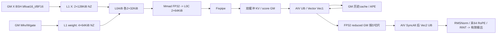
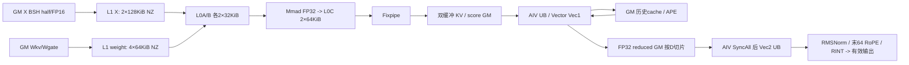
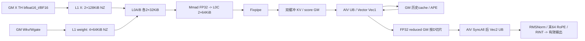

# 有状态 KV 压缩 A2/A3 ACLNN 算子知识

## 算子速览

| 项目 | 内容 |
|---|---|
| 实际入口 | 公开 ACLNN pair：aclnnSglCompressorGetWorkspaceSize / aclnnSglCompressor；OpType SglCompressor |
| 计算语义 | KV/score 两个投影→APE→跨 c*r token 的逐特征 softmax 加权和→FP32 RMSNorm→末64维交错 RoPE→输出；原地更新 FP32 KV/score 缓存 |
| 输入输出 | FP16/BF16 X、权重和输出；FP32 缓存/APE/gamma/sin/cos；BSH 或 packed TH；D=128/512，r∈{2,4,8,16,32,64,128}，c=1/2 |
| 执行类型 | 一个 sgl_compressor launch；非空为 KERNEL_TYPE_MIX_AIC_1_2，AIC_CUBE 手写 Mmad 与两个 AIV_VECTOR；950 Vector 使用 RegBase/VF。EMPTY_X 无计算，无 SIMT/通信 kernel |
| Kernel 路线 | R-001 空输入与R-002–R-017 PERF全部16个tuple；同一 launch 内投影、Vec1 和 Vec2 是阶段，不是三次 Host launch |
| 核心资源 | 系统 workspace 前缀+双缓冲 FP32 投影/尾块/压缩结果；AIC L1/L0，AIV UB/TQue/TBuf；缓存为调用者持有的原地 GM |
| 来源闭包 | source_closed：公开约束→Python/C++ adapter→公开 ACLNN pair→OpDef/Infer/Tiling→POD→entry/router→当前每条 body/helper→CMake。generated ACLNN inner bridge 和通用 AscendC 搬运/指令原语为框架边界 |
| 复用风险 | draft。A2/A3带seqused的批次遍历在请求耗尽后仍可能读取seqused[B]，且大维度窄化、metadata内容未校验。源码闭包不表示数值、内存安全或真机验证 |
| 验证状态 | 已完成源码闭包检查；本次知识提取未执行编译、真机、数值或性能测试 |

## 接口与语义

### 计算语义

记 r=cmp_ratio、c=coff、D=len(norm_weight)、W=cD，p 为请求绝对起点，n 为 seqused（缺省为输入容量），H 为 X 最末轴。对新 token t，AIC 以 X 的 FP16/BF16 输入进行两次 FP32 累加投影：K_t=X_t Wkv^T，G_t=X_t Wgate^T+APE[(p+t)%r]。KV 与 score 在缓存每行分别占 [0,W) 和 [W,2W)，score 在加入 APE 后持久化。

每个结束于 e 的完整组满足 e∈rℕ、p<e≤p+n。lane j=0..c−1 取绝对 token [e−(c−j)r,e−(c−j−1)r)，以及投影特征 [jD,(j+1)D)。将这些 c*r 行重排为同一 D 维，逐特征执行 a=exp(G−max_token G)/sum_token exp(G−max_token G)，u_d=sum_token(a*K)。绝对位置<0 使用 KV=0/score=−∞，早于 p 的位置读取调用前历史缓存。随后 v_d=gamma_d*u_d/sqrt(sum_i u_i²/D+norm_eps)。仅最后64维作相邻偶奇对的交错 RoPE；偶位用 even*cos_even−odd*sin_even，奇位用 odd*cos_odd+even*sin_odd。最后 CAST_RINT 回 X dtype，没有量化 scale、bias 或激活。

有效输出数 q_b=floor((p_b+n_b)/r)−floor(p_b/r)。BSH 每请求写前 q_b 行，TH 将所有请求的有效行连续打包。分配的剩余行未经初始化，不得读取。输出容量不等于实际有效行数。缓存更新独立于是否产出完整组：paged 模式保存本次新行但跳过 dummy page0 的写入；mode2 保留原始 token 后缀，E=p+n，q=floor(E/r)*r，keep=max(q−(c−1)r,0)，仅写绝对位置≥keep 的新行。当L>c*r时进一步令pad=L−c*r+2并将keep=min(keep,max(E−pad,0))，保留verification tail。输入 metadata 和映射应描述无冲突、合法历史；源码不替调用者建立历史。

### 输入、输出与属性

| 参数 | shape/layout | dtype | 约束、默认值与语义 |
|---|---|---|---|
| x | BSH[B,S,H] 或 TH[T,H]，ND 连续 | FP16/BF16 | H∈[1024,10240] 且 H%512=0；token/batch 轴可0；同一 NPU |
| wkv | [cD,H] | 与 x 相同 | KV 投影，ND；不在 Host 转置 tensor，Cube ND→NZ 搬运实现乘 Wᵀ |
| wgate | [cD,H] | 与 x 相同 | score 投影 |
| state_cache | [P,L,2cD] | FP32 | L≥1；前 cD 为KV，后 cD 为含APE的score；原地 ref output；调用者提供历史 |
| ape | [r,cD] | FP32 | token 绝对位置模r索引 |
| norm_weight | [D] | FP32 | D=128/512，gamma |
| rope_sin | BSH[B,ceil(S/r),64] 或 TH[min(T,T//r+B),64] | FP32 | 输出行布局；不从 token 原始位置自行生成 |
| rope_cos | 与 rope_sin 相同 | FP32 | 同上 |
| state_block_table | cache1[B,M]（兼容[B]）；cache2[B,c*r+capacity] | INT32 | API默认None，但当前native非空调用必须提供；cache1为页表；cache2列=c*r+abs−start，元素为cache的扁平token位置；需要覆盖历史和当前容量 |
| cu_seqlens | TH[B+1] | INT32 | TH必需、BSH禁止；值需非递减、首0尾T；[0]配T=0表示0请求；Host不读取/验证设备值 |
| seqused | 可选[B] | INT32 | 缺省容量；值应0..capacity，设备值不作Host内容校验 |
| start_pos | 可选[B] | INT32 | 缺省0；调用者保证非负，持久缓存绝对位置 |
| rope_head_dim | scalar | int | 64且默认64 |
| cmp_ratio | scalar | int | r∈{2,4,8,16,32,64,128}，默认4 |
| coff | scalar | int | 1或2，默认1；2包含前一组 |
| norm_eps | scalar | float | 默认1e−6；CheckSingleParaNormEps直接成功，未检查符号/有限性；需调用者提供有效eps |
| rotary_mode | scalar | int | 仅2且默认2；新adapter/tiling对空和非空都在launch前拒绝1 |
| cache_mode | scalar | int | 1 paged；2 显式token位置；默认1 |
| state_cache_stride_dim0 | scalar | int | 0推导L*2cD；显式必须相等并落非负INT32范围；运行时POD为uint64元素stride |
| cmp_kv | BSH[B,ceil(S/r),D] 或 TH[min(T,T//r+B),D] | 与x相同 | 连续GM，只有有效前缀/打包行有定义 |
| state_cache ref output | 与输入相同 | FP32 | OpDef同名ref，entry忽略独立stateCacheOut指针，body直接写stateCache |

### 入口与版本

当前公开入口由 CANN 工具链按 SglCompressor OpDef 生成 ACLNN query/execute；torch_adapter.cpp 明确加载并调用这对符号，CANN generated bridge 并非本仓手写 body。Python attention.compressor 的 auto/ascendc 直接走 torch.ops.npu.compressor，没有失败后 torch_native fallback。torch_native 是独立 CPU FP32 参考，不进入本卡 Device graph，未执行。

公开 API Hardware support 同时给 arch22/arch35 ascendc Supported；python/sgl_kernel_npu/README.md 与 architectures.json 将2201映射 ascend910b/ascend910_93（A2/A3），3510映射950；当前 CMake 对应两套 Tiling 和 entry。CANN 9.1.0 来自固定 README 与 CI 镜像，不表示本次安装/运行过此版本。CompressorV2 为另一公开实验接口与不同数学范围，不能用其无APE body替换本卡。旧 csrc/compressor 与此目录有代码复用历史，但 native active include 和构建使用 csrc/attention/compressor 的副本。新默认 RoPE2，旧默认1；新实现提前拒绝mode1，与旧非空Trap/空域可能返回的行为不同。

配套接口见[Compressor 公开 API](../../../../apis/sgl_kernel_npu/sgl_compressor.md)，V2 的独立约束见[CompressorV2 API](../../../../apis/sgl_kernel_npu/sgl_compressor_v2.md)。本卡只覆盖指定native ACLNN pair，不继承其他来源模型Concept中的性能数字。

## Host/Launcher 执行流程

### 参数校验与前处理

Python 先选硬件代际再规范 legacy table view：arch22 cache1 的[B]变[B,1]；arch35 cache2 的[B,M]执行 view(-1)[:B]，取前B个扁平元素而不是每行首元素。随后调用注册的后端。C++先校验 x NPU、建立 DeviceGuard、x rank2/3、norm rank1、state rank3，检查r可用于输出容量且落INT32、rotary_mode==2；TH需要cu且一维非空。逐tensor检查连续、同设备、X/权重同dtype与其余float、metadata int32。没有自动 Contiguous 复制；失败为 TORCH_CHECK。stride0推导并检查INT32。然后 at::empty 分配输出并建立 aclTensor descriptor，optional缺失表示nullptr。

TilingCompressor依次检查context/raw/rawcapacity≥sizeof POD、PlatformAscendCManager存在、RuntimeAttrs与rotary2；ConvertContext适配12输入/1主输出/7属性，RunBigKernelTiling以顺序 GetNpuInfo→required presence→CheckEmptyTensor→单参数dtype/rank/attr→SetBaseInfo→SetPageAttentionInfo→feature支持→shape/dtype/rank一致→AIC数量约束→SetTemplateId→SetInnerSplitInfo→SetWorkspaceInfo→SetScenarioInfo。EMPTY不绕开其后原有形状/属性校验，最终只保留libapi workspace并blockDim1。单参数shape取值、关系错误返回GRAPH_FAILED。元数据设备值、cu单调性/首尾、索引范围及请求不冲突由调用者保证。DAY0_SCOPE没有在当前CMake定义；其窄场景白名单不是当前公开r/c/D全组合的实际guard。

ConvertContext在后续required检查之前使用x.desc/x.shape，因此不能把手动构造空描述符的直接ACLNN调用推导为安全错误返回。RuntimeAttrs将int64属性转int32，本adapter只对r与stride显式先限界；绕过adapter的大属性值存在窄化边界。其它必要CANN参数/shape处理为generated bridge框架边界，不假定它补做设备内容校验。

### 参数、Workspace 与生命周期

query返回workspaceSize与aclOpExecutor；status失败立即TORCH_CHECK，不执行后续execute。workspaceSize需≤INT64_MAX，adapter以 at::zeros([workspaceSize], Byte)分配**整块零初始化**空间。当前NPU stream上 record_stream 所有输入/输出/workspace/可选metadata；lambda按值捕获tensor与descriptor，保持延迟Host任务排队期间存储。execute(workspace-or-null,size,executor,stream)通过OpCommand::RunOpApi提交，失败TORCH_CHECK。executor由CANN query/execution契约管理，本仓不手写销毁或重用规则；不得跨调用持有其裸指针自行复用。

Host CalcWorkSpace先加 libapiSize，再按下节元素数逐slice加字节。entry调用GetUserWorkspace去掉系统前缀；下文所有偏移基于user workspace。Host由框架复制POD，Device整个launch持有GM tiling；TPipe及队列归本次kernel，局部event初始化/等待排空后回收。输出与原地cache由调用者tensor持有至stream完成。A2无readGen全局计数初值依赖，但仍保留adapter整块zeros行为；不能将at::empty输出误认为也被清零。

### 启动图与失败传播

sgl_register_operator(AICORE,SglCompressor,2201/3510)→active variant Host .cpp + adapter→IMPL_OP_OPTILING→CANN runtime→单个sgl_compressor。非空blockDim=AIC平台核数，MIX_AIC_1_2使AIC索引GetBlockIdx、AIV逻辑AIC组GetBlockIdx()/2，AIV自身ID保留用于Vector分工。Host data.tilingKey保存真实手工key，context外层CANN tilingKey固定0。entry按平台编译宏选择对应POD与body；先判payload template bits==1即return，再switch实际key；未知key printf+Trap，没有计算fallback。公开错误传播只能保证已见query/execute返回检查；异步Device故障需由运行时观测，本次未执行。

```text
query -> validate/infer/tiling -> POD+workspace+executor
  -> same current stream zeros(workspace) -> execute
    -> one MIX entry
       AIC: GM X/W -> L1 -> L0A/B -> FP32 Mmad/L0C -> Fixpipe -> projection WS
       AIV Vec1: projection/history/APE -> softmax*KV reduce -> cache update + FP32 reduced WS
       AIV Vec2: after D-shard visibility -> RMSNorm + RoPE -> cast -> valid output
EMPTY_X: entry early return; no projection, cache/output writer
```

## Route 与参数设计

### 分核与资源计算

Host先从rank定BSH/TH；BSH B=x0,S=x1,T=B*S,H=x2，TH T=x0,H=x1,B=cu.shape0−1、S=0；D=norm.shape0，r/c/rd来自属性，W=cD，cs=S−S%r，cg=ceil(S/r)（TH最终为0，Device按cu与请求metadata计算）。GetNpuInfo读取平台SoC、UB/L1/L0B/L0C容量、libapiSize及AIC/AIV数，要求核数>0；CheckBlockDimConstrain要求AIC≥D/64。Host M、dBase 与动态细分见下表；nSize=2控制每两次C1/V1后合并V2。不能把平台容量查询误写为逐项验证所有静态InitBuffer预算：本仓未为每个buffer总和添加对应不等式。

Host M=(c==2?128:256)，dBase64。Device SetBaseSize遍历输入容量：若所有请求等容量且Msum<=M*floor(AIC/(D/64))，D128目标8块、D512目标16块，AIC足够时dBase=16/32；用新分组数求newM=ceil(B/groups)*首容量，只有minM<newM<M才收缩M。minM来自r边界前/后有效小段，避免破坏TC边界。随后nd=D/dBase，groups=floor(AIC/nd)，core的dStart=(core%nd)*dBase，group=floor(core/nd)，GetLoopTimes/SkipOneLoop按容量与r边界跨batch拼M块。没有A2 splitK。

定义 q=2（dbWorkspaceRatio），A=M*D*c，V=M*D*2，Tail=(c==2?r*D:0)，Gmax=floor(AIC/(D/dBase_host))。Host用户区保守预算为4*q*(Gmax*A+Gmax*A+Tail+Tail+Gmax*V)字节。Device以真实M、dBase、coreGroupNum形成下列连续片（A2可能缩小M/改变分组；950全/常规亦按实际分组）；不要把Host预算偏移直接代替Device实际偏移。令 G 为Device投影K/M组数，A'=M_actual*D*c，V'=M_actual*D*2：
```text
kv[db,g,m,j,d]: offset0; bytes=4*q*G*A'
score:          offset=4*q*G*A'; bytes same
tailKV:         offset=8*q*G*A'; bytes=4*q*Tail
tailScore:      offset=8*q*G*A'+4*q*Tail; bytes=4*q*Tail
vec1Res:        offset=8*q*G*A'+8*q*Tail; bytes=4*q*G*V'
vec2Input:      alias vec1Res (same lifetime; producer V1, consumer V2)
readGen=N/A；A2仅上述tensor片
workspace_total=libapiSize + Host user's conservative tensor budget
```
投影每个plane内元素offset=db*(G*A')+g*A'+m*cD+jD+d；tail plane内db*(rD)+tD+d；压缩结果按双轮次和完整D行索引，V2在全D可见后重分配输出行。所有extent单位在式中为字节，A/V/Tail字段单位为FP32元素。预算乘法的若干子表达式先在uint32求值，极大shape不具备普遍溢出保护。

### Route 选择

| 顺序 | Route | Key/模板 | 精确选择条件与优先级 | 不适用去向 |
|---:|---|---|---|---|
| 1 | R-001 空输入 | template1；key={2848,3360,2880,3392,2850,3362,2882,3394,2849,3361,2881,3393,2851,3363,2883,3395} | X空优先，后续校验通过 | 非空转下列平台族 |
| 2 | R-002 PERF BSH BF16 c1 cache1 | 4896/template2 | 2201非empty；layout=BSH，dtype=BF16，c=1，cache=1，rot2及全局约束 | 其他tuple继续匹配；不支持则GRAPH_FAILED |
| 3 | R-003 PERF BSH BF16 c1 cache2 | 5408/template2 | 2201非empty；layout=BSH，dtype=BF16，c=1，cache=2，rot2及全局约束 | 其他tuple继续匹配；不支持则GRAPH_FAILED |
| 4 | R-004 PERF BSH BF16 c2 cache1 | 4928/template2 | 2201非empty；layout=BSH，dtype=BF16，c=2，cache=1，rot2及全局约束 | 其他tuple继续匹配；不支持则GRAPH_FAILED |
| 5 | R-005 PERF BSH BF16 c2 cache2 | 5440/template2 | 2201非empty；layout=BSH，dtype=BF16，c=2，cache=2，rot2及全局约束 | 其他tuple继续匹配；不支持则GRAPH_FAILED |
| 6 | R-006 PERF BSH FP16 c1 cache1 | 4898/template2 | 2201非empty；layout=BSH，dtype=FP16，c=1，cache=1，rot2及全局约束 | 其他tuple继续匹配；不支持则GRAPH_FAILED |
| 7 | R-007 PERF BSH FP16 c1 cache2 | 5410/template2 | 2201非empty；layout=BSH，dtype=FP16，c=1，cache=2，rot2及全局约束 | 其他tuple继续匹配；不支持则GRAPH_FAILED |
| 8 | R-008 PERF BSH FP16 c2 cache1 | 4930/template2 | 2201非empty；layout=BSH，dtype=FP16，c=2，cache=1，rot2及全局约束 | 其他tuple继续匹配；不支持则GRAPH_FAILED |
| 9 | R-009 PERF BSH FP16 c2 cache2 | 5442/template2 | 2201非empty；layout=BSH，dtype=FP16，c=2，cache=2，rot2及全局约束 | 其他tuple继续匹配；不支持则GRAPH_FAILED |
| 10 | R-010 PERF TH BF16 c1 cache1 | 4897/template2 | 2201非empty；layout=TH，dtype=BF16，c=1，cache=1，rot2及全局约束 | 其他tuple继续匹配；不支持则GRAPH_FAILED |
| 11 | R-011 PERF TH BF16 c1 cache2 | 5409/template2 | 2201非empty；layout=TH，dtype=BF16，c=1，cache=2，rot2及全局约束 | 其他tuple继续匹配；不支持则GRAPH_FAILED |
| 12 | R-012 PERF TH BF16 c2 cache1 | 4929/template2 | 2201非empty；layout=TH，dtype=BF16，c=2，cache=1，rot2及全局约束 | 其他tuple继续匹配；不支持则GRAPH_FAILED |
| 13 | R-013 PERF TH BF16 c2 cache2 | 5441/template2 | 2201非empty；layout=TH，dtype=BF16，c=2，cache=2，rot2及全局约束 | 其他tuple继续匹配；不支持则GRAPH_FAILED |
| 14 | R-014 PERF TH FP16 c1 cache1 | 4899/template2 | 2201非empty；layout=TH，dtype=FP16，c=1，cache=1，rot2及全局约束 | 其他tuple继续匹配；不支持则GRAPH_FAILED |
| 15 | R-015 PERF TH FP16 c1 cache2 | 5411/template2 | 2201非empty；layout=TH，dtype=FP16，c=1，cache=2，rot2及全局约束 | 其他tuple继续匹配；不支持则GRAPH_FAILED |
| 16 | R-016 PERF TH FP16 c2 cache1 | 4931/template2 | 2201非empty；layout=TH，dtype=FP16，c=2，cache=1，rot2及全局约束 | 其他tuple继续匹配；不支持则GRAPH_FAILED |
| 17 | R-017 PERF TH FP16 c2 cache2 | 5443/template2 | 2201非empty；layout=TH，dtype=FP16，c=2，cache=2，rot2及全局约束 | 其他tuple继续匹配；不支持则GRAPH_FAILED |

```text
validate exact interface/shape/dtype/core predicates; any failure -> GRAPH_FAILED
if X token/batch axis is zero: template=1 -> R-001
else:
  template=2 -> PERF tuples（NORMAL0未被当前Host生产）
key = layout | dtype<<1 | c<<5 | 2<<7 | cache<<9 | template<<11
CANN outer key=0; payload key is consumed by entry switch
```

### 模板/实现执行矩阵

| Route | key/selector | dtype/shape/platform 完整命中条件 | 执行族与 kernel 节点 | 实际模板/body | 内存与同步特征 | tail/fallback |
|---|---|---|---|---|---|---|
| R-001 | template1，2848/3360/2880/3392/2850/3362/2882/3394/2849/3361/2881/3393/2851/3363/2883/3395 | 合法空X；全部公开dtype/c/cache/layout | 单entry return，无计算执行族 | sgl_compressor early return | 仅系统workspace，无交接 | 无输出写；仍检查参数 |
| R-002 | key4896 | A2/A3；BSH，BF16，c1，cache1，rot2；非空，H/D/r及core guard见表 | 单sgl_compressor MIX_CV，AIC_CUBE→AIV_VECTOR(V1)→AIV_VECTOR(V2) | CompressorKernelPerf<COMPType<X_LAYOUT::BSH, X_DTYPE::BF16, COFF::DISABLE, ROTARY_MODE::INTERLEAVE, CACHE_MODE::CONTINUOUS>> | projection/tail/reduced双缓冲；c1历史，cache1映射 | M/K/D/TC/row实际尾；无数学fallback |
| R-003 | key5408 | A2/A3；BSH，BF16，c1，cache2，rot2；非空，H/D/r及core guard见表 | 单sgl_compressor MIX_CV，AIC_CUBE→AIV_VECTOR(V1)→AIV_VECTOR(V2) | CompressorKernelPerf<COMPType<X_LAYOUT::BSH, X_DTYPE::BF16, COFF::DISABLE, ROTARY_MODE::INTERLEAVE, CACHE_MODE::EXPLICIT>> | projection/tail/reduced双缓冲；c1历史，cache2映射 | M/K/D/TC/row实际尾；无数学fallback |
| R-004 | key4928 | A2/A3；BSH，BF16，c2，cache1，rot2；非空，H/D/r及core guard见表 | 单sgl_compressor MIX_CV，AIC_CUBE→AIV_VECTOR(V1)→AIV_VECTOR(V2) | CompressorKernelPerf<COMPType<X_LAYOUT::BSH, X_DTYPE::BF16, COFF::OVERLAP, ROTARY_MODE::INTERLEAVE, CACHE_MODE::CONTINUOUS>> | projection/tail/reduced双缓冲；c2历史，cache1映射 | M/K/D/TC/row实际尾；无数学fallback |
| R-005 | key5440 | A2/A3；BSH，BF16，c2，cache2，rot2；非空，H/D/r及core guard见表 | 单sgl_compressor MIX_CV，AIC_CUBE→AIV_VECTOR(V1)→AIV_VECTOR(V2) | CompressorKernelPerf<COMPType<X_LAYOUT::BSH, X_DTYPE::BF16, COFF::OVERLAP, ROTARY_MODE::INTERLEAVE, CACHE_MODE::EXPLICIT>> | projection/tail/reduced双缓冲；c2历史，cache2映射 | M/K/D/TC/row实际尾；无数学fallback |
| R-006 | key4898 | A2/A3；BSH，FP16，c1，cache1，rot2；非空，H/D/r及core guard见表 | 单sgl_compressor MIX_CV，AIC_CUBE→AIV_VECTOR(V1)→AIV_VECTOR(V2) | CompressorKernelPerf<COMPType<X_LAYOUT::BSH, X_DTYPE::FP16, COFF::DISABLE, ROTARY_MODE::INTERLEAVE, CACHE_MODE::CONTINUOUS>> | projection/tail/reduced双缓冲；c1历史，cache1映射 | M/K/D/TC/row实际尾；无数学fallback |
| R-007 | key5410 | A2/A3；BSH，FP16，c1，cache2，rot2；非空，H/D/r及core guard见表 | 单sgl_compressor MIX_CV，AIC_CUBE→AIV_VECTOR(V1)→AIV_VECTOR(V2) | CompressorKernelPerf<COMPType<X_LAYOUT::BSH, X_DTYPE::FP16, COFF::DISABLE, ROTARY_MODE::INTERLEAVE, CACHE_MODE::EXPLICIT>> | projection/tail/reduced双缓冲；c1历史，cache2映射 | M/K/D/TC/row实际尾；无数学fallback |
| R-008 | key4930 | A2/A3；BSH，FP16，c2，cache1，rot2；非空，H/D/r及core guard见表 | 单sgl_compressor MIX_CV，AIC_CUBE→AIV_VECTOR(V1)→AIV_VECTOR(V2) | CompressorKernelPerf<COMPType<X_LAYOUT::BSH, X_DTYPE::FP16, COFF::OVERLAP, ROTARY_MODE::INTERLEAVE, CACHE_MODE::CONTINUOUS>> | projection/tail/reduced双缓冲；c2历史，cache1映射 | M/K/D/TC/row实际尾；无数学fallback |
| R-009 | key5442 | A2/A3；BSH，FP16，c2，cache2，rot2；非空，H/D/r及core guard见表 | 单sgl_compressor MIX_CV，AIC_CUBE→AIV_VECTOR(V1)→AIV_VECTOR(V2) | CompressorKernelPerf<COMPType<X_LAYOUT::BSH, X_DTYPE::FP16, COFF::OVERLAP, ROTARY_MODE::INTERLEAVE, CACHE_MODE::EXPLICIT>> | projection/tail/reduced双缓冲；c2历史，cache2映射 | M/K/D/TC/row实际尾；无数学fallback |
| R-010 | key4897 | A2/A3；TH，BF16，c1，cache1，rot2；非空，H/D/r及core guard见表 | 单sgl_compressor MIX_CV，AIC_CUBE→AIV_VECTOR(V1)→AIV_VECTOR(V2) | CompressorKernelPerf<COMPType<X_LAYOUT::TH, X_DTYPE::BF16, COFF::DISABLE, ROTARY_MODE::INTERLEAVE, CACHE_MODE::CONTINUOUS>> | projection/tail/reduced双缓冲；c1历史，cache1映射 | M/K/D/TC/row实际尾；无数学fallback |
| R-011 | key5409 | A2/A3；TH，BF16，c1，cache2，rot2；非空，H/D/r及core guard见表 | 单sgl_compressor MIX_CV，AIC_CUBE→AIV_VECTOR(V1)→AIV_VECTOR(V2) | CompressorKernelPerf<COMPType<X_LAYOUT::TH, X_DTYPE::BF16, COFF::DISABLE, ROTARY_MODE::INTERLEAVE, CACHE_MODE::EXPLICIT>> | projection/tail/reduced双缓冲；c1历史，cache2映射 | M/K/D/TC/row实际尾；无数学fallback |
| R-012 | key4929 | A2/A3；TH，BF16，c2，cache1，rot2；非空，H/D/r及core guard见表 | 单sgl_compressor MIX_CV，AIC_CUBE→AIV_VECTOR(V1)→AIV_VECTOR(V2) | CompressorKernelPerf<COMPType<X_LAYOUT::TH, X_DTYPE::BF16, COFF::OVERLAP, ROTARY_MODE::INTERLEAVE, CACHE_MODE::CONTINUOUS>> | projection/tail/reduced双缓冲；c2历史，cache1映射 | M/K/D/TC/row实际尾；无数学fallback |
| R-013 | key5441 | A2/A3；TH，BF16，c2，cache2，rot2；非空，H/D/r及core guard见表 | 单sgl_compressor MIX_CV，AIC_CUBE→AIV_VECTOR(V1)→AIV_VECTOR(V2) | CompressorKernelPerf<COMPType<X_LAYOUT::TH, X_DTYPE::BF16, COFF::OVERLAP, ROTARY_MODE::INTERLEAVE, CACHE_MODE::EXPLICIT>> | projection/tail/reduced双缓冲；c2历史，cache2映射 | M/K/D/TC/row实际尾；无数学fallback |
| R-014 | key4899 | A2/A3；TH，FP16，c1，cache1，rot2；非空，H/D/r及core guard见表 | 单sgl_compressor MIX_CV，AIC_CUBE→AIV_VECTOR(V1)→AIV_VECTOR(V2) | CompressorKernelPerf<COMPType<X_LAYOUT::TH, X_DTYPE::FP16, COFF::DISABLE, ROTARY_MODE::INTERLEAVE, CACHE_MODE::CONTINUOUS>> | projection/tail/reduced双缓冲；c1历史，cache1映射 | M/K/D/TC/row实际尾；无数学fallback |
| R-015 | key5411 | A2/A3；TH，FP16，c1，cache2，rot2；非空，H/D/r及core guard见表 | 单sgl_compressor MIX_CV，AIC_CUBE→AIV_VECTOR(V1)→AIV_VECTOR(V2) | CompressorKernelPerf<COMPType<X_LAYOUT::TH, X_DTYPE::FP16, COFF::DISABLE, ROTARY_MODE::INTERLEAVE, CACHE_MODE::EXPLICIT>> | projection/tail/reduced双缓冲；c1历史，cache2映射 | M/K/D/TC/row实际尾；无数学fallback |
| R-016 | key4931 | A2/A3；TH，FP16，c2，cache1，rot2；非空，H/D/r及core guard见表 | 单sgl_compressor MIX_CV，AIC_CUBE→AIV_VECTOR(V1)→AIV_VECTOR(V2) | CompressorKernelPerf<COMPType<X_LAYOUT::TH, X_DTYPE::FP16, COFF::OVERLAP, ROTARY_MODE::INTERLEAVE, CACHE_MODE::CONTINUOUS>> | projection/tail/reduced双缓冲；c2历史，cache1映射 | M/K/D/TC/row实际尾；无数学fallback |
| R-017 | key5443 | A2/A3；TH，FP16，c2，cache2，rot2；非空，H/D/r及core guard见表 | 单sgl_compressor MIX_CV，AIC_CUBE→AIV_VECTOR(V1)→AIV_VECTOR(V2) | CompressorKernelPerf<COMPType<X_LAYOUT::TH, X_DTYPE::FP16, COFF::OVERLAP, ROTARY_MODE::INTERLEAVE, CACHE_MODE::EXPLICIT>> | projection/tail/reduced双缓冲；c2历史，cache2映射 | M/K/D/TC/row实际尾；无数学fallback |

每个非空key独立成Route，避免将TH/BSH地址、c=1/2历史重排、两种cache同步或dtype精度混同。950 NORMAL的Ksplit与FULL_LOAD的CPU切片子选择保留在每条路线中；这些子选择不改变公开数学语义。TH FULL_LOAD虽编译存在，但Host条件要求BSH，非正式可达Route。A2包含的空CompressorKernel stub没有Host key producer，不是fallback。

### 隐藏性能 Guard

| Guard | Host/Tiling 条件 | Device/资源原因 | 影响 Route | 不满足时去向 | 源码符号 |
|---|---|---|---|---|---|
| 原始参数域 | H范围及512对齐、D128/512、r七值、c1/2、rd64、rot2、cache1/2；tensor shape关系完全一致 | Mmad K分块与Vector幂二归约、64维RoPE | 全部非空 | GRAPH_FAILED；无torch参考fallback | CheckSinglePara/CheckFeature/CheckMultiParaConsistency；TilingCompressor |
| 核数 | AIC>0,AIV>0,AIC≥D/64 | 至少承载D切片 | 全部 | GRAPH_FAILED | GetNpuInfo/CheckBlockDimConstrain |
| 小M动态D分片 | equalCapacity && Msum<=M*floor(AIC/(D/64)) && AIC>=目标D块数 | 小M增加D并行且按r边界约束M收缩 | PERF所有非空 | 保留Host M/dBase64；无新kernel | SetTemplateId/SetInnerSplitInfo/SetBaseSize/SplitK |
| V1 UB tile | maxCol=32768/(r*c*4)，dBase过宽则dLoop分片，否则多TC一tile | score/KV每tile≤32K的单平面；950额外将D块限制到8对齐幂二宽度 | 非空 | 减小D或TC tile；无通用稀疏fallback | CalcTilingStrategy/SplitCoreV1 |
| V2 UB tile | rowsPerLoop=32768/(D*4)，D128→64行，D512→16行 | 32K FP32 norm输入；单行D完整 | 非空 | 逐行tile迭代并按有效计数裁尾 | SplitCoreV2/ComputeVec2 |
| 编译目标 | SGL_COMPRESSOR_ARCH22 | 同名POD两代尺寸不同、VF仅对应架构编译 | 本卡平台 | 构建失败/非本variant；不能强制伪造宏 | CMakeLists/entry |
| mode2映射 | cache1为页表；cache2列=c*r+abs−start，元素为cache的扁平token位置；需要覆盖历史和当前容量 | 历史读取与当次写入可能同cache行，需特定提交顺序 | cache2 | 调用者更正表/保持协议；无自动转换不同语义 | CompressorTools/ReadState/SaveState |
| empty | token轴0 | 无数学输出；仍经query与execute | R-001 | 非空selector | CheckEmptyTensor/entry |

### POD/ABI

以下offset是固定宽度C++声明在通常uint64对齐8 ABI下的**静态推导**，不是本次编译测量；无packed/union。Host与Device include同一头。不能跨代交换POD：本卡base sizeof=704/align8，splitCore sizeof24/align4，page sizeof12/align4，inner sizeof8/align4，workspace sizeof20/align4，顶层sizeof752/align8。adapter先data{}，再显式memcpy至框架raw区；inactive字段保留0或声明默认值，不可当producer已写的有效切片。

| 结构 | 字段 | 类型/位宽 | ABI 布局 | 单位 | Host/launcher producer | Device consumer | 边界 |
|---|---|---|---|---|---|---|---|
| CompressorBaseParams | batchSize | uint32/32 | offsetof=0 | 元素/业务轴 | SetBaseInfo: B，TH=cu.size−1 | tools/迭代器请求上界 | 非空；empty不读取 |
| CompressorBaseParams | seqSize | uint32/32 | offsetof=4 | 元素/业务轴 | SetBaseInfo: BSH S；TH0 | BSH地址与full批次 | 非空；empty不读取 |
| CompressorBaseParams | hiddenSize | uint32/32 | offsetof=8 | 元素/业务轴 | SetBaseInfo: H | Cube K循环 | 非空；empty不读取 |
| CompressorBaseParams | tokenSize | uint32/32 | offsetof=12 | 元素/业务轴 | SetBaseInfo: BSH B*S；TH T | FULL_LOAD mEnd，非full只作选择 | 非空；empty不读取 |
| CompressorBaseParams | headDim | uint32/32 | offsetof=16 | 元素/业务轴 | SetBaseInfo: D=norm0 | 分D、row步幅、RMS | 非空；empty不读取 |
| CompressorBaseParams | ropeHeadDim | uint32/32 | offsetof=20 | 元素/业务轴 | SetBaseInfo: 64 | RoPE尾64 | 非空；empty不读取 |
| CompressorBaseParams | csSize | uint32/32 | offsetof=24 | 元素/业务轴 | SetBaseInfo: S−S%r | PERF无直接Device consumer；运行时按S/r及有效长度派生 | Host侧业务描述；TH为0 |
| CompressorBaseParams | cmpRatio | uint32/32 | offsetof=28 | 元素/业务轴 | SetBaseInfo: r | TC边界与历史 | 非空；empty不读取 |
| CompressorBaseParams | cgSize | uint32/32 | offsetof=32 | 元素/业务轴 | SetBaseInfo: ceil(S/r)；TH0 | PERF无直接Device consumer；BSH输出pitch按S、r重新计算 | Host侧描述，非Device寻址输入 |
| CompressorBaseParams | normEps | float/32 | offsetof=36 | 标量 | SetBaseInfo: attr epsilon | RMS加eps | 非空；empty不读取 |
| CompressorBaseParams | reciprocalD | float/32 | offsetof=40 | 标量 | SetBaseInfo: 1.0f/D | RMS均值 | 非空；empty不读取 |
| CompressorBaseParams | usedCoreNum | uint32/32 | offsetof=44 | core | SetBaseInfo: AIC数 | 核心分工，AIV=2倍 | 非空；empty不读取 |
| CompressorBaseParams | nSize | uint32/32 | offsetof=48 | 元素/业务轴 | SetBaseInfo: 2 | 双轮C1/V1合并V2 | 非空；empty不读取 |
| CompressorBaseParams | stateCacheStrideDim0 | uint64/64 | offsetof=56 | FP32元素 | SetBaseInfo: attr stride | PERF无直接Device consumer；缓存跨度按L、c、D重新计算 | Host校验用途；native attr源为INT32，必须等L*2cD |
| CompressorBaseParams | kBaseNum | uint32/32 | offsetof=64 | 个/元素 | adapter data{}保留0 | PERF不以Host此字段分工 | inactive，禁止拿0作有效分母 |
| CompressorBaseParams | kBaseSize | uint32/32 | offsetof=68 | 个/元素 | adapter data{}保留0 | PERF不以Host此字段分工 | inactive，禁止拿0作有效分母 |
| CompressorBaseParams | coreGroupNum | uint32/32 | offsetof=72 | 个/元素 | adapter data{}保留0 | PERF不以Host此字段分工 | inactive，禁止拿0作有效分母 |
| CompressorBaseParams | mLoopNum | uint32/32 | offsetof=76 | 个/元素 | adapter data{}保留0 | PERF不以Host此字段分工 | inactive，禁止拿0作有效分母 |
| CompressorBaseParams | splitCoreParam[26] | CompressorSplitCoreParams array | offsetof=80 | 每core 24字节 | data{}保持0 | PERF不消费数组 | 数组固定26；当前Host无显式AIC<=26检查 |
| CompressorSplitCoreParams | mStart | uint32/32 | offsetof=0 | 元素 | inactive0 | 无可达consumer | 顶层80+i*24+本偏移，PERF inactive |
| CompressorSplitCoreParams | mEnd | uint32/32 | offsetof=4 | 元素 | inactive0 | 无可达consumer | 顶层80+i*24+本偏移，PERF inactive |
| CompressorSplitCoreParams | nStart | uint32/32 | offsetof=8 | 元素 | inactive0 | 无可达consumer | 顶层80+i*24+本偏移，PERF inactive |
| CompressorSplitCoreParams | nEnd | uint32/32 | offsetof=12 | 元素 | inactive0 | 无可达consumer | 顶层80+i*24+本偏移，PERF inactive |
| CompressorSplitCoreParams | kStart | uint32/32 | offsetof=16 | 元素 | inactive0 | 无可达consumer | 顶层80+i*24+本偏移，PERF inactive |
| CompressorSplitCoreParams | kEnd | uint32/32 | offsetof=20 | 元素 | inactive0 | 无可达consumer | 顶层80+i*24+本偏移，PERF inactive |
| CompressorPageAttentionParams | blockNum | uint32/32 | offsetof=0 | 页/token/表列 | SetPageAttentionInfo: state_cache.P | 页/银行范围的shape检查与cache地址 | 顶层704+本偏移；table值仍由调用者保证 |
| CompressorPageAttentionParams | blockSize | uint32/32 | offsetof=4 | 页/token/表列 | SetPageAttentionInfo: state_cache.L | page/cycle取模 | 顶层704+本偏移；table值仍由调用者保证 |
| CompressorPageAttentionParams | maxBlockNumPerBatch | uint32/32 | offsetof=8 | 页/token/表列 | SetPageAttentionInfo: table末轴(1D兼容为1) | paged表行pitch；mode2按其独立映射 | 顶层704+本偏移；table值仍由调用者保证 |
| CompressorInnerSplitParams | mBaseSize | uint32/32 | offsetof=0 | 元素 | SetInnerSplitInfo: c==2?128:256 | Kernel M tile，A2可动态缩小 | 顶层716+本偏移；非空 |
| CompressorInnerSplitParams | dBaseSize | uint32/32 | offsetof=4 | 元素 | SetInnerSplitInfo: 64 | D分片，A2可能16/32 | 顶层716+本偏移；非空 |
| CompressorWorkspaceParams | mm1KvResSize | uint32/32 | offsetof=0 | FP32元素（ratio为次数） | SetWorkSpaceInfo: M*D*c | Host预算与Device实际片计算 | 顶层724+本偏移；overflow需调用者限界 |
| CompressorWorkspaceParams | mm1ScoreResSize | uint32/32 | offsetof=4 | FP32元素（ratio为次数） | SetWorkSpaceInfo: M*D*c | 同上score | 顶层724+本偏移；overflow需调用者限界 |
| CompressorWorkspaceParams | vec1ResSize | uint32/32 | offsetof=8 | FP32元素（ratio为次数） | SetWorkSpaceInfo: M*D*nSize | V1→V2 float片 | 顶层724+本偏移；overflow需调用者限界 |
| CompressorWorkspaceParams | vec1TailCacheSize | uint32/32 | offsetof=12 | FP32元素（ratio为次数） | SetWorkSpaceInfo: c==2?rD:0 | Overlap前一组KV/score | 顶层724+本偏移；overflow需调用者限界 |
| CompressorWorkspaceParams | dbWorkspaceRatio | uint32/32 | offsetof=16 | FP32元素（ratio为次数） | SetWorkSpaceInfo: 2 | pingpong dbIdx mask | 顶层724+本偏移；overflow需调用者限界 |
| CompressorTilingData | baseParams | CompressorBaseParams | offsetof=0 | 嵌套结构 | RunBigKernelTiling指向本字段赋值 | InitTilingData业务量 | raw capacity≥sizeof；顶层CANN key=0 |
| CompressorTilingData | pageAttentionParams | CompressorPageAttentionParams | offsetof=704 | 嵌套结构 | RunBigKernelTiling指向本字段赋值 | tools与Cache | raw capacity≥sizeof；顶层CANN key=0 |
| CompressorTilingData | innerSplitParams | CompressorInnerSplitParams | offsetof=716 | 嵌套结构 | RunBigKernelTiling指向本字段赋值 | M/D分核 | raw capacity≥sizeof；顶层CANN key=0 |
| CompressorTilingData | workspaceParams | CompressorWorkspaceParams | offsetof=724 | 嵌套结构 | RunBigKernelTiling指向本字段赋值 | 切片/DB | raw capacity≥sizeof；顶层CANN key=0 |
| CompressorTilingData | tilingKey | uint64/64 | offsetof=744 | bitfield | TilingCompressor: compressorContext.tilingKey | entry earlyreturn/switch | raw capacity≥sizeof；顶层CANN key=0 |

### Route 源码闭包

| Route | Key/selector | Host/Tiling producer | POD/参数 | Kernel entry/router | Kernel body/直接依赖 | 构建接线 |
|---|---|---|---|---|---|---|
| R-001 空输入 | 所有 template=1 的公开参数key | op_host/arch22/compressor_tiling.cpp RunBigKernelTiling/GenTilingKey；TilingCompressor adapter | arch22/compressor_tiling_data.h全部字段 | compressor_arch22.cpp→compressor_cann_entry.h→template1return | entry早返回 | CMakeLists sgl_register_operator_variant ARCH2201，共享cann_ops注册/编译 |
| R-002 PERF BSH BF16 c1 cache1 | 4896 | op_host/arch22/compressor_tiling.cpp RunBigKernelTiling/GenTilingKey；TilingCompressor adapter | arch22/compressor_tiling_data.h全部字段 | compressor_arch22.cpp→compressor_cann_entry.h→COMPType<X_LAYOUT::BSH, X_DTYPE::BF16, COFF::DISABLE, ROTARY_MODE::INTERLEAVE, CACHE_MODE::CONTINUOUS> | compressor_kernel_perf / block_cube_perf / block_vec_perf + tools / vector_comm / soft_max / rms_norm / rope | CMakeLists sgl_register_operator_variant ARCH2201，共享cann_ops注册/编译 |
| R-003 PERF BSH BF16 c1 cache2 | 5408 | op_host/arch22/compressor_tiling.cpp RunBigKernelTiling/GenTilingKey；TilingCompressor adapter | arch22/compressor_tiling_data.h全部字段 | compressor_arch22.cpp→compressor_cann_entry.h→COMPType<X_LAYOUT::BSH, X_DTYPE::BF16, COFF::DISABLE, ROTARY_MODE::INTERLEAVE, CACHE_MODE::EXPLICIT> | compressor_kernel_perf / block_cube_perf / block_vec_perf + tools / vector_comm / soft_max / rms_norm / rope | CMakeLists sgl_register_operator_variant ARCH2201，共享cann_ops注册/编译 |
| R-004 PERF BSH BF16 c2 cache1 | 4928 | op_host/arch22/compressor_tiling.cpp RunBigKernelTiling/GenTilingKey；TilingCompressor adapter | arch22/compressor_tiling_data.h全部字段 | compressor_arch22.cpp→compressor_cann_entry.h→COMPType<X_LAYOUT::BSH, X_DTYPE::BF16, COFF::OVERLAP, ROTARY_MODE::INTERLEAVE, CACHE_MODE::CONTINUOUS> | compressor_kernel_perf / block_cube_perf / block_vec_perf + tools / vector_comm / soft_max / rms_norm / rope | CMakeLists sgl_register_operator_variant ARCH2201，共享cann_ops注册/编译 |
| R-005 PERF BSH BF16 c2 cache2 | 5440 | op_host/arch22/compressor_tiling.cpp RunBigKernelTiling/GenTilingKey；TilingCompressor adapter | arch22/compressor_tiling_data.h全部字段 | compressor_arch22.cpp→compressor_cann_entry.h→COMPType<X_LAYOUT::BSH, X_DTYPE::BF16, COFF::OVERLAP, ROTARY_MODE::INTERLEAVE, CACHE_MODE::EXPLICIT> | compressor_kernel_perf / block_cube_perf / block_vec_perf + tools / vector_comm / soft_max / rms_norm / rope | CMakeLists sgl_register_operator_variant ARCH2201，共享cann_ops注册/编译 |
| R-006 PERF BSH FP16 c1 cache1 | 4898 | op_host/arch22/compressor_tiling.cpp RunBigKernelTiling/GenTilingKey；TilingCompressor adapter | arch22/compressor_tiling_data.h全部字段 | compressor_arch22.cpp→compressor_cann_entry.h→COMPType<X_LAYOUT::BSH, X_DTYPE::FP16, COFF::DISABLE, ROTARY_MODE::INTERLEAVE, CACHE_MODE::CONTINUOUS> | compressor_kernel_perf / block_cube_perf / block_vec_perf + tools / vector_comm / soft_max / rms_norm / rope | CMakeLists sgl_register_operator_variant ARCH2201，共享cann_ops注册/编译 |
| R-007 PERF BSH FP16 c1 cache2 | 5410 | op_host/arch22/compressor_tiling.cpp RunBigKernelTiling/GenTilingKey；TilingCompressor adapter | arch22/compressor_tiling_data.h全部字段 | compressor_arch22.cpp→compressor_cann_entry.h→COMPType<X_LAYOUT::BSH, X_DTYPE::FP16, COFF::DISABLE, ROTARY_MODE::INTERLEAVE, CACHE_MODE::EXPLICIT> | compressor_kernel_perf / block_cube_perf / block_vec_perf + tools / vector_comm / soft_max / rms_norm / rope | CMakeLists sgl_register_operator_variant ARCH2201，共享cann_ops注册/编译 |
| R-008 PERF BSH FP16 c2 cache1 | 4930 | op_host/arch22/compressor_tiling.cpp RunBigKernelTiling/GenTilingKey；TilingCompressor adapter | arch22/compressor_tiling_data.h全部字段 | compressor_arch22.cpp→compressor_cann_entry.h→COMPType<X_LAYOUT::BSH, X_DTYPE::FP16, COFF::OVERLAP, ROTARY_MODE::INTERLEAVE, CACHE_MODE::CONTINUOUS> | compressor_kernel_perf / block_cube_perf / block_vec_perf + tools / vector_comm / soft_max / rms_norm / rope | CMakeLists sgl_register_operator_variant ARCH2201，共享cann_ops注册/编译 |
| R-009 PERF BSH FP16 c2 cache2 | 5442 | op_host/arch22/compressor_tiling.cpp RunBigKernelTiling/GenTilingKey；TilingCompressor adapter | arch22/compressor_tiling_data.h全部字段 | compressor_arch22.cpp→compressor_cann_entry.h→COMPType<X_LAYOUT::BSH, X_DTYPE::FP16, COFF::OVERLAP, ROTARY_MODE::INTERLEAVE, CACHE_MODE::EXPLICIT> | compressor_kernel_perf / block_cube_perf / block_vec_perf + tools / vector_comm / soft_max / rms_norm / rope | CMakeLists sgl_register_operator_variant ARCH2201，共享cann_ops注册/编译 |
| R-010 PERF TH BF16 c1 cache1 | 4897 | op_host/arch22/compressor_tiling.cpp RunBigKernelTiling/GenTilingKey；TilingCompressor adapter | arch22/compressor_tiling_data.h全部字段 | compressor_arch22.cpp→compressor_cann_entry.h→COMPType<X_LAYOUT::TH, X_DTYPE::BF16, COFF::DISABLE, ROTARY_MODE::INTERLEAVE, CACHE_MODE::CONTINUOUS> | compressor_kernel_perf / block_cube_perf / block_vec_perf + tools / vector_comm / soft_max / rms_norm / rope | CMakeLists sgl_register_operator_variant ARCH2201，共享cann_ops注册/编译 |
| R-011 PERF TH BF16 c1 cache2 | 5409 | op_host/arch22/compressor_tiling.cpp RunBigKernelTiling/GenTilingKey；TilingCompressor adapter | arch22/compressor_tiling_data.h全部字段 | compressor_arch22.cpp→compressor_cann_entry.h→COMPType<X_LAYOUT::TH, X_DTYPE::BF16, COFF::DISABLE, ROTARY_MODE::INTERLEAVE, CACHE_MODE::EXPLICIT> | compressor_kernel_perf / block_cube_perf / block_vec_perf + tools / vector_comm / soft_max / rms_norm / rope | CMakeLists sgl_register_operator_variant ARCH2201，共享cann_ops注册/编译 |
| R-012 PERF TH BF16 c2 cache1 | 4929 | op_host/arch22/compressor_tiling.cpp RunBigKernelTiling/GenTilingKey；TilingCompressor adapter | arch22/compressor_tiling_data.h全部字段 | compressor_arch22.cpp→compressor_cann_entry.h→COMPType<X_LAYOUT::TH, X_DTYPE::BF16, COFF::OVERLAP, ROTARY_MODE::INTERLEAVE, CACHE_MODE::CONTINUOUS> | compressor_kernel_perf / block_cube_perf / block_vec_perf + tools / vector_comm / soft_max / rms_norm / rope | CMakeLists sgl_register_operator_variant ARCH2201，共享cann_ops注册/编译 |
| R-013 PERF TH BF16 c2 cache2 | 5441 | op_host/arch22/compressor_tiling.cpp RunBigKernelTiling/GenTilingKey；TilingCompressor adapter | arch22/compressor_tiling_data.h全部字段 | compressor_arch22.cpp→compressor_cann_entry.h→COMPType<X_LAYOUT::TH, X_DTYPE::BF16, COFF::OVERLAP, ROTARY_MODE::INTERLEAVE, CACHE_MODE::EXPLICIT> | compressor_kernel_perf / block_cube_perf / block_vec_perf + tools / vector_comm / soft_max / rms_norm / rope | CMakeLists sgl_register_operator_variant ARCH2201，共享cann_ops注册/编译 |
| R-014 PERF TH FP16 c1 cache1 | 4899 | op_host/arch22/compressor_tiling.cpp RunBigKernelTiling/GenTilingKey；TilingCompressor adapter | arch22/compressor_tiling_data.h全部字段 | compressor_arch22.cpp→compressor_cann_entry.h→COMPType<X_LAYOUT::TH, X_DTYPE::FP16, COFF::DISABLE, ROTARY_MODE::INTERLEAVE, CACHE_MODE::CONTINUOUS> | compressor_kernel_perf / block_cube_perf / block_vec_perf + tools / vector_comm / soft_max / rms_norm / rope | CMakeLists sgl_register_operator_variant ARCH2201，共享cann_ops注册/编译 |
| R-015 PERF TH FP16 c1 cache2 | 5411 | op_host/arch22/compressor_tiling.cpp RunBigKernelTiling/GenTilingKey；TilingCompressor adapter | arch22/compressor_tiling_data.h全部字段 | compressor_arch22.cpp→compressor_cann_entry.h→COMPType<X_LAYOUT::TH, X_DTYPE::FP16, COFF::DISABLE, ROTARY_MODE::INTERLEAVE, CACHE_MODE::EXPLICIT> | compressor_kernel_perf / block_cube_perf / block_vec_perf + tools / vector_comm / soft_max / rms_norm / rope | CMakeLists sgl_register_operator_variant ARCH2201，共享cann_ops注册/编译 |
| R-016 PERF TH FP16 c2 cache1 | 4931 | op_host/arch22/compressor_tiling.cpp RunBigKernelTiling/GenTilingKey；TilingCompressor adapter | arch22/compressor_tiling_data.h全部字段 | compressor_arch22.cpp→compressor_cann_entry.h→COMPType<X_LAYOUT::TH, X_DTYPE::FP16, COFF::OVERLAP, ROTARY_MODE::INTERLEAVE, CACHE_MODE::CONTINUOUS> | compressor_kernel_perf / block_cube_perf / block_vec_perf + tools / vector_comm / soft_max / rms_norm / rope | CMakeLists sgl_register_operator_variant ARCH2201，共享cann_ops注册/编译 |
| R-017 PERF TH FP16 c2 cache2 | 5443 | op_host/arch22/compressor_tiling.cpp RunBigKernelTiling/GenTilingKey；TilingCompressor adapter | arch22/compressor_tiling_data.h全部字段 | compressor_arch22.cpp→compressor_cann_entry.h→COMPType<X_LAYOUT::TH, X_DTYPE::FP16, COFF::OVERLAP, ROTARY_MODE::INTERLEAVE, CACHE_MODE::EXPLICIT> | compressor_kernel_perf / block_cube_perf / block_vec_perf + tools / vector_comm / soft_max / rms_norm / rope | CMakeLists sgl_register_operator_variant ARCH2201，共享cann_ops注册/编译 |

Host的CompressorContext含编译期tensor descriptor/shape和RuntimeAttrs指针，仅在Tiling同步调用期使用，不是Device ABI。Device ConstInfo、RunInfo/Vec1RunInfo/Vec2RunInfo、BatchInfo、BasicBlockInfo、Vec1/2SplitInfo与SliceIterator均是本地派生状态，不另作Host POD：InitTilingData从上表复制业务量，CalcSplitCoreInfo/CalcC1V1Params写dbIdx、bStart/sStart/dealSeqCnt、dIdx、groupIdx和有效TC数；迭代器根据cu/used/start计算输入token与输出row偏移。其声明和每次更新在对应compressor_comm/tools/kernel中可追溯，不能将运行时派生的used-count写成Host已读取的值。

## Kernel 实现

### 公共执行流程

entry位置参数依次为x,wKv,wGate,stateCache,ape,normWeight,ropeSin,ropeCos,stateBlockTable,cuSeqlens,seqUsed,startPos,cmpKvOut,stateCacheOut,workspace,tiling。stateCacheOut不另写；原地body持有stateCache。TPipe为本次launch创建；kernel对象保存GM指针和同代POD。真实key从payload读取，EMPTY优先返回，其他按完整key实例化COMPType；所有非空路线上AIC处理FP16/BF16投影、AIV处理FP32归约/归一化/旋转。没有atomic归约或额外CANN核心算子调用；splitK通过多片GM结果在AIV内显式求和。未使用CATLASS scheduler或Matmul对象，虽存在相关include，实际计算为本目录手写Mmad/LoadData/Fixpipe。硬件指令、队列和事件为SDK原语边界；其当前参数和本算子同步图在每条路线中保留。


### Route R-001：空输入

#### 适用条件

##### 选择证据

| 层级 | 文件 | 符号 | 源码谓词/参数 | 结果/下一跳 |
|---|---|---|---|---|
| Host | op_host/arch22/compressor_tiling.cpp | CheckEmptyTensor/RunBigKernelTiling | BSH token/batch轴0或TH T=0，且后续参数校验通过 | template1，blockDim1，workspace=libapiSize |
| Router | op_kernel/compressor_cann_entry.h | sgl_compressor | ((payloadKey>>11)&3)==1 | 优先return，不构造计算body |

#### Device 数据流

##### 函数级调用链

```text
aclnnSglCompressorGetWorkspaceSize -> TilingCompressor -> EMPTY_X POD
aclnnSglCompressor -> sgl_compressor -> GetUserWorkspace/TPipe -> template bits test -> return
```

##### 源码等价伪码

```text
# 源码等价伪码
parse payload key
if template==1: return  # 输入、输出与cache均无读写；不执行switch中的Mmad实例
```

#### 内存与数据搬运

##### 资源与搬运表

| 层级/缓冲区 | offset/地址公式 | extent/容量公式 | dtype/layout | producer | consumer | owner/lifetime | 对齐/复用 |
|---|---|---|---|---|---|---|---|
| GM output | 输出分配基址 | 空tensor容量或无有效行 | X dtype | at::empty仅分配 | 不得读取无效行 | caller tensor/stream | 无写入 |
| workspace | framework基址 | libapiSize | byte | query/zeros | 框架边界；Device不读用户片 | execute期间 | GetUserWorkspace仅解析 |
| L1/L0/UB/寄存器计算buffer | N/A | 0次InitBuffer | N/A | 无 | 无 | 无计算对象 | 不继承非空资源 |

##### 分层内存布局


##### 字节账、交接边与复用顺序

```text
workspace_total=libapiSize
operator user slices=0; L1/L0A/L0B/L0C/UB InitBuffer=0
AIC→AIV / V1→V2 edges=N/A
```

| 边/复用子区 | producer | offset/extent | dtype/layout | consumer | ordering/sync | owner/lifetime | 安全条件 |
|---|---|---|---|---|---|---|---|
| Host POD→entry | TilingCompressor | 同代完整sizeof POD | 同代ABI | entry template位 | framework launch复制 | executor/stream期间 | raw容量检查与原始参数仍须通过 |

#### 同步、精度与尾块

##### 同步与数值边界表

| 阶段 | primitive/机制 | producer | consumer/等待点 | 保护对象 | 精度/尾块 |
|---|---|---|---|---|---|
| empty | 无operator crosscore/event | Host selector | entry return | 无中间数据 | 无数值输出，不进行任何cast；仍经ACLNN query/execute |

#### 关键实现

##### 符号证据表

| 阶段 | 文件 | 符号/模板实例 | 实现事实 |
|---|---|---|---|
| Host/Tiling producer | op_host/arch22/compressor_tiling.cpp | CheckEmptyTensor/RunBigKernelTiling | template1优先保留，blockDim1 |
| Kernel entry/router | op_kernel/compressor_cann_entry.h | sgl_compressor | template位判断早于switch |
| Device body/helper | op_kernel/compressor_cann_entry.h | return | 无计算body，不能补造Cube工作 |

### Route R-002：PERF BSH BF16 c1 cache1

#### 适用条件

##### 选择证据

| 层级 | 文件 | 符号 | 源码谓词/参数 | 结果/下一跳 |
|---|---|---|---|---|
| API/Host | op_host/arch22/compressor_tiling.cpp | SetTemplateId/GenTilingKey | 非空且架构2201，layout=BSH，dtype=BF16，coff=1，rotary2，cache=1；全局shape/core约束已通过 | template=2，payload key=4896 |
| Router | op_kernel/compressor_cann_entry.h | LAUNCH_COMPRESSOR_KEY(0,0,1,2,1) | key==4896 | CompressorKernelPerf<COMPType<X_LAYOUT::BSH, X_DTYPE::BF16, COFF::DISABLE, ROTARY_MODE::INTERLEAVE, CACHE_MODE::CONTINUOUS>> |
| Body | op_kernel/arch22/compressor_kernel_perf.h | Init/Process | 非empty；AIC与AIV各分支 | 一个MIX launch；没有另一算子fallback |

#### Device 数据流

##### 函数级调用链

```text
sgl_compressor -> CompressorKernelPerf<COMPType<X_LAYOUT::BSH, X_DTYPE::BF16, COFF::DISABLE, ROTARY_MODE::INTERLEAVE, CACHE_MODE::CONTINUOUS>>::Init
 -> InitTilingData / SetBaseSize -> CalcSplitCoreInfo -> GetLoopTimes
 -> InitWorkspace -> blockCube.Init + blockVec.Init -> AllocEventID
 -> Process
   AIC -> ComputeMm1 -> CompressorBlockCubePerf::ComputeMm1
        -> CopyXGmToL1/CopyWeightGmToL1 -> LoadAToL0/LoadBToL0 -> Mmad -> CopyOut -> Fixpipe
   AIV -> ComputeVec1 -> CompressorBlockVectorPerf::ComputeVec1 -> OverLap/ReadState + AddAPE + SoftmaxDN + KvMulReduceScore
        -> SaveState直接保存新KV/含APE score，dummy page0写跳过；不执行mode2延迟提交
   AIV -> 每两轮或末轮且有完整组时SyncAll -> ComputeVec2 -> RMSNorm -> RoPE -> CopyOut
 -> FreeEventID (等待已初始化event/free credit排空)
```

##### 源码等价伪码

```text
# 源码等价伪码；只描述本Route已选择且控制流到达body后的行为
COMP=COMPType<X_LAYOUT::BSH, X_DTYPE::BF16, COFF::DISABLE, ROTARY_MODE::INTERLEAVE, CACHE_MODE::CONTINUOUS>; X_T=bfloat16_t/BF16; c=1; cache=1
先遍历请求容量求Msum、是否等长、压缩边界最小M；默认M=Host(c2?128:256)、dBase64。如果等容量且Msum≤M*floor(AIC/(D/64))，目标D块数D128→8/D512→16且AIC足够，则dBase16/32；newM=ceil(B/groups)*首请求容量，只有minM<newM<M才缩M。按groups*M分轮，但切分遵守r边界和请求容量
projection KV/score address = plane + 4*(db*G*A'+group*A'+m*cD+lane*D+d)
遍历按请求容量和r边界划分的M轮；db=cubeLoop++&1；V1db=vec1Loop++&1
AIC:
  无readGen轮询
  wait mode2 free[db]; 有有效请求/K范围才计算
  for K block (外512内256):
    X: ND[t,H] -> L1 NZ，M stride align16；Wkv/Wgate各dBase行合并NZ
    for lane=0..0:
      for mL0 step128 / kL0 step128 :
        LoadData -> L0A/B; Mmad FP32，首K清L0C、后K累加
      Fixpipe -> WS对应KV与score，实际M/D裁尾
  mode0 AIC barrier(flag3); set mode2 ready[db]
AIV:
  wait ready[db], wait mode0 V1_FLAG2[db]
  SplitCoreV1按TC与D分工：AIV=2*AIC，基础D=max(D/min(FloorPow2(AIV),CeilPow2(ceil(AIV/dealTC))),8)；必要时D/TC再切片；score输入32K、KV暂存tmpBuf2下32K，上32K归约scratch。maxCol=8192/(r*c)，D超maxCol则dLoop=ceil(Dbase/maxCol)、dSplit=Dbase/dLoop，否则TCtile=maxCol/Dbase；quotient/remainder分配TC，迭代器跨请求跳过无效行、保留起点与used
  coff1按当前r组，未到零pad0/-inf，需要的历史从cache读
  SaveState直接保存新KV/含APE score，dummy page0写跳过；不执行mode2延迟提交
  softmax(score, axis=c*r); weighted_sum(KV) -> float reduced[compressedRow,Dslice] -> vec1Res
  mode0 V1 barrier4; return mode2 free[db]; set V1_FLAG2[nextDb]
  达到2轮或最后轮且存在有效压缩行时SyncAll，保护全部D片已写
  V2令avgBaseNum=ceil(totalBaseNum/coreNum)，以coreId*avgBaseNum起连续定长块并裁剪末块；尾部核可无任务，FP32 RMS→末64维RoPE→CAST_RINT
  output offset=(b*ceil(S/r)+rowWithinRequest)*D
drain/free local events and crosscore credits; no read of unused output capacity
```

#### 内存与数据搬运

##### 资源与搬运表

| 层级/缓冲区 | offset/地址公式 | extent/容量公式 | dtype/layout | producer | consumer | owner/lifetime | 对齐/复用 |
|---|---|---|---|---|---|---|---|
| GM X | (b*S+s)*H+k | 实际M*K块；原tensor容量T*H*2 B | bfloat16_t/BF16 ND | caller | CopyXGmToL1 | caller/stream | H512对齐；请求与M尾裁剪 |
| GM Wkv/Wgate | ((lane*D+dStart)*H+k) | 每plane cD*H*2 B | bfloat16_t/BF16 ND | caller | CopyWeightGmToL1 | caller/stream | dBase多8；分别装入同NZ权重tile |
| L1 X | slot*128KiB | 2*128KiB | bfloat16_t/BF16 NZ | ND2NZ GM→L1 | LoadAToL0 | AIC TPipe全Process | 两slot，dstNzC0Stride=align16(m) |
| L1 weights | slot*64KiB；wgate相对wkv偏移dBase*16元素 | 4*64KiB | bfloat16_t/BF16 合并NZ | ND2NZ Wkv/Wgate | LoadBToL0 | AIC | dstNzC0Stride=2*dBase |
| L0A/L0B | abSlot*32KiB | 各2*32KiB | bfloat16_t/BF16 fractal | LoadData2D | Mmad | 每K/L0m tile | event保护2slot；M/K16对齐 |
| L0C | cSlot*64KiB | 2*64KiB | FP32 fractal | Mmad | Fixpipe V220 | tile内多K累加 | slot=lane+mL0/128，FIX/M保护 |
| workspace KV/score | 上文plane+4*(db*G*A'+g*A'+m*cD+laneD+d) | 各4*2*G*A' B | FP32 ND | Fixpipe | AIV inputQue | 本次execute，slot到归还free止 | db2，不与下一轮无保护重叠 |
| tailKV/tailScore | 上文两个tail base+4*(db*rD+tD+d) | 各4*2*0 B | FP32 | V1 SaveToWorkSpace | 下轮LoadFromWorkSpace | 两轮历史窗口 | coff1不消费tail片 |
| vec1Res/vec2Input | 同一base，按db/压缩row/D索引 | 4*2*G*V' B | FP32完整D按AIV片写 | V1 CopyOutVec1Res | V2 | 跨D SyncAll至V2读完 | 真alias，不减去未重叠投影plane |
| GM cache | page=table[b*M+floor(abs/L)]，row=page*L+abs%L；写page0跳过，历史读仍要求有效；feature0..W为KV、W..2W为score | P*L*2*cD*4 B | FP32 row-major | SaveState/CommitState | ReadState | caller跨调用 | 历史有效且请求无冲突；dummy page写跳过 |
| UB queues/TBuf | TPipe InitBuffer私有slice | inputQue1 depth1*32KiB，tmpBuf1 32KiB，tmpBuf2 64KiB，outputQue1 depth1*16KiB，normWeight4KiB，gather1KiB，ape32KiB，总181KiB=185344字节 | float为主，输出bfloat16_t/BF16 | GM搬入/VF或Vector | Vector/VF/GM搬出 | AIV TPipe；queue alloc/enqueue/dequeue/free | tmp/sin/cos仅在不同阶段复用，不擅自删分配 |
| RegTensor/Vector寄存器 | classic Vector mask/归约中间值 | 编译器分配，非可求和固定UB | FP32 | softmax/RMS/RoPE | Store/输出cast | 单VF/Vector段 | 真实元素mask与D尾；无SIMT共享内存 |


##### 分层内存布局




##### 字节账、交接边与复用顺序

```text
user_tensor_bytes=4*2*(G*A'+G*A'+Tail+Tail+G*V')
workspace_total=libapiSize+Host conservative tensor bytes
L1=2*128KiB+4*64KiB=512KiB
L0A=64KiB; L0B=64KiB; L0C=128KiB (独立硬件层，不拼成同一容量)
UB=181KiB=185344 bytes
UB_total <= queried UB capacity 是复用前提；185344<=192KiB(196608)为相应容量下的静态账，
不是本次测量，也不是Host逐buffer校验保证。
V2读vec1Res alias，投影仍独立占用；AIC等free后才覆盖对应db。
```

| 边/复用子区 | producer | offset/extent | dtype/layout | consumer | ordering/sync | owner/lifetime | 安全条件 |
|---|---|---|---|---|---|---|---|
| AIC→AIV projection | ComputeMm1/Fixpipe | 对应plane db/g片4*A' | FP32 ND | ComputeVec1 | ready=6+db，free=8+db，mode2 PIPE_FIX发布/PIPE_MTE2等待；AIC mode0 flag3保证本轮所有projection可见 | execute workspace/db0/1 | AIV结束前不归还free；Ksplit先求和全部partial |
| V1→V2 | CopyOutVec1Res | 同base compressedRow*D+d片，V'预算 | FP32 | ComputeVec2 | V1 mode0 flag4及V1_FLAG2=5+db轮转；每两轮/末轮AIV SyncAll保护完整D | 双buffer到V2结束 | 只有有效compressed row应读；full used风险见限制 |
| history读→cache写 | ReadState | page=table[b*M+floor(abs/L)]，row=page*L+abs%L；写page0跳过，历史读仍要求有效 | FP32 KV/APE score | SaveState/Commit | SaveState直接保存新KV/含APE score，dummy page0写跳过；不执行mode2延迟提交 | caller cache跨调用 | 合法非冲突映射和有效历史；不同代cache2不得互换 |
| L1/L0 pingpong | GM→L1/LoadData/Mmad | X/W/AB/C slot如上 | X dtype/FP32 | next pipe | X event0/1，weight4..7；L0AB M/MTE1 3/4，L0C FIX/M0/1；当前body初始化与末尾drain成对 | AIC本Process | 不绕过wait/reset以扩大重叠 |


#### 同步、精度与尾块

##### 同步与数值边界表

| 阶段 | primitive/机制 | producer | consumer/等待点 | 保护对象 | 精度/尾块 |
|---|---|---|---|---|---|
| Mmad | MTE2→MTE1→M、PIPE_M barrier、FIX/M事件 | CompressorBlockCubePerf | Mmad/Fixpipe | NZ/L0 tile与累加Cslot | 输入bfloat16_t/BF16，累加FP32；M按16补齐，K每128且H512整除；Fixpipe只写有效m,n |
| K组归约 | 无splitK | AIC各K组partial | V1 | 独立projection group片 | A2完整H K循环，不与950 Ksplit混用 |
| V1 softmax/RMS | softmax及KV加权沿c*r使用ColumnMax/ColumnSum的最高幂二树，单行特判copy；RMS沿D使用RowSum，先按64元素块对加，再WholeReduceSum；先减最大→Exp→列sum→Div，然后KV*score→ColumnSum；RMS先square→沿D sum→乘1/D→加eps→Sqrt→Div→gamma。RoPE用(i xor1)*4 gather、偶位取负，最后统一CAST_RINT | score/KV或reduced | V1/V2 | UB与寄存器 | 归约顺序与CPU参考不同；极值/NaN无额外稳定正确性声明 |
| cache | paged SaveState | V1 | 当前/后续请求历史 | 原地KV/score | r组，负位置0/−∞；new suffix包括不完整尾组 |
| 输出 | AscendC Cast(CAST_RINT) | FP32 RMS/RoPE | BF16 output | valid row | D前缀与末64顺序不变；unused output保留未定义值；TH/BSH地址按本Route |
| 退出 | FreeEventID | 已启动pipe与free credit | kernel return | local buffers | 排空已初始化事件；全capacity0提前return不伪造输出 |

#### 关键实现

##### 符号证据表

| 阶段 | 文件 | 符号/模板实例 | 实现事实 |
|---|---|---|---|
| Host/Tiling producer | op_host/arch22/compressor_tiling.cpp | SetTemplateId/SetInnerSplitInfo/SetWorkSpaceInfo/GenTilingKey | 非空且架构2201；key4896 |
| Kernel entry/router | op_kernel/compressor_cann_entry.h | CompressorKernelPerf<COMPType<X_LAYOUT::BSH, X_DTYPE::BF16, COFF::DISABLE, ROTARY_MODE::INTERLEAVE, CACHE_MODE::CONTINUOUS>> | 精确5个COMP模板实参，单MIX节点 |
| Device body/helper | op_kernel/arch22/compressor_kernel_perf.h | Init/Process/ComputeMm1/ComputeVec1/ComputeVec2 | AIC/AIV阶段、workspace与flag生命周期 |
| Device body/helper | op_kernel/arch22/compressor_block_cube_perf.h | CopyXGmToL1/CopyWeightGmToL1/ComputeMm1/CopyOut | 手写NZ→L0→Mmad→Fixpipe，不替换为黑盒Matmul |
| Device body/helper | op_kernel/arch22/compressor_block_vec_perf.h | SplitCoreV1/CalcTilingStrategy/ComputeVec1/ComputeVec2 | SplitCoreV1按TC与D分工：AIV=2*AIC，基础D=max(D/min(FloorPow2(AIV),CeilPow2(ceil(AIV/dealTC))),8)；必要时D/TC再切片；score输入32K、KV暂存tmpBuf2下32K，上32K归约scratch。maxCol=8192/(r*c)，D超maxCol则dLoop=ceil(Dbase/maxCol)、dSplit=Dbase/dLoop，否则TCtile=maxCol/Dbase；quotient/remainder分配TC，迭代器跨请求跳过无效行、保留起点与used |
| Device body/helper | op_kernel/arch22/compressor_tools.h | CompressorTools/CompressorVec1SliceIterator | BSH地址与page=table[b*M+floor(abs/L)]，row=page*L+abs%L；写page0跳过，历史读仍要求有效 |

### Route R-003：PERF BSH BF16 c1 cache2

#### 适用条件

##### 选择证据

| 层级 | 文件 | 符号 | 源码谓词/参数 | 结果/下一跳 |
|---|---|---|---|---|
| API/Host | op_host/arch22/compressor_tiling.cpp | SetTemplateId/GenTilingKey | 非空且架构2201，layout=BSH，dtype=BF16，coff=1，rotary2，cache=2；全局shape/core约束已通过 | template=2，payload key=5408 |
| Router | op_kernel/compressor_cann_entry.h | LAUNCH_COMPRESSOR_KEY(0,0,1,2,2) | key==5408 | CompressorKernelPerf<COMPType<X_LAYOUT::BSH, X_DTYPE::BF16, COFF::DISABLE, ROTARY_MODE::INTERLEAVE, CACHE_MODE::EXPLICIT>> |
| Body | op_kernel/arch22/compressor_kernel_perf.h | Init/Process | 非empty；AIC与AIV各分支 | 一个MIX launch；没有另一算子fallback |

#### Device 数据流

##### 函数级调用链

```text
sgl_compressor -> CompressorKernelPerf<COMPType<X_LAYOUT::BSH, X_DTYPE::BF16, COFF::DISABLE, ROTARY_MODE::INTERLEAVE, CACHE_MODE::EXPLICIT>>::Init
 -> InitTilingData / SetBaseSize -> CalcSplitCoreInfo -> GetLoopTimes
 -> InitWorkspace -> blockCube.Init + blockVec.Init -> AllocEventID
 -> Process
   AIC -> ComputeMm1 -> CompressorBlockCubePerf::ComputeMm1
        -> CopyXGmToL1/CopyWeightGmToL1 -> LoadAToL0/LoadBToL0 -> Mmad -> CopyOut -> Fixpipe
   AIV -> ComputeVec1 -> CompressorBlockVectorPerf::ComputeVec1 -> OverLap/ReadState + AddAPE + SoftmaxDN + KvMulReduceScore
        -> ComputeVec1后mode0 AIV barrier→SyncAll→CommitC128State，再归还projection free credit
   AIV -> 每两轮或末轮且有完整组时SyncAll -> ComputeVec2 -> RMSNorm -> RoPE -> CopyOut
 -> FreeEventID (等待已初始化event/free credit排空)
```

##### 源码等价伪码

```text
# 源码等价伪码；只描述本Route已选择且控制流到达body后的行为
COMP=COMPType<X_LAYOUT::BSH, X_DTYPE::BF16, COFF::DISABLE, ROTARY_MODE::INTERLEAVE, CACHE_MODE::EXPLICIT>; X_T=bfloat16_t/BF16; c=1; cache=2
先遍历请求容量求Msum、是否等长、压缩边界最小M；默认M=Host(c2?128:256)、dBase64。如果等容量且Msum≤M*floor(AIC/(D/64))，目标D块数D128→8/D512→16且AIC足够，则dBase16/32；newM=ceil(B/groups)*首请求容量，只有minM<newM<M才缩M。按groups*M分轮，但切分遵守r边界和请求容量
projection KV/score address = plane + 4*(db*G*A'+group*A'+m*cD+lane*D+d)
遍历按请求容量和r边界划分的M轮；db=cubeLoop++&1；V1db=vec1Loop++&1
AIC:
  无readGen轮询
  wait mode2 free[db]; 有有效请求/K范围才计算
  for K block (外512内256):
    X: ND[t,H] -> L1 NZ，M stride align16；Wkv/Wgate各dBase行合并NZ
    for lane=0..0:
      for mL0 step128 / kL0 step128 :
        LoadData -> L0A/B; Mmad FP32，首K清L0C、后K累加
      Fixpipe -> WS对应KV与score，实际M/D裁尾
  mode0 AIC barrier(flag3); set mode2 ready[db]
AIV:
  wait ready[db], wait mode0 V1_FLAG2[db]
  SplitCoreV1按TC与D分工：AIV=2*AIC，基础D=max(D/min(FloorPow2(AIV),CeilPow2(ceil(AIV/dealTC))),8)；必要时D/TC再切片；score输入32K、KV暂存tmpBuf2下32K，上32K归约scratch。maxCol=8192/(r*c)，D超maxCol则dLoop=ceil(Dbase/maxCol)、dSplit=Dbase/dLoop，否则TCtile=maxCol/Dbase；quotient/remainder分配TC，迭代器跨请求跳过无效行、保留起点与used
  coff1按当前r组，未到零pad0/-inf，需要的历史从cache读
  ComputeVec1后mode0 AIV barrier→SyncAll→CommitC128State，再归还projection free credit
  softmax(score, axis=c*r); weighted_sum(KV) -> float reduced[compressedRow,Dslice] -> vec1Res
  mode0 V1 barrier4; return mode2 free[db]; set V1_FLAG2[nextDb]
  达到2轮或最后轮且存在有效压缩行时SyncAll，保护全部D片已写
  V2令avgBaseNum=ceil(totalBaseNum/coreNum)，以coreId*avgBaseNum起连续定长块并裁剪末块；尾部核可无任务，FP32 RMS→末64维RoPE→CAST_RINT
  output offset=(b*ceil(S/r)+rowWithinRequest)*D
drain/free local events and crosscore credits; no read of unused output capacity
```

#### 内存与数据搬运

##### 资源与搬运表

| 层级/缓冲区 | offset/地址公式 | extent/容量公式 | dtype/layout | producer | consumer | owner/lifetime | 对齐/复用 |
|---|---|---|---|---|---|---|---|
| GM X | (b*S+s)*H+k | 实际M*K块；原tensor容量T*H*2 B | bfloat16_t/BF16 ND | caller | CopyXGmToL1 | caller/stream | H512对齐；请求与M尾裁剪 |
| GM Wkv/Wgate | ((lane*D+dStart)*H+k) | 每plane cD*H*2 B | bfloat16_t/BF16 ND | caller | CopyWeightGmToL1 | caller/stream | dBase多8；分别装入同NZ权重tile |
| L1 X | slot*128KiB | 2*128KiB | bfloat16_t/BF16 NZ | ND2NZ GM→L1 | LoadAToL0 | AIC TPipe全Process | 两slot，dstNzC0Stride=align16(m) |
| L1 weights | slot*64KiB；wgate相对wkv偏移dBase*16元素 | 4*64KiB | bfloat16_t/BF16 合并NZ | ND2NZ Wkv/Wgate | LoadBToL0 | AIC | dstNzC0Stride=2*dBase |
| L0A/L0B | abSlot*32KiB | 各2*32KiB | bfloat16_t/BF16 fractal | LoadData2D | Mmad | 每K/L0m tile | event保护2slot；M/K16对齐 |
| L0C | cSlot*64KiB | 2*64KiB | FP32 fractal | Mmad | Fixpipe V220 | tile内多K累加 | slot=lane+mL0/128，FIX/M保护 |
| workspace KV/score | 上文plane+4*(db*G*A'+g*A'+m*cD+laneD+d) | 各4*2*G*A' B | FP32 ND | Fixpipe | AIV inputQue | 本次execute，slot到归还free止 | db2，不与下一轮无保护重叠 |
| tailKV/tailScore | 上文两个tail base+4*(db*rD+tD+d) | 各4*2*0 B | FP32 | V1 SaveToWorkSpace | 下轮LoadFromWorkSpace | 两轮历史窗口 | coff1不消费tail片 |
| vec1Res/vec2Input | 同一base，按db/压缩row/D索引 | 4*2*G*V' B | FP32完整D按AIV片写 | V1 CopyOutVec1Res | V2 | 跨D SyncAll至V2读完 | 真alias，不减去未重叠投影plane |
| GM cache | row=table[b*tablePitch+c*r+abs−start]，可连续位置合并DMA，合法扁平token索引；feature0..W为KV、W..2W为score | P*L*2*cD*4 B | FP32 row-major | SaveState/CommitState | ReadState | caller跨调用 | 历史有效且请求无冲突；遵守本代提交协议 |
| UB queues/TBuf | TPipe InitBuffer私有slice | inputQue1 depth1*32KiB，tmpBuf1 32KiB，tmpBuf2 64KiB，outputQue1 depth1*16KiB，normWeight4KiB，gather1KiB，ape32KiB，总181KiB=185344字节 | float为主，输出bfloat16_t/BF16 | GM搬入/VF或Vector | Vector/VF/GM搬出 | AIV TPipe；queue alloc/enqueue/dequeue/free | tmp/sin/cos仅在不同阶段复用，不擅自删分配 |
| RegTensor/Vector寄存器 | classic Vector mask/归约中间值 | 编译器分配，非可求和固定UB | FP32 | softmax/RMS/RoPE | Store/输出cast | 单VF/Vector段 | 真实元素mask与D尾；无SIMT共享内存 |


##### 分层内存布局


##### 字节账、交接边与复用顺序

```text
user_tensor_bytes=4*2*(G*A'+G*A'+Tail+Tail+G*V')
workspace_total=libapiSize+Host conservative tensor bytes
L1=2*128KiB+4*64KiB=512KiB
L0A=64KiB; L0B=64KiB; L0C=128KiB (独立硬件层，不拼成同一容量)
UB=181KiB=185344 bytes
UB_total <= queried UB capacity 是复用前提；185344<=192KiB(196608)为相应容量下的静态账，
不是本次测量，也不是Host逐buffer校验保证。
V2读vec1Res alias，投影仍独立占用；AIC等free后才覆盖对应db。
```

| 边/复用子区 | producer | offset/extent | dtype/layout | consumer | ordering/sync | owner/lifetime | 安全条件 |
|---|---|---|---|---|---|---|---|
| AIC→AIV projection | ComputeMm1/Fixpipe | 对应plane db/g片4*A' | FP32 ND | ComputeVec1 | ready=6+db，free=8+db，mode2 PIPE_FIX发布/PIPE_MTE2等待；AIC mode0 flag3保证本轮所有projection可见 | execute workspace/db0/1 | AIV结束前不归还free；Ksplit先求和全部partial |
| V1→V2 | CopyOutVec1Res | 同base compressedRow*D+d片，V'预算 | FP32 | ComputeVec2 | V1 mode0 flag4及V1_FLAG2=5+db轮转；每两轮/末轮AIV SyncAll保护完整D | 双buffer到V2结束 | 只有有效compressed row应读；full used风险见限制 |
| history读→cache写 | ReadState | row=table[b*tablePitch+c*r+abs−start]，可连续位置合并DMA，合法扁平token索引 | FP32 KV/APE score | SaveState/Commit | ComputeVec1后mode0 AIV barrier→SyncAll→CommitC128State，再归还projection free credit | caller cache跨调用 | 合法非冲突映射和有效历史；不同代cache2不得互换 |
| L1/L0 pingpong | GM→L1/LoadData/Mmad | X/W/AB/C slot如上 | X dtype/FP32 | next pipe | X event0/1，weight4..7；L0AB M/MTE1 3/4，L0C FIX/M0/1；当前body初始化与末尾drain成对 | AIC本Process | 不绕过wait/reset以扩大重叠 |


#### 同步、精度与尾块

##### 同步与数值边界表

| 阶段 | primitive/机制 | producer | consumer/等待点 | 保护对象 | 精度/尾块 |
|---|---|---|---|---|---|
| Mmad | MTE2→MTE1→M、PIPE_M barrier、FIX/M事件 | CompressorBlockCubePerf | Mmad/Fixpipe | NZ/L0 tile与累加Cslot | 输入bfloat16_t/BF16，累加FP32；M按16补齐，K每128且H512整除；Fixpipe只写有效m,n |
| K组归约 | 无splitK | AIC各K组partial | V1 | 独立projection group片 | A2完整H K循环，不与950 Ksplit混用 |
| V1 softmax/RMS | softmax及KV加权沿c*r使用ColumnMax/ColumnSum的最高幂二树，单行特判copy；RMS沿D使用RowSum，先按64元素块对加，再WholeReduceSum；先减最大→Exp→列sum→Div，然后KV*score→ColumnSum；RMS先square→沿D sum→乘1/D→加eps→Sqrt→Div→gamma。RoPE用(i xor1)*4 gather、偶位取负，最后统一CAST_RINT | score/KV或reduced | V1/V2 | UB与寄存器 | 归约顺序与CPU参考不同；极值/NaN无额外稳定正确性声明 |
| cache | 本代Commit/SaveState协议 | V1 | 当前/后续请求历史 | 原地KV/score | r组，负位置0/−∞；new suffix包括不完整尾组 |
| 输出 | AscendC Cast(CAST_RINT) | FP32 RMS/RoPE | BF16 output | valid row | D前缀与末64顺序不变；unused output保留未定义值；TH/BSH地址按本Route |
| 退出 | FreeEventID | 已启动pipe与free credit | kernel return | local buffers | 排空已初始化事件；全capacity0提前return不伪造输出 |

#### 关键实现

##### 符号证据表

| 阶段 | 文件 | 符号/模板实例 | 实现事实 |
|---|---|---|---|
| Host/Tiling producer | op_host/arch22/compressor_tiling.cpp | SetTemplateId/SetInnerSplitInfo/SetWorkSpaceInfo/GenTilingKey | 非空且架构2201；key5408 |
| Kernel entry/router | op_kernel/compressor_cann_entry.h | CompressorKernelPerf<COMPType<X_LAYOUT::BSH, X_DTYPE::BF16, COFF::DISABLE, ROTARY_MODE::INTERLEAVE, CACHE_MODE::EXPLICIT>> | 精确5个COMP模板实参，单MIX节点 |
| Device body/helper | op_kernel/arch22/compressor_kernel_perf.h | Init/Process/ComputeMm1/ComputeVec1/ComputeVec2 | AIC/AIV阶段、workspace与flag生命周期 |
| Device body/helper | op_kernel/arch22/compressor_block_cube_perf.h | CopyXGmToL1/CopyWeightGmToL1/ComputeMm1/CopyOut | 手写NZ→L0→Mmad→Fixpipe，不替换为黑盒Matmul |
| Device body/helper | op_kernel/arch22/compressor_block_vec_perf.h | SplitCoreV1/CalcTilingStrategy/ComputeVec1/ComputeVec2 | SplitCoreV1按TC与D分工：AIV=2*AIC，基础D=max(D/min(FloorPow2(AIV),CeilPow2(ceil(AIV/dealTC))),8)；必要时D/TC再切片；score输入32K、KV暂存tmpBuf2下32K，上32K归约scratch。maxCol=8192/(r*c)，D超maxCol则dLoop=ceil(Dbase/maxCol)、dSplit=Dbase/dLoop，否则TCtile=maxCol/Dbase；quotient/remainder分配TC，迭代器跨请求跳过无效行、保留起点与used |
| Device body/helper | op_kernel/arch22/compressor_tools.h | CompressorTools/CompressorVec1SliceIterator | BSH地址与row=table[b*tablePitch+c*r+abs−start]，可连续位置合并DMA，合法扁平token索引 |

### Route R-004：PERF BSH BF16 c2 cache1

#### 适用条件

##### 选择证据

| 层级 | 文件 | 符号 | 源码谓词/参数 | 结果/下一跳 |
|---|---|---|---|---|
| API/Host | op_host/arch22/compressor_tiling.cpp | SetTemplateId/GenTilingKey | 非空且架构2201，layout=BSH，dtype=BF16，coff=2，rotary2，cache=1；全局shape/core约束已通过 | template=2，payload key=4928 |
| Router | op_kernel/compressor_cann_entry.h | LAUNCH_COMPRESSOR_KEY(0,0,2,2,1) | key==4928 | CompressorKernelPerf<COMPType<X_LAYOUT::BSH, X_DTYPE::BF16, COFF::OVERLAP, ROTARY_MODE::INTERLEAVE, CACHE_MODE::CONTINUOUS>> |
| Body | op_kernel/arch22/compressor_kernel_perf.h | Init/Process | 非empty；AIC与AIV各分支 | 一个MIX launch；没有另一算子fallback |

#### Device 数据流

##### 函数级调用链

```text
sgl_compressor -> CompressorKernelPerf<COMPType<X_LAYOUT::BSH, X_DTYPE::BF16, COFF::OVERLAP, ROTARY_MODE::INTERLEAVE, CACHE_MODE::CONTINUOUS>>::Init
 -> InitTilingData / SetBaseSize -> CalcSplitCoreInfo -> GetLoopTimes
 -> InitWorkspace -> blockCube.Init + blockVec.Init -> AllocEventID
 -> Process
   AIC -> ComputeMm1 -> CompressorBlockCubePerf::ComputeMm1
        -> CopyXGmToL1/CopyWeightGmToL1 -> LoadAToL0/LoadBToL0 -> Mmad -> CopyOut -> Fixpipe
   AIV -> ComputeVec1 -> CompressorBlockVectorPerf::ComputeVec1 -> OverLap/ReadState + AddAPE + SoftmaxDN + KvMulReduceScore
        -> SaveState直接保存新KV/含APE score，dummy page0写跳过；不执行mode2延迟提交
   AIV -> 每两轮或末轮且有完整组时SyncAll -> ComputeVec2 -> RMSNorm -> RoPE -> CopyOut
 -> FreeEventID (等待已初始化event/free credit排空)
```

##### 源码等价伪码

```text
# 源码等价伪码；只描述本Route已选择且控制流到达body后的行为
COMP=COMPType<X_LAYOUT::BSH, X_DTYPE::BF16, COFF::OVERLAP, ROTARY_MODE::INTERLEAVE, CACHE_MODE::CONTINUOUS>; X_T=bfloat16_t/BF16; c=2; cache=1
先遍历请求容量求Msum、是否等长、压缩边界最小M；默认M=Host(c2?128:256)、dBase64。如果等容量且Msum≤M*floor(AIC/(D/64))，目标D块数D128→8/D512→16且AIC足够，则dBase16/32；newM=ceil(B/groups)*首请求容量，只有minM<newM<M才缩M。按groups*M分轮，但切分遵守r边界和请求容量
projection KV/score address = plane + 4*(db*G*A'+group*A'+m*cD+lane*D+d)
遍历按请求容量和r边界划分的M轮；db=cubeLoop++&1；V1db=vec1Loop++&1
AIC:
  无readGen轮询
  wait mode2 free[db]; 有有效请求/K范围才计算
  for K block (外512内256):
    X: ND[t,H] -> L1 NZ，M stride align16；Wkv/Wgate各dBase行合并NZ
    for lane=1..0:
      for mL0 step128 / kL0 step128 :
        LoadData -> L0A/B; Mmad FP32，首K清L0C、后K累加
      Fixpipe -> WS对应KV与score，实际M/D裁尾
  mode0 AIC barrier(flag3); set mode2 ready[db]
AIV:
  wait ready[db], wait mode0 V1_FLAG2[db]
  SplitCoreV1按TC与D分工：AIV=2*AIC，基础D=max(D/min(FloorPow2(AIV),CeilPow2(ceil(AIV/dealTC))),8)；必要时D/TC再切片；score输入32K、KV暂存tmpBuf2下32K，上32K归约scratch。maxCol=8192/(r*c)，D超maxCol则dLoop=ceil(Dbase/maxCol)、dSplit=Dbase/dLoop，否则TCtile=maxCol/Dbase；quotient/remainder分配TC，迭代器跨请求跳过无效行、保留起点与used
  coff2把前一r组的lane0与当前组lane1重排到(c*r,D)；未到零位置pad0/-inf，历史读cache，同轮/跨轮tail用专用doublebuffer
  SaveState直接保存新KV/含APE score，dummy page0写跳过；不执行mode2延迟提交
  softmax(score, axis=c*r); weighted_sum(KV) -> float reduced[compressedRow,Dslice] -> vec1Res
  mode0 V1 barrier4; return mode2 free[db]; set V1_FLAG2[nextDb]
  达到2轮或最后轮且存在有效压缩行时SyncAll，保护全部D片已写
  V2令avgBaseNum=ceil(totalBaseNum/coreNum)，以coreId*avgBaseNum起连续定长块并裁剪末块；尾部核可无任务，FP32 RMS→末64维RoPE→CAST_RINT
  output offset=(b*ceil(S/r)+rowWithinRequest)*D
drain/free local events and crosscore credits; no read of unused output capacity
```

#### 内存与数据搬运

##### 资源与搬运表

| 层级/缓冲区 | offset/地址公式 | extent/容量公式 | dtype/layout | producer | consumer | owner/lifetime | 对齐/复用 |
|---|---|---|---|---|---|---|---|
| GM X | (b*S+s)*H+k | 实际M*K块；原tensor容量T*H*2 B | bfloat16_t/BF16 ND | caller | CopyXGmToL1 | caller/stream | H512对齐；请求与M尾裁剪 |
| GM Wkv/Wgate | ((lane*D+dStart)*H+k) | 每plane cD*H*2 B | bfloat16_t/BF16 ND | caller | CopyWeightGmToL1 | caller/stream | dBase多8；分别装入同NZ权重tile |
| L1 X | slot*128KiB | 2*128KiB | bfloat16_t/BF16 NZ | ND2NZ GM→L1 | LoadAToL0 | AIC TPipe全Process | 两slot，dstNzC0Stride=align16(m) |
| L1 weights | slot*64KiB；wgate相对wkv偏移dBase*16元素 | 4*64KiB | bfloat16_t/BF16 合并NZ | ND2NZ Wkv/Wgate | LoadBToL0 | AIC | dstNzC0Stride=2*dBase |
| L0A/L0B | abSlot*32KiB | 各2*32KiB | bfloat16_t/BF16 fractal | LoadData2D | Mmad | 每K/L0m tile | event保护2slot；M/K16对齐 |
| L0C | cSlot*64KiB | 2*64KiB | FP32 fractal | Mmad | Fixpipe V220 | tile内多K累加 | slot=lane+mL0/128，FIX/M保护 |
| workspace KV/score | 上文plane+4*(db*G*A'+g*A'+m*cD+laneD+d) | 各4*2*G*A' B | FP32 ND | Fixpipe | AIV inputQue | 本次execute，slot到归还free止 | db2，不与下一轮无保护重叠 |
| tailKV/tailScore | 上文两个tail base+4*(db*rD+tD+d) | 各4*2*rD B | FP32 | V1 SaveToWorkSpace | 下轮LoadFromWorkSpace | 两轮历史窗口 | 真实coff2历史边 |
| vec1Res/vec2Input | 同一base，按db/压缩row/D索引 | 4*2*G*V' B | FP32完整D按AIV片写 | V1 CopyOutVec1Res | V2 | 跨D SyncAll至V2读完 | 真alias，不减去未重叠投影plane |
| GM cache | page=table[b*M+floor(abs/L)]，row=page*L+abs%L；写page0跳过，历史读仍要求有效；feature0..W为KV、W..2W为score | P*L*2*cD*4 B | FP32 row-major | SaveState/CommitState | ReadState | caller跨调用 | 历史有效且请求无冲突；dummy page写跳过 |
| UB queues/TBuf | TPipe InitBuffer私有slice | inputQue1 depth1*32KiB，tmpBuf1 32KiB，tmpBuf2 64KiB，outputQue1 depth1*16KiB，normWeight4KiB，gather1KiB，ape32KiB，总181KiB=185344字节 | float为主，输出bfloat16_t/BF16 | GM搬入/VF或Vector | Vector/VF/GM搬出 | AIV TPipe；queue alloc/enqueue/dequeue/free | tmp/sin/cos仅在不同阶段复用，不擅自删分配 |
| RegTensor/Vector寄存器 | classic Vector mask/归约中间值 | 编译器分配，非可求和固定UB | FP32 | softmax/RMS/RoPE | Store/输出cast | 单VF/Vector段 | 真实元素mask与D尾；无SIMT共享内存 |


##### 分层内存布局


##### 字节账、交接边与复用顺序

```text
user_tensor_bytes=4*2*(G*A'+G*A'+Tail+Tail+G*V')
workspace_total=libapiSize+Host conservative tensor bytes
L1=2*128KiB+4*64KiB=512KiB
L0A=64KiB; L0B=64KiB; L0C=128KiB (独立硬件层，不拼成同一容量)
UB=181KiB=185344 bytes
UB_total <= queried UB capacity 是复用前提；185344<=192KiB(196608)为相应容量下的静态账，
不是本次测量，也不是Host逐buffer校验保证。
V2读vec1Res alias，投影仍独立占用；AIC等free后才覆盖对应db。
```

| 边/复用子区 | producer | offset/extent | dtype/layout | consumer | ordering/sync | owner/lifetime | 安全条件 |
|---|---|---|---|---|---|---|---|
| AIC→AIV projection | ComputeMm1/Fixpipe | 对应plane db/g片4*A' | FP32 ND | ComputeVec1 | ready=6+db，free=8+db，mode2 PIPE_FIX发布/PIPE_MTE2等待；AIC mode0 flag3保证本轮所有projection可见 | execute workspace/db0/1 | AIV结束前不归还free；Ksplit先求和全部partial |
| V1→V2 | CopyOutVec1Res | 同base compressedRow*D+d片，V'预算 | FP32 | ComputeVec2 | V1 mode0 flag4及V1_FLAG2=5+db轮转；每两轮/末轮AIV SyncAll保护完整D | 双buffer到V2结束 | 只有有效compressed row应读；full used风险见限制 |
| history读→cache写 | ReadState | page=table[b*M+floor(abs/L)]，row=page*L+abs%L；写page0跳过，历史读仍要求有效 | FP32 KV/APE score | SaveState/Commit | SaveState直接保存新KV/含APE score，dummy page0写跳过；不执行mode2延迟提交 | caller cache跨调用 | 合法非冲突映射和有效历史；不同代cache2不得互换 |
| L1/L0 pingpong | GM→L1/LoadData/Mmad | X/W/AB/C slot如上 | X dtype/FP32 | next pipe | X event0/1，weight4..7；L0AB M/MTE1 3/4，L0C FIX/M0/1；当前body初始化与末尾drain成对 | AIC本Process | 不绕过wait/reset以扩大重叠 |


#### 同步、精度与尾块

##### 同步与数值边界表

| 阶段 | primitive/机制 | producer | consumer/等待点 | 保护对象 | 精度/尾块 |
|---|---|---|---|---|---|
| Mmad | MTE2→MTE1→M、PIPE_M barrier、FIX/M事件 | CompressorBlockCubePerf | Mmad/Fixpipe | NZ/L0 tile与累加Cslot | 输入bfloat16_t/BF16，累加FP32；M按16补齐，K每128且H512整除；Fixpipe只写有效m,n |
| K组归约 | 无splitK | AIC各K组partial | V1 | 独立projection group片 | A2完整H K循环，不与950 Ksplit混用 |
| V1 softmax/RMS | softmax及KV加权沿c*r使用ColumnMax/ColumnSum的最高幂二树，单行特判copy；RMS沿D使用RowSum，先按64元素块对加，再WholeReduceSum；先减最大→Exp→列sum→Div，然后KV*score→ColumnSum；RMS先square→沿D sum→乘1/D→加eps→Sqrt→Div→gamma。RoPE用(i xor1)*4 gather、偶位取负，最后统一CAST_RINT | score/KV或reduced | V1/V2 | UB与寄存器 | 归约顺序与CPU参考不同；极值/NaN无额外稳定正确性声明 |
| cache | paged SaveState | V1 | 当前/后续请求历史 | 原地KV/score | 前组+本组共2r，负位置0/−∞；new suffix包括不完整尾组 |
| 输出 | AscendC Cast(CAST_RINT) | FP32 RMS/RoPE | BF16 output | valid row | D前缀与末64顺序不变；unused output保留未定义值；TH/BSH地址按本Route |
| 退出 | FreeEventID | 已启动pipe与free credit | kernel return | local buffers | 排空已初始化事件；全capacity0提前return不伪造输出 |

#### 关键实现

##### 符号证据表

| 阶段 | 文件 | 符号/模板实例 | 实现事实 |
|---|---|---|---|
| Host/Tiling producer | op_host/arch22/compressor_tiling.cpp | SetTemplateId/SetInnerSplitInfo/SetWorkSpaceInfo/GenTilingKey | 非空且架构2201；key4928 |
| Kernel entry/router | op_kernel/compressor_cann_entry.h | CompressorKernelPerf<COMPType<X_LAYOUT::BSH, X_DTYPE::BF16, COFF::OVERLAP, ROTARY_MODE::INTERLEAVE, CACHE_MODE::CONTINUOUS>> | 精确5个COMP模板实参，单MIX节点 |
| Device body/helper | op_kernel/arch22/compressor_kernel_perf.h | Init/Process/ComputeMm1/ComputeVec1/ComputeVec2 | AIC/AIV阶段、workspace与flag生命周期 |
| Device body/helper | op_kernel/arch22/compressor_block_cube_perf.h | CopyXGmToL1/CopyWeightGmToL1/ComputeMm1/CopyOut | 手写NZ→L0→Mmad→Fixpipe，不替换为黑盒Matmul |
| Device body/helper | op_kernel/arch22/compressor_block_vec_perf.h | SplitCoreV1/CalcTilingStrategy/ComputeVec1/ComputeVec2 | SplitCoreV1按TC与D分工：AIV=2*AIC，基础D=max(D/min(FloorPow2(AIV),CeilPow2(ceil(AIV/dealTC))),8)；必要时D/TC再切片；score输入32K、KV暂存tmpBuf2下32K，上32K归约scratch。maxCol=8192/(r*c)，D超maxCol则dLoop=ceil(Dbase/maxCol)、dSplit=Dbase/dLoop，否则TCtile=maxCol/Dbase；quotient/remainder分配TC，迭代器跨请求跳过无效行、保留起点与used |
| Device body/helper | op_kernel/arch22/compressor_tools.h | CompressorTools/CompressorVec1SliceIterator | BSH地址与page=table[b*M+floor(abs/L)]，row=page*L+abs%L；写page0跳过，历史读仍要求有效 |

### Route R-005：PERF BSH BF16 c2 cache2

#### 适用条件

##### 选择证据

| 层级 | 文件 | 符号 | 源码谓词/参数 | 结果/下一跳 |
|---|---|---|---|---|
| API/Host | op_host/arch22/compressor_tiling.cpp | SetTemplateId/GenTilingKey | 非空且架构2201，layout=BSH，dtype=BF16，coff=2，rotary2，cache=2；全局shape/core约束已通过 | template=2，payload key=5440 |
| Router | op_kernel/compressor_cann_entry.h | LAUNCH_COMPRESSOR_KEY(0,0,2,2,2) | key==5440 | CompressorKernelPerf<COMPType<X_LAYOUT::BSH, X_DTYPE::BF16, COFF::OVERLAP, ROTARY_MODE::INTERLEAVE, CACHE_MODE::EXPLICIT>> |
| Body | op_kernel/arch22/compressor_kernel_perf.h | Init/Process | 非empty；AIC与AIV各分支 | 一个MIX launch；没有另一算子fallback |

#### Device 数据流

##### 函数级调用链

```text
sgl_compressor -> CompressorKernelPerf<COMPType<X_LAYOUT::BSH, X_DTYPE::BF16, COFF::OVERLAP, ROTARY_MODE::INTERLEAVE, CACHE_MODE::EXPLICIT>>::Init
 -> InitTilingData / SetBaseSize -> CalcSplitCoreInfo -> GetLoopTimes
 -> InitWorkspace -> blockCube.Init + blockVec.Init -> AllocEventID
 -> Process
   AIC -> ComputeMm1 -> CompressorBlockCubePerf::ComputeMm1
        -> CopyXGmToL1/CopyWeightGmToL1 -> LoadAToL0/LoadBToL0 -> Mmad -> CopyOut -> Fixpipe
   AIV -> ComputeVec1 -> CompressorBlockVectorPerf::ComputeVec1 -> OverLap/ReadState + AddAPE + SoftmaxDN + KvMulReduceScore
        -> Overlap处理历史缓存和tail；同TC跨轮用tail workspace，wrapped范围避免重复覆盖；无coff1专用CommitC128State
   AIV -> 每两轮或末轮且有完整组时SyncAll -> ComputeVec2 -> RMSNorm -> RoPE -> CopyOut
 -> FreeEventID (等待已初始化event/free credit排空)
```

##### 源码等价伪码

```text
# 源码等价伪码；只描述本Route已选择且控制流到达body后的行为
COMP=COMPType<X_LAYOUT::BSH, X_DTYPE::BF16, COFF::OVERLAP, ROTARY_MODE::INTERLEAVE, CACHE_MODE::EXPLICIT>; X_T=bfloat16_t/BF16; c=2; cache=2
先遍历请求容量求Msum、是否等长、压缩边界最小M；默认M=Host(c2?128:256)、dBase64。如果等容量且Msum≤M*floor(AIC/(D/64))，目标D块数D128→8/D512→16且AIC足够，则dBase16/32；newM=ceil(B/groups)*首请求容量，只有minM<newM<M才缩M。按groups*M分轮，但切分遵守r边界和请求容量
projection KV/score address = plane + 4*(db*G*A'+group*A'+m*cD+lane*D+d)
遍历按请求容量和r边界划分的M轮；db=cubeLoop++&1；V1db=vec1Loop++&1
AIC:
  无readGen轮询
  wait mode2 free[db]; 有有效请求/K范围才计算
  for K block (外512内256):
    X: ND[t,H] -> L1 NZ，M stride align16；Wkv/Wgate各dBase行合并NZ
    for lane=1..0:
      for mL0 step128 / kL0 step128 :
        LoadData -> L0A/B; Mmad FP32，首K清L0C、后K累加
      Fixpipe -> WS对应KV与score，实际M/D裁尾
  mode0 AIC barrier(flag3); set mode2 ready[db]
AIV:
  wait ready[db], wait mode0 V1_FLAG2[db]
  SplitCoreV1按TC与D分工：AIV=2*AIC，基础D=max(D/min(FloorPow2(AIV),CeilPow2(ceil(AIV/dealTC))),8)；必要时D/TC再切片；score输入32K、KV暂存tmpBuf2下32K，上32K归约scratch。maxCol=8192/(r*c)，D超maxCol则dLoop=ceil(Dbase/maxCol)、dSplit=Dbase/dLoop，否则TCtile=maxCol/Dbase；quotient/remainder分配TC，迭代器跨请求跳过无效行、保留起点与used
  coff2把前一r组的lane0与当前组lane1重排到(c*r,D)；未到零位置pad0/-inf，历史读cache，同轮/跨轮tail用专用doublebuffer
  Overlap处理历史缓存和tail；同TC跨轮用tail workspace，wrapped范围避免重复覆盖；无coff1专用CommitC128State
  softmax(score, axis=c*r); weighted_sum(KV) -> float reduced[compressedRow,Dslice] -> vec1Res
  mode0 V1 barrier4; return mode2 free[db]; set V1_FLAG2[nextDb]
  达到2轮或最后轮且存在有效压缩行时SyncAll，保护全部D片已写
  V2令avgBaseNum=ceil(totalBaseNum/coreNum)，以coreId*avgBaseNum起连续定长块并裁剪末块；尾部核可无任务，FP32 RMS→末64维RoPE→CAST_RINT
  output offset=(b*ceil(S/r)+rowWithinRequest)*D
drain/free local events and crosscore credits; no read of unused output capacity
```

#### 内存与数据搬运

##### 资源与搬运表

| 层级/缓冲区 | offset/地址公式 | extent/容量公式 | dtype/layout | producer | consumer | owner/lifetime | 对齐/复用 |
|---|---|---|---|---|---|---|---|
| GM X | (b*S+s)*H+k | 实际M*K块；原tensor容量T*H*2 B | bfloat16_t/BF16 ND | caller | CopyXGmToL1 | caller/stream | H512对齐；请求与M尾裁剪 |
| GM Wkv/Wgate | ((lane*D+dStart)*H+k) | 每plane cD*H*2 B | bfloat16_t/BF16 ND | caller | CopyWeightGmToL1 | caller/stream | dBase多8；分别装入同NZ权重tile |
| L1 X | slot*128KiB | 2*128KiB | bfloat16_t/BF16 NZ | ND2NZ GM→L1 | LoadAToL0 | AIC TPipe全Process | 两slot，dstNzC0Stride=align16(m) |
| L1 weights | slot*64KiB；wgate相对wkv偏移dBase*16元素 | 4*64KiB | bfloat16_t/BF16 合并NZ | ND2NZ Wkv/Wgate | LoadBToL0 | AIC | dstNzC0Stride=2*dBase |
| L0A/L0B | abSlot*32KiB | 各2*32KiB | bfloat16_t/BF16 fractal | LoadData2D | Mmad | 每K/L0m tile | event保护2slot；M/K16对齐 |
| L0C | cSlot*64KiB | 2*64KiB | FP32 fractal | Mmad | Fixpipe V220 | tile内多K累加 | slot=lane+mL0/128，FIX/M保护 |
| workspace KV/score | 上文plane+4*(db*G*A'+g*A'+m*cD+laneD+d) | 各4*2*G*A' B | FP32 ND | Fixpipe | AIV inputQue | 本次execute，slot到归还free止 | db2，不与下一轮无保护重叠 |
| tailKV/tailScore | 上文两个tail base+4*(db*rD+tD+d) | 各4*2*rD B | FP32 | V1 SaveToWorkSpace | 下轮LoadFromWorkSpace | 两轮历史窗口 | 真实coff2历史边 |
| vec1Res/vec2Input | 同一base，按db/压缩row/D索引 | 4*2*G*V' B | FP32完整D按AIV片写 | V1 CopyOutVec1Res | V2 | 跨D SyncAll至V2读完 | 真alias，不减去未重叠投影plane |
| GM cache | row=table[b*tablePitch+c*r+abs−start]，可连续位置合并DMA，合法扁平token索引；feature0..W为KV、W..2W为score | P*L*2*cD*4 B | FP32 row-major | SaveState/CommitState | ReadState | caller跨调用 | 历史有效且请求无冲突；遵守本代提交协议 |
| UB queues/TBuf | TPipe InitBuffer私有slice | inputQue1 depth1*32KiB，tmpBuf1 32KiB，tmpBuf2 64KiB，outputQue1 depth1*16KiB，normWeight4KiB，gather1KiB，ape32KiB，总181KiB=185344字节 | float为主，输出bfloat16_t/BF16 | GM搬入/VF或Vector | Vector/VF/GM搬出 | AIV TPipe；queue alloc/enqueue/dequeue/free | tmp/sin/cos仅在不同阶段复用，不擅自删分配 |
| RegTensor/Vector寄存器 | classic Vector mask/归约中间值 | 编译器分配，非可求和固定UB | FP32 | softmax/RMS/RoPE | Store/输出cast | 单VF/Vector段 | 真实元素mask与D尾；无SIMT共享内存 |


##### 分层内存布局


##### 字节账、交接边与复用顺序

```text
user_tensor_bytes=4*2*(G*A'+G*A'+Tail+Tail+G*V')
workspace_total=libapiSize+Host conservative tensor bytes
L1=2*128KiB+4*64KiB=512KiB
L0A=64KiB; L0B=64KiB; L0C=128KiB (独立硬件层，不拼成同一容量)
UB=181KiB=185344 bytes
UB_total <= queried UB capacity 是复用前提；185344<=192KiB(196608)为相应容量下的静态账，
不是本次测量，也不是Host逐buffer校验保证。
V2读vec1Res alias，投影仍独立占用；AIC等free后才覆盖对应db。
```

| 边/复用子区 | producer | offset/extent | dtype/layout | consumer | ordering/sync | owner/lifetime | 安全条件 |
|---|---|---|---|---|---|---|---|
| AIC→AIV projection | ComputeMm1/Fixpipe | 对应plane db/g片4*A' | FP32 ND | ComputeVec1 | ready=6+db，free=8+db，mode2 PIPE_FIX发布/PIPE_MTE2等待；AIC mode0 flag3保证本轮所有projection可见 | execute workspace/db0/1 | AIV结束前不归还free；Ksplit先求和全部partial |
| V1→V2 | CopyOutVec1Res | 同base compressedRow*D+d片，V'预算 | FP32 | ComputeVec2 | V1 mode0 flag4及V1_FLAG2=5+db轮转；每两轮/末轮AIV SyncAll保护完整D | 双buffer到V2结束 | 只有有效compressed row应读；full used风险见限制 |
| history读→cache写 | ReadState | row=table[b*tablePitch+c*r+abs−start]，可连续位置合并DMA，合法扁平token索引 | FP32 KV/APE score | SaveState/Commit | Overlap处理历史缓存和tail；同TC跨轮用tail workspace，wrapped范围避免重复覆盖；无coff1专用CommitC128State | caller cache跨调用 | 合法非冲突映射和有效历史；不同代cache2不得互换 |
| L1/L0 pingpong | GM→L1/LoadData/Mmad | X/W/AB/C slot如上 | X dtype/FP32 | next pipe | X event0/1，weight4..7；L0AB M/MTE1 3/4，L0C FIX/M0/1；当前body初始化与末尾drain成对 | AIC本Process | 不绕过wait/reset以扩大重叠 |


#### 同步、精度与尾块

##### 同步与数值边界表

| 阶段 | primitive/机制 | producer | consumer/等待点 | 保护对象 | 精度/尾块 |
|---|---|---|---|---|---|
| Mmad | MTE2→MTE1→M、PIPE_M barrier、FIX/M事件 | CompressorBlockCubePerf | Mmad/Fixpipe | NZ/L0 tile与累加Cslot | 输入bfloat16_t/BF16，累加FP32；M按16补齐，K每128且H512整除；Fixpipe只写有效m,n |
| K组归约 | 无splitK | AIC各K组partial | V1 | 独立projection group片 | A2完整H K循环，不与950 Ksplit混用 |
| V1 softmax/RMS | softmax及KV加权沿c*r使用ColumnMax/ColumnSum的最高幂二树，单行特判copy；RMS沿D使用RowSum，先按64元素块对加，再WholeReduceSum；先减最大→Exp→列sum→Div，然后KV*score→ColumnSum；RMS先square→沿D sum→乘1/D→加eps→Sqrt→Div→gamma。RoPE用(i xor1)*4 gather、偶位取负，最后统一CAST_RINT | score/KV或reduced | V1/V2 | UB与寄存器 | 归约顺序与CPU参考不同；极值/NaN无额外稳定正确性声明 |
| cache | 本代Commit/SaveState协议 | V1 | 当前/后续请求历史 | 原地KV/score | 前组+本组共2r，负位置0/−∞；new suffix包括不完整尾组 |
| 输出 | AscendC Cast(CAST_RINT) | FP32 RMS/RoPE | BF16 output | valid row | D前缀与末64顺序不变；unused output保留未定义值；TH/BSH地址按本Route |
| 退出 | FreeEventID | 已启动pipe与free credit | kernel return | local buffers | 排空已初始化事件；全capacity0提前return不伪造输出 |

#### 关键实现

##### 符号证据表

| 阶段 | 文件 | 符号/模板实例 | 实现事实 |
|---|---|---|---|
| Host/Tiling producer | op_host/arch22/compressor_tiling.cpp | SetTemplateId/SetInnerSplitInfo/SetWorkSpaceInfo/GenTilingKey | 非空且架构2201；key5440 |
| Kernel entry/router | op_kernel/compressor_cann_entry.h | CompressorKernelPerf<COMPType<X_LAYOUT::BSH, X_DTYPE::BF16, COFF::OVERLAP, ROTARY_MODE::INTERLEAVE, CACHE_MODE::EXPLICIT>> | 精确5个COMP模板实参，单MIX节点 |
| Device body/helper | op_kernel/arch22/compressor_kernel_perf.h | Init/Process/ComputeMm1/ComputeVec1/ComputeVec2 | AIC/AIV阶段、workspace与flag生命周期 |
| Device body/helper | op_kernel/arch22/compressor_block_cube_perf.h | CopyXGmToL1/CopyWeightGmToL1/ComputeMm1/CopyOut | 手写NZ→L0→Mmad→Fixpipe，不替换为黑盒Matmul |
| Device body/helper | op_kernel/arch22/compressor_block_vec_perf.h | SplitCoreV1/CalcTilingStrategy/ComputeVec1/ComputeVec2 | SplitCoreV1按TC与D分工：AIV=2*AIC，基础D=max(D/min(FloorPow2(AIV),CeilPow2(ceil(AIV/dealTC))),8)；必要时D/TC再切片；score输入32K、KV暂存tmpBuf2下32K，上32K归约scratch。maxCol=8192/(r*c)，D超maxCol则dLoop=ceil(Dbase/maxCol)、dSplit=Dbase/dLoop，否则TCtile=maxCol/Dbase；quotient/remainder分配TC，迭代器跨请求跳过无效行、保留起点与used |
| Device body/helper | op_kernel/arch22/compressor_tools.h | CompressorTools/CompressorVec1SliceIterator | BSH地址与row=table[b*tablePitch+c*r+abs−start]，可连续位置合并DMA，合法扁平token索引 |

### Route R-006：PERF BSH FP16 c1 cache1

#### 适用条件

##### 选择证据

| 层级 | 文件 | 符号 | 源码谓词/参数 | 结果/下一跳 |
|---|---|---|---|---|
| API/Host | op_host/arch22/compressor_tiling.cpp | SetTemplateId/GenTilingKey | 非空且架构2201，layout=BSH，dtype=FP16，coff=1，rotary2，cache=1；全局shape/core约束已通过 | template=2，payload key=4898 |
| Router | op_kernel/compressor_cann_entry.h | LAUNCH_COMPRESSOR_KEY(0,1,1,2,1) | key==4898 | CompressorKernelPerf<COMPType<X_LAYOUT::BSH, X_DTYPE::FP16, COFF::DISABLE, ROTARY_MODE::INTERLEAVE, CACHE_MODE::CONTINUOUS>> |
| Body | op_kernel/arch22/compressor_kernel_perf.h | Init/Process | 非empty；AIC与AIV各分支 | 一个MIX launch；没有另一算子fallback |

#### Device 数据流

##### 函数级调用链

```text
sgl_compressor -> CompressorKernelPerf<COMPType<X_LAYOUT::BSH, X_DTYPE::FP16, COFF::DISABLE, ROTARY_MODE::INTERLEAVE, CACHE_MODE::CONTINUOUS>>::Init
 -> InitTilingData / SetBaseSize -> CalcSplitCoreInfo -> GetLoopTimes
 -> InitWorkspace -> blockCube.Init + blockVec.Init -> AllocEventID
 -> Process
   AIC -> ComputeMm1 -> CompressorBlockCubePerf::ComputeMm1
        -> CopyXGmToL1/CopyWeightGmToL1 -> LoadAToL0/LoadBToL0 -> Mmad -> CopyOut -> Fixpipe
   AIV -> ComputeVec1 -> CompressorBlockVectorPerf::ComputeVec1 -> OverLap/ReadState + AddAPE + SoftmaxDN + KvMulReduceScore
        -> SaveState直接保存新KV/含APE score，dummy page0写跳过；不执行mode2延迟提交
   AIV -> 每两轮或末轮且有完整组时SyncAll -> ComputeVec2 -> RMSNorm -> RoPE -> CopyOut
 -> FreeEventID (等待已初始化event/free credit排空)
```

##### 源码等价伪码

```text
# 源码等价伪码；只描述本Route已选择且控制流到达body后的行为
COMP=COMPType<X_LAYOUT::BSH, X_DTYPE::FP16, COFF::DISABLE, ROTARY_MODE::INTERLEAVE, CACHE_MODE::CONTINUOUS>; X_T=half/FP16; c=1; cache=1
先遍历请求容量求Msum、是否等长、压缩边界最小M；默认M=Host(c2?128:256)、dBase64。如果等容量且Msum≤M*floor(AIC/(D/64))，目标D块数D128→8/D512→16且AIC足够，则dBase16/32；newM=ceil(B/groups)*首请求容量，只有minM<newM<M才缩M。按groups*M分轮，但切分遵守r边界和请求容量
projection KV/score address = plane + 4*(db*G*A'+group*A'+m*cD+lane*D+d)
遍历按请求容量和r边界划分的M轮；db=cubeLoop++&1；V1db=vec1Loop++&1
AIC:
  无readGen轮询
  wait mode2 free[db]; 有有效请求/K范围才计算
  for K block (外512内256):
    X: ND[t,H] -> L1 NZ，M stride align16；Wkv/Wgate各dBase行合并NZ
    for lane=0..0:
      for mL0 step128 / kL0 step128 :
        LoadData -> L0A/B; Mmad FP32，首K清L0C、后K累加
      Fixpipe -> WS对应KV与score，实际M/D裁尾
  mode0 AIC barrier(flag3); set mode2 ready[db]
AIV:
  wait ready[db], wait mode0 V1_FLAG2[db]
  SplitCoreV1按TC与D分工：AIV=2*AIC，基础D=max(D/min(FloorPow2(AIV),CeilPow2(ceil(AIV/dealTC))),8)；必要时D/TC再切片；score输入32K、KV暂存tmpBuf2下32K，上32K归约scratch。maxCol=8192/(r*c)，D超maxCol则dLoop=ceil(Dbase/maxCol)、dSplit=Dbase/dLoop，否则TCtile=maxCol/Dbase；quotient/remainder分配TC，迭代器跨请求跳过无效行、保留起点与used
  coff1按当前r组，未到零pad0/-inf，需要的历史从cache读
  SaveState直接保存新KV/含APE score，dummy page0写跳过；不执行mode2延迟提交
  softmax(score, axis=c*r); weighted_sum(KV) -> float reduced[compressedRow,Dslice] -> vec1Res
  mode0 V1 barrier4; return mode2 free[db]; set V1_FLAG2[nextDb]
  达到2轮或最后轮且存在有效压缩行时SyncAll，保护全部D片已写
  V2令avgBaseNum=ceil(totalBaseNum/coreNum)，以coreId*avgBaseNum起连续定长块并裁剪末块；尾部核可无任务，FP32 RMS→末64维RoPE→CAST_RINT
  output offset=(b*ceil(S/r)+rowWithinRequest)*D
drain/free local events and crosscore credits; no read of unused output capacity
```

#### 内存与数据搬运

##### 资源与搬运表

| 层级/缓冲区 | offset/地址公式 | extent/容量公式 | dtype/layout | producer | consumer | owner/lifetime | 对齐/复用 |
|---|---|---|---|---|---|---|---|
| GM X | (b*S+s)*H+k | 实际M*K块；原tensor容量T*H*2 B | half/FP16 ND | caller | CopyXGmToL1 | caller/stream | H512对齐；请求与M尾裁剪 |
| GM Wkv/Wgate | ((lane*D+dStart)*H+k) | 每plane cD*H*2 B | half/FP16 ND | caller | CopyWeightGmToL1 | caller/stream | dBase多8；分别装入同NZ权重tile |
| L1 X | slot*128KiB | 2*128KiB | half/FP16 NZ | ND2NZ GM→L1 | LoadAToL0 | AIC TPipe全Process | 两slot，dstNzC0Stride=align16(m) |
| L1 weights | slot*64KiB；wgate相对wkv偏移dBase*16元素 | 4*64KiB | half/FP16 合并NZ | ND2NZ Wkv/Wgate | LoadBToL0 | AIC | dstNzC0Stride=2*dBase |
| L0A/L0B | abSlot*32KiB | 各2*32KiB | half/FP16 fractal | LoadData2D | Mmad | 每K/L0m tile | event保护2slot；M/K16对齐 |
| L0C | cSlot*64KiB | 2*64KiB | FP32 fractal | Mmad | Fixpipe V220 | tile内多K累加 | slot=lane+mL0/128，FIX/M保护 |
| workspace KV/score | 上文plane+4*(db*G*A'+g*A'+m*cD+laneD+d) | 各4*2*G*A' B | FP32 ND | Fixpipe | AIV inputQue | 本次execute，slot到归还free止 | db2，不与下一轮无保护重叠 |
| tailKV/tailScore | 上文两个tail base+4*(db*rD+tD+d) | 各4*2*0 B | FP32 | V1 SaveToWorkSpace | 下轮LoadFromWorkSpace | 两轮历史窗口 | coff1不消费tail片 |
| vec1Res/vec2Input | 同一base，按db/压缩row/D索引 | 4*2*G*V' B | FP32完整D按AIV片写 | V1 CopyOutVec1Res | V2 | 跨D SyncAll至V2读完 | 真alias，不减去未重叠投影plane |
| GM cache | page=table[b*M+floor(abs/L)]，row=page*L+abs%L；写page0跳过，历史读仍要求有效；feature0..W为KV、W..2W为score | P*L*2*cD*4 B | FP32 row-major | SaveState/CommitState | ReadState | caller跨调用 | 历史有效且请求无冲突；dummy page写跳过 |
| UB queues/TBuf | TPipe InitBuffer私有slice | inputQue1 depth1*32KiB，tmpBuf1 32KiB，tmpBuf2 64KiB，outputQue1 depth1*16KiB，normWeight4KiB，gather1KiB，ape32KiB，总181KiB=185344字节 | float为主，输出half/FP16 | GM搬入/VF或Vector | Vector/VF/GM搬出 | AIV TPipe；queue alloc/enqueue/dequeue/free | tmp/sin/cos仅在不同阶段复用，不擅自删分配 |
| RegTensor/Vector寄存器 | classic Vector mask/归约中间值 | 编译器分配，非可求和固定UB | FP32 | softmax/RMS/RoPE | Store/输出cast | 单VF/Vector段 | 真实元素mask与D尾；无SIMT共享内存 |


##### 分层内存布局




##### 字节账、交接边与复用顺序

```text
user_tensor_bytes=4*2*(G*A'+G*A'+Tail+Tail+G*V')
workspace_total=libapiSize+Host conservative tensor bytes
L1=2*128KiB+4*64KiB=512KiB
L0A=64KiB; L0B=64KiB; L0C=128KiB (独立硬件层，不拼成同一容量)
UB=181KiB=185344 bytes
UB_total <= queried UB capacity 是复用前提；185344<=192KiB(196608)为相应容量下的静态账，
不是本次测量，也不是Host逐buffer校验保证。
V2读vec1Res alias，投影仍独立占用；AIC等free后才覆盖对应db。
```

| 边/复用子区 | producer | offset/extent | dtype/layout | consumer | ordering/sync | owner/lifetime | 安全条件 |
|---|---|---|---|---|---|---|---|
| AIC→AIV projection | ComputeMm1/Fixpipe | 对应plane db/g片4*A' | FP32 ND | ComputeVec1 | ready=6+db，free=8+db，mode2 PIPE_FIX发布/PIPE_MTE2等待；AIC mode0 flag3保证本轮所有projection可见 | execute workspace/db0/1 | AIV结束前不归还free；Ksplit先求和全部partial |
| V1→V2 | CopyOutVec1Res | 同base compressedRow*D+d片，V'预算 | FP32 | ComputeVec2 | V1 mode0 flag4及V1_FLAG2=5+db轮转；每两轮/末轮AIV SyncAll保护完整D | 双buffer到V2结束 | 只有有效compressed row应读；full used风险见限制 |
| history读→cache写 | ReadState | page=table[b*M+floor(abs/L)]，row=page*L+abs%L；写page0跳过，历史读仍要求有效 | FP32 KV/APE score | SaveState/Commit | SaveState直接保存新KV/含APE score，dummy page0写跳过；不执行mode2延迟提交 | caller cache跨调用 | 合法非冲突映射和有效历史；不同代cache2不得互换 |
| L1/L0 pingpong | GM→L1/LoadData/Mmad | X/W/AB/C slot如上 | X dtype/FP32 | next pipe | X event0/1，weight4..7；L0AB M/MTE1 3/4，L0C FIX/M0/1；当前body初始化与末尾drain成对 | AIC本Process | 不绕过wait/reset以扩大重叠 |


#### 同步、精度与尾块

##### 同步与数值边界表

| 阶段 | primitive/机制 | producer | consumer/等待点 | 保护对象 | 精度/尾块 |
|---|---|---|---|---|---|
| Mmad | MTE2→MTE1→M、PIPE_M barrier、FIX/M事件 | CompressorBlockCubePerf | Mmad/Fixpipe | NZ/L0 tile与累加Cslot | 输入half/FP16，累加FP32；M按16补齐，K每128且H512整除；Fixpipe只写有效m,n |
| K组归约 | 无splitK | AIC各K组partial | V1 | 独立projection group片 | A2完整H K循环，不与950 Ksplit混用 |
| V1 softmax/RMS | softmax及KV加权沿c*r使用ColumnMax/ColumnSum的最高幂二树，单行特判copy；RMS沿D使用RowSum，先按64元素块对加，再WholeReduceSum；先减最大→Exp→列sum→Div，然后KV*score→ColumnSum；RMS先square→沿D sum→乘1/D→加eps→Sqrt→Div→gamma。RoPE用(i xor1)*4 gather、偶位取负，最后统一CAST_RINT | score/KV或reduced | V1/V2 | UB与寄存器 | 归约顺序与CPU参考不同；极值/NaN无额外稳定正确性声明 |
| cache | paged SaveState | V1 | 当前/后续请求历史 | 原地KV/score | r组，负位置0/−∞；new suffix包括不完整尾组 |
| 输出 | AscendC Cast(CAST_RINT) | FP32 RMS/RoPE | FP16 output | valid row | D前缀与末64顺序不变；unused output保留未定义值；TH/BSH地址按本Route |
| 退出 | FreeEventID | 已启动pipe与free credit | kernel return | local buffers | 排空已初始化事件；全capacity0提前return不伪造输出 |

#### 关键实现

##### 符号证据表

| 阶段 | 文件 | 符号/模板实例 | 实现事实 |
|---|---|---|---|
| Host/Tiling producer | op_host/arch22/compressor_tiling.cpp | SetTemplateId/SetInnerSplitInfo/SetWorkSpaceInfo/GenTilingKey | 非空且架构2201；key4898 |
| Kernel entry/router | op_kernel/compressor_cann_entry.h | CompressorKernelPerf<COMPType<X_LAYOUT::BSH, X_DTYPE::FP16, COFF::DISABLE, ROTARY_MODE::INTERLEAVE, CACHE_MODE::CONTINUOUS>> | 精确5个COMP模板实参，单MIX节点 |
| Device body/helper | op_kernel/arch22/compressor_kernel_perf.h | Init/Process/ComputeMm1/ComputeVec1/ComputeVec2 | AIC/AIV阶段、workspace与flag生命周期 |
| Device body/helper | op_kernel/arch22/compressor_block_cube_perf.h | CopyXGmToL1/CopyWeightGmToL1/ComputeMm1/CopyOut | 手写NZ→L0→Mmad→Fixpipe，不替换为黑盒Matmul |
| Device body/helper | op_kernel/arch22/compressor_block_vec_perf.h | SplitCoreV1/CalcTilingStrategy/ComputeVec1/ComputeVec2 | SplitCoreV1按TC与D分工：AIV=2*AIC，基础D=max(D/min(FloorPow2(AIV),CeilPow2(ceil(AIV/dealTC))),8)；必要时D/TC再切片；score输入32K、KV暂存tmpBuf2下32K，上32K归约scratch。maxCol=8192/(r*c)，D超maxCol则dLoop=ceil(Dbase/maxCol)、dSplit=Dbase/dLoop，否则TCtile=maxCol/Dbase；quotient/remainder分配TC，迭代器跨请求跳过无效行、保留起点与used |
| Device body/helper | op_kernel/arch22/compressor_tools.h | CompressorTools/CompressorVec1SliceIterator | BSH地址与page=table[b*M+floor(abs/L)]，row=page*L+abs%L；写page0跳过，历史读仍要求有效 |

### Route R-007：PERF BSH FP16 c1 cache2

#### 适用条件

##### 选择证据

| 层级 | 文件 | 符号 | 源码谓词/参数 | 结果/下一跳 |
|---|---|---|---|---|
| API/Host | op_host/arch22/compressor_tiling.cpp | SetTemplateId/GenTilingKey | 非空且架构2201，layout=BSH，dtype=FP16，coff=1，rotary2，cache=2；全局shape/core约束已通过 | template=2，payload key=5410 |
| Router | op_kernel/compressor_cann_entry.h | LAUNCH_COMPRESSOR_KEY(0,1,1,2,2) | key==5410 | CompressorKernelPerf<COMPType<X_LAYOUT::BSH, X_DTYPE::FP16, COFF::DISABLE, ROTARY_MODE::INTERLEAVE, CACHE_MODE::EXPLICIT>> |
| Body | op_kernel/arch22/compressor_kernel_perf.h | Init/Process | 非empty；AIC与AIV各分支 | 一个MIX launch；没有另一算子fallback |

#### Device 数据流

##### 函数级调用链

```text
sgl_compressor -> CompressorKernelPerf<COMPType<X_LAYOUT::BSH, X_DTYPE::FP16, COFF::DISABLE, ROTARY_MODE::INTERLEAVE, CACHE_MODE::EXPLICIT>>::Init
 -> InitTilingData / SetBaseSize -> CalcSplitCoreInfo -> GetLoopTimes
 -> InitWorkspace -> blockCube.Init + blockVec.Init -> AllocEventID
 -> Process
   AIC -> ComputeMm1 -> CompressorBlockCubePerf::ComputeMm1
        -> CopyXGmToL1/CopyWeightGmToL1 -> LoadAToL0/LoadBToL0 -> Mmad -> CopyOut -> Fixpipe
   AIV -> ComputeVec1 -> CompressorBlockVectorPerf::ComputeVec1 -> OverLap/ReadState + AddAPE + SoftmaxDN + KvMulReduceScore
        -> ComputeVec1后mode0 AIV barrier→SyncAll→CommitC128State，再归还projection free credit
   AIV -> 每两轮或末轮且有完整组时SyncAll -> ComputeVec2 -> RMSNorm -> RoPE -> CopyOut
 -> FreeEventID (等待已初始化event/free credit排空)
```

##### 源码等价伪码

```text
# 源码等价伪码；只描述本Route已选择且控制流到达body后的行为
COMP=COMPType<X_LAYOUT::BSH, X_DTYPE::FP16, COFF::DISABLE, ROTARY_MODE::INTERLEAVE, CACHE_MODE::EXPLICIT>; X_T=half/FP16; c=1; cache=2
先遍历请求容量求Msum、是否等长、压缩边界最小M；默认M=Host(c2?128:256)、dBase64。如果等容量且Msum≤M*floor(AIC/(D/64))，目标D块数D128→8/D512→16且AIC足够，则dBase16/32；newM=ceil(B/groups)*首请求容量，只有minM<newM<M才缩M。按groups*M分轮，但切分遵守r边界和请求容量
projection KV/score address = plane + 4*(db*G*A'+group*A'+m*cD+lane*D+d)
遍历按请求容量和r边界划分的M轮；db=cubeLoop++&1；V1db=vec1Loop++&1
AIC:
  无readGen轮询
  wait mode2 free[db]; 有有效请求/K范围才计算
  for K block (外512内256):
    X: ND[t,H] -> L1 NZ，M stride align16；Wkv/Wgate各dBase行合并NZ
    for lane=0..0:
      for mL0 step128 / kL0 step128 :
        LoadData -> L0A/B; Mmad FP32，首K清L0C、后K累加
      Fixpipe -> WS对应KV与score，实际M/D裁尾
  mode0 AIC barrier(flag3); set mode2 ready[db]
AIV:
  wait ready[db], wait mode0 V1_FLAG2[db]
  SplitCoreV1按TC与D分工：AIV=2*AIC，基础D=max(D/min(FloorPow2(AIV),CeilPow2(ceil(AIV/dealTC))),8)；必要时D/TC再切片；score输入32K、KV暂存tmpBuf2下32K，上32K归约scratch。maxCol=8192/(r*c)，D超maxCol则dLoop=ceil(Dbase/maxCol)、dSplit=Dbase/dLoop，否则TCtile=maxCol/Dbase；quotient/remainder分配TC，迭代器跨请求跳过无效行、保留起点与used
  coff1按当前r组，未到零pad0/-inf，需要的历史从cache读
  ComputeVec1后mode0 AIV barrier→SyncAll→CommitC128State，再归还projection free credit
  softmax(score, axis=c*r); weighted_sum(KV) -> float reduced[compressedRow,Dslice] -> vec1Res
  mode0 V1 barrier4; return mode2 free[db]; set V1_FLAG2[nextDb]
  达到2轮或最后轮且存在有效压缩行时SyncAll，保护全部D片已写
  V2令avgBaseNum=ceil(totalBaseNum/coreNum)，以coreId*avgBaseNum起连续定长块并裁剪末块；尾部核可无任务，FP32 RMS→末64维RoPE→CAST_RINT
  output offset=(b*ceil(S/r)+rowWithinRequest)*D
drain/free local events and crosscore credits; no read of unused output capacity
```

#### 内存与数据搬运

##### 资源与搬运表

| 层级/缓冲区 | offset/地址公式 | extent/容量公式 | dtype/layout | producer | consumer | owner/lifetime | 对齐/复用 |
|---|---|---|---|---|---|---|---|
| GM X | (b*S+s)*H+k | 实际M*K块；原tensor容量T*H*2 B | half/FP16 ND | caller | CopyXGmToL1 | caller/stream | H512对齐；请求与M尾裁剪 |
| GM Wkv/Wgate | ((lane*D+dStart)*H+k) | 每plane cD*H*2 B | half/FP16 ND | caller | CopyWeightGmToL1 | caller/stream | dBase多8；分别装入同NZ权重tile |
| L1 X | slot*128KiB | 2*128KiB | half/FP16 NZ | ND2NZ GM→L1 | LoadAToL0 | AIC TPipe全Process | 两slot，dstNzC0Stride=align16(m) |
| L1 weights | slot*64KiB；wgate相对wkv偏移dBase*16元素 | 4*64KiB | half/FP16 合并NZ | ND2NZ Wkv/Wgate | LoadBToL0 | AIC | dstNzC0Stride=2*dBase |
| L0A/L0B | abSlot*32KiB | 各2*32KiB | half/FP16 fractal | LoadData2D | Mmad | 每K/L0m tile | event保护2slot；M/K16对齐 |
| L0C | cSlot*64KiB | 2*64KiB | FP32 fractal | Mmad | Fixpipe V220 | tile内多K累加 | slot=lane+mL0/128，FIX/M保护 |
| workspace KV/score | 上文plane+4*(db*G*A'+g*A'+m*cD+laneD+d) | 各4*2*G*A' B | FP32 ND | Fixpipe | AIV inputQue | 本次execute，slot到归还free止 | db2，不与下一轮无保护重叠 |
| tailKV/tailScore | 上文两个tail base+4*(db*rD+tD+d) | 各4*2*0 B | FP32 | V1 SaveToWorkSpace | 下轮LoadFromWorkSpace | 两轮历史窗口 | coff1不消费tail片 |
| vec1Res/vec2Input | 同一base，按db/压缩row/D索引 | 4*2*G*V' B | FP32完整D按AIV片写 | V1 CopyOutVec1Res | V2 | 跨D SyncAll至V2读完 | 真alias，不减去未重叠投影plane |
| GM cache | row=table[b*tablePitch+c*r+abs−start]，可连续位置合并DMA，合法扁平token索引；feature0..W为KV、W..2W为score | P*L*2*cD*4 B | FP32 row-major | SaveState/CommitState | ReadState | caller跨调用 | 历史有效且请求无冲突；遵守本代提交协议 |
| UB queues/TBuf | TPipe InitBuffer私有slice | inputQue1 depth1*32KiB，tmpBuf1 32KiB，tmpBuf2 64KiB，outputQue1 depth1*16KiB，normWeight4KiB，gather1KiB，ape32KiB，总181KiB=185344字节 | float为主，输出half/FP16 | GM搬入/VF或Vector | Vector/VF/GM搬出 | AIV TPipe；queue alloc/enqueue/dequeue/free | tmp/sin/cos仅在不同阶段复用，不擅自删分配 |
| RegTensor/Vector寄存器 | classic Vector mask/归约中间值 | 编译器分配，非可求和固定UB | FP32 | softmax/RMS/RoPE | Store/输出cast | 单VF/Vector段 | 真实元素mask与D尾；无SIMT共享内存 |


##### 分层内存布局


##### 字节账、交接边与复用顺序

```text
user_tensor_bytes=4*2*(G*A'+G*A'+Tail+Tail+G*V')
workspace_total=libapiSize+Host conservative tensor bytes
L1=2*128KiB+4*64KiB=512KiB
L0A=64KiB; L0B=64KiB; L0C=128KiB (独立硬件层，不拼成同一容量)
UB=181KiB=185344 bytes
UB_total <= queried UB capacity 是复用前提；185344<=192KiB(196608)为相应容量下的静态账，
不是本次测量，也不是Host逐buffer校验保证。
V2读vec1Res alias，投影仍独立占用；AIC等free后才覆盖对应db。
```

| 边/复用子区 | producer | offset/extent | dtype/layout | consumer | ordering/sync | owner/lifetime | 安全条件 |
|---|---|---|---|---|---|---|---|
| AIC→AIV projection | ComputeMm1/Fixpipe | 对应plane db/g片4*A' | FP32 ND | ComputeVec1 | ready=6+db，free=8+db，mode2 PIPE_FIX发布/PIPE_MTE2等待；AIC mode0 flag3保证本轮所有projection可见 | execute workspace/db0/1 | AIV结束前不归还free；Ksplit先求和全部partial |
| V1→V2 | CopyOutVec1Res | 同base compressedRow*D+d片，V'预算 | FP32 | ComputeVec2 | V1 mode0 flag4及V1_FLAG2=5+db轮转；每两轮/末轮AIV SyncAll保护完整D | 双buffer到V2结束 | 只有有效compressed row应读；full used风险见限制 |
| history读→cache写 | ReadState | row=table[b*tablePitch+c*r+abs−start]，可连续位置合并DMA，合法扁平token索引 | FP32 KV/APE score | SaveState/Commit | ComputeVec1后mode0 AIV barrier→SyncAll→CommitC128State，再归还projection free credit | caller cache跨调用 | 合法非冲突映射和有效历史；不同代cache2不得互换 |
| L1/L0 pingpong | GM→L1/LoadData/Mmad | X/W/AB/C slot如上 | X dtype/FP32 | next pipe | X event0/1，weight4..7；L0AB M/MTE1 3/4，L0C FIX/M0/1；当前body初始化与末尾drain成对 | AIC本Process | 不绕过wait/reset以扩大重叠 |


#### 同步、精度与尾块

##### 同步与数值边界表

| 阶段 | primitive/机制 | producer | consumer/等待点 | 保护对象 | 精度/尾块 |
|---|---|---|---|---|---|
| Mmad | MTE2→MTE1→M、PIPE_M barrier、FIX/M事件 | CompressorBlockCubePerf | Mmad/Fixpipe | NZ/L0 tile与累加Cslot | 输入half/FP16，累加FP32；M按16补齐，K每128且H512整除；Fixpipe只写有效m,n |
| K组归约 | 无splitK | AIC各K组partial | V1 | 独立projection group片 | A2完整H K循环，不与950 Ksplit混用 |
| V1 softmax/RMS | softmax及KV加权沿c*r使用ColumnMax/ColumnSum的最高幂二树，单行特判copy；RMS沿D使用RowSum，先按64元素块对加，再WholeReduceSum；先减最大→Exp→列sum→Div，然后KV*score→ColumnSum；RMS先square→沿D sum→乘1/D→加eps→Sqrt→Div→gamma。RoPE用(i xor1)*4 gather、偶位取负，最后统一CAST_RINT | score/KV或reduced | V1/V2 | UB与寄存器 | 归约顺序与CPU参考不同；极值/NaN无额外稳定正确性声明 |
| cache | 本代Commit/SaveState协议 | V1 | 当前/后续请求历史 | 原地KV/score | r组，负位置0/−∞；new suffix包括不完整尾组 |
| 输出 | AscendC Cast(CAST_RINT) | FP32 RMS/RoPE | FP16 output | valid row | D前缀与末64顺序不变；unused output保留未定义值；TH/BSH地址按本Route |
| 退出 | FreeEventID | 已启动pipe与free credit | kernel return | local buffers | 排空已初始化事件；全capacity0提前return不伪造输出 |

#### 关键实现

##### 符号证据表

| 阶段 | 文件 | 符号/模板实例 | 实现事实 |
|---|---|---|---|
| Host/Tiling producer | op_host/arch22/compressor_tiling.cpp | SetTemplateId/SetInnerSplitInfo/SetWorkSpaceInfo/GenTilingKey | 非空且架构2201；key5410 |
| Kernel entry/router | op_kernel/compressor_cann_entry.h | CompressorKernelPerf<COMPType<X_LAYOUT::BSH, X_DTYPE::FP16, COFF::DISABLE, ROTARY_MODE::INTERLEAVE, CACHE_MODE::EXPLICIT>> | 精确5个COMP模板实参，单MIX节点 |
| Device body/helper | op_kernel/arch22/compressor_kernel_perf.h | Init/Process/ComputeMm1/ComputeVec1/ComputeVec2 | AIC/AIV阶段、workspace与flag生命周期 |
| Device body/helper | op_kernel/arch22/compressor_block_cube_perf.h | CopyXGmToL1/CopyWeightGmToL1/ComputeMm1/CopyOut | 手写NZ→L0→Mmad→Fixpipe，不替换为黑盒Matmul |
| Device body/helper | op_kernel/arch22/compressor_block_vec_perf.h | SplitCoreV1/CalcTilingStrategy/ComputeVec1/ComputeVec2 | SplitCoreV1按TC与D分工：AIV=2*AIC，基础D=max(D/min(FloorPow2(AIV),CeilPow2(ceil(AIV/dealTC))),8)；必要时D/TC再切片；score输入32K、KV暂存tmpBuf2下32K，上32K归约scratch。maxCol=8192/(r*c)，D超maxCol则dLoop=ceil(Dbase/maxCol)、dSplit=Dbase/dLoop，否则TCtile=maxCol/Dbase；quotient/remainder分配TC，迭代器跨请求跳过无效行、保留起点与used |
| Device body/helper | op_kernel/arch22/compressor_tools.h | CompressorTools/CompressorVec1SliceIterator | BSH地址与row=table[b*tablePitch+c*r+abs−start]，可连续位置合并DMA，合法扁平token索引 |

### Route R-008：PERF BSH FP16 c2 cache1

#### 适用条件

##### 选择证据

| 层级 | 文件 | 符号 | 源码谓词/参数 | 结果/下一跳 |
|---|---|---|---|---|
| API/Host | op_host/arch22/compressor_tiling.cpp | SetTemplateId/GenTilingKey | 非空且架构2201，layout=BSH，dtype=FP16，coff=2，rotary2，cache=1；全局shape/core约束已通过 | template=2，payload key=4930 |
| Router | op_kernel/compressor_cann_entry.h | LAUNCH_COMPRESSOR_KEY(0,1,2,2,1) | key==4930 | CompressorKernelPerf<COMPType<X_LAYOUT::BSH, X_DTYPE::FP16, COFF::OVERLAP, ROTARY_MODE::INTERLEAVE, CACHE_MODE::CONTINUOUS>> |
| Body | op_kernel/arch22/compressor_kernel_perf.h | Init/Process | 非empty；AIC与AIV各分支 | 一个MIX launch；没有另一算子fallback |

#### Device 数据流

##### 函数级调用链

```text
sgl_compressor -> CompressorKernelPerf<COMPType<X_LAYOUT::BSH, X_DTYPE::FP16, COFF::OVERLAP, ROTARY_MODE::INTERLEAVE, CACHE_MODE::CONTINUOUS>>::Init
 -> InitTilingData / SetBaseSize -> CalcSplitCoreInfo -> GetLoopTimes
 -> InitWorkspace -> blockCube.Init + blockVec.Init -> AllocEventID
 -> Process
   AIC -> ComputeMm1 -> CompressorBlockCubePerf::ComputeMm1
        -> CopyXGmToL1/CopyWeightGmToL1 -> LoadAToL0/LoadBToL0 -> Mmad -> CopyOut -> Fixpipe
   AIV -> ComputeVec1 -> CompressorBlockVectorPerf::ComputeVec1 -> OverLap/ReadState + AddAPE + SoftmaxDN + KvMulReduceScore
        -> SaveState直接保存新KV/含APE score，dummy page0写跳过；不执行mode2延迟提交
   AIV -> 每两轮或末轮且有完整组时SyncAll -> ComputeVec2 -> RMSNorm -> RoPE -> CopyOut
 -> FreeEventID (等待已初始化event/free credit排空)
```

##### 源码等价伪码

```text
# 源码等价伪码；只描述本Route已选择且控制流到达body后的行为
COMP=COMPType<X_LAYOUT::BSH, X_DTYPE::FP16, COFF::OVERLAP, ROTARY_MODE::INTERLEAVE, CACHE_MODE::CONTINUOUS>; X_T=half/FP16; c=2; cache=1
先遍历请求容量求Msum、是否等长、压缩边界最小M；默认M=Host(c2?128:256)、dBase64。如果等容量且Msum≤M*floor(AIC/(D/64))，目标D块数D128→8/D512→16且AIC足够，则dBase16/32；newM=ceil(B/groups)*首请求容量，只有minM<newM<M才缩M。按groups*M分轮，但切分遵守r边界和请求容量
projection KV/score address = plane + 4*(db*G*A'+group*A'+m*cD+lane*D+d)
遍历按请求容量和r边界划分的M轮；db=cubeLoop++&1；V1db=vec1Loop++&1
AIC:
  无readGen轮询
  wait mode2 free[db]; 有有效请求/K范围才计算
  for K block (外512内256):
    X: ND[t,H] -> L1 NZ，M stride align16；Wkv/Wgate各dBase行合并NZ
    for lane=1..0:
      for mL0 step128 / kL0 step128 :
        LoadData -> L0A/B; Mmad FP32，首K清L0C、后K累加
      Fixpipe -> WS对应KV与score，实际M/D裁尾
  mode0 AIC barrier(flag3); set mode2 ready[db]
AIV:
  wait ready[db], wait mode0 V1_FLAG2[db]
  SplitCoreV1按TC与D分工：AIV=2*AIC，基础D=max(D/min(FloorPow2(AIV),CeilPow2(ceil(AIV/dealTC))),8)；必要时D/TC再切片；score输入32K、KV暂存tmpBuf2下32K，上32K归约scratch。maxCol=8192/(r*c)，D超maxCol则dLoop=ceil(Dbase/maxCol)、dSplit=Dbase/dLoop，否则TCtile=maxCol/Dbase；quotient/remainder分配TC，迭代器跨请求跳过无效行、保留起点与used
  coff2把前一r组的lane0与当前组lane1重排到(c*r,D)；未到零位置pad0/-inf，历史读cache，同轮/跨轮tail用专用doublebuffer
  SaveState直接保存新KV/含APE score，dummy page0写跳过；不执行mode2延迟提交
  softmax(score, axis=c*r); weighted_sum(KV) -> float reduced[compressedRow,Dslice] -> vec1Res
  mode0 V1 barrier4; return mode2 free[db]; set V1_FLAG2[nextDb]
  达到2轮或最后轮且存在有效压缩行时SyncAll，保护全部D片已写
  V2令avgBaseNum=ceil(totalBaseNum/coreNum)，以coreId*avgBaseNum起连续定长块并裁剪末块；尾部核可无任务，FP32 RMS→末64维RoPE→CAST_RINT
  output offset=(b*ceil(S/r)+rowWithinRequest)*D
drain/free local events and crosscore credits; no read of unused output capacity
```

#### 内存与数据搬运

##### 资源与搬运表

| 层级/缓冲区 | offset/地址公式 | extent/容量公式 | dtype/layout | producer | consumer | owner/lifetime | 对齐/复用 |
|---|---|---|---|---|---|---|---|
| GM X | (b*S+s)*H+k | 实际M*K块；原tensor容量T*H*2 B | half/FP16 ND | caller | CopyXGmToL1 | caller/stream | H512对齐；请求与M尾裁剪 |
| GM Wkv/Wgate | ((lane*D+dStart)*H+k) | 每plane cD*H*2 B | half/FP16 ND | caller | CopyWeightGmToL1 | caller/stream | dBase多8；分别装入同NZ权重tile |
| L1 X | slot*128KiB | 2*128KiB | half/FP16 NZ | ND2NZ GM→L1 | LoadAToL0 | AIC TPipe全Process | 两slot，dstNzC0Stride=align16(m) |
| L1 weights | slot*64KiB；wgate相对wkv偏移dBase*16元素 | 4*64KiB | half/FP16 合并NZ | ND2NZ Wkv/Wgate | LoadBToL0 | AIC | dstNzC0Stride=2*dBase |
| L0A/L0B | abSlot*32KiB | 各2*32KiB | half/FP16 fractal | LoadData2D | Mmad | 每K/L0m tile | event保护2slot；M/K16对齐 |
| L0C | cSlot*64KiB | 2*64KiB | FP32 fractal | Mmad | Fixpipe V220 | tile内多K累加 | slot=lane+mL0/128，FIX/M保护 |
| workspace KV/score | 上文plane+4*(db*G*A'+g*A'+m*cD+laneD+d) | 各4*2*G*A' B | FP32 ND | Fixpipe | AIV inputQue | 本次execute，slot到归还free止 | db2，不与下一轮无保护重叠 |
| tailKV/tailScore | 上文两个tail base+4*(db*rD+tD+d) | 各4*2*rD B | FP32 | V1 SaveToWorkSpace | 下轮LoadFromWorkSpace | 两轮历史窗口 | 真实coff2历史边 |
| vec1Res/vec2Input | 同一base，按db/压缩row/D索引 | 4*2*G*V' B | FP32完整D按AIV片写 | V1 CopyOutVec1Res | V2 | 跨D SyncAll至V2读完 | 真alias，不减去未重叠投影plane |
| GM cache | page=table[b*M+floor(abs/L)]，row=page*L+abs%L；写page0跳过，历史读仍要求有效；feature0..W为KV、W..2W为score | P*L*2*cD*4 B | FP32 row-major | SaveState/CommitState | ReadState | caller跨调用 | 历史有效且请求无冲突；dummy page写跳过 |
| UB queues/TBuf | TPipe InitBuffer私有slice | inputQue1 depth1*32KiB，tmpBuf1 32KiB，tmpBuf2 64KiB，outputQue1 depth1*16KiB，normWeight4KiB，gather1KiB，ape32KiB，总181KiB=185344字节 | float为主，输出half/FP16 | GM搬入/VF或Vector | Vector/VF/GM搬出 | AIV TPipe；queue alloc/enqueue/dequeue/free | tmp/sin/cos仅在不同阶段复用，不擅自删分配 |
| RegTensor/Vector寄存器 | classic Vector mask/归约中间值 | 编译器分配，非可求和固定UB | FP32 | softmax/RMS/RoPE | Store/输出cast | 单VF/Vector段 | 真实元素mask与D尾；无SIMT共享内存 |


##### 分层内存布局


##### 字节账、交接边与复用顺序

```text
user_tensor_bytes=4*2*(G*A'+G*A'+Tail+Tail+G*V')
workspace_total=libapiSize+Host conservative tensor bytes
L1=2*128KiB+4*64KiB=512KiB
L0A=64KiB; L0B=64KiB; L0C=128KiB (独立硬件层，不拼成同一容量)
UB=181KiB=185344 bytes
UB_total <= queried UB capacity 是复用前提；185344<=192KiB(196608)为相应容量下的静态账，
不是本次测量，也不是Host逐buffer校验保证。
V2读vec1Res alias，投影仍独立占用；AIC等free后才覆盖对应db。
```

| 边/复用子区 | producer | offset/extent | dtype/layout | consumer | ordering/sync | owner/lifetime | 安全条件 |
|---|---|---|---|---|---|---|---|
| AIC→AIV projection | ComputeMm1/Fixpipe | 对应plane db/g片4*A' | FP32 ND | ComputeVec1 | ready=6+db，free=8+db，mode2 PIPE_FIX发布/PIPE_MTE2等待；AIC mode0 flag3保证本轮所有projection可见 | execute workspace/db0/1 | AIV结束前不归还free；Ksplit先求和全部partial |
| V1→V2 | CopyOutVec1Res | 同base compressedRow*D+d片，V'预算 | FP32 | ComputeVec2 | V1 mode0 flag4及V1_FLAG2=5+db轮转；每两轮/末轮AIV SyncAll保护完整D | 双buffer到V2结束 | 只有有效compressed row应读；full used风险见限制 |
| history读→cache写 | ReadState | page=table[b*M+floor(abs/L)]，row=page*L+abs%L；写page0跳过，历史读仍要求有效 | FP32 KV/APE score | SaveState/Commit | SaveState直接保存新KV/含APE score，dummy page0写跳过；不执行mode2延迟提交 | caller cache跨调用 | 合法非冲突映射和有效历史；不同代cache2不得互换 |
| L1/L0 pingpong | GM→L1/LoadData/Mmad | X/W/AB/C slot如上 | X dtype/FP32 | next pipe | X event0/1，weight4..7；L0AB M/MTE1 3/4，L0C FIX/M0/1；当前body初始化与末尾drain成对 | AIC本Process | 不绕过wait/reset以扩大重叠 |


#### 同步、精度与尾块

##### 同步与数值边界表

| 阶段 | primitive/机制 | producer | consumer/等待点 | 保护对象 | 精度/尾块 |
|---|---|---|---|---|---|
| Mmad | MTE2→MTE1→M、PIPE_M barrier、FIX/M事件 | CompressorBlockCubePerf | Mmad/Fixpipe | NZ/L0 tile与累加Cslot | 输入half/FP16，累加FP32；M按16补齐，K每128且H512整除；Fixpipe只写有效m,n |
| K组归约 | 无splitK | AIC各K组partial | V1 | 独立projection group片 | A2完整H K循环，不与950 Ksplit混用 |
| V1 softmax/RMS | softmax及KV加权沿c*r使用ColumnMax/ColumnSum的最高幂二树，单行特判copy；RMS沿D使用RowSum，先按64元素块对加，再WholeReduceSum；先减最大→Exp→列sum→Div，然后KV*score→ColumnSum；RMS先square→沿D sum→乘1/D→加eps→Sqrt→Div→gamma。RoPE用(i xor1)*4 gather、偶位取负，最后统一CAST_RINT | score/KV或reduced | V1/V2 | UB与寄存器 | 归约顺序与CPU参考不同；极值/NaN无额外稳定正确性声明 |
| cache | paged SaveState | V1 | 当前/后续请求历史 | 原地KV/score | 前组+本组共2r，负位置0/−∞；new suffix包括不完整尾组 |
| 输出 | AscendC Cast(CAST_RINT) | FP32 RMS/RoPE | FP16 output | valid row | D前缀与末64顺序不变；unused output保留未定义值；TH/BSH地址按本Route |
| 退出 | FreeEventID | 已启动pipe与free credit | kernel return | local buffers | 排空已初始化事件；全capacity0提前return不伪造输出 |

#### 关键实现

##### 符号证据表

| 阶段 | 文件 | 符号/模板实例 | 实现事实 |
|---|---|---|---|
| Host/Tiling producer | op_host/arch22/compressor_tiling.cpp | SetTemplateId/SetInnerSplitInfo/SetWorkSpaceInfo/GenTilingKey | 非空且架构2201；key4930 |
| Kernel entry/router | op_kernel/compressor_cann_entry.h | CompressorKernelPerf<COMPType<X_LAYOUT::BSH, X_DTYPE::FP16, COFF::OVERLAP, ROTARY_MODE::INTERLEAVE, CACHE_MODE::CONTINUOUS>> | 精确5个COMP模板实参，单MIX节点 |
| Device body/helper | op_kernel/arch22/compressor_kernel_perf.h | Init/Process/ComputeMm1/ComputeVec1/ComputeVec2 | AIC/AIV阶段、workspace与flag生命周期 |
| Device body/helper | op_kernel/arch22/compressor_block_cube_perf.h | CopyXGmToL1/CopyWeightGmToL1/ComputeMm1/CopyOut | 手写NZ→L0→Mmad→Fixpipe，不替换为黑盒Matmul |
| Device body/helper | op_kernel/arch22/compressor_block_vec_perf.h | SplitCoreV1/CalcTilingStrategy/ComputeVec1/ComputeVec2 | SplitCoreV1按TC与D分工：AIV=2*AIC，基础D=max(D/min(FloorPow2(AIV),CeilPow2(ceil(AIV/dealTC))),8)；必要时D/TC再切片；score输入32K、KV暂存tmpBuf2下32K，上32K归约scratch。maxCol=8192/(r*c)，D超maxCol则dLoop=ceil(Dbase/maxCol)、dSplit=Dbase/dLoop，否则TCtile=maxCol/Dbase；quotient/remainder分配TC，迭代器跨请求跳过无效行、保留起点与used |
| Device body/helper | op_kernel/arch22/compressor_tools.h | CompressorTools/CompressorVec1SliceIterator | BSH地址与page=table[b*M+floor(abs/L)]，row=page*L+abs%L；写page0跳过，历史读仍要求有效 |

### Route R-009：PERF BSH FP16 c2 cache2

#### 适用条件

##### 选择证据

| 层级 | 文件 | 符号 | 源码谓词/参数 | 结果/下一跳 |
|---|---|---|---|---|
| API/Host | op_host/arch22/compressor_tiling.cpp | SetTemplateId/GenTilingKey | 非空且架构2201，layout=BSH，dtype=FP16，coff=2，rotary2，cache=2；全局shape/core约束已通过 | template=2，payload key=5442 |
| Router | op_kernel/compressor_cann_entry.h | LAUNCH_COMPRESSOR_KEY(0,1,2,2,2) | key==5442 | CompressorKernelPerf<COMPType<X_LAYOUT::BSH, X_DTYPE::FP16, COFF::OVERLAP, ROTARY_MODE::INTERLEAVE, CACHE_MODE::EXPLICIT>> |
| Body | op_kernel/arch22/compressor_kernel_perf.h | Init/Process | 非empty；AIC与AIV各分支 | 一个MIX launch；没有另一算子fallback |

#### Device 数据流

##### 函数级调用链

```text
sgl_compressor -> CompressorKernelPerf<COMPType<X_LAYOUT::BSH, X_DTYPE::FP16, COFF::OVERLAP, ROTARY_MODE::INTERLEAVE, CACHE_MODE::EXPLICIT>>::Init
 -> InitTilingData / SetBaseSize -> CalcSplitCoreInfo -> GetLoopTimes
 -> InitWorkspace -> blockCube.Init + blockVec.Init -> AllocEventID
 -> Process
   AIC -> ComputeMm1 -> CompressorBlockCubePerf::ComputeMm1
        -> CopyXGmToL1/CopyWeightGmToL1 -> LoadAToL0/LoadBToL0 -> Mmad -> CopyOut -> Fixpipe
   AIV -> ComputeVec1 -> CompressorBlockVectorPerf::ComputeVec1 -> OverLap/ReadState + AddAPE + SoftmaxDN + KvMulReduceScore
        -> Overlap处理历史缓存和tail；同TC跨轮用tail workspace，wrapped范围避免重复覆盖；无coff1专用CommitC128State
   AIV -> 每两轮或末轮且有完整组时SyncAll -> ComputeVec2 -> RMSNorm -> RoPE -> CopyOut
 -> FreeEventID (等待已初始化event/free credit排空)
```

##### 源码等价伪码

```text
# 源码等价伪码；只描述本Route已选择且控制流到达body后的行为
COMP=COMPType<X_LAYOUT::BSH, X_DTYPE::FP16, COFF::OVERLAP, ROTARY_MODE::INTERLEAVE, CACHE_MODE::EXPLICIT>; X_T=half/FP16; c=2; cache=2
先遍历请求容量求Msum、是否等长、压缩边界最小M；默认M=Host(c2?128:256)、dBase64。如果等容量且Msum≤M*floor(AIC/(D/64))，目标D块数D128→8/D512→16且AIC足够，则dBase16/32；newM=ceil(B/groups)*首请求容量，只有minM<newM<M才缩M。按groups*M分轮，但切分遵守r边界和请求容量
projection KV/score address = plane + 4*(db*G*A'+group*A'+m*cD+lane*D+d)
遍历按请求容量和r边界划分的M轮；db=cubeLoop++&1；V1db=vec1Loop++&1
AIC:
  无readGen轮询
  wait mode2 free[db]; 有有效请求/K范围才计算
  for K block (外512内256):
    X: ND[t,H] -> L1 NZ，M stride align16；Wkv/Wgate各dBase行合并NZ
    for lane=1..0:
      for mL0 step128 / kL0 step128 :
        LoadData -> L0A/B; Mmad FP32，首K清L0C、后K累加
      Fixpipe -> WS对应KV与score，实际M/D裁尾
  mode0 AIC barrier(flag3); set mode2 ready[db]
AIV:
  wait ready[db], wait mode0 V1_FLAG2[db]
  SplitCoreV1按TC与D分工：AIV=2*AIC，基础D=max(D/min(FloorPow2(AIV),CeilPow2(ceil(AIV/dealTC))),8)；必要时D/TC再切片；score输入32K、KV暂存tmpBuf2下32K，上32K归约scratch。maxCol=8192/(r*c)，D超maxCol则dLoop=ceil(Dbase/maxCol)、dSplit=Dbase/dLoop，否则TCtile=maxCol/Dbase；quotient/remainder分配TC，迭代器跨请求跳过无效行、保留起点与used
  coff2把前一r组的lane0与当前组lane1重排到(c*r,D)；未到零位置pad0/-inf，历史读cache，同轮/跨轮tail用专用doublebuffer
  Overlap处理历史缓存和tail；同TC跨轮用tail workspace，wrapped范围避免重复覆盖；无coff1专用CommitC128State
  softmax(score, axis=c*r); weighted_sum(KV) -> float reduced[compressedRow,Dslice] -> vec1Res
  mode0 V1 barrier4; return mode2 free[db]; set V1_FLAG2[nextDb]
  达到2轮或最后轮且存在有效压缩行时SyncAll，保护全部D片已写
  V2令avgBaseNum=ceil(totalBaseNum/coreNum)，以coreId*avgBaseNum起连续定长块并裁剪末块；尾部核可无任务，FP32 RMS→末64维RoPE→CAST_RINT
  output offset=(b*ceil(S/r)+rowWithinRequest)*D
drain/free local events and crosscore credits; no read of unused output capacity
```

#### 内存与数据搬运

##### 资源与搬运表

| 层级/缓冲区 | offset/地址公式 | extent/容量公式 | dtype/layout | producer | consumer | owner/lifetime | 对齐/复用 |
|---|---|---|---|---|---|---|---|
| GM X | (b*S+s)*H+k | 实际M*K块；原tensor容量T*H*2 B | half/FP16 ND | caller | CopyXGmToL1 | caller/stream | H512对齐；请求与M尾裁剪 |
| GM Wkv/Wgate | ((lane*D+dStart)*H+k) | 每plane cD*H*2 B | half/FP16 ND | caller | CopyWeightGmToL1 | caller/stream | dBase多8；分别装入同NZ权重tile |
| L1 X | slot*128KiB | 2*128KiB | half/FP16 NZ | ND2NZ GM→L1 | LoadAToL0 | AIC TPipe全Process | 两slot，dstNzC0Stride=align16(m) |
| L1 weights | slot*64KiB；wgate相对wkv偏移dBase*16元素 | 4*64KiB | half/FP16 合并NZ | ND2NZ Wkv/Wgate | LoadBToL0 | AIC | dstNzC0Stride=2*dBase |
| L0A/L0B | abSlot*32KiB | 各2*32KiB | half/FP16 fractal | LoadData2D | Mmad | 每K/L0m tile | event保护2slot；M/K16对齐 |
| L0C | cSlot*64KiB | 2*64KiB | FP32 fractal | Mmad | Fixpipe V220 | tile内多K累加 | slot=lane+mL0/128，FIX/M保护 |
| workspace KV/score | 上文plane+4*(db*G*A'+g*A'+m*cD+laneD+d) | 各4*2*G*A' B | FP32 ND | Fixpipe | AIV inputQue | 本次execute，slot到归还free止 | db2，不与下一轮无保护重叠 |
| tailKV/tailScore | 上文两个tail base+4*(db*rD+tD+d) | 各4*2*rD B | FP32 | V1 SaveToWorkSpace | 下轮LoadFromWorkSpace | 两轮历史窗口 | 真实coff2历史边 |
| vec1Res/vec2Input | 同一base，按db/压缩row/D索引 | 4*2*G*V' B | FP32完整D按AIV片写 | V1 CopyOutVec1Res | V2 | 跨D SyncAll至V2读完 | 真alias，不减去未重叠投影plane |
| GM cache | row=table[b*tablePitch+c*r+abs−start]，可连续位置合并DMA，合法扁平token索引；feature0..W为KV、W..2W为score | P*L*2*cD*4 B | FP32 row-major | SaveState/CommitState | ReadState | caller跨调用 | 历史有效且请求无冲突；遵守本代提交协议 |
| UB queues/TBuf | TPipe InitBuffer私有slice | inputQue1 depth1*32KiB，tmpBuf1 32KiB，tmpBuf2 64KiB，outputQue1 depth1*16KiB，normWeight4KiB，gather1KiB，ape32KiB，总181KiB=185344字节 | float为主，输出half/FP16 | GM搬入/VF或Vector | Vector/VF/GM搬出 | AIV TPipe；queue alloc/enqueue/dequeue/free | tmp/sin/cos仅在不同阶段复用，不擅自删分配 |
| RegTensor/Vector寄存器 | classic Vector mask/归约中间值 | 编译器分配，非可求和固定UB | FP32 | softmax/RMS/RoPE | Store/输出cast | 单VF/Vector段 | 真实元素mask与D尾；无SIMT共享内存 |


##### 分层内存布局


##### 字节账、交接边与复用顺序

```text
user_tensor_bytes=4*2*(G*A'+G*A'+Tail+Tail+G*V')
workspace_total=libapiSize+Host conservative tensor bytes
L1=2*128KiB+4*64KiB=512KiB
L0A=64KiB; L0B=64KiB; L0C=128KiB (独立硬件层，不拼成同一容量)
UB=181KiB=185344 bytes
UB_total <= queried UB capacity 是复用前提；185344<=192KiB(196608)为相应容量下的静态账，
不是本次测量，也不是Host逐buffer校验保证。
V2读vec1Res alias，投影仍独立占用；AIC等free后才覆盖对应db。
```

| 边/复用子区 | producer | offset/extent | dtype/layout | consumer | ordering/sync | owner/lifetime | 安全条件 |
|---|---|---|---|---|---|---|---|
| AIC→AIV projection | ComputeMm1/Fixpipe | 对应plane db/g片4*A' | FP32 ND | ComputeVec1 | ready=6+db，free=8+db，mode2 PIPE_FIX发布/PIPE_MTE2等待；AIC mode0 flag3保证本轮所有projection可见 | execute workspace/db0/1 | AIV结束前不归还free；Ksplit先求和全部partial |
| V1→V2 | CopyOutVec1Res | 同base compressedRow*D+d片，V'预算 | FP32 | ComputeVec2 | V1 mode0 flag4及V1_FLAG2=5+db轮转；每两轮/末轮AIV SyncAll保护完整D | 双buffer到V2结束 | 只有有效compressed row应读；full used风险见限制 |
| history读→cache写 | ReadState | row=table[b*tablePitch+c*r+abs−start]，可连续位置合并DMA，合法扁平token索引 | FP32 KV/APE score | SaveState/Commit | Overlap处理历史缓存和tail；同TC跨轮用tail workspace，wrapped范围避免重复覆盖；无coff1专用CommitC128State | caller cache跨调用 | 合法非冲突映射和有效历史；不同代cache2不得互换 |
| L1/L0 pingpong | GM→L1/LoadData/Mmad | X/W/AB/C slot如上 | X dtype/FP32 | next pipe | X event0/1，weight4..7；L0AB M/MTE1 3/4，L0C FIX/M0/1；当前body初始化与末尾drain成对 | AIC本Process | 不绕过wait/reset以扩大重叠 |


#### 同步、精度与尾块

##### 同步与数值边界表

| 阶段 | primitive/机制 | producer | consumer/等待点 | 保护对象 | 精度/尾块 |
|---|---|---|---|---|---|
| Mmad | MTE2→MTE1→M、PIPE_M barrier、FIX/M事件 | CompressorBlockCubePerf | Mmad/Fixpipe | NZ/L0 tile与累加Cslot | 输入half/FP16，累加FP32；M按16补齐，K每128且H512整除；Fixpipe只写有效m,n |
| K组归约 | 无splitK | AIC各K组partial | V1 | 独立projection group片 | A2完整H K循环，不与950 Ksplit混用 |
| V1 softmax/RMS | softmax及KV加权沿c*r使用ColumnMax/ColumnSum的最高幂二树，单行特判copy；RMS沿D使用RowSum，先按64元素块对加，再WholeReduceSum；先减最大→Exp→列sum→Div，然后KV*score→ColumnSum；RMS先square→沿D sum→乘1/D→加eps→Sqrt→Div→gamma。RoPE用(i xor1)*4 gather、偶位取负，最后统一CAST_RINT | score/KV或reduced | V1/V2 | UB与寄存器 | 归约顺序与CPU参考不同；极值/NaN无额外稳定正确性声明 |
| cache | 本代Commit/SaveState协议 | V1 | 当前/后续请求历史 | 原地KV/score | 前组+本组共2r，负位置0/−∞；new suffix包括不完整尾组 |
| 输出 | AscendC Cast(CAST_RINT) | FP32 RMS/RoPE | FP16 output | valid row | D前缀与末64顺序不变；unused output保留未定义值；TH/BSH地址按本Route |
| 退出 | FreeEventID | 已启动pipe与free credit | kernel return | local buffers | 排空已初始化事件；全capacity0提前return不伪造输出 |

#### 关键实现

##### 符号证据表

| 阶段 | 文件 | 符号/模板实例 | 实现事实 |
|---|---|---|---|
| Host/Tiling producer | op_host/arch22/compressor_tiling.cpp | SetTemplateId/SetInnerSplitInfo/SetWorkSpaceInfo/GenTilingKey | 非空且架构2201；key5442 |
| Kernel entry/router | op_kernel/compressor_cann_entry.h | CompressorKernelPerf<COMPType<X_LAYOUT::BSH, X_DTYPE::FP16, COFF::OVERLAP, ROTARY_MODE::INTERLEAVE, CACHE_MODE::EXPLICIT>> | 精确5个COMP模板实参，单MIX节点 |
| Device body/helper | op_kernel/arch22/compressor_kernel_perf.h | Init/Process/ComputeMm1/ComputeVec1/ComputeVec2 | AIC/AIV阶段、workspace与flag生命周期 |
| Device body/helper | op_kernel/arch22/compressor_block_cube_perf.h | CopyXGmToL1/CopyWeightGmToL1/ComputeMm1/CopyOut | 手写NZ→L0→Mmad→Fixpipe，不替换为黑盒Matmul |
| Device body/helper | op_kernel/arch22/compressor_block_vec_perf.h | SplitCoreV1/CalcTilingStrategy/ComputeVec1/ComputeVec2 | SplitCoreV1按TC与D分工：AIV=2*AIC，基础D=max(D/min(FloorPow2(AIV),CeilPow2(ceil(AIV/dealTC))),8)；必要时D/TC再切片；score输入32K、KV暂存tmpBuf2下32K，上32K归约scratch。maxCol=8192/(r*c)，D超maxCol则dLoop=ceil(Dbase/maxCol)、dSplit=Dbase/dLoop，否则TCtile=maxCol/Dbase；quotient/remainder分配TC，迭代器跨请求跳过无效行、保留起点与used |
| Device body/helper | op_kernel/arch22/compressor_tools.h | CompressorTools/CompressorVec1SliceIterator | BSH地址与row=table[b*tablePitch+c*r+abs−start]，可连续位置合并DMA，合法扁平token索引 |

### Route R-010：PERF TH BF16 c1 cache1

#### 适用条件

##### 选择证据

| 层级 | 文件 | 符号 | 源码谓词/参数 | 结果/下一跳 |
|---|---|---|---|---|
| API/Host | op_host/arch22/compressor_tiling.cpp | SetTemplateId/GenTilingKey | 非空且架构2201，layout=TH，dtype=BF16，coff=1，rotary2，cache=1；全局shape/core约束已通过 | template=2，payload key=4897 |
| Router | op_kernel/compressor_cann_entry.h | LAUNCH_COMPRESSOR_KEY(1,0,1,2,1) | key==4897 | CompressorKernelPerf<COMPType<X_LAYOUT::TH, X_DTYPE::BF16, COFF::DISABLE, ROTARY_MODE::INTERLEAVE, CACHE_MODE::CONTINUOUS>> |
| Body | op_kernel/arch22/compressor_kernel_perf.h | Init/Process | 非empty；AIC与AIV各分支 | 一个MIX launch；没有另一算子fallback |

#### Device 数据流

##### 函数级调用链

```text
sgl_compressor -> CompressorKernelPerf<COMPType<X_LAYOUT::TH, X_DTYPE::BF16, COFF::DISABLE, ROTARY_MODE::INTERLEAVE, CACHE_MODE::CONTINUOUS>>::Init
 -> InitTilingData / SetBaseSize -> CalcSplitCoreInfo -> GetLoopTimes
 -> InitWorkspace -> blockCube.Init + blockVec.Init -> AllocEventID
 -> Process
   AIC -> ComputeMm1 -> CompressorBlockCubePerf::ComputeMm1
        -> CopyXGmToL1/CopyWeightGmToL1 -> LoadAToL0/LoadBToL0 -> Mmad -> CopyOut -> Fixpipe
   AIV -> ComputeVec1 -> CompressorBlockVectorPerf::ComputeVec1 -> OverLap/ReadState + AddAPE + SoftmaxDN + KvMulReduceScore
        -> SaveState直接保存新KV/含APE score，dummy page0写跳过；不执行mode2延迟提交
   AIV -> 每两轮或末轮且有完整组时SyncAll -> ComputeVec2 -> RMSNorm -> RoPE -> CopyOut
 -> FreeEventID (等待已初始化event/free credit排空)
```

##### 源码等价伪码

```text
# 源码等价伪码；只描述本Route已选择且控制流到达body后的行为
COMP=COMPType<X_LAYOUT::TH, X_DTYPE::BF16, COFF::DISABLE, ROTARY_MODE::INTERLEAVE, CACHE_MODE::CONTINUOUS>; X_T=bfloat16_t/BF16; c=1; cache=1
先遍历请求容量求Msum、是否等长、压缩边界最小M；默认M=Host(c2?128:256)、dBase64。如果等容量且Msum≤M*floor(AIC/(D/64))，目标D块数D128→8/D512→16且AIC足够，则dBase16/32；newM=ceil(B/groups)*首请求容量，只有minM<newM<M才缩M。按groups*M分轮，但切分遵守r边界和请求容量
projection KV/score address = plane + 4*(db*G*A'+group*A'+m*cD+lane*D+d)
遍历按请求容量和r边界划分的M轮；db=cubeLoop++&1；V1db=vec1Loop++&1
AIC:
  无readGen轮询
  wait mode2 free[db]; 有有效请求/K范围才计算
  for K block (外512内256):
    X: ND[t,H] -> L1 NZ，M stride align16；Wkv/Wgate各dBase行合并NZ
    for lane=0..0:
      for mL0 step128 / kL0 step128 :
        LoadData -> L0A/B; Mmad FP32，首K清L0C、后K累加
      Fixpipe -> WS对应KV与score，实际M/D裁尾
  mode0 AIC barrier(flag3); set mode2 ready[db]
AIV:
  wait ready[db], wait mode0 V1_FLAG2[db]
  SplitCoreV1按TC与D分工：AIV=2*AIC，基础D=max(D/min(FloorPow2(AIV),CeilPow2(ceil(AIV/dealTC))),8)；必要时D/TC再切片；score输入32K、KV暂存tmpBuf2下32K，上32K归约scratch。maxCol=8192/(r*c)，D超maxCol则dLoop=ceil(Dbase/maxCol)、dSplit=Dbase/dLoop，否则TCtile=maxCol/Dbase；quotient/remainder分配TC，迭代器跨请求跳过无效行、保留起点与used
  coff1按当前r组，未到零pad0/-inf，需要的历史从cache读
  SaveState直接保存新KV/含APE score，dummy page0写跳过；不执行mode2延迟提交
  softmax(score, axis=c*r); weighted_sum(KV) -> float reduced[compressedRow,Dslice] -> vec1Res
  mode0 V1 barrier4; return mode2 free[db]; set V1_FLAG2[nextDb]
  达到2轮或最后轮且存在有效压缩行时SyncAll，保护全部D片已写
  V2令avgBaseNum=ceil(totalBaseNum/coreNum)，以coreId*avgBaseNum起连续定长块并裁剪末块；尾部核可无任务，FP32 RMS→末64维RoPE→CAST_RINT
  output offset=prefixValidRows*D+rowWithinRequest*D
drain/free local events and crosscore credits; no read of unused output capacity
```

#### 内存与数据搬运

##### 资源与搬运表

| 层级/缓冲区 | offset/地址公式 | extent/容量公式 | dtype/layout | producer | consumer | owner/lifetime | 对齐/复用 |
|---|---|---|---|---|---|---|---|
| GM X | (cu[b]+s)*H+k | 实际M*K块；原tensor容量T*H*2 B | bfloat16_t/BF16 ND | caller | CopyXGmToL1 | caller/stream | H512对齐；请求与M尾裁剪 |
| GM Wkv/Wgate | ((lane*D+dStart)*H+k) | 每plane cD*H*2 B | bfloat16_t/BF16 ND | caller | CopyWeightGmToL1 | caller/stream | dBase多8；分别装入同NZ权重tile |
| L1 X | slot*128KiB | 2*128KiB | bfloat16_t/BF16 NZ | ND2NZ GM→L1 | LoadAToL0 | AIC TPipe全Process | 两slot，dstNzC0Stride=align16(m) |
| L1 weights | slot*64KiB；wgate相对wkv偏移dBase*16元素 | 4*64KiB | bfloat16_t/BF16 合并NZ | ND2NZ Wkv/Wgate | LoadBToL0 | AIC | dstNzC0Stride=2*dBase |
| L0A/L0B | abSlot*32KiB | 各2*32KiB | bfloat16_t/BF16 fractal | LoadData2D | Mmad | 每K/L0m tile | event保护2slot；M/K16对齐 |
| L0C | cSlot*64KiB | 2*64KiB | FP32 fractal | Mmad | Fixpipe V220 | tile内多K累加 | slot=lane+mL0/128，FIX/M保护 |
| workspace KV/score | 上文plane+4*(db*G*A'+g*A'+m*cD+laneD+d) | 各4*2*G*A' B | FP32 ND | Fixpipe | AIV inputQue | 本次execute，slot到归还free止 | db2，不与下一轮无保护重叠 |
| tailKV/tailScore | 上文两个tail base+4*(db*rD+tD+d) | 各4*2*0 B | FP32 | V1 SaveToWorkSpace | 下轮LoadFromWorkSpace | 两轮历史窗口 | coff1不消费tail片 |
| vec1Res/vec2Input | 同一base，按db/压缩row/D索引 | 4*2*G*V' B | FP32完整D按AIV片写 | V1 CopyOutVec1Res | V2 | 跨D SyncAll至V2读完 | 真alias，不减去未重叠投影plane |
| GM cache | page=table[b*M+floor(abs/L)]，row=page*L+abs%L；写page0跳过，历史读仍要求有效；feature0..W为KV、W..2W为score | P*L*2*cD*4 B | FP32 row-major | SaveState/CommitState | ReadState | caller跨调用 | 历史有效且请求无冲突；dummy page写跳过 |
| UB queues/TBuf | TPipe InitBuffer私有slice | inputQue1 depth1*32KiB，tmpBuf1 32KiB，tmpBuf2 64KiB，outputQue1 depth1*16KiB，normWeight4KiB，gather1KiB，ape32KiB，总181KiB=185344字节 | float为主，输出bfloat16_t/BF16 | GM搬入/VF或Vector | Vector/VF/GM搬出 | AIV TPipe；queue alloc/enqueue/dequeue/free | tmp/sin/cos仅在不同阶段复用，不擅自删分配 |
| RegTensor/Vector寄存器 | classic Vector mask/归约中间值 | 编译器分配，非可求和固定UB | FP32 | softmax/RMS/RoPE | Store/输出cast | 单VF/Vector段 | 真实元素mask与D尾；无SIMT共享内存 |


##### 分层内存布局




##### 字节账、交接边与复用顺序

```text
user_tensor_bytes=4*2*(G*A'+G*A'+Tail+Tail+G*V')
workspace_total=libapiSize+Host conservative tensor bytes
L1=2*128KiB+4*64KiB=512KiB
L0A=64KiB; L0B=64KiB; L0C=128KiB (独立硬件层，不拼成同一容量)
UB=181KiB=185344 bytes
UB_total <= queried UB capacity 是复用前提；185344<=192KiB(196608)为相应容量下的静态账，
不是本次测量，也不是Host逐buffer校验保证。
V2读vec1Res alias，投影仍独立占用；AIC等free后才覆盖对应db。
```

| 边/复用子区 | producer | offset/extent | dtype/layout | consumer | ordering/sync | owner/lifetime | 安全条件 |
|---|---|---|---|---|---|---|---|
| AIC→AIV projection | ComputeMm1/Fixpipe | 对应plane db/g片4*A' | FP32 ND | ComputeVec1 | ready=6+db，free=8+db，mode2 PIPE_FIX发布/PIPE_MTE2等待；AIC mode0 flag3保证本轮所有projection可见 | execute workspace/db0/1 | AIV结束前不归还free；Ksplit先求和全部partial |
| V1→V2 | CopyOutVec1Res | 同base compressedRow*D+d片，V'预算 | FP32 | ComputeVec2 | V1 mode0 flag4及V1_FLAG2=5+db轮转；每两轮/末轮AIV SyncAll保护完整D | 双buffer到V2结束 | 只有有效compressed row应读；full used风险见限制 |
| history读→cache写 | ReadState | page=table[b*M+floor(abs/L)]，row=page*L+abs%L；写page0跳过，历史读仍要求有效 | FP32 KV/APE score | SaveState/Commit | SaveState直接保存新KV/含APE score，dummy page0写跳过；不执行mode2延迟提交 | caller cache跨调用 | 合法非冲突映射和有效历史；不同代cache2不得互换 |
| L1/L0 pingpong | GM→L1/LoadData/Mmad | X/W/AB/C slot如上 | X dtype/FP32 | next pipe | X event0/1，weight4..7；L0AB M/MTE1 3/4，L0C FIX/M0/1；当前body初始化与末尾drain成对 | AIC本Process | 不绕过wait/reset以扩大重叠 |


#### 同步、精度与尾块

##### 同步与数值边界表

| 阶段 | primitive/机制 | producer | consumer/等待点 | 保护对象 | 精度/尾块 |
|---|---|---|---|---|---|
| Mmad | MTE2→MTE1→M、PIPE_M barrier、FIX/M事件 | CompressorBlockCubePerf | Mmad/Fixpipe | NZ/L0 tile与累加Cslot | 输入bfloat16_t/BF16，累加FP32；M按16补齐，K每128且H512整除；Fixpipe只写有效m,n |
| K组归约 | 无splitK | AIC各K组partial | V1 | 独立projection group片 | A2完整H K循环，不与950 Ksplit混用 |
| V1 softmax/RMS | softmax及KV加权沿c*r使用ColumnMax/ColumnSum的最高幂二树，单行特判copy；RMS沿D使用RowSum，先按64元素块对加，再WholeReduceSum；先减最大→Exp→列sum→Div，然后KV*score→ColumnSum；RMS先square→沿D sum→乘1/D→加eps→Sqrt→Div→gamma。RoPE用(i xor1)*4 gather、偶位取负，最后统一CAST_RINT | score/KV或reduced | V1/V2 | UB与寄存器 | 归约顺序与CPU参考不同；极值/NaN无额外稳定正确性声明 |
| cache | paged SaveState | V1 | 当前/后续请求历史 | 原地KV/score | r组，负位置0/−∞；new suffix包括不完整尾组 |
| 输出 | AscendC Cast(CAST_RINT) | FP32 RMS/RoPE | BF16 output | valid row | D前缀与末64顺序不变；unused output保留未定义值；TH/BSH地址按本Route |
| 退出 | FreeEventID | 已启动pipe与free credit | kernel return | local buffers | 排空已初始化事件；全capacity0提前return不伪造输出 |

#### 关键实现

##### 符号证据表

| 阶段 | 文件 | 符号/模板实例 | 实现事实 |
|---|---|---|---|
| Host/Tiling producer | op_host/arch22/compressor_tiling.cpp | SetTemplateId/SetInnerSplitInfo/SetWorkSpaceInfo/GenTilingKey | 非空且架构2201；key4897 |
| Kernel entry/router | op_kernel/compressor_cann_entry.h | CompressorKernelPerf<COMPType<X_LAYOUT::TH, X_DTYPE::BF16, COFF::DISABLE, ROTARY_MODE::INTERLEAVE, CACHE_MODE::CONTINUOUS>> | 精确5个COMP模板实参，单MIX节点 |
| Device body/helper | op_kernel/arch22/compressor_kernel_perf.h | Init/Process/ComputeMm1/ComputeVec1/ComputeVec2 | AIC/AIV阶段、workspace与flag生命周期 |
| Device body/helper | op_kernel/arch22/compressor_block_cube_perf.h | CopyXGmToL1/CopyWeightGmToL1/ComputeMm1/CopyOut | 手写NZ→L0→Mmad→Fixpipe，不替换为黑盒Matmul |
| Device body/helper | op_kernel/arch22/compressor_block_vec_perf.h | SplitCoreV1/CalcTilingStrategy/ComputeVec1/ComputeVec2 | SplitCoreV1按TC与D分工：AIV=2*AIC，基础D=max(D/min(FloorPow2(AIV),CeilPow2(ceil(AIV/dealTC))),8)；必要时D/TC再切片；score输入32K、KV暂存tmpBuf2下32K，上32K归约scratch。maxCol=8192/(r*c)，D超maxCol则dLoop=ceil(Dbase/maxCol)、dSplit=Dbase/dLoop，否则TCtile=maxCol/Dbase；quotient/remainder分配TC，迭代器跨请求跳过无效行、保留起点与used |
| Device body/helper | op_kernel/arch22/compressor_tools.h | CompressorTools/CompressorVec1SliceIterator | TH地址与page=table[b*M+floor(abs/L)]，row=page*L+abs%L；写page0跳过，历史读仍要求有效 |

### Route R-011：PERF TH BF16 c1 cache2

#### 适用条件

##### 选择证据

| 层级 | 文件 | 符号 | 源码谓词/参数 | 结果/下一跳 |
|---|---|---|---|---|
| API/Host | op_host/arch22/compressor_tiling.cpp | SetTemplateId/GenTilingKey | 非空且架构2201，layout=TH，dtype=BF16，coff=1，rotary2，cache=2；全局shape/core约束已通过 | template=2，payload key=5409 |
| Router | op_kernel/compressor_cann_entry.h | LAUNCH_COMPRESSOR_KEY(1,0,1,2,2) | key==5409 | CompressorKernelPerf<COMPType<X_LAYOUT::TH, X_DTYPE::BF16, COFF::DISABLE, ROTARY_MODE::INTERLEAVE, CACHE_MODE::EXPLICIT>> |
| Body | op_kernel/arch22/compressor_kernel_perf.h | Init/Process | 非empty；AIC与AIV各分支 | 一个MIX launch；没有另一算子fallback |

#### Device 数据流

##### 函数级调用链

```text
sgl_compressor -> CompressorKernelPerf<COMPType<X_LAYOUT::TH, X_DTYPE::BF16, COFF::DISABLE, ROTARY_MODE::INTERLEAVE, CACHE_MODE::EXPLICIT>>::Init
 -> InitTilingData / SetBaseSize -> CalcSplitCoreInfo -> GetLoopTimes
 -> InitWorkspace -> blockCube.Init + blockVec.Init -> AllocEventID
 -> Process
   AIC -> ComputeMm1 -> CompressorBlockCubePerf::ComputeMm1
        -> CopyXGmToL1/CopyWeightGmToL1 -> LoadAToL0/LoadBToL0 -> Mmad -> CopyOut -> Fixpipe
   AIV -> ComputeVec1 -> CompressorBlockVectorPerf::ComputeVec1 -> OverLap/ReadState + AddAPE + SoftmaxDN + KvMulReduceScore
        -> ComputeVec1后mode0 AIV barrier→SyncAll→CommitC128State，再归还projection free credit
   AIV -> 每两轮或末轮且有完整组时SyncAll -> ComputeVec2 -> RMSNorm -> RoPE -> CopyOut
 -> FreeEventID (等待已初始化event/free credit排空)
```

##### 源码等价伪码

```text
# 源码等价伪码；只描述本Route已选择且控制流到达body后的行为
COMP=COMPType<X_LAYOUT::TH, X_DTYPE::BF16, COFF::DISABLE, ROTARY_MODE::INTERLEAVE, CACHE_MODE::EXPLICIT>; X_T=bfloat16_t/BF16; c=1; cache=2
先遍历请求容量求Msum、是否等长、压缩边界最小M；默认M=Host(c2?128:256)、dBase64。如果等容量且Msum≤M*floor(AIC/(D/64))，目标D块数D128→8/D512→16且AIC足够，则dBase16/32；newM=ceil(B/groups)*首请求容量，只有minM<newM<M才缩M。按groups*M分轮，但切分遵守r边界和请求容量
projection KV/score address = plane + 4*(db*G*A'+group*A'+m*cD+lane*D+d)
遍历按请求容量和r边界划分的M轮；db=cubeLoop++&1；V1db=vec1Loop++&1
AIC:
  无readGen轮询
  wait mode2 free[db]; 有有效请求/K范围才计算
  for K block (外512内256):
    X: ND[t,H] -> L1 NZ，M stride align16；Wkv/Wgate各dBase行合并NZ
    for lane=0..0:
      for mL0 step128 / kL0 step128 :
        LoadData -> L0A/B; Mmad FP32，首K清L0C、后K累加
      Fixpipe -> WS对应KV与score，实际M/D裁尾
  mode0 AIC barrier(flag3); set mode2 ready[db]
AIV:
  wait ready[db], wait mode0 V1_FLAG2[db]
  SplitCoreV1按TC与D分工：AIV=2*AIC，基础D=max(D/min(FloorPow2(AIV),CeilPow2(ceil(AIV/dealTC))),8)；必要时D/TC再切片；score输入32K、KV暂存tmpBuf2下32K，上32K归约scratch。maxCol=8192/(r*c)，D超maxCol则dLoop=ceil(Dbase/maxCol)、dSplit=Dbase/dLoop，否则TCtile=maxCol/Dbase；quotient/remainder分配TC，迭代器跨请求跳过无效行、保留起点与used
  coff1按当前r组，未到零pad0/-inf，需要的历史从cache读
  ComputeVec1后mode0 AIV barrier→SyncAll→CommitC128State，再归还projection free credit
  softmax(score, axis=c*r); weighted_sum(KV) -> float reduced[compressedRow,Dslice] -> vec1Res
  mode0 V1 barrier4; return mode2 free[db]; set V1_FLAG2[nextDb]
  达到2轮或最后轮且存在有效压缩行时SyncAll，保护全部D片已写
  V2令avgBaseNum=ceil(totalBaseNum/coreNum)，以coreId*avgBaseNum起连续定长块并裁剪末块；尾部核可无任务，FP32 RMS→末64维RoPE→CAST_RINT
  output offset=prefixValidRows*D+rowWithinRequest*D
drain/free local events and crosscore credits; no read of unused output capacity
```

#### 内存与数据搬运

##### 资源与搬运表

| 层级/缓冲区 | offset/地址公式 | extent/容量公式 | dtype/layout | producer | consumer | owner/lifetime | 对齐/复用 |
|---|---|---|---|---|---|---|---|
| GM X | (cu[b]+s)*H+k | 实际M*K块；原tensor容量T*H*2 B | bfloat16_t/BF16 ND | caller | CopyXGmToL1 | caller/stream | H512对齐；请求与M尾裁剪 |
| GM Wkv/Wgate | ((lane*D+dStart)*H+k) | 每plane cD*H*2 B | bfloat16_t/BF16 ND | caller | CopyWeightGmToL1 | caller/stream | dBase多8；分别装入同NZ权重tile |
| L1 X | slot*128KiB | 2*128KiB | bfloat16_t/BF16 NZ | ND2NZ GM→L1 | LoadAToL0 | AIC TPipe全Process | 两slot，dstNzC0Stride=align16(m) |
| L1 weights | slot*64KiB；wgate相对wkv偏移dBase*16元素 | 4*64KiB | bfloat16_t/BF16 合并NZ | ND2NZ Wkv/Wgate | LoadBToL0 | AIC | dstNzC0Stride=2*dBase |
| L0A/L0B | abSlot*32KiB | 各2*32KiB | bfloat16_t/BF16 fractal | LoadData2D | Mmad | 每K/L0m tile | event保护2slot；M/K16对齐 |
| L0C | cSlot*64KiB | 2*64KiB | FP32 fractal | Mmad | Fixpipe V220 | tile内多K累加 | slot=lane+mL0/128，FIX/M保护 |
| workspace KV/score | 上文plane+4*(db*G*A'+g*A'+m*cD+laneD+d) | 各4*2*G*A' B | FP32 ND | Fixpipe | AIV inputQue | 本次execute，slot到归还free止 | db2，不与下一轮无保护重叠 |
| tailKV/tailScore | 上文两个tail base+4*(db*rD+tD+d) | 各4*2*0 B | FP32 | V1 SaveToWorkSpace | 下轮LoadFromWorkSpace | 两轮历史窗口 | coff1不消费tail片 |
| vec1Res/vec2Input | 同一base，按db/压缩row/D索引 | 4*2*G*V' B | FP32完整D按AIV片写 | V1 CopyOutVec1Res | V2 | 跨D SyncAll至V2读完 | 真alias，不减去未重叠投影plane |
| GM cache | row=table[b*tablePitch+c*r+abs−start]，可连续位置合并DMA，合法扁平token索引；feature0..W为KV、W..2W为score | P*L*2*cD*4 B | FP32 row-major | SaveState/CommitState | ReadState | caller跨调用 | 历史有效且请求无冲突；遵守本代提交协议 |
| UB queues/TBuf | TPipe InitBuffer私有slice | inputQue1 depth1*32KiB，tmpBuf1 32KiB，tmpBuf2 64KiB，outputQue1 depth1*16KiB，normWeight4KiB，gather1KiB，ape32KiB，总181KiB=185344字节 | float为主，输出bfloat16_t/BF16 | GM搬入/VF或Vector | Vector/VF/GM搬出 | AIV TPipe；queue alloc/enqueue/dequeue/free | tmp/sin/cos仅在不同阶段复用，不擅自删分配 |
| RegTensor/Vector寄存器 | classic Vector mask/归约中间值 | 编译器分配，非可求和固定UB | FP32 | softmax/RMS/RoPE | Store/输出cast | 单VF/Vector段 | 真实元素mask与D尾；无SIMT共享内存 |


##### 分层内存布局


```mermaid
block-beta
  columns 3
  INPUT["inputQ1 32K"]
  TEMP["tmp1 32K / tmp2 64K"]
  APE["apeBuf32K + gather1K"]
  GAMMA["gamma4K"]
  OUTPUT["outQ1 16K"]
  LIFE["V1 后 sin/cos / V2 分阶段复用"]
```

##### 字节账、交接边与复用顺序

```text
user_tensor_bytes=4*2*(G*A'+G*A'+Tail+Tail+G*V')
workspace_total=libapiSize+Host conservative tensor bytes
L1=2*128KiB+4*64KiB=512KiB
L0A=64KiB; L0B=64KiB; L0C=128KiB (独立硬件层，不拼成同一容量)
UB=181KiB=185344 bytes
UB_total <= queried UB capacity 是复用前提；185344<=192KiB(196608)为相应容量下的静态账，
不是本次测量，也不是Host逐buffer校验保证。
V2读vec1Res alias，投影仍独立占用；AIC等free后才覆盖对应db。
```

| 边/复用子区 | producer | offset/extent | dtype/layout | consumer | ordering/sync | owner/lifetime | 安全条件 |
|---|---|---|---|---|---|---|---|
| AIC→AIV projection | ComputeMm1/Fixpipe | 对应plane db/g片4*A' | FP32 ND | ComputeVec1 | ready=6+db，free=8+db，mode2 PIPE_FIX发布/PIPE_MTE2等待；AIC mode0 flag3保证本轮所有projection可见 | execute workspace/db0/1 | AIV结束前不归还free；Ksplit先求和全部partial |
| V1→V2 | CopyOutVec1Res | 同base compressedRow*D+d片，V'预算 | FP32 | ComputeVec2 | V1 mode0 flag4及V1_FLAG2=5+db轮转；每两轮/末轮AIV SyncAll保护完整D | 双buffer到V2结束 | 只有有效compressed row应读；full used风险见限制 |
| history读→cache写 | ReadState | row=table[b*tablePitch+c*r+abs−start]，可连续位置合并DMA，合法扁平token索引 | FP32 KV/APE score | SaveState/Commit | ComputeVec1后mode0 AIV barrier→SyncAll→CommitC128State，再归还projection free credit | caller cache跨调用 | 合法非冲突映射和有效历史；不同代cache2不得互换 |
| L1/L0 pingpong | GM→L1/LoadData/Mmad | X/W/AB/C slot如上 | X dtype/FP32 | next pipe | X event0/1，weight4..7；L0AB M/MTE1 3/4，L0C FIX/M0/1；当前body初始化与末尾drain成对 | AIC本Process | 不绕过wait/reset以扩大重叠 |


#### 同步、精度与尾块

##### 同步与数值边界表

| 阶段 | primitive/机制 | producer | consumer/等待点 | 保护对象 | 精度/尾块 |
|---|---|---|---|---|---|
| Mmad | MTE2→MTE1→M、PIPE_M barrier、FIX/M事件 | CompressorBlockCubePerf | Mmad/Fixpipe | NZ/L0 tile与累加Cslot | 输入bfloat16_t/BF16，累加FP32；M按16补齐，K每128且H512整除；Fixpipe只写有效m,n |
| K组归约 | 无splitK | AIC各K组partial | V1 | 独立projection group片 | A2完整H K循环，不与950 Ksplit混用 |
| V1 softmax/RMS | softmax及KV加权沿c*r使用ColumnMax/ColumnSum的最高幂二树，单行特判copy；RMS沿D使用RowSum，先按64元素块对加，再WholeReduceSum；先减最大→Exp→列sum→Div，然后KV*score→ColumnSum；RMS先square→沿D sum→乘1/D→加eps→Sqrt→Div→gamma。RoPE用(i xor1)*4 gather、偶位取负，最后统一CAST_RINT | score/KV或reduced | V1/V2 | UB与寄存器 | 归约顺序与CPU参考不同；极值/NaN无额外稳定正确性声明 |
| cache | 本代Commit/SaveState协议 | V1 | 当前/后续请求历史 | 原地KV/score | r组，负位置0/−∞；new suffix包括不完整尾组 |
| 输出 | AscendC Cast(CAST_RINT) | FP32 RMS/RoPE | BF16 output | valid row | D前缀与末64顺序不变；unused output保留未定义值；TH/BSH地址按本Route |
| 退出 | FreeEventID | 已启动pipe与free credit | kernel return | local buffers | 排空已初始化事件；全capacity0提前return不伪造输出 |

#### 关键实现

##### 符号证据表

| 阶段 | 文件 | 符号/模板实例 | 实现事实 |
|---|---|---|---|
| Host/Tiling producer | op_host/arch22/compressor_tiling.cpp | SetTemplateId/SetInnerSplitInfo/SetWorkSpaceInfo/GenTilingKey | 非空且架构2201；key5409 |
| Kernel entry/router | op_kernel/compressor_cann_entry.h | CompressorKernelPerf<COMPType<X_LAYOUT::TH, X_DTYPE::BF16, COFF::DISABLE, ROTARY_MODE::INTERLEAVE, CACHE_MODE::EXPLICIT>> | 精确5个COMP模板实参，单MIX节点 |
| Device body/helper | op_kernel/arch22/compressor_kernel_perf.h | Init/Process/ComputeMm1/ComputeVec1/ComputeVec2 | AIC/AIV阶段、workspace与flag生命周期 |
| Device body/helper | op_kernel/arch22/compressor_block_cube_perf.h | CopyXGmToL1/CopyWeightGmToL1/ComputeMm1/CopyOut | 手写NZ→L0→Mmad→Fixpipe，不替换为黑盒Matmul |
| Device body/helper | op_kernel/arch22/compressor_block_vec_perf.h | SplitCoreV1/CalcTilingStrategy/ComputeVec1/ComputeVec2 | SplitCoreV1按TC与D分工：AIV=2*AIC，基础D=max(D/min(FloorPow2(AIV),CeilPow2(ceil(AIV/dealTC))),8)；必要时D/TC再切片；score输入32K、KV暂存tmpBuf2下32K，上32K归约scratch。maxCol=8192/(r*c)，D超maxCol则dLoop=ceil(Dbase/maxCol)、dSplit=Dbase/dLoop，否则TCtile=maxCol/Dbase；quotient/remainder分配TC，迭代器跨请求跳过无效行、保留起点与used |
| Device body/helper | op_kernel/arch22/compressor_tools.h | CompressorTools/CompressorVec1SliceIterator | TH地址与row=table[b*tablePitch+c*r+abs−start]，可连续位置合并DMA，合法扁平token索引 |

### Route R-012：PERF TH BF16 c2 cache1

#### 适用条件

##### 选择证据

| 层级 | 文件 | 符号 | 源码谓词/参数 | 结果/下一跳 |
|---|---|---|---|---|
| API/Host | op_host/arch22/compressor_tiling.cpp | SetTemplateId/GenTilingKey | 非空且架构2201，layout=TH，dtype=BF16，coff=2，rotary2，cache=1；全局shape/core约束已通过 | template=2，payload key=4929 |
| Router | op_kernel/compressor_cann_entry.h | LAUNCH_COMPRESSOR_KEY(1,0,2,2,1) | key==4929 | CompressorKernelPerf<COMPType<X_LAYOUT::TH, X_DTYPE::BF16, COFF::OVERLAP, ROTARY_MODE::INTERLEAVE, CACHE_MODE::CONTINUOUS>> |
| Body | op_kernel/arch22/compressor_kernel_perf.h | Init/Process | 非empty；AIC与AIV各分支 | 一个MIX launch；没有另一算子fallback |

#### Device 数据流

##### 函数级调用链

```text
sgl_compressor -> CompressorKernelPerf<COMPType<X_LAYOUT::TH, X_DTYPE::BF16, COFF::OVERLAP, ROTARY_MODE::INTERLEAVE, CACHE_MODE::CONTINUOUS>>::Init
 -> InitTilingData / SetBaseSize -> CalcSplitCoreInfo -> GetLoopTimes
 -> InitWorkspace -> blockCube.Init + blockVec.Init -> AllocEventID
 -> Process
   AIC -> ComputeMm1 -> CompressorBlockCubePerf::ComputeMm1
        -> CopyXGmToL1/CopyWeightGmToL1 -> LoadAToL0/LoadBToL0 -> Mmad -> CopyOut -> Fixpipe
   AIV -> ComputeVec1 -> CompressorBlockVectorPerf::ComputeVec1 -> OverLap/ReadState + AddAPE + SoftmaxDN + KvMulReduceScore
        -> SaveState直接保存新KV/含APE score，dummy page0写跳过；不执行mode2延迟提交
   AIV -> 每两轮或末轮且有完整组时SyncAll -> ComputeVec2 -> RMSNorm -> RoPE -> CopyOut
 -> FreeEventID (等待已初始化event/free credit排空)
```

##### 源码等价伪码

```text
# 源码等价伪码；只描述本Route已选择且控制流到达body后的行为
COMP=COMPType<X_LAYOUT::TH, X_DTYPE::BF16, COFF::OVERLAP, ROTARY_MODE::INTERLEAVE, CACHE_MODE::CONTINUOUS>; X_T=bfloat16_t/BF16; c=2; cache=1
先遍历请求容量求Msum、是否等长、压缩边界最小M；默认M=Host(c2?128:256)、dBase64。如果等容量且Msum≤M*floor(AIC/(D/64))，目标D块数D128→8/D512→16且AIC足够，则dBase16/32；newM=ceil(B/groups)*首请求容量，只有minM<newM<M才缩M。按groups*M分轮，但切分遵守r边界和请求容量
projection KV/score address = plane + 4*(db*G*A'+group*A'+m*cD+lane*D+d)
遍历按请求容量和r边界划分的M轮；db=cubeLoop++&1；V1db=vec1Loop++&1
AIC:
  无readGen轮询
  wait mode2 free[db]; 有有效请求/K范围才计算
  for K block (外512内256):
    X: ND[t,H] -> L1 NZ，M stride align16；Wkv/Wgate各dBase行合并NZ
    for lane=1..0:
      for mL0 step128 / kL0 step128 :
        LoadData -> L0A/B; Mmad FP32，首K清L0C、后K累加
      Fixpipe -> WS对应KV与score，实际M/D裁尾
  mode0 AIC barrier(flag3); set mode2 ready[db]
AIV:
  wait ready[db], wait mode0 V1_FLAG2[db]
  SplitCoreV1按TC与D分工：AIV=2*AIC，基础D=max(D/min(FloorPow2(AIV),CeilPow2(ceil(AIV/dealTC))),8)；必要时D/TC再切片；score输入32K、KV暂存tmpBuf2下32K，上32K归约scratch。maxCol=8192/(r*c)，D超maxCol则dLoop=ceil(Dbase/maxCol)、dSplit=Dbase/dLoop，否则TCtile=maxCol/Dbase；quotient/remainder分配TC，迭代器跨请求跳过无效行、保留起点与used
  coff2把前一r组的lane0与当前组lane1重排到(c*r,D)；未到零位置pad0/-inf，历史读cache，同轮/跨轮tail用专用doublebuffer
  SaveState直接保存新KV/含APE score，dummy page0写跳过；不执行mode2延迟提交
  softmax(score, axis=c*r); weighted_sum(KV) -> float reduced[compressedRow,Dslice] -> vec1Res
  mode0 V1 barrier4; return mode2 free[db]; set V1_FLAG2[nextDb]
  达到2轮或最后轮且存在有效压缩行时SyncAll，保护全部D片已写
  V2令avgBaseNum=ceil(totalBaseNum/coreNum)，以coreId*avgBaseNum起连续定长块并裁剪末块；尾部核可无任务，FP32 RMS→末64维RoPE→CAST_RINT
  output offset=prefixValidRows*D+rowWithinRequest*D
drain/free local events and crosscore credits; no read of unused output capacity
```

#### 内存与数据搬运

##### 资源与搬运表

| 层级/缓冲区 | offset/地址公式 | extent/容量公式 | dtype/layout | producer | consumer | owner/lifetime | 对齐/复用 |
|---|---|---|---|---|---|---|---|
| GM X | (cu[b]+s)*H+k | 实际M*K块；原tensor容量T*H*2 B | bfloat16_t/BF16 ND | caller | CopyXGmToL1 | caller/stream | H512对齐；请求与M尾裁剪 |
| GM Wkv/Wgate | ((lane*D+dStart)*H+k) | 每plane cD*H*2 B | bfloat16_t/BF16 ND | caller | CopyWeightGmToL1 | caller/stream | dBase多8；分别装入同NZ权重tile |
| L1 X | slot*128KiB | 2*128KiB | bfloat16_t/BF16 NZ | ND2NZ GM→L1 | LoadAToL0 | AIC TPipe全Process | 两slot，dstNzC0Stride=align16(m) |
| L1 weights | slot*64KiB；wgate相对wkv偏移dBase*16元素 | 4*64KiB | bfloat16_t/BF16 合并NZ | ND2NZ Wkv/Wgate | LoadBToL0 | AIC | dstNzC0Stride=2*dBase |
| L0A/L0B | abSlot*32KiB | 各2*32KiB | bfloat16_t/BF16 fractal | LoadData2D | Mmad | 每K/L0m tile | event保护2slot；M/K16对齐 |
| L0C | cSlot*64KiB | 2*64KiB | FP32 fractal | Mmad | Fixpipe V220 | tile内多K累加 | slot=lane+mL0/128，FIX/M保护 |
| workspace KV/score | 上文plane+4*(db*G*A'+g*A'+m*cD+laneD+d) | 各4*2*G*A' B | FP32 ND | Fixpipe | AIV inputQue | 本次execute，slot到归还free止 | db2，不与下一轮无保护重叠 |
| tailKV/tailScore | 上文两个tail base+4*(db*rD+tD+d) | 各4*2*rD B | FP32 | V1 SaveToWorkSpace | 下轮LoadFromWorkSpace | 两轮历史窗口 | 真实coff2历史边 |
| vec1Res/vec2Input | 同一base，按db/压缩row/D索引 | 4*2*G*V' B | FP32完整D按AIV片写 | V1 CopyOutVec1Res | V2 | 跨D SyncAll至V2读完 | 真alias，不减去未重叠投影plane |
| GM cache | page=table[b*M+floor(abs/L)]，row=page*L+abs%L；写page0跳过，历史读仍要求有效；feature0..W为KV、W..2W为score | P*L*2*cD*4 B | FP32 row-major | SaveState/CommitState | ReadState | caller跨调用 | 历史有效且请求无冲突；dummy page写跳过 |
| UB queues/TBuf | TPipe InitBuffer私有slice | inputQue1 depth1*32KiB，tmpBuf1 32KiB，tmpBuf2 64KiB，outputQue1 depth1*16KiB，normWeight4KiB，gather1KiB，ape32KiB，总181KiB=185344字节 | float为主，输出bfloat16_t/BF16 | GM搬入/VF或Vector | Vector/VF/GM搬出 | AIV TPipe；queue alloc/enqueue/dequeue/free | tmp/sin/cos仅在不同阶段复用，不擅自删分配 |
| RegTensor/Vector寄存器 | classic Vector mask/归约中间值 | 编译器分配，非可求和固定UB | FP32 | softmax/RMS/RoPE | Store/输出cast | 单VF/Vector段 | 真实元素mask与D尾；无SIMT共享内存 |


##### 分层内存布局

```mermaid
flowchart LR
  X["GM X TH bfloat16_t/BF16"] --> XL["L1 X: 2×128KiB NZ"]
  W["GM Wkv/Wgate"] --> WL["L1 weight: 4×64KiB NZ"]
  XL --> AB["L0A/B 各2×32KiB"]
  WL --> AB
  AB --> MM["Mmad FP32 -> L0C 2×64KiB"]
  MM --> FIX["Fixpipe"]
  FIX --> WS["双缓冲 KV / score GM"]
  WS --> U["AIV UB / Vector Vec1"]
  CACHE["GM 历史cache / APE"] --> U
  U --> CACHE
  U --> V["FP32 reduced GM 按D切片"]
  V --> B["AIV SyncAll 后 Vec2 UB"]
  B --> OUT["RMSNorm / 末64 RoPE / RINT -> 有效输出"]
```

```mermaid
block-beta
  columns 3
  INPUT["inputQ1 32K"]
  TEMP["tmp1 32K / tmp2 64K"]
  APE["apeBuf32K + gather1K"]
  GAMMA["gamma4K"]
  OUTPUT["outQ1 16K"]
  LIFE["V1 后 sin/cos / V2 分阶段复用"]
```

##### 字节账、交接边与复用顺序

```text
user_tensor_bytes=4*2*(G*A'+G*A'+Tail+Tail+G*V')
workspace_total=libapiSize+Host conservative tensor bytes
L1=2*128KiB+4*64KiB=512KiB
L0A=64KiB; L0B=64KiB; L0C=128KiB (独立硬件层，不拼成同一容量)
UB=181KiB=185344 bytes
UB_total <= queried UB capacity 是复用前提；185344<=192KiB(196608)为相应容量下的静态账，
不是本次测量，也不是Host逐buffer校验保证。
V2读vec1Res alias，投影仍独立占用；AIC等free后才覆盖对应db。
```

| 边/复用子区 | producer | offset/extent | dtype/layout | consumer | ordering/sync | owner/lifetime | 安全条件 |
|---|---|---|---|---|---|---|---|
| AIC→AIV projection | ComputeMm1/Fixpipe | 对应plane db/g片4*A' | FP32 ND | ComputeVec1 | ready=6+db，free=8+db，mode2 PIPE_FIX发布/PIPE_MTE2等待；AIC mode0 flag3保证本轮所有projection可见 | execute workspace/db0/1 | AIV结束前不归还free；Ksplit先求和全部partial |
| V1→V2 | CopyOutVec1Res | 同base compressedRow*D+d片，V'预算 | FP32 | ComputeVec2 | V1 mode0 flag4及V1_FLAG2=5+db轮转；每两轮/末轮AIV SyncAll保护完整D | 双buffer到V2结束 | 只有有效compressed row应读；full used风险见限制 |
| history读→cache写 | ReadState | page=table[b*M+floor(abs/L)]，row=page*L+abs%L；写page0跳过，历史读仍要求有效 | FP32 KV/APE score | SaveState/Commit | SaveState直接保存新KV/含APE score，dummy page0写跳过；不执行mode2延迟提交 | caller cache跨调用 | 合法非冲突映射和有效历史；不同代cache2不得互换 |
| L1/L0 pingpong | GM→L1/LoadData/Mmad | X/W/AB/C slot如上 | X dtype/FP32 | next pipe | X event0/1，weight4..7；L0AB M/MTE1 3/4，L0C FIX/M0/1；当前body初始化与末尾drain成对 | AIC本Process | 不绕过wait/reset以扩大重叠 |


#### 同步、精度与尾块

##### 同步与数值边界表

| 阶段 | primitive/机制 | producer | consumer/等待点 | 保护对象 | 精度/尾块 |
|---|---|---|---|---|---|
| Mmad | MTE2→MTE1→M、PIPE_M barrier、FIX/M事件 | CompressorBlockCubePerf | Mmad/Fixpipe | NZ/L0 tile与累加Cslot | 输入bfloat16_t/BF16，累加FP32；M按16补齐，K每128且H512整除；Fixpipe只写有效m,n |
| K组归约 | 无splitK | AIC各K组partial | V1 | 独立projection group片 | A2完整H K循环，不与950 Ksplit混用 |
| V1 softmax/RMS | softmax及KV加权沿c*r使用ColumnMax/ColumnSum的最高幂二树，单行特判copy；RMS沿D使用RowSum，先按64元素块对加，再WholeReduceSum；先减最大→Exp→列sum→Div，然后KV*score→ColumnSum；RMS先square→沿D sum→乘1/D→加eps→Sqrt→Div→gamma。RoPE用(i xor1)*4 gather、偶位取负，最后统一CAST_RINT | score/KV或reduced | V1/V2 | UB与寄存器 | 归约顺序与CPU参考不同；极值/NaN无额外稳定正确性声明 |
| cache | paged SaveState | V1 | 当前/后续请求历史 | 原地KV/score | 前组+本组共2r，负位置0/−∞；new suffix包括不完整尾组 |
| 输出 | AscendC Cast(CAST_RINT) | FP32 RMS/RoPE | BF16 output | valid row | D前缀与末64顺序不变；unused output保留未定义值；TH/BSH地址按本Route |
| 退出 | FreeEventID | 已启动pipe与free credit | kernel return | local buffers | 排空已初始化事件；全capacity0提前return不伪造输出 |

#### 关键实现

##### 符号证据表

| 阶段 | 文件 | 符号/模板实例 | 实现事实 |
|---|---|---|---|
| Host/Tiling producer | op_host/arch22/compressor_tiling.cpp | SetTemplateId/SetInnerSplitInfo/SetWorkSpaceInfo/GenTilingKey | 非空且架构2201；key4929 |
| Kernel entry/router | op_kernel/compressor_cann_entry.h | CompressorKernelPerf<COMPType<X_LAYOUT::TH, X_DTYPE::BF16, COFF::OVERLAP, ROTARY_MODE::INTERLEAVE, CACHE_MODE::CONTINUOUS>> | 精确5个COMP模板实参，单MIX节点 |
| Device body/helper | op_kernel/arch22/compressor_kernel_perf.h | Init/Process/ComputeMm1/ComputeVec1/ComputeVec2 | AIC/AIV阶段、workspace与flag生命周期 |
| Device body/helper | op_kernel/arch22/compressor_block_cube_perf.h | CopyXGmToL1/CopyWeightGmToL1/ComputeMm1/CopyOut | 手写NZ→L0→Mmad→Fixpipe，不替换为黑盒Matmul |
| Device body/helper | op_kernel/arch22/compressor_block_vec_perf.h | SplitCoreV1/CalcTilingStrategy/ComputeVec1/ComputeVec2 | SplitCoreV1按TC与D分工：AIV=2*AIC，基础D=max(D/min(FloorPow2(AIV),CeilPow2(ceil(AIV/dealTC))),8)；必要时D/TC再切片；score输入32K、KV暂存tmpBuf2下32K，上32K归约scratch。maxCol=8192/(r*c)，D超maxCol则dLoop=ceil(Dbase/maxCol)、dSplit=Dbase/dLoop，否则TCtile=maxCol/Dbase；quotient/remainder分配TC，迭代器跨请求跳过无效行、保留起点与used |
| Device body/helper | op_kernel/arch22/compressor_tools.h | CompressorTools/CompressorVec1SliceIterator | TH地址与page=table[b*M+floor(abs/L)]，row=page*L+abs%L；写page0跳过，历史读仍要求有效 |

### Route R-013：PERF TH BF16 c2 cache2

#### 适用条件

##### 选择证据

| 层级 | 文件 | 符号 | 源码谓词/参数 | 结果/下一跳 |
|---|---|---|---|---|
| API/Host | op_host/arch22/compressor_tiling.cpp | SetTemplateId/GenTilingKey | 非空且架构2201，layout=TH，dtype=BF16，coff=2，rotary2，cache=2；全局shape/core约束已通过 | template=2，payload key=5441 |
| Router | op_kernel/compressor_cann_entry.h | LAUNCH_COMPRESSOR_KEY(1,0,2,2,2) | key==5441 | CompressorKernelPerf<COMPType<X_LAYOUT::TH, X_DTYPE::BF16, COFF::OVERLAP, ROTARY_MODE::INTERLEAVE, CACHE_MODE::EXPLICIT>> |
| Body | op_kernel/arch22/compressor_kernel_perf.h | Init/Process | 非empty；AIC与AIV各分支 | 一个MIX launch；没有另一算子fallback |

#### Device 数据流

##### 函数级调用链

```text
sgl_compressor -> CompressorKernelPerf<COMPType<X_LAYOUT::TH, X_DTYPE::BF16, COFF::OVERLAP, ROTARY_MODE::INTERLEAVE, CACHE_MODE::EXPLICIT>>::Init
 -> InitTilingData / SetBaseSize -> CalcSplitCoreInfo -> GetLoopTimes
 -> InitWorkspace -> blockCube.Init + blockVec.Init -> AllocEventID
 -> Process
   AIC -> ComputeMm1 -> CompressorBlockCubePerf::ComputeMm1
        -> CopyXGmToL1/CopyWeightGmToL1 -> LoadAToL0/LoadBToL0 -> Mmad -> CopyOut -> Fixpipe
   AIV -> ComputeVec1 -> CompressorBlockVectorPerf::ComputeVec1 -> OverLap/ReadState + AddAPE + SoftmaxDN + KvMulReduceScore
        -> Overlap处理历史缓存和tail；同TC跨轮用tail workspace，wrapped范围避免重复覆盖；无coff1专用CommitC128State
   AIV -> 每两轮或末轮且有完整组时SyncAll -> ComputeVec2 -> RMSNorm -> RoPE -> CopyOut
 -> FreeEventID (等待已初始化event/free credit排空)
```

##### 源码等价伪码

```text
# 源码等价伪码；只描述本Route已选择且控制流到达body后的行为
COMP=COMPType<X_LAYOUT::TH, X_DTYPE::BF16, COFF::OVERLAP, ROTARY_MODE::INTERLEAVE, CACHE_MODE::EXPLICIT>; X_T=bfloat16_t/BF16; c=2; cache=2
先遍历请求容量求Msum、是否等长、压缩边界最小M；默认M=Host(c2?128:256)、dBase64。如果等容量且Msum≤M*floor(AIC/(D/64))，目标D块数D128→8/D512→16且AIC足够，则dBase16/32；newM=ceil(B/groups)*首请求容量，只有minM<newM<M才缩M。按groups*M分轮，但切分遵守r边界和请求容量
projection KV/score address = plane + 4*(db*G*A'+group*A'+m*cD+lane*D+d)
遍历按请求容量和r边界划分的M轮；db=cubeLoop++&1；V1db=vec1Loop++&1
AIC:
  无readGen轮询
  wait mode2 free[db]; 有有效请求/K范围才计算
  for K block (外512内256):
    X: ND[t,H] -> L1 NZ，M stride align16；Wkv/Wgate各dBase行合并NZ
    for lane=1..0:
      for mL0 step128 / kL0 step128 :
        LoadData -> L0A/B; Mmad FP32，首K清L0C、后K累加
      Fixpipe -> WS对应KV与score，实际M/D裁尾
  mode0 AIC barrier(flag3); set mode2 ready[db]
AIV:
  wait ready[db], wait mode0 V1_FLAG2[db]
  SplitCoreV1按TC与D分工：AIV=2*AIC，基础D=max(D/min(FloorPow2(AIV),CeilPow2(ceil(AIV/dealTC))),8)；必要时D/TC再切片；score输入32K、KV暂存tmpBuf2下32K，上32K归约scratch。maxCol=8192/(r*c)，D超maxCol则dLoop=ceil(Dbase/maxCol)、dSplit=Dbase/dLoop，否则TCtile=maxCol/Dbase；quotient/remainder分配TC，迭代器跨请求跳过无效行、保留起点与used
  coff2把前一r组的lane0与当前组lane1重排到(c*r,D)；未到零位置pad0/-inf，历史读cache，同轮/跨轮tail用专用doublebuffer
  Overlap处理历史缓存和tail；同TC跨轮用tail workspace，wrapped范围避免重复覆盖；无coff1专用CommitC128State
  softmax(score, axis=c*r); weighted_sum(KV) -> float reduced[compressedRow,Dslice] -> vec1Res
  mode0 V1 barrier4; return mode2 free[db]; set V1_FLAG2[nextDb]
  达到2轮或最后轮且存在有效压缩行时SyncAll，保护全部D片已写
  V2令avgBaseNum=ceil(totalBaseNum/coreNum)，以coreId*avgBaseNum起连续定长块并裁剪末块；尾部核可无任务，FP32 RMS→末64维RoPE→CAST_RINT
  output offset=prefixValidRows*D+rowWithinRequest*D
drain/free local events and crosscore credits; no read of unused output capacity
```

#### 内存与数据搬运

##### 资源与搬运表

| 层级/缓冲区 | offset/地址公式 | extent/容量公式 | dtype/layout | producer | consumer | owner/lifetime | 对齐/复用 |
|---|---|---|---|---|---|---|---|
| GM X | (cu[b]+s)*H+k | 实际M*K块；原tensor容量T*H*2 B | bfloat16_t/BF16 ND | caller | CopyXGmToL1 | caller/stream | H512对齐；请求与M尾裁剪 |
| GM Wkv/Wgate | ((lane*D+dStart)*H+k) | 每plane cD*H*2 B | bfloat16_t/BF16 ND | caller | CopyWeightGmToL1 | caller/stream | dBase多8；分别装入同NZ权重tile |
| L1 X | slot*128KiB | 2*128KiB | bfloat16_t/BF16 NZ | ND2NZ GM→L1 | LoadAToL0 | AIC TPipe全Process | 两slot，dstNzC0Stride=align16(m) |
| L1 weights | slot*64KiB；wgate相对wkv偏移dBase*16元素 | 4*64KiB | bfloat16_t/BF16 合并NZ | ND2NZ Wkv/Wgate | LoadBToL0 | AIC | dstNzC0Stride=2*dBase |
| L0A/L0B | abSlot*32KiB | 各2*32KiB | bfloat16_t/BF16 fractal | LoadData2D | Mmad | 每K/L0m tile | event保护2slot；M/K16对齐 |
| L0C | cSlot*64KiB | 2*64KiB | FP32 fractal | Mmad | Fixpipe V220 | tile内多K累加 | slot=lane+mL0/128，FIX/M保护 |
| workspace KV/score | 上文plane+4*(db*G*A'+g*A'+m*cD+laneD+d) | 各4*2*G*A' B | FP32 ND | Fixpipe | AIV inputQue | 本次execute，slot到归还free止 | db2，不与下一轮无保护重叠 |
| tailKV/tailScore | 上文两个tail base+4*(db*rD+tD+d) | 各4*2*rD B | FP32 | V1 SaveToWorkSpace | 下轮LoadFromWorkSpace | 两轮历史窗口 | 真实coff2历史边 |
| vec1Res/vec2Input | 同一base，按db/压缩row/D索引 | 4*2*G*V' B | FP32完整D按AIV片写 | V1 CopyOutVec1Res | V2 | 跨D SyncAll至V2读完 | 真alias，不减去未重叠投影plane |
| GM cache | row=table[b*tablePitch+c*r+abs−start]，可连续位置合并DMA，合法扁平token索引；feature0..W为KV、W..2W为score | P*L*2*cD*4 B | FP32 row-major | SaveState/CommitState | ReadState | caller跨调用 | 历史有效且请求无冲突；遵守本代提交协议 |
| UB queues/TBuf | TPipe InitBuffer私有slice | inputQue1 depth1*32KiB，tmpBuf1 32KiB，tmpBuf2 64KiB，outputQue1 depth1*16KiB，normWeight4KiB，gather1KiB，ape32KiB，总181KiB=185344字节 | float为主，输出bfloat16_t/BF16 | GM搬入/VF或Vector | Vector/VF/GM搬出 | AIV TPipe；queue alloc/enqueue/dequeue/free | tmp/sin/cos仅在不同阶段复用，不擅自删分配 |
| RegTensor/Vector寄存器 | classic Vector mask/归约中间值 | 编译器分配，非可求和固定UB | FP32 | softmax/RMS/RoPE | Store/输出cast | 单VF/Vector段 | 真实元素mask与D尾；无SIMT共享内存 |


##### 分层内存布局

```mermaid
flowchart LR
  X["GM X TH bfloat16_t/BF16"] --> XL["L1 X: 2×128KiB NZ"]
  W["GM Wkv/Wgate"] --> WL["L1 weight: 4×64KiB NZ"]
  XL --> AB["L0A/B 各2×32KiB"]
  WL --> AB
  AB --> MM["Mmad FP32 -> L0C 2×64KiB"]
  MM --> FIX["Fixpipe"]
  FIX --> WS["双缓冲 KV / score GM"]
  WS --> U["AIV UB / Vector Vec1"]
  CACHE["GM 历史cache / APE"] --> U
  U --> CACHE
  U --> V["FP32 reduced GM 按D切片"]
  V --> B["AIV SyncAll 后 Vec2 UB"]
  B --> OUT["RMSNorm / 末64 RoPE / RINT -> 有效输出"]
```

```mermaid
block-beta
  columns 3
  INPUT["inputQ1 32K"]
  TEMP["tmp1 32K / tmp2 64K"]
  APE["apeBuf32K + gather1K"]
  GAMMA["gamma4K"]
  OUTPUT["outQ1 16K"]
  LIFE["V1 后 sin/cos / V2 分阶段复用"]
```

##### 字节账、交接边与复用顺序

```text
user_tensor_bytes=4*2*(G*A'+G*A'+Tail+Tail+G*V')
workspace_total=libapiSize+Host conservative tensor bytes
L1=2*128KiB+4*64KiB=512KiB
L0A=64KiB; L0B=64KiB; L0C=128KiB (独立硬件层，不拼成同一容量)
UB=181KiB=185344 bytes
UB_total <= queried UB capacity 是复用前提；185344<=192KiB(196608)为相应容量下的静态账，
不是本次测量，也不是Host逐buffer校验保证。
V2读vec1Res alias，投影仍独立占用；AIC等free后才覆盖对应db。
```

| 边/复用子区 | producer | offset/extent | dtype/layout | consumer | ordering/sync | owner/lifetime | 安全条件 |
|---|---|---|---|---|---|---|---|
| AIC→AIV projection | ComputeMm1/Fixpipe | 对应plane db/g片4*A' | FP32 ND | ComputeVec1 | ready=6+db，free=8+db，mode2 PIPE_FIX发布/PIPE_MTE2等待；AIC mode0 flag3保证本轮所有projection可见 | execute workspace/db0/1 | AIV结束前不归还free；Ksplit先求和全部partial |
| V1→V2 | CopyOutVec1Res | 同base compressedRow*D+d片，V'预算 | FP32 | ComputeVec2 | V1 mode0 flag4及V1_FLAG2=5+db轮转；每两轮/末轮AIV SyncAll保护完整D | 双buffer到V2结束 | 只有有效compressed row应读；full used风险见限制 |
| history读→cache写 | ReadState | row=table[b*tablePitch+c*r+abs−start]，可连续位置合并DMA，合法扁平token索引 | FP32 KV/APE score | SaveState/Commit | Overlap处理历史缓存和tail；同TC跨轮用tail workspace，wrapped范围避免重复覆盖；无coff1专用CommitC128State | caller cache跨调用 | 合法非冲突映射和有效历史；不同代cache2不得互换 |
| L1/L0 pingpong | GM→L1/LoadData/Mmad | X/W/AB/C slot如上 | X dtype/FP32 | next pipe | X event0/1，weight4..7；L0AB M/MTE1 3/4，L0C FIX/M0/1；当前body初始化与末尾drain成对 | AIC本Process | 不绕过wait/reset以扩大重叠 |


#### 同步、精度与尾块

##### 同步与数值边界表

| 阶段 | primitive/机制 | producer | consumer/等待点 | 保护对象 | 精度/尾块 |
|---|---|---|---|---|---|
| Mmad | MTE2→MTE1→M、PIPE_M barrier、FIX/M事件 | CompressorBlockCubePerf | Mmad/Fixpipe | NZ/L0 tile与累加Cslot | 输入bfloat16_t/BF16，累加FP32；M按16补齐，K每128且H512整除；Fixpipe只写有效m,n |
| K组归约 | 无splitK | AIC各K组partial | V1 | 独立projection group片 | A2完整H K循环，不与950 Ksplit混用 |
| V1 softmax/RMS | softmax及KV加权沿c*r使用ColumnMax/ColumnSum的最高幂二树，单行特判copy；RMS沿D使用RowSum，先按64元素块对加，再WholeReduceSum；先减最大→Exp→列sum→Div，然后KV*score→ColumnSum；RMS先square→沿D sum→乘1/D→加eps→Sqrt→Div→gamma。RoPE用(i xor1)*4 gather、偶位取负，最后统一CAST_RINT | score/KV或reduced | V1/V2 | UB与寄存器 | 归约顺序与CPU参考不同；极值/NaN无额外稳定正确性声明 |
| cache | 本代Commit/SaveState协议 | V1 | 当前/后续请求历史 | 原地KV/score | 前组+本组共2r，负位置0/−∞；new suffix包括不完整尾组 |
| 输出 | AscendC Cast(CAST_RINT) | FP32 RMS/RoPE | BF16 output | valid row | D前缀与末64顺序不变；unused output保留未定义值；TH/BSH地址按本Route |
| 退出 | FreeEventID | 已启动pipe与free credit | kernel return | local buffers | 排空已初始化事件；全capacity0提前return不伪造输出 |

#### 关键实现

##### 符号证据表

| 阶段 | 文件 | 符号/模板实例 | 实现事实 |
|---|---|---|---|
| Host/Tiling producer | op_host/arch22/compressor_tiling.cpp | SetTemplateId/SetInnerSplitInfo/SetWorkSpaceInfo/GenTilingKey | 非空且架构2201；key5441 |
| Kernel entry/router | op_kernel/compressor_cann_entry.h | CompressorKernelPerf<COMPType<X_LAYOUT::TH, X_DTYPE::BF16, COFF::OVERLAP, ROTARY_MODE::INTERLEAVE, CACHE_MODE::EXPLICIT>> | 精确5个COMP模板实参，单MIX节点 |
| Device body/helper | op_kernel/arch22/compressor_kernel_perf.h | Init/Process/ComputeMm1/ComputeVec1/ComputeVec2 | AIC/AIV阶段、workspace与flag生命周期 |
| Device body/helper | op_kernel/arch22/compressor_block_cube_perf.h | CopyXGmToL1/CopyWeightGmToL1/ComputeMm1/CopyOut | 手写NZ→L0→Mmad→Fixpipe，不替换为黑盒Matmul |
| Device body/helper | op_kernel/arch22/compressor_block_vec_perf.h | SplitCoreV1/CalcTilingStrategy/ComputeVec1/ComputeVec2 | SplitCoreV1按TC与D分工：AIV=2*AIC，基础D=max(D/min(FloorPow2(AIV),CeilPow2(ceil(AIV/dealTC))),8)；必要时D/TC再切片；score输入32K、KV暂存tmpBuf2下32K，上32K归约scratch。maxCol=8192/(r*c)，D超maxCol则dLoop=ceil(Dbase/maxCol)、dSplit=Dbase/dLoop，否则TCtile=maxCol/Dbase；quotient/remainder分配TC，迭代器跨请求跳过无效行、保留起点与used |
| Device body/helper | op_kernel/arch22/compressor_tools.h | CompressorTools/CompressorVec1SliceIterator | TH地址与row=table[b*tablePitch+c*r+abs−start]，可连续位置合并DMA，合法扁平token索引 |

### Route R-014：PERF TH FP16 c1 cache1

#### 适用条件

##### 选择证据

| 层级 | 文件 | 符号 | 源码谓词/参数 | 结果/下一跳 |
|---|---|---|---|---|
| API/Host | op_host/arch22/compressor_tiling.cpp | SetTemplateId/GenTilingKey | 非空且架构2201，layout=TH，dtype=FP16，coff=1，rotary2，cache=1；全局shape/core约束已通过 | template=2，payload key=4899 |
| Router | op_kernel/compressor_cann_entry.h | LAUNCH_COMPRESSOR_KEY(1,1,1,2,1) | key==4899 | CompressorKernelPerf<COMPType<X_LAYOUT::TH, X_DTYPE::FP16, COFF::DISABLE, ROTARY_MODE::INTERLEAVE, CACHE_MODE::CONTINUOUS>> |
| Body | op_kernel/arch22/compressor_kernel_perf.h | Init/Process | 非empty；AIC与AIV各分支 | 一个MIX launch；没有另一算子fallback |

#### Device 数据流

##### 函数级调用链

```text
sgl_compressor -> CompressorKernelPerf<COMPType<X_LAYOUT::TH, X_DTYPE::FP16, COFF::DISABLE, ROTARY_MODE::INTERLEAVE, CACHE_MODE::CONTINUOUS>>::Init
 -> InitTilingData / SetBaseSize -> CalcSplitCoreInfo -> GetLoopTimes
 -> InitWorkspace -> blockCube.Init + blockVec.Init -> AllocEventID
 -> Process
   AIC -> ComputeMm1 -> CompressorBlockCubePerf::ComputeMm1
        -> CopyXGmToL1/CopyWeightGmToL1 -> LoadAToL0/LoadBToL0 -> Mmad -> CopyOut -> Fixpipe
   AIV -> ComputeVec1 -> CompressorBlockVectorPerf::ComputeVec1 -> OverLap/ReadState + AddAPE + SoftmaxDN + KvMulReduceScore
        -> SaveState直接保存新KV/含APE score，dummy page0写跳过；不执行mode2延迟提交
   AIV -> 每两轮或末轮且有完整组时SyncAll -> ComputeVec2 -> RMSNorm -> RoPE -> CopyOut
 -> FreeEventID (等待已初始化event/free credit排空)
```

##### 源码等价伪码

```text
# 源码等价伪码；只描述本Route已选择且控制流到达body后的行为
COMP=COMPType<X_LAYOUT::TH, X_DTYPE::FP16, COFF::DISABLE, ROTARY_MODE::INTERLEAVE, CACHE_MODE::CONTINUOUS>; X_T=half/FP16; c=1; cache=1
先遍历请求容量求Msum、是否等长、压缩边界最小M；默认M=Host(c2?128:256)、dBase64。如果等容量且Msum≤M*floor(AIC/(D/64))，目标D块数D128→8/D512→16且AIC足够，则dBase16/32；newM=ceil(B/groups)*首请求容量，只有minM<newM<M才缩M。按groups*M分轮，但切分遵守r边界和请求容量
projection KV/score address = plane + 4*(db*G*A'+group*A'+m*cD+lane*D+d)
遍历按请求容量和r边界划分的M轮；db=cubeLoop++&1；V1db=vec1Loop++&1
AIC:
  无readGen轮询
  wait mode2 free[db]; 有有效请求/K范围才计算
  for K block (外512内256):
    X: ND[t,H] -> L1 NZ，M stride align16；Wkv/Wgate各dBase行合并NZ
    for lane=0..0:
      for mL0 step128 / kL0 step128 :
        LoadData -> L0A/B; Mmad FP32，首K清L0C、后K累加
      Fixpipe -> WS对应KV与score，实际M/D裁尾
  mode0 AIC barrier(flag3); set mode2 ready[db]
AIV:
  wait ready[db], wait mode0 V1_FLAG2[db]
  SplitCoreV1按TC与D分工：AIV=2*AIC，基础D=max(D/min(FloorPow2(AIV),CeilPow2(ceil(AIV/dealTC))),8)；必要时D/TC再切片；score输入32K、KV暂存tmpBuf2下32K，上32K归约scratch。maxCol=8192/(r*c)，D超maxCol则dLoop=ceil(Dbase/maxCol)、dSplit=Dbase/dLoop，否则TCtile=maxCol/Dbase；quotient/remainder分配TC，迭代器跨请求跳过无效行、保留起点与used
  coff1按当前r组，未到零pad0/-inf，需要的历史从cache读
  SaveState直接保存新KV/含APE score，dummy page0写跳过；不执行mode2延迟提交
  softmax(score, axis=c*r); weighted_sum(KV) -> float reduced[compressedRow,Dslice] -> vec1Res
  mode0 V1 barrier4; return mode2 free[db]; set V1_FLAG2[nextDb]
  达到2轮或最后轮且存在有效压缩行时SyncAll，保护全部D片已写
  V2令avgBaseNum=ceil(totalBaseNum/coreNum)，以coreId*avgBaseNum起连续定长块并裁剪末块；尾部核可无任务，FP32 RMS→末64维RoPE→CAST_RINT
  output offset=prefixValidRows*D+rowWithinRequest*D
drain/free local events and crosscore credits; no read of unused output capacity
```

#### 内存与数据搬运

##### 资源与搬运表

| 层级/缓冲区 | offset/地址公式 | extent/容量公式 | dtype/layout | producer | consumer | owner/lifetime | 对齐/复用 |
|---|---|---|---|---|---|---|---|
| GM X | (cu[b]+s)*H+k | 实际M*K块；原tensor容量T*H*2 B | half/FP16 ND | caller | CopyXGmToL1 | caller/stream | H512对齐；请求与M尾裁剪 |
| GM Wkv/Wgate | ((lane*D+dStart)*H+k) | 每plane cD*H*2 B | half/FP16 ND | caller | CopyWeightGmToL1 | caller/stream | dBase多8；分别装入同NZ权重tile |
| L1 X | slot*128KiB | 2*128KiB | half/FP16 NZ | ND2NZ GM→L1 | LoadAToL0 | AIC TPipe全Process | 两slot，dstNzC0Stride=align16(m) |
| L1 weights | slot*64KiB；wgate相对wkv偏移dBase*16元素 | 4*64KiB | half/FP16 合并NZ | ND2NZ Wkv/Wgate | LoadBToL0 | AIC | dstNzC0Stride=2*dBase |
| L0A/L0B | abSlot*32KiB | 各2*32KiB | half/FP16 fractal | LoadData2D | Mmad | 每K/L0m tile | event保护2slot；M/K16对齐 |
| L0C | cSlot*64KiB | 2*64KiB | FP32 fractal | Mmad | Fixpipe V220 | tile内多K累加 | slot=lane+mL0/128，FIX/M保护 |
| workspace KV/score | 上文plane+4*(db*G*A'+g*A'+m*cD+laneD+d) | 各4*2*G*A' B | FP32 ND | Fixpipe | AIV inputQue | 本次execute，slot到归还free止 | db2，不与下一轮无保护重叠 |
| tailKV/tailScore | 上文两个tail base+4*(db*rD+tD+d) | 各4*2*0 B | FP32 | V1 SaveToWorkSpace | 下轮LoadFromWorkSpace | 两轮历史窗口 | coff1不消费tail片 |
| vec1Res/vec2Input | 同一base，按db/压缩row/D索引 | 4*2*G*V' B | FP32完整D按AIV片写 | V1 CopyOutVec1Res | V2 | 跨D SyncAll至V2读完 | 真alias，不减去未重叠投影plane |
| GM cache | page=table[b*M+floor(abs/L)]，row=page*L+abs%L；写page0跳过，历史读仍要求有效；feature0..W为KV、W..2W为score | P*L*2*cD*4 B | FP32 row-major | SaveState/CommitState | ReadState | caller跨调用 | 历史有效且请求无冲突；dummy page写跳过 |
| UB queues/TBuf | TPipe InitBuffer私有slice | inputQue1 depth1*32KiB，tmpBuf1 32KiB，tmpBuf2 64KiB，outputQue1 depth1*16KiB，normWeight4KiB，gather1KiB，ape32KiB，总181KiB=185344字节 | float为主，输出half/FP16 | GM搬入/VF或Vector | Vector/VF/GM搬出 | AIV TPipe；queue alloc/enqueue/dequeue/free | tmp/sin/cos仅在不同阶段复用，不擅自删分配 |
| RegTensor/Vector寄存器 | classic Vector mask/归约中间值 | 编译器分配，非可求和固定UB | FP32 | softmax/RMS/RoPE | Store/输出cast | 单VF/Vector段 | 真实元素mask与D尾；无SIMT共享内存 |


##### 分层内存布局

```mermaid
flowchart LR
  X["GM X TH half/FP16"] --> XL["L1 X: 2×128KiB NZ"]
  W["GM Wkv/Wgate"] --> WL["L1 weight: 4×64KiB NZ"]
  XL --> AB["L0A/B 各2×32KiB"]
  WL --> AB
  AB --> MM["Mmad FP32 -> L0C 2×64KiB"]
  MM --> FIX["Fixpipe"]
  FIX --> WS["双缓冲 KV / score GM"]
  WS --> U["AIV UB / Vector Vec1"]
  CACHE["GM 历史cache / APE"] --> U
  U --> CACHE
  U --> V["FP32 reduced GM 按D切片"]
  V --> B["AIV SyncAll 后 Vec2 UB"]
  B --> OUT["RMSNorm / 末64 RoPE / RINT -> 有效输出"]
```

```mermaid
block-beta
  columns 3
  INPUT["inputQ1 32K"]
  TEMP["tmp1 32K / tmp2 64K"]
  APE["apeBuf32K + gather1K"]
  GAMMA["gamma4K"]
  OUTPUT["outQ1 16K"]
  LIFE["V1 后 sin/cos / V2 分阶段复用"]
```

##### 字节账、交接边与复用顺序

```text
user_tensor_bytes=4*2*(G*A'+G*A'+Tail+Tail+G*V')
workspace_total=libapiSize+Host conservative tensor bytes
L1=2*128KiB+4*64KiB=512KiB
L0A=64KiB; L0B=64KiB; L0C=128KiB (独立硬件层，不拼成同一容量)
UB=181KiB=185344 bytes
UB_total <= queried UB capacity 是复用前提；185344<=192KiB(196608)为相应容量下的静态账，
不是本次测量，也不是Host逐buffer校验保证。
V2读vec1Res alias，投影仍独立占用；AIC等free后才覆盖对应db。
```

| 边/复用子区 | producer | offset/extent | dtype/layout | consumer | ordering/sync | owner/lifetime | 安全条件 |
|---|---|---|---|---|---|---|---|
| AIC→AIV projection | ComputeMm1/Fixpipe | 对应plane db/g片4*A' | FP32 ND | ComputeVec1 | ready=6+db，free=8+db，mode2 PIPE_FIX发布/PIPE_MTE2等待；AIC mode0 flag3保证本轮所有projection可见 | execute workspace/db0/1 | AIV结束前不归还free；Ksplit先求和全部partial |
| V1→V2 | CopyOutVec1Res | 同base compressedRow*D+d片，V'预算 | FP32 | ComputeVec2 | V1 mode0 flag4及V1_FLAG2=5+db轮转；每两轮/末轮AIV SyncAll保护完整D | 双buffer到V2结束 | 只有有效compressed row应读；full used风险见限制 |
| history读→cache写 | ReadState | page=table[b*M+floor(abs/L)]，row=page*L+abs%L；写page0跳过，历史读仍要求有效 | FP32 KV/APE score | SaveState/Commit | SaveState直接保存新KV/含APE score，dummy page0写跳过；不执行mode2延迟提交 | caller cache跨调用 | 合法非冲突映射和有效历史；不同代cache2不得互换 |
| L1/L0 pingpong | GM→L1/LoadData/Mmad | X/W/AB/C slot如上 | X dtype/FP32 | next pipe | X event0/1，weight4..7；L0AB M/MTE1 3/4，L0C FIX/M0/1；当前body初始化与末尾drain成对 | AIC本Process | 不绕过wait/reset以扩大重叠 |


#### 同步、精度与尾块

##### 同步与数值边界表

| 阶段 | primitive/机制 | producer | consumer/等待点 | 保护对象 | 精度/尾块 |
|---|---|---|---|---|---|
| Mmad | MTE2→MTE1→M、PIPE_M barrier、FIX/M事件 | CompressorBlockCubePerf | Mmad/Fixpipe | NZ/L0 tile与累加Cslot | 输入half/FP16，累加FP32；M按16补齐，K每128且H512整除；Fixpipe只写有效m,n |
| K组归约 | 无splitK | AIC各K组partial | V1 | 独立projection group片 | A2完整H K循环，不与950 Ksplit混用 |
| V1 softmax/RMS | softmax及KV加权沿c*r使用ColumnMax/ColumnSum的最高幂二树，单行特判copy；RMS沿D使用RowSum，先按64元素块对加，再WholeReduceSum；先减最大→Exp→列sum→Div，然后KV*score→ColumnSum；RMS先square→沿D sum→乘1/D→加eps→Sqrt→Div→gamma。RoPE用(i xor1)*4 gather、偶位取负，最后统一CAST_RINT | score/KV或reduced | V1/V2 | UB与寄存器 | 归约顺序与CPU参考不同；极值/NaN无额外稳定正确性声明 |
| cache | paged SaveState | V1 | 当前/后续请求历史 | 原地KV/score | r组，负位置0/−∞；new suffix包括不完整尾组 |
| 输出 | AscendC Cast(CAST_RINT) | FP32 RMS/RoPE | FP16 output | valid row | D前缀与末64顺序不变；unused output保留未定义值；TH/BSH地址按本Route |
| 退出 | FreeEventID | 已启动pipe与free credit | kernel return | local buffers | 排空已初始化事件；全capacity0提前return不伪造输出 |

#### 关键实现

##### 符号证据表

| 阶段 | 文件 | 符号/模板实例 | 实现事实 |
|---|---|---|---|
| Host/Tiling producer | op_host/arch22/compressor_tiling.cpp | SetTemplateId/SetInnerSplitInfo/SetWorkSpaceInfo/GenTilingKey | 非空且架构2201；key4899 |
| Kernel entry/router | op_kernel/compressor_cann_entry.h | CompressorKernelPerf<COMPType<X_LAYOUT::TH, X_DTYPE::FP16, COFF::DISABLE, ROTARY_MODE::INTERLEAVE, CACHE_MODE::CONTINUOUS>> | 精确5个COMP模板实参，单MIX节点 |
| Device body/helper | op_kernel/arch22/compressor_kernel_perf.h | Init/Process/ComputeMm1/ComputeVec1/ComputeVec2 | AIC/AIV阶段、workspace与flag生命周期 |
| Device body/helper | op_kernel/arch22/compressor_block_cube_perf.h | CopyXGmToL1/CopyWeightGmToL1/ComputeMm1/CopyOut | 手写NZ→L0→Mmad→Fixpipe，不替换为黑盒Matmul |
| Device body/helper | op_kernel/arch22/compressor_block_vec_perf.h | SplitCoreV1/CalcTilingStrategy/ComputeVec1/ComputeVec2 | SplitCoreV1按TC与D分工：AIV=2*AIC，基础D=max(D/min(FloorPow2(AIV),CeilPow2(ceil(AIV/dealTC))),8)；必要时D/TC再切片；score输入32K、KV暂存tmpBuf2下32K，上32K归约scratch。maxCol=8192/(r*c)，D超maxCol则dLoop=ceil(Dbase/maxCol)、dSplit=Dbase/dLoop，否则TCtile=maxCol/Dbase；quotient/remainder分配TC，迭代器跨请求跳过无效行、保留起点与used |
| Device body/helper | op_kernel/arch22/compressor_tools.h | CompressorTools/CompressorVec1SliceIterator | TH地址与page=table[b*M+floor(abs/L)]，row=page*L+abs%L；写page0跳过，历史读仍要求有效 |

### Route R-015：PERF TH FP16 c1 cache2

#### 适用条件

##### 选择证据

| 层级 | 文件 | 符号 | 源码谓词/参数 | 结果/下一跳 |
|---|---|---|---|---|
| API/Host | op_host/arch22/compressor_tiling.cpp | SetTemplateId/GenTilingKey | 非空且架构2201，layout=TH，dtype=FP16，coff=1，rotary2，cache=2；全局shape/core约束已通过 | template=2，payload key=5411 |
| Router | op_kernel/compressor_cann_entry.h | LAUNCH_COMPRESSOR_KEY(1,1,1,2,2) | key==5411 | CompressorKernelPerf<COMPType<X_LAYOUT::TH, X_DTYPE::FP16, COFF::DISABLE, ROTARY_MODE::INTERLEAVE, CACHE_MODE::EXPLICIT>> |
| Body | op_kernel/arch22/compressor_kernel_perf.h | Init/Process | 非empty；AIC与AIV各分支 | 一个MIX launch；没有另一算子fallback |

#### Device 数据流

##### 函数级调用链

```text
sgl_compressor -> CompressorKernelPerf<COMPType<X_LAYOUT::TH, X_DTYPE::FP16, COFF::DISABLE, ROTARY_MODE::INTERLEAVE, CACHE_MODE::EXPLICIT>>::Init
 -> InitTilingData / SetBaseSize -> CalcSplitCoreInfo -> GetLoopTimes
 -> InitWorkspace -> blockCube.Init + blockVec.Init -> AllocEventID
 -> Process
   AIC -> ComputeMm1 -> CompressorBlockCubePerf::ComputeMm1
        -> CopyXGmToL1/CopyWeightGmToL1 -> LoadAToL0/LoadBToL0 -> Mmad -> CopyOut -> Fixpipe
   AIV -> ComputeVec1 -> CompressorBlockVectorPerf::ComputeVec1 -> OverLap/ReadState + AddAPE + SoftmaxDN + KvMulReduceScore
        -> ComputeVec1后mode0 AIV barrier→SyncAll→CommitC128State，再归还projection free credit
   AIV -> 每两轮或末轮且有完整组时SyncAll -> ComputeVec2 -> RMSNorm -> RoPE -> CopyOut
 -> FreeEventID (等待已初始化event/free credit排空)
```

##### 源码等价伪码

```text
# 源码等价伪码；只描述本Route已选择且控制流到达body后的行为
COMP=COMPType<X_LAYOUT::TH, X_DTYPE::FP16, COFF::DISABLE, ROTARY_MODE::INTERLEAVE, CACHE_MODE::EXPLICIT>; X_T=half/FP16; c=1; cache=2
先遍历请求容量求Msum、是否等长、压缩边界最小M；默认M=Host(c2?128:256)、dBase64。如果等容量且Msum≤M*floor(AIC/(D/64))，目标D块数D128→8/D512→16且AIC足够，则dBase16/32；newM=ceil(B/groups)*首请求容量，只有minM<newM<M才缩M。按groups*M分轮，但切分遵守r边界和请求容量
projection KV/score address = plane + 4*(db*G*A'+group*A'+m*cD+lane*D+d)
遍历按请求容量和r边界划分的M轮；db=cubeLoop++&1；V1db=vec1Loop++&1
AIC:
  无readGen轮询
  wait mode2 free[db]; 有有效请求/K范围才计算
  for K block (外512内256):
    X: ND[t,H] -> L1 NZ，M stride align16；Wkv/Wgate各dBase行合并NZ
    for lane=0..0:
      for mL0 step128 / kL0 step128 :
        LoadData -> L0A/B; Mmad FP32，首K清L0C、后K累加
      Fixpipe -> WS对应KV与score，实际M/D裁尾
  mode0 AIC barrier(flag3); set mode2 ready[db]
AIV:
  wait ready[db], wait mode0 V1_FLAG2[db]
  SplitCoreV1按TC与D分工：AIV=2*AIC，基础D=max(D/min(FloorPow2(AIV),CeilPow2(ceil(AIV/dealTC))),8)；必要时D/TC再切片；score输入32K、KV暂存tmpBuf2下32K，上32K归约scratch。maxCol=8192/(r*c)，D超maxCol则dLoop=ceil(Dbase/maxCol)、dSplit=Dbase/dLoop，否则TCtile=maxCol/Dbase；quotient/remainder分配TC，迭代器跨请求跳过无效行、保留起点与used
  coff1按当前r组，未到零pad0/-inf，需要的历史从cache读
  ComputeVec1后mode0 AIV barrier→SyncAll→CommitC128State，再归还projection free credit
  softmax(score, axis=c*r); weighted_sum(KV) -> float reduced[compressedRow,Dslice] -> vec1Res
  mode0 V1 barrier4; return mode2 free[db]; set V1_FLAG2[nextDb]
  达到2轮或最后轮且存在有效压缩行时SyncAll，保护全部D片已写
  V2令avgBaseNum=ceil(totalBaseNum/coreNum)，以coreId*avgBaseNum起连续定长块并裁剪末块；尾部核可无任务，FP32 RMS→末64维RoPE→CAST_RINT
  output offset=prefixValidRows*D+rowWithinRequest*D
drain/free local events and crosscore credits; no read of unused output capacity
```

#### 内存与数据搬运

##### 资源与搬运表

| 层级/缓冲区 | offset/地址公式 | extent/容量公式 | dtype/layout | producer | consumer | owner/lifetime | 对齐/复用 |
|---|---|---|---|---|---|---|---|
| GM X | (cu[b]+s)*H+k | 实际M*K块；原tensor容量T*H*2 B | half/FP16 ND | caller | CopyXGmToL1 | caller/stream | H512对齐；请求与M尾裁剪 |
| GM Wkv/Wgate | ((lane*D+dStart)*H+k) | 每plane cD*H*2 B | half/FP16 ND | caller | CopyWeightGmToL1 | caller/stream | dBase多8；分别装入同NZ权重tile |
| L1 X | slot*128KiB | 2*128KiB | half/FP16 NZ | ND2NZ GM→L1 | LoadAToL0 | AIC TPipe全Process | 两slot，dstNzC0Stride=align16(m) |
| L1 weights | slot*64KiB；wgate相对wkv偏移dBase*16元素 | 4*64KiB | half/FP16 合并NZ | ND2NZ Wkv/Wgate | LoadBToL0 | AIC | dstNzC0Stride=2*dBase |
| L0A/L0B | abSlot*32KiB | 各2*32KiB | half/FP16 fractal | LoadData2D | Mmad | 每K/L0m tile | event保护2slot；M/K16对齐 |
| L0C | cSlot*64KiB | 2*64KiB | FP32 fractal | Mmad | Fixpipe V220 | tile内多K累加 | slot=lane+mL0/128，FIX/M保护 |
| workspace KV/score | 上文plane+4*(db*G*A'+g*A'+m*cD+laneD+d) | 各4*2*G*A' B | FP32 ND | Fixpipe | AIV inputQue | 本次execute，slot到归还free止 | db2，不与下一轮无保护重叠 |
| tailKV/tailScore | 上文两个tail base+4*(db*rD+tD+d) | 各4*2*0 B | FP32 | V1 SaveToWorkSpace | 下轮LoadFromWorkSpace | 两轮历史窗口 | coff1不消费tail片 |
| vec1Res/vec2Input | 同一base，按db/压缩row/D索引 | 4*2*G*V' B | FP32完整D按AIV片写 | V1 CopyOutVec1Res | V2 | 跨D SyncAll至V2读完 | 真alias，不减去未重叠投影plane |
| GM cache | row=table[b*tablePitch+c*r+abs−start]，可连续位置合并DMA，合法扁平token索引；feature0..W为KV、W..2W为score | P*L*2*cD*4 B | FP32 row-major | SaveState/CommitState | ReadState | caller跨调用 | 历史有效且请求无冲突；遵守本代提交协议 |
| UB queues/TBuf | TPipe InitBuffer私有slice | inputQue1 depth1*32KiB，tmpBuf1 32KiB，tmpBuf2 64KiB，outputQue1 depth1*16KiB，normWeight4KiB，gather1KiB，ape32KiB，总181KiB=185344字节 | float为主，输出half/FP16 | GM搬入/VF或Vector | Vector/VF/GM搬出 | AIV TPipe；queue alloc/enqueue/dequeue/free | tmp/sin/cos仅在不同阶段复用，不擅自删分配 |
| RegTensor/Vector寄存器 | classic Vector mask/归约中间值 | 编译器分配，非可求和固定UB | FP32 | softmax/RMS/RoPE | Store/输出cast | 单VF/Vector段 | 真实元素mask与D尾；无SIMT共享内存 |


##### 分层内存布局

```mermaid
flowchart LR
  X["GM X TH half/FP16"] --> XL["L1 X: 2×128KiB NZ"]
  W["GM Wkv/Wgate"] --> WL["L1 weight: 4×64KiB NZ"]
  XL --> AB["L0A/B 各2×32KiB"]
  WL --> AB
  AB --> MM["Mmad FP32 -> L0C 2×64KiB"]
  MM --> FIX["Fixpipe"]
  FIX --> WS["双缓冲 KV / score GM"]
  WS --> U["AIV UB / Vector Vec1"]
  CACHE["GM 历史cache / APE"] --> U
  U --> CACHE
  U --> V["FP32 reduced GM 按D切片"]
  V --> B["AIV SyncAll 后 Vec2 UB"]
  B --> OUT["RMSNorm / 末64 RoPE / RINT -> 有效输出"]
```

```mermaid
block-beta
  columns 3
  INPUT["inputQ1 32K"]
  TEMP["tmp1 32K / tmp2 64K"]
  APE["apeBuf32K + gather1K"]
  GAMMA["gamma4K"]
  OUTPUT["outQ1 16K"]
  LIFE["V1 后 sin/cos / V2 分阶段复用"]
```

##### 字节账、交接边与复用顺序

```text
user_tensor_bytes=4*2*(G*A'+G*A'+Tail+Tail+G*V')
workspace_total=libapiSize+Host conservative tensor bytes
L1=2*128KiB+4*64KiB=512KiB
L0A=64KiB; L0B=64KiB; L0C=128KiB (独立硬件层，不拼成同一容量)
UB=181KiB=185344 bytes
UB_total <= queried UB capacity 是复用前提；185344<=192KiB(196608)为相应容量下的静态账，
不是本次测量，也不是Host逐buffer校验保证。
V2读vec1Res alias，投影仍独立占用；AIC等free后才覆盖对应db。
```

| 边/复用子区 | producer | offset/extent | dtype/layout | consumer | ordering/sync | owner/lifetime | 安全条件 |
|---|---|---|---|---|---|---|---|
| AIC→AIV projection | ComputeMm1/Fixpipe | 对应plane db/g片4*A' | FP32 ND | ComputeVec1 | ready=6+db，free=8+db，mode2 PIPE_FIX发布/PIPE_MTE2等待；AIC mode0 flag3保证本轮所有projection可见 | execute workspace/db0/1 | AIV结束前不归还free；Ksplit先求和全部partial |
| V1→V2 | CopyOutVec1Res | 同base compressedRow*D+d片，V'预算 | FP32 | ComputeVec2 | V1 mode0 flag4及V1_FLAG2=5+db轮转；每两轮/末轮AIV SyncAll保护完整D | 双buffer到V2结束 | 只有有效compressed row应读；full used风险见限制 |
| history读→cache写 | ReadState | row=table[b*tablePitch+c*r+abs−start]，可连续位置合并DMA，合法扁平token索引 | FP32 KV/APE score | SaveState/Commit | ComputeVec1后mode0 AIV barrier→SyncAll→CommitC128State，再归还projection free credit | caller cache跨调用 | 合法非冲突映射和有效历史；不同代cache2不得互换 |
| L1/L0 pingpong | GM→L1/LoadData/Mmad | X/W/AB/C slot如上 | X dtype/FP32 | next pipe | X event0/1，weight4..7；L0AB M/MTE1 3/4，L0C FIX/M0/1；当前body初始化与末尾drain成对 | AIC本Process | 不绕过wait/reset以扩大重叠 |


#### 同步、精度与尾块

##### 同步与数值边界表

| 阶段 | primitive/机制 | producer | consumer/等待点 | 保护对象 | 精度/尾块 |
|---|---|---|---|---|---|
| Mmad | MTE2→MTE1→M、PIPE_M barrier、FIX/M事件 | CompressorBlockCubePerf | Mmad/Fixpipe | NZ/L0 tile与累加Cslot | 输入half/FP16，累加FP32；M按16补齐，K每128且H512整除；Fixpipe只写有效m,n |
| K组归约 | 无splitK | AIC各K组partial | V1 | 独立projection group片 | A2完整H K循环，不与950 Ksplit混用 |
| V1 softmax/RMS | softmax及KV加权沿c*r使用ColumnMax/ColumnSum的最高幂二树，单行特判copy；RMS沿D使用RowSum，先按64元素块对加，再WholeReduceSum；先减最大→Exp→列sum→Div，然后KV*score→ColumnSum；RMS先square→沿D sum→乘1/D→加eps→Sqrt→Div→gamma。RoPE用(i xor1)*4 gather、偶位取负，最后统一CAST_RINT | score/KV或reduced | V1/V2 | UB与寄存器 | 归约顺序与CPU参考不同；极值/NaN无额外稳定正确性声明 |
| cache | 本代Commit/SaveState协议 | V1 | 当前/后续请求历史 | 原地KV/score | r组，负位置0/−∞；new suffix包括不完整尾组 |
| 输出 | AscendC Cast(CAST_RINT) | FP32 RMS/RoPE | FP16 output | valid row | D前缀与末64顺序不变；unused output保留未定义值；TH/BSH地址按本Route |
| 退出 | FreeEventID | 已启动pipe与free credit | kernel return | local buffers | 排空已初始化事件；全capacity0提前return不伪造输出 |

#### 关键实现

##### 符号证据表

| 阶段 | 文件 | 符号/模板实例 | 实现事实 |
|---|---|---|---|
| Host/Tiling producer | op_host/arch22/compressor_tiling.cpp | SetTemplateId/SetInnerSplitInfo/SetWorkSpaceInfo/GenTilingKey | 非空且架构2201；key5411 |
| Kernel entry/router | op_kernel/compressor_cann_entry.h | CompressorKernelPerf<COMPType<X_LAYOUT::TH, X_DTYPE::FP16, COFF::DISABLE, ROTARY_MODE::INTERLEAVE, CACHE_MODE::EXPLICIT>> | 精确5个COMP模板实参，单MIX节点 |
| Device body/helper | op_kernel/arch22/compressor_kernel_perf.h | Init/Process/ComputeMm1/ComputeVec1/ComputeVec2 | AIC/AIV阶段、workspace与flag生命周期 |
| Device body/helper | op_kernel/arch22/compressor_block_cube_perf.h | CopyXGmToL1/CopyWeightGmToL1/ComputeMm1/CopyOut | 手写NZ→L0→Mmad→Fixpipe，不替换为黑盒Matmul |
| Device body/helper | op_kernel/arch22/compressor_block_vec_perf.h | SplitCoreV1/CalcTilingStrategy/ComputeVec1/ComputeVec2 | SplitCoreV1按TC与D分工：AIV=2*AIC，基础D=max(D/min(FloorPow2(AIV),CeilPow2(ceil(AIV/dealTC))),8)；必要时D/TC再切片；score输入32K、KV暂存tmpBuf2下32K，上32K归约scratch。maxCol=8192/(r*c)，D超maxCol则dLoop=ceil(Dbase/maxCol)、dSplit=Dbase/dLoop，否则TCtile=maxCol/Dbase；quotient/remainder分配TC，迭代器跨请求跳过无效行、保留起点与used |
| Device body/helper | op_kernel/arch22/compressor_tools.h | CompressorTools/CompressorVec1SliceIterator | TH地址与row=table[b*tablePitch+c*r+abs−start]，可连续位置合并DMA，合法扁平token索引 |

### Route R-016：PERF TH FP16 c2 cache1

#### 适用条件

##### 选择证据

| 层级 | 文件 | 符号 | 源码谓词/参数 | 结果/下一跳 |
|---|---|---|---|---|
| API/Host | op_host/arch22/compressor_tiling.cpp | SetTemplateId/GenTilingKey | 非空且架构2201，layout=TH，dtype=FP16，coff=2，rotary2，cache=1；全局shape/core约束已通过 | template=2，payload key=4931 |
| Router | op_kernel/compressor_cann_entry.h | LAUNCH_COMPRESSOR_KEY(1,1,2,2,1) | key==4931 | CompressorKernelPerf<COMPType<X_LAYOUT::TH, X_DTYPE::FP16, COFF::OVERLAP, ROTARY_MODE::INTERLEAVE, CACHE_MODE::CONTINUOUS>> |
| Body | op_kernel/arch22/compressor_kernel_perf.h | Init/Process | 非empty；AIC与AIV各分支 | 一个MIX launch；没有另一算子fallback |

#### Device 数据流

##### 函数级调用链

```text
sgl_compressor -> CompressorKernelPerf<COMPType<X_LAYOUT::TH, X_DTYPE::FP16, COFF::OVERLAP, ROTARY_MODE::INTERLEAVE, CACHE_MODE::CONTINUOUS>>::Init
 -> InitTilingData / SetBaseSize -> CalcSplitCoreInfo -> GetLoopTimes
 -> InitWorkspace -> blockCube.Init + blockVec.Init -> AllocEventID
 -> Process
   AIC -> ComputeMm1 -> CompressorBlockCubePerf::ComputeMm1
        -> CopyXGmToL1/CopyWeightGmToL1 -> LoadAToL0/LoadBToL0 -> Mmad -> CopyOut -> Fixpipe
   AIV -> ComputeVec1 -> CompressorBlockVectorPerf::ComputeVec1 -> OverLap/ReadState + AddAPE + SoftmaxDN + KvMulReduceScore
        -> SaveState直接保存新KV/含APE score，dummy page0写跳过；不执行mode2延迟提交
   AIV -> 每两轮或末轮且有完整组时SyncAll -> ComputeVec2 -> RMSNorm -> RoPE -> CopyOut
 -> FreeEventID (等待已初始化event/free credit排空)
```

##### 源码等价伪码

```text
# 源码等价伪码；只描述本Route已选择且控制流到达body后的行为
COMP=COMPType<X_LAYOUT::TH, X_DTYPE::FP16, COFF::OVERLAP, ROTARY_MODE::INTERLEAVE, CACHE_MODE::CONTINUOUS>; X_T=half/FP16; c=2; cache=1
先遍历请求容量求Msum、是否等长、压缩边界最小M；默认M=Host(c2?128:256)、dBase64。如果等容量且Msum≤M*floor(AIC/(D/64))，目标D块数D128→8/D512→16且AIC足够，则dBase16/32；newM=ceil(B/groups)*首请求容量，只有minM<newM<M才缩M。按groups*M分轮，但切分遵守r边界和请求容量
projection KV/score address = plane + 4*(db*G*A'+group*A'+m*cD+lane*D+d)
遍历按请求容量和r边界划分的M轮；db=cubeLoop++&1；V1db=vec1Loop++&1
AIC:
  无readGen轮询
  wait mode2 free[db]; 有有效请求/K范围才计算
  for K block (外512内256):
    X: ND[t,H] -> L1 NZ，M stride align16；Wkv/Wgate各dBase行合并NZ
    for lane=1..0:
      for mL0 step128 / kL0 step128 :
        LoadData -> L0A/B; Mmad FP32，首K清L0C、后K累加
      Fixpipe -> WS对应KV与score，实际M/D裁尾
  mode0 AIC barrier(flag3); set mode2 ready[db]
AIV:
  wait ready[db], wait mode0 V1_FLAG2[db]
  SplitCoreV1按TC与D分工：AIV=2*AIC，基础D=max(D/min(FloorPow2(AIV),CeilPow2(ceil(AIV/dealTC))),8)；必要时D/TC再切片；score输入32K、KV暂存tmpBuf2下32K，上32K归约scratch。maxCol=8192/(r*c)，D超maxCol则dLoop=ceil(Dbase/maxCol)、dSplit=Dbase/dLoop，否则TCtile=maxCol/Dbase；quotient/remainder分配TC，迭代器跨请求跳过无效行、保留起点与used
  coff2把前一r组的lane0与当前组lane1重排到(c*r,D)；未到零位置pad0/-inf，历史读cache，同轮/跨轮tail用专用doublebuffer
  SaveState直接保存新KV/含APE score，dummy page0写跳过；不执行mode2延迟提交
  softmax(score, axis=c*r); weighted_sum(KV) -> float reduced[compressedRow,Dslice] -> vec1Res
  mode0 V1 barrier4; return mode2 free[db]; set V1_FLAG2[nextDb]
  达到2轮或最后轮且存在有效压缩行时SyncAll，保护全部D片已写
  V2令avgBaseNum=ceil(totalBaseNum/coreNum)，以coreId*avgBaseNum起连续定长块并裁剪末块；尾部核可无任务，FP32 RMS→末64维RoPE→CAST_RINT
  output offset=prefixValidRows*D+rowWithinRequest*D
drain/free local events and crosscore credits; no read of unused output capacity
```

#### 内存与数据搬运

##### 资源与搬运表

| 层级/缓冲区 | offset/地址公式 | extent/容量公式 | dtype/layout | producer | consumer | owner/lifetime | 对齐/复用 |
|---|---|---|---|---|---|---|---|
| GM X | (cu[b]+s)*H+k | 实际M*K块；原tensor容量T*H*2 B | half/FP16 ND | caller | CopyXGmToL1 | caller/stream | H512对齐；请求与M尾裁剪 |
| GM Wkv/Wgate | ((lane*D+dStart)*H+k) | 每plane cD*H*2 B | half/FP16 ND | caller | CopyWeightGmToL1 | caller/stream | dBase多8；分别装入同NZ权重tile |
| L1 X | slot*128KiB | 2*128KiB | half/FP16 NZ | ND2NZ GM→L1 | LoadAToL0 | AIC TPipe全Process | 两slot，dstNzC0Stride=align16(m) |
| L1 weights | slot*64KiB；wgate相对wkv偏移dBase*16元素 | 4*64KiB | half/FP16 合并NZ | ND2NZ Wkv/Wgate | LoadBToL0 | AIC | dstNzC0Stride=2*dBase |
| L0A/L0B | abSlot*32KiB | 各2*32KiB | half/FP16 fractal | LoadData2D | Mmad | 每K/L0m tile | event保护2slot；M/K16对齐 |
| L0C | cSlot*64KiB | 2*64KiB | FP32 fractal | Mmad | Fixpipe V220 | tile内多K累加 | slot=lane+mL0/128，FIX/M保护 |
| workspace KV/score | 上文plane+4*(db*G*A'+g*A'+m*cD+laneD+d) | 各4*2*G*A' B | FP32 ND | Fixpipe | AIV inputQue | 本次execute，slot到归还free止 | db2，不与下一轮无保护重叠 |
| tailKV/tailScore | 上文两个tail base+4*(db*rD+tD+d) | 各4*2*rD B | FP32 | V1 SaveToWorkSpace | 下轮LoadFromWorkSpace | 两轮历史窗口 | 真实coff2历史边 |
| vec1Res/vec2Input | 同一base，按db/压缩row/D索引 | 4*2*G*V' B | FP32完整D按AIV片写 | V1 CopyOutVec1Res | V2 | 跨D SyncAll至V2读完 | 真alias，不减去未重叠投影plane |
| GM cache | page=table[b*M+floor(abs/L)]，row=page*L+abs%L；写page0跳过，历史读仍要求有效；feature0..W为KV、W..2W为score | P*L*2*cD*4 B | FP32 row-major | SaveState/CommitState | ReadState | caller跨调用 | 历史有效且请求无冲突；dummy page写跳过 |
| UB queues/TBuf | TPipe InitBuffer私有slice | inputQue1 depth1*32KiB，tmpBuf1 32KiB，tmpBuf2 64KiB，outputQue1 depth1*16KiB，normWeight4KiB，gather1KiB，ape32KiB，总181KiB=185344字节 | float为主，输出half/FP16 | GM搬入/VF或Vector | Vector/VF/GM搬出 | AIV TPipe；queue alloc/enqueue/dequeue/free | tmp/sin/cos仅在不同阶段复用，不擅自删分配 |
| RegTensor/Vector寄存器 | classic Vector mask/归约中间值 | 编译器分配，非可求和固定UB | FP32 | softmax/RMS/RoPE | Store/输出cast | 单VF/Vector段 | 真实元素mask与D尾；无SIMT共享内存 |


##### 分层内存布局

```mermaid
flowchart LR
  X["GM X TH half/FP16"] --> XL["L1 X: 2×128KiB NZ"]
  W["GM Wkv/Wgate"] --> WL["L1 weight: 4×64KiB NZ"]
  XL --> AB["L0A/B 各2×32KiB"]
  WL --> AB
  AB --> MM["Mmad FP32 -> L0C 2×64KiB"]
  MM --> FIX["Fixpipe"]
  FIX --> WS["双缓冲 KV / score GM"]
  WS --> U["AIV UB / Vector Vec1"]
  CACHE["GM 历史cache / APE"] --> U
  U --> CACHE
  U --> V["FP32 reduced GM 按D切片"]
  V --> B["AIV SyncAll 后 Vec2 UB"]
  B --> OUT["RMSNorm / 末64 RoPE / RINT -> 有效输出"]
```

```mermaid
block-beta
  columns 3
  INPUT["inputQ1 32K"]
  TEMP["tmp1 32K / tmp2 64K"]
  APE["apeBuf32K + gather1K"]
  GAMMA["gamma4K"]
  OUTPUT["outQ1 16K"]
  LIFE["V1 后 sin/cos / V2 分阶段复用"]
```

##### 字节账、交接边与复用顺序

```text
user_tensor_bytes=4*2*(G*A'+G*A'+Tail+Tail+G*V')
workspace_total=libapiSize+Host conservative tensor bytes
L1=2*128KiB+4*64KiB=512KiB
L0A=64KiB; L0B=64KiB; L0C=128KiB (独立硬件层，不拼成同一容量)
UB=181KiB=185344 bytes
UB_total <= queried UB capacity 是复用前提；185344<=192KiB(196608)为相应容量下的静态账，
不是本次测量，也不是Host逐buffer校验保证。
V2读vec1Res alias，投影仍独立占用；AIC等free后才覆盖对应db。
```

| 边/复用子区 | producer | offset/extent | dtype/layout | consumer | ordering/sync | owner/lifetime | 安全条件 |
|---|---|---|---|---|---|---|---|
| AIC→AIV projection | ComputeMm1/Fixpipe | 对应plane db/g片4*A' | FP32 ND | ComputeVec1 | ready=6+db，free=8+db，mode2 PIPE_FIX发布/PIPE_MTE2等待；AIC mode0 flag3保证本轮所有projection可见 | execute workspace/db0/1 | AIV结束前不归还free；Ksplit先求和全部partial |
| V1→V2 | CopyOutVec1Res | 同base compressedRow*D+d片，V'预算 | FP32 | ComputeVec2 | V1 mode0 flag4及V1_FLAG2=5+db轮转；每两轮/末轮AIV SyncAll保护完整D | 双buffer到V2结束 | 只有有效compressed row应读；full used风险见限制 |
| history读→cache写 | ReadState | page=table[b*M+floor(abs/L)]，row=page*L+abs%L；写page0跳过，历史读仍要求有效 | FP32 KV/APE score | SaveState/Commit | SaveState直接保存新KV/含APE score，dummy page0写跳过；不执行mode2延迟提交 | caller cache跨调用 | 合法非冲突映射和有效历史；不同代cache2不得互换 |
| L1/L0 pingpong | GM→L1/LoadData/Mmad | X/W/AB/C slot如上 | X dtype/FP32 | next pipe | X event0/1，weight4..7；L0AB M/MTE1 3/4，L0C FIX/M0/1；当前body初始化与末尾drain成对 | AIC本Process | 不绕过wait/reset以扩大重叠 |


#### 同步、精度与尾块

##### 同步与数值边界表

| 阶段 | primitive/机制 | producer | consumer/等待点 | 保护对象 | 精度/尾块 |
|---|---|---|---|---|---|
| Mmad | MTE2→MTE1→M、PIPE_M barrier、FIX/M事件 | CompressorBlockCubePerf | Mmad/Fixpipe | NZ/L0 tile与累加Cslot | 输入half/FP16，累加FP32；M按16补齐，K每128且H512整除；Fixpipe只写有效m,n |
| K组归约 | 无splitK | AIC各K组partial | V1 | 独立projection group片 | A2完整H K循环，不与950 Ksplit混用 |
| V1 softmax/RMS | softmax及KV加权沿c*r使用ColumnMax/ColumnSum的最高幂二树，单行特判copy；RMS沿D使用RowSum，先按64元素块对加，再WholeReduceSum；先减最大→Exp→列sum→Div，然后KV*score→ColumnSum；RMS先square→沿D sum→乘1/D→加eps→Sqrt→Div→gamma。RoPE用(i xor1)*4 gather、偶位取负，最后统一CAST_RINT | score/KV或reduced | V1/V2 | UB与寄存器 | 归约顺序与CPU参考不同；极值/NaN无额外稳定正确性声明 |
| cache | paged SaveState | V1 | 当前/后续请求历史 | 原地KV/score | 前组+本组共2r，负位置0/−∞；new suffix包括不完整尾组 |
| 输出 | AscendC Cast(CAST_RINT) | FP32 RMS/RoPE | FP16 output | valid row | D前缀与末64顺序不变；unused output保留未定义值；TH/BSH地址按本Route |
| 退出 | FreeEventID | 已启动pipe与free credit | kernel return | local buffers | 排空已初始化事件；全capacity0提前return不伪造输出 |

#### 关键实现

##### 符号证据表

| 阶段 | 文件 | 符号/模板实例 | 实现事实 |
|---|---|---|---|
| Host/Tiling producer | op_host/arch22/compressor_tiling.cpp | SetTemplateId/SetInnerSplitInfo/SetWorkSpaceInfo/GenTilingKey | 非空且架构2201；key4931 |
| Kernel entry/router | op_kernel/compressor_cann_entry.h | CompressorKernelPerf<COMPType<X_LAYOUT::TH, X_DTYPE::FP16, COFF::OVERLAP, ROTARY_MODE::INTERLEAVE, CACHE_MODE::CONTINUOUS>> | 精确5个COMP模板实参，单MIX节点 |
| Device body/helper | op_kernel/arch22/compressor_kernel_perf.h | Init/Process/ComputeMm1/ComputeVec1/ComputeVec2 | AIC/AIV阶段、workspace与flag生命周期 |
| Device body/helper | op_kernel/arch22/compressor_block_cube_perf.h | CopyXGmToL1/CopyWeightGmToL1/ComputeMm1/CopyOut | 手写NZ→L0→Mmad→Fixpipe，不替换为黑盒Matmul |
| Device body/helper | op_kernel/arch22/compressor_block_vec_perf.h | SplitCoreV1/CalcTilingStrategy/ComputeVec1/ComputeVec2 | SplitCoreV1按TC与D分工：AIV=2*AIC，基础D=max(D/min(FloorPow2(AIV),CeilPow2(ceil(AIV/dealTC))),8)；必要时D/TC再切片；score输入32K、KV暂存tmpBuf2下32K，上32K归约scratch。maxCol=8192/(r*c)，D超maxCol则dLoop=ceil(Dbase/maxCol)、dSplit=Dbase/dLoop，否则TCtile=maxCol/Dbase；quotient/remainder分配TC，迭代器跨请求跳过无效行、保留起点与used |
| Device body/helper | op_kernel/arch22/compressor_tools.h | CompressorTools/CompressorVec1SliceIterator | TH地址与page=table[b*M+floor(abs/L)]，row=page*L+abs%L；写page0跳过，历史读仍要求有效 |

### Route R-017：PERF TH FP16 c2 cache2

#### 适用条件

##### 选择证据

| 层级 | 文件 | 符号 | 源码谓词/参数 | 结果/下一跳 |
|---|---|---|---|---|
| API/Host | op_host/arch22/compressor_tiling.cpp | SetTemplateId/GenTilingKey | 非空且架构2201，layout=TH，dtype=FP16，coff=2，rotary2，cache=2；全局shape/core约束已通过 | template=2，payload key=5443 |
| Router | op_kernel/compressor_cann_entry.h | LAUNCH_COMPRESSOR_KEY(1,1,2,2,2) | key==5443 | CompressorKernelPerf<COMPType<X_LAYOUT::TH, X_DTYPE::FP16, COFF::OVERLAP, ROTARY_MODE::INTERLEAVE, CACHE_MODE::EXPLICIT>> |
| Body | op_kernel/arch22/compressor_kernel_perf.h | Init/Process | 非empty；AIC与AIV各分支 | 一个MIX launch；没有另一算子fallback |

#### Device 数据流

##### 函数级调用链

```text
sgl_compressor -> CompressorKernelPerf<COMPType<X_LAYOUT::TH, X_DTYPE::FP16, COFF::OVERLAP, ROTARY_MODE::INTERLEAVE, CACHE_MODE::EXPLICIT>>::Init
 -> InitTilingData / SetBaseSize -> CalcSplitCoreInfo -> GetLoopTimes
 -> InitWorkspace -> blockCube.Init + blockVec.Init -> AllocEventID
 -> Process
   AIC -> ComputeMm1 -> CompressorBlockCubePerf::ComputeMm1
        -> CopyXGmToL1/CopyWeightGmToL1 -> LoadAToL0/LoadBToL0 -> Mmad -> CopyOut -> Fixpipe
   AIV -> ComputeVec1 -> CompressorBlockVectorPerf::ComputeVec1 -> OverLap/ReadState + AddAPE + SoftmaxDN + KvMulReduceScore
        -> Overlap处理历史缓存和tail；同TC跨轮用tail workspace，wrapped范围避免重复覆盖；无coff1专用CommitC128State
   AIV -> 每两轮或末轮且有完整组时SyncAll -> ComputeVec2 -> RMSNorm -> RoPE -> CopyOut
 -> FreeEventID (等待已初始化event/free credit排空)
```

##### 源码等价伪码

```text
# 源码等价伪码；只描述本Route已选择且控制流到达body后的行为
COMP=COMPType<X_LAYOUT::TH, X_DTYPE::FP16, COFF::OVERLAP, ROTARY_MODE::INTERLEAVE, CACHE_MODE::EXPLICIT>; X_T=half/FP16; c=2; cache=2
先遍历请求容量求Msum、是否等长、压缩边界最小M；默认M=Host(c2?128:256)、dBase64。如果等容量且Msum≤M*floor(AIC/(D/64))，目标D块数D128→8/D512→16且AIC足够，则dBase16/32；newM=ceil(B/groups)*首请求容量，只有minM<newM<M才缩M。按groups*M分轮，但切分遵守r边界和请求容量
projection KV/score address = plane + 4*(db*G*A'+group*A'+m*cD+lane*D+d)
遍历按请求容量和r边界划分的M轮；db=cubeLoop++&1；V1db=vec1Loop++&1
AIC:
  无readGen轮询
  wait mode2 free[db]; 有有效请求/K范围才计算
  for K block (外512内256):
    X: ND[t,H] -> L1 NZ，M stride align16；Wkv/Wgate各dBase行合并NZ
    for lane=1..0:
      for mL0 step128 / kL0 step128 :
        LoadData -> L0A/B; Mmad FP32，首K清L0C、后K累加
      Fixpipe -> WS对应KV与score，实际M/D裁尾
  mode0 AIC barrier(flag3); set mode2 ready[db]
AIV:
  wait ready[db], wait mode0 V1_FLAG2[db]
  SplitCoreV1按TC与D分工：AIV=2*AIC，基础D=max(D/min(FloorPow2(AIV),CeilPow2(ceil(AIV/dealTC))),8)；必要时D/TC再切片；score输入32K、KV暂存tmpBuf2下32K，上32K归约scratch。maxCol=8192/(r*c)，D超maxCol则dLoop=ceil(Dbase/maxCol)、dSplit=Dbase/dLoop，否则TCtile=maxCol/Dbase；quotient/remainder分配TC，迭代器跨请求跳过无效行、保留起点与used
  coff2把前一r组的lane0与当前组lane1重排到(c*r,D)；未到零位置pad0/-inf，历史读cache，同轮/跨轮tail用专用doublebuffer
  Overlap处理历史缓存和tail；同TC跨轮用tail workspace，wrapped范围避免重复覆盖；无coff1专用CommitC128State
  softmax(score, axis=c*r); weighted_sum(KV) -> float reduced[compressedRow,Dslice] -> vec1Res
  mode0 V1 barrier4; return mode2 free[db]; set V1_FLAG2[nextDb]
  达到2轮或最后轮且存在有效压缩行时SyncAll，保护全部D片已写
  V2令avgBaseNum=ceil(totalBaseNum/coreNum)，以coreId*avgBaseNum起连续定长块并裁剪末块；尾部核可无任务，FP32 RMS→末64维RoPE→CAST_RINT
  output offset=prefixValidRows*D+rowWithinRequest*D
drain/free local events and crosscore credits; no read of unused output capacity
```

#### 内存与数据搬运

##### 资源与搬运表

| 层级/缓冲区 | offset/地址公式 | extent/容量公式 | dtype/layout | producer | consumer | owner/lifetime | 对齐/复用 |
|---|---|---|---|---|---|---|---|
| GM X | (cu[b]+s)*H+k | 实际M*K块；原tensor容量T*H*2 B | half/FP16 ND | caller | CopyXGmToL1 | caller/stream | H512对齐；请求与M尾裁剪 |
| GM Wkv/Wgate | ((lane*D+dStart)*H+k) | 每plane cD*H*2 B | half/FP16 ND | caller | CopyWeightGmToL1 | caller/stream | dBase多8；分别装入同NZ权重tile |
| L1 X | slot*128KiB | 2*128KiB | half/FP16 NZ | ND2NZ GM→L1 | LoadAToL0 | AIC TPipe全Process | 两slot，dstNzC0Stride=align16(m) |
| L1 weights | slot*64KiB；wgate相对wkv偏移dBase*16元素 | 4*64KiB | half/FP16 合并NZ | ND2NZ Wkv/Wgate | LoadBToL0 | AIC | dstNzC0Stride=2*dBase |
| L0A/L0B | abSlot*32KiB | 各2*32KiB | half/FP16 fractal | LoadData2D | Mmad | 每K/L0m tile | event保护2slot；M/K16对齐 |
| L0C | cSlot*64KiB | 2*64KiB | FP32 fractal | Mmad | Fixpipe V220 | tile内多K累加 | slot=lane+mL0/128，FIX/M保护 |
| workspace KV/score | 上文plane+4*(db*G*A'+g*A'+m*cD+laneD+d) | 各4*2*G*A' B | FP32 ND | Fixpipe | AIV inputQue | 本次execute，slot到归还free止 | db2，不与下一轮无保护重叠 |
| tailKV/tailScore | 上文两个tail base+4*(db*rD+tD+d) | 各4*2*rD B | FP32 | V1 SaveToWorkSpace | 下轮LoadFromWorkSpace | 两轮历史窗口 | 真实coff2历史边 |
| vec1Res/vec2Input | 同一base，按db/压缩row/D索引 | 4*2*G*V' B | FP32完整D按AIV片写 | V1 CopyOutVec1Res | V2 | 跨D SyncAll至V2读完 | 真alias，不减去未重叠投影plane |
| GM cache | row=table[b*tablePitch+c*r+abs−start]，可连续位置合并DMA，合法扁平token索引；feature0..W为KV、W..2W为score | P*L*2*cD*4 B | FP32 row-major | SaveState/CommitState | ReadState | caller跨调用 | 历史有效且请求无冲突；遵守本代提交协议 |
| UB queues/TBuf | TPipe InitBuffer私有slice | inputQue1 depth1*32KiB，tmpBuf1 32KiB，tmpBuf2 64KiB，outputQue1 depth1*16KiB，normWeight4KiB，gather1KiB，ape32KiB，总181KiB=185344字节 | float为主，输出half/FP16 | GM搬入/VF或Vector | Vector/VF/GM搬出 | AIV TPipe；queue alloc/enqueue/dequeue/free | tmp/sin/cos仅在不同阶段复用，不擅自删分配 |
| RegTensor/Vector寄存器 | classic Vector mask/归约中间值 | 编译器分配，非可求和固定UB | FP32 | softmax/RMS/RoPE | Store/输出cast | 单VF/Vector段 | 真实元素mask与D尾；无SIMT共享内存 |


##### 分层内存布局

```mermaid
flowchart LR
  X["GM X TH half/FP16"] --> XL["L1 X: 2×128KiB NZ"]
  W["GM Wkv/Wgate"] --> WL["L1 weight: 4×64KiB NZ"]
  XL --> AB["L0A/B 各2×32KiB"]
  WL --> AB
  AB --> MM["Mmad FP32 -> L0C 2×64KiB"]
  MM --> FIX["Fixpipe"]
  FIX --> WS["双缓冲 KV / score GM"]
  WS --> U["AIV UB / Vector Vec1"]
  CACHE["GM 历史cache / APE"] --> U
  U --> CACHE
  U --> V["FP32 reduced GM 按D切片"]
  V --> B["AIV SyncAll 后 Vec2 UB"]
  B --> OUT["RMSNorm / 末64 RoPE / RINT -> 有效输出"]
```

```mermaid
block-beta
  columns 3
  INPUT["inputQ1 32K"]
  TEMP["tmp1 32K / tmp2 64K"]
  APE["apeBuf32K + gather1K"]
  GAMMA["gamma4K"]
  OUTPUT["outQ1 16K"]
  LIFE["V1 后 sin/cos / V2 分阶段复用"]
```

##### 字节账、交接边与复用顺序

```text
user_tensor_bytes=4*2*(G*A'+G*A'+Tail+Tail+G*V')
workspace_total=libapiSize+Host conservative tensor bytes
L1=2*128KiB+4*64KiB=512KiB
L0A=64KiB; L0B=64KiB; L0C=128KiB (独立硬件层，不拼成同一容量)
UB=181KiB=185344 bytes
UB_total <= queried UB capacity 是复用前提；185344<=192KiB(196608)为相应容量下的静态账，
不是本次测量，也不是Host逐buffer校验保证。
V2读vec1Res alias，投影仍独立占用；AIC等free后才覆盖对应db。
```

| 边/复用子区 | producer | offset/extent | dtype/layout | consumer | ordering/sync | owner/lifetime | 安全条件 |
|---|---|---|---|---|---|---|---|
| AIC→AIV projection | ComputeMm1/Fixpipe | 对应plane db/g片4*A' | FP32 ND | ComputeVec1 | ready=6+db，free=8+db，mode2 PIPE_FIX发布/PIPE_MTE2等待；AIC mode0 flag3保证本轮所有projection可见 | execute workspace/db0/1 | AIV结束前不归还free；Ksplit先求和全部partial |
| V1→V2 | CopyOutVec1Res | 同base compressedRow*D+d片，V'预算 | FP32 | ComputeVec2 | V1 mode0 flag4及V1_FLAG2=5+db轮转；每两轮/末轮AIV SyncAll保护完整D | 双buffer到V2结束 | 只有有效compressed row应读；full used风险见限制 |
| history读→cache写 | ReadState | row=table[b*tablePitch+c*r+abs−start]，可连续位置合并DMA，合法扁平token索引 | FP32 KV/APE score | SaveState/Commit | Overlap处理历史缓存和tail；同TC跨轮用tail workspace，wrapped范围避免重复覆盖；无coff1专用CommitC128State | caller cache跨调用 | 合法非冲突映射和有效历史；不同代cache2不得互换 |
| L1/L0 pingpong | GM→L1/LoadData/Mmad | X/W/AB/C slot如上 | X dtype/FP32 | next pipe | X event0/1，weight4..7；L0AB M/MTE1 3/4，L0C FIX/M0/1；当前body初始化与末尾drain成对 | AIC本Process | 不绕过wait/reset以扩大重叠 |


#### 同步、精度与尾块

##### 同步与数值边界表

| 阶段 | primitive/机制 | producer | consumer/等待点 | 保护对象 | 精度/尾块 |
|---|---|---|---|---|---|
| Mmad | MTE2→MTE1→M、PIPE_M barrier、FIX/M事件 | CompressorBlockCubePerf | Mmad/Fixpipe | NZ/L0 tile与累加Cslot | 输入half/FP16，累加FP32；M按16补齐，K每128且H512整除；Fixpipe只写有效m,n |
| K组归约 | 无splitK | AIC各K组partial | V1 | 独立projection group片 | A2完整H K循环，不与950 Ksplit混用 |
| V1 softmax/RMS | softmax及KV加权沿c*r使用ColumnMax/ColumnSum的最高幂二树，单行特判copy；RMS沿D使用RowSum，先按64元素块对加，再WholeReduceSum；先减最大→Exp→列sum→Div，然后KV*score→ColumnSum；RMS先square→沿D sum→乘1/D→加eps→Sqrt→Div→gamma。RoPE用(i xor1)*4 gather、偶位取负，最后统一CAST_RINT | score/KV或reduced | V1/V2 | UB与寄存器 | 归约顺序与CPU参考不同；极值/NaN无额外稳定正确性声明 |
| cache | 本代Commit/SaveState协议 | V1 | 当前/后续请求历史 | 原地KV/score | 前组+本组共2r，负位置0/−∞；new suffix包括不完整尾组 |
| 输出 | AscendC Cast(CAST_RINT) | FP32 RMS/RoPE | FP16 output | valid row | D前缀与末64顺序不变；unused output保留未定义值；TH/BSH地址按本Route |
| 退出 | FreeEventID | 已启动pipe与free credit | kernel return | local buffers | 排空已初始化事件；全capacity0提前return不伪造输出 |

#### 关键实现

##### 符号证据表

| 阶段 | 文件 | 符号/模板实例 | 实现事实 |
|---|---|---|---|
| Host/Tiling producer | op_host/arch22/compressor_tiling.cpp | SetTemplateId/SetInnerSplitInfo/SetWorkSpaceInfo/GenTilingKey | 非空且架构2201；key5443 |
| Kernel entry/router | op_kernel/compressor_cann_entry.h | CompressorKernelPerf<COMPType<X_LAYOUT::TH, X_DTYPE::FP16, COFF::OVERLAP, ROTARY_MODE::INTERLEAVE, CACHE_MODE::EXPLICIT>> | 精确5个COMP模板实参，单MIX节点 |
| Device body/helper | op_kernel/arch22/compressor_kernel_perf.h | Init/Process/ComputeMm1/ComputeVec1/ComputeVec2 | AIC/AIV阶段、workspace与flag生命周期 |
| Device body/helper | op_kernel/arch22/compressor_block_cube_perf.h | CopyXGmToL1/CopyWeightGmToL1/ComputeMm1/CopyOut | 手写NZ→L0→Mmad→Fixpipe，不替换为黑盒Matmul |
| Device body/helper | op_kernel/arch22/compressor_block_vec_perf.h | SplitCoreV1/CalcTilingStrategy/ComputeVec1/ComputeVec2 | SplitCoreV1按TC与D分工：AIV=2*AIC，基础D=max(D/min(FloorPow2(AIV),CeilPow2(ceil(AIV/dealTC))),8)；必要时D/TC再切片；score输入32K、KV暂存tmpBuf2下32K，上32K归约scratch。maxCol=8192/(r*c)，D超maxCol则dLoop=ceil(Dbase/maxCol)、dSplit=Dbase/dLoop，否则TCtile=maxCol/Dbase；quotient/remainder分配TC，迭代器跨请求跳过无效行、保留起点与used |
| Device body/helper | op_kernel/arch22/compressor_tools.h | CompressorTools/CompressorVec1SliceIterator | TH地址与row=table[b*tablePitch+c*r+abs−start]，可连续位置合并DMA，合法扁平token索引 |

## 算子特定优化


### Trick T-001：小M等长请求增加D并行

#### 触发与源码依据

- 适用 Route：全部PERF
- 触发条件：所有请求输入容量相等、Msum≤M*floor(AIC/(D/64))，且AIC足够承载D128的8块或D512的16块
- Golden 来源：[csrc/attention/compressor/op_kernel/arch22/compressor_kernel_perf.h:279–314](https://github.com/sgl-project/sgl-kernel-npu/blob/dda6d36b0cdb4081e102d14c0a2fb276fc416e69/csrc/attention/compressor/op_kernel/arch22/compressor_kernel_perf.h#L279-L314)

**官方源码（固定 Commit 连续逐字摘录）**：

```cpp
                    minMBaseSize = startCmpValidSeqCnt;
                }
                if (endCmpValidSeqCnt > minMBaseSize) {
                    minMBaseSize = endCmpValidSeqCnt;
                }
            } else {
                minMBaseSize = constInfo.cmpRatio;
            }
        }
    }

    uint32_t aiCoreNum = constInfo.usedCoreNum;
    constInfo.dBaseSize = 64;
    uint32_t dBaseBlockNum = constInfo.headDim / constInfo.dBaseSize;
    if (sameSeqUsed && mSize <= (constInfo.mBaseSize * (aiCoreNum / dBaseBlockNum))) {
        if constexpr (COMP::coff == COFF::OVERLAP) {
            if (constInfo.headDim == 128) {
                dBaseBlockNum = 8;
            } else if (constInfo.headDim == 512) {
                dBaseBlockNum = 16;
            }
        } else {
            if (constInfo.headDim == 128) {
                dBaseBlockNum = 8;
            } else if (constInfo.headDim == 512) {
                dBaseBlockNum = 16;
            }
        }
        // the modification takes effect only when there are enough cores
        if (aiCoreNum >= dBaseBlockNum) {
            constInfo.dBaseSize = constInfo.headDim / dBaseBlockNum;
            // enable all cores
            uint32_t coreGroupNum = aiCoreNum / dBaseBlockNum;
            uint32_t newMBaseSize = (constInfo.batchSize + coreGroupNum - 1) / coreGroupNum * firstBatchSeqUsed;
            if (newMBaseSize > minMBaseSize && newMBaseSize < constInfo.mBaseSize) {
                constInfo.mBaseSize = newMBaseSize;
```

#### 机制与设计原因

本段先将dBase从64改为16/32，再用新的D组数计算coreGroupNum，只有newM严格介于边界最小M与原M之间才收缩M。它改变核占用与workspace实际片大小，但Host保守预算仍按原tile申请；不能把GetSeqLength误读为seqused。

#### 迁移边界

- 适用：同代、同布局和业务语义的小M等长请求增加D并行。
- 前提：保留压缩组边界minM、相同请求容量判断与足够AIC条件；c1/c2都由源码同样选择。
- 失效：不满足本段谓词时采用当前源码的后继路线/保留默认切片，不能只保留快速路径。
- 未验证：本次知识提取未执行编译、真机、数值或性能测试。

#### 错误做法

固定仓未提供可验证反例；不得把本机制推导为无条件性能收益。省略源码同步、修改布局或扩大selector后的结果未验证。

## 模板与实现对比

| 对比维度 | 本代非空路线 | EMPTY_X | 设计选择依据 |
|---|---|---|---|
| 命中条件/优先级 | PERF2全部非空tuple | token/batch空优先，仍走完整Host校验 | template位与Host producer |
| 执行族/节点图 | 单MIX：AIC手写双投影→AIV Vec1→AIV Vec2 | entry立即return，无Cube工作 | 单launch不等同三个kernel |
| M/N/K、tile 与 scheduler | M128(c2)/256(c1)，Dbase64按小M变16/32，完整K=H | blockDim1，不分M/N/K | 按容量、r边界和core数分片 |
| workspace/L1/L0/UB | 上文逐Route预算；UB181K/L1 512K/L0C128K | 仅libapiSize | 常规与空域资源不可混写 |
| AIC/AIV 或 kernel 交接 | FP32 projection/压缩WS双buffer，mode2 flag，AIV SyncAll | 无交接 | 避免局部完成等同全D完成 |
| 同步、精度与 tail | FP32累加/softmax/RMS/RoPE，最终RINT；metadata裁有效行 | 无cast或输出写入 | 未用输出容量无定义 |
| fallback/失败边界 | 未知payload key Trap；参数不支持GRAPH_FAILED；无自动torch_native | 即使empty也拒rotary1 | 新入口与legacy错误处理差异 |

## 平台差异

| 项目 | A2 | A3 | Ascend 950 |
|---|---|---|---|
| 支持状态 | API arch22 Supported+2201→ascend910b | API arch22 Supported+2201→ascend910_93 | API arch35 Supported+3510→ascend950；不纳入本卡，另有950卡 |
| Host/Launcher | arch22 tiling/adapter，PERF2/EMPTY1 | 同A2，不从文件名推测额外差异 | arch35 NORMAL0/FULL_LOAD2/EMPTY1；短BSH条件明确 |
| Kernel/资源 | 手写Mmad；L1 512K，L0C128K，UB181K；mode2显式位置表 | 与A2当前同一body | 手写Mmad+RegBase VF；L0C256K，UB244K；mode2环形bank；NORMAL readGen |

## 限制与失败边界

- 本卡为draft源码级知识，不推荐未经修复/实测直接安全复用；source_closed仅表示核心body、Host、参数和构建可追溯。本次没有编译、真机、数值、性能或内存安全运行验证。
- 参数/维度多处从int64缩窄到uint32或int32；Host预算的M*D*c等先做uint32乘法，Device索引/TC计数亦有窄化。公开范围只限制部分轴，不能据此声称任意超大B/T安全。
- norm_eps校验函数直接返回成功，负值、NaN或Infinity没有native数值保护；归一化除零或极值行为不得外推CPU参考保证。softmax针对有限合法score仍使用减max，不保证全−∞窗口的数学可定义性。
- cu、used、start、table的设备值没有Host内容检查；调用者负责非递减cu/合法长度、非负绝对位置、有效历史、非冲突映射和所有实际访问cache/table下标合法。token容量与used必须区分；dummy page0只被跳过写，不是任意读都可省略。
- A2/A3 CompressorKernelPerf::SkipInvalidBatch在for结束后先调用tools_.GetSeqUsed(batchInfo.bIdx)，随后才以bIdx<batchSize保护start_pos等读取。SkipOneLoop可在耗尽末请求后把bIdx推进到B并调用本函数，因此提供seqused时存在seqused[B]越界读取的静态路径；并不将这次越界读值推导为某个确定调度或数值。950相应实现调整了守卫，不能用它替换本卡源码事实。
- EMPTY不等于对无效属性自动放行，尤其mode1 RoPE新入口在launch前拒绝。unknown key为Device Trap，非数值fallback。TH FULL_LOAD无Host producer，arch22 NORMAL空stub无Host producer，均不作为可复用正式路线。
- 通用AscendC ND2NZ/LoadData/Mmad/Fixpipe/Vector/VF、TPipe/event、CANN生成ACLNN bridge是明确框架/硬件原语边界；当前算子specialization、资源、地址与同步在固定本仓内闭合，不需要以不可见自有核心body代替。未读取/执行不命中的其他算子或测试。

## 源码索引

### 链路索引

| 链路阶段 | 文件 | 关键符号 | 支撑内容 |
|---|---|---|---|
| 入口约束 | [docs/api/en/operators/attention/compressor.md](https://github.com/sgl-project/sgl-kernel-npu/blob/dda6d36b0cdb4081e102d14c0a2fb276fc416e69/docs/api/en/operators/attention/compressor.md) | Hardware support/Description/Parameters | 公开支持与语义 |
| 公开包装 | [python/sgl_kernel_npu/sgl_kernel_npu/operators/attention/compressor.py](https://github.com/sgl-project/sgl-kernel-npu/blob/dda6d36b0cdb4081e102d14c0a2fb276fc416e69/python/sgl_kernel_npu/sgl_kernel_npu/operators/attention/compressor.py) | compressor/_ascendc_impl | 实现选择与legacy view规范 |
| 入口实现 | [csrc/attention/compressor/torch_adapter.cpp](https://github.com/sgl-project/sgl-kernel-npu/blob/dda6d36b0cdb4081e102d14c0a2fb276fc416e69/csrc/attention/compressor/torch_adapter.cpp) | compressor | query/execute、zeros、capture、record_stream |
| 入口原语 | [csrc/aclnn_torch_adapter/aclnn_runtime.h](https://github.com/sgl-project/sgl-kernel-npu/blob/dda6d36b0cdb4081e102d14c0a2fb276fc416e69/csrc/aclnn_torch_adapter/aclnn_runtime.h) | op_api_symbol/tensor_descriptor | 动态符号与descriptor RAII |
| OpDef | [csrc/attention/compressor/op_host/compressor_def.cpp](https://github.com/sgl-project/sgl-kernel-npu/blob/dda6d36b0cdb4081e102d14c0a2fb276fc416e69/csrc/attention/compressor/op_host/compressor_def.cpp) | SglCompressor | dtype/attr/ref注册 |
| Infer | [csrc/attention/compressor/op_host/compressor_infer.cpp](https://github.com/sgl-project/sgl-kernel-npu/blob/dda6d36b0cdb4081e102d14c0a2fb276fc416e69/csrc/attention/compressor/op_host/compressor_infer.cpp) | InferCompressorShape/InferCompressorDataType | 输出容量与cache同shape |
| 兼容 | [csrc/attention/compressor/op_host/compat/ge_helper.h](https://github.com/sgl-project/sgl-kernel-npu/blob/dda6d36b0cdb4081e102d14c0a2fb276fc416e69/csrc/attention/compressor/op_host/compat/ge_helper.h) | RuntimeAttrs/TilingContext | 属性转换与optional表示 |
| Host adapter | [csrc/attention/compressor/op_host/compressor_tiling_adapter.h](https://github.com/sgl-project/sgl-kernel-npu/blob/dda6d36b0cdb4081e102d14c0a2fb276fc416e69/csrc/attention/compressor/op_host/compressor_tiling_adapter.h) | TilingCompressor | POD复制/outer key0 |
| Host | [csrc/attention/compressor/op_host/arch22/compressor_tiling.cpp](https://github.com/sgl-project/sgl-kernel-npu/blob/dda6d36b0cdb4081e102d14c0a2fb276fc416e69/csrc/attention/compressor/op_host/arch22/compressor_tiling.cpp) | RunBigKernelTiling/SetTemplateId/SetInnerSplitInfo/CalcWorkSpace/GenTilingKey | 完整选择与资源 |
| Host声明 | [csrc/attention/compressor/op_host/arch22/compressor_tiling.h](https://github.com/sgl-project/sgl-kernel-npu/blob/dda6d36b0cdb4081e102d14c0a2fb276fc416e69/csrc/attention/compressor/op_host/arch22/compressor_tiling.h) | CompressorContext/CompressorTiling | 属性、shape域与Host本地状态 |
| POD | [csrc/attention/compressor/op_kernel/arch22/compressor_tiling_data.h](https://github.com/sgl-project/sgl-kernel-npu/blob/dda6d36b0cdb4081e102d14c0a2fb276fc416e69/csrc/attention/compressor/op_kernel/arch22/compressor_tiling_data.h) | CompressorTilingData | 逐字段ABI |
| Key | [csrc/attention/compressor/op_kernel/compressor_template_tiling_key.h](https://github.com/sgl-project/sgl-kernel-npu/blob/dda6d36b0cdb4081e102d14c0a2fb276fc416e69/csrc/attention/compressor/op_kernel/compressor_template_tiling_key.h) | GET_TPL_TILING_KEY | payload编码 |
| Router | [csrc/attention/compressor/op_kernel/compressor_cann_entry.h](https://github.com/sgl-project/sgl-kernel-npu/blob/dda6d36b0cdb4081e102d14c0a2fb276fc416e69/csrc/attention/compressor/op_kernel/compressor_cann_entry.h) | sgl_compressor/LAUNCH_COMPRESSOR_KEY | 实例与空域/Trap |
| 编译entry | [csrc/attention/compressor/op_kernel/compressor_arch22.cpp](https://github.com/sgl-project/sgl-kernel-npu/blob/dda6d36b0cdb4081e102d14c0a2fb276fc416e69/csrc/attention/compressor/op_kernel/compressor_arch22.cpp) | SGL_COMPRESSOR_ARCH22 | 固定代际body |
| Device本地状态 | [csrc/attention/compressor/op_kernel/arch22/compressor_comm.h](https://github.com/sgl-project/sgl-kernel-npu/blob/dda6d36b0cdb4081e102d14c0a2fb276fc416e69/csrc/attention/compressor/op_kernel/arch22/compressor_comm.h) | COMPType/ConstInfo/RunInfo/Vec1RunInfo/Vec2RunInfo | 实例类型与本地派生参数 |
| Device地址 | [csrc/attention/compressor/op_kernel/arch22/compressor_tools.h](https://github.com/sgl-project/sgl-kernel-npu/blob/dda6d36b0cdb4081e102d14c0a2fb276fc416e69/csrc/attention/compressor/op_kernel/arch22/compressor_tools.h) | CompressorTools/CompressorVec1SliceIterator | 请求、cache、TC索引 |
| 构建 | [csrc/attention/compressor/CMakeLists.txt](https://github.com/sgl-project/sgl-kernel-npu/blob/dda6d36b0cdb4081e102d14c0a2fb276fc416e69/csrc/attention/compressor/CMakeLists.txt) | sgl_register_operator/sgl_register_operator_variant | 两代实际Host/Kernel接线 |
| 构建原语 | [csrc/cmake/operators.cmake](https://github.com/sgl-project/sgl-kernel-npu/blob/dda6d36b0cdb4081e102d14c0a2fb276fc416e69/csrc/cmake/operators.cmake) | sgl_register_operator/sgl_register_operator_variant | 注册metadata |
| CANN构建 | [csrc/cmake/cann_ops.cmake](https://github.com/sgl-project/sgl-kernel-npu/blob/dda6d36b0cdb4081e102d14c0a2fb276fc416e69/csrc/cmake/cann_ops.cmake) | sgl_generate_cann_interfaces/sgl_add_cann_tiling/sgl_add_cann_host_libraries/sgl_add_cann_kernels | 生成ACLNN/tiling/kernel包装 |
| 域接线 | [csrc/cmake/domains.cmake](https://github.com/sgl-project/sgl-kernel-npu/blob/dda6d36b0cdb4081e102d14c0a2fb276fc416e69/csrc/cmake/domains.cmake) | sgl_add_operator_domains/sgl_discover_operators | attention域构建 |
| 平台 | [csrc/cmake/architectures.json](https://github.com/sgl-project/sgl-kernel-npu/blob/dda6d36b0cdb4081e102d14c0a2fb276fc416e69/csrc/cmake/architectures.json) | 2201/3510 | compute unit映射 |
| 公开平台 | [python/sgl_kernel_npu/README.md](https://github.com/sgl-project/sgl-kernel-npu/blob/dda6d36b0cdb4081e102d14c0a2fb276fc416e69/python/sgl_kernel_npu/README.md) | hardware generation | arch22/35产品关系 |
| 版本 | [README.md](https://github.com/sgl-project/sgl-kernel-npu/blob/dda6d36b0cdb4081e102d14c0a2fb276fc416e69/README.md) | CANN 9.1.0 | 固定任务版本依据 |
| CI版本 | [.github/workflows/pr-test-kernels.yml](https://github.com/sgl-project/sgl-kernel-npu/blob/dda6d36b0cdb4081e102d14c0a2fb276fc416e69/.github/workflows/pr-test-kernels.yml) | CANN 9.1.0镜像 | 固定版本支持，未执行 |
| Device body/helper | [csrc/attention/compressor/op_kernel/arch22/compressor_kernel_perf.h](https://github.com/sgl-project/sgl-kernel-npu/blob/dda6d36b0cdb4081e102d14c0a2fb276fc416e69/csrc/attention/compressor/op_kernel/arch22/compressor_kernel_perf.h) | CompressorKernelPerf::Init/SetBaseSize/SkipInvalidBatch/Process | 当前实例数据流、内存、同步、精度与tail |
| Device body/helper | [csrc/attention/compressor/op_kernel/arch22/compressor_block_cube_perf.h](https://github.com/sgl-project/sgl-kernel-npu/blob/dda6d36b0cdb4081e102d14c0a2fb276fc416e69/csrc/attention/compressor/op_kernel/arch22/compressor_block_cube_perf.h) | CompressorBlockCubePerf::ComputeMm1/CopyOut | 当前实例数据流、内存、同步、精度与tail |
| Device body/helper | [csrc/attention/compressor/op_kernel/arch22/compressor_block_vec_perf.h](https://github.com/sgl-project/sgl-kernel-npu/blob/dda6d36b0cdb4081e102d14c0a2fb276fc416e69/csrc/attention/compressor/op_kernel/arch22/compressor_block_vec_perf.h) | CompressorBlockVectorPerf::ComputeVec1/CommitC128State/ComputeVec2 | 当前实例数据流、内存、同步、精度与tail |
| Device body/helper | [csrc/attention/compressor/op_kernel/arch22/compressor_vector_comm.h](https://github.com/sgl-project/sgl-kernel-npu/blob/dda6d36b0cdb4081e102d14c0a2fb276fc416e69/csrc/attention/compressor/op_kernel/arch22/compressor_vector_comm.h) | ColumnMax/ColumnSum | 当前实例数据流、内存、同步、精度与tail |
| Device body/helper | [csrc/attention/compressor/op_kernel/arch22/soft_max.h](https://github.com/sgl-project/sgl-kernel-npu/blob/dda6d36b0cdb4081e102d14c0a2fb276fc416e69/csrc/attention/compressor/op_kernel/arch22/soft_max.h) | ColumnSoftMax | 当前实例数据流、内存、同步、精度与tail |
| Device body/helper | [csrc/attention/compressor/op_kernel/arch22/rms_norm.h](https://github.com/sgl-project/sgl-kernel-npu/blob/dda6d36b0cdb4081e102d14c0a2fb276fc416e69/csrc/attention/compressor/op_kernel/arch22/rms_norm.h) | RmsNorm | 当前实例数据流、内存、同步、精度与tail |
| Device body/helper | [csrc/attention/compressor/op_kernel/arch22/rope.h](https://github.com/sgl-project/sgl-kernel-npu/blob/dda6d36b0cdb4081e102d14c0a2fb276fc416e69/csrc/attention/compressor/op_kernel/arch22/rope.h) | RotaryPosEmb/SetGatherSrcOffset | 当前实例数据流、内存、同步、精度与tail |

每行一个固定commit文件，均列在sources；同目录helper只服务本算子，不把整个目录计为额外逻辑算子。独立数学语义CompressorV2没有并入。

### 实现复用检查

| 检查项 | 可复用事实 | 不得改变的约束 | 源码符号 |
|---|---|---|---|
| ABI/POD | 本卡逐字段静态布局 | 同代header、字段顺序/宽度/单位；inactive不得读作有效值；950数组36/A2数组26 | CompressorTilingData及子结构 |
| 调用顺序 | query→zeros workspace→execute；同MIX内AIC/V1/V2 | EMPTY仍经query执行，描述符/tensor捕获与record_stream | torch_adapter/entry/Process |
| workspace/内存 | 独立投影、两tail、V1/V2 alias双buffer | q2、真实Device分组偏移与Host保守预算的区别；mode2 explicit位置表、coff1延迟提交 | CalcWorkSpace/InitWorkspace |
| 同步 | ready/free、mode0各族屏障、AIV SyncAll | 保留pipe、flag ID、轮次、初始化和drain；不能仅凭Host launch顺序认定D片可见 | ComputeMm1/ComputeVec1/Process |
| 精度与尾块 | FP32投影后所有归约/归一化/旋转，最后RINT | 原dtype、c*r归约、64维交错RoPE；unused output不读取 | Cube/Vector/VF helpers |
| 失败边界 | Host GRAPH_FAILED，adapter TORCH_CHECK，unknown key Trap | 不造fallback、不隐藏静态风险、不把来源闭包当安全证明 | TilingCompressor/GenTilingKey/entry |
